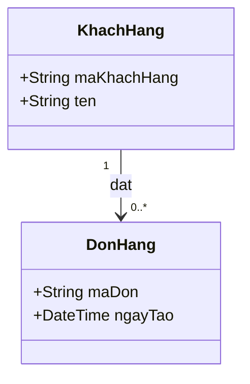

# Lớp và thuộc tính

Trong thiết kế ngôn ngữ chuyên biệt miền (Domain-Specific Language, DSL), mô hình trừu tượng mô tả những khái niệm mà chương trình DSL có thể biểu diễn và cách các khái niệm đó liên kết với nhau. Hai thành phần nền tảng của mô hình này là **lớp (class)** và **thuộc tính (attribute)**. Lớp định nghĩa một loại khái niệm hoặc cấu trúc; thuộc tính mô tả dữ liệu đặc trưng của một phần tử thuộc lớp đó.

Ví dụ, một DSL dùng để mô tả quy trình xử lý đơn hàng có thể có lớp `DonHang` với các thuộc tính `maDon`, `ngayTao` và `tongTien`. Mỗi đơn hàng cụ thể là một đối tượng (object) hoặc một phần tử mô hình thuộc lớp `DonHang`. Một lớp khác như `DongHang` có thể có thuộc tính `soLuong` và `donGia`.

Lớp và thuộc tính giúp chuyển những khái niệm trong miền thành một cấu trúc dữ liệu có kiểu, có tên và có quy tắc. Chúng cũng là cơ sở để xây dựng cây cú pháp trừu tượng (Abstract Syntax Tree, AST), kiểm tra ngữ nghĩa, sinh mã, hiển thị mô hình và hỗ trợ công cụ biên tập DSL. Nếu lớp hoặc thuộc tính được thiết kế sai, chương trình DSL có thể vẫn phân tích cú pháp thành công nhưng biểu diễn sai ý nghĩa miền.

## 1. Lớp trong mô hình trừu tượng

**Lớp** là mô tả chung cho một nhóm phần tử có cùng loại đặc điểm và cấu trúc. Lớp quy định một phần tử thuộc loại đó có những thuộc tính nào, có thể liên kết với những phần tử nào và phải tuân theo những ràng buộc gì.

Trong mô hình trừu tượng của DSL, lớp thường đại diện cho một khái niệm miền hoặc một cấu trúc ngôn ngữ. Ví dụ:

- `DonHang` biểu diễn một đơn hàng trong miền thương mại.
- `QuyTacGia` biểu diễn một quy tắc định giá.
- `DieuKien` biểu diễn một điều kiện trong chương trình DSL.
- `PhepSoSanh` biểu diễn một biểu thức so sánh trong AST.
- `TaiNguyen` biểu diễn một tài nguyên được khai báo trong DSL hạ tầng.

Lớp không phải là một đơn hàng cụ thể. Nó là khuôn mô tả cấu trúc mà các đơn hàng cụ thể phải tuân theo.

### 1.1. Lớp và đối tượng

**Đối tượng (object)** là một phần tử cụ thể được tạo theo định nghĩa của lớp. Nếu `DonHang` là lớp, `DH102` có thể là một đối tượng thuộc lớp đó.

| Khái niệm | Ví dụ | Vai trò |
|---|---|---|
| Lớp | `DonHang` | Định nghĩa loại phần tử |
| Đối tượng | Đơn hàng có mã `DH102` | Một phần tử cụ thể của lớp |
| Thuộc tính | `tongTien` | Đặc điểm được lớp khai báo |
| Giá trị thuộc tính | `650000 VND` | Giá trị cụ thể của một đối tượng |

Có thể hình dung:

```text
Lớp DonHang
  - maDon: String
  - ngayTao: DateTime
  - tongTien: Money

Đối tượng DH102 : DonHang
  - maDon = "DH102"
  - ngayTao = 2026-11-15T09:00:00
  - tongTien = 650000 VND
```

Lớp định nghĩa cấu trúc; đối tượng cung cấp giá trị cho cấu trúc đó. Một lớp có thể có nhiều đối tượng, và nhiều đối tượng cùng lớp có cùng tập thuộc tính nhưng mang giá trị khác nhau.

### 1.2. Lớp trong mô hình miền và lớp trong AST

Trong một dự án DSL, từ “lớp” có thể được dùng ở hai tầng khác nhau:

| Tầng | Lớp đại diện cho | Ví dụ |
|---|---|---|
| Mô hình miền | Khái niệm nghiệp vụ hoặc kỹ thuật | `DonHang`, `KhachHang`, `TuyenGiao` |
| Mô hình cú pháp trừu tượng | Cấu trúc của chương trình DSL | `PolicyDeclaration`, `BinaryExpression`, `AttributeAccess` |

Hai tầng có thể liên hệ nhưng không nhất thiết trùng nhau. Một lớp AST như `PolicyDeclaration` có thể chứa tham chiếu đến một đối tượng miền `DonHang`, hoặc chỉ chứa tên và biểu thức cần được liên kết về sau. Không nên coi mọi lớp trong mã parser là lớp miền.

Ví dụ, câu DSL:

```text
don_hang DH102 {
    tong_tien = 650000 VND
}
```

có thể được parser biểu diễn bằng lớp AST `EntityDeclaration` và `PropertyAssignment`. Sau bước kiểm tra ngữ nghĩa, các phần tử đó có thể được ánh xạ thành đối tượng miền `DonHang` cùng giá trị `tongTien`.

## 2. Vai trò của lớp trong DSL

Lớp giúp tổ chức mô hình trừu tượng thành các loại phần tử có ý nghĩa. Mỗi lớp là một khái niệm có ranh giới, tên gọi và trách nhiệm.

### 2.1. Biểu diễn khái niệm miền

Khi chuyên gia miền nói về đơn hàng, khách hàng, khoản thanh toán và kiện hàng như những đối tượng riêng, mô hình có thể tạo các lớp tương ứng. Điều này giúp giữ cách phân loại mà người dùng đã quen thuộc.

Không phải mọi danh từ đều cần trở thành lớp. Một từ có thể chỉ là thuộc tính, giá trị, vai trò hoặc trạng thái. Ví dụ, `trangThai` thường là thuộc tính của `DonHang`, còn `DaThanhToan` có thể là một giá trị của kiểu liệt kê `TrangThaiDonHang`.

### 2.2. Biểu diễn cấu trúc chương trình

Với DSL văn bản, lớp còn biểu diễn các cấu trúc cú pháp sau khi parser phân tích. Ví dụ:

- `LiteralExpression` biểu diễn hằng số.
- `VariableReference` biểu diễn tham chiếu biến.
- `BinaryExpression` biểu diễn biểu thức có toán tử hai ngôi.
- `IfStatement` biểu diễn câu lệnh điều kiện.
- `ResourceDeclaration` biểu diễn khai báo tài nguyên.

Những lớp này tạo thành AST. Compiler hoặc validator có thể duyệt AST theo loại lớp để kiểm tra hoặc chuyển đổi.

### 2.3. Xác định ranh giới và tính hợp lệ

Lớp quy định loại dữ liệu mà một phần tử có thể mang. Nếu `KhoiLuong` là kiểu đại lượng, lớp `KienHang` có thể có thuộc tính `khoiLuong: KhoiLuong`. Một giá trị ngày giờ không nên được gán vào thuộc tính này.

Lớp cũng có thể mang các ràng buộc như thuộc tính bắt buộc, số lượng phần tử tối thiểu, phạm vi giá trị hoặc quan hệ hợp lệ với lớp khác.

## 3. Thuộc tính là gì?

**Thuộc tính (attribute)** là đặc điểm có tên được khai báo trong một lớp. Mỗi thuộc tính có thể có kiểu dữ liệu, giá trị mặc định, tính bắt buộc, giới hạn số lượng và các ràng buộc khác.

Ví dụ, lớp `KienHang` có thể khai báo:

```text
class KienHang {
    maKien: String
    khoiLuong: Weight
    chieuDai: Length
    daDongGoi: Boolean
}
```

`maKien`, `khoiLuong`, `chieuDai` và `daDongGoi` là các thuộc tính. Chúng cho biết một kiện hàng có mã nào, nặng bao nhiêu, dài bao nhiêu và đã đóng gói hay chưa.

### 3.1. Tên thuộc tính

Tên thuộc tính nên phản ánh ý nghĩa miền, ngắn gọn và nhất quán. Ví dụ `ngayTao`, `tongTien`, `trangThai` thường dễ hiểu hơn những tên phụ thuộc vào cách lưu trữ như `col_03` hoặc `field_x`.

Một quy ước đặt tên cần trả lời:

- Dùng tiếng Việt, tiếng Anh hay kết hợp?
- Dùng camelCase, snake_case hay một quy tắc khác?
- Có phân biệt chữ hoa và chữ thường không?
- Tên có thể chứa dấu tiếng Việt hoặc ký tự Unicode không?
- Từ khóa dành riêng có được dùng làm tên thuộc tính không?
- Có cho phép bí danh hoặc tên cũ khi di trú mô hình không?

Tên thuộc tính trong mô hình nội bộ không nhất thiết phải giống hệt cách viết trong DSL. Một parser có thể ánh xạ tên `tong_tien` trong mã nguồn sang thuộc tính nội bộ `totalAmount`. Tuy nhiên, ánh xạ phải ổn định và có thể truy xuất để thông báo lỗi đúng vị trí.

### 3.2. Giá trị thuộc tính

Giá trị thuộc tính là dữ liệu cụ thể gắn với một đối tượng. Ví dụ, `tongTien` có kiểu `Money`, còn giá trị của nó ở một đơn hàng cụ thể là `650000 VND`.

Một thuộc tính có thể:

- Có giá trị ngay khi đối tượng được tạo.
- Được cung cấp trong chương trình DSL.
- Được suy ra từ thuộc tính hoặc quan hệ khác.
- Được nạp từ dữ liệu của ứng dụng chủ.
- Chưa có giá trị hoặc không áp dụng trong một trạng thái nhất định.

Đặc tả cần nói rõ thuộc tính nào được phép thiếu và cách phân biệt giá trị chưa biết với giá trị mặc định.

### 3.3. Thuộc tính dữ liệu và tham chiếu

Trong nhiều mô hình, cần phân biệt thuộc tính chứa một giá trị đơn giản với tham chiếu đến đối tượng khác.

Ví dụ:

```text
class DonHang {
    maDon: String                 // thuộc tính dữ liệu
    tongTien: Money               // thuộc tính dữ liệu
    khachHang: KhachHang          // tham chiếu đến đối tượng khác
}
```

Trong một số công nghệ mô hình hóa, `maDon` và `tongTien` được xem là thuộc tính dữ liệu (`EAttribute`), còn `khachHang` là tham chiếu (`EReference`). Trong UML, phần tử thứ ba thường được biểu diễn bằng association hoặc property có kiểu là lớp khác. Cách đặt tên và cơ chế cụ thể phụ thuộc metamodel.

## 4. Kiểu dữ liệu của thuộc tính

Kiểu dữ liệu xác định loại giá trị mà thuộc tính chấp nhận và các phép toán có thể áp dụng.

### 4.1. Các kiểu dữ liệu nguyên thủy

Các kiểu cơ bản thường gặp gồm:

| Kiểu | Ví dụ giá trị | Công dụng |
|---|---|---|
| `String` | `"DH102"` | Mã, tên và văn bản |
| `Integer` | `12` | Số nguyên |
| `Decimal` | `19.95` | Số thập phân |
| `Boolean` | `true`, `false` | Giá trị đúng/sai |
| `Date` | `2026-11-15` | Ngày lịch |
| `DateTime` | `2026-11-15T09:00:00Z` | Thời điểm |
| `Duration` | `30 min` | Khoảng thời gian |
| `Binary` | Dữ liệu byte | Nội dung nhị phân |

Không phải mọi DSL đều cần tất cả kiểu trên. Chỉ nên đưa kiểu vào mô hình khi chúng có ý nghĩa đối với miền hoặc cấu trúc ngôn ngữ.

### 4.2. Kiểu miền chuyên biệt

Kiểu miền biểu diễn những đại lượng hoặc khái niệm có quy tắc riêng, ví dụ:

- `Money`: số tiền kèm mã tiền tệ.
- `Distance`: khoảng cách kèm đơn vị.
- `Weight`: khối lượng.
- `Percentage`: tỷ lệ phần trăm.
- `EmailAddress`: địa chỉ email đã được chuẩn hóa hoặc kiểm tra.
- `OrderId`: định danh đơn hàng.
- `GeoPoint`: tọa độ địa lý.

Kiểu miền giúp ngăn việc gán nhầm dữ liệu chỉ vì chúng cùng được lưu dưới dạng chuỗi hoặc số. Ví dụ `OrderId` và `CustomerId` đều có thể có dạng văn bản, nhưng chúng đại diện cho hai loại định danh khác nhau.

### 4.3. Kiểu liệt kê

Kiểu liệt kê (enumeration, enum) xác định một tập giá trị hữu hạn và có tên.

```text
enum TrangThaiDonHang {
    MOI_TAO
    DA_XAC_NHAN
    DANG_GIAO
    DA_GIAO
    DA_HUY
}

class DonHang {
    trangThai: TrangThaiDonHang
}
```

Enum phù hợp với thuộc tính có các lựa chọn xác định như trạng thái, loại giao hàng hoặc mức ưu tiên. Nếu danh sách giá trị thay đổi thường xuyên hoặc do người dùng tự cấu hình, có thể cần mô hình đối tượng tham chiếu thay vì enum cố định.

### 4.4. Kiểu phức hợp và kiểu dữ liệu do người dùng định nghĩa

Một lớp có thể chứa thuộc tính có kiểu là lớp khác hoặc một kiểu phức hợp. Ví dụ `DiaChi` có thể gồm `soNha`, `duong`, `quan` và `maBuuChinh`. Nếu địa chỉ được dùng như một giá trị không có danh tính riêng, mô hình có thể xem nó là value object hoặc datatype phức hợp.

Không nên tạo lớp cho mọi nhóm trường chỉ để gom dữ liệu. Hãy xem nhóm đó có danh tính, vòng đời, quan hệ và quy tắc độc lập hay không.

## 5. Thuộc tính bắt buộc, tùy chọn và số lượng

Ngoài kiểu, một thuộc tính còn có giới hạn về số lượng giá trị mà nó có thể nhận.

### 5.1. Thuộc tính bắt buộc

Thuộc tính bắt buộc phải có giá trị trong mọi đối tượng hợp lệ hoặc trong một giai đoạn cụ thể của vòng đời.

Ví dụ, `maDon` có thể bắt buộc khi tạo đơn hàng. `ngayGiao` có thể chưa bắt buộc khi đơn mới được tạo, nhưng phải có khi trạng thái chuyển sang `DA_GIAO`.

Điều này cho thấy tính bắt buộc có thể phụ thuộc trạng thái hoặc điều kiện, không chỉ là một cờ đơn giản ở lớp.

### 5.2. Thuộc tính tùy chọn

Thuộc tính tùy chọn có thể không có giá trị. Ví dụ, `ghiChu` có thể để trống; `maVanDon` chỉ xuất hiện sau khi đơn được bàn giao.

Trong mô hình, có thể biểu diễn thuộc tính tùy chọn bằng kiểu optional, giá trị null được phép hoặc bội số tối thiểu bằng 0. Cần quy định cách phân biệt:

- Thuộc tính chưa được cung cấp.
- Thuộc tính được cung cấp nhưng có giá trị rỗng.
- Thuộc tính không áp dụng.
- Thuộc tính chưa thể xác định.

Các trạng thái này có thể có ý nghĩa nghiệp vụ khác nhau.

### 5.3. Bội số (multiplicity)

Bội số quy định số lượng giá trị hoặc phần tử mà một thuộc tính hay tham chiếu có thể có.

| Bội số | Ý nghĩa | Ví dụ |
|---|---|---|
| `1` | Chính xác một | `maDon` |
| `0..1` | Không hoặc một | `ghiChu` |
| `0..*` | Không hoặc nhiều | `nhan` |
| `1..*` | Ít nhất một | `dongHang` |
| `2..5` | Từ hai đến năm | `nguoiPheDuyet` trong quy trình cụ thể |

Ví dụ:

```text
class DonHang {
    maDon: String [1]
    ghiChu: String [0..1]
    dongHang: DongHang [1..*]
    nhan: String [0..*]
}
```

Ký hiệu trong ví dụ là một cách viết minh họa. UML, Ecore hoặc DSL mô hình hóa khác có thể dùng cú pháp riêng để biểu diễn multiplicity.

### 5.4. Bội số của thuộc tính và bội số của quan hệ

Một thuộc tính nhiều giá trị và một quan hệ một-nhiều có thể trông giống nhau nhưng không nhất thiết mang cùng ý nghĩa.

Ví dụ `nhan: String [0..*]` là danh sách chuỗi. `dongHang: DongHang [1..*]` là nhiều phần tử thuộc lớp `DongHang`, tức quan hệ giữa các đối tượng. Trong metamodel, quan hệ thường cần thêm thông tin như containment, thứ tự, tính duy nhất và vòng đời.

## 6. Giá trị mặc định và khởi tạo thuộc tính

Giá trị mặc định là giá trị được sử dụng khi thuộc tính không được cung cấp theo cách mà mô hình cho phép.

Ví dụ:

```text
class CauHinhGiaoHang {
    choPhepGiaoCuoiTuan: Boolean = false
    soLanThuLai: Integer = 3
    donViTien: Currency = VND
}
```

Giá trị mặc định giúp chương trình DSL ngắn gọn và có hành vi nhất quán. Tuy nhiên, cần phân biệt giá trị mặc định với giá trị bắt buộc và giá trị do hệ thống tự suy ra.

### 6.1. Khi nào nên có mặc định?

Giá trị mặc định phù hợp khi:

- Có một giá trị chuẩn được cộng đồng miền chấp nhận.
- Giá trị không làm thay đổi ý nghĩa theo ngữ cảnh bất ngờ.
- Người dùng có thể dự đoán kết quả khi bỏ qua thuộc tính.
- Giá trị mặc định có thể được tài liệu hóa và phiên bản hóa.

Không nên tự đặt mặc định cho thuộc tính có tác động lớn như mức phí, quyền truy cập hoặc thời hạn pháp lý nếu miền chưa xác nhận.

### 6.2. Thời điểm áp dụng mặc định

Mặc định có thể được áp dụng khi parse, khi tạo đối tượng mô hình, khi kiểm tra ngữ nghĩa hoặc khi runtime thực thi. Cần chọn một thời điểm rõ ràng để tránh hai thành phần áp dụng giá trị khác nhau.

Nếu mặc định phụ thuộc môi trường, tenant hoặc thời điểm, nên cung cấp qua cấu hình hoặc dịch vụ miền thay vì nhúng vào metamodel tĩnh.

## 7. Thuộc tính dẫn xuất và thuộc tính tính toán

Một số thuộc tính không được người dùng nhập trực tiếp mà được tính từ thuộc tính khác.

Ví dụ:

```text
class DongHang {
    soLuong: Integer
    donGia: Money
    thanhTien: Money derived = soLuong * donGia
}
```

`thanhTien` là thuộc tính dẫn xuất từ `soLuong` và `donGia`.

### 7.1. Thuộc tính lưu trữ và thuộc tính dẫn xuất

| Loại | Đặc điểm | Ví dụ |
|---|---|---|
| Thuộc tính lưu trữ | Có giá trị được nhập hoặc nạp từ dữ liệu | `soLuong`, `donGia` |
| Thuộc tính dẫn xuất | Được tính từ thuộc tính hoặc quan hệ khác | `thanhTien` |
| Thuộc tính suy luận | Được xác định bằng quy tắc hoặc truy vấn | `duDieuKienMienPhi` |

### 7.2. Đồng bộ và tính nhất quán

Nếu thuộc tính dẫn xuất được lưu lại để tối ưu, cần có cơ chế cập nhật khi dữ liệu nguồn thay đổi. Nếu không, giá trị có thể lỗi thời.

Với thuộc tính thuần tính toán, có thể tính lại khi truy cập. Tuy nhiên, cần cân nhắc chi phí tính toán và khả năng dữ liệu nguồn thay đổi trong lúc đánh giá.

### 7.3. Phụ thuộc vòng

Không nên để thuộc tính dẫn xuất phụ thuộc vòng lẫn nhau nếu không có cơ chế giải quyết rõ ràng.

Ví dụ, `tongTien` phụ thuộc `thanhTien`, trong khi `thanhTien` lại phụ thuộc `tongTien` sẽ tạo vòng tính toán. Validator có thể phát hiện đồ thị phụ thuộc có chu trình và báo lỗi.

## 8. Thuộc tính và quan hệ giữa các lớp

Lớp thường liên kết với lớp khác. Cần phân biệt một giá trị đơn giản được lưu trong thuộc tính với một quan hệ tham chiếu đến đối tượng.

### 8.1. Thuộc tính dữ liệu

Thuộc tính dữ liệu có kiểu nguyên thủy hoặc kiểu giá trị như `String`, `Integer`, `Money`, `DateTime`. Nó lưu dữ liệu trực tiếp của đối tượng.

### 8.2. Tham chiếu đến lớp khác

Tham chiếu biểu diễn quan hệ giữa các đối tượng. Ví dụ một đơn hàng thuộc về một khách hàng:

```text
class DonHang {
    maDon: String
    khachHang: KhachHang [1]
}

class KhachHang {
    maKhachHang: String
    ten: String
}
```

`khachHang` không chỉ là một chuỗi chứa tên khách hàng; nó là tham chiếu đến một đối tượng `KhachHang`. Điều này cho phép mô hình truy cập các thuộc tính của khách hàng và kiểm tra tính nhất quán của quan hệ.

### 8.3. Association

Trong UML, association mô tả quan hệ cấu trúc giữa các lớp. Association có thể có tên, vai trò ở mỗi đầu, bội số và hướng điều hướng.

Ví dụ, một `DonHang` có một `KhachHang`, còn một `KhachHang` có thể có nhiều `DonHang`:



Sơ đồ cho biết mỗi đơn hàng gắn với một khách hàng, còn một khách hàng có thể có không hoặc nhiều đơn hàng. Nếu miền cho phép đơn hàng chưa gắn khách hàng trong một trạng thái đặc biệt, bội số cần phản ánh đúng quy tắc đó.

### 8.4. Composition và containment

Composition biểu diễn quan hệ toàn thể-bộ phận có vòng đời phụ thuộc. Ví dụ `DonHang` chứa các `DongHang`; khi đơn hàng bị xóa khỏi mô hình, các dòng hàng thuộc nó thường cũng không còn tồn tại độc lập trong mô hình đó.

Trong AST, containment thường được dùng để biểu diễn cây cú pháp: một `IfStatement` chứa điều kiện, khối lệnh đúng và khối lệnh sai. Mỗi node con thuộc về một vị trí trong cây.

Không phải mọi quan hệ một-nhiều đều là composition. Một `KhachHang` có nhiều `DonHang`, nhưng đơn hàng có vòng đời nghiệp vụ riêng và không nên bị xem là phần dữ liệu bị xóa cùng khách hàng theo nghĩa composition.

### 8.5. Quan hệ một chiều và hai chiều

Một quan hệ một chiều chỉ cho phép truy cập từ một đầu, ví dụ `DonHang.khachHang`. Quan hệ hai chiều cho phép truy cập ngược từ `KhachHang.donHangs`.

Quan hệ hai chiều tiện cho truy vấn nhưng cần giữ đồng bộ hai đầu. Nếu thay đổi một đầu mà không cập nhật đầu kia, mô hình có thể không nhất quán. Chỉ nên tạo quan hệ hai chiều khi các thao tác miền thực sự cần nó.

## 9. Lớp trừu tượng, lớp cụ thể và kế thừa

Một mô hình có thể có các lớp tổng quát và lớp chuyên biệt.

### 9.1. Lớp cụ thể

Lớp cụ thể có thể được dùng để tạo đối tượng. Ví dụ `DonHang`, `KhachHang` hoặc `KienHang`.

### 9.2. Lớp trừu tượng

Lớp trừu tượng mô tả đặc điểm chung nhưng không được tạo đối tượng trực tiếp. Ví dụ:

```text
abstract class DoiTuongCoDinhDanh {
    id: String [1]
}

class DonHang extends DoiTuongCoDinhDanh {
    tongTien: Money
}

class KhachHang extends DoiTuongCoDinhDanh {
    ten: String
}
```

`DoiTuongCoDinhDanh` gom thuộc tính `id` dùng chung. `DonHang` và `KhachHang` kế thừa thuộc tính đó nhưng bổ sung dữ liệu riêng.

### 9.3. Kế thừa

Kế thừa (inheritance) cho phép lớp con nhận các thuộc tính và quan hệ của lớp cha. Nó phù hợp khi lớp con thực sự là một dạng chuyên biệt của lớp cha và tuân theo hợp đồng chung.

Ví dụ, `ChuyenKhoan` và `TienMat` có thể là hai dạng của `PhuongThucThanhToan` nếu chúng chia sẻ một tập thuộc tính và hành vi chung.

Không nên dùng kế thừa chỉ để tránh lặp vài thuộc tính. Nếu hai khái niệm chỉ tình cờ có cùng trường dữ liệu nhưng có vòng đời hoặc ngữ nghĩa khác nhau, có thể dùng value object, composition hoặc interface.

### 9.4. Kế thừa đơn và đa kế thừa

Kế thừa đơn cho phép một lớp có một lớp cha trực tiếp. Đa kế thừa cho phép nhiều lớp cha. Đa kế thừa có thể gây xung đột nếu các lớp cha định nghĩa thuộc tính cùng tên hoặc quy tắc khác nhau.

Một metamodel có thể giới hạn kế thừa đơn để đơn giản hóa. Nếu cần chia sẻ khả năng mà không tạo quan hệ phân loại, interface hoặc trait có thể phù hợp hơn.

### 9.5. Kế thừa và đa hình

Đa hình cho phép xử lý nhiều lớp con thông qua kiểu cha hoặc interface chung. Ví dụ, một danh sách `PhuongThucThanhToan` có thể chứa cả `TienMat` và `ChuyenKhoan`.

Trong DSL, đa hình có thể giúp định nghĩa một quy tắc chung cho nhiều loại phần tử. Tuy nhiên, cần xác định cách chọn thuộc tính hoặc thao tác phù hợp với lớp cụ thể khi chạy.

## 10. Lớp và thuộc tính trong AST

Với DSL văn bản, parser thường tạo AST. AST là mô hình trừu tượng của chương trình, trong đó các lớp biểu diễn các loại node và thuộc tính chứa thông tin cần thiết.

### 10.1. Ví dụ AST cho biểu thức

Xét biểu thức:

```text
tong_tien >= 500000 VND
```

AST có thể được mô hình hóa như sau:

```text
abstract class Expression

class BinaryExpression extends Expression {
    left: Expression
    operator: ComparisonOperator
    right: Expression
}

class VariableReference extends Expression {
    name: String
}

class MoneyLiteral extends Expression {
    amount: Decimal
    currency: CurrencyCode
}
```

Đối tượng AST tương ứng có thể là:

```text
BinaryExpression
  left = VariableReference(name = "tong_tien")
  operator = GREATER_OR_EQUAL
  right = MoneyLiteral(amount = 500000, currency = VND)
```

`BinaryExpression` có hai tham chiếu `left` và `right` đến các node biểu thức, cùng thuộc tính `operator`. `VariableReference` lưu tên biến. `MoneyLiteral` lưu số tiền và mã tiền tệ.

### 10.2. Thuộc tính nguồn (source location)

Node AST thường cần giữ vị trí nguồn như số dòng, cột hoặc khoảng ký tự trong tệp DSL. Thông tin này có thể được mô hình hóa bằng thuộc tính chung hoặc một đối tượng `SourceSpan`.

Ví dụ, khi kiểu của `tong_tien` không phù hợp với phép so sánh, compiler có thể trỏ lỗi về đúng biểu thức người dùng đã viết.

Thông tin vị trí nguồn thường phục vụ công cụ phát triển hơn là ngữ nghĩa miền. Có thể tách nó thành metadata để không làm lẫn dữ liệu nghiệp vụ với thông tin biên tập.

### 10.3. AST không nhất thiết giữ nguyên cú pháp cụ thể

Hai cách viết khác nhau có thể tạo cùng một cấu trúc AST nếu chúng biểu đạt cùng ý nghĩa. Ví dụ DSL cho phép cả `a AND b` và `AND(a, b)` thì cả hai có thể tạo `LogicalExpression` giống nhau.

Ngược lại, những chi tiết cần phục vụ formatter hoặc công cụ refactoring như dấu ngoặc, comment và khoảng trắng có thể cần được giữ trong concrete syntax tree (CST) hoặc token stream, không nhất thiết nằm trong AST thuần.

## 11. Mô hình lớp và metamodel

**Metamodel** là mô hình mô tả cấu trúc của một loại mô hình khác. Trong DSL, metamodel thường định nghĩa các lớp, thuộc tính, quan hệ và ràng buộc mà mô hình DSL hợp lệ phải tuân theo.

Ví dụ, metamodel của DSL chính sách có thể định nghĩa:

```text
class Policy {
    name: String [1]
    rules: Rule [0..*]
}

abstract class Rule {
    id: String [1]
}

class ThresholdRule extends Rule {
    field: AttributeReference [1]
    operator: ComparisonOperator [1]
    threshold: Value [1]
}
```

Một mô hình chính sách cụ thể là instance của metamodel này. Cần phân biệt:

- **Metamodel:** Định nghĩa `Policy`, `Rule`, `ThresholdRule` và các thuộc tính.
- **Model:** Một chính sách cụ thể có tên và danh sách quy tắc.
- **Runtime data:** Dữ liệu đơn hàng hoặc khách hàng mà chính sách được đánh giá trên đó.

### 11.1. Meta-level và model-level

Có thể hình dung các tầng:

```text
Metamodel
  định nghĩa các lớp và quan hệ
       |
       v
Model
  tạo các đối tượng theo metamodel
       |
       v
Runtime data / Execution
  cung cấp dữ liệu và thực thi mô hình
```

Một lớp `Policy` thuộc metamodel; một đối tượng `giao_hang_tieu_chuan` thuộc model; một đơn hàng `DH102` là dữ liệu được đưa vào khi đánh giá chính sách. Trong một số kiến trúc, dữ liệu runtime cũng là model theo metamodel riêng, nhưng cần nêu rõ tầng đang nói đến.

### 11.2. Metamodel không phải database schema

Metamodel mô tả khái niệm và cấu trúc mô hình. Database schema mô tả cách dữ liệu được lưu trữ. Chúng có thể được ánh xạ nhưng không nhất thiết giống nhau.

Ví dụ một lớp `DonHang` có thể được lưu trong nhiều bảng; một thuộc tính phức hợp `DiaChi` có thể được lưu trong cùng bảng hoặc bảng riêng. Thiết kế metamodel nên bắt đầu từ ngữ nghĩa miền và nhu cầu ngôn ngữ, sau đó mới quyết định ánh xạ lưu trữ.

## 12. Ràng buộc trên lớp và thuộc tính

Khai báo lớp và thuộc tính mới chỉ xác định cấu trúc. Một mô hình hợp lệ còn cần tuân thủ các ràng buộc.

### 12.1. Ràng buộc kiểu

Giá trị gán cho thuộc tính phải tương thích với kiểu đã khai báo. Ví dụ `tongTien: Money` không nhận chuỗi tùy ý nếu không có quy tắc chuyển đổi.

### 12.2. Ràng buộc bắt buộc và bội số

Nếu `maDon` có bội số `1`, mọi đối tượng `DonHang` hợp lệ phải có đúng một mã. Nếu `dongHang` có bội số `1..*`, đơn hàng phải có ít nhất một dòng hàng.

### 12.3. Ràng buộc miền giá trị

Một thuộc tính có thể có giới hạn:

```text
class KienHang {
    khoiLuong: Weight [1]
        where khoiLuong > 0 kg
}
```

Ví dụ này minh họa rằng khối lượng phải dương. Cú pháp `where` không phải cú pháp chuẩn bắt buộc; cách biểu diễn phụ thuộc ngôn ngữ mô hình hóa.

### 12.4. Ràng buộc duy nhất

Một thuộc tính có thể cần duy nhất trong phạm vi lớp hoặc một tập đối tượng. Ví dụ `maDon` không được trùng giữa các đơn hàng trong cùng hệ thống.

Ràng buộc duy nhất có thể cần kiểm tra trên toàn mô hình hoặc trong kho dữ liệu, không chỉ trên một đối tượng riêng lẻ.

### 12.5. Ràng buộc liên thuộc tính

Một quy tắc có thể liên quan nhiều thuộc tính:

```text
class KhoangThoiGian {
    batDau: DateTime [1]
    ketThuc: DateTime [1]

    invariant ketThuc > batDau
}
```

Ràng buộc `ketThuc > batDau` chỉ hợp lệ khi hai thuộc tính đều có giá trị và cùng hệ quy chiếu thời gian.

### 12.6. Ràng buộc phụ thuộc trạng thái

Một thuộc tính có thể bắt buộc ở trạng thái này nhưng tùy chọn ở trạng thái khác. Ví dụ `maVanDon` chỉ bắt buộc khi đơn hàng ở trạng thái `DANG_GIAO` hoặc `DA_GIAO`.

Những quy tắc này thường thuộc validation hoặc ngữ nghĩa miền, không phải chỉ là multiplicity tĩnh của thuộc tính.

## 13. Thuộc tính tĩnh, thuộc tính đối tượng và metadata

Một số mô hình cần phân biệt dữ liệu thuộc về từng đối tượng với dữ liệu dùng chung cho toàn lớp.

### 13.1. Thuộc tính đối tượng

Mỗi đối tượng có giá trị riêng. Ví dụ `maDon` hoặc `tongTien` của từng đơn hàng.

### 13.2. Thuộc tính lớp hoặc thuộc tính tĩnh

Thuộc tính tĩnh thuộc về lớp và được chia sẻ giữa các đối tượng, ví dụ một hằng số hoặc cấu hình chung. Trong mô hình miền, loại dữ liệu này cần được dùng thận trọng vì cấu hình toàn cục có thể phụ thuộc tenant hoặc môi trường.

### 13.3. Metadata

Metadata mô tả chính lớp, thuộc tính hoặc mô hình thay vì dữ liệu nghiệp vụ. Ví dụ:

- Nhãn hiển thị trong editor.
- Mô tả trợ giúp.
- Thứ tự hiển thị thuộc tính.
- Nhóm trong giao diện.
- Đơn vị hiển thị.
- Quy tắc ẩn hoặc chỉ đọc trong một chế độ biên tập.

Metadata có thể được gắn bằng annotation, tag hoặc mô hình riêng. Nên tách metadata giao diện khỏi ngữ nghĩa cốt lõi để thay đổi giao diện không làm thay đổi ý nghĩa chương trình DSL.

## 14. Lớp và thuộc tính trong UML và Ecore

UML và Ecore là hai cách mô hình hóa thường gặp trong hệ sinh thái kỹ nghệ mô hình.

### 14.1. Biểu đồ lớp UML

UML class diagram biểu diễn lớp, thuộc tính, phương thức và quan hệ. Một lớp thường được vẽ thành hình chữ nhật có ngăn tên, thuộc tính và thao tác.

Ví dụ:

```text
+------------------------------+
| DonHang                      |
+------------------------------+
| - maDon: String              |
| - ngayTao: DateTime          |
| - tongTien: Money            |
+------------------------------+
| + tinhTongTien(): Money      |
+------------------------------+
```

Ký hiệu `-` thường biểu thị private và `+` biểu thị public trong UML. DSL không nhất thiết phải sử dụng mức truy cập theo mô hình hướng đối tượng; chỉ nên đưa visibility vào metamodel nếu nó có ý nghĩa đối với người dùng hoặc công cụ.

### 14.2. Ecore

Ecore là metamodel cốt lõi của Eclipse Modeling Framework (EMF). Trong Ecore:

- `EClass` mô tả một lớp mô hình.
- `EAttribute` mô tả thuộc tính dữ liệu có kiểu.
- `EReference` mô tả tham chiếu giữa các đối tượng.
- `EDataType` mô tả kiểu dữ liệu.
- `EEnum` mô tả kiểu liệt kê.
- `EPackage` gom các thành phần mô hình trong một namespace và không gian tên.

Ví dụ khái niệm: `DonHang` là `EClass`; `maDon: EString` và `tongTien: EDecimal` là `EAttribute`; `khachHang: KhachHang` là `EReference` đến lớp khác.

Ecore còn hỗ trợ multiplicity, containment, tính duy nhất, thứ tự và metadata. Những khả năng này hữu ích khi xây dựng editor mô hình, validator hoặc sinh mã từ metamodel.

### 14.3. Khi nào dùng UML hoặc Ecore?

UML phù hợp để trao đổi thiết kế và mô tả cấu trúc ở mức khái niệm. Ecore cung cấp mô hình máy có thể dùng trực tiếp trong EMF để sinh lớp Java, parser hoặc editor theo công cụ tương ứng.

Không bắt buộc DSL phải dùng UML hoặc Ecore. Có thể định nghĩa metamodel bằng schema, lớp Java, kiểu dữ liệu trong ngôn ngữ chủ hoặc một định dạng riêng. Điều quan trọng là mô hình có hợp đồng rõ và có thể kiểm tra.

## 15. Ánh xạ lớp và thuộc tính từ DSL văn bản

DSL văn bản thường có một bước ánh xạ từ cú pháp cụ thể sang mô hình trừu tượng.

### 15.1. Ví dụ khai báo

Giả sử người dùng viết:

```text
don_hang DH102 {
    ngay_tao = 2026-11-15
    tong_tien = 650000 VND
    trang_thai = DA_XAC_NHAN
}
```

Parser có thể tạo AST với một node khai báo, tên định danh và các phép gán thuộc tính. Bước ngữ nghĩa tìm lớp `DonHang`, xác minh các thuộc tính được phép và chuyển giá trị về kiểu tương ứng.

### 15.2. Ánh xạ tên

Tên trong DSL có thể khác tên trong metamodel:

| Tên trong DSL | Thuộc tính mô hình | Kiểu |
|---|---|---|
| `ngay_tao` | `DonHang.createdAt` | `Date` |
| `tong_tien` | `DonHang.totalAmount` | `Money` |
| `trang_thai` | `DonHang.status` | `TrangThaiDonHang` |

Ánh xạ cần được định nghĩa tường minh để parser, validator, serializer và editor cùng hiểu một cách.

### 15.3. Kiểm tra thuộc tính chưa biết

Nếu người dùng viết `tong_tienn` do gõ sai, validator nên báo thuộc tính không tồn tại và có thể gợi ý `tong_tien`. Không nên tự tạo thuộc tính mới một cách ngầm định trừ khi DSL được thiết kế theo kiểu mở.

### 15.4. Giá trị và chuyển đổi kiểu

Parser có thể nhận `650000 VND` thành literal tiền tệ. Validator kiểm tra kiểu thuộc tính `Money`, mã tiền tệ được hỗ trợ và quy tắc độ chính xác. Việc chuyển đổi cần giữ đơn vị thay vì chỉ lưu số `650000`.

## 16. Lớp và thuộc tính trong DSL nhúng và DSL độc lập

Lớp và thuộc tính có thể được định nghĩa hoặc hiện thực khác nhau tùy cách triển khai DSL.

### 16.1. DSL độc lập

DSL độc lập có metamodel riêng. Parser đọc văn bản và tạo đối tượng AST hoặc model theo các lớp đã định nghĩa. Nhóm phát triển kiểm soát tên, kiểu, bội số và quan hệ.

### 16.2. DSL nhúng

DSL nhúng sử dụng lớp và thuộc tính của ngôn ngữ chủ hoặc thư viện. Ví dụ một DSL Java có thể dùng object model gồm `Policy`, `Rule`, `Condition` và `AttributeReference`, được tạo qua API fluent.

Ngôn ngữ chủ cung cấp hệ thống lớp và kiểu, nhưng nhóm vẫn cần định nghĩa ngữ nghĩa miền và cách các đối tượng đó biểu diễn chương trình DSL.

### 16.3. Lớp trong mã nguồn không tự động là metamodel

Một lớp Java chỉ trở thành thành phần của metamodel khi nó được dùng và công bố như một phần của hợp đồng mô hình. Các lớp tiện ích, DTO vận chuyển dữ liệu hoặc lớp dịch vụ không nhất thiết là khái niệm trong mô hình trừu tượng.

Tách metamodel khỏi lớp triển khai giúp tránh để thay đổi framework hoặc cách lưu trữ làm thay đổi cấu trúc ngôn ngữ.

## 17. Quy trình thiết kế lớp và thuộc tính

Có thể xây dựng lớp và thuộc tính theo quy trình sau:

1. **Xác định khái niệm:** Tìm các đối tượng và cấu trúc mà người dùng cần biểu diễn trong miền.
2. **Xác định trách nhiệm lớp:** Mỗi lớp cần có định nghĩa, ranh giới và vai trò rõ.
3. **Liệt kê thuộc tính:** Ghi nhận đặc điểm dữ liệu mà người dùng cần đọc, khai báo hoặc kiểm tra.
4. **Chọn kiểu dữ liệu:** Dùng kiểu nguyên thủy, enum, datatype hoặc kiểu miền chuyên biệt.
5. **Định nghĩa multiplicity:** Xác định bắt buộc, tùy chọn và số lượng giá trị.
6. **Xác định mặc định:** Chỉ đặt giá trị mặc định khi có căn cứ miền.
7. **Mô hình hóa quan hệ:** Phân biệt thuộc tính dữ liệu, tham chiếu và composition.
8. **Xem xét kế thừa:** Chỉ tạo lớp cha khi có khái niệm chung thực sự.
9. **Định nghĩa ràng buộc:** Bổ sung giới hạn giá trị, tính duy nhất và invariant.
10. **Ánh xạ cú pháp DSL:** Quy định cách lớp và thuộc tính xuất hiện trong chương trình.
11. **Kiểm tra bằng ví dụ:** Dùng mô hình mẫu và trường hợp biên để xác nhận cấu trúc.
12. **Tài liệu hóa:** Ghi định nghĩa, kiểu, multiplicity, quan hệ và phiên bản.

Quy trình này có thể lặp lại khi phát hiện một khái niệm bị gộp quá rộng hoặc một thuộc tính thực chất là một lớp độc lập.

## 18. Những sai lầm thường gặp

### 18.1. Tạo lớp cho mọi danh từ

Không phải mọi danh từ đều là thực thể hoặc lớp. Một số từ chỉ trạng thái, giá trị, vai trò hoặc thuộc tính. Cần xác định vòng đời, danh tính và quan hệ trước khi tạo lớp.

### 18.2. Gom nhiều khái niệm vào một lớp quá lớn

Một lớp `ThongTin` chứa hàng chục thuộc tính từ nhiều lĩnh vực làm mô hình khó hiểu và khó kiểm tra. Nên tách theo trách nhiệm và khái niệm miền.

### 18.3. Dùng kiểu chuỗi cho mọi thuộc tính

Lưu tiền, ngày, trạng thái và định danh dưới dạng chuỗi làm mất khả năng kiểm tra kiểu và phép toán. Dùng kiểu chuyên biệt khi ý nghĩa miền yêu cầu.

### 18.4. Nhầm thuộc tính với quan hệ

Lưu tên khách hàng vào `DonHang.tenKhachHang` có thể không đủ nếu cần truy cập hồ sơ khách hàng hoặc bảo đảm tham chiếu. Khi đó, `khachHang` nên là tham chiếu đến lớp `KhachHang`.

### 18.5. Bội số không phản ánh quy tắc

Đặt mọi thuộc tính là tùy chọn khiến mô hình chấp nhận đối tượng thiếu dữ liệu bắt buộc. Đặt mọi thuộc tính là bắt buộc lại làm khó các trạng thái chưa hoàn tất. Cần xét vòng đời và điều kiện nghiệp vụ.

### 18.6. Dùng kế thừa chỉ để tái sử dụng trường

Hai lớp có cùng thuộc tính chưa chắc có quan hệ “là một dạng của”. Kế thừa sai làm mô hình cứng nhắc và tạo quan hệ khái niệm giả.

### 18.7. Đưa chi tiết lưu trữ vào mô hình trừu tượng

Tên cột, kiểu database hoặc cấu trúc bảng không nhất thiết là khái niệm miền. Metamodel nên biểu diễn ý nghĩa trước, ánh xạ lưu trữ sau.

### 18.8. Không quản lý metadata và phiên bản

Đổi tên thuộc tính hoặc thay kiểu có thể làm chương trình DSL cũ không còn hợp lệ. Cần quản lý thay đổi, bí danh và di trú mô hình.

## 19. Kiểm thử mô hình lớp và thuộc tính

Kiểm thử giúp xác nhận metamodel có thể biểu diễn các tình huống mà DSL cần hỗ trợ và từ chối cấu trúc không hợp lệ.

### 19.1. Kiểm thử cấu trúc

Kiểm tra lớp có đủ thuộc tính, quan hệ và kiểu dữ liệu cần thiết. Kiểm tra tên lớp và tên thuộc tính được định nghĩa duy nhất trong namespace.

### 19.2. Kiểm thử kiểu và multiplicity

Tạo đối tượng với giá trị đúng kiểu, sai kiểu, thiếu thuộc tính bắt buộc, thừa phần tử hoặc thiếu phần tử trong quan hệ nhiều giá trị.

### 19.3. Kiểm thử ràng buộc

Thử giá trị ở biên và ngoài miền hợp lệ. Ví dụ khối lượng bằng 0, âm hoặc vượt giới hạn; thời điểm kết thúc bằng hoặc trước thời điểm bắt đầu.

### 19.4. Kiểm thử quan hệ

Kiểm tra tham chiếu đến đối tượng tồn tại, tham chiếu sai kiểu, quan hệ containment và các ràng buộc vòng đời.

### 19.5. Kiểm thử ánh xạ DSL

Với mỗi ví dụ DSL, xác minh parser và validator tạo đúng lớp, thuộc tính, giá trị và quan hệ. Cần kiểm tra cả thông báo lỗi khi người dùng dùng tên thuộc tính không tồn tại.

### 19.6. Kiểm thử tương thích

Khi đổi tên, xóa hoặc đổi kiểu thuộc tính, chạy lại các chương trình DSL cũ và kiểm tra công cụ di trú. Nếu thay đổi ảnh hưởng đến cách hiểu chương trình, cần phiên bản hóa metamodel hoặc ngôn ngữ.

## 20. Thuật ngữ cần nhớ

| Thuật ngữ | Ý nghĩa |
|---|---|
| Class (lớp) | Mô tả một loại phần tử với cấu trúc và đặc điểm chung |
| Object (đối tượng) | Phần tử cụ thể thuộc một lớp |
| Attribute (thuộc tính) | Đặc điểm có tên được khai báo trong lớp |
| Attribute Value | Giá trị cụ thể của thuộc tính trên một đối tượng |
| Data Type | Kiểu xác định loại giá trị mà thuộc tính chấp nhận |
| Enumeration / Enum | Kiểu có tập giá trị hữu hạn được đặt tên |
| Multiplicity | Giới hạn số lượng giá trị hoặc phần tử |
| Default Value | Giá trị được dùng khi không cung cấp giá trị tường minh theo quy tắc |
| Derived Attribute | Thuộc tính được tính từ dữ liệu khác |
| Association | Quan hệ cấu trúc giữa các lớp |
| Composition / Containment | Quan hệ toàn thể-bộ phận với quyền sở hữu hoặc vòng đời phụ thuộc |
| Inheritance | Cơ chế lớp con nhận cấu trúc từ lớp cha |
| Abstract Class | Lớp dùng làm nền tảng chung, không tạo instance trực tiếp |
| AST | Cây biểu diễn cấu trúc trừu tượng của chương trình DSL |
| Metamodel | Mô hình định nghĩa cấu trúc và quy tắc của các model |
| Invariant | Điều kiện phải luôn đúng đối với mô hình hợp lệ |
| EClass / EAttribute / EReference | Các khái niệm lớp, thuộc tính dữ liệu và tham chiếu trong Ecore |

Lớp và thuộc tính tạo nên bộ khung của mô hình trừu tượng. Lớp xác định những loại khái niệm mà DSL có thể biểu diễn; thuộc tính mô tả dữ liệu của từng loại; kiểu, multiplicity, quan hệ và ràng buộc xác định cấu trúc nào hợp lệ. Khi mô hình hóa đúng các khái niệm miền và tách rõ lớp miền với node AST, nhóm phát triển có thể xây dựng parser, validator, editor và runtime dựa trên một mô hình nhất quán.
