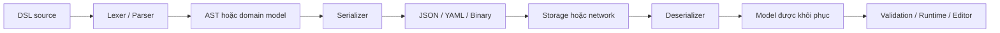
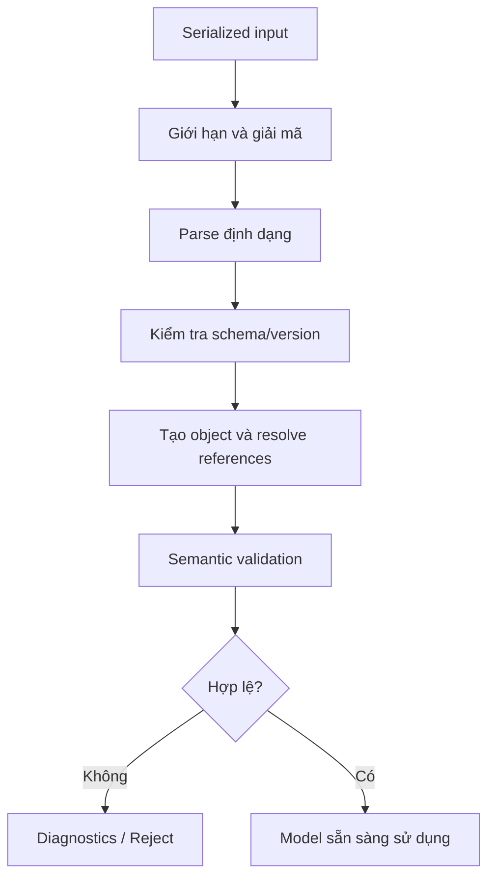
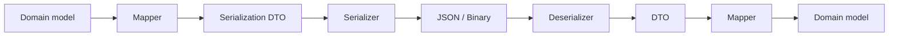

# Tuần tự hóa mô hình

Trong quá trình xây dựng một **Domain-Specific Language (DSL)**, mô hình trừu tượng thường được tạo ra sau khi parser phân tích source và kiểm tra cấu trúc. Mô hình này có thể là Abstract Syntax Tree (AST), domain model hoặc một biểu diễn trung gian (IR). **Tuần tự hóa mô hình (model serialization)** là quá trình chuyển mô hình trong bộ nhớ thành một dạng dữ liệu có thể lưu trữ hoặc truyền đi; **giải tuần tự hóa (deserialization)** là quá trình đọc dữ liệu đó và khôi phục lại mô hình.

Tuần tự hóa cho phép một công cụ DSL lưu kết quả phân tích để dùng lại, chia sẻ mô hình giữa các tiến trình, trao đổi dữ liệu với IDE hoặc dịch vụ khác, lưu cấu hình và tạo cache. Tuy nhiên, mô hình trong bộ nhớ thường có kiểu dữ liệu, quan hệ tham chiếu, định danh và bất biến riêng. Một định dạng JSON hay YAML đơn giản không tự động bảo toàn tất cả những đặc điểm đó. Vì vậy, cần thiết kế rõ cách ánh xạ mô hình sang dữ liệu, cách kiểm tra dữ liệu khi đọc lại và cách quản lý phiên bản.

## 1. Tuần tự hóa mô hình là gì?

Giả sử parser đọc DSL:

```text
pipeline "nightly" {
    step compile {
        command "gradle build"
    }

    step test {
        command "gradle test"
        after compile
    }
}
```

Sau khi parse và phân tích ngữ nghĩa, công cụ có thể tạo một mô hình trong bộ nhớ gồm `Pipeline`, các `Step` và quan hệ phụ thuộc giữa chúng. Tuần tự hóa chuyển mô hình này thành một chuỗi hoặc chuỗi byte, chẳng hạn JSON:

```json
{
  "kind": "Pipeline",
  "name": "nightly",
  "steps": [
    {
      "id": "compile",
      "command": "gradle build",
      "dependsOn": []
    },
    {
      "id": "test",
      "command": "gradle test",
      "dependsOn": ["compile"]
    }
  ]
}
```

JSON ở đây là một biểu diễn dữ liệu của mô hình. Nó không nhất thiết là source DSL ban đầu: cú pháp DSL có từ khóa `step`, dấu ngoặc và cách viết `after compile`, trong khi JSON dùng trường `steps` và mảng `dependsOn`.

Quy trình khái quát:



Tuần tự hóa và giải tuần tự hóa tạo thành một ranh giới dữ liệu. Ranh giới này cần định nghĩa rõ định dạng, kiểu dữ liệu, phiên bản, cách biểu diễn quan hệ và những quy tắc hợp lệ của mô hình.

## 2. Phân biệt source DSL, AST và dữ liệu tuần tự hóa

Ba dạng biểu diễn thường liên quan nhưng có mục tiêu khác nhau:

- **Source DSL** là văn bản hoặc tài liệu mà người dùng viết. Nó ưu tiên cú pháp dễ đọc, comment, khoảng trắng và cách trình bày.
- **AST hoặc domain model** là cấu trúc trong bộ nhớ, thể hiện các thành phần và quan hệ cần cho phân tích ngữ nghĩa, xử lý hoặc thực thi.
- **Serialized model** là dạng dữ liệu lưu trữ hoặc trao đổi của mô hình. Nó cần có schema và quy tắc tương thích để có thể đọc lại ở một thời điểm hoặc môi trường khác.

Ví dụ, source có thể chứa comment giải thích:

```text
step test {
    # Chạy kiểm thử sau khi biên dịch thành công.
    command "gradle test"
    after compile
}
```

AST phục vụ thực thi có thể chỉ chứa tên bước, lệnh và dependency. Nếu comment chỉ dùng để giải thích cho người đọc, nó có thể không xuất hiện trong serialized model phục vụ runtime. Nếu sản phẩm cần lưu và mở lại tài liệu với comment, cần một mô hình source-preserving riêng hoặc lưu source cùng mô hình.

| Dạng dữ liệu | Câu hỏi chính | Thông tin thường cần giữ |
|---|---|---|
| Source DSL | Người dùng đã viết gì và viết như thế nào? | Cú pháp, comment, trivia, vị trí nguồn |
| AST/domain model | Chương trình có cấu trúc và ý nghĩa gì? | Node, kiểu, thuộc tính, quan hệ và metadata ngữ nghĩa |
| Serialized model | Mô hình được lưu hoặc truyền ra sao? | Schema, dữ liệu, định danh, tham chiếu, phiên bản |

Không nên giả định serialize AST là có thể tái tạo nguyên văn source. Nếu AST đã bỏ comment, dấu ngoặc dư hoặc khoảng trắng, thông tin đó không thể tự xuất hiện trở lại sau khi giải tuần tự hóa.

## 3. Vì sao DSL cần tuần tự hóa mô hình?

Các nhu cầu phổ biến gồm:

### 3.1. Lưu trữ và mở lại mô hình

Một công cụ thiết kế DSL có thể cho phép người dùng tạo mô hình, lưu vào file hoặc cơ sở dữ liệu rồi mở lại để tiếp tục chỉnh sửa. Tuần tự hóa giúp mô hình tồn tại lâu hơn vòng đời của tiến trình đã tạo ra nó.

### 3.2. Trao đổi giữa các thành phần

Parser có thể chạy trong một dịch vụ, còn validator, runtime hoặc giao diện đồ họa chạy ở tiến trình khác. Serialized model tạo ra hợp đồng dữ liệu giữa các thành phần mà không buộc chúng chia sẻ trực tiếp object trong bộ nhớ.

### 3.3. Cache kết quả phân tích

Nếu parse và phân tích ngữ nghĩa tốn thời gian, công cụ có thể lưu mô hình hoặc kết quả trung gian để tái sử dụng. Cache cần gắn với phiên bản grammar, compiler, schema và các đầu vào ảnh hưởng đến kết quả; nếu không, mô hình cũ có thể bị dùng nhầm sau khi ngôn ngữ thay đổi.

### 3.4. Tích hợp công cụ và nền tảng

Một DSL có thể chuyển mô hình sang JSON để gọi API, YAML để cấu hình công cụ triển khai hoặc một định dạng nhị phân để truyền hiệu quả. Serialized model đóng vai trò cầu nối giữa mô hình trừu tượng và hệ thống bên ngoài.

### 3.5. Kiểm thử và tái hiện lỗi

Lưu mô hình đầu vào giúp tái hiện một lần chạy, chia sẻ trường hợp lỗi hoặc kiểm thử hồi quy mà không phải phân tích lại toàn bộ source. Cần lưu kèm phiên bản schema và thông tin môi trường liên quan nếu chúng ảnh hưởng đến cách diễn giải dữ liệu.

## 4. Chọn định dạng tuần tự hóa

Không có một định dạng phù hợp cho mọi tình huống. Việc lựa chọn phụ thuộc vào khả năng đọc, kích thước, tốc độ, schema, hệ sinh thái thư viện và yêu cầu tương thích.

### 4.1. JSON

JSON là định dạng văn bản phổ biến, dễ trao đổi giữa nhiều ngôn ngữ và được hỗ trợ rộng rãi. Nó phù hợp với API, file cấu hình và serialized model có cấu trúc cây hoặc đồ thị được biểu diễn bằng định danh.

Ưu điểm:

- Dễ đọc, dễ tìm kiếm và thuận tiện khi debug.
- Có thư viện cho hầu hết ngôn ngữ lập trình.
- Hỗ trợ object, array, string, number, boolean và null.
- Dễ kết hợp với JSON Schema hoặc hợp đồng API.

Giới hạn:

- Không có kiểu ngày giờ, decimal hoặc reference riêng trong chuẩn cơ bản; cần quy ước biểu diễn.
- Không hỗ trợ comment trong JSON chuẩn.
- Không biểu diễn trực tiếp object identity hoặc chu trình tham chiếu.
- Dữ liệu có thể lớn hơn định dạng nhị phân.

### 4.2. YAML

YAML thường được dùng cho file cấu hình vì hỗ trợ cấu trúc lồng nhau, danh sách và cách viết tương đối dễ đọc.

```yaml
kind: Pipeline
schemaVersion: 1
name: nightly
steps:
  - id: compile
    command: gradle build
  - id: test
    command: gradle test
    dependsOn:
      - compile
```

YAML phù hợp khi con người thường xuyên chỉnh sửa file. Tuy nhiên, cần quy định kiểu dữ liệu, quy tắc xử lý scalar và chính sách về anchor/alias nếu sử dụng. Một số cách viết YAML có thể khiến cùng một nội dung được diễn giải khác nhau giữa các parser hoặc phiên bản thư viện. Với dữ liệu không đáng tin cậy, nên dùng cấu hình parser an toàn và giới hạn tính năng không cần thiết.

### 4.3. XML

XML biểu diễn dữ liệu dạng cây bằng element và attribute. Nó có hệ sinh thái schema và công cụ lâu đời, hữu ích khi cần hợp đồng dữ liệu chặt chẽ hoặc tích hợp hệ thống đã sử dụng XML.

```xml
<pipeline schemaVersion="1" name="nightly">
    <step id="compile">
        <command>gradle build</command>
    </step>
    <step id="test">
        <command>gradle test</command>
        <dependsOn ref="compile" />
    </step>
</pipeline>
```

XML có thể dài hơn JSON hoặc YAML nhưng hỗ trợ namespace, attribute, schema và nhiều cơ chế kiểm tra. Khi đọc XML từ nguồn không đáng tin cậy, cần cấu hình parser để ngăn truy cập external entity và các tính năng không cần thiết.

### 4.4. Định dạng nhị phân

Protocol Buffers, CBOR, MessagePack hoặc định dạng nhị phân riêng có thể giảm kích thước và chi phí parse trong một số hệ thống. Chúng hữu ích khi cần truyền dữ liệu thường xuyên, payload lớn hoặc hợp đồng kiểu dữ liệu rõ ràng.

Đánh đổi thường gặp là khó đọc trực tiếp bằng mắt, cần schema hoặc công cụ giải mã và phải quản lý tương thích cẩn thận. Định dạng nhị phân không tự động giải quyết vấn đề versioning; schema vẫn cần được thiết kế để các phiên bản producer và consumer có thể phối hợp.

### 4.5. So sánh tổng quan

| Tiêu chí | JSON | YAML | XML | Nhị phân có schema |
|---|---|---|---|---|
| Khả năng đọc bằng mắt | Tốt | Tốt cho cấu hình | Tốt nhưng nhiều dấu | Thường thấp |
| Trao đổi đa ngôn ngữ | Rất phổ biến | Phổ biến | Rất phổ biến | Tùy hệ sinh thái |
| Schema/validation | Có thể dùng JSON Schema | Có công cụ ngoài định dạng | XSD và các schema khác | Thường gắn với schema IDL |
| Comment | Không có trong chuẩn JSON | Có | Có | Thường không |
| Kích thước | Trung bình | Có thể dài | Có thể dài | Thường gọn hơn |
| Phù hợp | API và mô hình trao đổi | File cấu hình người dùng chỉnh sửa | Hợp đồng XML, tích hợp hệ thống | Giao tiếp hiệu năng cao |

Nên chọn định dạng mà người tiêu thụ có thể hỗ trợ ổn định. Không nên chọn chỉ vì một định dạng ngắn hơn trong một ví dụ nhỏ; hãy xét cả schema, công cụ, khả năng debug, bảo mật và vòng đời dữ liệu.

## 5. Thiết kế hợp đồng dữ liệu và schema

Một serialized model cần có cấu trúc được xác định. Schema mô tả trường nào tồn tại, kiểu dữ liệu của chúng, trường nào bắt buộc, giá trị mặc định và những ràng buộc cần kiểm tra.

Ví dụ schema khái niệm cho một pipeline:

```text
Pipeline {
    schemaVersion: integer       required
    name: string                 required
    steps: list<Step>            required
}

Step {
    id: string                   required
    command: string               required
    dependsOn: list<string>       optional, default []
}
```

Schema cần trả lời các câu hỏi:

- Trường nào bắt buộc và trường nào tùy chọn?
- Giá trị mặc định được áp dụng khi trường bị thiếu như thế nào?
- `null` khác với trường không xuất hiện ra sao?
- Có cho phép trường không được nhận diện (unknown fields) không?
- Định danh có duy nhất trong phạm vi nào?
- Tham chiếu được biểu diễn bằng ID, đường dẫn hay object lồng nhau?
- Các kiểu dữ liệu đặc biệt như duration, decimal hoặc date được mã hóa thế nào?

### 5.1. Phân biệt thiếu, null và mặc định

Trong JSON, một trường có thể không xuất hiện, xuất hiện với `null` hoặc xuất hiện với một giá trị. Ba trạng thái này có thể mang ý nghĩa khác nhau.

Ví dụ:

```json
{
  "name": "nightly"
}
```

Trường `timeout` bị thiếu có thể có nghĩa là dùng mặc định 30 giây.

```json
{
  "name": "nightly",
  "timeout": null
}
```

`null` có thể có nghĩa là không đặt timeout, kế thừa timeout từ môi trường hoặc xóa giá trị đã cấu hình. Hệ thống phải chọn một ý nghĩa rõ ràng. Nếu cả thiếu và null đều bị chuyển thành cùng một giá trị trong deserializer, không thể khôi phục sự khác biệt đó.

### 5.2. Kiểu dữ liệu và độ chính xác

Không nên serialize mọi giá trị thành string nếu kiểu của chúng có ý nghĩa. Ví dụ, `replicas` nên là số nguyên, `enabled` là boolean và `dependsOn` là danh sách định danh. Với tiền tệ hoặc số thập phân cần độ chính xác, nên dùng biểu diễn decimal hoặc chuỗi có quy ước thay vì phụ thuộc vào số dấu phẩy động nhị phân.

Thời gian, duration, đơn vị và đường dẫn cũng cần quy ước rõ. Ví dụ, duration có thể được biểu diễn bằng số mili giây hoặc chuỗi `"30s"`; timestamp có thể dùng ISO 8601 UTC. Consumer phải hiểu cùng một cách.

## 6. Biểu diễn quan hệ và object identity

Mô hình trừu tượng không phải lúc nào cũng là một cây đơn giản. Nó có thể là đồ thị gồm các node được nhiều node khác tham chiếu. Ví dụ, nhiều bước có thể phụ thuộc vào cùng một bước `compile`; một node type có thể được tham chiếu từ nhiều nơi.

Nếu serialize bằng cách lồng toàn bộ object, cùng một đối tượng có thể bị ghi lặp nhiều lần. Khi deserialize, các bản sao đó có thể trở thành những object khác nhau, làm mất identity ban đầu. Với quan hệ chia sẻ hoặc chu trình, lồng object trực tiếp có thể tạo dữ liệu vô hạn hoặc không thể biểu diễn.

Một cách phổ biến là serialize node một lần bằng ID, còn quan hệ được biểu diễn bằng tham chiếu ID:

```json
{
  "nodes": [
    { "id": "compile", "kind": "Step", "command": "gradle build" },
    { "id": "test", "kind": "Step", "command": "gradle test" }
  ],
  "edges": [
    { "from": "test", "relation": "dependsOn", "to": "compile" }
  ]
}
```

Khi đọc lại, deserializer tạo các node trước, lập bảng ánh xạ `id -> object`, sau đó giải quyết các cạnh để nối tham chiếu. Cách này bảo toàn identity và hỗ trợ đồ thị có chu trình nếu mô hình cho phép.

### 6.1. Lồng object hay dùng reference ID?

| Trường hợp | Cách biểu diễn thường phù hợp |
|---|---|
| Cấu trúc cây, node con chỉ thuộc một cha | Lồng object |
| Một node được nhiều node khác tham chiếu | ID và reference |
| Đồ thị có chu trình | ID và reference |
| Mô hình nhỏ, quan hệ đơn giản | Lồng object có thể dễ đọc hơn |
| Mô hình lớn cần truy vấn từng node | Danh sách node và quan hệ riêng |

Không nên dùng ID cho mọi trường nếu cấu trúc thực sự là cây và không có nhu cầu tham chiếu. Ngược lại, không nên lồng object chỉ để JSON trông tự nhiên nếu việc đó làm mất identity hoặc tạo lặp dữ liệu.

### 6.2. Định danh ổn định

ID được serialize cần ổn định trong phạm vi mà consumer dựa vào. Nếu ID chỉ được tạo ngẫu nhiên lại mỗi lần serialize, công cụ diff hoặc hệ thống lưu trữ có thể xem mọi node là mới dù nội dung không đổi. Tùy miền, ID có thể là tên người dùng đặt, UUID, khóa tổng hợp hoặc định danh có phạm vi.

Không nên mặc định tên hiển thị là ID. Người dùng có thể đổi tên node trong khi quan hệ tham chiếu vẫn phải trỏ đến cùng đối tượng. Khi đó cần một identity ổn định riêng và một thuộc tính name có thể thay đổi.

## 7. Kiểu đa hình và phân biệt loại node

AST thường có nhiều loại node cùng kế thừa từ một kiểu cơ sở, ví dụ `Expression` có `Literal`, `NameReference`, `BinaryExpression` và `FunctionCall`. Khi serialize, dữ liệu cần cho biết mỗi object thuộc loại nào để deserializer tạo đúng kiểu.

Một cách biểu diễn là thêm trường discriminator như `kind`:

```json
{
  "kind": "BinaryExpression",
  "operator": "+",
  "left": {
    "kind": "NameReference",
    "name": "price"
  },
  "right": {
    "kind": "Literal",
    "valueType": "integer",
    "value": 2
  }
}
```

`kind` là một phần của hợp đồng serialized model. Nên dùng tập giá trị được phép rõ ràng và ánh xạ chúng sang các kiểu nội bộ. Tránh để dữ liệu bên ngoài chỉ định tên lớp tùy ý rồi yêu cầu runtime nạp lớp đó; cách làm như vậy có thể tạo rủi ro bảo mật và phụ thuộc chặt vào tên lớp triển khai.

Khi thêm một loại node mới, consumer cũ có thể không nhận diện được `kind` đó. Cần quy định hành vi: từ chối với thông báo rõ, giữ node như extension data nếu có thể, hoặc chỉ cho phép khi phiên bản schema tương thích.

## 8. Tuần tự hóa AST và mô hình ngữ nghĩa

AST phản ánh cấu trúc cú pháp. Domain model phản ánh khái niệm nghiệp vụ. IR phản ánh dạng trung gian phù hợp cho xử lý hoặc sinh mã. Chúng có thể có quan hệ một-một, một-nhiều hoặc nhiều-một.

Ví dụ, source có thể dùng cú pháp:

```text
after compile
```

AST có thể giữ một node `DependencyDeclaration` với tên tham chiếu `compile`. Sau semantic analysis, domain model có thể chứa một tham chiếu trực tiếp đến object `Step` đã được phân giải. Serialized model có thể chọn lưu tên ID `compile` thay vì toàn bộ object `Step`.

Các lựa chọn phụ thuộc mục tiêu:

- Serialize **AST** nếu cần lưu cấu trúc source đã parse, bao gồm node cú pháp và vị trí nguồn.
- Serialize **domain model** nếu cần trao đổi ý nghĩa nghiệp vụ độc lập với cách viết source.
- Serialize **IR** nếu cần cache kết quả compiler hoặc chuyển cho backend/runtime.

Không nên dùng một schema cho mọi mục đích nếu các nhu cầu khác nhau rõ rệt. Ví dụ, serialized AST có thể thay đổi khi grammar thay đổi, trong khi domain model có thể ổn định hơn với người tiêu thụ bên ngoài. IR có thể tối ưu cho runtime nhưng không thích hợp làm định dạng trao đổi lâu dài.

## 9. Quy trình giải tuần tự hóa an toàn

Đọc dữ liệu và tạo object không có nghĩa mô hình đã hợp lệ. Một quy trình an toàn nên tách các bước:

1. **Đọc byte hoặc văn bản**: giới hạn kích thước đầu vào và giải mã ký tự theo encoding đã quy định.
2. **Parse định dạng**: đọc JSON, YAML, XML hoặc định dạng nhị phân bằng parser phù hợp.
3. **Kiểm tra schema**: xác nhận kiểu dữ liệu, trường bắt buộc, cấu trúc và phiên bản.
4. **Tạo mô hình**: khởi tạo node, object và quan hệ tham chiếu.
5. **Kiểm tra ngữ nghĩa**: xác nhận định danh duy nhất, tham chiếu tồn tại, kiểu tương thích, không có chu trình bị cấm và các bất biến miền.
6. **Áp dụng migration nếu cần**: chuyển dữ liệu từ phiên bản cũ sang mô hình hiện tại theo quy tắc được định nghĩa.
7. **Chuyển cho thành phần tiêu thụ**: chỉ sau khi các kiểm tra cần thiết thành công.



Nếu dữ liệu không hợp lệ, thông báo lỗi nên chỉ ra trường hoặc đường dẫn dữ liệu gây lỗi. Ví dụ: `steps[2].dependsOn[0] tham chiếu đến ID 'package', nhưng không có step nào mang ID này.` Điều đó hữu ích hơn một lỗi chung như `Invalid model`.

## 10. Ví dụ Java: serialize và deserialize bằng JSON

Ví dụ sau minh họa cách một mô hình đơn giản có thể được biểu diễn bằng Java record và chuyển sang JSON bằng thư viện Jackson. Trong ứng dụng thực tế, cần khai báo dependency và cấu hình ObjectMapper theo schema, quy tắc null, kiểu đặc biệt và chính sách tương thích của dự án.

```java
import com.fasterxml.jackson.databind.ObjectMapper;
import java.util.List;

record PipelineModel(
        int schemaVersion,
        String name,
        List<StepModel> steps) {
}

record StepModel(
        String id,
        String command,
        List<String> dependsOn) {
}

public class ModelSerializationExample {
    public static void main(String[] args) throws Exception {
        PipelineModel model = new PipelineModel(
                1,
                "nightly",
                List.of(
                        new StepModel("compile", "gradle build", List.of()),
                        new StepModel("test", "gradle test", List.of("compile"))
                )
        );

        ObjectMapper mapper = new ObjectMapper();

        // Serialize: Java model -> JSON text.
        String json = mapper.writerWithDefaultPrettyPrinter()
                .writeValueAsString(model);
        System.out.println(json);

        // Deserialize: JSON text -> Java model.
        PipelineModel restored = mapper.readValue(json, PipelineModel.class);

        System.out.println(restored.name());
        System.out.println(restored.steps().get(1).dependsOn());
    }
}
```

Ở đây, `PipelineModel` và `StepModel` là mô hình trao đổi được thiết kế riêng cho serialized form. Chúng có thể trùng với domain model nội bộ trong ví dụ nhỏ, nhưng với hệ thống lớn, nên cân nhắc dùng DTO (Data Transfer Object) để tách hợp đồng bên ngoài khỏi cấu trúc object nội bộ.

Sau khi `readValue`, không nên coi `restored` đã hợp lệ chỉ vì Jackson tạo object thành công. Ứng dụng vẫn cần kiểm tra `schemaVersion`, tên không rỗng, ID duy nhất và mọi tham chiếu `dependsOn` đều tồn tại. Việc deserialize kiểm tra khả năng ánh xạ dữ liệu sang kiểu Java; semantic validation kiểm tra mô hình có hợp lệ theo miền hay không.

## 11. DTO và mô hình nội bộ

Một sai lầm thường gặp là serialize trực tiếp mọi class nội bộ. Cấu trúc nội bộ có thể chứa cache, logger, tham chiếu đến service, lazy proxy, object vòng đời ngắn hoặc các trường không nên công khai. Nếu dùng nguyên object làm hợp đồng lưu trữ, thay đổi triển khai có thể vô tình làm thay đổi schema.

DTO là kiểu dữ liệu được thiết kế để truyền hoặc lưu dữ liệu. Có thể chuyển đổi giữa domain model và DTO:



Lợi ích của cách tách này:

- Hợp đồng dữ liệu ổn định hơn cấu trúc class nội bộ.
- Có thể đổi tên hoặc tổ chức lại class mà không buộc thay schema bên ngoài.
- Dễ loại bỏ dữ liệu nhạy cảm hoặc trường chỉ dùng nội bộ.
- Có thể cung cấp nhiều phiên bản DTO cho các consumer khác nhau.
- Việc kiểm tra và chuyển đổi dữ liệu có một vị trí rõ ràng.

Đổi lại, cần viết mapper và quản lý hai mô hình. Với mô hình nhỏ, ổn định và chỉ có một consumer, dùng chung kiểu có thể chấp nhận được. Quyết định nên dựa trên vòng đời và mức độ độc lập cần có của hợp đồng dữ liệu.

## 12. Versioning và tương thích schema

Serialized model có thể tồn tại lâu hơn phiên bản chương trình đã tạo ra nó. Vì vậy, schema cần được quản lý phiên bản. Một file có thể mang trường `schemaVersion` hoặc dùng version trong metadata/đường dẫn.

Ví dụ:

```json
{
  "schemaVersion": 2,
  "kind": "Pipeline",
  "name": "nightly",
  "steps": []
}
```

Khi schema thay đổi, cần phân loại:

- **Thêm trường tùy chọn** có mặc định an toàn thường dễ tương thích với consumer cũ nếu consumer bỏ qua trường không biết.
- **Thêm giá trị enum hoặc loại node mới** có thể làm consumer cũ không xử lý được nếu họ giả định danh sách giá trị đóng.
- **Đổi tên hoặc xóa trường** thường là thay đổi phá vỡ tương thích.
- **Đổi kiểu dữ liệu** có thể khiến dữ liệu cũ không deserialize được.
- **Đổi ngữ nghĩa mà không đổi cấu trúc** nguy hiểm vì dữ liệu vẫn parse được nhưng được hiểu khác.

Một chính sách tương thích cần quy định producer và consumer có thể lệch phiên bản đến mức nào, trường không biết được xử lý ra sao, giá trị mặc định được áp dụng thế nào và khi nào cần migration.

### 12.1. Migration dữ liệu

Nếu schema v1 lưu `timeoutSeconds`, còn schema v2 dùng `timeout` với kiểu duration, migration cần chuyển giá trị và đơn vị chính xác:

```text
v1: timeoutSeconds = 30
v2: timeout = "30s"
```

Migration nên là bước tường minh, có thể kiểm thử và có diagnostics khi dữ liệu cũ không ánh xạ được. Không nên âm thầm đoán ý nghĩa khi một trường cũ có nhiều cách chuyển đổi.

Với dữ liệu quan trọng, nên lưu bản gốc hoặc có backup trước khi migration hàng loạt. Nếu migration thất bại giữa chừng, cần có cách xác định dữ liệu nào đã được chuyển đổi và cách chạy lại an toàn.

### 12.2. Unknown fields và forward compatibility

Khi consumer đọc schema mới hơn, nó có thể gặp trường chưa biết. Có hai chính sách thường gặp:

- **Reject unknown fields**: từ chối để tránh bỏ sót dữ liệu có ý nghĩa hoặc phát hiện sai schema sớm.
- **Ignore hoặc preserve unknown fields**: cho phép consumer cũ đọc phần nó hiểu, đồng thời có thể giữ lại trường lạ khi ghi lại.

Chọn chính sách nào phụ thuộc vai trò của consumer. Một validator nghiêm ngặt có thể cần từ chối; một editor trung gian chỉ sửa một trường và phải bảo toàn phần mở rộng có thể cần giữ unknown fields. Nếu bỏ trường lạ rồi serialize lại, dữ liệu do phiên bản mới thêm vào có thể bị mất.

## 13. Tuần tự hóa xác định và tính ổn định

Hai lần serialize cùng một mô hình có thể tạo ra văn bản khác nhau nếu thứ tự map, cách định dạng số, timestamp hoặc thứ tự trường không được quy định. Với cache, chữ ký số, diff và kiểm thử snapshot, tính xác định (deterministic serialization) có thể rất quan trọng.

Một biểu diễn ổn định cần xác định:

- Thứ tự trường hoặc khóa trong output nếu output được so sánh theo byte.
- Cách sắp xếp collection khi thứ tự không mang ý nghĩa.
- Cách chuẩn hóa số thập phân, timestamp, encoding và newline.
- Cách biểu diễn giá trị mặc định và trường không xuất hiện.
- Quy tắc escape chuỗi và Unicode.

Không nên sắp xếp mọi danh sách một cách máy móc. Danh sách các bước thực thi có thể mang thứ tự; danh sách tập hợp quyền có thể không. Schema phải quy định trường nào có thứ tự ngữ nghĩa và trường nào là tập hợp không thứ tự.

### 13.1. Canonical serialization

Canonical serialization là cách chuẩn hóa một mô hình thành một biểu diễn duy nhất theo một bộ quy tắc. Ví dụ, các khóa object được sắp xếp, timestamp chuyển về UTC, số được viết theo một dạng chuẩn và khoảng trắng định dạng được cố định.

Canonical form hữu ích cho hash, chữ ký, cache key và so sánh phiên bản. Tuy nhiên, canonicalization cần được đặc tả chính xác. Nếu hai triển khai khác nhau chuẩn hóa số, Unicode hoặc thứ tự collection khác nhau, hash có thể không giống nhau dù mô hình được cho là tương đương.

## 14. Bảo mật khi deserialize

Serialized model có thể đến từ file tải lên, API hoặc hệ thống bên ngoài. Không nên tin dữ liệu chỉ vì nó có định dạng hợp lệ. Một payload được parse thành công vẫn có thể chứa nội dung gây tiêu tốn tài nguyên, tham chiếu sai hoặc cấu hình nguy hiểm.

Các biện pháp cần cân nhắc:

- Giới hạn kích thước file, độ sâu lồng nhau, số node, độ dài chuỗi và số lượng phần tử.
- Chỉ cho phép các kiểu node đã đăng ký; không nạp class tùy ý theo tên trong dữ liệu.
- Kiểm tra schema và semantic invariants trước khi chuyển mô hình cho runtime.
- Không deserialize object có khả năng thực thi mã hoặc kích hoạt side effect trong constructor/callback.
- Với XML, tắt external entity và tính năng truy cập tài nguyên ngoài nếu không cần.
- Với YAML, cấu hình parser an toàn và tránh cơ chế tạo object tùy ý.
- Không lưu token, mật khẩu hoặc secret trong serialized model nếu không cần; nếu phải lưu, dùng cơ chế bảo vệ phù hợp.
- Xác thực nguồn gốc hoặc chữ ký nếu mô hình có thể điều khiển triển khai hay hành động quan trọng.
- Ghi log lỗi theo cách không làm lộ dữ liệu nhạy cảm trong payload.

Một mô hình hợp lệ về schema chưa chắc an toàn để thực thi. Ví dụ, một trường `command` có thể đúng kiểu string nhưng chứa lệnh không được phép. Quyền và chính sách thực thi cần được kiểm tra riêng tại ranh giới runtime.

## 15. Lỗi và diagnostics trong quá trình giải tuần tự hóa

Không nên gộp mọi lỗi thành một thông báo `Cannot deserialize`. Có thể phân loại lỗi để người dùng và hệ thống xử lý đúng:

| Loại lỗi | Ví dụ | Cách phản hồi |
|---|---|---|
| Lỗi định dạng | JSON thiếu dấu ngoặc hoặc YAML sai thụt lề | Báo vị trí và lỗi cú pháp |
| Sai schema | `replicas` nhận chuỗi thay vì số nguyên | Báo đường dẫn trường và kiểu mong đợi |
| Phiên bản không hỗ trợ | `schemaVersion = 99` | Báo phiên bản được hỗ trợ và hướng nâng cấp |
| Tham chiếu thiếu | `dependsOn` trỏ đến step không tồn tại | Báo ID và vị trí quan hệ |
| Vi phạm miền | `replicas = 0` khi miền yêu cầu ít nhất 1 | Báo quy tắc nghiệp vụ bị vi phạm |
| Giới hạn tài nguyên | File quá lớn hoặc cấu trúc lồng quá sâu | Từ chối có kiểm soát và ghi rõ giới hạn |

Nếu mô hình được tạo từ nhiều file, diagnostics nên chỉ ra file nguồn và đường dẫn dữ liệu. Một JSON Pointer như `/steps/2/dependsOn/0` có thể giúp định vị trường trong serialized document; có thể bổ sung tên node hoặc ID để thông báo dễ hiểu hơn.

## 16. Kiểm thử tuần tự hóa và giải tuần tự hóa

Kiểm thử cần xác nhận cả dữ liệu được ghi ra lẫn mô hình được khôi phục. Một số nhóm kiểm thử hữu ích:

- **Round-trip test**: serialize một mô hình rồi deserialize và so sánh theo ngữ nghĩa.
- **Golden file test**: so sánh output với file mẫu đã được phê duyệt khi định dạng cần ổn định.
- **Schema validation test**: kiểm tra trường thiếu, sai kiểu, trường lạ và phiên bản không hỗ trợ.
- **Reference test**: xác nhận quan hệ ID được khôi phục đúng và identity được giữ khi cần.
- **Polymorphism test**: xác nhận từng loại node được khôi phục đúng kiểu.
- **Migration test**: xác nhận dữ liệu phiên bản cũ được chuyển đúng sang mô hình mới.
- **Compatibility test**: kiểm tra producer/consumer ở các phiên bản khác nhau theo chính sách đã công bố.
- **Security/resource test**: kiểm tra payload quá lớn, độ sâu cao, kiểu không cho phép và nội dung bất thường.

Round-trip không nhất thiết yêu cầu hai object giống nhau từng byte hoặc cùng tham chiếu bộ nhớ. Điều quan trọng là các thuộc tính và quan hệ có ý nghĩa được bảo toàn theo định nghĩa equality của mô hình.

Ví dụ, nếu thứ tự khóa JSON không có ý nghĩa, test không nên thất bại chỉ vì serializer đổi thứ tự khóa. Nếu thứ tự `steps` quyết định thứ tự thực thi, test phải xác nhận danh sách này được giữ nguyên.

## 17. Các lựa chọn kiến trúc thường gặp

Tùy mục đích, có thể chọn một trong các cách tổ chức sau:

### 17.1. Serialize AST trực tiếp

Phù hợp với cache parser, công cụ phân tích hoặc hệ thống cần lưu lại cây cú pháp. Cần versioning gắn với grammar/AST và xác định có lưu source span, trivia hay không.

### 17.2. Chuyển AST thành DTO rồi serialize

Phù hợp với API và trao đổi lâu dài giữa dịch vụ. DTO giữ schema ổn định, còn mapper chịu trách nhiệm chuyển đổi từ mô hình nội bộ.

### 17.3. Serialize IR cho backend

Phù hợp khi front-end và backend tách rời, hoặc cần cache kết quả biên dịch. IR có thể tối ưu cho runtime nhưng cần quản lý phiên bản compiler và định dạng IR.

### 17.4. Lưu source DSL cùng metadata

Phù hợp với editor hoặc hệ thống quản lý tài liệu nơi người dùng cần mở lại nội dung gần như nguyên bản. Có thể lưu source, schema version, encoding và một số metadata; AST có thể được tái tạo khi mở file.

Không nhất thiết chọn duy nhất một cách. Một sản phẩm có thể lưu source để chỉnh sửa, serialize DTO để trao đổi API và tạo IR để thực thi. Mỗi dạng cần mục đích và hợp đồng riêng.

## 18. Quy trình thiết kế tuần tự hóa cho một DSL

Một quy trình thực tế có thể gồm:

1. **Xác định mục đích**: lưu trữ, trao đổi, cache, thực thi, chỉnh sửa hay tái hiện lỗi.
2. **Chọn mô hình cần serialize**: source, AST, domain model, DTO hay IR.
3. **Xác định consumer**: thành phần nào đọc dữ liệu, dùng ngôn ngữ nào và có vòng đời bao lâu.
4. **Thiết kế schema**: kiểu dữ liệu, trường bắt buộc, mặc định, null, enum, ID và reference.
5. **Chọn định dạng**: JSON, YAML, XML hay binary dựa trên nhu cầu đọc, hiệu năng và hệ sinh thái.
6. **Định nghĩa versioning**: cách nhận diện phiên bản, chính sách unknown fields và migration.
7. **Xây serializer/deserializer**: tách mapper nếu hợp đồng bên ngoài cần ổn định.
8. **Thêm validation**: kiểm tra schema, quan hệ và bất biến miền trước khi sử dụng.
9. **Xác định chính sách bảo mật**: giới hạn kích thước, độ sâu, kiểu được phép và quyền thực thi.
10. **Kiểm thử round-trip và tương thích**: dùng dữ liệu thực tế và file mẫu của các phiên bản.
11. **Tài liệu hóa hợp đồng**: mô tả trường, ví dụ, lỗi, chính sách nâng cấp và giới hạn.

## 19. Những lỗi thiết kế thường gặp

| Lỗi | Hệ quả | Cách xử lý |
|---|---|---|
| Serialize trực tiếp mọi class nội bộ | Thay đổi code vô tình làm đổi schema | Dùng DTO hoặc lớp chuyển đổi khi cần hợp đồng ổn định |
| Không có schema version | Không biết cách đọc dữ liệu cũ | Gắn phiên bản và định nghĩa migration |
| Lồng object có quan hệ chia sẻ hoặc chu trình | Dữ liệu lặp, vô hạn hoặc mất identity | Dùng ID và reference |
| Không phân biệt thiếu và null | Mất ý nghĩa của giá trị mặc định hoặc kế thừa | Định nghĩa rõ ba trạng thái |
| Dựa vào tên class trong payload | Phụ thuộc triển khai và có thể mở ra rủi ro nạp kiểu | Dùng discriminator với danh sách loại được phép |
| Deserialize xong là chạy ngay | Dữ liệu sai quy tắc có thể gây lỗi hoặc tác động nguy hiểm | Validate schema và ngữ nghĩa trước khi thực thi |
| Bỏ unknown fields khi chỉnh sửa file phiên bản mới | Mất dữ liệu mở rộng khi ghi lại | Reject hoặc giữ unknown fields theo chính sách |
| Không chuẩn hóa output khi cần diff/hash | Cache key hoặc chữ ký không ổn định | Định nghĩa canonical serialization |
| Không giới hạn đầu vào | Tốn bộ nhớ, CPU hoặc stack | Đặt giới hạn kích thước, độ sâu và số node |
| Cho rằng round-trip phải giống byte | Test sai mục tiêu khi thứ tự/format không có ý nghĩa | So sánh theo ngữ nghĩa hoặc canonical form |

## 20. Tiêu chí của một thiết kế tuần tự hóa tốt

Một thiết kế tuần tự hóa mô hình tốt cần giúp các thành phần trao đổi dữ liệu mà không phụ thuộc quá chặt vào cách object được triển khai trong bộ nhớ. Schema phải rõ, quan hệ phải được biểu diễn nhất quán, phiên bản phải có thể nhận diện và dữ liệu đọc vào phải được kiểm tra trước khi sử dụng.

Các câu hỏi quan trọng cần trả lời được:

- Mô hình nào đang được lưu: source, AST, domain model hay IR?
- Consumer có thể khôi phục đúng kiểu, thuộc tính và quan hệ không?
- Định danh và reference có giữ được identity của node không?
- Trường thiếu, null, mặc định và unknown fields được xử lý thế nào?
- Dữ liệu cũ sẽ được đọc và migration ra sao khi schema thay đổi?
- Payload không đáng tin cậy được giới hạn và kiểm tra như thế nào?
- Hai lần serialize cùng mô hình có tạo ra biểu diễn ổn định khi yêu cầu cần điều đó không?

Tuần tự hóa không chỉ là gọi một thư viện để chuyển object thành JSON hoặc byte. Nó là một phần của kiến trúc mô hình trừu tượng và hợp đồng giữa các thành phần. Khi schema, identity, versioning, validation và bảo mật được thiết kế rõ ràng, mô hình DSL có thể được lưu trữ, chia sẻ và tái sử dụng một cách đáng tin cậy qua nhiều công cụ và phiên bản.
