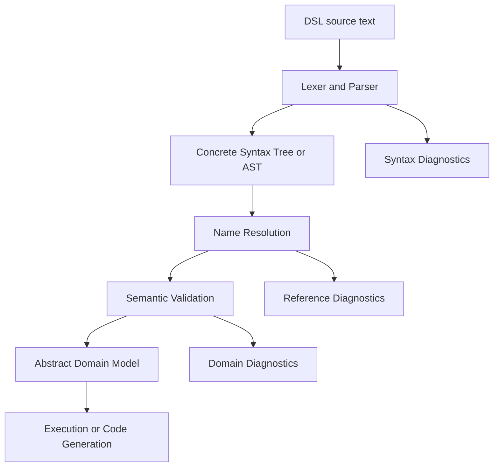
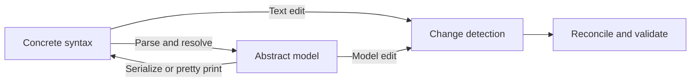

# Đồng bộ cú pháp và mô hình

Một ngôn ngữ miền chuyên biệt (Domain-Specific Language, DSL) thường có hai cách biểu diễn cùng một nội dung: **cú pháp** mà người dùng viết và **mô hình trừu tượng** mà công cụ sử dụng để hiểu, kiểm tra, biến đổi hoặc thực thi nội dung đó. Đồng bộ cú pháp và mô hình là quá trình giữ cho hai biểu diễn này nhất quán khi người dùng đọc, sửa, lưu, sinh hoặc chuyển đổi chương trình DSL.

Cú pháp giúp con người diễn đạt ý định bằng văn bản, từ khóa và cấu trúc quen thuộc. Mô hình trừu tượng thể hiện các khái niệm của miền dưới dạng đối tượng, thuộc tính, quan hệ và ràng buộc độc lập hơn với cách viết. Nếu người dùng sửa cú pháp nhưng mô hình không được cập nhật, công cụ có thể thực thi dữ liệu cũ. Nếu mô hình thay đổi nhưng văn bản không được cập nhật, tài liệu hiển thị có thể không phản ánh nội dung thật. Vì vậy, hệ thống DSL cần định nghĩa rõ cách chuyển đổi, thời điểm đồng bộ và cách xử lý khi hai phía có thay đổi đồng thời.

## 1. Cú pháp và mô hình trừu tượng

### 1.1. Cú pháp cụ thể

Cú pháp cụ thể (concrete syntax) là hình thức mà người dùng nhìn thấy và viết trực tiếp. Nó bao gồm từ khóa, tên định danh, dấu phân cách, biểu thức, chú thích, khoảng trắng và cách trình bày.

Ví dụ, một DSL mô tả quy trình có thể cho phép viết:

```text
workflow "release" {
    task "compile" {}
    task "test" {
        depends_on = ["compile"]
    }
}
```

Người viết nhìn thấy từ khóa `workflow`, `task`, tên tác vụ, dấu ngoặc nhọn và danh sách phụ thuộc. Cú pháp cụ thể có thể được thiết kế để dễ đọc, dễ sửa bằng trình soạn thảo và gần với ngôn ngữ của miền.

### 1.2. Cú pháp trừu tượng

Cú pháp trừu tượng (abstract syntax) mô tả cấu trúc có ý nghĩa của chương trình mà không giữ mọi chi tiết trình bày. Nó thường được biểu diễn bằng cây cú pháp trừu tượng (Abstract Syntax Tree, AST).

Từ ví dụ trên, AST có thể được hình dung như sau:

```text
Workflow
  name: "release"
  tasks:
    - Task
        name: "compile"
        dependencies: []
    - Task
        name: "test"
        dependencies: ["compile"]
```

AST không cần giữ việc người viết dùng bốn dấu cách hay hai dấu cách, có dòng trống giữa hai task hay đặt dấu phẩy cuối danh sách. Những chi tiết này không làm thay đổi cấu trúc logic của workflow.

### 1.3. Mô hình miền

Mô hình miền (domain model) thể hiện các khái niệm nghiệp vụ và quan hệ của chúng. Nó có thể gần với AST, nhưng thường được thiết kế để phục vụ kiểm tra ngữ nghĩa, thao tác nghiệp vụ và thực thi.

Ví dụ, mô hình miền có thể gồm:

- `Workflow` có tên và tập hợp các `Task`.
- Mỗi `Task` có định danh, tên và danh sách phụ thuộc.
- Một phụ thuộc tham chiếu đến task khác bằng định danh đã được phân giải.
- Quy tắc miền yêu cầu tên task duy nhất và không có chu trình phụ thuộc.

Trong AST, một phụ thuộc có thể chỉ là chuỗi `"compile"`. Trong mô hình miền đã phân giải, nó có thể là tham chiếu trực tiếp đến đối tượng `Task` có tên `compile`. Việc phân giải tên giúp công cụ kiểm tra các quan hệ và thực thi mô hình thuận tiện hơn.

### 1.4. Phân biệt ba lớp biểu diễn

| Biểu diễn | Mục đích | Thông tin thường giữ |
|---|---|---|
| Cú pháp cụ thể / văn bản nguồn | Giao tiếp với người viết | Từ khóa, dấu câu, chú thích, khoảng trắng, vị trí dòng/cột |
| AST / cú pháp trừu tượng | Thể hiện cấu trúc chương trình | Nút, thuộc tính, biểu thức và quan hệ cú pháp có ý nghĩa |
| Mô hình miền | Thể hiện ý nghĩa trong miền | Đối tượng miền, kiểu, tham chiếu đã phân giải, bất biến và quy tắc nghiệp vụ |

Không phải hệ thống nào cũng cần ba cấu trúc hoàn toàn tách biệt. Một DSL nhỏ có thể dùng AST làm mô hình miền nếu nhu cầu đơn giản. Tuy nhiên, khi ngôn ngữ phát triển, việc phân biệt rõ giúp tránh trộn chi tiết trình bày với logic nghiệp vụ.

## 2. Vì sao cần đồng bộ?

Đồng bộ bảo đảm các công cụ cùng nhìn thấy một trạng thái logic nhất quán. Điều này quan trọng trong nhiều tình huống:

- Người dùng sửa tệp DSL và mong mô hình trong IDE cập nhật ngay.
- Công cụ chỉnh sửa mô hình bằng biểu mẫu hoặc sơ đồ, sau đó cần cập nhật tệp DSL.
- Bộ sinh mã thay đổi mô hình và cần tạo lại cấu hình nguồn.
- Hệ thống tải dự án cũ, chuyển đổi phiên bản mô hình và lưu lại cú pháp mới.
- Công cụ định dạng thay đổi cách trình bày nhưng phải giữ nguyên ý nghĩa.
- Một nhóm dùng nhiều giao diện khác nhau để chỉnh sửa cùng một tài liệu.

Nếu đồng bộ không chính xác, có thể xuất hiện những lỗi khó phát hiện: giao diện hiển thị giá trị cũ, runtime chạy cấu hình khác với nội dung đang mở, tham chiếu bị mất hoặc thao tác lưu làm mất chú thích của người dùng.

## 3. Luồng chuyển đổi từ cú pháp sang mô hình

Luồng phổ biến bắt đầu từ văn bản nguồn và tạo ra mô hình có thể kiểm tra hoặc thực thi.



Các bước chính:

1. **Đọc văn bản:** lexer chuyển chuỗi ký tự thành token.
2. **Phân tích cú pháp:** parser xác định cấu trúc và tạo CST hoặc AST.
3. **Phân giải tên:** liên kết tên định danh và tham chiếu với khai báo tương ứng.
4. **Kiểm tra ngữ nghĩa:** xác nhận kiểu, phạm vi, quan hệ và bất biến miền.
5. **Tạo mô hình:** xây dựng mô hình trừu tượng phù hợp cho thao tác hoặc thực thi.
6. **Thông báo lỗi:** ghi nhận lỗi tại đúng vị trí nguồn và liên kết chúng với nút mô hình liên quan nếu có thể.

Mỗi bước có thể tạo chẩn đoán riêng. Một lỗi cú pháp có nghĩa văn bản không tuân theo grammar; lỗi phân giải tên có nghĩa tham chiếu không tìm thấy đối tượng; lỗi ngữ nghĩa có nghĩa cấu trúc hợp lệ nhưng vi phạm quy tắc miền.

## 4. Luồng chuyển đổi từ mô hình sang cú pháp

Khi mô hình được chỉnh sửa bằng giao diện trực quan, API hoặc công cụ sinh mã, hệ thống cần tạo lại văn bản DSL. Luồng này thường gồm:

1. Kiểm tra mô hình có đủ dữ liệu bắt buộc và thỏa mãn bất biến.
2. Chuyển đối tượng miền thành AST hoặc cấu trúc cú pháp trung gian.
3. Chọn cách biểu diễn các giá trị, tham chiếu và tùy chọn theo grammar.
4. Dùng serializer hoặc pretty printer tạo văn bản.
5. Ghi tệp hoặc cập nhật vùng văn bản trong trình soạn thảo.
6. Nếu cần, phân tích lại văn bản để xác nhận mô hình sau khi sinh vẫn tương đương với mô hình ban đầu.

Ví dụ, mô hình workflow có hai task và một quan hệ phụ thuộc có thể được tuần tự hóa thành:

```text
workflow "release" {
    task "compile" {}
    task "test" {
        depends_on = ["compile"]
    }
}
```

Pretty printer có thể chọn thụt lề bốn dấu cách, đặt mỗi task trên một khối riêng và sắp xếp thuộc tính theo thứ tự chuẩn. Đây là lựa chọn trình bày, miễn là cú pháp được sinh ra giữ nguyên ý nghĩa của mô hình.

## 5. Xác định nguồn dữ liệu chuẩn

Một vấn đề thiết kế quan trọng là xác định biểu diễn nào được xem là nguồn dữ liệu chuẩn (source of truth) trong từng giai đoạn.

### 5.1. Văn bản nguồn là nguồn chuẩn

Trong trình soạn thảo mã, người dùng trực tiếp sửa văn bản. Khi đó, văn bản nguồn thường là nguồn chuẩn; AST và mô hình miền là các biểu diễn được tạo lại từ văn bản.

Ưu điểm:

- Dễ bảo toàn ý định trình bày, chú thích và cấu trúc mà người viết đã chọn.
- Hỗ trợ quy trình làm việc dựa trên tệp và hệ thống quản lý phiên bản.
- Không cần chuyển mọi thay đổi của mô hình ngược về cú pháp ngay lập tức.

Hạn chế là các công cụ trực quan cần chuyển thao tác của mình thành thay đổi văn bản hoặc tạo một bản chỉnh sửa cú pháp tương ứng.

### 5.2. Mô hình là nguồn chuẩn

Trong công cụ thiết kế trực quan, người dùng có thể kéo thả các thành phần, thay đổi thuộc tính và kết nối quan hệ. Khi đó, mô hình miền có thể là nguồn chuẩn; văn bản DSL được sinh ra để lưu trữ hoặc xem.

Ưu điểm là mô hình có cấu trúc rõ, dễ áp dụng ràng buộc và hỗ trợ nhiều giao diện. Hạn chế là việc tái tạo chính xác cách trình bày ban đầu khó hơn, đặc biệt khi người dùng đã viết chú thích, sắp xếp thuộc tính hoặc dùng cú pháp rút gọn.

### 5.3. Hai phía cùng có thể chỉnh sửa

Một hệ thống cộng tác có thể cho phép người dùng sửa văn bản và chỉnh sửa mô hình qua biểu mẫu. Khi đó, không thể giả định một phía luôn mới hơn. Hệ thống cần theo dõi phiên bản, vùng thay đổi, nguồn phát sinh và quy tắc giải quyết xung đột.

Thực tế thường chọn một nguồn chuẩn theo từng thao tác hoặc chế độ làm việc. Ví dụ, khi người dùng đang gõ trong editor, văn bản là nguồn chuẩn; khi họ chỉnh sửa trên canvas, mô hình có thể là nguồn chuẩn cho thao tác đó. Sau mỗi thay đổi được chấp nhận, hệ thống đồng bộ biểu diễn còn lại.

## 6. Đồng bộ một chiều và hai chiều

### 6.1. Đồng bộ một chiều

Đồng bộ một chiều chỉ cho phép cập nhật theo một hướng, ví dụ:

```text
Source text -> Parser -> Domain model
```

Đây là cách đơn giản và phù hợp khi mô hình chỉ dùng để kiểm tra hoặc thực thi. Khi mô hình thay đổi nội bộ, không cần sinh lại văn bản nguồn.

Một hướng khác là:

```text
Domain model -> Serializer -> DSL source
```

Cách này phù hợp với công cụ sinh cấu hình từ biểu mẫu hoặc mô hình trực quan. Người dùng không chỉnh sửa trực tiếp tệp sinh ra, hoặc tệp được xem là đầu ra có thể tạo lại.

### 6.2. Đồng bộ hai chiều

Đồng bộ hai chiều cho phép thay đổi ở một phía được phản ánh sang phía còn lại:



Đồng bộ hai chiều phức tạp hơn vì hai biểu diễn không nhất thiết giữ cùng thông tin. Văn bản có thể chứa chú thích và định dạng không có trong mô hình; mô hình có thể chứa định danh nội bộ hoặc tham chiếu đã phân giải không xuất hiện trong văn bản.

Vì vậy, “hai chiều” không nhất thiết có nghĩa hai hàm chuyển đổi là nghịch đảo hoàn hảo. Hệ thống cần định nghĩa thông tin nào được bảo toàn, thông tin nào được chuẩn hóa và hành vi nào xảy ra khi không thể chuyển đổi.

## 7. Các tính chất round-trip

Round-trip là việc chuyển đổi từ một biểu diễn sang biểu diễn khác rồi quay lại để kiểm tra tính nhất quán.

### 7.1. Từ mô hình sang cú pháp rồi phân tích lại

Gọi `serialize` là hàm tạo văn bản từ mô hình và `parse` là hàm tạo mô hình từ văn bản. Một tính chất mong muốn là:

\[
parse(serialize(M)) \equiv M
\]

Dấu tương đương ở đây thường là tương đương về ý nghĩa, không nhất thiết bằng nhau từng byte hoặc từng đối tượng. Ví dụ, serializer có thể đổi cách thụt lề hoặc thứ tự thuộc tính mà vẫn giữ cùng mô hình miền.

### 7.2. Từ cú pháp sang mô hình rồi sinh lại cú pháp

Một tính chất khác là:

\[
parse(serialize(parse(S))) \equiv parse(S)
\]

Nghĩa là khi phân tích văn bản `S`, sinh lại văn bản chuẩn và phân tích lần nữa, mô hình kết quả vẫn tương đương với mô hình ban đầu.

Nếu yêu cầu giữ nguyên chính xác văn bản, điều kiện mạnh hơn là:

\[
serialize(parse(S)) = S
\]

Điều này thường không thể đạt được nếu parser chỉ giữ AST vì AST thường loại bỏ khoảng trắng, chú thích và một số lựa chọn trình bày. Để bảo toàn văn bản chính xác, hệ thống cần lưu thêm CST, token gốc hoặc trivia.

### 7.3. Tương đương ngữ nghĩa và tương đương văn bản

| Mục tiêu | Điều cần giữ | Kỹ thuật thường dùng |
|---|---|---|
| Tương đương ngữ nghĩa | Cùng đối tượng, thuộc tính, quan hệ và hành vi | AST/mô hình miền và kiểm thử round-trip |
| Tương đương cú pháp | Cùng cấu trúc cú pháp có ý nghĩa | CST hoặc AST có thông tin nguồn |
| Bảo toàn văn bản | Chú thích, khoảng trắng, dấu câu và cách viết ban đầu | CST, token gốc và trivia |
| Trình bày chuẩn | Cùng phong cách định dạng theo quy ước | Pretty printer/formatter |

Trước khi thiết kế đồng bộ, cần xác định hệ thống cần mức bảo toàn nào. Công cụ build có thể chỉ cần tương đương ngữ nghĩa; IDE thường cần giữ chú thích và chỉnh sửa cục bộ; công cụ chuyển đổi định dạng có thể cần bảo toàn cấu trúc nguồn nhiều hơn.

## 8. Bảo toàn chú thích và định dạng nguồn

AST thường loại bỏ thông tin không ảnh hưởng đến ý nghĩa, chẳng hạn:

```text
# Build the production package
workflow "release" {
    task "compile" {}
}
```

Nếu AST chỉ giữ `Workflow(name="release", tasks=[...])`, chú thích `# Build the production package` có thể bị mất khi sinh lại văn bản.

Một số cách xử lý:

- **Concrete Syntax Tree (CST):** giữ cả token và cấu trúc dấu câu, dấu ngoặc, từ khóa.
- **Trivia:** lưu khoảng trắng, dòng mới và chú thích gắn với token hoặc nút.
- **Source map:** giữ liên hệ giữa nút AST/mô hình và khoảng ký tự trong tệp nguồn.
- **Patch cục bộ:** thay đổi đúng vùng văn bản liên quan thay vì serialize toàn bộ tài liệu.
- **Tài liệu phụ trợ:** lưu chú thích hoặc metadata trong mô hình nếu chúng có ý nghĩa cần bảo toàn.

Không phải mọi chú thích đều chỉ là trang trí. Một DSL có thể quy định chú thích đặc biệt như `@deprecated`, `@generated` hoặc annotation ảnh hưởng đến công cụ. Những nội dung này cần được biểu diễn trong AST hoặc mô hình thay vì bị loại bỏ như trivia thông thường.

## 9. Ánh xạ cú pháp sang mô hình

Ánh xạ (mapping) là quy tắc xác định cấu trúc cú pháp nào tương ứng với đối tượng hoặc thuộc tính nào trong mô hình.

Ví dụ, cú pháp:

```text
task "test" {
    depends_on = ["compile"]
}
```

có thể ánh xạ thành:

```text
Task
  id: generated-or-resolved-id
  name: "test"
  dependencies:
    - reference to Task("compile")
```

Ánh xạ cần giải quyết các vấn đề sau:

- **Định danh:** tên hiển thị có phải định danh duy nhất hay cần ID nội bộ?
- **Giá trị mặc định:** thuộc tính không được viết có nhận giá trị mặc định trong mô hình không?
- **Danh sách:** thứ tự phần tử có được giữ hay không?
- **Tham chiếu:** chuỗi tên được chuyển thành tham chiếu đối tượng như thế nào?
- **Kiểu dữ liệu:** literal được chuyển thành kiểu miền nào?
- **Nguồn gốc:** nút mô hình liên kết với vùng văn bản nào để báo lỗi hoặc cập nhật?

Nếu giá trị mặc định được thêm ngầm vào mô hình, serializer cần quyết định có ghi giá trị đó ra cú pháp hay không. Ví dụ, nếu `retries` mặc định bằng 3, tệp nguồn có thể bỏ trường này; khi sinh lại, hệ thống có thể giữ nguyên việc bỏ trường hoặc ghi rõ `retries = 3`. Cả hai có thể tương đương về ý nghĩa nhưng khác về văn bản.

## 10. Ánh xạ mô hình sang cú pháp

Chiều ngược lại cần xác định cách mỗi đối tượng miền được biểu diễn thành cấu trúc hợp lệ theo grammar.

Một serializer cần xử lý:

- Chọn từ khóa và dạng khai báo tương ứng với kiểu đối tượng.
- Chuyển giá trị miền thành literal đúng định dạng.
- Chuyển tham chiếu đối tượng thành tên hoặc định danh có thể phân giải.
- Bỏ qua thuộc tính nội bộ không thuộc cú pháp công khai.
- Ghi giá trị mặc định theo chính sách đã chọn.
- Bảo đảm thứ tự khai báo và danh sách tuân theo quy tắc DSL.
- Tạo dấu ngoặc và dấu phân cách cân bằng.

Nếu mô hình chứa một trạng thái không thể biểu diễn bằng cú pháp DSL hiện tại, serializer phải báo lỗi hoặc dùng một phần mở rộng được định nghĩa. Không nên âm thầm bỏ trường vì dữ liệu sẽ mất mà người dùng không biết.

## 11. Đồng bộ gia tăng khi người dùng đang chỉnh sửa

Trong IDE, phân tích lại toàn bộ tệp sau mỗi phím gõ có thể tốn kém và tạo nhiều chẩn đoán tạm thời. Đồng bộ gia tăng (incremental synchronization) chỉ cập nhật phần bị ảnh hưởng khi có thể.

Một quy trình điển hình:

1. Editor phát hiện vùng văn bản thay đổi.
2. Parser xác định nút hoặc vùng cú pháp bị ảnh hưởng.
3. AST/CST được cập nhật cục bộ hoặc phân tích lại một vùng thích hợp.
4. Bộ phân giải tham chiếu và kiểm tra ngữ nghĩa cập nhật các nút liên quan.
5. Mô hình mới được công bố cho các công cụ phụ thuộc.
6. Chẩn đoán cũ thuộc vùng đã thay đổi được thay thế bằng chẩn đoán mới.

Đồng bộ gia tăng cần quản lý phiên bản tài liệu. Một kết quả phân tích bất đồng bộ có thể hoàn thành sau khi người dùng đã gõ thêm nội dung. Nếu kết quả cũ được áp dụng, mô hình sẽ lùi về trạng thái trước. Vì vậy, mỗi lần phân tích nên gắn với revision hoặc version của văn bản và chỉ chấp nhận kết quả tương ứng với phiên bản hiện tại.

Nếu tài liệu đang ở trạng thái chưa hoàn chỉnh, parser có thể tạo cây một phần (partial AST) cùng nút lỗi hoặc placeholder. Công cụ vẫn có thể gợi ý tên, tô màu cú pháp và hiển thị cấu trúc đã nhận diện mà không coi tài liệu tạm thời là chương trình hợp lệ để thực thi.

## 12. Đồng bộ khi cả hai phía cùng thay đổi

Trong hệ thống có editor văn bản và giao diện mô hình, có thể xảy ra hai thay đổi gần như đồng thời:

- Người dùng đổi tên task trong văn bản.
- Một thao tác trên canvas đổi tên task trong mô hình.

Nếu cả hai thay đổi dựa trên cùng phiên bản cũ, áp dụng tuần tự một cách đơn giản có thể làm mất một chỉnh sửa. Hệ thống cần phát hiện xung đột.

### 12.1. Theo dõi revision

Mỗi biểu diễn có thể gắn số phiên bản hoặc mã revision. Khi bắt đầu chỉnh sửa, thao tác ghi lại revision nguồn. Khi lưu, hệ thống so sánh revision hiện tại với revision mà thao tác dựa trên. Nếu khác nhau, cần hợp nhất hoặc yêu cầu người dùng giải quyết.

### 12.2. Hợp nhất thay đổi

Nếu hai thay đổi nằm ở các thuộc tính độc lập, có thể hợp nhất tự động. Ví dụ, một bên đổi `retries`, bên kia đổi `timeout`; cả hai có thể được giữ.

Nếu cùng sửa một thuộc tính, cần chính sách rõ:

- Ưu tiên phía vừa được người dùng chỉnh sửa gần nhất.
- Hiển thị xung đột và yêu cầu chọn giá trị.
- Áp dụng quy tắc miền nếu có một giá trị hợp lệ duy nhất.
- Tạo bản sao hoặc nhánh chỉnh sửa để tránh mất dữ liệu.

Không nên dùng timestamp đơn thuần như bằng chứng tuyệt đối về thứ tự khi nhiều thiết bị hoặc dịch vụ có đồng hồ không đồng bộ. Revision tăng đơn điệu hoặc cơ chế đồng bộ của hệ thống thường đáng tin cậy hơn.

### 12.3. Giao dịch đồng bộ

Một thay đổi logic có thể cần cập nhật cả văn bản, mô hình và metadata. Nếu chỉ cập nhật một phần rồi thất bại, hệ thống có thể rơi vào trạng thái không nhất quán. Có thể dùng giao dịch hoặc một quy trình commit gồm các bước:

1. Tạo bản thay đổi tạm thời.
2. Phân tích và xác thực mô hình kết quả.
3. Sinh văn bản tương ứng.
4. Kiểm tra round-trip.
5. Commit các biểu diễn và revision cùng nhau.

Nếu một bước thất bại, giữ trạng thái đã commit trước đó và hiển thị lỗi thay vì công bố một nửa kết quả.

## 13. Ví dụ thiết kế đồng bộ cho DSL workflow

Giả sử người dùng viết:

```text
workflow "release" {
    task "compile" {
        retries = 2
    }
    task "test" {
        depends_on = ["compile"]
    }
}
```

Mô hình miền tương ứng có thể được biểu diễn giản lược:

```java
record Workflow(String name, List<Task> tasks) {}

record Task(
    String name,
    int retries,
    List<String> dependencyNames
) {}
```

Khi phân tích cú pháp:

- `workflow "release"` tạo một `Workflow` có tên `release`.
- Mỗi khối `task` tạo một `Task`.
- `retries = 2` trở thành giá trị số nguyên 2.
- `depends_on` trở thành danh sách tên tham chiếu.

Sau bước phân giải tên, `dependencyNames` có thể được chuyển thành tham chiếu trực tiếp tới task `compile`. Kiểm tra ngữ nghĩa xác nhận task `compile` tồn tại, không có phụ thuộc vòng và `retries` không âm.

Nếu người dùng chỉnh sửa trên biểu mẫu và đổi `retries` thành 4, serializer có thể cập nhật đúng thuộc tính trong tệp. Nếu hệ thống dùng CST hoặc source map, nó có thể thay `2` thành `4` mà giữ nguyên chú thích, khoảng trắng và cách sắp xếp phần còn lại.

Nếu người dùng đồng thời đổi tên task `compile` thành `build` trong văn bản, còn biểu mẫu vẫn giữ tham chiếu cũ, hệ thống phải cập nhật tham chiếu theo định danh ổn định hoặc báo xung đột. Nếu chỉ dùng tên hiển thị làm khóa, đổi tên có thể làm mất liên kết. Vì vậy, mô hình miền thường cần định danh ổn định tách khỏi tên hiển thị.

## 14. Mô hình ánh xạ hai chiều và lens

Trong lý thuyết chuyển đổi dữ liệu, một số hệ thống dùng khái niệm *bidirectional transformation* hoặc *lenses* để mô tả quan hệ giữa nguồn và đích. Một lens thường có hai thao tác khái quát:

- `get(source)`: lấy một biểu diễn hoặc góc nhìn từ nguồn.
- `put(source, updatedView)`: cập nhật nguồn dựa trên góc nhìn đã sửa, đồng thời giữ những phần nguồn không liên quan nếu có thể.

Với DSL, có thể xem văn bản nguồn là `source` và mô hình là `view`, hoặc ngược lại tùy kiến trúc. Ý tưởng quan trọng là khi cập nhật một phía, hệ thống cần giữ những thông tin không bị thay đổi ở phía kia.

Một số tính chất thường được mong muốn:

- **Get-Put:** lấy mô hình từ văn bản rồi ghi lại mô hình đó không làm thay đổi ý nghĩa của văn bản.
- **Put-Get:** cập nhật mô hình rồi đọc lại mô hình từ cú pháp mới phải thu được mô hình đã cập nhật.
- **Put-Put:** nếu có nhiều lần cập nhật mô hình liên tiếp, kết quả cuối phản ánh lần cập nhật mới nhất và vẫn giữ các phần không liên quan.

Các tính chất này cần được diễn giải phù hợp với DSL. Nếu serializer chuẩn hóa khoảng trắng, Get-Put có thể chỉ bảo đảm tương đương ngữ nghĩa chứ không bảo đảm chuỗi ký tự giống hệt.

## 15. Xử lý giá trị mặc định, giá trị suy ra và dữ liệu chỉ có ở một phía

Không phải mọi thông tin đều xuất hiện trong cả cú pháp và mô hình.

### 15.1. Giá trị mặc định

Một thuộc tính có thể không được viết nhưng được mô hình gán giá trị mặc định. Cần xác định serializer có ghi giá trị mặc định ra hay giữ nguyên trạng thái bỏ trống.

### 15.2. Giá trị suy ra

Một giá trị có thể được tính từ dữ liệu khác, ví dụ tổng thời lượng của workflow hoặc trạng thái phụ thuộc. Nếu giá trị này không phải đầu vào của người dùng, thường không nên ghi nó thành thuộc tính nguồn trừ khi DSL hỗ trợ khai báo rõ.

### 15.3. Metadata nội bộ

Mô hình có thể có ID nội bộ, cache, chỉ mục hoặc trạng thái phân tích. Những thông tin này thường không thuộc cú pháp và không nên bị sinh ra thành văn bản trừ khi có yêu cầu lưu trữ.

### 15.4. Chú thích và định dạng

Ngược lại, văn bản có thể có chú thích và định dạng không tồn tại trong mô hình miền. Nếu cần bảo toàn, chúng phải được lưu ở CST, trivia hoặc metadata gắn với nguồn.

Đặc tả ánh xạ cần phân loại từng trường: trường cú pháp, trường miền, trường mặc định, trường suy ra, metadata hoặc thông tin trình bày. Nếu không, serializer có thể vô tình làm mất hoặc tạo ra dữ liệu không mong muốn.

## 16. Đồng bộ lỗi và trạng thái không hợp lệ

Khi người dùng đang gõ, văn bản thường tạm thời không hợp lệ. Ví dụ:

```text
workflow "release" {
    task "compile" {
        retries =
    }
}
```

Parser không thể tạo một mô hình hoàn chỉnh cho thuộc tính `retries`. Hệ thống có thể giữ mô hình hợp lệ gần nhất, tạo partial AST cho phần có thể phân tích và đánh dấu vùng lỗi. Cần phân biệt:

- **Mô hình hợp lệ gần nhất:** bản đã được kiểm tra và có thể thực thi.
- **Mô hình tạm thời:** phản ánh một phần nội dung đang sửa, có thể chứa placeholder hoặc lỗi.
- **Chẩn đoán:** thông tin lỗi gắn với vị trí và revision cụ thể.

Không nên thực thi mô hình tạm thời nếu các ràng buộc bắt buộc chưa được xác nhận. Khi người dùng sửa xong, parser và semantic analysis tạo mô hình mới; nếu hợp lệ, hệ thống có thể công bố và thay thế mô hình trước.

Nếu mô hình được chỉnh sửa qua giao diện, một thay đổi có thể tạo ra cú pháp không hợp lệ hoặc không biểu diễn được. Giao diện cần kiểm tra trước khi commit hoặc hiển thị rõ lỗi serializer. Không nên âm thầm bỏ thao tác hoặc tự đổi giá trị mà không thông báo.

## 17. Phiên bản cú pháp và mô hình

DSL và mô hình miền có thể phát triển độc lập. Ví dụ, phiên bản mới của DSL thêm thuộc tính `timeout`, trong khi mô hình cũ chưa có trường tương ứng. Hoặc mô hình mới thay một danh sách tên tham chiếu bằng một quan hệ có kiểu và metadata.

Cần xác định:

- Phiên bản grammar và schema mô hình.
- Quy tắc chuyển đổi từ cú pháp cũ sang mô hình mới.
- Giá trị mặc định khi trường mới chưa có trong tài liệu cũ.
- Cách serialize mô hình mới thành cú pháp tương thích với runtime cũ nếu cần.
- Cách xử lý trường không còn hỗ trợ.
- Thời điểm và cách ghi nhận migration.

Một quy trình tải tài liệu có thể gồm: đọc phiên bản, parse theo grammar tương ứng, chuyển AST cũ sang mô hình nội bộ hiện tại, xác thực, rồi khi lưu thì sinh cú pháp theo phiên bản đích đã chọn. Cần tránh parse tài liệu cũ bằng grammar mới nếu sự thay đổi cú pháp làm cách hiểu khác đi.

## 18. Kiểm thử đồng bộ cú pháp và mô hình

Kiểm thử cần xác nhận không chỉ parser riêng lẻ mà cả chu trình chuyển đổi.

### 18.1. Kiểm thử parse-to-model

Với mỗi tệp mẫu, xác nhận AST hoặc mô hình miền có đúng tên, giá trị, quan hệ, kiểu và giá trị mặc định.

### 18.2. Kiểm thử model-to-syntax

Tạo mô hình mẫu rồi xác nhận serializer sinh ra văn bản hợp lệ, có cấu trúc và định dạng theo quy ước.

### 18.3. Kiểm thử round-trip

- Parse văn bản thành mô hình.
- Serialize mô hình thành văn bản mới.
- Parse lại văn bản mới.
- So sánh mô hình trước và sau theo tiêu chí tương đương đã định nghĩa.

### 18.4. Kiểm thử bảo toàn nguồn

Với DSL cần giữ chú thích và định dạng, xác nhận chỉnh sửa một thuộc tính không làm mất các chú thích, dòng trống hoặc nội dung không liên quan.

### 18.5. Kiểm thử xung đột và đồng bộ gia tăng

Kiểm tra thay đổi đồng thời ở văn bản và mô hình, kết quả phân tích cũ hoàn thành muộn, tham chiếu bị đổi tên và tài liệu tạm thời không hợp lệ.

### 18.6. Kiểm thử migration

Giữ các tài liệu của phiên bản cũ làm mẫu; xác nhận có thể nạp, chuyển đổi, lưu và nạp lại mà không mất ý nghĩa được hỗ trợ.

## 19. Quy trình thiết kế cơ chế đồng bộ

Một quy trình có thể triển khai theo các bước:

1. **Xác định các biểu diễn:** phân biệt văn bản nguồn, CST/AST và mô hình miền.
2. **Chọn nguồn chuẩn:** quyết định biểu diễn nào là nguồn dữ liệu chuẩn trong từng chế độ chỉnh sửa.
3. **Định nghĩa mapping:** mô tả cách token, nút cú pháp, thuộc tính và tham chiếu ánh xạ sang mô hình.
4. **Định nghĩa serializer:** quy định cách mô hình được chuyển thành cú pháp hợp lệ và cách chuẩn hóa định dạng.
5. **Quyết định mức bảo toàn:** chọn giữ ý nghĩa, cấu trúc cú pháp hay văn bản chính xác.
6. **Theo dõi phiên bản:** gắn revision cho tài liệu và mô hình, tránh áp dụng kết quả phân tích cũ.
7. **Xử lý lỗi và xung đột:** xác định cách giữ mô hình hợp lệ gần nhất, tạo partial model và hợp nhất thay đổi.
8. **Định nghĩa round-trip:** chọn các tính chất tương đương và cách so sánh.
9. **Kiểm thử toàn chu trình:** bao gồm chỉnh sửa văn bản, chỉnh sửa mô hình, lưu, tải và migration.

Cơ chế đồng bộ tốt không chỉ chuyển đổi được dữ liệu mà còn giúp người dùng hiểu thay đổi nào đã được áp dụng, phần nào được chuẩn hóa và vì sao một thay đổi bị từ chối.

## 20. Nguyên tắc thiết kế

- **Tách cú pháp khỏi ý nghĩa miền:** không để chi tiết dấu cách hoặc dấu ngoặc chi phối logic nghiệp vụ.
- **Giữ nguồn gốc:** liên kết nút mô hình với vị trí nguồn để hỗ trợ lỗi, điều hướng và cập nhật cục bộ.
- **Định danh ổn định:** không phụ thuộc hoàn toàn vào tên hiển thị để giữ quan hệ khi đổi tên.
- **Công bố quy tắc mặc định:** xác định giá trị nào được suy ra và có được ghi lại hay không.
- **Bảo toàn thông tin cần thiết:** dùng CST/trivia khi chú thích và định dạng có giá trị đối với người dùng.
- **Kiểm tra trước khi commit:** chỉ công bố mô hình hoặc văn bản mới khi chuyển đổi và xác thực thành công.
- **Theo dõi revision:** ngăn kết quả cũ ghi đè trạng thái mới.
- **Giải quyết xung đột tường minh:** không âm thầm bỏ một trong hai thay đổi.
- **Kiểm thử round-trip:** bảo đảm chuyển đổi qua lại giữ được ý nghĩa đã cam kết.
- **Quản lý phiên bản:** chuyển đổi grammar và mô hình theo quy tắc tương thích có thể dự đoán.

Đồng bộ cú pháp và mô hình là cầu nối giữa cách con người viết DSL và cách công cụ hiểu, kiểm tra, chỉnh sửa hoặc thực thi nó. Khi hệ thống phân biệt rõ cú pháp cụ thể, AST và mô hình miền; xác định nguồn dữ liệu chuẩn; xây dựng ánh xạ hai chiều; bảo toàn thông tin nguồn cần thiết; và kiểm thử round-trip, các biểu diễn có thể phát triển cùng nhau mà vẫn giữ ý nghĩa nhất quán.
