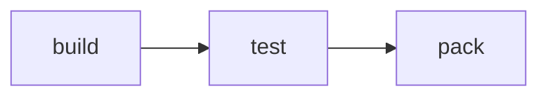

# Ngữ nghĩa chỉ định

Trong thiết kế một **Domain-Specific Language (DSL)**, ngữ pháp cho biết chương trình nào có cấu trúc hợp lệ, còn ngữ nghĩa xác định chương trình đó có ý nghĩa gì. **Ngữ nghĩa chỉ định (denotational semantics)** mô tả ý nghĩa của mỗi cấu trúc ngôn ngữ bằng cách ánh xạ nó tới một đối tượng toán học trong một miền ngữ nghĩa (semantic domain).

Thay vì mô tả từng bước máy tính phải thực hiện, cách tiếp cận này trả lời câu hỏi: “Cấu trúc DSL này biểu thị giá trị, trạng thái, hàm, tập kết quả hoặc mô hình nào?”. Ví dụ, một biểu thức `price * quantity` có thể được ánh xạ thành giá trị số thu được khi nhân hai giá trị của các biến; một khai báo pipeline có thể được ánh xạ thành đồ thị các bước và quan hệ phụ thuộc; một câu lệnh cập nhật có thể được ánh xạ thành hàm biến đổi trạng thái.

Ngữ nghĩa chỉ định đặc biệt hữu ích khi DSL cần có quy tắc chính xác, nhất quán và có thể suy luận. Nó giúp định nghĩa hành vi của ngôn ngữ độc lập với parser hoặc nền tảng thực thi, đồng thời tạo cơ sở để chứng minh tính đúng đắn của compiler, tối ưu hóa và các phép biến đổi chương trình.

## 1. Ngữ nghĩa chỉ định là gì?

Ngữ nghĩa chỉ định là phương pháp định nghĩa ý nghĩa của chương trình bằng một ánh xạ từ cấu trúc cú pháp sang các giá trị hoặc đối tượng toán học. Ánh xạ này thường được gọi là **hàm ngữ nghĩa (semantic function)** hoặc **denotation function**.

Ký hiệu hai dấu ngoặc vuông thường dùng để biểu diễn ý nghĩa của một biểu thức. Ví dụ:

\[
\llbracket e \rrbracket : Env \rightarrow Value
\]

Biểu thức (e) được ánh xạ thành một hàm nhận môi trường `Env` và trả về một giá trị `Value`. Môi trường chứa giá trị hiện tại của các tên biến hoặc định danh mà biểu thức sử dụng.

Nếu môi trường gán `x = 4` và `y = 3`, thì:

\[
\llbracket x + y \rrbracket(\rho) = 4 + 3 = 7
\]

Trong đó (\rho) là môi trường có ánh xạ `x` tới 4 và `y` tới 3. Công thức này định nghĩa ý nghĩa của biểu thức mà không cần chỉ ra CPU đọc token, tạo stack frame hay thực hiện lệnh máy nào.

Một định nghĩa ngữ nghĩa đầy đủ thường cần xác định:

- Các miền giá trị mà chương trình có thể biểu diễn.
- Cách tên biến và tên tài nguyên được ánh xạ tới giá trị.
- Ý nghĩa của từng loại biểu thức, câu lệnh và khai báo.
- Cách xử lý lỗi, giá trị không xác định hoặc tính toán không kết thúc.
- Cách các thành phần nhỏ kết hợp thành ý nghĩa của cấu trúc lớn.

## 2. Cú pháp trừu tượng và miền ngữ nghĩa

Để định nghĩa ngữ nghĩa, trước hết cần xác định DSL có những cấu trúc nào và chúng được biểu diễn ra sao sau khi parse. Thông thường, ta dùng **cú pháp trừu tượng (abstract syntax)** hoặc AST để mô tả các dạng cấu trúc của chương trình.

Ví dụ, một DSL biểu thức số học có thể có cú pháp trừu tượng:

```text
Expr ::= Integer(n)
       | Variable(name)
       | Add(left, right)
       | Multiply(left, right)
```

AST của `x + 2 * y` có thể được biểu diễn:

```text
Add(
    Variable("x"),
    Multiply(Integer(2), Variable("y"))
)
```

AST đã bỏ đi một số chi tiết bề mặt như khoảng trắng hoặc cách viết dấu ngoặc khi chúng không cần thiết để biểu diễn cấu trúc. Nó giữ lại quan hệ toán hạng và toán tử mà ngữ nghĩa cần xử lý.

**Miền ngữ nghĩa (semantic domain)** là tập hợp toán học dùng để biểu diễn ý nghĩa. Với DSL số học, miền giá trị có thể là số nguyên:

\[
Value = \mathbb{Z}
\]

Với DSL hỗ trợ số nguyên, số thực và boolean, miền có thể là hợp rời:

\[
Value = Integer + Real + Boolean
\]

Ký hiệu (+) ở đây biểu thị hợp các loại giá trị có phân biệt kiểu. Một hệ thống thực tế có thể cần thêm chuỗi, ngày giờ, danh sách, bản ghi, tài nguyên hoặc giá trị lỗi.

### 2.1. Môi trường (environment)

Môi trường là một ánh xạ từ tên định danh tới giá trị:

\[
Env = Identifier \rightarrow Value
\]

Ví dụ:

\[
\rho = \{x \mapsto 4,\ y \mapsto 3\}
\]

Khi cần cập nhật một ánh xạ, có thể dùng ký hiệu (\rho[x \mapsto v]), nghĩa là một môi trường mới giống (\rho), ngoại trừ tên `x` được ánh xạ tới giá trị (v).

Môi trường thường dùng để biểu diễn phạm vi tên và giá trị có thể đọc được tại một vị trí trong chương trình. Trong DSL cấu hình, nó có thể ánh xạ tên biến tới giá trị cấu hình; trong DSL quy trình, nó có thể ánh xạ tên bước hoặc tham số tới mô hình tương ứng.

### 2.2. Trạng thái (store)

Môi trường và trạng thái có thể phục vụ hai mục đích khác nhau. Môi trường thường biểu diễn cách phân giải tên; trạng thái lưu giá trị có thể thay đổi trong quá trình thực thi.

\[
Store = Location \rightarrow Value
\]

Ví dụ, môi trường ánh xạ `balance` tới vị trí bộ nhớ (\ell_1), còn store ánh xạ (\ell_1) tới số dư 100. Khi một lệnh gửi tiền cập nhật số dư, store thay đổi trong khi môi trường có thể giữ nguyên.

Không phải DSL nào cũng cần store có thể thay đổi. Một DSL khai báo cấu hình bất biến có thể chỉ cần môi trường hoặc mô hình dữ liệu. DSL mô tả quy trình, giao dịch hay chương trình có trạng thái thường cần một miền trạng thái rõ ràng.

## 3. Hàm ngữ nghĩa và tính hợp thành

Một đặc điểm quan trọng của ngữ nghĩa chỉ định là **tính hợp thành (compositionality)**: ý nghĩa của cấu trúc lớn được xác định từ ý nghĩa của các thành phần nhỏ hơn cùng với cách chúng được kết hợp.

Với biểu thức `Add(left, right)`, ý nghĩa được định nghĩa dựa trên ý nghĩa của `left` và `right`:

\[
\llbracket Add(e_1,e_2) \rrbracket(\rho)
= \llbracket e_1 \rrbracket(\rho)
+ \llbracket e_2 \rrbracket(\rho)
\]

Với `Multiply`:

\[
\llbracket Multiply(e_1,e_2) \rrbracket(\rho)
= \llbracket e_1 \rrbracket(\rho)
\times \llbracket e_2 \rrbracket(\rho)
\]

Vì vậy, để hiểu `x + 2 * y`, không cần định nghĩa riêng một trường hợp đặc biệt cho toàn bộ biểu thức. Ta định nghĩa ý nghĩa của số nguyên, biến, phép cộng và phép nhân; sau đó kết hợp chúng theo AST.

Tính hợp thành mang lại một số lợi ích:

- Mỗi cấu trúc ngôn ngữ có thể được định nghĩa và giải thích độc lập.
- Khi thêm một cấu trúc mới, thường chỉ cần định nghĩa ý nghĩa của cấu trúc đó dựa trên các thành phần đã có.
- Có thể suy luận về chương trình lớn bằng cách suy luận về các phần nhỏ.
- Dễ so sánh hai chương trình hoặc hai biểu thức có cùng ý nghĩa.
- Tạo cơ sở cho tối ưu hóa và kiểm chứng phép biến đổi.

Tính hợp thành không có nghĩa mọi chi tiết đều độc lập. Một biểu thức có thể phụ thuộc vào môi trường, trạng thái, ngoại lệ hoặc hiệu ứng. Điều quan trọng là các phụ thuộc đó được đưa vào miền và chữ ký của hàm ngữ nghĩa một cách tường minh.

## 4. Định nghĩa ngữ nghĩa cho biểu thức

Xét DSL số học đơn giản:

```text
expression ::= integer
             | identifier
             | expression "+" expression
             | expression "*" expression
```

Ta định nghĩa miền giá trị và hàm ngữ nghĩa:

\[
Value = \mathbb{Z}
\]

\[
\mathcal{E}: Expr \rightarrow (Env \rightarrow Value)
\]

Các quy tắc:

**Số nguyên**

\[
\mathcal{E}(Integer(n))(\rho) = n
\]

**Biến**

\[
\mathcal{E}(Variable(x))(\rho) = \rho(x)
\]

**Phép cộng**

\[
\mathcal{E}(Add(e_1,e_2))(\rho)
= \mathcal{E}(e_1)(\rho) + \mathcal{E}(e_2)(\rho)
\]

**Phép nhân**

\[
\mathcal{E}(Multiply(e_1,e_2))(\rho)
= \mathcal{E}(e_1)(\rho) \times \mathcal{E}(e_2)(\rho)
\]

Với môi trường (\rho = \{x \mapsto 4, y \mapsto 3\}):

\[
\begin{aligned}
\mathcal{E}(Add(Variable(x), Multiply(Integer(2), Variable(y))))(\rho)
&= \mathcal{E}(Variable(x))(\rho) \\
&\quad + \mathcal{E}(Multiply(Integer(2),Variable(y)))(\rho) \\
&= 4 + (2 \times 3) \\
&= 10
\end{aligned}
\]

Định nghĩa trên làm rõ cả thứ tự nhóm phép toán lẫn cách tra cứu biến. Độ ưu tiên của `*` so với `+` thường được phản ánh trong grammar/AST; hàm ngữ nghĩa sau đó diễn giải cấu trúc AST đã được xác định.

## 5. Định nghĩa ngữ nghĩa cho biểu thức boolean

DSL thường cần biểu thức điều kiện để mô tả quy tắc hoặc nhánh thực thi. Ta có thể mở rộng miền giá trị:

\[
Value = Integer + Boolean
\]

Và định nghĩa các node:

```text
BoolExpr ::= BooleanLiteral(value)
           | Equal(left, right)
           | LessThan(left, right)
           | And(left, right)
           | Not(expression)
```

Ví dụ:

\[
\mathcal{B}(BooleanLiteral(b))(\rho) = b
\]

\[
\mathcal{B}(LessThan(e_1,e_2))(\rho)
= \mathcal{E}(e_1)(\rho) < \mathcal{E}(e_2)(\rho)
\]

\[
\mathcal{B}(Not(b))(\rho) = \neg \mathcal{B}(b)(\rho)
\]

Với phép `And`, cần quyết định DSL dùng logic boolean thuần hay có short-circuit. Nếu biểu thức chỉ có giá trị thuần và không có hiệu ứng, có thể định nghĩa:

\[
\mathcal{B}(And(b_1,b_2))(\rho)
= \mathcal{B}(b_1)(\rho) \land \mathcal{B}(b_2)(\rho)
\]

Nếu vế phải có thể gây lỗi hoặc có hiệu ứng, thứ tự đánh giá và short-circuit cần được mô hình hóa rõ. Chẳng hạn, `false and (1 / 0 == 2)` có thể trả về `false` mà không đánh giá vế phải nếu DSL quy định short-circuit; nếu DSL đánh giá cả hai vế, phép chia cho không có thể gây lỗi.

## 6. Ngữ nghĩa của câu lệnh và phép biến đổi trạng thái

Biểu thức thường trả về giá trị. Câu lệnh có thể thay đổi trạng thái. Vì vậy, hàm ngữ nghĩa của câu lệnh thường có dạng:

\[
\mathcal{C}: Command \rightarrow (Store \rightarrow Store)
\]

Một câu lệnh được diễn giải thành hàm nhận trạng thái hiện tại và trả về trạng thái mới.

Ví dụ DSL:

```text
balance = balance + amount
```

Nếu môi trường ánh xạ `balance` tới vị trí (\ell_b), `amount` tới vị trí (\ell_a), ngữ nghĩa của phép gán có thể cập nhật store tại (\ell_b):

\[
\mathcal{C}(Assign(x,e))(\sigma)
= \sigma[\rho(x) \mapsto \mathcal{E}(e)(\rho)]
\]

Trong công thức này, (\rho) là môi trường phân giải tên và (\sigma) là store. Phép gán tính giá trị biểu thức trong môi trường hiện tại rồi tạo store mới với vị trí của `x` được cập nhật.

Một DSL khai báo có thể không có phép gán. Khi đó, câu lệnh có thể được ánh xạ thành một mô hình mới thay vì hàm biến đổi store. Chữ ký của hàm ngữ nghĩa phải phản ánh đúng bản chất của miền.

## 7. Ngữ nghĩa của cấu trúc điều kiện

Xét câu lệnh:

```text
if condition {
    thenCommand
} else {
    elseCommand
}
```

Với ngữ nghĩa trạng thái, có thể định nghĩa:

\[
\mathcal{C}(If(b,c_1,c_2))(\sigma)
= \begin{cases}
\mathcal{C}(c_1)(\sigma), & \mathcal{B}(b)(\rho_\sigma)=true \\
\mathcal{C}(c_2)(\sigma), & \mathcal{B}(b)(\rho_\sigma)=false
\end{cases}
\]

Trong đó (\rho_\sigma) là môi trường hoặc ngữ cảnh đọc giá trị tại trạng thái (\sigma). Công thức cho biết ý nghĩa của `if` là chọn kết quả ngữ nghĩa của nhánh tương ứng với giá trị điều kiện.

Nếu DSL không có nhánh `else`, có thể định nghĩa nhánh vắng mặt là câu lệnh không làm thay đổi trạng thái:

\[
\mathcal{C}(Skip)(\sigma)=\sigma
\]

Như vậy, `if condition { body }` có thể được hiểu là `If(condition, body, Skip)`.

## 8. Ngữ nghĩa của vòng lặp và điểm bất động

Vòng lặp là cấu trúc phức tạp hơn vì số lần thực hiện phụ thuộc vào trạng thái và điều kiện. Xét:

```text
while condition {
    body
}
```

Về mặt ý nghĩa, vòng lặp tiếp tục áp dụng ngữ nghĩa của `body` khi điều kiện đúng và kết thúc khi điều kiện sai. Một cách định nghĩa toán học sử dụng **điểm bất động (fixed point)**.

Đặt (F) là hàm biến đổi trên các hàm trạng thái:

\[
F(g)(\sigma) =
\begin{cases}
g(\mathcal{C}(body)(\sigma)), & \mathcal{B}(condition)(\rho_\sigma)=true \\
\sigma, & \mathcal{B}(condition)(\rho_\sigma)=false
\end{cases}
\]

Ngữ nghĩa của vòng lặp được mô tả bằng một điểm bất động của (F):

\[
\mathcal{C}(While(condition,body)) = fix(F)
\]

Trực giác là kết quả của vòng lặp phải nhất quán với quy tắc: nếu điều kiện còn đúng thì thực hiện thân vòng lặp rồi tiếp tục; nếu sai thì giữ trạng thái và kết thúc.

Trong lý thuyết miền (domain theory), thường dùng **điểm bất động nhỏ nhất (least fixed point)** để chọn nghiệm phù hợp, đặc biệt khi cần biểu diễn tính không xác định hoặc vòng lặp không kết thúc. Ký hiệu (fix(F)) cần được hiểu trong miền toán học thích hợp; không phải mọi hàm tùy ý đều có điểm bất động nhỏ nhất nếu chưa xác định các điều kiện cần thiết.

Với DSL chỉ mô tả cấu hình, có thể không có vòng lặp runtime. Nhưng DSL workflow có thể có bước lặp, retry hoặc polling. Khi đó, ngữ nghĩa cần xác định điều kiện dừng, giới hạn số lần, thời gian chờ và cách xử lý lỗi để hành vi không mơ hồ.

## 9. Ngữ nghĩa của khai báo và phạm vi tên

Một DSL thường cho phép khai báo biến, tài nguyên, pipeline hoặc quy tắc. Ý nghĩa của khai báo có thể là mở rộng môi trường hoặc tạo một mô hình miền.

Ví dụ:

```text
let taxRate = 0.1
let total = subtotal * (1 + taxRate)
```

Một môi trường có thể được mở rộng khi xử lý khai báo:

\[
\mathcal{D}(Let(x,e))(\rho)
= \rho[x \mapsto \mathcal{E}(e)(\rho)]
\]

Nếu DSL có phạm vi lồng nhau, mỗi khối có thể tạo một môi trường con. Khi rời khối, môi trường bên ngoài được khôi phục. Cần xác định quy tắc shadowing: một khai báo bên trong có được phép dùng lại tên đã khai báo bên ngoài hay không.

Ví dụ:

```text
let limit = 10

scope {
    let limit = 5
    use limit
}

use limit
```

Nếu DSL dùng lexical scoping, `use limit` bên trong khối đọc giá trị 5; câu lệnh bên ngoài khối đọc giá trị 10. Ngữ nghĩa chỉ định có thể biểu diễn điều này bằng cách định nghĩa cách tạo và tra cứu môi trường con.

## 10. Ngữ nghĩa cho DSL khai báo và DSL quy trình

Không phải DSL nào cũng biểu diễn chương trình tính toán số học. Miền ngữ nghĩa nên phản ánh lĩnh vực mà DSL mô tả.

### 10.1. DSL cấu hình

Một DSL cấu hình có thể ánh xạ file nguồn thành một cấu hình chuẩn:

\[
\mathcal{D}: ConfigSource \rightarrow ConfigurationModel
\]

Ví dụ:

```text
service "orders-api" {
    replicas = 3
    image = "example/orders:2.4"
}
```

Denotation của chương trình có thể là một record:

```text
ServiceConfig {
    name = "orders-api"
    replicas = 3
    image = "example/orders:2.4"
}
```

Ngữ nghĩa cần quy định giá trị mặc định, cách hợp nhất cấu hình từ nhiều file, kế thừa theo môi trường và xử lý thuộc tính xung đột. Nếu cùng một cấu hình có thể được viết theo nhiều cách cú pháp, các cách đó nên ánh xạ tới cùng mô hình khi chúng có cùng ý nghĩa.

### 10.2. DSL workflow

Một DSL workflow có thể ánh xạ chương trình thành đồ thị có hướng:

\[
\mathcal{W}: WorkflowSource \rightarrow (Steps, Dependencies)
\]

Ví dụ:

```text
step build { command "gradle build" }
step test  { command "gradle test" after build }
step pack  { command "gradle jar" after test }
```

Denotation có thể là đồ thị:



Ngữ nghĩa cần xác định `after build` có nghĩa là `test` chỉ được chạy sau khi `build` hoàn tất thành công hay chỉ sau khi nó kết thúc bất kể kết quả. Cần quy định cách xử lý dependency không tồn tại, chu trình, bước thất bại, retry và nhiều bước có thể chạy song song.

### 10.3. DSL quy tắc nghiệp vụ

Một DSL quy tắc có thể ánh xạ mỗi rule thành một hàm từ ngữ cảnh sang quyết định:

\[
\mathcal{R}: Rule \rightarrow (Context \rightarrow Decision)
\]

Ví dụ:

```text
rule "priority-customer" {
    when customer.totalSpent > 10000000
    then customer.setPriority(true)
}
```

Denotation của rule có thể là một hàm nhận thông tin khách hàng và trả về quyết định hoặc tập hành động. Nếu rule có hiệu ứng, miền kết quả cần mô tả các hiệu ứng đó thay vì chỉ trả về boolean.

## 11. Giá trị lỗi, không xác định và tính không kết thúc

Các định nghĩa ngữ nghĩa đơn giản thường giả định mọi biểu thức đều trả về một giá trị. Trong ngôn ngữ thực tế, biểu thức có thể lỗi, tham chiếu biến chưa khai báo hoặc không kết thúc.

Một cách mở rộng miền kết quả:

\[
Result(Value) = Value + Error
\]

Hàm ngữ nghĩa có thể trả về `Result<Value>` thay vì chỉ `Value`:

\[
\mathcal{E}: Expr \rightarrow (Env \rightarrow Result(Value))
\]

Ví dụ, phép chia có thể được định nghĩa:

\[
\mathcal{E}(Divide(e_1,e_2))(\rho) =
\begin{cases}
Error(DivisionByZero), & \mathcal{E}(e_2)(\rho)=0 \\
\mathcal{E}(e_1)(\rho) / \mathcal{E}(e_2)(\rho), & \text{otherwise}
\end{cases}
\]

Đây là dạng minh họa; định nghĩa thực tế cần xử lý trường hợp chính các biểu thức con đã lỗi và kiểu dữ liệu không hợp lệ.

Với tính không kết thúc, lý thuyết ngữ nghĩa có thể bổ sung phần tử (\bot) (bottom) biểu diễn kết quả không xác định hoặc phép tính không có kết quả hữu hạn:

\[
Value_\bot = Value \cup \{\bot\}
\]

Trong miền ngữ nghĩa, (\bot) thường là phần tử nhỏ nhất theo một thứ tự thông tin. Nó không đơn giản luôn đồng nghĩa với `null`, `false` hay một lỗi nghiệp vụ. Cần phân biệt rõ lỗi có thể quan sát được với tính không kết thúc hoặc thiếu thông tin.

## 12. Ngữ nghĩa có hiệu ứng và trạng thái

Một số DSL mô tả thao tác có tác dụng phụ như ghi file, gửi thông điệp, cập nhật database hoặc triển khai dịch vụ. Nếu chỉ ánh xạ câu lệnh thành một giá trị, định nghĩa sẽ không mô tả đủ hành vi.

Có thể mở rộng miền kết quả để chứa trạng thái và hiệu ứng:

\[
\mathcal{C}: Command \rightarrow (State \rightarrow Result(State, Output))
\]

Trong đó:

- `State` là trạng thái miền hoặc trạng thái runtime.
- `Result` biểu diễn thành công hoặc lỗi.
- `Output` có thể chứa sự kiện, log, yêu cầu gọi dịch vụ hoặc các hiệu ứng được mô hình hóa.

Ví dụ, một lệnh `emit OrderPlaced` có thể được định nghĩa là thêm sự kiện `OrderPlaced` vào danh sách output của quá trình xử lý. Một lệnh `writeFile` có thể trả về trạng thái mới cùng hiệu ứng ghi file, thay vì thực hiện I/O trực tiếp trong hàm toán học.

Việc biểu diễn hiệu ứng tường minh giúp ngữ nghĩa dễ suy luận hơn. Nó cũng cho phép phân biệt phần tính toán thuần với phần thực thi có tác động bên ngoài. Runtime sau đó chịu trách nhiệm diễn giải các hiệu ứng theo môi trường cụ thể.

## 13. Ngữ nghĩa chỉ định và các phương pháp ngữ nghĩa khác

Ba phương pháp thường được giới thiệu trong lý thuyết ngôn ngữ lập trình là ngữ nghĩa chỉ định, ngữ nghĩa thao tác và ngữ nghĩa tiên đề.

### 13.1. Ngữ nghĩa chỉ định (denotational semantics)

Định nghĩa ý nghĩa bằng cách ánh xạ cấu trúc ngôn ngữ sang đối tượng toán học như giá trị, hàm, trạng thái hoặc đồ thị. Trọng tâm là ý nghĩa trừu tượng của chương trình.

### 13.2. Ngữ nghĩa thao tác (operational semantics)

Định nghĩa ý nghĩa bằng các bước chuyển trạng thái hoặc cấu hình thực thi. Ví dụ, quy tắc chuyển:

\[
\langle x := x + 1,\ \sigma \rangle
\rightarrow
\langle skip,\ \sigma[x \mapsto \sigma(x)+1] \rangle
\]

cho biết một lệnh gán được thực hiện như thế nào trên trạng thái. Cách này gần với mô hình máy trừu tượng và hữu ích để mô tả thứ tự đánh giá hoặc hành vi từng bước.

### 13.3. Ngữ nghĩa tiên đề (axiomatic semantics)

Định nghĩa ý nghĩa thông qua các mệnh đề logic về điều kiện trước và sau. Một dạng phổ biến là Hoare triple:

\[
\{P\}\ C\ \{Q\}
\]

Nó diễn đạt rằng nếu điều kiện trước (P) đúng và lệnh (C) kết thúc, thì điều kiện sau (Q) đúng.

| Phương pháp | Cách mô tả ý nghĩa | Trọng tâm |
|---|---|---|
| Chỉ định | Ánh xạ sang miền toán học | Kết quả hoặc ý nghĩa trừu tượng |
| Thao tác | Quy tắc chuyển trạng thái | Các bước thực hiện |
| Tiên đề | Mệnh đề logic và quy tắc suy luận | Tính đúng đắn của chương trình |

Các phương pháp này bổ sung cho nhau. Một DSL có thể được định nghĩa bằng ngữ nghĩa chỉ định để nêu rõ ý nghĩa, dùng ngữ nghĩa thao tác để mô phỏng runtime và dùng Hoare logic để chứng minh các thuộc tính an toàn.

## 14. Ngữ nghĩa chỉ định trong thiết kế DSL

Khi thiết kế DSL, không nhất thiết phải viết một định nghĩa toán học đầy đủ cho mọi cấu trúc ngay từ đầu. Tuy nhiên, tư duy chỉ định giúp nhóm làm rõ ý nghĩa của các khai báo và tránh để hành vi phụ thuộc vào chi tiết triển khai.

Một quy trình có thể gồm:

1. **Xác định cú pháp trừu tượng**: liệt kê node hoặc loại khai báo mà DSL hỗ trợ.
2. **Xác định miền ngữ nghĩa**: giá trị, trạng thái, tài nguyên, sự kiện hoặc mô hình nào biểu diễn ý nghĩa.
3. **Xác định ngữ cảnh**: môi trường, trạng thái hoặc tham số nào ảnh hưởng đến cách diễn giải.
4. **Định nghĩa hàm ngữ nghĩa**: mỗi cấu trúc cú pháp được ánh xạ thành giá trị hoặc hàm nào.
5. **Định nghĩa trường hợp biên**: lỗi, giá trị thiếu, tham chiếu không hợp lệ, hiệu ứng và không kết thúc.
6. **Kiểm tra tính hợp thành**: ý nghĩa của cấu trúc lớn có thể suy ra từ các thành phần con không?
7. **Đối chiếu với triển khai**: interpreter hoặc compiler có thực hiện đúng denotation đã định nghĩa không?
8. **Viết ví dụ và thuộc tính**: đưa ra chương trình mẫu, kết quả mong đợi và các quy tắc có thể kiểm chứng.

Với DSL cấu hình, có thể bắt đầu bằng việc định nghĩa một hàm ánh xạ source model sang configuration model. Với DSL workflow, xác định denotation là đồ thị bước và dependency. Với DSL biểu thức, định nghĩa miền giá trị, môi trường và hàm đánh giá biểu thức.

## 15. Tính tương đương ngữ nghĩa và tối ưu hóa

Hai chương trình có thể có cú pháp khác nhau nhưng cùng ý nghĩa. Ta nói chúng **tương đương ngữ nghĩa (semantically equivalent)** nếu denotation của chúng giống nhau trong mọi ngữ cảnh được xét.

\[
P_1 \equiv P_2
\quad \text{nếu} \quad
\llbracket P_1 \rrbracket = \llbracket P_2 \rrbracket
\]

Ví dụ, nếu DSL quy định phép cộng số nguyên thuần và không có hiệu ứng, `x + 0` có thể tương đương với `x`:

\[
\llbracket x + 0 \rrbracket(\rho)
= \llbracket x \rrbracket(\rho)
\]

Compiler có thể dùng tính chất này để tối ưu biểu thức. Tuy nhiên, phép biến đổi chỉ hợp lệ khi các giả định của miền được thỏa mãn. Nếu biểu thức có thể gây lỗi, đọc biến có thể có hiệu ứng hoặc số học có overflow theo quy tắc đặc biệt, cần xem xét những hành vi quan sát được đó.

Ví dụ với workflow, hai cách khai báo có thể tạo cùng đồ thị dependency dù thứ tự viết các khai báo khác nhau. Nếu thứ tự source không mang ý nghĩa, compiler có thể chuẩn hóa hoặc sắp xếp mô hình. Nếu thứ tự khai báo quyết định thứ tự thực thi, phép sắp xếp có thể làm thay đổi denotation và không được phép.

Ngữ nghĩa chỉ định cung cấp một tiêu chuẩn để đánh giá tối ưu hóa: phép biến đổi có giữ nguyên ý nghĩa được định nghĩa hay không?

## 16. Bảo toàn ngữ nghĩa khi biên dịch

Khi DSL được biên dịch sang ngôn ngữ hoặc nền tảng khác, cần bảo đảm chương trình đích thể hiện cùng ý nghĩa với chương trình nguồn. Gọi:

- (\llbracket P \rrbracket_S) là ý nghĩa của chương trình DSL nguồn.
- (Compile(P)) là chương trình đích được sinh ra.
- (\llbracket Compile(P) \rrbracket_T) là ý nghĩa của chương trình đích.

Mục tiêu bảo toàn ngữ nghĩa có thể viết:

\[
\llbracket P \rrbracket_S
= \llbracket Compile(P) \rrbracket_T
\]

Trong hệ thống thực tế, có thể cần một quan hệ tương đương hoặc ánh xạ giữa miền kết quả nguồn và đích thay vì đòi hỏi hai miền giống hệt nhau.

Ví dụ, DSL workflow được biên dịch thành cấu hình CI. Nếu DSL quy định bước `test` chỉ chạy sau khi `compile` thành công, cấu hình đích phải bảo toàn điều kiện đó. Chỉ tạo ra hai job có cùng tên là chưa đủ; quan hệ phụ thuộc và chính sách khi job thất bại cũng phải tương ứng.

## 17. Lỗi thường gặp khi định nghĩa ngữ nghĩa chỉ định

| Vấn đề | Hệ quả | Cách khắc phục |
|---|---|---|
| Không định nghĩa miền giá trị | Không rõ biểu thức có thể trả về kiểu nào | Xác định semantic domains và kiểu dữ liệu |
| Hàm ngữ nghĩa bỏ qua môi trường | Không thể diễn giải biến hoặc phạm vi tên | Đưa environment vào chữ ký hàm khi cần |
| Trộn môi trường với trạng thái mutable | Quy tắc cập nhật và tra cứu tên khó hiểu | Phân biệt environment và store |
| Chỉ định nghĩa trường hợp thành công | Hành vi lỗi hoặc giá trị thiếu mơ hồ | Mở rộng miền kết quả để mô tả lỗi/undefined |
| Không làm rõ thứ tự đánh giá | Các biểu thức có hiệu ứng có thể cho kết quả khác nhau | Định nghĩa evaluation order và effects |
| Ngữ nghĩa của cấu trúc lớn được viết độc lập với cấu trúc con | Mất tính hợp thành, khó mở rộng | Định nghĩa bằng denotation của các thành phần |
| Dùng công thức nhưng không giải thích ký hiệu | Người triển khai hiểu khác nhau | Định nghĩa từng miền, hàm và giả định |
| Tối ưu dựa trên giả định không được nêu | Compiler có thể đổi hành vi chương trình | Chứng minh hoặc kiểm tra bảo toàn ngữ nghĩa |
| Định nghĩa vòng lặp mà không xét không kết thúc | Mô hình không thể biểu diễn mọi hành vi | Dùng miền có bottom hoặc fixed-point semantics khi cần |

## 18. Kiểm chứng và kiểm thử dựa trên ngữ nghĩa

Ngữ nghĩa chỉ định có thể được dùng làm chuẩn tham chiếu cho triển khai. Một số cách kiểm tra:

- **Ví dụ tính tay**: chọn môi trường cụ thể và tính denotation của biểu thức hoặc chương trình.
- **Kiểm thử theo bảng ngữ nghĩa**: với mỗi node AST, tạo đầu vào và kết quả mong đợi.
- **Kiểm thử tính hợp thành**: xác nhận denotation của cấu trúc lớn bằng cách kết hợp denotation của các thành phần.
- **Differential testing**: so sánh kết quả interpreter tham chiếu với compiler hoặc runtime tối ưu.
- **Kiểm tra tương đương**: xác nhận các phép biến đổi được cho là bảo toàn ý nghĩa trong những điều kiện xác định.
- **Property-based testing**: sinh nhiều AST và môi trường, kiểm tra các tính chất như `x + 0` tương đương `x` khi các giả định phù hợp.

Ví dụ, nếu `Add` được định nghĩa trên số nguyên không có overflow, có thể kiểm tra tính giao hoán:

\[
\mathcal{E}(Add(e_1,e_2))(\rho)
= \mathcal{E}(Add(e_2,e_1))(\rho)
\]

Nhưng nếu DSL hỗ trợ chuỗi và toán tử `+` có nghĩa nối chuỗi, hoặc có hiệu ứng khi đánh giá vế, thuộc tính trên có thể không đúng. Mọi tính chất kiểm thử phải dựa trên đúng miền và giả định ngữ nghĩa đã định nghĩa.

## 19. Ví dụ tổng hợp: định nghĩa ngữ nghĩa cho DSL tính giá đơn hàng

Giả sử DSL cho phép khai báo:

```text
price = unitPrice * quantity
discountedPrice = price * (1 - discountRate)
eligible = quantity > 0 and customerActive
```

Mô hình trừu tượng có thể gồm:

```text
Expr ::= Number(value)
       | Name(identifier)
       | Add(left, right)
       | Multiply(left, right)
       | Subtract(left, right)
       | GreaterThan(left, right)
       | And(left, right)

Declaration ::= Let(name, expression)
```

Miền giá trị:

\[
Value = Decimal + Integer + Boolean
\]

Môi trường:

\[
Env = Identifier \rightarrow Value
\]

Hàm đánh giá số:

\[
\mathcal{E}(Number(n))(\rho)=n
\]

\[
\mathcal{E}(Name(x))(\rho)=\rho(x)
\]

\[
\mathcal{E}(Multiply(a,b))(\rho)
=\mathcal{E}(a)(\rho)\times\mathcal{E}(b)(\rho)
\]

\[
\mathcal{E}(Subtract(a,b))(\rho)
=\mathcal{E}(a)(\rho)-\mathcal{E}(b)(\rho)
\]

Hàm đánh giá so sánh:

\[
\mathcal{B}(GreaterThan(a,b))(\rho)
=\mathcal{E}(a)(\rho)>\mathcal{E}(b)(\rho)
\]

Hàm xử lý khai báo:

\[
\mathcal{D}(Let(x,e))(\rho)
=\rho[x\mapsto\mathcal{E}(e)(\rho)]
\]

Với môi trường đầu vào:

\[
\rho_0 = \{
unitPrice\mapsto 120000,
quantity\mapsto 2,
discountRate\mapsto 0.1,
customerActive\mapsto true
\}
\]

Ta có:

\[
price = 120000\times 2 = 240000
\]

\[
discountedPrice = 240000\times(1-0.1)=216000
\]

Và:

\[
eligible = (2>0)\land true = true
\]

Ví dụ này cho thấy một DSL có thể được định nghĩa bằng các hàm toán học nhỏ, sau đó ghép lại để xác định ý nghĩa của toàn bộ khai báo. Trong triển khai thật, cần quy định kiểu decimal, độ chính xác, làm tròn, đơn vị tiền tệ, giá trị thiếu và lỗi kiểu dữ liệu.

## 20. Kết luận

Ngữ nghĩa chỉ định mô tả ý nghĩa của DSL bằng cách ánh xạ cấu trúc cú pháp sang miền toán học như giá trị, hàm, trạng thái, đồ thị hoặc quyết định nghiệp vụ. Cách tiếp cận này nhấn mạnh tính hợp thành: ý nghĩa của cấu trúc lớn được xây dựng từ ý nghĩa của các thành phần nhỏ cùng với quy tắc kết hợp.

Để định nghĩa tốt, cần xác định rõ cú pháp trừu tượng, miền giá trị, môi trường, trạng thái và hàm ngữ nghĩa. Những trường hợp lỗi, hiệu ứng, vòng lặp và không kết thúc cũng cần được mô hình hóa khi chúng thuộc phạm vi của DSL. Khi có định nghĩa ngữ nghĩa rõ ràng, nhóm phát triển có thể triển khai interpreter hoặc compiler nhất quán, kiểm tra các phép tối ưu hóa và trao đổi chính xác về hành vi của ngôn ngữ.
