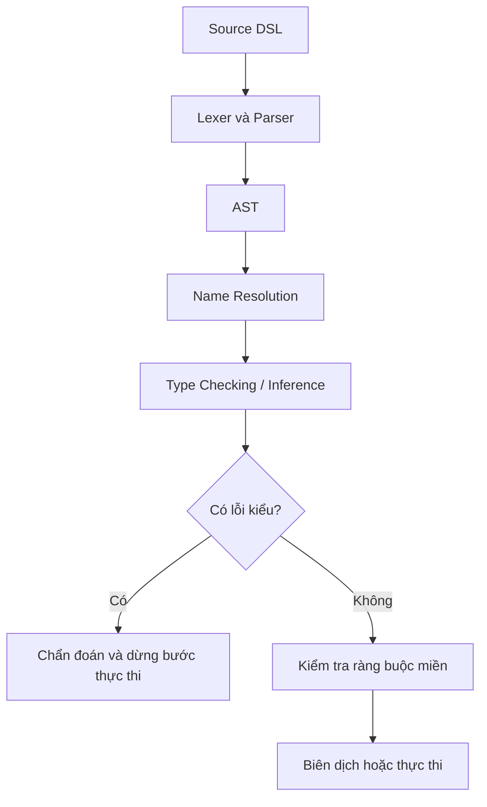

# Lỗi kiểu

Trong ngôn ngữ chuyên biệt miền (Domain-Specific Language, DSL), hệ kiểu quy định những loại giá trị nào tồn tại, cách chúng kết hợp với nhau và những phép toán nào được phép thực hiện. **Lỗi kiểu (type error)** xuất hiện khi một biểu thức, phép gán, lời gọi hàm hoặc cấu trúc chương trình sử dụng giá trị theo cách không phù hợp với kiểu mà ngôn ngữ yêu cầu.

Ví dụ, nếu `tong_tien` có kiểu `Money` còn `ngay_giao` có kiểu `Date`, biểu thức `tong_tien + ngay_giao` thường không hợp lệ. Hai giá trị đều có thể được lưu dưới dạng dữ liệu trong máy tính, nhưng chúng biểu diễn những khái niệm khác nhau và không có phép cộng tự nhiên trong miền. Hệ kiểu giúp phát hiện lỗi này trước khi chương trình tạo ra kết quả sai.

Lỗi kiểu có thể được phát hiện khi biên dịch, khi kiểm tra mô hình hoặc trong lúc chạy, tùy thiết kế DSL. Một thông báo lỗi tốt cần chỉ rõ vị trí, kiểu thực tế, kiểu mong đợi và cách sửa có thể áp dụng. Trong DSL miền, việc kiểm tra kiểu còn phải quan tâm đến đơn vị đo, tiền tệ, trạng thái, định danh và những kiểu dữ liệu mang ý nghĩa nghiệp vụ.

## 1. Lỗi kiểu là gì?

Kiểu dữ liệu mô tả tập giá trị mà một biểu thức có thể tạo ra cùng với các thao tác hợp lệ trên những giá trị đó. Lỗi kiểu xảy ra khi chương trình vi phạm hợp đồng này.

Ví dụ:

```text
so_luong: Integer = 5
don_gia: Money = 100000 VND

thanh_tien = so_luong * don_gia       # hợp lệ nếu DSL định nghĩa phép nhân này
ngay_giao = 2026-11-20
ket_qua = don_gia + ngay_giao         # lỗi kiểu
```

Ở dòng cuối, toán tử `+` nhận một giá trị tiền tệ và một giá trị ngày. Nếu DSL không định nghĩa phép cộng giữa `Money` và `Date`, biểu thức không có ý nghĩa kiểu hợp lệ.

Lỗi kiểu không nhất thiết là lỗi cú pháp. Parser có thể nhận diện cấu trúc `a + b` hoàn toàn chính xác, nhưng bước kiểm tra kiểu phát hiện rằng hai toán hạng không tương thích.

### 1.1. Kiểu và giá trị

Giá trị là dữ liệu cụ thể, còn kiểu mô tả loại dữ liệu đó. Chẳng hạn `42` là một giá trị có thể thuộc kiểu `Integer`; `"DH102"` là một giá trị có thể thuộc kiểu `String`; `650000 VND` là một giá trị thuộc kiểu `Money`.

Kiểu không chỉ quyết định cách lưu trữ. Nó còn xác định ý nghĩa và các thao tác được phép. `OrderId` và `CustomerId` có thể đều được lưu dưới dạng chuỗi, nhưng việc dùng nhầm mã khách hàng ở nơi cần mã đơn hàng có thể là lỗi kiểu nếu DSL phân biệt hai kiểu định danh này.

### 1.2. Hệ kiểu là hợp đồng của ngôn ngữ

Hệ kiểu (type system) là tập quy tắc xác định cách gán kiểu cho biểu thức và cách kiểm tra chương trình. Hệ kiểu có thể quy định:

- Kiểu nào được khai báo và sử dụng.
- Toán tử chấp nhận những kiểu toán hạng nào.
- Hàm nhận tham số có kiểu gì và trả về kiểu gì.
- Giá trị nào có thể gán cho biến hoặc thuộc tính.
- Kiểu nào có thể chuyển đổi hoặc thay thế cho kiểu khác.
- Cách xử lý giá trị thiếu, null hoặc chưa xác định.
- Khi nào lỗi được phát hiện và cách báo lỗi.

Một hệ kiểu rõ ràng giúp người viết DSL dự đoán được chương trình nào hợp lệ và giúp runtime tránh phải đoán ý nghĩa của dữ liệu.

## 2. Những tình huống thường gây lỗi kiểu

Lỗi kiểu có thể xuất hiện ở nhiều cấu trúc của DSL, không chỉ trong phép toán số học.

### 2.1. Toán hạng không tương thích

Toán tử có hợp đồng kiểu riêng. Ví dụ, phép cộng số thường nhận hai toán hạng số; phép so sánh ngày nhận hai giá trị ngày hoặc thời điểm tương thích.

```text
so_luong + 3              # hợp lệ nếu so_luong là kiểu số phù hợp
ngay_tao < ngay_ket_thuc  # hợp lệ nếu hai giá trị có kiểu thời gian tương thích
so_luong + ngay_tao       # lỗi kiểu
```

### 2.2. Gán giá trị sai kiểu

Giá trị bên phải phép gán phải tương thích với kiểu của biến hoặc thuộc tính bên trái.

```text
so_luong: Integer
so_luong = 12             # hợp lệ
so_luong = "mười hai"     # lỗi kiểu
```

### 2.3. Truyền đối số không đúng kiểu

Khi gọi hàm, mỗi đối số phải phù hợp với kiểu tham số tương ứng.

```text
tinh_phi(khoang_cach: Distance, don_gia: MoneyPerDistance)

tinh_phi(8 km, 5000 VND/km)    # hợp lệ
tinh_phi("8 km", 5000)        # có thể có lỗi kiểu ở cả hai đối số
```

### 2.4. Trả về sai kiểu

Nếu hàm khai báo trả về `Money`, mọi nhánh trả về bình thường phải tạo ra giá trị tương thích với `Money`.

```text
function tinh_tien() -> Money {
    return 30000 VND
}
```

Nếu một nhánh trả về chuỗi thông báo thay vì tiền tệ, hệ kiểu cần báo lỗi hoặc yêu cầu hàm sử dụng một kiểu kết quả tổng quát như `Result<Money, Error>`.

### 2.5. Truy cập thuộc tính không tồn tại hoặc sai kiểu

Một biểu thức `don_hang.tong_tien` chỉ hợp lệ nếu kiểu của `don_hang` có thuộc tính `tong_tien` và quyền truy cập cho phép sử dụng thuộc tính đó. Nếu tên thuộc tính không tồn tại, đây thường là lỗi phân giải tên hoặc lỗi truy cập thành viên; nếu thuộc tính tồn tại nhưng kiểu của nó không phù hợp với phép toán tiếp theo, đó là lỗi kiểu.

### 2.6. Nhánh điều kiện trả về kiểu không thống nhất

Nếu biểu thức điều kiện tạo ra một giá trị trong cả hai nhánh, hai nhánh cần có kiểu kết quả tương thích.

```text
ket_qua = if da_thanh_toan then 100000 VND else "chưa thanh toán"
```

Biểu thức trên trộn `Money` và `String`. DSL có thể từ chối, hoặc yêu cầu khai báo kiểu kết quả chung rõ ràng như `PaymentStatus` hay `Result<Money, String>`.

### 2.7. Kiểu phần tử của collection không phù hợp

Một danh sách được khai báo là `List<Money>` không nên nhận một phần tử `Date`.

```text
phi_phat_sinh: List<Money> = [10000 VND, 20000 VND]
phi_phat_sinh.add(2026-11-20)   # lỗi kiểu
```

### 2.8. Dùng sai đơn vị hoặc kiểu miền

Các đại lượng có thể cùng được biểu diễn bằng số nhưng không thể thay thế tùy ý.

```text
khoi_luong: Weight = 5 kg
khoang_cach: Distance = 5 km
ket_qua = khoi_luong + khoang_cach  # lỗi kiểu
```

Đây là trường hợp đặc biệt quan trọng trong DSL kỹ thuật, tài chính, logistics, khoa học và cấu hình hệ thống.

## 3. Lỗi kiểu tĩnh và lỗi kiểu động

Thời điểm phát hiện lỗi phụ thuộc mô hình kiểu của DSL.

### 3.1. Kiểm tra kiểu tĩnh

Trong hệ kiểu tĩnh (static typing), compiler hoặc validator xác định kiểu biểu thức trước khi chương trình được thực thi. Nếu chương trình có phép toán không hợp lệ, quá trình kiểm tra sẽ báo lỗi.

Ví dụ:

```text
gia_tri: Money = 50000 VND
ngay: Date = 2026-11-20

ket_qua = gia_tri + ngay   # bị phát hiện trước khi chạy
```

Ưu điểm của kiểm tra tĩnh là lỗi có thể được phát hiện sớm, thông báo có thể gắn với mã nguồn và runtime ít phải xử lý các trường hợp sai kiểu. Đổi lại, hệ kiểu và bộ kiểm tra có thể phức tạp, nhất là khi DSL hỗ trợ kiểu tổng quát, suy luận kiểu hoặc plugin.

### 3.2. Kiểm tra kiểu động

Trong hệ kiểu động (dynamic typing), kiểu thực tế của giá trị được kiểm tra trong lúc chạy. Một biểu thức có thể được chấp nhận khi parse nhưng chỉ phát sinh lỗi khi dữ liệu đầu vào không phù hợp.

Ví dụ, một trường `gia_tri` được đọc từ dữ liệu bên ngoài có thể chứa số trong một bản ghi và chuỗi trong bản ghi khác. Khi runtime thực hiện `gia_tri + 10`, kết quả phụ thuộc kiểu thực tế.

Ưu điểm là linh hoạt khi dữ liệu không cố định hoặc DSL được dùng để xử lý nội dung biến đổi. Hạn chế là một số lỗi chỉ xuất hiện khi chương trình chạy trên dữ liệu cụ thể, nên cần kiểm thử và xử lý lỗi runtime tốt.

### 3.3. Hệ kiểu lai

DSL có thể kết hợp kiểm tra tĩnh và động. Compiler kiểm tra những gì có thể xác định từ chương trình; runtime kiểm tra những gì phụ thuộc dữ liệu thực tế.

Ví dụ, compiler xác nhận `tong_tien` được khai báo là `Money`, nhưng runtime vẫn phải kiểm tra dữ liệu được nạp từ dịch vụ có đúng định dạng và mã tiền tệ hợp lệ không.

### 3.4. So sánh

| Tiêu chí | Kiểu tĩnh | Kiểu động | Kiểu lai |
|---|---|---|---|
| Thời điểm kiểm tra | Trước khi chạy | Trong khi chạy | Cả hai |
| Lỗi có thể phát hiện sớm | Nhiều lỗi cấu trúc kiểu | Ít hơn nếu thiếu dữ liệu thực tế | Các lỗi suy ra được từ chương trình |
| Linh hoạt dữ liệu | Thường chặt chẽ hơn | Thường linh hoạt hơn | Tùy vùng kiểm tra |
| Chi phí runtime | Có thể thấp hơn | Có thể cần kiểm tra thường xuyên | Phụ thuộc phần kiểm tra động |
| Thông tin cần cho compiler | Kiểu khai báo và quy tắc kiểu | Có thể ít hơn | Một phần tĩnh và một phần runtime |

Không có lựa chọn phù hợp cho mọi DSL. DSL cấu hình hạ tầng hoặc chính sách tài chính thường hưởng lợi từ kiểm tra tĩnh; DSL xử lý dữ liệu linh hoạt có thể cần thêm kiểm tra động.

## 4. Phán đoán kiểu và quy tắc suy luận

Để mô tả hệ kiểu một cách hình thức, có thể dùng **phán đoán kiểu (typing judgment)**. Một ký hiệu thường gặp là:

```text
Gamma |- e : T
```

Đọc là: trong môi trường kiểu `Gamma`, biểu thức `e` có kiểu `T`.

`Gamma` chứa thông tin về kiểu của biến, hàm, thuộc tính và những tên có thể sử dụng. Dấu `|-` biểu thị quan hệ suy ra hoặc chứng minh phán đoán.

### 4.1. Quy tắc cho literal

Literal số nguyên có thể được gán kiểu `Integer`:

```text
---------------------- (T-Integer)
Gamma |- 42 : Integer
```

Literal Boolean có kiểu `Boolean`:

```text
-------------------------- (T-Boolean)
Gamma |- true : Boolean
```

Literal tiền tệ có thể mang kiểu `Money` với thông tin đơn vị:

```text
------------------------------------- (T-Money)
Gamma |- 50000 VND : Money<VND>
```

### 4.2. Quy tắc cho biến

Nếu môi trường kiểu ghi nhận `x : T`, có thể suy ra:

```text
x : T in Gamma
------------------ (T-Variable)
Gamma |- x : T
```

Nếu tên chưa được khai báo, đây trước hết là lỗi phân giải tên. Không nên gán cho nó một kiểu tùy ý chỉ để tiếp tục kiểm tra.

### 4.3. Quy tắc cho phép cộng

Với phép cộng số nguyên:

```text
Gamma |- e1 : Integer     Gamma |- e2 : Integer
------------------------------------------------ (T-Add)
Gamma |- e1 + e2 : Integer
```

Quy tắc chỉ cho phép cộng khi cả hai toán hạng có kiểu `Integer`. Một DSL có thể bổ sung quy tắc cho `Decimal`, `Money` hoặc các kiểu miền khác, nhưng từng trường hợp cần được định nghĩa riêng.

### 4.4. Quy tắc cho điều kiện

Với biểu thức `if`, điều kiện cần có kiểu Boolean:

```text
Gamma |- condition : Boolean
Gamma |- thenExpr : T
Gamma |- elseExpr : T
--------------------------------------- (T-If)
Gamma |- if condition then thenExpr else elseExpr : T
```

Quy tắc trên yêu cầu hai nhánh có cùng kiểu `T`. Một hệ kiểu nâng cao có thể cho phép kiểu chung `U` nếu cả hai nhánh đều có thể chuyển lên `U` theo quy tắc subtyping hoặc type join.

### 4.5. Quy tắc cho lời gọi hàm

Nếu hàm `f` có kiểu `(T1, T2) -> R`, đối số thứ nhất cần kiểu `T1`, đối số thứ hai cần kiểu `T2`, và kết quả có kiểu `R`.

```text
Gamma |- e1 : T1     Gamma |- e2 : T2
f : (T1, T2) -> R in Gamma
--------------------------------------- (T-Call)
Gamma |- f(e1, e2) : R
```

Nếu số lượng hoặc kiểu đối số không phù hợp, compiler báo lỗi tại lời gọi hàm và chỉ rõ tham số tương ứng.

## 5. Lỗi kiểu trong biểu thức và toán tử

Mỗi toán tử có hợp đồng về kiểu toán hạng và kiểu kết quả. Khi một biểu thức vi phạm hợp đồng đó, hệ kiểu cần chỉ ra vị trí và nguyên nhân.

### 5.1. Phép toán số học

Một số ví dụ:

```text
3 + 4                    # Integer + Integer
2.5 * 4                  # Decimal * Integer, nếu có quy tắc chuyển kiểu
10000 VND + 5000 VND     # Money cùng mã tiền tệ
10000 VND + 5000 USD     # lỗi nếu chưa có quy tắc quy đổi
"10" - 2                 # lỗi nếu String không tự chuyển sang Number
```

Không nên dựa vào cách lưu trữ để suy ra phép toán hợp lệ. Chuỗi chứa chữ số không tự động là số; hai số tiền khác mã tiền tệ không tự động cộng được.

### 5.2. Phép so sánh

Toán tử so sánh cần hai toán hạng có quan hệ so sánh được.

```text
ngay_tao < ngay_giao            # Date với Date
tong_tien >= 500000 VND         # Money với Money<VND>
trang_thai > DA_GIAO            # có thể lỗi nếu enum không có thứ tự
ma_don < ngay_tao                # lỗi kiểu
```

Với kiểu miền, phép so sánh bằng và phép so sánh thứ tự có thể có quy tắc khác nhau. Một kiểu enum có thể hỗ trợ `==` nhưng không hỗ trợ `<` hoặc `>`.

### 5.3. Phép toán logic

Các toán tử `AND`, `OR` và `NOT` thường yêu cầu Boolean:

```text
da_thanh_toan AND co_hang       # Boolean AND Boolean
NOT da_huy                      # NOT Boolean
da_thanh_toan AND tong_tien     # lỗi nếu tong_tien là Money
```

Nếu DSL dùng logic ba trạng thái với `true`, `false` và `unknown`, cần một kiểu logic riêng hoặc quy tắc mở rộng cho Boolean nullable. Không nên âm thầm coi `Money` hoặc chuỗi là truthy nếu đặc tả không nói rõ.

### 5.4. Phép nối chuỗi

Nếu `+` được dùng để nối chuỗi, cần định nghĩa rõ kiểu:

```text
"DH" + "102"       # String + String
"DH" + 102          # chỉ hợp lệ nếu có quy tắc chuyển đổi tường minh
```

Ép mọi kiểu thành chuỗi có thể tiện nhưng dễ che giấu lỗi, ví dụ ghép một đối tượng đơn hàng vào thông báo mà không xác định định dạng mong muốn.

### 5.5. Truy cập thuộc tính và toán tử null-safe

Nếu `khach_hang` có kiểu `KhachHang?` (có thể null), biểu thức `khach_hang.ten` có thể không an toàn. DSL có thể yêu cầu kiểm tra null trước hoặc cung cấp toán tử truy cập an toàn như `khach_hang?.ten`.

Kết quả của truy cập an toàn thường là kiểu tùy chọn, ví dụ `String?`, thay vì `String`. Nếu người dùng dùng kết quả đó ở nơi cần chuỗi chắc chắn, cần xử lý giá trị thiếu.

## 6. Lỗi kiểu trong phép gán và khai báo

Phép gán kết nối một biểu thức với một vị trí lưu trữ hoặc thuộc tính có kiểu xác định.

### 6.1. Gán đúng kiểu

```text
so_luong: Integer = 5
so_luong = 8
```

Hai giá trị đều thuộc kiểu `Integer`, vì vậy phép gán hợp lệ.

### 6.2. Gán sai kiểu

```text
so_luong: Integer = "tám"
```

Giá trị bên phải có kiểu `String`, trong khi biến yêu cầu `Integer`. Compiler nên báo cả hai kiểu.

### 6.3. Gán vào thuộc tính chỉ đọc

Một số thuộc tính được khai báo là chỉ đọc hoặc dẫn xuất. Việc gán vào chúng có thể bị từ chối, dù kiểu giá trị đúng.

```text
class DongHang {
    so_luong: Integer
    don_gia: Money
    thanh_tien: Money derived
}

dong_hang.thanh_tien = 100000 VND  # lỗi gán nếu thuộc tính chỉ dẫn xuất
```

Đây có thể được phân loại là lỗi quyền ghi hoặc lỗi ngữ nghĩa thuộc tính, không nhất thiết là lỗi kiểu thuần túy. Thông báo nên phân biệt để người dùng biết cần sửa kiểu hay cách cập nhật.

### 6.4. Gán cho biến có kiểu suy luận

Nếu DSL suy luận kiểu từ giá trị đầu tiên, việc gán sau đó cần tương thích với kiểu đã suy ra.

```text
ket_qua = 10
ket_qua = "hoan_tat"   # lỗi nếu ket_qua đã được suy luận là Integer
```

Nếu DSL cho phép biến đổi kiểu động, hành vi khác đi và phải được quy định. Không nên để người dùng phải đoán xem kiểu của biến cố định hay thay đổi theo lần gán.

## 7. Lỗi kiểu trong lời gọi hàm

Hàm có chữ ký kiểu (function signature) mô tả tên, số lượng và kiểu tham số cùng kiểu trả về.

### 7.1. Sai số lượng tham số

```text
tinh_phi(khoang_cach, don_gia)
tinh_phi(8 km)  # lỗi nếu hàm yêu cầu hai tham số
```

Đây thường là lỗi arity (sai số lượng đối số), có liên quan đến kiểm tra kiểu nhưng nên được thông báo riêng.

### 7.2. Sai kiểu tham số

```text
tinh_phi(khoang_cach: Distance, don_gia: MoneyPerDistance)

tinh_phi(8 km, "5000 VND/km")  # lỗi kiểu đối số thứ hai
```

Thông báo tốt cần nêu tên tham số `don_gia`, kiểu mong đợi `MoneyPerDistance` và kiểu thực tế `String`.

### 7.3. Kiểu trả về

Hàm có kiểu trả về khai báo phải bảo đảm mọi đường đi kết thúc bằng một giá trị tương thích.

```text
function lay_phi(duoc_mien_phi: Boolean) -> Money {
    if duoc_mien_phi {
        return 0 VND
    } else {
        return "30000 VND"  # lỗi: String không phải Money
    }
}
```

### 7.4. Hàm nạp chồng

Một tên hàm có thể có nhiều chữ ký khác nhau. Compiler cần chọn phiên bản phù hợp dựa trên kiểu đối số.

```text
chuyen_doi(so_tien: Money, don_vi: Currency) -> Money
chuyen_doi(khoang_cach: Distance, don_vi: DistanceUnit) -> Distance
```

Nếu một lời gọi phù hợp với nhiều phiên bản hoặc không phù hợp phiên bản nào, compiler nên báo lỗi mơ hồ hoặc không có hàm phù hợp. Không nên chọn tùy ý một overload.

### 7.5. Hàm generic

Hàm generic dùng tham số kiểu để tái sử dụng trên nhiều kiểu dữ liệu:

```text
function first<T>(items: List<T>) -> T?
```

Khi gọi `first` với `List<Money>`, kiểu `T` được suy ra là `Money` và kết quả là `Money?`. Nếu truyền một giá trị không phải danh sách, lỗi kiểu xuất hiện ở đối số.

## 8. Lỗi kiểu với collection và kiểu tổng quát

Collection như danh sách, tập hợp và bản đồ thường có tham số kiểu mô tả kiểu phần tử.

### 8.1. Danh sách có kiểu phần tử

```text
phi: List<Money> = [10000 VND, 20000 VND]
phi.add(5000 VND)       # hợp lệ
phi.add("miễn phí")    # lỗi kiểu
```

### 8.2. Bản đồ key-value

Một bản đồ có thể có kiểu `Map<String, Money>`, nghĩa là khóa là chuỗi và giá trị là tiền tệ.

```text
bang_phi: Map<String, Money>
bang_phi["NOI_THANH"] = 30000 VND
bang_phi["NGOAI_THANH"] = "tùy khu vực"  # lỗi kiểu
```

### 8.3. Kiểu generic và tham số kiểu

Với `List<T>`, `Map<K, V>` hoặc `Result<T, E>`, hệ kiểu cần quy định cách tham số kiểu được suy ra và kiểm tra. Một generic có thể bị ràng buộc, ví dụ `T extends Comparable<T>`, để chỉ chấp nhận kiểu hỗ trợ phép so sánh.

### 8.4. Variance

Variance quy định quan hệ giữa các kiểu generic khi kiểu tham số có quan hệ kế thừa.

- **Covariance:** `Container<Dog>` có thể được dùng ở nơi cần `Container<Animal>` trong một số hệ thống.
- **Contravariance:** Quan hệ ngược lại có thể áp dụng cho kiểu đầu vào như hàm xử lý.
- **Invariance:** Hai kiểu generic chỉ tương thích khi tham số kiểu tương ứng giống nhau.

Ví dụ về variance cần được thiết kế cẩn thận vì có thể ảnh hưởng an toàn kiểu khi collection có thao tác ghi. Nhiều DSL đơn giản chọn invariant để quy tắc dễ hiểu hơn.

## 9. Lỗi kiểu liên quan đến null, optional và unknown

Giá trị thiếu là nguồn lỗi phổ biến khi DSL làm việc với dữ liệu thực tế.

### 9.1. Nullability

Một kiểu nullable cho phép giá trị null; kiểu non-null không cho phép. Có thể biểu diễn:

```text
ma_van_don: String       # không được null
ghi_chu: String?         # có thể null
```

Nếu `ghi_chu` được dùng ở nơi cần `String` chắc chắn, hệ kiểu cần yêu cầu kiểm tra hoặc cung cấp giá trị thay thế.

### 9.2. Optional type

`Optional<T>` hoặc `T?` biểu diễn một giá trị có thể hiện diện hoặc vắng mặt. Nó khác với một giá trị chuỗi rỗng hoặc số 0.

```text
ma_van_don: Optional<String>
```

Để dùng giá trị, chương trình có thể cần kiểm tra `isPresent`, dùng `orElse` hoặc pattern matching.

### 9.3. Unknown và logic ba trạng thái

Trong DSL truy vấn hoặc quy tắc, `unknown` có thể xuất hiện khi dữ liệu cần thiết chưa có. `unknown` không giống `false` và cũng không nhất thiết giống `null`.

Ví dụ, nếu chưa có `ngay_giao`, biểu thức `ngay_giao < hom_nay` chưa thể kết luận. Hệ kiểu hoặc ngữ nghĩa logic cần quy định cách biểu diễn và kết hợp giá trị này.

### 9.4. Null không tự động tương thích với mọi kiểu

Cho phép null ở mọi nơi làm giảm khả năng phát hiện lỗi. Một thiết kế thường gặp là chỉ cho phép null ở kiểu optional và yêu cầu kiểm tra trước khi truy cập hoặc truyền vào hàm không nhận null.

### 9.5. Unwrap không an toàn

Một toán tử buộc lấy giá trị từ optional có thể gây lỗi runtime nếu giá trị vắng mặt. Nếu DSL cung cấp thao tác như `value!`, cần quy định rõ lỗi có thể xảy ra và cân nhắc yêu cầu kiểm tra tĩnh.

## 10. Lỗi kiểu với kiểu miền và đơn vị đo

DSL chuyên biệt miền thường cần kiểu dữ liệu biểu đạt ý nghĩa ngoài kiểu số và chuỗi thông thường.

### 10.1. Tiền tệ

`Money<VND>` và `Money<USD>` có thể là hai kiểu khác nhau hoặc hai giá trị của cùng kiểu `Money` có thuộc tính mã tiền tệ. Dù chọn mô hình nào, phép cộng phải ngăn việc cộng trực tiếp các loại tiền khác nhau nếu không có quy tắc quy đổi.

```text
100000 VND + 50000 VND   # hợp lệ
100000 VND + 50 USD      # lỗi nếu không có conversion context
```

### 10.2. Đại lượng có đơn vị

Các kiểu `Distance`, `Duration`, `Weight` và `Temperature` cần quy tắc toán học riêng. Có thể cho phép quy đổi giữa đơn vị cùng chiều đại lượng, ví dụ kilomet sang mét, nhưng không cho phép quy đổi khoảng cách sang khối lượng.

### 10.3. Định danh miền

`OrderId`, `CustomerId` và `ProductId` có thể đều chứa chuỗi nhưng nên được phân biệt nếu nhầm lẫn gây lỗi nghiệp vụ.

```text
tim_don_hang(id: OrderId)
id_khach_hang: CustomerId

tim_don_hang(id_khach_hang)  # lỗi kiểu nếu hai kiểu định danh tách biệt
```

### 10.4. Enum và trạng thái

Một thuộc tính trạng thái chỉ nhận giá trị thuộc enum đã định nghĩa. Gán một chuỗi tùy ý hoặc giá trị enum của loại khác là lỗi kiểu.

```text
trang_thai: TrangThaiDonHang = DA_GIAO
trang_thai = "đã giao"  # lỗi nếu không có chuyển đổi tường minh
```

### 10.5. Kiểu miền và phép toán hợp lệ

Kiểu miền nên công bố những toán tử có ý nghĩa. Ví dụ `Date + Duration` có thể hợp lệ; `Date + Money` không hợp lệ. `Distance / Duration` có thể tạo `Speed`; `Weight / Volume` có thể tạo `Density` nếu DSL định nghĩa các kiểu kết quả tương ứng.

## 11. Suy luận kiểu và nguồn gốc lỗi

Một DSL có thể yêu cầu người dùng khai báo mọi kiểu hoặc tự suy luận một phần từ biểu thức.

### 11.1. Suy luận kiểu

Ví dụ:

```text
so_luong = 5
ten_khach = "An"
```

Compiler có thể suy ra `so_luong: Integer` và `ten_khach: String`. Khi biểu thức phức tạp hơn, hệ thống sử dụng các ràng buộc kiểu để xác định kiểu chưa biết.

### 11.2. Ràng buộc kiểu

Với biểu thức `x + 1`, nếu kiểu của `x` chưa biết, toán tử `+` tạo ràng buộc rằng `x` phải thuộc kiểu hỗ trợ phép cộng với `Integer`. Nếu sau đó `x` được xác định là `Date`, hệ thống có thể báo lỗi nếu không có phép cộng ngày với số nguyên được định nghĩa.

### 11.3. Lỗi suy luận

Một biểu thức có thể không đủ thông tin để suy ra kiểu duy nhất. Ví dụ một danh sách rỗng `[]` không cho biết kiểu phần tử. DSL có thể yêu cầu chú thích `List<Money>` hoặc suy ra từ ngữ cảnh sử dụng.

### 11.4. Nhiều lỗi dây chuyền

Một lỗi kiểu ban đầu có thể khiến nhiều biểu thức sau không xác định được kiểu. Ví dụ biến `x` được gán sai kiểu, rồi được dùng trong năm phép toán khác. Nếu compiler báo năm lỗi độc lập mà không chỉ ra lỗi gốc, người dùng khó sửa.

Compiler nên phân biệt lỗi gốc với lỗi phát sinh do kiểu chưa xác định, tránh đưa ra nhiều thông báo trùng lặp.

## 12. Chuyển kiểu và ép kiểu

Chuyển kiểu (type conversion) thay đổi một giá trị từ kiểu này sang kiểu khác. Chuyển đổi có thể tự động hoặc tường minh.

### 12.1. Chuyển kiểu ngầm định

Một số hệ kiểu cho phép chuyển đổi an toàn như `Integer` sang `Decimal`:

```text
so_thap_phan: Decimal = 5
```

Nếu không mất thông tin, phép chuyển đổi có thể được chấp nhận tự động. Tuy nhiên, quy tắc cần nhất quán để tránh một biểu thức được hiểu khác nhau trong các ngữ cảnh.

### 12.2. Chuyển kiểu tường minh

Người dùng có thể yêu cầu chuyển đổi rõ ràng:

```text
gia_tri = to_decimal(so_nguyen)
ngay = parse_date("2026-11-20")
```

Chuyển đổi tường minh giúp người viết thể hiện ý định và làm rõ nơi có thể phát sinh lỗi định dạng hoặc mất dữ liệu.

### 12.3. Chuyển đổi mất thông tin

Chuyển `Decimal` sang `Integer` có thể làm mất phần thập phân. Chuyển một số lớn sang kiểu nhỏ hơn có thể tràn. Chuyển thời điểm sang ngày có thể bỏ thông tin giờ và múi giờ.

Những chuyển đổi này nên được thực hiện tường minh và có quy tắc làm tròn, kiểm tra phạm vi hoặc cảnh báo.

### 12.4. Ép kiểu không hợp lệ

Không phải kiểu nào cũng có thể chuyển đổi. Chuyển `Customer` thành `Money` không có ý nghĩa nếu miền không định nghĩa một phép biến đổi cụ thể.

### 12.5. Chuyển đổi đơn vị

Chuyển đổi đơn vị là một trường hợp chuyển đổi kiểu miền:

```text
5 km -> 5000 m
```

Việc đổi đơn vị cần bảo toàn đại lượng và độ chính xác. Chuyển tiền tệ khác đơn vị đo thông thường vì cần tỷ giá, nguồn tỷ giá và thời điểm áp dụng.

## 13. Tương thích kiểu và subtyping

Một giá trị có thể được dùng ở nơi yêu cầu kiểu khác nếu hệ kiểu định nghĩa quan hệ tương thích.

### 13.1. Subtyping

Nếu `NhanVien` là kiểu con của `Nguoi`, một giá trị `NhanVien` có thể được dùng ở nơi cần `Nguoi` theo quy tắc thay thế.

```text
class Nguoi {
    ten: String
}

class NhanVien extends Nguoi {
    maNhanVien: String
}

gui_thong_bao(nguoi: Nguoi)
gui_thong_bao(nhan_vien)  # hợp lệ nếu NhanVien <: Nguoi
```

Ký hiệu `NhanVien <: Nguoi` nghĩa là `NhanVien` là subtype của `Nguoi`.

### 13.2. Nguyên tắc thay thế

Một subtype cần có thể thay thế cho supertype mà không phá vỡ hợp đồng mà bên gọi mong đợi. Nếu subtype làm yếu điều kiện đầu vào hoặc thay đổi bất ngờ kết quả, việc thay thế có thể không an toàn.

### 13.3. Structural typing và nominal typing

Trong nominal typing, hai kiểu tương thích dựa trên quan hệ khai báo như tên kiểu hoặc kế thừa. Trong structural typing, hai kiểu có thể tương thích nếu chúng có cùng cấu trúc cần thiết.

Ví dụ, hai record có thuộc tính `ma: String` và `ten: String` có thể được xem là tương thích trong một hệ structural. Trong hệ nominal, chúng vẫn có thể là hai kiểu khác nhau nếu không có quan hệ khai báo.

### 13.4. Lỗi do quan hệ subtype không phù hợp

Nếu một hàm yêu cầu `Nguoi` nhưng nhận một kiểu không có quan hệ subtype hoặc không đáp ứng cấu trúc cần thiết, compiler báo lỗi. Ngược lại, không nên ép một supertype xuống subtype nếu chưa kiểm tra kiểu thực tế.

## 14. Phân biệt lỗi kiểu với các loại lỗi khác

Không phải mọi lỗi liên quan đến dữ liệu đều là lỗi kiểu. Phân loại đúng giúp thông báo và cách sửa chính xác hơn.

| Loại lỗi | Ví dụ | Bản chất |
|---|---|---|
| Lỗi cú pháp | Thiếu dấu `}` | Cấu trúc văn bản không tuân theo grammar |
| Lỗi phân giải tên | Dùng biến `tong_tienn` chưa khai báo | Không tìm thấy tên trong môi trường |
| Lỗi kiểu | Cộng `Money` với `Date` | Các kiểu không tương thích với thao tác |
| Lỗi miền | Khối lượng âm khi miền yêu cầu dương | Giá trị đúng kiểu nhưng vi phạm quy tắc nghiệp vụ |
| Lỗi quyền | Vai trò không được phép phê duyệt | Người gọi thiếu quyền thực hiện hành động |
| Lỗi runtime/hạ tầng | Dịch vụ dữ liệu timeout | Môi trường thực thi không hoàn thành thao tác |

Ví dụ, `khoi_luong = -2 kg` có thể không phải lỗi kiểu vì `-2 kg` vẫn có kiểu `Weight`. Nó là lỗi miền nếu mô hình yêu cầu khối lượng lớn hơn 0. Ngược lại, `khoi_luong = "nặng"` là lỗi kiểu vì chuỗi không tương thích với `Weight`.

## 15. Thông báo lỗi kiểu tốt

Thông báo lỗi là một phần quan trọng của trải nghiệm sử dụng DSL. Người viết cần biết điều gì sai, sai ở đâu và có thể sửa thế nào.

### 15.1. Thành phần của thông báo

Một thông báo hữu ích thường có:

- Mã lỗi ổn định để công cụ có thể phân loại.
- Mô tả ngắn gọn bằng ngôn ngữ dễ hiểu.
- Vị trí tệp, dòng, cột hoặc đoạn nguồn liên quan.
- Biểu thức hoặc lời gọi gây lỗi.
- Kiểu mong đợi.
- Kiểu thực tế.
- Tham số hoặc toán hạng liên quan nếu có.
- Gợi ý sửa an toàn khi có đủ thông tin.

Ví dụ:

```text
DSL-TYPE-004: Không thể cộng Money với Date.
Tại: shipping-policy.dsl, dòng 12, cột 18
Biểu thức: tong_tien + ngay_giao
Kiểu bên trái: Money<VND>
Kiểu bên phải: Date
Kiểu được hỗ trợ: Money<VND> + Money<VND>
Gợi ý: Kiểm tra xem ngay_giao có bị dùng nhầm tên thuộc tính không.
```

### 15.2. Không chỉ nói “type mismatch”

Thông báo như `Type mismatch` hoặc `Invalid expression` quá chung chung. Nên nêu tên kiểu, vị trí và thao tác gây lỗi.

### 15.3. Gợi ý sửa phải có căn cứ

Compiler có thể gợi ý tên thuộc tính gần giống hoặc chuyển đổi tường minh nếu phép chuyển đổi hợp lệ. Không nên tự sửa mã nguồn hoặc tự chuyển `String` thành `Money` nếu không có đủ căn cứ về định dạng và tiền tệ.

### 15.4. Liên kết lỗi dây chuyền

Nếu một biểu thức không suy ra được kiểu vì lỗi trước đó, thông báo nên liên kết đến lỗi gốc và tránh lặp lại cùng một vấn đề ở mọi vị trí sử dụng.

### 15.5. Phân biệt cảnh báo và lỗi

Một chuyển đổi có thể mất độ chính xác nhưng vẫn được phép trong một chế độ. Hệ thống có thể đưa ra warning thay vì error, nếu đặc tả cho phép. Cảnh báo cần nêu nguy cơ và cách viết tường minh hơn.

## 16. Phục hồi sau lỗi kiểu

Trong editor hoặc môi trường phát triển tương tác, compiler thường cần tiếp tục phân tích để hiển thị nhiều lỗi cùng lúc. Đây là vấn đề phục hồi (error recovery), khác với việc cho phép chương trình sai kiểu được thực thi.

### 16.1. Error type

Một compiler có thể gán một kiểu đặc biệt như `ErrorType` cho biểu thức đã lỗi. Các phép toán tiếp theo có thể tiếp tục truyền `ErrorType` mà không phát sinh hàng loạt lỗi thứ cấp.

Ví dụ, nếu `a + b` sai kiểu, biểu thức `a + b + c` không nhất thiết phải tạo thêm lỗi mới cho phép cộng thứ hai nếu lỗi đầu đã khiến kiểu trung gian không xác định.

### 16.2. Tiếp tục phân tích

Parser và type checker có thể bỏ qua một vùng lỗi hoặc dùng node lỗi để tiếp tục kiểm tra các khai báo độc lập. Điều này giúp IDE hiển thị nhiều chẩn đoán trong một lần.

### 16.3. Không thực thi chương trình còn lỗi nghiêm trọng

Việc phục hồi nhằm hỗ trợ phân tích và biên tập. Nó không có nghĩa runtime nên chạy chương trình có `ErrorType` hoặc kiểu không hợp lệ. Trước khi thực thi, cần có điều kiện xác nhận chương trình đã qua các kiểm tra bắt buộc.

### 16.4. Giới hạn số lỗi

Một tệp có thể tạo ra rất nhiều lỗi dây chuyền. Công cụ có thể giới hạn số chẩn đoán, nhóm lỗi tương tự và ưu tiên lỗi gốc để giữ thông tin dễ đọc.

## 17. Thiết kế hệ kiểu để giảm lỗi

Mục tiêu không phải làm cho mọi lỗi biến mất mà là khiến các cách dùng sai khó biểu đạt, dễ phát hiện và dễ sửa.

### 17.1. Dùng kiểu miền cụ thể

Thay vì dùng `String` cho mọi mã, có thể định nghĩa `OrderId`, `CustomerId` và `ProductId`. Thay vì dùng `Decimal` cho mọi đại lượng, có thể định nghĩa `Money`, `Distance`, `Weight` và `Percentage`.

### 17.2. Ưu tiên kiểm tra tĩnh cho cấu trúc ổn định

Nếu DSL có schema và kiểu khai báo rõ, hãy phát hiện sai kiểu trước khi chạy. Dữ liệu bên ngoài vẫn cần kiểm tra runtime tại biên hệ thống.

### 17.3. Hạn chế chuyển kiểu ngầm định

Chuyển kiểu ngầm chỉ nên được phép khi an toàn, dễ hiểu và không làm mất thông tin. Các chuyển đổi có thể gây mất dữ liệu hoặc phụ thuộc ngữ cảnh nên được viết tường minh.

### 17.4. Thiết kế nullability rõ ràng

Phân biệt kiểu nullable và non-null. Yêu cầu kiểm tra trước khi dùng giá trị tùy chọn ở nơi cần giá trị chắc chắn.

### 17.5. Định nghĩa toán tử theo kiểu

Mỗi toán tử cần một bảng kiểu toán hạng và kiểu kết quả. Tránh cho phép phép toán chỉ vì có thể ép mọi thứ về chuỗi hoặc số.

### 17.6. Hợp đồng hàm rõ ràng

Khai báo kiểu tham số, kiểu trả về, generic constraint và hành vi lỗi. Với hàm miền, tài liệu cần giải thích đơn vị và ý nghĩa tham số.

### 17.7. Hướng dẫn lỗi theo người dùng miền

Thông báo nên dùng thuật ngữ mà chuyên gia miền hiểu. Ví dụ “Giá trị khối lượng cần kiểu Weight; nhận được Date” hữu ích hơn một mã nội bộ không giải thích.

## 18. Quy trình kiểm tra kiểu trong pipeline DSL

Một pipeline điển hình có thể đặt kiểm tra kiểu sau parsing và phân giải tên:



### 18.1. Lexer và parser

Giai đoạn này kiểm tra văn bản có đúng cấu trúc cú pháp không. Parser có thể tạo AST ngay cả khi chưa biết tên biến hoặc kiểu của biểu thức.

### 18.2. Name resolution

Giai đoạn phân giải tên tìm biến, hàm, lớp, thuộc tính và module. Tên không tồn tại thường được báo là lỗi tham chiếu trước khi kiểm tra kiểu.

### 18.3. Type checking và inference

Type checker gán hoặc suy luận kiểu cho node AST, kiểm tra phép toán và so sánh với kiểu mong đợi. Nếu phát hiện không tương thích, nó tạo chẩn đoán.

### 18.4. Domain validation

Sau khi kiểu hợp lệ, validator kiểm tra ràng buộc miền như ngưỡng, trạng thái, quyền hoặc quan hệ. Một giá trị có thể đúng kiểu nhưng vẫn vi phạm miền.

### 18.5. Runtime checks

Những điều phụ thuộc dữ liệu thực tế vẫn cần kiểm tra khi chạy, ví dụ giá trị từ API có đúng kiểu, mã tiền tệ có được hỗ trợ và tham chiếu có tồn tại hay không.

## 19. Ví dụ tổng hợp: lỗi kiểu trong DSL chính sách giao hàng

Giả sử DSL có các kiểu:

```text
type Money = { amount: Decimal, currency: Currency }
type Distance = Quantity<Length>
type Weight = Quantity<Mass>
type OrderId = Identifier<Order>

class DonHang {
    maDon: OrderId
    tongTien: Money
    khoangCach: Distance
    khoiLuong: Weight
    trangThai: TrangThaiDonHang
}
```

Một chính sách hợp lệ có thể viết:

```text
policy giao_hang {
    free_when don_hang.tongTien >= 500000 VND
    max_weight = 20 kg

    allow_delivery_when {
        don_hang.khoiLuong <= max_weight
        AND don_hang.trangThai != DA_HUY
    }
}
```

### 19.1. Lỗi cộng sai kiểu

```text
phi = don_hang.tongTien + don_hang.khoangCach
```

Kiểu thực tế là `Money + Distance`. Không có phép cộng hợp lệ giữa tiền và khoảng cách. Cần kiểm tra xem người viết có nhầm thuộc tính hoặc muốn nhân khoảng cách với đơn giá hay không.

### 19.2. Lỗi so sánh sai đơn vị

```text
don_hang.khoiLuong <= 20 km
```

`Weight` không tương thích với `Distance`. Có thể người viết định dùng `20 kg`; nếu vậy cần sửa literal và giữ đúng đơn vị.

### 19.3. Lỗi định danh

```text
tim_don_hang(khach_hang.maKhachHang)
```

Hàm cần `OrderId`, nhưng đối số là `CustomerId`. Cả hai có thể là chuỗi ở tầng lưu trữ, nhưng kiểu miền phân biệt chúng để ngăn truy vấn nhầm đối tượng.

### 19.4. Lỗi optional

```text
ten_khu_vuc = don_hang.diaChi.khuVuc.ten
```

Nếu `diaChi` hoặc `khuVuc` có thể vắng mặt, truy cập trực tiếp có thể không an toàn. DSL có thể yêu cầu kiểm tra null hoặc dùng truy cập an toàn và xử lý kết quả optional.

### 19.5. Lỗi nhánh điều kiện

```text
phi = if mien_phi then 0 VND else "tính theo bảng giá"
```

Nhánh đúng trả `Money`, nhánh sai trả `String`. Nếu `phi` cần kiểu `Money`, cần sửa nhánh sai thành biểu thức tính tiền. Nếu mục đích là trả cả giá trị và thông điệp, nên khai báo một kiểu kết quả có cấu trúc.

### 19.6. Bảng chẩn đoán minh họa

| Mã | Biểu thức | Kiểu mong đợi | Kiểu thực tế |
|---|---|---|---|
| T001 | `Money + Distance` | Hai toán hạng cùng kiểu đại lượng phù hợp | `Money`, `Distance` |
| T002 | `Weight <= Distance` | `Weight` với `Weight` | `Weight`, `Distance` |
| T003 | `tim_don_hang(CustomerId)` | `OrderId` | `CustomerId` |
| T004 | Gán `String` vào `Money` | `Money` | `String` |
| T005 | Nhánh điều kiện trả kiểu khác nhau | Kiểu kết quả chung | `Money`, `String` |

Ví dụ cho thấy kiểu miền giúp phát hiện cả lỗi lập trình lẫn nhầm lẫn khái niệm trước khi chính sách được áp dụng.

## 20. Kiểm thử lỗi kiểu

Kiểm thử hệ kiểu cần bao gồm cả chương trình hợp lệ và chương trình có lỗi. Mục tiêu là bảo đảm compiler chấp nhận đúng những trường hợp được hỗ trợ và từ chối trường hợp không hợp lệ với chẩn đoán hữu ích.

### 20.1. Kiểm thử theo kiểu và toán tử

Với mỗi toán tử, tạo ma trận kiểu toán hạng:

| Toán tử | Trường hợp hợp lệ | Trường hợp cần từ chối |
|---|---|---|
| `+` | `Integer + Integer`, `Money<VND> + Money<VND>` | `Money + Date` |
| `*` | `Integer * Decimal`, `Distance * Rate` nếu có định nghĩa | `Date * CustomerId` |
| `AND` | `Boolean AND Boolean` | `Money AND String` |
| `>=` | Hai kiểu số hoặc đại lượng cùng chiều | `Weight >= Date` |
| `IN` | `T IN Collection<T>` | `Date IN List<Money>` |

### 20.2. Kiểm thử gán và lời gọi hàm

Kiểm tra gán đúng/sai kiểu, thiếu tham số, thừa tham số, overload mơ hồ, kiểu trả về sai và generic constraint không thỏa mãn.

### 20.3. Kiểm thử nullability

Kiểm tra truy cập optional có kiểm tra, truy cập không an toàn, giá trị null, unknown và giá trị mặc định. Cần xác minh lỗi xuất hiện ở đúng giai đoạn.

### 20.4. Kiểm thử kiểu miền

Kiểm tra đơn vị cùng loại, đơn vị có thể quy đổi, đơn vị không tương thích, tiền tệ khác nhau, định danh khác miền và enum khác loại.

### 20.5. Kiểm thử thông báo lỗi

Không chỉ kiểm tra rằng compiler thất bại. Cần xác minh mã lỗi, vị trí nguồn, kiểu mong đợi, kiểu thực tế và nội dung gợi ý.

### 20.6. Kiểm thử phục hồi

Với editor, kiểm tra compiler có thể tiếp tục phân tích sau một lỗi mà không tạo quá nhiều lỗi dây chuyền. Đồng thời xác nhận chương trình có lỗi nghiêm trọng không được đưa vào thực thi.

## 21. Những sai lầm thường gặp

### 21.1. Xem mọi dữ liệu dạng số là cùng kiểu

Tiền, khoảng cách, khối lượng và thời lượng có thể đều được lưu bằng số nhưng không thể thay thế tùy ý. Hãy dùng kiểu miền và đơn vị.

### 21.2. Ép kiểu ngầm quá rộng

Tự động chuyển chuỗi, ngày, tiền và enum sang kiểu khác có thể che giấu lỗi dữ liệu. Chỉ cho phép chuyển đổi an toàn và có ý nghĩa rõ.

### 21.3. Nhầm lỗi kiểu với lỗi miền

Giá trị âm có thể đúng kiểu số nhưng vi phạm ràng buộc nghiệp vụ. Cần phân biệt lỗi kiểu với lỗi miền để thông báo chính xác.

### 21.4. Chỉ kiểm tra kiểu ở runtime

Nếu phần lớn cấu trúc có thể xác định trước, kiểm tra tĩnh giúp phát hiện lỗi sớm và giảm lỗi khi chạy. Những giá trị phụ thuộc nguồn ngoài vẫn cần runtime validation.

### 21.5. Không định nghĩa nullability

Nếu không rõ thuộc tính có thể null hay không, người dùng sẽ không biết khi nào phải kiểm tra. Kiểu optional nên được thể hiện rõ trong mô hình.

### 21.6. Thông báo lỗi quá chung

Thông báo không nêu kiểu mong đợi và kiểu thực tế khiến người dùng phải tự lần theo chương trình. Chẩn đoán cần gắn với biểu thức và vị trí nguồn.

### 21.7. Báo quá nhiều lỗi dây chuyền

Một lỗi gốc có thể khiến nhiều biểu thức sau không suy luận được kiểu. Compiler nên dùng error type hoặc cơ chế phục hồi để giảm thông báo trùng lặp.

### 21.8. Không kiểm thử các kiểu miền

Chỉ kiểm thử Integer và String sẽ bỏ sót những lỗi quan trọng của DSL như sai tiền tệ, sai đơn vị, nhầm định danh hoặc trạng thái không tương thích.

## 22. Thuật ngữ cần nhớ

| Thuật ngữ | Ý nghĩa |
|---|---|
| Type Error (lỗi kiểu) | Việc sử dụng giá trị không phù hợp với kiểu mà thao tác yêu cầu |
| Type System (hệ kiểu) | Tập quy tắc xác định và kiểm tra kiểu của chương trình |
| Static Typing | Kiểm tra kiểu trước khi thực thi |
| Dynamic Typing | Kiểm tra kiểu dựa trên giá trị thực tế khi chạy |
| Type Judgment | Phán đoán hình thức cho biết biểu thức có kiểu nào |
| Type Environment (`Gamma`) | Môi trường chứa thông tin kiểu của tên và khai báo |
| Type Inference | Suy luận kiểu từ biểu thức và ngữ cảnh |
| Type Conversion | Chuyển giá trị từ kiểu này sang kiểu khác |
| Coercion | Chuyển kiểu tự động theo quy tắc của ngôn ngữ |
| Subtyping | Quan hệ kiểu con có thể thay thế kiểu cha theo hợp đồng |
| Generic Type | Kiểu có tham số kiểu như `List<T>` |
| Nullability | Khả năng một giá trị có thể là null |
| Optional Type | Kiểu biểu diễn giá trị có thể hiện diện hoặc vắng mặt |
| Error Type | Kiểu đặc biệt dùng để phục hồi phân tích sau lỗi |
| Variance | Quy tắc tương thích giữa các kiểu generic có tham số liên quan |
| Domain Type | Kiểu biểu diễn khái niệm hoặc đại lượng chuyên biệt miền |
| Type Checker | Thành phần kiểm tra tính hợp lệ về kiểu |

Lỗi kiểu cho thấy một chương trình đang kết hợp giá trị hoặc thao tác theo cách không được hệ kiểu cho phép. Trong DSL, hệ kiểu tốt cần phản ánh cả kiểu dữ liệu phổ thông lẫn khái niệm miền như tiền tệ, đơn vị đo, trạng thái và định danh. Khi quy tắc kiểu, chuyển đổi, nullability và thông báo lỗi được định nghĩa rõ, nhiều sai sót có thể được phát hiện trước khi thực thi và người dùng có thể sửa chúng dựa trên thông tin cụ thể thay vì phỏng đoán.
