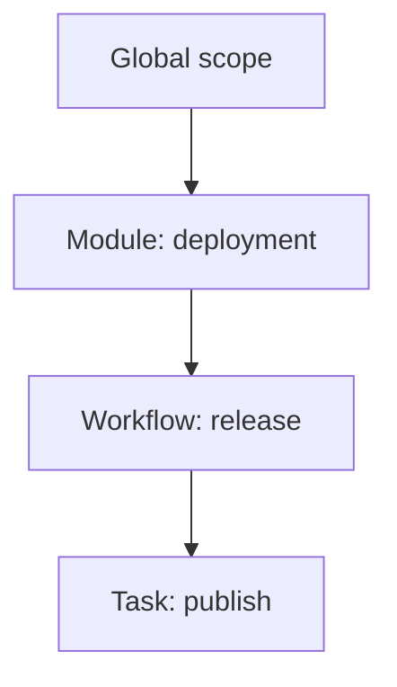

# Phạm vi tên

Trong ngôn ngữ miền chuyên biệt (Domain-Specific Language, DSL), tên được dùng để nhận diện biến, thuộc tính, hàm, kiểu, dịch vụ, quy tắc, tác vụ hoặc những đối tượng khác trong mô hình miền. **Phạm vi tên (name scope)** xác định nơi một khai báo có thể được nhìn thấy và sử dụng. Phạm vi rõ ràng giúp người viết DSL tổ chức chương trình thành các phần độc lập, tránh xung đột tên và làm cho việc phân giải tên (name resolution) có kết quả nhất quán.

Khi parser gặp một tên như `customer`, nó mới chỉ biết đây là một token định danh. Hệ thống cần xác định tên đó tham chiếu đến khai báo nào, khai báo có hiển thị ở vị trí hiện tại hay không và có đúng loại đối tượng mà ngữ cảnh yêu cầu không. Quy tắc phạm vi cung cấp nền tảng cho quá trình này. Nếu DSL không quy định rõ phạm vi, một tên có thể trỏ đến nhiều đối tượng, phụ thuộc vào thứ tự tải tệp hoặc vô tình truy cập dữ liệu không được phép.

## 1. Tên, khai báo và liên kết tên

Tên (name) là ký hiệu mà người viết sử dụng để gọi một đối tượng hoặc thành phần trong chương trình. Khai báo (declaration) tạo ra một tên và liên kết tên đó với một thực thể, kiểu hoặc giá trị.

Ví dụ:

```text
workflow "release" {
    task "compile" {}
    task "test" {
        depends_on = ["compile"]
    }
}
```

Trong ví dụ, `release`, `compile` và `test` là tên được khai báo trong một cấu trúc workflow. Chuỗi `"compile"` trong danh sách `depends_on` là một tham chiếu đến task đã khai báo. Bộ phân giải cần xác định tên đó có tồn tại trong phạm vi workflow hay không và liên kết tham chiếu với đúng task.

Có thể phân biệt ba khái niệm:

- **Khai báo:** tạo ra một tên, ví dụ khai báo `task "compile"`.
- **Phạm vi:** xác định nơi tên đó có thể được nhìn thấy, ví dụ chỉ bên trong workflow chứa task.
- **Liên kết (binding):** kết nối một lần sử dụng tên với khai báo cụ thể, ví dụ tham chiếu `"compile"` trong `depends_on` được liên kết với task đã khai báo.

Một tên có thể được khai báo nhưng không nhìn thấy từ một vị trí khác. Ngược lại, một tên có thể nhìn thấy nhưng vẫn không hợp lệ vì sai kiểu hoặc không phù hợp với ngữ cảnh sử dụng. Phạm vi là điều kiện cần cho việc phân giải, không thay thế kiểm tra kiểu và quy tắc miền.

## 2. Phạm vi tên là gì?

Phạm vi là vùng chương trình mà một khai báo có hiệu lực về mặt tên. Trong DSL, phạm vi có thể được tạo bởi:

- Toàn bộ tài liệu hoặc chương trình.
- Module hoặc namespace.
- Khối lệnh, workflow hoặc cấu hình lồng nhau.
- Hàm, biểu thức lambda hoặc quy tắc.
- Một cấu trúc miền như service, schema, entity hoặc pipeline.
- Phạm vi nhập (import) từ thư viện hoặc tệp khác.

Ví dụ:

```text
let region = "asia"

workflow "release" {
    let retries = 2

    task "compile" {
        timeout = 30
    }
}
```

Nếu DSL dùng phạm vi từ vựng theo khối, `region` được khai báo ở cấp tài liệu nên có thể được nhìn thấy trong workflow và task. `retries` chỉ có hiệu lực trong workflow `release` và các phạm vi con của nó. `timeout` có thể chỉ thuộc phạm vi cấu hình của task `compile`, tùy quy tắc DSL.

Phạm vi không nhất thiết giống với thời gian tồn tại của giá trị trong runtime. Một khai báo có thể nhìn thấy trong toàn bộ module dù đối tượng chỉ được khởi tạo khi chạy. Ngược lại, một giá trị runtime có thể tiếp tục tồn tại sau khi phạm vi tên nơi nó được tạo đã kết thúc, chẳng hạn giá trị được giữ trong closure. DSL cần phân biệt khả năng nhìn thấy tên với vòng đời dữ liệu nếu cả hai khái niệm có liên quan.

## 3. Phạm vi từ vựng và phạm vi động

Hai mô hình phạm vi thường được nhắc đến là phạm vi từ vựng và phạm vi động.

### 3.1. Phạm vi từ vựng

Phạm vi từ vựng (lexical scope hoặc static scope) được xác định bởi cấu trúc văn bản của chương trình. Một tham chiếu thường được phân giải dựa trên vị trí khai báo và các phạm vi bao quanh tại nơi tham chiếu xuất hiện.

Ví dụ:

```text
let environment = "production"

workflow "deploy" {
    task "publish" {
        target = environment
    }
}
```

Nếu DSL dùng lexical scope, `environment` được tìm thấy trong phạm vi bên ngoài workflow. Kết quả không phụ thuộc vào task nào đang chạy tại thời điểm đánh giá.

Phạm vi từ vựng thường dễ hiểu, dễ phân tích tĩnh và phù hợp với DSL khai báo. IDE có thể xác định nơi một tên được khai báo, tìm mọi tham chiếu và cảnh báo lỗi trước khi thực thi.

### 3.2. Phạm vi động

Phạm vi động (dynamic scope) xác định tên dựa trên ngữ cảnh gọi hoặc ngăn xếp thực thi tại runtime. Một tên có thể được tìm trong môi trường đang hoạt động thay vì theo cấu trúc văn bản nơi biểu thức được định nghĩa.

Mô hình này có thể hữu ích cho một số hệ thống template, quy tắc hoặc môi trường đánh giá biểu thức, nhưng thường làm việc phân tích tĩnh và dự đoán hành vi khó hơn. Cùng một biểu thức có thể nhận giá trị khác nhau tùy đường gọi.

Nếu DSL chọn dynamic scope, cần ghi rõ thứ tự tìm kiếm môi trường, cách xử lý tên không tồn tại và cách tránh phụ thuộc ngầm vào caller. Với DSL cấu hình hoặc nghiệp vụ, lexical scope thường dễ bảo trì hơn vì tham chiếu có thể được hiểu từ cấu trúc tài liệu.

## 4. Các loại phạm vi thường gặp

### 4.1. Phạm vi toàn cục

Phạm vi toàn cục (global scope) chứa các tên có thể được sử dụng từ nhiều phần của chương trình. Ví dụ, một DSL có thể định nghĩa các hằng số chung:

```text
const DEFAULT_TIMEOUT = 30
const DEFAULT_REGION = "asia"
```

Tên toàn cục thuận tiện cho cấu hình dùng chung, nhưng nếu có quá nhiều tên ở cấp này, chúng dễ xung đột và làm chương trình khó hiểu. Nên giới hạn số lượng khai báo toàn cục và gom các tên liên quan vào module hoặc namespace.

### 4.2. Phạm vi module

Module scope giới hạn tên trong một module hoặc tệp logic. Module có thể công khai một số khai báo và giữ những khai báo khác ở chế độ nội bộ.

```text
module billing {
    export rule "calculate-tax" { ... }
    private const TAX_TABLE_VERSION = "2026-01"
}
```

Nếu module khác nhập `billing`, nó có thể sử dụng `calculate-tax` nhưng không thể tham chiếu trực tiếp đến `TAX_TABLE_VERSION`. Phạm vi module giúp chia DSL lớn thành các phần có trách nhiệm riêng và kiểm soát giao diện công khai.

### 4.3. Phạm vi khối

Phạm vi khối (block scope) được tạo bởi một cấu trúc như `{ ... }`, một khối `begin/end` hoặc một khối lồng nhau theo thụt lề.

```text
workflow "release" {
    let artifact = "app.jar"

    task "publish" {
        let destination = "registry"
        upload artifact to destination
    }
}
```

Trong ví dụ, `destination` có thể chỉ nhìn thấy trong task `publish`, còn `artifact` được nhìn thấy trong task con nếu DSL cho phép tra cứu tên ở phạm vi cha.

### 4.4. Phạm vi hàm và lambda

Tham số và biến cục bộ của hàm thường có phạm vi trong thân hàm. Lambda cũng có thể tạo phạm vi riêng:

```text
let eligibleOrders = orders.filter(order -> {
    let total = order.total
    return total >= 1000000
})
```

Tên `order` là tham số lambda; `total` là biến cục bộ trong thân lambda. Nếu DSL hỗ trợ closure, biểu thức lambda có thể sử dụng tên từ phạm vi bên ngoài theo quy tắc capture đã định nghĩa.

### 4.5. Phạm vi miền

Một DSL có thể tạo phạm vi theo đối tượng miền thay vì chỉ theo khối cú pháp. Ví dụ, bên trong `service "catalog"`, tên `port` có thể là thuộc tính của service hiện tại. Trong một khối `database`, cùng tên `port` có thể là thuộc tính của kết nối cơ sở dữ liệu.

Phạm vi miền làm cú pháp gần với ngôn ngữ chuyên môn, nhưng cần tránh việc một tên có quá nhiều ý nghĩa phụ thuộc ngữ cảnh. Cần quy định cách phân giải tên tương đối và cách tham chiếu tường minh khi có nhiều đối tượng cùng loại.

## 5. Phạm vi lồng nhau và quy tắc tìm kiếm

Các phạm vi có thể lồng nhau. Khi một tên được sử dụng, một quy tắc phổ biến là tìm trong phạm vi hiện tại trước, sau đó lần lượt tìm ở các phạm vi cha cho đến phạm vi gốc.



Giả sử `region` được khai báo ở global scope, `timeout` ở workflow scope và `registry` ở task scope. Trong task `publish`, quá trình tìm kiếm có thể là:

1. Tìm trong scope `publish`.
2. Nếu không có, tìm trong scope `release`.
3. Nếu vẫn không có, tìm trong module `deployment`.
4. Cuối cùng tìm trong global scope.
5. Nếu không tìm thấy ở bất kỳ nơi nào, báo lỗi tên chưa được khai báo.

Đây là quy tắc lexical lookup theo chuỗi phạm vi cha. DSL có thể dùng mô hình khác, nhưng cần xác định thứ tự tra cứu một cách ổn định.

## 6. Che khuất tên (shadowing)

Shadowing xảy ra khi một khai báo ở phạm vi trong có cùng tên với khai báo ở phạm vi ngoài. Khi đó, tên trong phạm vi trong che khuất tên ngoài tại những vị trí thuộc phạm vi trong.

Ví dụ:

```text
let region = "asia"

workflow "deploy" {
    let region = "europe"
    task "publish" {
        targetRegion = region
    }
}
```

Nếu DSL cho phép shadowing theo lexical scope, `targetRegion` nhận giá trị từ khai báo `region` bên trong workflow, tức `"europe"`.

Shadowing có thể hữu ích khi một phạm vi con cần giá trị cục bộ cùng tên với giá trị mặc định bên ngoài. Tuy nhiên, nó cũng dễ gây lỗi vì người đọc có thể không nhận ra tên nào đang được sử dụng.

Các lựa chọn thiết kế:

- Cho phép shadowing và quy định rõ phạm vi trong luôn được ưu tiên.
- Cấm khai báo trùng tên trong các phạm vi lồng nhau.
- Cho phép shadowing nhưng yêu cầu cảnh báo hoặc quy tắc đặt tên.
- Cung cấp cú pháp tham chiếu tường minh đến tên ngoài, chẳng hạn `outer.region` hoặc `global.region`.

Không nên để hành vi shadowing khác nhau giữa parser, IDE và runtime. Nếu DSL cấm shadowing, lỗi nên chỉ ra cả vị trí khai báo mới và khai báo đang bị trùng.

## 7. Phân biệt khai báo trùng và shadowing

Khai báo trùng (duplicate declaration) và shadowing là hai trường hợp khác nhau.

- **Khai báo trùng:** hai khai báo cùng tên trong một phạm vi mà DSL yêu cầu tên phải duy nhất.
- **Shadowing:** hai khai báo cùng tên nhưng nằm ở các phạm vi lồng nhau, khai báo trong che khuất khai báo ngoài.

Ví dụ khai báo trùng:

```text
module inventory {
    let stockLimit = 100
    let stockLimit = 200  # trùng trong cùng phạm vi
}
```

Ví dụ shadowing:

```text
let stockLimit = 100

workflow "restock" {
    let stockLimit = 50
}
```

Một DSL có thể cho phép trường hợp thứ hai nhưng từ chối trường hợp thứ nhất. Bộ phân giải cần lưu phạm vi của từng khai báo để phân biệt chính xác.

## 8. Namespace và tên định danh đầy đủ

Namespace là cơ chế nhóm các tên để tránh xung đột và tổ chức giao diện. Ví dụ:

```text
module sales {
    export entity Customer { ... }
}

module support {
    export entity Customer { ... }
}
```

Hai module đều có `Customer`, nhưng tên đầy đủ (qualified name) khác nhau:

```text
sales.Customer
support.Customer
```

Tên đầy đủ giúp tham chiếu chính xác khi có nhiều khai báo cùng tên ở các module khác nhau. DSL cần quy định dấu phân cách namespace, cách lồng namespace và việc tên có phân biệt chữ hoa/chữ thường hay không.

Tên ngắn có thể được dùng khi chỉ có một ứng viên trong phạm vi hiện tại. Nếu có nhiều ứng viên, parser hoặc semantic analyzer nên báo mơ hồ và yêu cầu tên đầy đủ, thay vì tự chọn một module theo thứ tự tải.

## 9. Import và phạm vi nhập

Import cho phép một module sử dụng khai báo được công khai bởi module khác.

Ví dụ:

```text
import sales.Customer
import billing.Money

entity Invoice {
    customer: Customer
    total: Money
}
```

DSL cần định nghĩa import có các dạng nào:

- **Import một tên:** chỉ đưa một khai báo vào phạm vi hiện tại.
- **Import cả namespace:** cho phép dùng tên đầy đủ hoặc tên rút gọn theo quy tắc.
- **Import có alias:** đổi tên khi nhập để tránh xung đột.
- **Import có chọn lọc:** chỉ nhập những khai báo được liệt kê.
- **Re-export:** module hiện tại công khai lại một tên đã nhập.

Ví dụ alias:

```text
import sales.Customer as SalesCustomer
import support.Customer as SupportCustomer

let buyer: SalesCustomer
let helpContact: SupportCustomer
```

Alias giúp phân biệt hai kiểu cùng tên ngắn. Cần xác định alias chỉ có hiệu lực trong module hiện tại hay có thể được truyền qua các module phụ thuộc.

Import cũng đặt ra vấn đề phụ thuộc vòng. Nếu module A nhập B và B nhập A, hệ thống cần quy định có cho phép hay không, và nếu có thì tên được phân giải ở giai đoạn nào. Với DSL cấu hình, hạn chế phụ thuộc vòng thường giúp việc tải và kiểm tra mô hình dễ dự đoán hơn.

## 10. Phạm vi và khả năng hiển thị (visibility)

Phạm vi trả lời tên có thể được tìm thấy ở đâu; visibility trả lời khai báo nào được phép truy cập từ bên ngoài cấu trúc sở hữu nó. Một DSL có thể dùng các mức như:

- `public` hoặc `export`: có thể được module khác nhập và sử dụng.
- `internal`: chỉ dùng trong một module hoặc package.
- `private`: chỉ dùng trong cấu trúc khai báo hoặc phạm vi sở hữu.
- `protected`: chỉ dùng trong một hệ thống có quan hệ kế thừa hoặc mở rộng, nếu DSL hỗ trợ.

Ví dụ:

```text
module payments {
    export rule "calculate-fee" { ... }
    private const INTERNAL_RATE = 0.025
}
```

Module khác có thể gọi quy tắc công khai nhưng không truy cập trực tiếp hằng số nội bộ. Điều này giúp module thay đổi cách triển khai mà không phá vỡ người dùng phụ thuộc vào giao diện công khai.

Không nên nhầm visibility với bảo mật runtime. Một tên không hiển thị trong DSL không tự động bảo vệ dữ liệu hoặc ngăn truy cập hệ thống bên ngoài. Quyền truy cập tài nguyên vẫn cần được kiểm tra ở tầng thực thi và tích hợp.

## 11. Thời điểm khai báo và quy tắc nhìn thấy tên

DSL cần quyết định tên có thể được sử dụng trước khi khai báo hay không.

### 11.1. Khai báo trước khi dùng

Một quy tắc đơn giản là tên phải được khai báo trước vị trí sử dụng:

```text
let region = "asia"
use region
```

Nếu viết `use region` trước `let region`, bộ phân giải báo lỗi chưa khai báo. Cách này dễ triển khai và dễ hiểu, nhưng không thuận tiện cho các cấu trúc có tham chiếu lẫn nhau.

### 11.2. Khai báo được thu thập trước

Một số DSL thu thập tất cả khai báo trong module trước khi phân giải tham chiếu. Khi đó, một task có thể phụ thuộc vào task được viết phía dưới:

```text
workflow "release" {
    task "publish" {
        depends_on = ["test"]
    }

    task "test" {}
}
```

Điều này hữu ích cho khai báo khai báo (declarative), nơi thứ tự văn bản không nhất thiết là thứ tự thực thi. Tuy nhiên, hệ thống cần xử lý khai báo trùng và tham chiếu không tồn tại sau khi đã thu thập toàn bộ symbol.

### 11.3. Tham chiếu tiến về trước

Forward reference là tham chiếu đến khai báo xuất hiện sau vị trí sử dụng. DSL có thể cho phép forward reference trong module, nhưng giới hạn trong một số loại khai báo. Ví dụ, tên task có thể được tham chiếu trước, còn biến cục bộ trong biểu thức phải khai báo trước.

Quy tắc cần được công bố theo từng loại tên để tránh người dùng suy luận rằng mọi tên đều có cùng hành vi.

## 12. Symbol table và biểu diễn phạm vi

Bộ phân giải thường dùng bảng ký hiệu (symbol table) để lưu khai báo và quan hệ phạm vi. Một symbol có thể chứa:

- Tên và loại tên.
- Kiểu hoặc loại đối tượng miền.
- Phạm vi sở hữu.
- Vị trí khai báo trong tệp nguồn.
- Visibility và trạng thái export.
- Liên kết đến nút AST hoặc đối tượng miền.
- Thông tin phiên bản hoặc module chứa khai báo.

Một cách triển khai đơn giản là mỗi phạm vi có một bảng tên riêng và một liên kết đến phạm vi cha:

```java
import java.util.HashMap;
import java.util.Map;
import java.util.Optional;

final class Scope {
    private final Scope parent;
    private final Map<String, Symbol> symbols = new HashMap<>();

    Scope(Scope parent) {
        this.parent = parent;
    }

    void declare(String name, Symbol symbol) {
        if (symbols.containsKey(name)) {
            throw new IllegalArgumentException("Duplicate name: " + name);
        }
        symbols.put(name, symbol);
    }

    Optional<Symbol> resolve(String name) {
        Symbol local = symbols.get(name);
        if (local != null) {
            return Optional.of(local);
        }
        return parent == null
            ? Optional.empty()
            : parent.resolve(name);
    }
}
```

`Symbol` là kiểu dữ liệu minh họa, có thể chứa thông tin khai báo. `resolve` tìm trong phạm vi hiện tại trước, sau đó đi lên phạm vi cha. Triển khai thực tế cần thêm loại tên, visibility, namespace, vị trí nguồn, import và chính sách shadowing.

Với DSL lớn, symbol table có thể được xây dựng thành scope graph (đồ thị phạm vi), trong đó các quan hệ không chỉ là cha-con mà còn gồm import, export, namespace và liên kết module. Mô hình đồ thị giúp biểu diễn những quy tắc tra cứu phức tạp hơn.

## 13. Phân giải tên theo loại biểu tượng

Không phải mọi tên đều thuộc cùng một không gian tên. DSL có thể có các loại tên:

- Tên biến hoặc hằng số.
- Tên kiểu hoặc entity.
- Tên hàm hoặc thao tác.
- Tên module hoặc namespace.
- Tên trường hoặc thuộc tính miền.
- Tên sự kiện, trạng thái, quy tắc hoặc tác vụ.

Có hai cách tổ chức phổ biến:

1. **Một không gian tên chung:** mọi khai báo phải có tên duy nhất trong phạm vi, bất kể loại.
2. **Nhiều không gian tên:** tên kiểu, tên biến và tên hàm có thể trùng nhau vì được tra cứu theo ngữ cảnh riêng.

Ví dụ, một DSL có thể cho phép kiểu `Order` và biến `Order` cùng tồn tại nếu parser và semantic analyzer biết vị trí nào cần kiểu, vị trí nào cần giá trị. Tuy nhiên, điều này có thể gây khó hiểu cho người viết. Dù chọn mô hình nào, cần xác định cách tra cứu theo ngữ cảnh và thông báo lỗi khi có nhiều ứng viên.

## 14. Tên thuộc tính và phạm vi miền

Trong DSL hướng miền, cú pháp truy cập thuộc tính như `order.total` kết hợp hai bước: phân giải tên đối tượng `order`, sau đó tìm thuộc tính `total` trên kiểu của đối tượng.

```text
let order = currentOrder
let amount = order.total
```

Bộ phân giải trước tiên tìm `order` trong phạm vi tên hiện tại. Khi biết kiểu của nó là `Order`, bộ kiểm tra kiểu xác nhận `total` là thuộc tính hợp lệ của `Order` và trả về kiểu `Money`.

Một tên thuộc tính có thể không cần được đưa vào symbol table cùng phạm vi với biến cục bộ. Nó thường được phân giải thông qua mô hình kiểu hoặc metadata của đối tượng. Việc tách hai cơ chế này giúp tránh nhầm giữa biến có tên `total` và thuộc tính `total` của một entity.

Nếu DSL hỗ trợ truy cập ngầm định, ví dụ chỉ viết `total` bên trong một khối `order`, cần quy định đối tượng mặc định (`self`, `this` hoặc context object) và thứ tự tìm kiếm. Cú pháp rút gọn nên có cách tham chiếu tường minh khi tên trùng hoặc khi có nhiều đối tượng trong ngữ cảnh.

## 15. Phạm vi của biến và closure

Nếu DSL hỗ trợ hàm hoặc lambda, cần xác định cách tên từ phạm vi bên ngoài được sử dụng bên trong hàm.

Ví dụ:

```text
let minimum = 1000

let eligible = orders.filter(order -> {
    return order.total >= minimum
})
```

Lambda sử dụng tham số `order` trong phạm vi riêng và tham chiếu `minimum` từ phạm vi bên ngoài. Nếu DSL dùng lexical scope, tham chiếu `minimum` được liên kết với khai báo tại nơi lambda được viết, không phụ thuộc vào nơi lambda được gọi.

Closure là hàm kèm theo môi trường các biến được capture. DSL cần quy định biến được capture theo giá trị hay theo tham chiếu, có được thay đổi bên trong lambda hay không và điều gì xảy ra nếu môi trường bên ngoài thay đổi sau khi closure được tạo.

Với DSL khai báo hoặc quy tắc nghiệp vụ, capture bất biến thường dễ dự đoán hơn. Nếu cho phép capture biến có thể thay đổi, cần cân nhắc tác động đến tính xác định và khả năng thực thi song song.

## 16. Phạm vi trong module và nhiều tệp

Một dự án DSL có thể gồm nhiều tệp. Phạm vi module và import quyết định cách tên được chia sẻ giữa các tệp.

Ví dụ cấu trúc dự án:

```text
project/
  modules/
    sales.dsl
    billing.dsl
    deployment.dsl
  main.dsl
```

Tệp `sales.dsl` có thể export `Customer`; `billing.dsl` import kiểu đó để khai báo `Invoice`; `main.dsl` import các module cần thiết để kết hợp quy trình.

Bộ nạp module cần xác định:

- Cách tìm tệp module và cách định danh module.
- Tên export có thể được import trực tiếp hay phải dùng qualified name.
- Cách xử lý import trùng hoặc alias trùng.
- Cách phát hiện module không tồn tại.
- Cách xử lý phụ thuộc vòng.
- Thứ tự phân tích và phân giải tên giữa các module.
- Quy tắc visibility và re-export.

Không nên phụ thuộc vào thứ tự duyệt tệp của hệ điều hành hoặc thứ tự tình cờ mà người dùng mở tệp. Kết quả phân giải cần xác định từ các khai báo và quan hệ import được mô tả trong dự án.

## 17. Tên động và truy cập theo chuỗi

Một số DSL cho phép truy cập tên được xác định tại runtime, ví dụ:

```text
fieldName = input.selectedField
value = record[fieldName]
```

Truy cập `record[fieldName]` khác với truy cập tĩnh `record.total`: tên trường chỉ được biết khi chạy. Điều này làm giảm khả năng kiểm tra tĩnh và có thể tạo lỗi nếu trường không tồn tại.

Nếu DSL hỗ trợ tên động, nên giới hạn nơi được phép dùng, xác định hành vi khi không tìm thấy trường và cung cấp API hoặc hàm kiểm tra an toàn. Với các trường quan trọng, truy cập tĩnh thường tốt hơn vì parser và semantic analyzer có thể xác nhận tên cùng kiểu trước khi chạy.

Tên động cũng cần được kiểm soát khi có quyền truy cập dữ liệu. Không nên cho phép chuỗi do người dùng nhập tự động truy cập mọi thuộc tính hoặc tài nguyên nội bộ nếu DSL không có chính sách cho phép rõ ràng.

## 18. Thông báo lỗi phân giải tên

Khi không tìm thấy tên, thông báo nên giúp người viết xác định nguyên nhân và cách sửa.

Ví dụ không hữu ích:

```text
Unknown symbol
```

Thông báo tốt hơn:

```text
Không tìm thấy task "test" trong workflow "release".
Tham chiếu xuất hiện tại dòng 8, cột 22.
Các task hiện có: "compile", "package".
```

Các trường hợp lỗi thường gặp:

- Tên chưa được khai báo.
- Tên nằm ngoài phạm vi hiện tại.
- Tên không được export hoặc không có quyền truy cập.
- Import trỏ đến module không tồn tại.
- Alias hoặc tên đầy đủ không hợp lệ.
- Có nhiều khai báo cùng tên gây mơ hồ.
- Khai báo bị shadowing ngoài ý muốn.
- Tên tồn tại nhưng sai loại, ví dụ dùng tên biến ở vị trí cần kiểu.

Thông báo nên gắn với vị trí tham chiếu và, khi hữu ích, vị trí khai báo. Nếu có các tên gần giống, hệ thống có thể gợi ý tên phù hợp, nhưng không nên tự sửa nếu việc thay đổi có thể làm chương trình mang ý nghĩa khác.

## 19. Phạm vi tên và bảo mật

Phạm vi tên giúp tổ chức khả năng nhìn thấy khai báo, nhưng không phải cơ chế bảo mật đầy đủ. Một khai báo `private` có thể không xuất hiện trong giao diện DSL, nhưng nếu runtime vẫn cho phép gọi API bên ngoài không giới hạn thì dữ liệu vẫn có thể bị truy cập.

Khi DSL cho phép tham chiếu tài nguyên như file, database, secret hoặc service, cần tách:

- **Name visibility:** tên có được phân giải từ vị trí hiện tại hay không.
- **Authorization:** người dùng hoặc tiến trình có quyền thực hiện hành động trên tài nguyên hay không.
- **Capability:** môi trường thực thi có cung cấp quyền hoặc đối tượng cần thiết hay không.

Ví dụ, tên `productionDatabase` có thể được import vào một module, nhưng runtime vẫn cần xác thực người thực thi có quyền truy cập cơ sở dữ liệu production. Không nên xem việc tên phân giải thành công là bằng chứng thao tác được phép.

## 20. Nguyên tắc thiết kế phạm vi tên

Một DSL dễ hiểu nên có quy tắc phạm vi nhất quán và có thể giải thích. Những nguyên tắc sau thường hữu ích:

- **Ưu tiên lexical scope:** nếu không có yêu cầu đặc biệt, phạm vi theo cấu trúc văn bản dễ phân tích và dự đoán.
- **Giới hạn phạm vi toàn cục:** gom tên liên quan vào module hoặc namespace.
- **Định nghĩa shadowing rõ ràng:** cho phép, cấm hoặc cảnh báo theo một chính sách thống nhất.
- **Phân biệt khai báo trùng và shadowing:** hai lỗi này cần thông báo khác nhau.
- **Dùng qualified name khi cần:** giải quyết xung đột giữa các module và kiểu cùng tên.
- **Công bố quy tắc import/export:** xác định tên nào được chia sẻ và cách alias hoạt động.
- **Quy định forward reference:** xác định loại khai báo nào có thể được tham chiếu trước.
- **Tách tên thuộc tính khỏi tên biến:** tra cứu thuộc tính theo kiểu của đối tượng.
- **Giữ thông tin nguồn:** liên kết symbol với vị trí khai báo và vị trí tham chiếu để hỗ trợ IDE và chẩn đoán.
- **Không nhầm phạm vi với quyền:** kiểm tra authorization ở runtime đối với tài nguyên nhạy cảm.
- **Bảo đảm kết quả xác định:** cùng một dự án và cùng phiên bản phải tạo cùng kết quả phân giải, không phụ thuộc thứ tự tải ngẫu nhiên.

## 21. Quy trình xây dựng bộ phân giải tên

Có thể triển khai name resolution theo các bước:

1. **Tạo cấu trúc phạm vi:** xây dựng scope cho chương trình, module, khối, hàm và cấu trúc miền.
2. **Thu thập khai báo:** ghi nhận tên, loại symbol, kiểu, visibility và vị trí nguồn.
3. **Kiểm tra khai báo trùng:** phát hiện xung đột trong cùng phạm vi theo chính sách DSL.
4. **Thiết lập quan hệ phạm vi:** liên kết phạm vi con với phạm vi cha, module với namespace và import với module được nhập.
5. **Phân giải tham chiếu:** tìm tên theo thứ tự tra cứu đã định nghĩa.
6. **Xử lý shadowing và qualified name:** chọn khai báo phù hợp hoặc báo mơ hồ.
7. **Kiểm tra loại symbol và kiểu:** xác nhận tên được dùng đúng ngữ cảnh.
8. **Ghi liên kết vào AST/mô hình:** tham chiếu được liên kết với symbol hoặc đối tượng miền cụ thể.
9. **Phát sinh chẩn đoán:** báo lỗi tại vị trí nguồn và cung cấp thông tin khai báo liên quan.

Một số DSL cần hai lượt xử lý: lượt đầu thu thập tất cả khai báo trong module; lượt sau phân giải tham chiếu. Cách này hỗ trợ forward reference. DSL đơn giản có thể phân giải ngay khi đọc tuần tự nếu quy tắc yêu cầu khai báo trước khi dùng.

## 22. Ví dụ tổng hợp: phạm vi trong DSL triển khai

Xét một dự án triển khai có hằng số toàn cục, module và workflow:

```text
const DEFAULT_REGION = "asia"

module deployment {
    export const DEFAULT_TIMEOUT = 30

    workflow "release" {
        let region = DEFAULT_REGION

        task "compile" {
            timeout = DEFAULT_TIMEOUT
        }

        task "publish" {
            let region = "europe"
            targetRegion = region
            depends_on = ["compile"]
        }
    }
}
```

Nếu DSL dùng lexical scope và cho phép shadowing:

- `DEFAULT_REGION` được tìm ở phạm vi toàn cục.
- `DEFAULT_TIMEOUT` được tìm trong module `deployment` từ các cấu trúc con.
- `region` ở workflow có giá trị mặc định `"asia"`.
- `region` ở task `publish` che khuất `region` của workflow trong phạm vi task đó.
- `targetRegion` trong task `publish` tham chiếu đến `region` cục bộ, tức `"europe"`.
- `"compile"` trong `depends_on` được phân giải thành task `compile` trong cùng workflow.

Nếu một module khác muốn sử dụng `DEFAULT_TIMEOUT`, nó cần import module `deployment` và chỉ được truy cập tên nếu khai báo đó được export. Việc truy cập thành công vẫn không tự cấp quyền triển khai tài nguyên production; runtime phải kiểm tra quyền riêng.

## 23. Kiểm thử phạm vi và phân giải tên

Bộ kiểm thử cần xác nhận cả trường hợp hợp lệ và lỗi:

- Tên trong phạm vi hiện tại được ưu tiên hơn tên ở phạm vi cha.
- Tên ở phạm vi cha được tìm thấy khi không có khai báo cục bộ.
- Tên ở phạm vi con không bị nhìn thấy từ phạm vi bên ngoài.
- Khai báo trùng trong cùng phạm vi được xử lý theo chính sách.
- Shadowing được cho phép, cảnh báo hoặc từ chối đúng như đặc tả.
- Qualified name trỏ đến đúng module và symbol.
- Import và alias không tạo xung đột ngoài dự kiến.
- Forward reference hoạt động đúng với các loại khai báo được hỗ trợ.
- Tên thuộc tính được kiểm tra theo kiểu đối tượng.
- Tên không tồn tại hoặc sai visibility tạo thông báo có vị trí rõ ràng.
- Kết quả không thay đổi khi thứ tự nạp module không liên quan thay đổi.

Ngoài kiểm thử đơn vị cho symbol table, nên có kiểm thử tích hợp trên tài liệu DSL hoàn chỉnh. Các ví dụ này giúp xác nhận parser, name resolver, semantic analyzer và IDE dùng chung quy tắc phạm vi.

Phạm vi tên xác định nơi một khai báo có thể được nhìn thấy và cách một lần sử dụng tên được liên kết với khai báo đó. Khi DSL quy định rõ phạm vi toàn cục, module, khối và miền; cách tra cứu qua phạm vi cha; shadowing; namespace; import/export và forward reference, quá trình phân giải tên trở nên xác định và dễ giải thích. Kết hợp symbol table với thông tin nguồn và kiểm tra kiểu giúp DSL phát hiện lỗi sớm, hỗ trợ công cụ phát triển và giữ cho các tham chiếu trong mô hình miền nhất quán.
