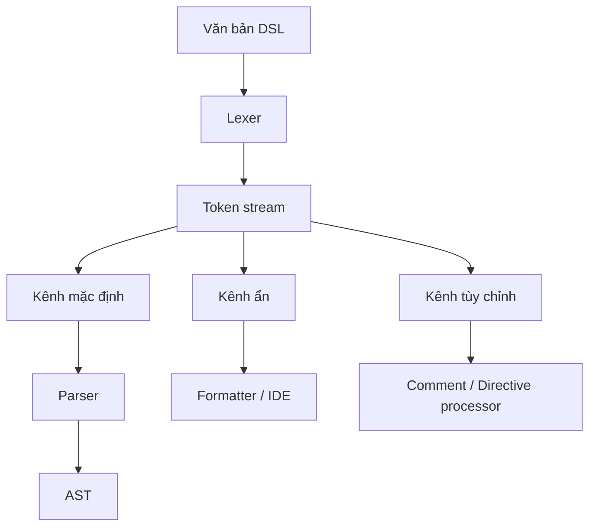

# Kênh token

Trong quá trình phân tích từ vựng của ngôn ngữ chuyên biệt miền (Domain-Specific Language, DSL), lexer đọc chuỗi ký tự nguồn và tạo ra một dãy token. Mỗi token biểu diễn một đơn vị từ vựng như từ khóa, tên định danh, số, chuỗi, toán tử, dấu phân cách hoặc chú thích. Tuy nhiên, không phải token nào cũng phục vụ cùng một mục đích. Parser cần nhìn thấy những token cấu thành cú pháp, trong khi formatter, IDE, công cụ tài liệu hóa hoặc bộ xử lý chú thích có thể cần giữ lại cả những token mà parser không sử dụng.

**Kênh token (token channel)** là thông tin phân loại gắn với token để xác định token đó thuộc luồng xử lý nào hoặc được thành phần nào quan tâm. Trong các lexer hỗ trợ channel, token vẫn được tạo và giữ trong token stream, nhưng parser có thể chỉ quan sát một kênh nhất định, thường là kênh mặc định. Những token như khoảng trắng và chú thích có thể được đặt vào kênh ẩn để không ảnh hưởng đến cú pháp nhưng vẫn còn sẵn cho công cụ khác.

Kênh token đặc biệt hữu ích khi DSL cần đồng thời hỗ trợ phân tích cú pháp và các công cụ làm việc trên văn bản gốc. Nếu lexer loại bỏ mọi khoảng trắng và chú thích ngay từ đầu, parser vẫn có thể hoạt động nhưng formatter hoặc IDE sẽ mất thông tin cần thiết để bảo toàn cách trình bày và chú giải của người viết.

## 1. Kênh token là gì?

Một token thường có các thông tin như loại token, nội dung văn bản, vị trí trong tệp và kênh mà token thuộc về. **Loại token (token type)** trả lời câu hỏi “đây là loại đơn vị từ vựng nào?”, còn **kênh (channel)** trả lời câu hỏi “token này được phân loại vào luồng nào?”. Hai thông tin này phục vụ những mục đích khác nhau.

Ví dụ, lexer có thể nhận diện một token `IDENTIFIER` chứa văn bản `tong_tien`. Token này thường thuộc kênh mặc định vì parser cần nó để phân tích biểu thức. Một token `LINE_COMMENT` chứa văn bản `// mức phí ưu đãi` có thể thuộc kênh `COMMENTS`: parser không cần dùng nó để xác định cấu trúc, nhưng trình soạn thảo hoặc công cụ tài liệu hóa vẫn có thể đọc.

Một dãy token minh họa:

```text
policy giao_hang {
    // chính sách cho đơn hàng nội thành
    phi_co_ban = 30000 VND
}
```

Lexer có thể tạo ra các token như sau:

| Nội dung token | Loại token | Kênh minh họa | Mục đích |
|---|---|---|---|
| `policy` | `POLICY` | Default | Từ khóa mở đầu khai báo |
| `giao_hang` | `IDENTIFIER` | Default | Tên chính sách |
| `{` | `LBRACE` | Default | Dấu mở khối |
| `\n    ` | `WS` | Hidden | Khoảng trắng và xuống dòng |
| `// chính sách...` | `LINE_COMMENT` | `COMMENTS` | Chú thích cho người đọc |
| `phi_co_ban` | `IDENTIFIER` | Default | Tên thuộc tính |
| `=` | `ASSIGN` | Default | Toán tử gán |
| `30000` | `NUMBER` | Default | Giá trị số |
| `VND` | `CURRENCY` | Default | Mã tiền tệ |
| `}` | `RBRACE` | Default | Dấu đóng khối |

Kênh trong bảng chỉ là ví dụ thiết kế. Một DSL có thể đặt chú thích và khoảng trắng cùng vào kênh ẩn, hoặc tách chúng thành các kênh riêng nếu công cụ cần xử lý khác nhau.

### 1.1. Kênh là metadata của token

Kênh thường là một giá trị số nguyên hoặc một định danh được lexer/runtime ánh xạ sang số. Token không mất đi chỉ vì nó nằm ngoài kênh parser đang quan sát. Nó vẫn có thể nằm trong bộ đệm token, giữ nguyên nội dung và vị trí nguồn.

Kênh không thay đổi nội dung token. Ví dụ, token chú thích vẫn chứa văn bản `// ghi chú`; việc đặt nó vào `COMMENTS` chỉ thay đổi cách các thành phần phía sau lọc hoặc sử dụng token.

### 1.2. Kênh mặc định

Kênh mặc định (default channel) thường chứa các token cần thiết để parser nhận diện cấu trúc chương trình: từ khóa, identifier, literal, toán tử và dấu phân cách.

Trong ANTLR, kênh mặc định có hằng `DEFAULT_TOKEN_CHANNEL`, thường có giá trị số 0. Parser dùng token stream mặc định sẽ nhìn thấy các token trên kênh này khi thực hiện lookahead và tiêu thụ token.

### 1.3. Kênh ẩn

Kênh ẩn (hidden channel) thường dùng cho token mà parser không cần xét khi phân tích cú pháp, nhưng hệ thống vẫn muốn lưu giữ. Khoảng trắng và chú thích là hai ví dụ phổ biến.

Trong ANTLR, hằng `HIDDEN` hoặc `HIDDEN_CHANNEL` biểu thị kênh ẩn chuẩn. Một `CommonTokenStream` thông thường lọc các token ngoài kênh được chọn khỏi thao tác lookahead của parser, nhưng vẫn giữ chúng trong bộ đệm để có thể truy xuất.

### 1.4. Kênh tùy chỉnh

Một DSL có thể định nghĩa các kênh riêng như `COMMENTS`, `DOC_COMMENTS`, `DIRECTIVES` hoặc `WHITESPACE`. Kênh tùy chỉnh hữu ích khi nhiều nhóm công cụ cần lấy một loại token riêng mà không phải tự phân loại lại toàn bộ token stream.

Không nên tạo quá nhiều kênh nếu các thành phần sử dụng chúng không có nhu cầu khác nhau. Một thiết kế đơn giản thường chỉ cần kênh mặc định và kênh ẩn; các kênh tùy chỉnh nên xuất hiện khi có người tiêu thụ cụ thể.

## 2. Vì sao cần kênh token?

Kênh token giải quyết vấn đề một luồng token có thể phục vụ nhiều mục đích. Parser cần cấu trúc cú pháp; công cụ biên tập cần thông tin trình bày; công cụ tài liệu hóa cần chú thích; bộ tiền xử lý có thể cần chỉ thị đặc biệt.

### 2.1. Giữ chú thích mà không làm rối parser

Chú thích thường không làm thay đổi ý nghĩa cú pháp của chương trình. Ví dụ:

```text
policy giao_hang {
    // miễn phí cho đơn đủ điều kiện
    free_when tong_tien >= 500000 VND
}
```

Parser chỉ cần nhận `policy`, tên, dấu ngoặc, từ khóa và biểu thức. Chú thích có thể nằm ở kênh riêng để parser bỏ qua, trong khi IDE vẫn hiển thị, tìm kiếm hoặc trích xuất nó.

### 2.2. Bảo toàn khoảng trắng và định dạng

Khoảng trắng, tab, xuống dòng và comment thường bị bỏ qua khi xác định cấu trúc. Nhưng chúng quan trọng khi định dạng lại mã hoặc hiển thị văn bản gần giống bản gốc.

Nếu lexer bỏ các token này, formatter có thể phải tự tái tạo khoảng trắng theo quy tắc riêng. Nếu giữ chúng trong kênh ẩn, công cụ có thể bảo toàn định dạng ban đầu hoặc thực hiện thay đổi cục bộ mà không làm mất những phần văn bản không liên quan.

### 2.3. Hỗ trợ IDE và công cụ biên tập

IDE có thể dùng các kênh khác nhau để:

- Hiển thị chú thích với màu sắc riêng.
- Phân biệt chú thích tài liệu với chú thích thông thường.
- Giữ khoảng trắng và xuống dòng khi người dùng sửa một vùng mã.
- Tìm token gần vị trí con trỏ mà không làm thay đổi cách parser hoạt động.
- Cung cấp chức năng chọn, ẩn hoặc thu gọn một số loại chú thích.

### 2.4. Xử lý chỉ thị hoặc metadata trong nguồn

Một DSL có thể có chỉ thị dành cho công cụ, ví dụ khai báo vùng mã được sinh tự động, đánh dấu mã không được formatter thay đổi hoặc gắn metadata cho tài liệu.

Những chỉ thị này có thể được đưa vào kênh riêng nếu chúng không phải cú pháp thực thi của DSL nhưng vẫn cần được một thành phần khác xử lý.

### 2.5. Phân tách trách nhiệm giữa các thành phần

Kênh token tạo ra ranh giới rõ: parser xử lý kênh cú pháp, bộ xử lý comment xử lý kênh chú thích, formatter xử lý token trình bày và công cụ tài liệu hóa xử lý chú thích tài liệu. Các thành phần không cần tự đoán loại token từ văn bản nếu lexer đã phân loại chính xác.

## 3. Phân biệt channel, token type và skip

Đây là ba khái niệm dễ nhầm khi thiết kế lexer.

| Cơ chế | Điều nó xác định | Token có được tạo không? | Có thể truy xuất sau lexing không? |
|---|---|---:|---:|
| Token type | Loại đơn vị từ vựng | Có | Có |
| Token channel | Nhóm/luồng mà token thuộc về | Có | Có, nếu token stream giữ lại |
| `skip` | Không tạo token cho đoạn khớp | Không | Không qua token stream thông thường |

### 3.1. Token type

Token type là danh mục loại token như `IDENTIFIER`, `NUMBER`, `STRING`, `COMMENT` hoặc `PLUS`. Hai token có thể cùng type nhưng nằm ở channel khác nhau nếu lexer hoặc kiến trúc cho phép phân loại theo ngữ cảnh.

Thông thường, mỗi lexer rule sinh ra một loại token xác định. Token type giúp parser nhận diện cấu trúc cú pháp.

### 3.2. Channel

Channel là nhãn phân luồng gắn với token đã được tạo. Token vẫn tồn tại trong token stream, nhưng một consumer có thể chỉ quan sát các token thuộc channel mà nó quan tâm.

Ví dụ, `LINE_COMMENT` vẫn là token type của chú thích; `COMMENTS` là channel của token đó. Công cụ có thể lọc theo type để phân biệt comment dòng và comment khối, hoặc lọc theo channel để lấy toàn bộ chú thích.

### 3.3. Skip

Lệnh `skip` yêu cầu lexer bỏ qua đoạn ký tự khớp mà không phát ra token. Nó phù hợp khi thông tin đó không cần thiết cho bất kỳ thành phần nào ở phía sau.

Ví dụ, nếu DSL không cần bảo toàn khoảng trắng và không có formatter cần dùng token gốc, lexer có thể bỏ qua whitespace. Nhưng nếu cần giữ comment hoặc khoảng trắng, dùng channel thường phù hợp hơn.

### 3.4. Khi nào chọn skip, hidden hay custom channel?

- Dùng `skip` khi đoạn văn bản không cần xuất hiện trong token stream.
- Dùng kênh ẩn khi parser không cần token nhưng công cụ khác cần giữ lại.
- Dùng kênh tùy chỉnh khi một nhóm token cần được một consumer riêng xử lý hoặc phân biệt với các token ẩn khác.

Quyết định nên dựa trên vòng đời dữ liệu. Nếu sau lexing còn cần formatter, IDE hoặc công cụ tài liệu hóa, việc bỏ token sớm có thể khiến hệ thống phải phân tích lại văn bản hoặc mất thông tin nguồn.

## 4. Cấu trúc token stream có nhiều kênh

Một token stream có thể chứa token trên nhiều kênh theo đúng thứ tự xuất hiện trong văn bản nguồn. Parser thường đọc một kênh được chọn, còn các công cụ khác có thể truy xuất toàn bộ dãy.

### 4.1. Minh họa luồng xử lý



Sơ đồ mô tả luồng khái niệm. Một triển khai có thể dùng chung một token buffer và lọc theo channel khi consumer đọc, thay vì tạo ba token stream vật lý riêng biệt.

### 4.2. Token vẫn giữ thứ tự nguồn

Giả sử nguồn có các đoạn:

```text
name = "Lan" // tên người nhận
```

Token stream có thể chứa:

| Thứ tự | Token | Channel |
|---:|---|---|
| 0 | `name` | Default |
| 1 | ` ` | Hidden |
| 2 | `=` | Default |
| 3 | ` ` | Hidden |
| 4 | `"Lan"` | Default |
| 5 | ` ` | Hidden |
| 6 | `// tên người nhận` | COMMENTS |
| 7 | `\n` | Hidden |

Parser trên kênh mặc định nhìn thấy `name`, `=`, `"Lan"` và các token cú pháp khác. Formatter hoặc comment processor có thể dùng các token ở channel khác để tái tạo hoặc phân tích phần trình bày.

### 4.3. Chỉ số token và vị trí nguồn

Một token thường có chỉ số trong token stream, vị trí bắt đầu/kết thúc trong nguồn, số dòng và cột. Các chỉ số này hữu ích khi lấy comment ở trước hoặc sau một node AST, xác định khoảng văn bản cần định dạng hoặc đưa ra chẩn đoán.

Nếu một token bị `skip`, nó không có chỉ số token trong stream thông thường. Nếu token nằm trên kênh ẩn, nó vẫn có thể chiếm một vị trí trong dãy token và giúp duy trì liên hệ với văn bản gốc.

## 5. Kênh mặc định và kênh ẩn trong ANTLR

ANTLR là một công cụ phổ biến để xây dựng lexer và parser. Cơ chế channel của ANTLR minh họa rõ cách giữ token không dành cho parser.

### 5.1. Kênh mặc định

Các lexer rule thông thường phát token trên kênh mặc định nếu không chỉ định channel khác. Parser dùng `CommonTokenStream` thường đọc kênh mặc định.

Ví dụ grammar:

```antlr
lexer grammar PolicyLexer;

POLICY    : 'policy';
IDENTIFIER: [a-zA-Z_] [a-zA-Z_0-9]*;
NUMBER    : [0-9]+;
ASSIGN    : '=';
LBRACE    : '{';
RBRACE    : '}';
```

Các token trên thuộc default channel. Parser có thể dùng chúng để nhận diện khai báo chính sách.

### 5.2. Đưa whitespace vào hidden channel

Thay vì bỏ khoảng trắng bằng `skip`, có thể giữ chúng:

```antlr
WS
    : [ \t\r\n]+ -> channel(HIDDEN)
    ;
```

Parser mặc định không phải xử lý token `WS`, nhưng token vẫn được giữ trong buffer. Formatter có thể đọc để bảo toàn khoảng trắng và xuống dòng.

### 5.3. Đưa comment vào hidden channel

Một comment đơn giản có thể được viết:

```antlr
LINE_COMMENT
    : '//' ~[\r\n]* -> channel(HIDDEN)
    ;

BLOCK_COMMENT
    : '/*' .*? '*/' -> channel(HIDDEN)
    ;
```

Với cách này, parser không nhìn thấy comment khi phân tích cú pháp. Công cụ vẫn có thể lấy token comment từ token stream để hiển thị hoặc xử lý.

### 5.4. Khi comment có nhiều mục đích

Nếu cần phân biệt comment tài liệu và comment thông thường, có thể dùng channel tùy chỉnh thay vì đưa cả hai vào `HIDDEN`. Cách đó được trình bày ở phần tiếp theo.

### 5.5. Parser grammar dùng token mặc định

Ví dụ parser grammar:

```antlr
parser grammar PolicyParser;

options { tokenVocab = PolicyLexer; }

policyFile
    : POLICY IDENTIFIER LBRACE assignment* RBRACE EOF
    ;

assignment
    : IDENTIFIER ASSIGN NUMBER
    ;
```

Các token whitespace và comment ở kênh ẩn không xuất hiện trong các production parser. Parser vẫn có thể phân tích văn bản có khoảng trắng và comment xen giữa các token cú pháp.

## 6. Định nghĩa kênh tùy chỉnh trong ANTLR

Khi cần phân loại token thành các nhóm riêng, lexer grammar có thể khai báo channel tùy chỉnh.

### 6.1. Khai báo channel

Ví dụ:

```antlr
lexer grammar PolicyLexer;

channels {
    COMMENTS,
    DOC_COMMENTS,
    DIRECTIVES
}
```

Các tên trong khối `channels` tạo ra các định danh channel để lexer rule sử dụng. Trong mã sinh, công cụ cung cấp hằng tương ứng để consumer tham chiếu.

### 6.2. Gán token vào channel

```antlr
DOC_COMMENT
    : '///' ~[\r\n]* -> channel(DOC_COMMENTS)
    ;

LINE_COMMENT
    : '//' ~[\r\n]* -> channel(COMMENTS)
    ;

DIRECTIVE
    : '#@' ~[\r\n]* -> channel(DIRECTIVES)
    ;

WS
    : [ \t\r\n]+ -> channel(HIDDEN)
    ;
```

Trong ví dụ này, comment tài liệu được tách khỏi comment thông thường. Chỉ thị bắt đầu bằng `#@` được giữ trong một channel riêng để công cụ build hoặc tài liệu hóa xử lý.

### 6.3. Thứ tự lexer rule

Khi nhiều rule có thể khớp cùng một đoạn, lexer áp dụng quy tắc chọn token của công cụ, thường xét độ dài khớp và thứ tự rule khi độ dài bằng nhau. Vì vậy, rule `DOC_COMMENT` bắt đầu bằng `///` nên được đặt trước `LINE_COMMENT` bắt đầu bằng `//` để ý định được thể hiện rõ.

Đối với các mẫu chồng lấn phức tạp, cần kiểm tra hành vi thực tế của lexer và tạo test riêng. Không nên dựa vào thứ tự khai báo một cách mơ hồ.

### 6.4. Kênh tùy chỉnh không tự làm parser hiểu cú pháp mới

Đưa token vào channel `DIRECTIVES` không có nghĩa parser sẽ tự xử lý chỉ thị đó. Parser mặc định bỏ qua token ngoài channel đang đọc. Một thành phần riêng cần truy xuất token trên channel này và định nghĩa cách sử dụng chúng.

Nếu một chỉ thị thực sự là thành phần cú pháp bắt buộc, có thể nó nên nằm trên default channel và được khai báo trong parser grammar thay vì bị tách ra.

## 7. Truy cập token theo channel

Khi lexer đã tạo token stream, các thành phần có thể lấy token theo channel tùy nhu cầu.

### 7.1. Token stream mặc định cho parser

Trong ANTLR Java, cách dùng thường gặp:

```java
PolicyLexer lexer = new PolicyLexer(CharStreams.fromString(source));
CommonTokenStream tokens = new CommonTokenStream(lexer);
PolicyParser parser = new PolicyParser(tokens);

var tree = parser.policyFile();
```

`CommonTokenStream` mặc định lọc token cho thao tác lookahead theo `DEFAULT_CHANNEL`. Token ở hidden hoặc custom channel vẫn được buffer giữ lại.

### 7.2. Lấy toàn bộ token

Sau khi token stream được nạp, có thể duyệt token để xem type, text, channel và vị trí nguồn. Ví dụ minh họa:

```java
tokens.fill();

for (Token token : tokens.getTokens()) {
    System.out.printf(
        "type=%s channel=%d text=%s line=%d column=%d%n",
        lexer.getVocabulary().getSymbolicName(token.getType()),
        token.getChannel(),
        token.getText(),
        token.getLine(),
        token.getCharPositionInLine()
    );
}
```

`fill()` yêu cầu token stream nạp hết token từ lexer. Trong ứng dụng lớn, chỉ nên nạp toàn bộ khi cần; parser thông thường có thể tiêu thụ token theo nhu cầu.

### 7.3. Lấy token ẩn gần một token cú pháp

ANTLR cung cấp các phương thức trên `CommonTokenStream` để lấy token ở channel ẩn nằm trước hoặc sau một token khác. Ví dụ:

```java
List<Token> commentsBefore = tokens.getHiddenTokensToLeft(
    targetToken.getTokenIndex(),
    PolicyLexer.COMMENTS
);
```

Ví dụ này lấy các token trên channel `COMMENTS` ở phía trước token mục tiêu theo phạm vi mà API quy định. Một số phiên bản hoặc cấu hình có thể dùng tên hằng channel được sinh khác nhau; hãy tham chiếu hằng từ lexer đã sinh.

### 7.4. Tạo stream chỉ đọc một channel

`CommonTokenStream` có thể được cấu hình để lọc một channel cụ thể cho thao tác lookahead. Điều này hữu ích cho consumer chuyên biệt, nhưng cần bảo đảm consumer đó thực sự muốn đọc riêng kênh ấy.

Ví dụ, một công cụ phân tích comment có thể duyệt token stream và lọc `COMMENTS` hoặc `DOC_COMMENTS`; parser của chương trình vẫn nên dùng stream phù hợp với default channel.

### 7.5. Phân biệt token không được nhìn thấy và token không tồn tại

Khi parser không nhìn thấy comment, không thể kết luận lexer đã bỏ comment. Token có thể đang nằm trên hidden channel. Muốn biết chính xác, cần xem toàn bộ token buffer hoặc truy vấn channel tương ứng.

## 8. Kênh token trong pipeline phân tích DSL

Kênh token tạo ra một điểm phân chia giữa lexer và các thành phần tiêu thụ token.

### 8.1. Luồng xử lý tổng quát

```text
Source text
    |
    v
Lexer
    |
    v
Token stream (token type + channel + source position)
    |                     |                     |
    v                     v                     v
Default channel       Hidden channel       Custom channels
    |                     |                     |
    v                     v                     v
Parser                Formatter / IDE       Comment / directive tools
    |
    v
AST
    |
    v
Semantic analysis and runtime
```

### 8.2. Parser

Parser chủ yếu tiêu thụ token cú pháp trên default channel. Việc ẩn comment và whitespace giúp grammar tập trung vào cấu trúc ngôn ngữ thay vì phải viết quy tắc cho mọi khoảng trắng hoặc comment xen giữa.

### 8.3. Formatter

Formatter có thể sử dụng token hidden để biết người viết đã xuống dòng, thụt lề hoặc đặt comment ở đâu. Nó có thể tạo định dạng mới theo quy tắc chuẩn, đồng thời giữ comment gắn với node thích hợp.

### 8.4. IDE và syntax highlighting

IDE có thể tô màu token theo type và channel. Ví dụ, `DOC_COMMENTS` được hiển thị như chú thích tài liệu, `COMMENTS` như chú thích thường, còn token mặc định được tô màu theo từ khóa, chuỗi và toán tử.

### 8.5. Công cụ tài liệu hóa

Một bộ sinh tài liệu có thể đọc `DOC_COMMENTS` để lấy mô tả gắn với khai báo. Nó cần quy tắc xác định comment nào thuộc về khai báo tiếp theo, comment nào là comment nội tuyến và cách xử lý comment cách xa khai báo.

### 8.6. Bộ tiền xử lý

Nếu DSL hỗ trợ chỉ thị như `#include`, `#region` hoặc annotation dành riêng cho build, một channel riêng có thể giúp bộ tiền xử lý tìm chúng mà không đưa chúng vào grammar thực thi. Tuy nhiên, nếu chỉ thị thay đổi cấu trúc chương trình, thứ tự xử lý giữa tiền xử lý và parser phải được xác định rõ.

## 9. Kênh token và bảo toàn văn bản gốc

Một mục tiêu quan trọng của kênh ẩn là giữ những phần văn bản không ảnh hưởng đến cú pháp nhưng cần cho công cụ phát triển.

### 9.1. Trivia

Trong nhiều hệ thống compiler, khoảng trắng, comment và một số dấu phân cách trình bày được gọi chung là **trivia**: thông tin không ảnh hưởng trực tiếp đến ngữ nghĩa cú pháp nhưng có giá trị khi hiển thị hoặc chỉnh sửa mã.

Kênh ẩn là một cách giữ trivia trong token stream. Một số kiến trúc khác lưu trivia gắn trước hoặc sau token chính, hoặc dùng concrete syntax tree để giữ toàn bộ chi tiết nguồn.

### 9.2. Concrete syntax tree và abstract syntax tree

AST tập trung vào cấu trúc trừu tượng có ý nghĩa đối với compiler. Nó thường bỏ qua khoảng trắng và comment. CST giữ lại nhiều chi tiết cú pháp cụ thể hơn, bao gồm token trình bày.

Kênh token có thể hỗ trợ xây dựng CST hoặc liên kết token trivia với node AST. Tuy nhiên, việc có channel không tự động tạo ra CST; ứng dụng cần có cơ chế lưu và liên kết token.

### 9.3. Giữ comment khi formatter chạy

Một formatter tốt thường cần bảo toàn comment và liên kết chúng với khai báo hoặc biểu thức phù hợp. Nếu chỉ giữ AST, comment có thể đã biến mất. Nếu giữ token trên hidden/custom channel, formatter có thể xác định comment nằm trước, sau hoặc bên trong vùng mã nào.

### 9.4. Chỉnh sửa cục bộ

Khi IDE chỉ sửa một biểu thức, nó có thể giữ nguyên các token trivia bên ngoài vùng thay đổi. Điều này giúp tránh việc một chỉnh sửa nhỏ làm toàn bộ tệp đổi định dạng hoặc mất comment.

### 9.5. Source mapping

Token trên mọi channel nên giữ vị trí nguồn nhất quán. Khi công cụ tạo lỗi hoặc chỉnh sửa, vị trí token giúp ánh xạ trở lại văn bản gốc. Nếu lexer chuẩn hóa hoặc biến đổi đầu vào, cần giữ mapping giữa vị trí sau biến đổi và vị trí nguồn ban đầu.

## 10. Thiết kế các channel cho DSL

Không có số lượng channel cố định. Cách thiết kế tốt phụ thuộc vào những consumer thực tế và thông tin mà chúng cần.

### 10.1. Bắt đầu từ nhu cầu sử dụng

Trước khi tạo channel mới, hãy xác định thành phần nào sẽ đọc token đó và thực hiện việc gì. Nếu không có consumer riêng, một channel mới có thể chỉ làm tăng độ phức tạp.

Ví dụ, nếu formatter chỉ cần mọi comment, có thể đưa comment vào một channel `COMMENTS`. Nếu công cụ sinh tài liệu cần phân biệt comment tài liệu, việc tách `DOC_COMMENTS` có thể hợp lý.

### 10.2. Quy ước tên channel

Tên channel nên mô tả mục đích hoặc loại token được phân luồng, chẳng hạn:

- `COMMENTS`: chú thích thông thường.
- `DOC_COMMENTS`: chú thích dùng để sinh tài liệu.
- `DIRECTIVES`: chỉ thị cho công cụ build hoặc biên tập.
- `WHITESPACE`: khoảng trắng nếu cần phân biệt riêng.

Tránh tên mơ hồ như `OTHER`, `MISC` hoặc `CHANNEL_2` vì chúng không cho biết consumer cần làm gì.

### 10.3. Có nên tách whitespace khỏi comment?

Nếu parser bỏ cả hai và formatter chỉ cần đọc lại toàn bộ trivia, có thể để cả hai trong `HIDDEN`. Nếu công cụ cần xử lý comment riêng, có thể đặt comment vào `COMMENTS` và whitespace vào `HIDDEN` hoặc `WHITESPACE`.

Không có quy tắc rằng mọi comment phải nằm trên hidden channel. Một số công cụ cần channel riêng để truy xuất nhanh hoặc để phân biệt comment tài liệu.

### 10.4. Phân biệt comment tài liệu

Comment tài liệu thường gắn với khai báo kế tiếp và có cú pháp hoặc quy ước riêng. Ví dụ:

```text
/// Tính phí giao hàng theo khu vực.
policy giao_hang {
    ...
}
```

Nếu `///` có ý nghĩa khác `//`, lexer có thể tạo token type `DOC_COMMENT` và đặt vào `DOC_COMMENTS`. Công cụ tài liệu hóa sẽ đọc channel này để tạo mô tả cho `policy`.

### 10.5. Hạn chế channel phụ thuộc ngữ cảnh quá rộng

Một token có thể cần được hiểu khác nhau trong lexer mode khác nhau. Không nên dùng channel để thay thế cơ chế nhận diện ngữ cảnh của lexer. Channel phân loại token sau khi rule đã khớp; nó không quyết định tập rule nào đang hoạt động.

## 11. Phân biệt channel với lexer mode

Channel và mode đều liên quan đến lexer nhưng giải quyết hai vấn đề khác nhau.

| Khái niệm | Câu hỏi được giải quyết | Tác động |
|---|---|---|
| Lexer mode | Hiện tại lexer dùng tập rule nào để nhận diện ký tự? | Thay đổi cách lexer nhận diện token tiếp theo |
| Token channel | Token vừa nhận diện được phân vào nhóm nào? | Phân loại token cho các consumer |

### 11.1. Ví dụ về mode

Một DSL có chuỗi nội suy như:

```text
"Xin chào ${khach_hang.ten}"
```

Lexer có thể chuyển sang mode nội suy khi gặp `${`, dùng các rule biểu thức trong mode đó, rồi quay về mode chuỗi khi gặp `}`. Mode quyết định rule nào hoạt động tại từng thời điểm.

### 11.2. Ví dụ về channel

Sau khi lexer nhận diện một comment, nó có thể đưa token comment vào `COMMENTS`. Việc đó không làm thay đổi tập rule lexer sử dụng để đọc ký tự tiếp theo.

### 11.3. Có thể dùng đồng thời

Một lexer có thể dùng mode để nhận diện nội dung trong chuỗi hoặc khối đặc biệt, đồng thời gán token được tạo ra vào các channel phù hợp. Hai cơ chế độc lập và có thể phối hợp.

## 12. Kênh token và xử lý lỗi từ vựng

Token channel không phải cơ chế báo lỗi. Một đoạn ký tự không khớp rule hợp lệ không nên được đưa vào hidden channel để che đi lỗi.

### 12.1. Ký tự không hợp lệ

Nếu DSL không cho phép ký tự `@` ở vị trí hiện tại, lexer nên phát sinh chẩn đoán từ vựng hoặc tạo token lỗi theo chính sách đã định nghĩa. Đưa ký tự đó vào một channel ẩn có thể khiến lỗi biến mất khỏi parser mà không có thông báo phù hợp.

### 12.2. Token lỗi riêng

Một số lexer có thể tạo token loại `INVALID` để phục vụ phục hồi hoặc IDE. Nếu làm vậy, cần quy định channel của token lỗi và bảo đảm parser hoặc diagnostic collector có thể nhìn thấy nó.

### 12.3. Comment chưa đóng

Một comment khối bắt đầu bằng `/*` nhưng không có `*/` là lỗi từ vựng nếu DSL yêu cầu comment phải đóng. Không nên đưa phần còn lại của tệp vào channel comment như thể đó là một comment hợp lệ mà không phát cảnh báo.

### 12.4. Chẩn đoán giữ vị trí nguồn

Lỗi từ vựng nên gắn với vị trí ký tự bắt đầu và đoạn văn bản liên quan. Kênh token không thay thế thông tin dòng, cột hoặc offset.

## 13. Kênh token trong formatter và IDE

Các công cụ biên tập thường cần thông tin nhiều hơn parser. Channel giúp chúng truy cập dữ liệu mà không phải đưa mọi chi tiết vào grammar.

### 13.1. Syntax highlighting

IDE có thể dùng token type để tô màu từ khóa, chuỗi và toán tử. Channel bổ sung khả năng phân biệt comment tài liệu, comment thường và chỉ thị.

### 13.2. Code folding

Comment hoặc chỉ thị vùng như `#region` và `#endregion` có thể nằm trên channel riêng. IDE đọc chúng để tạo vùng thu gọn mà không yêu cầu parser hiểu chúng như câu lệnh DSL.

### 13.3. Comment gắn với node

Một công cụ có thể tìm token `DOC_COMMENTS` gần trước khai báo và gắn nội dung vào node AST tương ứng. Cần định nghĩa khoảng cách tối đa, xử lý dòng trống và cách phân biệt comment nội tuyến với comment mô tả khai báo.

### 13.4. Refactoring

Khi đổi tên identifier, IDE cần sửa đúng token định danh mà vẫn giữ comment và khoảng trắng. Token stream đầy đủ hỗ trợ xác định vùng văn bản cần thay đổi và tránh ghi đè trivia không liên quan.

### 13.5. Formatter bảo toàn định dạng

Formatter có thể chọn hai chiến lược:

- **Canonical formatting:** Tạo lại khoảng trắng và xuống dòng theo một chuẩn chung.
- **Minimal formatting:** Chỉ thay đổi phần cần thiết, giữ các token trivia khác càng nhiều càng tốt.

Kênh hidden và custom có ích đặc biệt cho chiến lược thứ hai.

## 14. Kênh token và công cụ tài liệu hóa

DSL thường dùng comment tài liệu để giải thích mục đích của chính sách, biến, tài nguyên hoặc hàm.

### 14.1. Cú pháp comment tài liệu

Ví dụ:

```text
/// Chính sách miễn phí giao hàng cho khách hàng thành viên.
policy mien_phi_thanh_vien {
    free_when khach_hang.hang_thanh_vien == VANG
}
```

Lexer có thể nhận `///...` thành `DOC_COMMENT` trên channel `DOC_COMMENTS`. Bộ sinh tài liệu đọc token này và liên kết với khai báo `policy` tiếp theo.

### 14.2. Liên kết comment với khai báo

Không nên giả định comment gần nhất luôn thuộc về khai báo kế tiếp. Cần quy định:

- Comment phải liền kề hay được phép có dòng trống?
- Có cho phép nhiều dòng comment liên tiếp không?
- Comment nằm cuối dòng khai báo thuộc node nào?
- Một nhóm comment có thể mô tả nhiều khai báo không?
- Comment trong thân khối có phạm vi liên kết ra sao?

### 14.3. Phân tích nội dung tài liệu

Sau khi lấy token comment, công cụ có thể loại bỏ dấu `///`, chuẩn hóa phần đầu dòng và xử lý cú pháp Markdown hoặc tag tài liệu. Việc này thuộc comment processor, không phải parser cú pháp chính của DSL trừ khi ngôn ngữ quy định khác.

## 15. Kênh token và chỉ thị tiền xử lý

Một DSL có thể hỗ trợ các chỉ thị không trực tiếp thuộc chương trình thực thi nhưng ảnh hưởng đến cách công cụ xử lý tệp.

### 15.1. Chỉ thị vùng

Ví dụ:

```text
#@region Thông tin vận chuyển
policy giao_hang {
    ...
}
#@endregion
```

Lexer có thể nhận các dòng `#@...` thành token `DIRECTIVE` trên channel riêng. IDE dùng chúng để tạo vùng thu gọn.

### 15.2. Chỉ thị include hoặc import

Nếu chỉ thị có tác động đến tập chương trình được phân tích, cần xác định nó thuộc cú pháp DSL hay tiền xử lý. Nếu parser cần hiểu quan hệ module, import nên được biểu diễn trên default channel. Nếu chỉ thị dành riêng cho công cụ ngoài, channel riêng có thể phù hợp.

### 15.3. Thứ tự xử lý

Nếu bộ tiền xử lý thay đổi văn bản trước khi parser chạy, cần xác định token channel được tạo trước hay sau bước đó. Nếu lexer và preprocessor cùng xử lý nguồn, cần tránh việc một chỉ thị bị tiêu thụ hai lần hoặc bị bỏ qua ngoài ý muốn.

## 16. Kênh token và hiệu năng

Giữ thêm token có thể tăng bộ nhớ và chi phí xử lý, nhưng mức ảnh hưởng phụ thuộc kích thước nguồn và cách sử dụng token stream.

### 16.1. Chi phí bộ nhớ

Nếu giữ whitespace và comment, token stream chứa nhiều token hơn so với việc dùng `skip`. Với tệp lớn hoặc xử lý hàng loạt, số lượng token có thể tăng đáng kể.

### 16.2. Nạp token theo nhu cầu

Một parser stream có thể nạp token khi cần. Nếu gọi `fill()` để lấy toàn bộ token cho formatter hoặc comment processor, hệ thống phải giữ toàn bộ token trong bộ nhớ. Nên cân nhắc giữa khả năng truy cập ngược và mức tiêu thụ tài nguyên.

### 16.3. Tối ưu channel

Không nên tạo channel riêng cho từng loại token nhỏ nếu consumer không cần phân biệt. Có thể dùng token type để phân loại chi tiết trong cùng một channel.

Ví dụ, `LINE_COMMENT` và `BLOCK_COMMENT` có thể cùng nằm trên `COMMENTS`; consumer dùng token type để biết loại comment. Chỉ tách channel khi chúng có luồng xử lý khác nhau.

### 16.4. Xử lý nguồn lớn

Với DSL có tệp rất lớn, công cụ có thể lưu token trivia theo vùng hoặc dùng cấu trúc syntax tree tối ưu. Tuy nhiên, nếu cần chỉnh sửa chính xác và bảo toàn văn bản, cần giữ đủ offset và nội dung gốc.

## 17. Bảo đảm tính nhất quán của token channel

Kênh token là một phần của hợp đồng giữa lexer và consumer. Thay đổi channel có thể làm hỏng parser hoặc công cụ biên tập dù token type không đổi.

### 17.1. Tài liệu hóa channel

Với mỗi channel, nên ghi:

- Tên và định danh.
- Loại token được phép xuất hiện.
- Consumer dự kiến.
- Token có được parser sử dụng không.
- Cách truy xuất token.
- Quy tắc vị trí và liên kết với node AST.

### 17.2. Kiểm thử phân loại

Với từng lexer rule, kiểm tra token type, channel, text và vị trí nguồn. Một rule comment có thể vẫn nhận đúng type nhưng vô tình bị đưa về default channel, khiến parser gặp token ngoài dự kiến.

### 17.3. Kiểm thử parser

Đảm bảo parser phân tích đúng khi comment và whitespace xuất hiện ở những vị trí hợp lệ. Kiểm tra rằng token hidden/custom không làm thay đổi cấu trúc AST.

### 17.4. Kiểm thử công cụ phụ trợ

Kiểm tra formatter, IDE hoặc document generator có thể lấy token từ channel tương ứng. Một thay đổi lexer có thể không làm parser thất bại nhưng khiến comment tài liệu biến mất khỏi đầu ra.

### 17.5. Tương thích phiên bản

Nếu plugin hoặc công cụ bên ngoài phụ thuộc vào tên channel, việc đổi tên hoặc gộp channel có thể phá vỡ tích hợp. Nên xem tên channel công khai như một phần API và quản lý thay đổi có phiên bản.

## 18. Ví dụ hoàn chỉnh: lexer có nhiều channel cho DSL chính sách

Ví dụ sau minh họa một lexer ANTLR có default channel, hidden channel và các channel tùy chỉnh cho comment cùng directive.

```antlr
lexer grammar ShippingPolicyLexer;

channels {
    COMMENTS,
    DOC_COMMENTS,
    DIRECTIVES
}

POLICY      : 'policy';
FREE_WHEN   : 'free_when';
IDENTIFIER  : [a-zA-Z_] [a-zA-Z_0-9]*;
NUMBER      : [0-9]+ ('.' [0-9]+)?;
CURRENCY    : 'VND' | 'USD';
ASSIGN      : '=';
GE          : '>=';
LBRACE      : '{';
RBRACE      : '}';

DOC_COMMENT
    : '///' ~[\r\n]* -> channel(DOC_COMMENTS)
    ;

LINE_COMMENT
    : '//' ~[\r\n]* -> channel(COMMENTS)
    ;

DIRECTIVE
    : '#@' ~[\r\n]* -> channel(DIRECTIVES)
    ;

WS
    : [ \t\r\n]+ -> channel(HIDDEN)
    ;
```

Parser grammar có thể chỉ sử dụng token trên default channel:

```antlr
parser grammar ShippingPolicyParser;

options { tokenVocab = ShippingPolicyLexer; }

policyFile
    : policyDeclaration* EOF
    ;

policyDeclaration
    : POLICY IDENTIFIER LBRACE policyMember* RBRACE
    ;

policyMember
    : FREE_WHEN expression
    | IDENTIFIER ASSIGN NUMBER CURRENCY
    ;

expression
    : IDENTIFIER GE NUMBER CURRENCY
    ;
```

Chương trình nguồn:

```text
/// Miễn phí khi tổng tiền đạt ngưỡng.
policy giao_hang {
    // Ngưỡng tính theo VND
    free_when tong_tien >= 500000 VND
}
```

Parser nhìn thấy các token cấu trúc như `POLICY`, `IDENTIFIER`, `LBRACE`, `FREE_WHEN`, `GE`, `NUMBER`, `CURRENCY` và `RBRACE`. Các token `DOC_COMMENT`, `LINE_COMMENT`, `DIRECTIVE` và `WS` vẫn có thể được truy xuất từ token stream bởi công cụ tương ứng.

Ví dụ này chỉ minh họa cơ chế channel. Một DSL hoàn chỉnh có thể cần thêm rule cho dấu chấm, biểu thức, số âm, chuỗi, comment khối, escape, lỗi từ vựng và các kiểu literal miền.

## 19. Những sai lầm thường gặp

### 19.1. Nhầm channel với token type

Token type nhận diện loại từ vựng; channel phân loại luồng sử dụng. Dùng channel để biểu diễn mọi loại token sẽ làm mất sự phân biệt cần thiết cho parser.

### 19.2. Dùng `skip` cho comment khi cần sinh tài liệu

Nếu lexer bỏ comment, công cụ phía sau không còn token để truy xuất. Hãy giữ comment trên hidden hoặc custom channel khi có nhu cầu.

### 19.3. Nghĩ rằng hidden token đã bị xóa

Hidden chỉ có nghĩa parser stream mặc định không xét token đó khi lookahead. Token vẫn có thể nằm trong buffer và được truy xuất.

### 19.4. Đưa token cú pháp vào channel ẩn

Nếu một token cần parser để hiểu chương trình, đưa nó vào hidden channel sẽ khiến parser không nhìn thấy nó. Chỉ phân luồng token khi vai trò của nó đã rõ.

### 19.5. Tạo quá nhiều channel

Mỗi channel mới làm tăng hợp đồng giữa lexer và consumer. Nếu chỉ cần phân biệt loại token, token type có thể đã đủ; không nhất thiết phải có channel riêng.

### 19.6. Không kiểm tra thứ tự rule chồng lấn

Comment tài liệu và comment thường có tiền tố chung. Nếu lexer nhận sai rule, token có thể đi vào channel không mong muốn. Cần test các dạng đầu vào chồng lấn.

### 19.7. Coi channel là lexer mode

Mode chọn tập rule đang hoạt động; channel phân loại token sau khi nhận diện. Dùng nhầm hai cơ chế sẽ khiến lexer khó hiểu và có thể nhận sai nội dung.

### 19.8. Không giữ vị trí nguồn

Token được giữ nhưng thiếu offset, dòng hoặc cột sẽ khó dùng cho formatter, IDE và diagnostic. Cần bảo toàn source location cho mọi channel cần thiết.

### 19.9. Giả định parser tự xử lý custom channel

Khai báo channel không tự động tạo hành vi. Một consumer phải chủ động đọc token trên channel đó và xác định cách sử dụng.

## 20. Thuật ngữ cần nhớ

| Thuật ngữ | Ý nghĩa |
|---|---|
| Token | Đơn vị từ vựng được lexer tạo ra |
| Token Type | Loại token như identifier, number hoặc comment |
| Token Channel | Nhãn phân loại token theo luồng sử dụng |
| Default Channel | Kênh chứa token mà parser thông thường tiêu thụ |
| Hidden Channel | Kênh giữ token mà parser mặc định bỏ qua khi lookahead |
| Custom Channel | Kênh do DSL hoặc lexer khai báo cho consumer riêng |
| Token Stream | Dãy token theo thứ tự nguồn |
| Lexer | Thành phần chuyển ký tự nguồn thành token |
| Parser | Thành phần kết hợp token thành cấu trúc cú pháp |
| `skip` | Lexer bỏ đoạn ký tự mà không tạo token |
| Trivia | Khoảng trắng, comment và chi tiết trình bày không ảnh hưởng trực tiếp đến cú pháp |
| Lexer Mode | Chế độ xác định tập rule lexer đang hoạt động |
| AST | Cây biểu diễn cấu trúc trừu tượng của chương trình |
| CST | Cây cú pháp cụ thể giữ nhiều chi tiết văn bản hơn AST |
| Source Span | Khoảng vị trí của một token hoặc node trong nguồn |
| ANTLR `CommonTokenStream` | Token stream hỗ trợ lọc token theo channel cho parser |

Kênh token cho phép một lexer phục vụ đồng thời parser và các công cụ làm việc trên văn bản gốc. Kênh mặc định giữ token cú pháp, kênh ẩn giữ những token parser không cần nhưng công cụ khác vẫn cần, còn kênh tùy chỉnh phân loại các nhóm token có consumer riêng. Khi phân biệt đúng channel với token type, `skip` và lexer mode, đồng thời bảo toàn vị trí nguồn và kiểm thử hợp đồng giữa các thành phần, DSL có thể vừa phân tích cú pháp hiệu quả vừa hỗ trợ formatter, IDE và tài liệu hóa mà không đánh mất chú thích hay cấu trúc trình bày của người viết.
