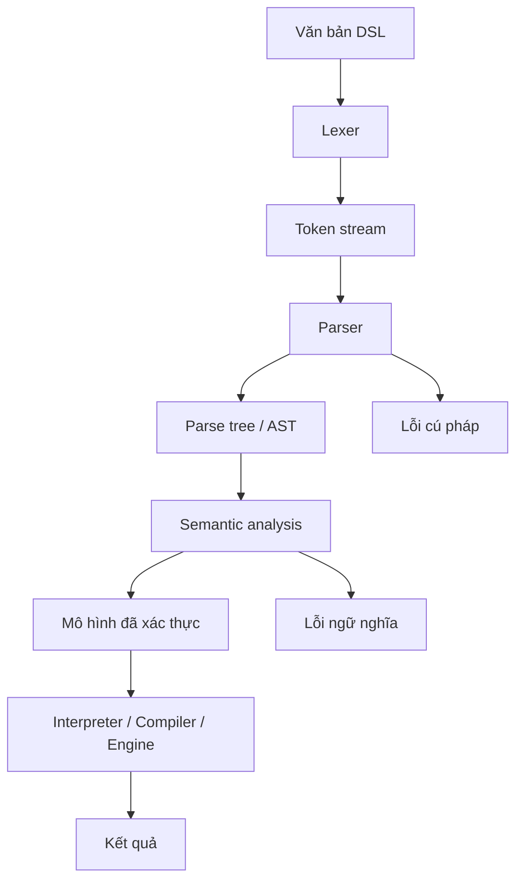

# Parser là gì?

Trong một DSL (*Domain-Specific Language*), người dùng viết mô tả bằng cú pháp được thiết kế cho một miền cụ thể: truy vấn dữ liệu, khai báo chính sách, cấu hình hạ tầng, workflow hoặc công thức nghiệp vụ. Máy tính cần hiểu cấu trúc của mô tả đó trước khi có thể kiểm tra, diễn giải hoặc thực thi. Thành phần đảm nhiệm việc phân tích cấu trúc cú pháp này là **parser**.

**Parser** là bộ phân tích cú pháp. Nó nhận một chuỗi token từ lexer, kiểm tra cách các token được kết hợp theo grammar của ngôn ngữ và tạo ra biểu diễn có cấu trúc, thường là parse tree hoặc AST. Nếu chuỗi token không tuân theo grammar, parser phát hiện lỗi cú pháp và cung cấp thông tin giúp người viết sửa lỗi.

Ví dụ, một DSL quy tắc có thể cho phép:

```text
when order.total >= 500000
then shipping.fee = 0
```

Parser xác định `when` mở đầu điều kiện, biểu thức so sánh là cấu trúc hợp lệ, `then` mở đầu hành động và phép gán thuộc phần hành động. Nó không chỉ tìm các từ khóa; nó phải hiểu quan hệ giữa chúng theo quy tắc của DSL.

## 1. Parser nằm ở đâu trong quá trình xử lý DSL?

Một bộ xử lý DSL thường có pipeline gồm nhiều bước. Parser là một thành phần trong pipeline đó.



Các thành phần có trách nhiệm khác nhau:

- **Source text:** văn bản nguồn do người dùng viết hoặc hệ thống sinh ra.
- **Lexer (bộ phân tích từ vựng):** gom ký tự thành token như identifier, keyword, number, string, operator và punctuation.
- **Parser:** kiểm tra thứ tự và quan hệ giữa token theo grammar, rồi tạo cấu trúc cú pháp.
- **Semantic analyzer:** kiểm tra ý nghĩa của cấu trúc, chẳng hạn tên có tồn tại, kiểu có tương thích và thao tác có được phép trong miền hay không.
- **Interpreter/compiler/engine:** thực thi cấu trúc hoặc chuyển đổi nó thành mã, cấu hình hay kế hoạch cho hệ thống khác.

Parser thường không quyết định một biểu thức có đúng nghiệp vụ hay không. Ví dụ, `order.unknownField > 10` có thể đúng grammar nhưng sai ngữ nghĩa nếu `unknownField` không tồn tại trong mô hình Order. Việc tìm ra lỗi đó thuộc semantic analysis.

## 2. Parser nhận đầu vào và tạo đầu ra gì?

### Đầu vào: token stream

Lexer đọc chuỗi ký tự và tạo một dãy token. Với biểu thức:

```text
order.total >= 500000
```

token stream minh họa có thể gồm:

| Token text | Token type |
|---|---|
| `order` | IDENTIFIER |
| `.` | DOT |
| `total` | IDENTIFIER |
| `>=` | GREATER_EQUAL |
| `500000` | NUMBER |

Token thường chứa thêm vị trí nguồn như offset, dòng và cột. Thông tin này giúp parser chỉ ra lỗi ở đâu.

Lexer có thể xử lý comment, khoảng trắng, escape sequence, chuỗi và số. Parser nhận token đã được phân loại, nhờ đó không phải phân tích lại từng ký tự.

### Đầu ra: parse tree hoặc AST

Khi token stream hợp lệ theo grammar, parser tạo một cấu trúc cây.

**Parse tree** thể hiện cách chuỗi token được dẫn xuất từ các quy tắc grammar. Nó có thể giữ các non-terminal trung gian và chi tiết cú pháp.

**Abstract Syntax Tree (AST)** tập trung vào cấu trúc có ý nghĩa của chương trình, thường bỏ qua một số chi tiết dấu câu hoặc quy tắc trung gian không cần cho các bước tiếp theo.

Với biểu thức `order.total >= 500000`, AST có thể được mô tả rút gọn:

```text
GreaterThanOrEqual
├── MemberAccess
│   ├── Name("order")
│   └── Name("total")
└── Number(500000)
```

AST cho phép semantic analysis, type checking, transformation và execution làm việc với node có kiểu rõ ràng thay vì tìm kiếm trong văn bản.

### Parser không nhất thiết tạo AST trực tiếp

Một parser có thể tạo parse tree rồi chuyển thành AST. Parser khác có thể tạo AST ngay trong lúc phân tích. Một số parser dùng semantic action để xây dựng mô hình nội bộ hoặc thực hiện hành động giới hạn ngay khi nhận diện production.

Dù cách triển khai nào được chọn, cần giữ ranh giới rõ giữa nhận diện cấu trúc cú pháp và kiểm tra ý nghĩa của miền.

## 3. Grammar quy định parser điều gì?

**Grammar (văn phạm)** là tập quy tắc xác định những chuỗi token nào được xem là cấu trúc hợp lệ của ngôn ngữ. Parser sử dụng grammar để quyết định token tiếp theo có thể xuất hiện ở vị trí hiện tại hay không và một cấu trúc đã hoàn chỉnh chưa.

Ví dụ, một grammar rút gọn cho biểu thức số học:

```ebnf
expression = term, { ("+" | "-"), term } ;
term       = factor, { ("*" | "/"), factor } ;
factor     = number | identifier | "(", expression, ")" ;
```

Các quy tắc trên nói rằng:

- Một expression gồm một term và có thể có thêm các cặp toán tử cộng/trừ với term.
- Một term gồm một factor và có thể có thêm các cặp nhân/chia với factor.
- Một factor có thể là số, định danh hoặc biểu thức đặt trong ngoặc.

Cách chia tầng này cũng thể hiện precedence: nhân và chia được nhóm trước cộng và trừ.

### Terminal và non-terminal

- **Terminal:** token xuất hiện trực tiếp trong đầu vào, như `+`, `if`, `(` hoặc literal.
- **Non-terminal:** tên đại diện cho cấu trúc được định nghĩa bởi grammar, như expression, statement hoặc declaration.
- **Production rule:** quy tắc mô tả cách một non-terminal được tạo từ terminal và non-terminal khác.
- **Start symbol:** non-terminal bắt đầu quá trình phân tích, thường là program, document hoặc expression.

Một DSL hoàn chỉnh thường có nhiều production để mô tả khai báo, block, câu lệnh, biểu thức, kiểu dữ liệu và cấu trúc miền.

## 4. Ví dụ parser phân tích một biểu thức

Giả sử người dùng viết:

```text
2 + 3 * 4
```

Lexer tạo token:

```text
NUMBER(2), PLUS, NUMBER(3), STAR, NUMBER(4)
```

Parser áp dụng grammar. Nếu phép nhân có precedence cao hơn phép cộng, nó tạo cấu trúc tương đương:

```text
Add
├── Number(2)
└── Multiply
    ├── Number(3)
    └── Number(4)
```

Parser không tính kết quả 14 chỉ vì đã tạo cây. AST mô tả grouping. Interpreter hoặc compiler mới xác định cách đánh giá theo semantics của DSL.

Nếu người viết nhập:

```text
2 + * 4
```

parser phát hiện `*` xuất hiện ở vị trí mà grammar đang yêu cầu một toán hạng. Đây là lỗi cú pháp. Thông báo hữu ích nên nêu vị trí, token bất ngờ và loại thành phần parser đang mong đợi.

## 5. Parser phân tích từ trên xuống và từ dưới lên

Có nhiều chiến lược parsing. Hai nhóm phổ biến là **top-down parsing** và **bottom-up parsing**.

### 5.1. Top-down parsing – phân tích từ trên xuống

Top-down parser bắt đầu từ start symbol của grammar rồi dự đoán hoặc mở rộng các production để khớp với token đầu vào.

Một kỹ thuật quen thuộc là **recursive descent parser**. Mỗi non-terminal có thể tương ứng với một hàm phân tích. Hàm gọi các hàm khác theo cấu trúc grammar.

Ví dụ mã giả:

```text
parseExpression():
    left = parseTerm()

    while nextToken is PLUS or MINUS:
        operator = consume()
        right = parseTerm()
        left = BinaryExpr(operator, left, right)

    return left
```

Hàm parseExpression gọi parseTerm để xử lý các toán tử có precedence cao hơn, sau đó xử lý cộng/trừ. Cách viết này tương đối dễ đọc và phù hợp với DSL có grammar được tổ chức rõ.

**Predictive parsing** là dạng top-down parser có thể chọn production tiếp theo dựa trên một lượng token nhìn trước, không cần thử lần lượt mọi khả năng. LL parser là một họ parser predictive phổ biến.

### 5.2. Bottom-up parsing – phân tích từ dưới lên

Bottom-up parser bắt đầu từ token đầu vào và dần kết hợp các token hoặc cấu trúc nhỏ thành cấu trúc lớn hơn cho đến khi tạo được start symbol.

Một kỹ thuật tiêu biểu là **shift-reduce parsing**:

- **Shift:** đưa token tiếp theo vào stack.
- **Reduce:** thay một chuỗi trên stack bằng non-terminal theo một production.
- **Accept:** chấp nhận khi toàn bộ đầu vào được rút gọn thành start symbol.
- **Error:** không có hành động hợp lệ theo bảng parser.

LR parser là một họ bottom-up parser được sử dụng rộng rãi. Parser generator có thể tạo bảng phân tích từ grammar.

### So sánh

| Tiêu chí | Top-down | Bottom-up |
|---|---|---|
| Điểm bắt đầu | Start symbol | Token đầu vào |
| Cách xây dựng | Mở rộng production để khớp input | Kết hợp cấu trúc nhỏ thành cấu trúc lớn |
| Kỹ thuật ví dụ | Recursive descent, LL | Shift-reduce, LR |
| Độ dễ triển khai thủ công | Thường dễ tiếp cận với grammar nhỏ | Bảng và thuật toán có thể phức tạp hơn |
| Grammar | Thường cần xử lý một số dạng đệ quy trái hoặc mơ hồ | Xử lý được nhiều grammar hơn, tùy họ parser |
| Phù hợp | DSL nhỏ, cú pháp có cấu trúc rõ | Ngôn ngữ có grammar lớn hoặc cần parser generator |

Không có chiến lược tốt nhất cho mọi DSL. Việc chọn parser cần xét độ phức tạp grammar, khả năng mở rộng, chất lượng diagnostics và kỹ năng của nhóm phát triển.

## 6. Recursive descent parser

Recursive descent là cách triển khai parser thủ công thường gặp trong các DSL nhỏ và vừa.

Ví dụ, grammar:

```ebnf
statement  = "print", expression, ";" ;
expression = number, { ("+" | "-"), number } ;
```

có thể được xử lý bằng các hàm:

```text
parseStatement()
parseExpression()
parseNumber()
```

Mỗi hàm kiểm tra token hiện tại, tiêu thụ token cần thiết và trả về node hoặc cấu trúc tương ứng.

### Ưu điểm

- Cấu trúc code gần với grammar, dễ đọc.
- Dễ tùy chỉnh thông báo lỗi theo ngữ cảnh.
- Dễ tích hợp với AST và domain model.
- Phù hợp khi DSL có cú pháp được kiểm soát và không quá lớn.

### Hạn chế

- Có thể khó quản lý khi grammar rất lớn hoặc nhiều production chồng lấn.
- Đệ quy trái trực tiếp có thể gây gọi đệ quy vô hạn.
- Nếu grammar thay đổi thường xuyên, mã parser thủ công cần được cập nhật cẩn thận.
- Việc xử lý lookahead, backtracking và ambiguity có thể phức tạp.

Để tránh đệ quy trái, grammar có thể được chuyển sang dạng lặp hoặc parser dùng thuật toán hỗ trợ phù hợp. Ví dụ, thay vì định nghĩa `expr = expr "+" term | term`, recursive descent có thể phân tích term đầu tiên rồi lặp qua các cặp toán tử và term tiếp theo.

## 7. Parser generator là gì?

**Parser generator** là công cụ nhận grammar và sinh mã parser hoặc bảng parser. Người phát triển mô tả cú pháp trong một định dạng grammar; công cụ tạo bộ phân tích theo thuật toán mà nó hỗ trợ.

Quy trình khái quát:

1. Viết grammar của DSL.
2. Chọn parser generator và định dạng đặc tả.
3. Sinh parser.
4. Tích hợp parser với lexer và AST builder.
5. Xử lý diagnostics và lỗi cú pháp.
6. Kiểm tra các đầu vào hợp lệ và không hợp lệ.

Một số công cụ và thư viện thường gặp:

- **ANTLR:** công cụ sinh parser, hỗ trợ grammar và tạo parse tree với runtime cho nhiều ngôn ngữ.
- **JavaCC:** parser generator cho Java, thường dùng với grammar dạng gần EBNF.
- **Bison:** parser generator thuộc họ Yacc, thường tạo parser kiểu LALR hoặc các biến thể được hỗ trợ.
- **PEG parser libraries:** xử lý grammar theo Parsing Expression Grammar, với quy tắc lựa chọn có thứ tự.
- **Parser combinators:** thư viện cho phép ghép các parser nhỏ bằng code của host language.

Lựa chọn công cụ phụ thuộc ngôn ngữ triển khai, loại grammar, yêu cầu hiệu năng, khả năng báo lỗi và công cụ hỗ trợ. Parser generator không tự thiết kế semantics của DSL; nhóm vẫn phải định nghĩa domain model, type rules và hành vi thực thi.

## 8. Ambiguity – grammar mơ hồ

Một grammar là **ambiguous** nếu cùng một chuỗi đầu vào có thể tạo ra nhiều parse tree hợp lệ khác nhau.

Ví dụ, nếu grammar không định nghĩa precedence cho `+` và `*`, biểu thức:

```text
a + b * c
```

có thể được nhóm theo hai cách:

```text
(a + b) * c
a + (b * c)
```

Hai cây có thể dẫn tới kết quả khác nhau. DSL cần loại bỏ sự mơ hồ bằng grammar phân tầng, khai báo precedence/associativity hoặc yêu cầu người dùng dùng dấu ngoặc.

### Các nguồn ambiguity khác

- Một token có thể được hiểu là keyword hoặc identifier.
- Hai production có phần đầu giống nhau.
- Cú pháp optional khiến parser không rõ một đoạn thuộc cấu trúc nào.
- Cấu trúc lời gọi hàm, nhóm biểu thức và tuple có thể trùng hình thức.
- Một từ khóa miền như `AND` có thể xuất hiện trong cú pháp của một toán tử khác.

Không nên chỉ dựa vào parser generator để tự giải quyết mọi ambiguity. Nếu công cụ chọn một nhánh theo quy tắc mặc định, kết quả có thể không phản ánh ý định của người thiết kế. Cần hiểu cây được tạo ra và đặc tả semantics rõ.

## 9. Lookahead và backtracking

**Lookahead** là việc parser xem trước một hoặc nhiều token để quyết định production hoặc nhánh phân tích tiếp theo. Ví dụ, khi parser thấy identifier, token tiếp theo có thể cho biết đó là lời gọi hàm nếu là `(`, hoặc truy cập biến nếu không phải.

**Backtracking** là việc parser thử một nhánh; nếu nhánh đó thất bại, nó quay lại trạng thái trước để thử nhánh khác.

Lookahead có thể giúp parser dự đoán mà không cần backtracking. Backtracking làm grammar linh hoạt hơn trong một số parser, nhưng có thể tăng chi phí và khiến hiệu năng khó dự đoán nếu có nhiều nhánh trùng tiền tố.

PEG thường sử dụng ordered choice: các lựa chọn được thử theo thứ tự trong grammar, và lựa chọn đầu tiên thành công được chấp nhận. Vì vậy, đổi thứ tự production có thể đổi cách phân tích. Đây là semantics của PEG, không giống hoàn toàn grammar CFG thông thường.

## 10. Parser xử lý lỗi như thế nào?

Không phải mọi đầu vào đều hợp lệ. Parser cần phát hiện lỗi và báo cho người dùng biết vị trí cùng nguyên nhân.

Các lỗi cú pháp phổ biến:

- Thiếu dấu ngoặc hoặc dấu đóng block.
- Thiếu toán hạng sau toán tử.
- Từ khóa xuất hiện sai vị trí.
- Sai thứ tự thành phần bắt buộc.
- Literal không đúng định dạng theo grammar.
- Token không được phép tại vị trí hiện tại.
- Kết thúc tệp khi parser vẫn đang chờ một thành phần.

Một diagnostics hữu ích nên gồm:

- Tên tệp hoặc nguồn đầu vào.
- Dòng và cột hoặc source offset.
- Token gặp phải.
- Token hoặc cấu trúc parser mong đợi.
- Ngữ cảnh cú pháp đang được phân tích.
- Gợi ý sửa lỗi nếu có thể đưa ra đáng tin cậy.

Ví dụ:

```text
policy "shipping" {
    when order.total >=
    then shipping.fee = 0
}
```

Thông báo chung chung như “syntax error” ít hữu ích. Một parser tốt có thể chỉ ra rằng sau toán tử `>=`, parser mong đợi một biểu thức nhưng lại gặp keyword `then`.

## 11. Error recovery – phục hồi sau lỗi

Trong editor hoặc công cụ tương tác, parser thường cần tiếp tục phân tích sau khi gặp lỗi để người dùng có thể nhận nhiều diagnostics trong một lần sửa.

### Panic-mode recovery

Parser bỏ qua token cho đến khi gặp một token đồng bộ (*synchronization token*) như dấu `;`, dấu `}` hoặc keyword mở đầu câu lệnh tiếp theo. Sau đó, nó tiếp tục từ vị trí có khả năng khôi phục.

### Phrase-level recovery

Parser thực hiện sửa chữa nhỏ tại vị trí lỗi, ví dụ giả định thiếu một dấu `)` hoặc bỏ qua một token thừa. Cách này có thể giúp tiếp tục phân tích nhưng cần đánh dấu node được phục hồi để các bước sau không xem nó là hoàn toàn đáng tin cậy.

### Error productions

Grammar có thể định nghĩa một số cấu trúc lỗi thường gặp để parser nhận diện và đưa ra thông báo chuyên biệt.

### Error node trong AST

Một parser phục hồi có thể tạo node lỗi đại diện cho vùng không phân tích được. Editor có thể tiếp tục tô màu, hiển thị cấu trúc còn lại và đưa diagnostics cho người dùng.

Phục hồi lỗi hữu ích trong IDE, nhưng không có nghĩa chương trình sai cú pháp được phép thực thi. Runtime hoặc compiler cần biết AST có chứa error node và từ chối thực thi nếu cấu trúc chưa hợp lệ.

## 12. Source location và diagnostics

Parser cần giữ liên hệ giữa node và đoạn văn bản nguồn đã tạo ra nó. Thông tin này thường được lưu dưới dạng source span.

Một span có thể gồm:

```text
SourceSpan {
    file
    startOffset
    endOffset
    startLine
    startColumn
}
```

Span thường dùng khoảng nửa mở: startOffset được tính vào vùng, endOffset nằm ngay sau vùng. Quy ước này giúp tính độ dài bằng endOffset trừ startOffset và dễ biểu diễn vùng rỗng.

Khi semantic analyzer phát hiện tên không tồn tại, nó có thể dùng source span của node identifier để đánh dấu đúng đoạn nguồn. Khi compiler báo kiểu không tương thích, thông tin vị trí giúp người viết tìm biểu thức liên quan.

Nếu AST được transformation, cần quyết định cách giữ hoặc cập nhật source location. Node được sinh tự động có thể cần source origin hoặc synthetic marker để diagnostics không trỏ sai vị trí.

## 13. Parser và semantic analysis khác nhau như thế nào?

Parser xác định cấu trúc cú pháp; semantic analysis xác định cấu trúc đó có ý nghĩa và hợp lệ trong miền hay không.

| Đầu vào | Parser | Semantic analysis |
|---|---|---|
| `a + 2` | Có thể phân tích thành BinaryExpr | Kiểm tra kiểu của a có cộng với số được không |
| `order.unknown` | Có thể tạo MemberAccess | Kiểm tra Order có trường unknown không |
| `if active { ... }` | Kiểm tra cấu trúc if/block | Kiểm tra active là Boolean và nội dung block hợp lệ |
| `send(message)` | Phân tích lời gọi hàm | Kiểm tra send tồn tại, số đối số và kiểu đối số |
| `timeout = -1` | Có thể đúng grammar | Kiểm tra giá trị có vi phạm ràng buộc miền không |

Một chương trình có thể đúng cú pháp nhưng sai ngữ nghĩa. Ngược lại, nếu cú pháp không hợp lệ thì parser thường không thể tạo một AST hoàn chỉnh để semantic analysis xử lý bình thường.

## 14. Parser trong DSL khai báo và DSL mệnh lệnh

Cả DSL khai báo (*declarative*) và DSL mệnh lệnh (*imperative*) đều cần parser, nhưng cấu trúc mà parser nhận diện có thể khác.

### DSL khai báo

Người dùng mô tả trạng thái mong muốn, quan hệ hoặc quy tắc:

```text
service "catalog" {
    replicas = 3
    region = "ap-southeast"
}
```

Parser nhận diện block service, tên tài nguyên và các thuộc tính. Semantic analyzer kiểm tra schema, kiểu và quan hệ giữa các tài nguyên. Engine quyết định cách đạt tới trạng thái mong muốn.

### DSL mệnh lệnh

Người dùng mô tả chuỗi thao tác:

```text
connect database
read records
filter records where status == "ACTIVE"
write report
```

Parser nhận diện câu lệnh và thứ tự của chúng. AST có thể chứa các node Statement hoặc Command. Interpreter hoặc runtime thực thi theo semantics được định nghĩa.

Một DSL có thể kết hợp hai phong cách. Parser cần phản ánh đúng grammar của ngôn ngữ, không nên giả định mọi DSL đều là danh sách câu lệnh.

## 15. Tích hợp parser vào ứng dụng

Parser thường được gọi từ ứng dụng hoặc công cụ quản trị DSL. Một giao diện đơn giản có thể nhận văn bản và trả về AST hoặc diagnostics.

Ví dụ mã giả:

```java
ParseResult parse(String source) {
    List<Token> tokens = lexer.tokenize(source);
    return parser.parse(tokens);
}
```

Ứng dụng có thể dùng kết quả như sau:

```java
ParseResult result = parse(source);

if (result.hasErrors()) {
    showDiagnostics(result.errors());
} else {
    Ast ast = result.ast();
    SemanticResult checked = semanticAnalyzer.analyze(ast);

    if (checked.isValid()) {
        engine.execute(checked.model());
    } else {
        showDiagnostics(checked.errors());
    }
}
```

Đây là mô hình minh họa; API thực tế có thể khác. Điều quan trọng là không thực thi AST chưa qua các bước xác thực cần thiết của DSL.

### Parser trong editor và IDE

Một editor cho DSL có thể dùng parser để:

- Tô màu cú pháp.
- Tự động hoàn thành từ khóa hoặc cấu trúc.
- Hiển thị lỗi ngay khi người dùng gõ.
- Điều hướng đến khai báo.
- Tạo outline hoặc cấu trúc tài liệu.
- Hỗ trợ rename và refactoring.
- Cung cấp hover information dựa trên AST và semantic model.

Editor thường cần parser chịu được đầu vào chưa hoàn chỉnh, vì người dùng có thể đang gõ dở một block hoặc biểu thức. Error recovery và incremental parsing vì vậy đặc biệt hữu ích.

### Incremental parsing

**Incremental parsing** cập nhật kết quả phân tích khi một phần văn bản thay đổi, thay vì parse lại toàn bộ tài liệu. Editor có thể chỉ phân tích lại vùng bị ảnh hưởng và tái sử dụng cấu trúc không đổi.

Để làm tốt, parser cần giữ source range, quản lý phụ thuộc giữa các vùng và xử lý trường hợp một thay đổi nhỏ làm cấu trúc lớn hơn bị ảnh hưởng, chẳng hạn thêm dấu ngoặc mở ở đầu block.

## 16. Hiệu năng và giới hạn tài nguyên

Parser thường xử lý đầu vào do người dùng hoặc hệ thống khác cung cấp. Một số yếu tố ảnh hưởng hiệu năng:

- Độ dài văn bản và số lượng token.
- Độ phức tạp của grammar.
- Số lượng nhánh lookahead hoặc backtracking.
- Độ sâu lồng nhau và độ sâu đệ quy.
- Chi phí tạo parse tree hoặc AST.
- Cách quản lý comment, source span và diagnostics.
- Việc parse lại toàn bộ hay incremental.

Một parser cho DSL dùng trong ứng dụng thực tế nên có giới hạn phù hợp đối với kích thước đầu vào, độ sâu lồng nhau và thời gian phân tích. Với parser đệ quy, đầu vào lồng rất sâu có thể gây tràn stack. Với grammar có backtracking không kiểm soát, một đầu vào đặc biệt có thể tiêu tốn nhiều thời gian.

Có thể dùng timeout, giới hạn số token, giới hạn nesting depth hoặc thuật toán parsing có độ phức tạp dự đoán được tùy yêu cầu của miền.

## 17. An toàn khi phân tích DSL

Parser là ranh giới tiếp nhận dữ liệu đầu vào, nhưng parse thành công không có nghĩa nội dung an toàn để thực thi.

Các nguyên tắc quan trọng:

- Giới hạn kích thước và độ sâu đầu vào.
- Không thực thi mã tùy ý chỉ vì parser nhận diện được cấu trúc.
- Semantic analyzer cần kiểm tra tên, quyền và kiểu trước khi gọi action.
- Runtime cần giới hạn tài nguyên và thao tác mà DSL có thể yêu cầu.
- Diagnostics không nên làm lộ thông tin nhạy cảm của hệ thống.
- Nếu DSL cho phép plugin hoặc hàm mở rộng, cần xác thực nguồn và quyền của chúng.

Parser chỉ bảo đảm đầu vào phù hợp grammar. Việc một rule được phép truy cập dữ liệu nào hoặc gọi dịch vụ nào thuộc trách nhiệm của semantic layer và runtime.

## 18. Thiết kế parser dễ bảo trì cho DSL

### Bắt đầu từ domain language

Xác định người dùng cần diễn đạt khái niệm gì trước khi viết grammar. Từ khóa, block và biểu thức nên phản ánh thuật ngữ miền, tránh thêm cấu trúc chỉ vì parser dễ cài đặt.

### Giữ grammar rõ và nhất quán

Quy định cách viết block, dấu phân cách, optional element, precedence, associativity và comment. Tránh các production chồng lấn khiến người đọc khó dự đoán.

### Tách lexer, parser và semantic analysis

Ranh giới rõ giúp thay đổi cú pháp mà không phải sửa mọi quy tắc nghiệp vụ. Với DSL rất nhỏ, có thể kết hợp một số thành phần, nhưng cần giữ phân biệt về trách nhiệm.

### Thiết kế diagnostics ngay từ đầu

Thông báo lỗi là một phần của trải nghiệm ngôn ngữ. Cần có source span, expected token và ngữ cảnh parsing. Đừng chỉ trả một thông báo lỗi chung.

### Duy trì tính nhất quán của tooling

Parser trong CLI, editor, validator và runtime cần dùng cùng grammar và semantics. Nếu mỗi công cụ hiểu cú pháp khác nhau, người dùng sẽ khó tin cậy kết quả.

### Quản lý phiên bản grammar

Khi grammar thay đổi, cần biết tệp DSL cũ có còn hợp lệ không. Có thể dùng version declaration, migration hoặc cảnh báo cấu trúc sắp bị loại bỏ. Thay đổi precedence hoặc ý nghĩa token cũng có thể làm đổi cách phân tích các biểu thức cũ.

## 19. Những nhầm lẫn thường gặp

**Cho rằng parser chính là lexer.** Lexer nhận diện token; parser kết hợp token theo grammar.

**Cho rằng parser kiểm tra toàn bộ tính đúng đắn.** Parser kiểm tra cú pháp. Tên tồn tại, kiểu tương thích và quy tắc nghiệp vụ thuộc semantic analysis.

**Cho rằng parse tree và AST giống hệt nhau.** Parse tree phản ánh grammar chi tiết hơn; AST tập trung vào cấu trúc có ý nghĩa cho các bước sau.

**Cho rằng parser chỉ dành cho ngôn ngữ lập trình tổng quát.** DSL cấu hình, truy vấn, workflow, chính sách và công thức đều có thể cần parser.

**Cho rằng parser generator tự tạo ra một ngôn ngữ hoàn chỉnh.** Công cụ chỉ giúp tạo parser từ grammar. Semantics, type checking, runtime và tooling vẫn cần được thiết kế.

**Cho rằng parse thành công đồng nghĩa có thể thực thi an toàn.** Cấu trúc đúng cú pháp vẫn có thể sai ngữ nghĩa hoặc yêu cầu hành động không được phép.

**Cho rằng mọi grammar đều không mơ hồ.** Grammar có thể cho nhiều parse tree. Cần xác định precedence, associativity và cách giải quyết các production xung đột.

**Cho rằng parser phải dừng ở lỗi đầu tiên.** CLI có thể chọn dừng sớm, nhưng editor thường cần error recovery để hiển thị nhiều diagnostics cùng lúc.

## 20. Quy trình xây dựng parser cho một DSL

1. Xác định các cấu trúc và biểu thức người dùng cần viết.
2. Xác định token, keyword, identifier, literal và operator.
3. Viết grammar với start symbol và các production rõ ràng.
4. Chọn chiến lược parsing: recursive descent, LL, LR, PEG hoặc parser combinator.
5. Xây dựng lexer và parser hoặc chọn parser generator phù hợp.
6. Quy định parser tạo parse tree, AST hay mô hình trung gian.
7. Giữ source location để hỗ trợ diagnostics.
8. Xác định cách xử lý ambiguity, precedence và associativity.
9. Thiết kế error reporting và error recovery.
10. Kết nối parser với semantic analyzer và runtime.
11. Hỗ trợ editor hoặc incremental parsing nếu DSL có trải nghiệm tương tác.
12. Kiểm tra giới hạn kích thước, độ sâu và thời gian phân tích.
13. Quản lý version grammar và khả năng tương thích của tệp DSL.

## 21. Câu hỏi tự kiểm tra

1. Parser là gì và nó nhận đầu vào nào?
2. Lexer và parser khác nhau ở trách nhiệm nào?
3. Grammar quy định điều gì trong một DSL?
4. Parse tree khác AST như thế nào?
5. Vì sao parser không thể tự xác nhận mọi quy tắc nghiệp vụ?
6. Top-down parsing và bottom-up parsing khác nhau ra sao?
7. Recursive descent parser hoạt động như thế nào?
8. Parser generator có vai trò gì và không giải quyết phần nào của DSL?
9. Ambiguous grammar là gì? Nêu ví dụ với biểu thức toán học.
10. Lookahead và backtracking giúp parser xử lý lựa chọn như thế nào?
11. Error recovery có ích gì trong editor?
12. Source span hỗ trợ diagnostics ra sao?
13. Incremental parsing khác parse lại toàn bộ tài liệu như thế nào?
14. Vì sao parse thành công không có nghĩa chương trình an toàn để thực thi?
15. Hãy mô tả pipeline xử lý một câu lệnh DSL từ văn bản đến AST và runtime.

Khi hiểu parser, người học có thể giải thích cách văn bản DSL được chuyển thành cấu trúc có thể xử lý, phân biệt lỗi cú pháp với lỗi ngữ nghĩa và lựa chọn chiến lược parsing phù hợp với grammar cùng trải nghiệm người dùng của ngôn ngữ.
