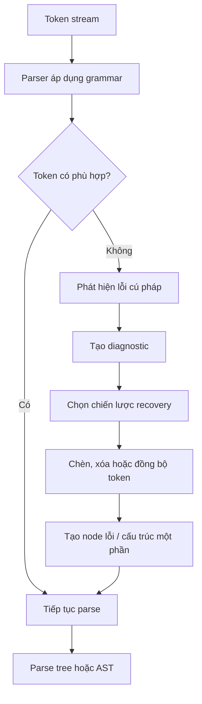

# Khôi phục sau lỗi

Trong quá trình phân tích cú pháp (parsing) một ngôn ngữ chuyên biệt miền (Domain-Specific Language, DSL), parser có thể gặp đầu vào không tuân theo ngữ pháp. Người viết có thể quên dấu `}`, thiếu toán hạng, đặt từ khóa sai vị trí hoặc nhập nhầm tên cấu trúc. Nếu parser dừng ngay tại lỗi đầu tiên, người dùng phải sửa từng lỗi rồi chạy phân tích lại nhiều lần. Điều này gây khó chịu, đặc biệt khi DSL được dùng trong IDE, trình soạn thảo cấu hình hoặc công cụ thiết kế mô hình.

**Khôi phục sau lỗi (error recovery)** là tập hợp kỹ thuật giúp parser tiếp tục phân tích sau khi phát hiện lỗi cú pháp, nhằm tìm thêm lỗi hoặc tạo ra một cấu trúc cú pháp một phần đủ hữu ích cho các bước tiếp theo. Khôi phục tốt giúp người dùng nhận được nhiều chẩn đoán có liên quan trong một lần phân tích, đồng thời giữ được vị trí và ngữ cảnh của những phần chương trình vẫn hợp lệ.

Khôi phục không có nghĩa là coi chương trình sai cú pháp như chương trình hợp lệ. Parser phải đánh dấu vùng lỗi, ghi nhận token bị thiếu hoặc thừa nếu có sửa chữa giả định, và tránh tạo ra kết quả khiến compiler hiểu nhầm rằng đầu vào đã hoàn toàn đúng. Một DSL có thể chấp nhận mô hình cú pháp một phần trong editor, nhưng bước build hoặc thực thi vẫn cần từ chối chương trình có lỗi nghiêm trọng.

## 1. Khôi phục sau lỗi là gì?

Parser thường đọc token stream và áp dụng grammar để tạo parse tree hoặc AST. Khi token hiện tại không phù hợp với token hoặc production mà parser mong đợi, parser phát hiện lỗi cú pháp. **Khôi phục** là cách đưa parser trở lại một trạng thái mà nó có thể tiếp tục phân tích phần còn lại.

Ví dụ, một DSL khai báo chính sách có đoạn:

```text
policy giao_hang {
    base_fee = 30000 VND
    free_when tong_tien >= 500000 VND
    area = NOI_THANH
```

Tệp thiếu dấu `}` đóng khối. Parser có thể phát hiện lỗi khi gặp EOF, báo rằng nó đang mong đợi `RBRACE`, sau đó tạo một token đóng khối giả định để hoàn tất cấu trúc một phần. Nhờ vậy, AST vẫn có thể chứa khai báo `policy` và các thành viên bên trong.

Trong ví dụ khác:

```text
base_fee = 30000 VND;
free_when tong_tien >= 500000 VND;
area = NOI_THANH;
```

Nếu grammar không dùng dấu chấm phẩy sau mỗi thành viên, parser có thể gặp dấu `;` không mong đợi. Nó có thể bỏ token đó và tiếp tục ở `free_when`, thay vì dừng cả tệp.

### 1.1. Ba mục tiêu của khôi phục

Khôi phục sau lỗi thường cân bằng ba mục tiêu:

- **Tiến triển:** Parser cần tiếp tục đọc đầu vào để tránh mắc kẹt tại cùng token.
- **Định vị lỗi:** Parser cần chỉ ra vùng gây lỗi và giải thích token mong đợi hoặc cấu trúc bị vi phạm.
- **Giữ cấu trúc hữu ích:** Những phần hợp lệ trước và sau lỗi nên được giữ để IDE, validator hoặc công cụ khác có thể tiếp tục làm việc.

Không có thuật toán nào luôn đạt cả ba mục tiêu hoàn hảo. Khôi phục quá mạnh có thể đoán sai ý định và tạo nhiều lỗi dây chuyền; khôi phục quá thận trọng có thể bỏ qua phần lớn tệp sau một lỗi nhỏ.

### 1.2. Khôi phục khác với sửa mã nguồn

Parser có thể giả định rằng một token bị thiếu hoặc thừa để tiếp tục phân tích, nhưng điều đó không nhất thiết có nghĩa nó đã sửa văn bản gốc. Ví dụ, parser có thể tạo một token `}` tổng hợp trong parse tree mà không chèn ký tự vào tệp.

Việc áp dụng sửa đổi thật vào mã nguồn là một hành động riêng của IDE hoặc công cụ sửa lỗi. Nó cần sự đồng ý của người dùng hoặc một chính sách tự động sửa được xác định rõ. Phân biệt này giúp tránh việc parser âm thầm thay đổi nội dung mà người dùng đã viết.

## 2. Vòng đời xử lý lỗi cú pháp

Khôi phục là một phần của quy trình phân tích cú pháp. Một pipeline phổ biến có thể gồm các bước:

1. Lexer chuyển ký tự thành token và báo lỗi từ vựng nếu cần.
2. Parser nhận token stream và áp dụng grammar.
3. Khi token không phù hợp, parser tạo chẩn đoán cú pháp.
4. Recovery strategy chọn cách đồng bộ hoặc sửa lỗi cục bộ.
5. Parser tiếp tục phân tích phần còn lại.
6. Parse tree hoặc AST đánh dấu các vùng lỗi và token tổng hợp.
7. Các bước ngữ nghĩa quyết định phần nào có thể kiểm tra an toàn.



Sơ đồ thể hiện luồng khái niệm. Một parser thực tế có thể thực hiện chẩn đoán, recovery và xây dựng node lỗi trong cùng một hàm hoặc thông qua các callback.

### 2.1. Phát hiện lỗi

Lỗi được phát hiện khi parser không thể áp dụng production phù hợp với token hiện tại, hoặc khi kết thúc một production nhưng token tiếp theo không thuộc tập token hợp lệ.

Parser có thể biết token mong đợi từ grammar, tập FIRST/FOLLOW, trạng thái automaton hoặc lookahead. Chất lượng thông báo phụ thuộc việc parser giữ được thông tin về ngữ cảnh và các lựa chọn cú pháp có thể có.

### 2.2. Báo lỗi

Chẩn đoán nên được tạo tại nơi parser có đủ thông tin để mô tả lỗi. Một chẩn đoán cần vị trí nguồn, token thực tế, token hoặc cấu trúc mong đợi và ngữ cảnh cú pháp đang được phân tích.

### 2.3. Chọn cách khôi phục

Parser có thể sửa một lỗi cục bộ bằng cách chèn hoặc xóa token, bỏ qua token đến một điểm đồng bộ, hoặc sử dụng production lỗi được thiết kế trước. Chiến lược phù hợp phụ thuộc loại lỗi và vị trí trong grammar.

### 2.4. Tiếp tục có kiểm soát

Sau recovery, parser cần bảo đảm đã tiêu thụ token, thay đổi trạng thái hoặc chuyển sang một ngữ cảnh mới. Nếu không, parser có thể lặp vô hạn tại cùng vị trí. Cần có điều kiện dừng và giới hạn để xử lý các trường hợp đầu vào hỏng nặng.

## 3. Các loại lỗi liên quan đến parsing

Không phải lỗi nào xuất hiện trong lúc phân tích DSL cũng là lỗi cú pháp. Việc phân loại giúp chọn đúng thành phần xử lý.

| Loại lỗi | Ví dụ | Thành phần thường xử lý |
|---|---|---|
| Lỗi từ vựng | Chuỗi không đóng dấu nháy, ký tự không hợp lệ | Lexer |
| Lỗi cú pháp | Thiếu `}`, đặt `ELSE` sai vị trí | Parser |
| Lỗi phân giải tên | Dùng biến chưa khai báo | Name resolver |
| Lỗi kiểu | Cộng `Money` với `Date` | Type checker |
| Lỗi ràng buộc miền | Khối lượng âm khi miền yêu cầu dương | Domain validator |
| Lỗi thực thi | Chia cho 0 khi chạy | Runtime |

Khôi phục parser tập trung vào cấu trúc cú pháp. Lexer có thể có cơ chế phục hồi riêng, ví dụ bỏ qua ký tự không hợp lệ và tiếp tục lexing, nhưng parser cần nhận được thông tin về lỗi đó để không coi token stream là hoàn toàn đáng tin cậy.

### 3.1. Lỗi từ vựng ảnh hưởng đến parser

Nếu lexer không nhận diện được một đoạn ký tự, nó có thể phát chẩn đoán và bỏ qua ký tự, tạo token lỗi hoặc dừng lexing. Nếu lexer bỏ qua ký tự mà không ghi nhận lỗi, parser có thể thấy một dãy token có vẻ hợp lệ nhưng thiếu dữ liệu quan trọng.

Ví dụ:

```text
name = "Lan
```

Nếu chuỗi không có dấu nháy đóng, lexer cần báo lỗi tại vị trí bắt đầu chuỗi. Parser có thể tiếp tục với token lỗi hoặc token tổng hợp tùy thiết kế, nhưng không nên che mất lỗi từ vựng ban đầu.

### 3.2. Lỗi cú pháp cục bộ và lỗi cấu trúc lớn

Thiếu dấu phẩy trong danh sách thường là lỗi cục bộ. Thiếu dấu ngoặc khối có thể làm parser mất ranh giới giữa nhiều khai báo và gây lỗi dây chuyền. Recovery nên cân nhắc mức độ ảnh hưởng của lỗi đến cấu trúc phía sau.

## 4. Tập đồng bộ (synchronization set)

Một kỹ thuật cơ bản là bỏ qua token cho đến khi gặp một token có khả năng đánh dấu điểm bắt đầu hoặc ranh giới của cấu trúc hợp lệ. Những token này tạo thành **tập đồng bộ (synchronization set)**.

Ví dụ, trong DSL có các khai báo kết thúc bằng dấu `;` và khối được đóng bằng `}`, parser có thể đồng bộ tại:

```text
;   }   EOF
```

Khi gặp lỗi trong một khai báo, parser bỏ qua token cho đến khi gặp một trong các dấu mốc này, rồi tiếp tục ở cấu trúc kế tiếp.

### 4.1. Đồng bộ theo dấu kết thúc câu lệnh

Với DSL dạng câu lệnh:

```text
set quota = 10;
set timeout = 30;
set retries = 3;
```

Nếu câu lệnh thứ hai sai cú pháp, dấu `;` có thể là điểm đồng bộ để parser bắt đầu câu lệnh thứ ba.

### 4.2. Đồng bộ theo dấu đóng khối

Trong cấu trúc lồng nhau, `}` thường là điểm đồng bộ quan trọng. Nếu một thành viên bên trong khối bị lỗi, parser có thể bỏ qua đến `;` hoặc `}` để tránh nuốt mất phần còn lại của khối.

Tuy nhiên, `}` cũng có thể đóng một khối lồng sâu hơn. Parser cần biết ngữ cảnh hiện tại để không đồng bộ nhầm vào dấu đóng thuộc cấp khác.

### 4.3. Đồng bộ theo từ khóa bắt đầu cấu trúc

DSL có thể dùng từ khóa như `policy`, `resource`, `rule`, `function` để bắt đầu khai báo. Khi lỗi xảy ra ở cấp tệp, các từ khóa này có thể là điểm đồng bộ phù hợp.

Ví dụ, nếu một khai báo `policy` bị hỏng, parser có thể bỏ phần còn lại đến khi gặp `policy` tiếp theo hoặc EOF. Cách này giúp giữ được các khai báo độc lập ở phía sau.

### 4.4. Đồng bộ theo ngữ cảnh grammar

Không nên dùng một tập đồng bộ toàn cục cho mọi vị trí. Bên trong danh sách tham số, dấu phẩy hoặc `)` có thể là điểm đồng bộ; bên trong biểu thức, dấu `;`, `)` hoặc `}` có thể phù hợp; ở cấp tệp, từ khóa khai báo mới có thể hữu ích.

Tập đồng bộ càng gắn với ngữ cảnh grammar thì parser càng ít có nguy cơ bỏ qua phần hợp lệ.

## 5. Panic-mode recovery

**Panic-mode recovery** là chiến lược đơn giản, phổ biến: khi gặp lỗi, parser bỏ qua token cho đến khi tìm được một token đồng bộ, sau đó tiếp tục phân tích.

Ví dụ:

```text
policy giao_hang {
    base_fee = 30000 VND
    free_when >= 500000 VND
    area = NOI_THANH
}
```

Trong `free_when >= 500000 VND`, biểu thức thiếu toán hạng trái. Parser có thể bỏ qua phần lỗi đến dấu xuống dòng hoặc ranh giới thành viên tiếp theo, rồi tiếp tục phân tích `area = NOI_THANH`.

### 5.1. Các bước cơ bản

Một thuật toán panic-mode giản lược:

```text
function recover(syncSet):
    reportSyntaxError(currentToken)

    while currentToken is not EOF
          and currentToken not in syncSet:
        consume(currentToken)

    return toParser
```

Đây là pseudocode. Parser thực tế cần xem xét token đồng bộ có nên được tiêu thụ hay để lại cho production bên ngoài xử lý.

### 5.2. Ưu điểm

- Dễ triển khai và dễ hiểu.
- Có thể phục hồi sau lỗi lớn mà không cần đoán chính xác token bị thiếu.
- Tránh một số lỗi dây chuyền bằng cách bỏ qua cả vùng không thể phân tích.
- Phù hợp với parser cần báo nhiều lỗi trong một lần.

### 5.3. Hạn chế

- Có thể bỏ qua nhiều token hợp lệ.
- Có thể mất cả một khai báo hoặc biểu thức chỉ vì một lỗi nhỏ.
- Chất lượng phụ thuộc vào tập đồng bộ.
- Nếu tập đồng bộ quá rộng, parser có thể tiếp tục ở vị trí không phù hợp.

### 5.4. Chọn điểm đồng bộ

Một số điểm đồng bộ thường gặp:

| Ngữ cảnh | Token đồng bộ có thể dùng |
|---|---|
| Danh sách tham số | `,`, `)`, EOF |
| Danh sách phần tử | `,`, `]`, EOF |
| Khối câu lệnh | `;`, `}`, EOF |
| Khai báo thành viên | Từ khóa thành viên, `}`, EOF |
| Cấp tệp | Từ khóa khai báo, EOF |
| Biểu thức trong ngoặc | `)`, `;`, `}`, EOF |

Các tập này chỉ là ví dụ. Grammar cụ thể phải xác định điểm đồng bộ dựa trên FIRST/FOLLOW và cấu trúc lồng nhau.

## 6. Phrase-level recovery

**Phrase-level recovery** cố gắng sửa một lỗi nhỏ ngay tại vị trí phát hiện thay vì bỏ qua cả vùng token. Parser có thể chèn, xóa hoặc thay thế một token để tiếp tục.

Ví dụ, người viết quên dấu `)`:

```text
check(total >= 500000 VND {
    allow()
}
```

Nếu parser đang mong đợi `)` nhưng thấy `{`, nó có thể giả định dấu `)` bị thiếu, chèn một token `)` tổng hợp rồi tiếp tục phân tích khối.

### 6.1. Chèn token giả định

Nếu token hiện tại có vẻ hợp lệ trong ngữ cảnh sau token đang thiếu, parser có thể chèn token mong đợi mà không tiêu thụ token hiện tại.

Ví dụ:

```text
policy giao_hang {
    base_fee = 30000 VND
    area = NOI_THANH
```

Khi gặp EOF mà đang mong `}`, parser có thể chèn `}` tổng hợp để hoàn tất cấu trúc.

### 6.2. Xóa token thừa

Nếu token hiện tại không mong đợi nhưng token kế tiếp phù hợp, parser có thể xóa token hiện tại khỏi quá trình phân tích.

Ví dụ:

```text
base_fee = = 30000 VND
```

Nếu grammar mong `ASSIGN NUMBER` và token thứ hai là `=`, parser có thể giả định dấu `=` đầu tiên là thừa hoặc token thứ hai là thừa, tùy ngữ cảnh và thuật toán. Cần tránh xóa tùy tiện khi có nhiều cách hiểu.

### 6.3. Thay thế token

Thay thế có thể được xem như kết hợp xóa token hiện tại và chèn token mong đợi. Một số parser không thực hiện thao tác thay thế trực tiếp mà biểu diễn nó qua hai bước.

Ví dụ, nếu grammar cần `)` nhưng đầu vào có `]`, parser có thể báo token đóng không đúng loại. Tự thay `]` bằng `)` chỉ hợp lý khi ngữ cảnh rất rõ; nếu không, nên báo lỗi và dùng recovery rộng hơn.

### 6.4. Giới hạn số token sửa

Parser nên giới hạn số thao tác sửa cục bộ cho mỗi lỗi. Nếu phải chèn hoặc xóa quá nhiều token, có thể đầu vào đã sai cấu trúc lớn và panic-mode sẽ an toàn hơn.

### 6.5. Ghi nhận token tổng hợp

Token được chèn giả định nên có cờ hoặc metadata cho biết nó không tồn tại trong nguồn. Điều này giúp IDE không hiển thị token như thể người dùng đã viết và giúp chẩn đoán chỉ đúng nơi cần sửa.

## 7. Dự đoán lỗi và lookahead

Một số parser dùng lookahead để xem token tiếp theo trước khi quyết định sửa lỗi. Việc dự đoán giúp tránh phục hồi quá sớm.

### 7.1. Single-token deletion

Nếu token hiện tại không mong đợi nhưng token kế tiếp đúng với token mong đợi, parser có thể bỏ token hiện tại.

Ví dụ, parser cần `IDENTIFIER` nhưng gặp `; IDENTIFIER`. Nếu dấu `;` không thể hợp lệ tại vị trí đó và token kế tiếp là identifier, có thể báo dấu `;` thừa rồi tiếp tục.

### 7.2. Single-token insertion

Nếu token hiện tại có thể hợp lệ sau một token đang thiếu, parser có thể chèn token mong đợi. Ví dụ, khi đang mong `)` và thấy `{`, có thể chèn `)` để bắt đầu khối.

### 7.3. Lookahead nhiều token

Với grammar phức tạp, parser có thể nhìn trước nhiều token để đánh giá phương án sửa nào ít phá vỡ cấu trúc hơn. Lookahead dài hơn có thể tăng chi phí và không bảo đảm tìm ra ý định của người viết.

### 7.4. Sửa tối thiểu không đồng nghĩa với sửa đúng ý định

Một chỉnh sửa có số token thay đổi ít nhất chưa chắc là điều người viết muốn. Ví dụ `>` có thể bị nhập nhầm thành `>=`, nhưng parser không thể biết ý nghĩa nghiệp vụ nếu không có thêm ngữ cảnh. Recovery nên ưu tiên tiếp tục phân tích và báo lỗi; gợi ý sửa cần thể hiện là đề xuất, không phải sự thật chắc chắn.

## 8. Error productions và grammar dành cho lỗi

Một số grammar định nghĩa trước những dạng sai phổ biến để parser nhận diện và đưa ra thông báo chuyên biệt. Cách này thường gọi là **error productions** hoặc error rules.

Ví dụ, nếu DSL yêu cầu `=` giữa tên thuộc tính và giá trị, parser có thể có một nhánh nhận diện trường hợp thiếu dấu gán:

```ebnf
Assignment
    = Identifier, "=", Expression
    | Identifier, Expression        (* dạng lỗi: thiếu dấu = *)
    ;
```

Nhánh thứ hai không biểu diễn cú pháp hợp lệ của DSL; nó giúp parser nhận ra lỗi cụ thể và báo “thiếu dấu `=` sau tên thuộc tính”. Cú pháp error production phụ thuộc notation và parser generator.

### 8.1. Lỗi phổ biến có thể dự đoán

Error production phù hợp với lỗi lặp lại và dễ nhận diện, chẳng hạn:

- Thiếu dấu phân cách giữa các phần tử.
- Thiếu từ khóa bắt buộc.
- Dùng sai cặp dấu ngoặc.
- Viết nhầm thứ tự hai thành phần quen thuộc.
- Bỏ quên một phần bắt buộc trong khai báo.

### 8.2. Ưu điểm

- Thông báo lỗi có thể cụ thể và gần với cách người dùng nghĩ.
- Parser có thể phục hồi chính xác hơn so với bỏ qua token đến điểm đồng bộ.
- Có thể giữ lại nhiều cấu trúc xung quanh vùng lỗi.

### 8.3. Hạn chế

- Grammar có thể phình to nếu thêm mọi dạng lỗi có thể xảy ra.
- Error production có thể xung đột với production hợp lệ.
- Cần đánh dấu rõ nhánh lỗi để không coi kết quả là chương trình hợp lệ.
- Không thể bao phủ mọi cách người dùng có thể viết sai.

### 8.4. Tách grammar hợp lệ và grammar lỗi

Trong một số kiến trúc, grammar hợp lệ được giữ gọn, còn các pattern lỗi được nhận diện trong recovery strategy hoặc một lớp chẩn đoán riêng. Cách tách này giúp tránh việc grammar chính trở thành danh sách dài các biến thể sai.

## 9. Error node và parse tree một phần

Sau recovery, parser có thể tạo một cây cú pháp không hoàn chỉnh. Để biểu diễn vùng lỗi, hệ thống có thể dùng **error node**, **missing token node** hoặc metadata lỗi gắn với node hiện có.

### 9.1. Error node

Error node biểu diễn một đoạn đầu vào không thể phân tích theo grammar. Node có thể chứa token nguồn, vị trí và thông tin chẩn đoán.

Ví dụ:

```text
PolicyDeclaration
  name: "giao_hang"
  members:
    BaseFeeDeclaration
    ErrorNode
    AreaDeclaration
```

Parser giữ được hai thành viên hợp lệ và đánh dấu vùng ở giữa bị lỗi.

### 9.2. Missing token node

Nếu parser giả định một token bị thiếu, nó có thể tạo token tổng hợp và gắn cờ `synthetic` hoặc `missing`. Ví dụ node `RBRACE` được tạo tại EOF để đóng khối.

### 9.3. Unknown hoặc incomplete node

Trong IDE, người dùng thường đang gõ dở. Parser có thể tạo node chưa hoàn chỉnh như `IncompleteExpression` hoặc `MissingIdentifier`, thay vì coi mọi trạng thái đang gõ là lỗi nghiêm trọng.

Node chưa hoàn chỉnh giúp autocomplete và outline vẫn hoạt động khi chương trình chưa hoàn tất.

### 9.4. Giữ source span

Node lỗi cần giữ vị trí nguồn để editor tô sáng đúng vùng. Với token bị thiếu, vị trí có thể là điểm chèn giả định; với token thừa, vị trí bao phủ đoạn token thực tế.

### 9.5. AST không nên che mất lỗi

Nếu AST chỉ chứa node hợp lệ và bỏ hết thông tin lỗi, bước sau có thể không biết rằng parser đã phục hồi. Nên giữ diagnostics hoặc trạng thái lỗi đi cùng kết quả parse để compiler quyết định có tiếp tục type checking, sinh mã hay thực thi hay không.

## 10. Khôi phục trong parser LL và recursive descent

Parser LL hoặc recursive descent thường có cấu trúc hàm tương ứng với nonterminal trong grammar. Recovery có thể được triển khai tại mỗi hàm hoặc thông qua một bộ xử lý lỗi dùng chung.

### 10.1. Đồng bộ theo FOLLOW set

Khi một production không thể hoàn tất, parser có thể bỏ token đến khi gặp một token thuộc FOLLOW set của production. FOLLOW set chứa token có thể xuất hiện sau cấu trúc hiện tại trong một derivation hợp lệ.

Ví dụ, nếu parser đang đọc biểu thức bên trong ngoặc, `)` có thể nằm trong FOLLOW của biểu thức. Khi biểu thức sai, đồng bộ tại `)` giúp parser tiếp tục với phần bên ngoài.

### 10.2. FIRST set và lựa chọn production

FIRST set giúp xác định token nào có thể bắt đầu một production. Nếu token hiện tại không thuộc FIRST của bất kỳ lựa chọn nào, parser cần báo lỗi và phục hồi.

Trong parser dự đoán, FIRST/FOLLOW cũng hỗ trợ quyết định token nào nên được giữ lại để production bên ngoài tiếp tục.

### 10.3. Hàm consume và match

Một recursive descent parser thường có hàm `match(expectedToken)` để xác nhận token hiện tại. Nếu không khớp, hàm có thể gọi error handler.

Pseudocode:

```text
function match(expected):
    if current.type == expected:
        return consume()

    report(expected, current)

    if lookahead(2).type == expected:
        discard(current)       // token thừa
        return consume()

    if current can follow expected:
        return synthetic(expected)  // token thiếu

    synchronize(followSet(expected))
    return syntheticOrFailure(expected)
```

Đây là mô tả khái niệm. Một parser thực tế cần phân biệt token được tiêu thụ, token tổng hợp và trạng thái lỗi để tránh làm sai vị trí token.

### 10.4. Tránh vòng lặp không tiến triển

Nếu một hàm parser trả về mà không tiêu thụ token và caller lại gọi chính nó ở cùng trạng thái, parser có thể lặp vô hạn. Mỗi nhánh recovery cần bảo đảm một trong các điều kiện:

- Token stream đã tiến lên.
- Parser đã thoát khỏi production hiện tại.
- Trạng thái parser đã thay đổi theo cách bảo đảm lần gọi sau có thể tiến triển.
- Parser đã kết thúc do EOF hoặc lỗi không thể phục hồi.

## 11. Khôi phục trong parser LR và parser sinh tự động

Parser LR thường được sinh từ grammar và sử dụng bảng trạng thái để quyết định shift, reduce hoặc error. Recovery có thể tận dụng trạng thái parser và các token được phép tiếp tục.

### 11.1. Error token hoặc error symbol

Một số parser generator hỗ trợ ký hiệu lỗi trong grammar. Khi gặp lỗi, parser có thể pop trạng thái stack cho đến khi tìm được trạng thái chấp nhận error symbol, sau đó bỏ token đến một điểm có thể tiếp tục.

### 11.2. Bỏ trạng thái trên stack

Parser có thể loại bỏ một số trạng thái hoặc symbol đã được parse để quay về ngữ cảnh hợp lệ gần nhất. Cách này có thể làm mất cấu trúc trước đó, nên cần tạo chẩn đoán và node lỗi phù hợp.

### 11.3. Token đồng bộ

Parser có thể bỏ token đầu vào đến khi gặp token có thể được xử lý ở trạng thái hiện tại. Việc chọn token đồng bộ cần dựa trên grammar và cấu trúc lồng nhau.

### 11.4. Cơ chế của công cụ

Các parser generator như ANTLR, Bison hoặc JavaCC có cơ chế recovery riêng. Tên API, quy tắc và khả năng tùy chỉnh khác nhau theo công cụ và phiên bản. Khi triển khai DSL, cần dựa vào tài liệu của phiên bản đang sử dụng và kiểm thử hành vi thực tế thay vì giả định mọi công cụ có cùng thuật toán.

## 12. Ví dụ recovery trong ANTLR

ANTLR cung cấp cơ chế báo lỗi và phục hồi mặc định, đồng thời cho phép tùy chỉnh error strategy. Parser thường sử dụng `DefaultErrorStrategy`; nếu cần hành vi khác, có thể kế thừa hoặc triển khai `ANTLRErrorStrategy`.

### 12.1. Grammar đơn giản

```antlr
grammar ShippingPolicy;

policyFile
    : policyDeclaration* EOF
    ;

policyDeclaration
    : 'policy' IDENTIFIER '{' member* '}'
    ;

member
    : 'base_fee' '=' NUMBER CURRENCY
    | 'area' '=' IDENTIFIER
    ;

IDENTIFIER : [a-zA-Z_] [a-zA-Z_0-9]*;
NUMBER     : [0-9]+;
CURRENCY   : 'VND' | 'USD';
WS         : [ \t\r\n]+ -> skip;
```

Grammar này định nghĩa hai dạng thành viên chính. Nếu người dùng viết sai một thành viên, parser có thể báo lỗi và cố gắng đồng bộ để phân tích thành viên kế tiếp.

### 12.2. Sử dụng error listener

Trong ANTLR, error listener nhận thông báo khi lexer hoặc parser phát hiện lỗi. Một listener tùy chỉnh có thể lưu vị trí, thông điệp và loại nguồn lỗi:

```java
public final class DslErrorListener extends BaseErrorListener {
    @Override
    public void syntaxError(
            Recognizer<?, ?> recognizer,
            Object offendingSymbol,
            int line,
            int charPositionInLine,
            String message,
            RecognitionException exception) {

        diagnostics.add(new Diagnostic(
            "DSL-PARSE-001",
            line,
            charPositionInLine,
            message
        ));
    }
}
```

Đây là ví dụ rút gọn; `diagnostics` cần được cung cấp qua trường hoặc dịch vụ phù hợp trong lớp listener. Listener nhận chẩn đoán, còn chính sách tiếp tục parse thuộc error strategy.

### 12.3. Thay error strategy

Parser có thể được cấu hình với strategy tùy chỉnh:

```java
ShippingPolicyParser parser = new ShippingPolicyParser(tokens);
parser.removeErrorListeners();
parser.addErrorListener(new DslErrorListener());
parser.setErrorHandler(new DefaultErrorStrategy());
```

Ví dụ trên vẫn dùng strategy mặc định nhưng thay listener. Nếu cần thay thuật toán recovery, có thể cung cấp một implementation riêng. Không nên viết strategy tùy chỉnh nếu cơ chế mặc định đáp ứng yêu cầu, vì việc thay đổi có thể làm parser khó tương thích với grammar.

### 12.4. Bail strategy

ANTLR cũng có `BailErrorStrategy`, thường dùng khi muốn parser dừng ngay khi gặp lỗi thay vì cố gắng phục hồi. Nó phù hợp với một số tình huống như kiểm tra đầu vào cần fail-fast hoặc parser phụ trợ mà không cần nhiều chẩn đoán.

Đối với IDE cần nhiều lỗi trong một lần phân tích, fail-fast thường không phải lựa chọn phù hợp. Có thể dùng strategy phục hồi để tạo parse tree một phần.

### 12.5. Missing và unwanted token

Recovery mặc định của ANTLR có thể thực hiện chiến lược single-token insertion hoặc deletion trong những trường hợp xác định. Parser có thể báo token thiếu hoặc token không mong đợi rồi tiếp tục. Cách cụ thể phụ thuộc trạng thái parser và phiên bản runtime.

## 13. Khôi phục trong parser PEG

PEG (Parsing Expression Grammar) dùng lựa chọn có thứ tự. Khi một nhánh thất bại, parser có thể thử nhánh khác. Vì vậy, recovery trong PEG cần chú ý đến backtracking và điểm mà parser quyết định một lỗi là lỗi thật sự.

### 13.1. Ordered choice

Trong PEG, `A / B` có nghĩa thử `A` trước; nếu `A` thất bại theo quy tắc PEG thì thử `B`. Đây không hoàn toàn giống lựa chọn không thứ tự trong EBNF.

### 13.2. Lỗi có thể bị che bởi nhánh khác

Nếu một nhánh bắt đầu đúng nhưng thất bại ở sâu bên trong, parser có thể quay lại và thử nhánh sau. Nếu grammar không thiết kế điểm commit hoặc cut phù hợp, thông báo cuối có thể kém cụ thể.

### 13.3. Recovery bằng điểm đồng bộ

Một PEG parser có thể định nghĩa recovery expression để tiêu thụ token đến dấu kết thúc câu lệnh hoặc dấu đóng khối. Cần bảo đảm recovery không làm lựa chọn có thứ tự nhận một đoạn sai thành cấu trúc hợp lệ.

### 13.4. Parser combinator

Trong parser combinator, recovery có thể được xây dựng như combinator dùng chung: khi parser con thất bại, combinator tìm token đồng bộ và trả về node lỗi. Việc kết hợp các combinator cần bảo đảm vị trí đầu vào và thông tin lỗi được giữ nhất quán.

## 14. Khôi phục khi người dùng đang gõ trong IDE

IDE thường phân tích mã khi người dùng chưa gõ xong. Một trạng thái như `if (x >` là bình thường trong lúc chỉnh sửa, dù nó không phải chương trình hoàn chỉnh.

### 14.1. Incomplete input

Parser cho IDE cần phân biệt:

- Lỗi cú pháp trong một chương trình đã hoàn tất.
- Cấu trúc chưa hoàn tất vì người dùng đang nhập.
- Token tạm thời chưa đủ để xác định loại.
- Lỗi thật sự cần người dùng sửa.

Ví dụ, nếu con trỏ đang ở cuối `base_fee =`, parser có thể tạo `IncompleteExpression` và gợi ý giá trị hợp lệ thay vì báo một lỗi nghiêm trọng khiến toàn bộ editor mất cấu trúc.

### 14.2. Partial parse tree

Partial parse tree giữ những node có thể phân tích và đánh dấu phần chưa hoàn chỉnh. Outline, navigation và autocomplete có thể sử dụng những node hợp lệ này.

### 14.3. Autocomplete dựa trên trạng thái parser

Nếu parser biết vị trí hiện tại đang mong `NUMBER`, `CURRENCY` hoặc `IDENTIFIER`, IDE có thể gợi ý đúng loại token. Recovery vì vậy không chỉ phục vụ báo lỗi mà còn hỗ trợ hoàn thành mã.

### 14.4. Incremental parsing

Incremental parser chỉ phân tích lại vùng bị thay đổi và những vùng phụ thuộc. Khi người dùng sửa một dòng, hệ thống có thể tái sử dụng các node trước đó nếu chúng không bị ảnh hưởng.

Recovery cần giữ source range và trạng thái node ổn định để parser có thể cập nhật cây một cách hiệu quả. Nếu lỗi làm thay đổi cấu trúc lồng nhau, phạm vi cần phân tích lại có thể rộng hơn.

### 14.5. Diagnostic không nên nhấp nháy

Trong editor, parser chạy liên tục khi người dùng nhập. Nếu recovery tạo lỗi khác nhau ở mỗi ký tự tạm thời, dấu gạch đỏ có thể nhấp nháy. Có thể trì hoãn một số chẩn đoán, phân loại lỗi chưa hoàn tất hoặc giữ ổn định lỗi gốc trong thời gian ngắn.

## 15. Recovery cho cấu trúc lồng nhau

Các DSL thường có khối lồng nhau, danh sách, biểu thức trong ngoặc và khai báo bên trong khai báo. Recovery cần giữ đúng ranh giới lồng nhau.

### 15.1. Thiếu dấu đóng

Ví dụ:

```text
workflow giao_hang {
    step tiep_nhan {
        action xac_nhan()
    step dong_goi {
        action dong_goi()
    }
}
```

Khối `tiep_nhan` thiếu dấu `}` trước `step dong_goi`. Nếu parser chỉ đồng bộ tại dấu đóng cuối cùng, nó có thể hiểu nhầm `step dong_goi` là thành viên của khối đầu. Recovery tốt cần nhận ra từ khóa `step` có thể mở một thành viên mới và chèn dấu đóng bị thiếu nếu ngữ cảnh đủ rõ.

### 15.2. Ngăn xếp dấu phân cách

Một parser hoặc lexer có thể theo dõi độ sâu của ngoặc `()`, `[]`, `{}` để tránh đồng bộ ở dấu đóng thuộc cấp lồng nhau khác.

Ví dụ, dấu `)` bên trong biểu thức lồng không nên khiến parser thoát khỏi một khối `policy`. Tuy nhiên, chỉ theo dõi số lượng ngoặc không đủ nếu các loại delimiter có thể trộn sai; cần kiểm tra đúng cặp.

### 15.3. Đồng bộ ở cấp gần nhất

Khi lỗi xảy ra trong một danh sách con, ưu tiên tìm điểm đồng bộ của danh sách đó trước. Nếu không tìm được, mới mở rộng ra khối cha hoặc cấp tệp.

### 15.4. Không nuốt cấu trúc kế tiếp

Một lỗi thiếu dấu đóng có thể khiến parser tiêu thụ toàn bộ khai báo tiếp theo. Những từ khóa bắt đầu khai báo ở cấp cha nên được xem là điểm dừng có thể phục hồi, miễn là parser xác định được ngữ cảnh phù hợp.

## 16. Chẩn đoán lỗi và thông điệp thân thiện

Recovery chỉ hữu ích khi người dùng hiểu điều gì đã xảy ra. Chẩn đoán cần chính xác, ngắn gọn và gắn với vị trí nguồn.

### 16.1. Thành phần của diagnostic

Một diagnostic có thể gồm:

- Mã lỗi ổn định.
- Mức độ: error, warning hoặc info.
- Thông điệp chính.
- Vị trí bắt đầu và kết thúc.
- Token thực tế.
- Token hoặc cấu trúc mong đợi.
- Ngữ cảnh grammar hoặc khai báo hiện tại.
- Gợi ý sửa hoặc quick fix nếu có căn cứ.
- Thông tin liên kết đến lỗi gốc nếu đây là lỗi dây chuyền.

### 16.2. Thông báo cụ thể

Thông báo chung như `mismatched input` có thể hữu ích với người phát triển parser nhưng không đủ thân thiện với người dùng miền.

Ví dụ tốt hơn:

```text
DSL-PARSE-014: Thiếu dấu '=' sau tên thuộc tính.
Tệp: shipping.dsl
Dòng: 8, cột: 14
Đang đọc: base_fee 30000 VND
Mong đợi: '=' trước giá trị phí.
Gợi ý: Viết `base_fee = 30000 VND`.
```

### 16.3. Nêu rõ token thừa hoặc thiếu

Nếu parser đã chèn token giả định, diagnostic nên nói “thiếu `}` trước `policy tiep_theo`”. Nếu parser bỏ token, nên nói “token `,` không mong đợi tại vị trí này”.

### 16.4. Tránh đoán quá mức

Gợi ý chỉ nên đưa ra khi có một cách sửa có khả năng cao. Nếu có nhiều cách hiểu, thông báo nên mô tả vấn đề và cho phép người dùng tự quyết định.

### 16.5. Liên kết lỗi dây chuyền

Một lỗi thiếu `}` có thể làm hàng loạt token sau đó bị phân tích sai. Parser hoặc diagnostic engine nên đánh dấu các lỗi có thể bắt nguồn từ cùng một lỗi cấu trúc, tránh khiến người dùng tưởng rằng mỗi dòng đều độc lập sai.

## 17. Recovery và các bước sau parsing

Parser phục hồi có thể tạo AST một phần, nhưng không phải mọi bước sau đều có thể chạy an toàn trên cây đó.

### 17.1. Name resolution

Nếu một khai báo bị lỗi, các tham chiếu đến tên được khai báo trong vùng đó có thể không phân giải được. Name resolver cần biết node nào bị lỗi để tránh tạo quá nhiều lỗi “không tìm thấy tên” thứ cấp.

### 17.2. Type checking

Node lỗi có thể được gán một kiểu đặc biệt như `ErrorType` để type checker tiếp tục kiểm tra những phần độc lập. Cách này giúp phát hiện thêm lỗi kiểu mà không lặp lại chẩn đoán cho cùng một vùng cú pháp.

### 17.3. Domain validation

Validator chỉ nên kiểm tra những thuộc tính và quan hệ đã được phân tích đủ tin cậy. Nếu node chứa token giả định hoặc thiếu trường bắt buộc do recovery, validator có thể bỏ qua một số kiểm tra và ghi nhận trạng thái chưa xác định.

### 17.4. Code generation và execution

Thông thường không nên sinh mã hoặc thực thi một chương trình có lỗi cú pháp nghiêm trọng. IDE có thể dùng AST một phần cho gợi ý và hiển thị, nhưng build hoặc runtime cần một điều kiện chấp nhận nghiêm ngặt hơn.

### 17.5. Phân biệt parse success và parse completion

Một API parse có thể trả về cây dù có lỗi. Vì vậy, kết quả nên bao gồm cả cây và danh sách diagnostic hoặc một trạng thái như `hasErrors`. Việc có cây không đồng nghĩa parse thành công hoàn toàn.

## 18. Thiết kế recovery cho DSL miền

DSL nên chọn chiến lược recovery dựa trên cấu trúc và người dùng mục tiêu.

### 18.1. Ưu tiên ranh giới miền rõ ràng

Các cấu trúc như `policy`, `resource`, `rule`, `step` hoặc `entity` thường tạo ranh giới tốt để đồng bộ. Từ khóa mở đầu khai báo giúp parser tìm lại vị trí có ý nghĩa sau lỗi.

### 18.2. Định nghĩa terminator nhất quán

Nếu mỗi loại khai báo có quy tắc kết thúc khác nhau, recovery khó dự đoán. Dùng dấu kết thúc hoặc cấu trúc khối nhất quán giúp xây dựng synchronization set hiệu quả.

### 18.3. Thiết kế grammar thân thiện với lỗi

Một grammar có cấu trúc rõ, ít mơ hồ và có điểm kết thúc dễ nhận diện thường dễ phục hồi hơn. Có thể cân nhắc:

- Dùng keyword mở đầu cho cấu trúc quan trọng.
- Dùng dấu phân cách nhất quán.
- Hạn chế production có tiền tố chồng lấn khó phân biệt.
- Giữ biểu thức có delimiter rõ.
- Tránh cú pháp mà một token có thể mở nhiều cấu trúc không liên quan.

### 18.4. Phân biệt chế độ editor và chế độ build

Editor cần giữ cây một phần và tiếp tục báo lỗi. Build thường cần từ chối chương trình không hợp lệ. Hai chế độ có thể dùng cùng parser nhưng khác chính sách xử lý kết quả.

### 18.5. Recovery có thể cấu hình theo ngữ cảnh

Một DSL lớn có thể có các vùng cú pháp khác nhau: biểu thức, khai báo, truy vấn và workflow. Mỗi vùng có thể cần synchronization set và diagnostic riêng. Tuy nhiên, quy tắc chung nên được tập trung để tránh mỗi module phục hồi theo cách khó đoán.

## 19. Ví dụ tổng hợp: phục hồi trong DSL chính sách

Xét chương trình có một số lỗi:

```text
policy giao_hang {
    base_fee 30000 VND
    free_when tong_tien >= 500000 VND
    area = NOI_THANH

policy uu_tien {
    base_fee = 0 VND
    area = NGOAI_THANH
}
```

Lỗi thứ nhất là thiếu dấu `=` sau `base_fee`. Lỗi thứ hai là khối `giao_hang` thiếu dấu `}` trước khai báo `policy uu_tien`.

### 19.1. Phát hiện lỗi thứ nhất

Parser đang phân tích `BaseFeeDeclaration` và mong `=` sau identifier `base_fee`, nhưng gặp `30000`. Có thể dùng phrase-level recovery để chèn `=` giả định.

Parser ghi nhận diagnostic:

```text
Thiếu '=' sau tên thuộc tính 'base_fee'.
```

### 19.2. Phát hiện thiếu dấu đóng khối

Khi parser gặp `policy uu_tien` trong khi vẫn đang ở khối `giao_hang`, từ khóa `policy` có thể là điểm bắt đầu khai báo cấp tệp. Parser có thể giả định `}` bị thiếu trước token này, hoàn tất khối đầu và tiếp tục phân tích khai báo thứ hai.

Diagnostic:

```text
Thiếu '}' để đóng policy 'giao_hang' trước khai báo 'policy uu_tien'.
```

### 19.3. Cây cú pháp một phần

Kết quả có thể được biểu diễn:

```text
PolicyFile
  PolicyDeclaration("giao_hang")
    BaseFeeDeclaration
      name: base_fee
      ASSIGN: <synthetic>
      value: 30000 VND
    FreeWhenDeclaration
    AreaDeclaration
    RBRACE: <synthetic>

  PolicyDeclaration("uu_tien")
    BaseFeeDeclaration
    AreaDeclaration
```

### 19.4. Chẩn đoán và trạng thái kết quả

Parser trả về cây một phần cùng hai diagnostic. IDE có thể hiển thị cả hai chính xác. Bộ build đánh dấu chương trình không hợp lệ vì có lỗi cú pháp, dù parser đã khôi phục và phân tích được khai báo thứ hai.

## 20. Kiểm thử khôi phục sau lỗi

Recovery cần được kiểm thử riêng vì parser có thể tạo cây nhưng vẫn bỏ sót cấu trúc hoặc báo lỗi không chính xác.

### 20.1. Kiểm thử một lỗi đơn lẻ

Tạo một chương trình chỉ có một lỗi: thiếu dấu phân cách, thừa token, thiếu dấu đóng hoặc sai thứ tự từ khóa. Kiểm tra vị trí diagnostic và phần chương trình còn được parse.

### 20.2. Kiểm thử nhiều lỗi độc lập

Đặt nhiều lỗi ở các khai báo khác nhau. Xác nhận parser tiếp tục sau lỗi thứ nhất và phát hiện lỗi tiếp theo mà không tạo quá nhiều lỗi dây chuyền.

### 20.3. Kiểm thử lỗi trong cấu trúc lồng nhau

Thử thiếu hoặc thừa ngoặc trong danh sách, biểu thức lồng, khối workflow và khai báo con. Kiểm tra recovery không thoát nhầm khỏi khối cha.

### 20.4. Kiểm thử EOF

Kiểm tra các trường hợp tệp kết thúc giữa chuỗi, biểu thức, danh sách hoặc khối. Parser cần báo token hoặc cấu trúc đang thiếu và không lặp vô hạn.

### 20.5. Kiểm thử tiến triển

Với đầu vào hỏng nặng như nhiều ký tự ngẫu nhiên hoặc chuỗi token không thể phân tích, parser phải kết thúc trong thời gian hữu hạn. Cần bảo đảm mỗi nhánh recovery tiêu thụ token hoặc thoát khỏi ngữ cảnh.

### 20.6. Kiểm thử AST một phần

Kiểm tra node lỗi, token tổng hợp và source span được gắn đúng. Các khai báo hợp lệ trước và sau lỗi phải còn trong cây khi chiến lược recovery cho phép.

### 20.7. Kiểm thử IDE

Kiểm tra các trạng thái đang gõ dở, autocomplete, diagnostic ổn định và khả năng cập nhật cây sau chỉnh sửa. Chương trình chưa hoàn tất không nên làm editor mất toàn bộ cấu trúc có thể suy ra.

### 20.8. Kiểm thử không thực thi mã lỗi

Xác nhận pipeline build hoặc runtime từ chối chương trình có lỗi cú pháp nghiêm trọng, dù parser đã tạo được cây một phần.

## 21. Hiệu năng và an toàn của recovery

Đầu vào lỗi có thể kích hoạt nhiều lần thử parser, backtracking hoặc đồng bộ. Recovery cần có giới hạn để không làm công cụ chậm hoặc tiêu tốn tài nguyên quá mức.

### 21.1. Giới hạn số lần thử sửa

Giới hạn số token được chèn hoặc xóa cho một lỗi. Nếu không tìm được phương án cục bộ nhanh, chuyển sang điểm đồng bộ rộng hơn.

### 21.2. Tránh quadratic behavior

Nếu parser lặp lại việc quét cùng một đoạn token sau mỗi lỗi, tổng chi phí có thể tăng mạnh. Có thể ghi nhận vị trí đã đồng bộ, tránh thử lại cùng một phương án hoặc giới hạn số diagnostic trên một vùng.

### 21.3. Giới hạn chẩn đoán

Một tệp hỏng có thể tạo hàng nghìn lỗi dây chuyền. Công cụ có thể đặt giới hạn số diagnostic, nhóm lỗi và ưu tiên lỗi gốc để bảo vệ hiệu năng cũng như khả năng đọc.

### 21.4. Đầu vào đối kháng

DSL có thể được phân tích từ tệp không đáng tin cậy. Recovery không nên tạo vòng lặp vô hạn, stack overflow hoặc tiêu tốn bộ nhớ không giới hạn khi gặp chuỗi token bất thường.

### 21.5. Không dùng recovery để che đầu vào độc hại

Parser cần giữ lại và báo các token bất hợp lệ. Không nên âm thầm bỏ qua nội dung không hiểu được nếu nó có thể chứa chỉ thị hoặc dữ liệu mà hệ thống phía sau cần kiểm tra.

## 22. Những sai lầm thường gặp

### 22.1. Dừng parser ở lỗi đầu tiên trong mọi chế độ

Fail-fast phù hợp với một số pipeline nhưng gây khó cho IDE. Nếu mục tiêu là hỗ trợ biên tập, cần có recovery và parse tree một phần.

### 22.2. Đồng bộ bằng một tập token toàn cục

Một tập đồng bộ dùng ở mọi production có thể bỏ quá nhiều token hoặc tiếp tục sai cấp lồng nhau. Nên xây dựng tập theo ngữ cảnh.

### 22.3. Bỏ token quá rộng

Một lỗi nhỏ không nên khiến parser bỏ toàn bộ khai báo tiếp theo. Hãy thử sửa cục bộ khi có căn cứ và dùng panic-mode khi cấu trúc đã mất.

### 22.4. Chèn token mà không đánh dấu tổng hợp

Nếu token giả định được xem như token thật, IDE có thể hiển thị sai và bước sau có thể coi chương trình hợp lệ. Cần giữ metadata missing/synthetic.

### 22.5. Không giữ node lỗi

Bỏ vùng lỗi khỏi cây khiến công cụ không biết phần nào đã bị hỏng. Error node hoặc diagnostic gắn với source span giúp các bước sau xử lý có kiểm soát.

### 22.6. Báo lỗi dây chuyền như lỗi độc lập

Một dấu ngoặc thiếu có thể gây nhiều lỗi tiếp theo. Cần liên kết lỗi thứ cấp với lỗi gốc hoặc giảm chẩn đoán trùng lặp.

### 22.7. Không kiểm tra tiến triển

Recovery không tiêu thụ token và không thoát production có thể làm parser lặp vô hạn. Mỗi nhánh cần có điều kiện tiến triển rõ.

### 22.8. Cho chạy chương trình chỉ vì parser đã trả cây

Parser có thể trả partial tree để IDE sử dụng. Build và runtime vẫn phải kiểm tra diagnostics và từ chối chương trình sai cú pháp.

## 23. Thuật ngữ cần nhớ

| Thuật ngữ | Ý nghĩa |
|---|---|
| Error Recovery | Khôi phục parser sau khi phát hiện lỗi cú pháp |
| Panic-mode Recovery | Bỏ token đến một điểm đồng bộ rồi tiếp tục |
| Phrase-level Recovery | Sửa lỗi cục bộ bằng cách chèn, xóa hoặc thay token giả định |
| Synchronization Set | Tập token dùng làm điểm tiếp tục phân tích |
| FIRST Set | Tập token có thể bắt đầu một cấu trúc grammar |
| FOLLOW Set | Tập token có thể xuất hiện sau một cấu trúc grammar |
| Single-token Insertion | Giả định một token bị thiếu và chèn token tổng hợp |
| Single-token Deletion | Bỏ qua token thừa để tiếp tục phân tích |
| Error Production | Production nhận diện một dạng cú pháp sai phổ biến |
| Error Node | Node biểu diễn vùng đầu vào không phân tích được |
| Synthetic Token | Token được parser tạo giả định, không có trong văn bản nguồn |
| Partial Parse Tree | Cây cú pháp một phần được tạo dù đầu vào có lỗi |
| Stuck Parser | Parser không thể tiến triển hoặc lặp tại cùng trạng thái |
| Error Strategy | Chính sách quyết định cách parser báo và phục hồi lỗi |
| Incremental Parsing | Phân tích lại phần bị thay đổi thay vì toàn bộ tệp |
| Diagnostic | Thông tin chẩn đoán lỗi hoặc cảnh báo gắn với vị trí nguồn |

Khôi phục sau lỗi giúp parser tiếp tục làm việc trên chương trình chưa hoàn chỉnh hoặc có sai sót, đồng thời giữ lại cấu trúc hữu ích cho người dùng và công cụ. Một thiết kế tốt kết hợp phát hiện lỗi chính xác, điểm đồng bộ theo ngữ cảnh, sửa token có giới hạn, node lỗi có source span và chẩn đoán dễ hiểu. Quan trọng hơn, parser phải phân biệt rõ cây một phần phục vụ biên tập với chương trình hợp lệ được phép build hoặc thực thi. Nhờ vậy, DSL có thể cung cấp trải nghiệm phát triển thân thiện mà vẫn giữ được tính đúng đắn của ngữ pháp.
