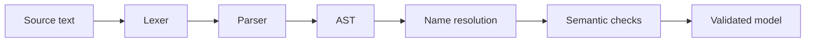

# Hiệu năng parser

Parser (bộ phân tích cú pháp) chuyển chuỗi token do lexer tạo ra thành cấu trúc cú pháp như cây phân tích hoặc cây cú pháp trừu tượng (Abstract Syntax Tree, AST). Trong một ngôn ngữ miền chuyên biệt (Domain-Specific Language, DSL), hiệu năng parser ảnh hưởng đến thời gian mở tài liệu, phản hồi khi gõ trong IDE, kiểm tra cấu hình, chạy chương trình và triển khai hệ thống. Một parser tốt cần xử lý đầu vào đủ nhanh, sử dụng bộ nhớ hợp lý, phát hiện lỗi rõ ràng và giữ được hành vi ổn định với những tài liệu lớn hoặc bất thường.

Hiệu năng không chỉ phụ thuộc vào thuật toán parser. Cấu trúc grammar, cách lexer tạo token, số lần lookahead, backtracking, việc cấp phát AST, tra cứu tên, kiểm tra kiểu và khôi phục lỗi đều có thể ảnh hưởng đáng kể. Vì vậy, tối ưu parser cần bắt đầu từ việc xác định giai đoạn nào đang tốn thời gian hoặc bộ nhớ, sau đó chọn thay đổi phù hợp với ngữ nghĩa và nhu cầu của DSL.

## 1. Hiệu năng parser gồm những gì?

Khi đánh giá parser, không nên chỉ nhìn vào thời gian xử lý một tệp nhỏ. Các khía cạnh chính gồm:

- **Thời gian phân tích:** thời gian từ lúc nhận token đến khi tạo xong cấu trúc cú pháp.
- **Thông lượng:** lượng đầu vào có thể xử lý trong một đơn vị thời gian, thường đo bằng byte, token hoặc tài liệu mỗi giây.
- **Độ trễ:** thời gian người dùng phải chờ một thao tác cụ thể, ví dụ sau khi gõ một ký tự hoặc yêu cầu kiểm tra tài liệu.
- **Bộ nhớ:** dung lượng cần cho token, trạng thái parser, AST, bảng memoization, diagnostics và cấu trúc tạm.
- **Khả năng mở rộng:** hành vi khi kích thước đầu vào, độ sâu lồng nhau hoặc số lượng cấu trúc tăng lên.
- **Độ ổn định:** hiệu năng có biến động lớn theo hình dạng đầu vào hay không, đặc biệt với các trường hợp backtracking hoặc lỗi cú pháp.
- **Khả năng phục hồi:** parser có tiếp tục phân tích để đưa ra chẩn đoán hữu ích mà không làm thời gian xử lý tăng bất thường không.

Một parser dùng ít thời gian trung bình nhưng có thể mất hàng chục giây với một mẫu đầu vào nhất định vẫn là rủi ro. Với DSL được dùng trong IDE hoặc xử lý cấu hình do người dùng cung cấp, cần quan tâm cả trường hợp điển hình và trường hợp xấu.

## 2. Độ phức tạp thuật toán

Độ phức tạp mô tả cách chi phí tính toán thay đổi theo kích thước đầu vào. Gọi `n` là số token hoặc độ dài đầu vào theo một đơn vị đã chọn.

| Độ phức tạp | Cách tăng chi phí | Ý nghĩa thường gặp |
|---|---|---|
| `O(1)` | Gần như không đổi theo `n` | Tra cứu bảng băm trung bình cho một khóa |
| `O(log n)` | Tăng theo logarit | Tìm kiếm trong cấu trúc cân bằng |
| `O(n)` | Tăng tuyến tính | Duyệt mỗi token một số lần cố định |
| `O(n log n)` | Tuyến tính nhân logarit | Một số thao tác sắp xếp hoặc phân tích |
| `O(n^2)` | Tăng theo bình phương | Một số thuật toán so sánh nhiều cặp phần tử |
| `O(n^3)` | Tăng theo lập phương | Một số parser tổng quát cho grammar phi ngữ cảnh |

Các ký hiệu Big-O mô tả xu hướng khi đầu vào lớn, không phải thời gian thực tế trên mọi máy. Hằng số, cấp phát bộ nhớ, cache CPU, cấu trúc dữ liệu và hình dạng grammar đều ảnh hưởng đến kết quả.

Với một grammar xác định phù hợp, nhiều parser LL hoặc LR có thể xử lý đầu vào trong thời gian tuyến tính `O(n)`. Recursive descent được thiết kế tốt cũng thường tuyến tính nếu mỗi token được tiêu thụ số lần bị chặn và không có backtracking gây lặp lớn. Tuy nhiên, không nên kết luận mọi parser mang tên LL/LR hay mọi recursive descent đều tự động tuyến tính; điều đó phụ thuộc vào grammar, cách triển khai và xử lý ngữ cảnh.

## 3. Các giai đoạn ảnh hưởng đến tổng chi phí

Một pipeline DSL thường có nhiều giai đoạn:



Parser có thể không phải thành phần chậm nhất. Với một tài liệu lớn, lexer có thể tốn thời gian xử lý Unicode hoặc chuỗi; name resolution có thể tốn thời gian tra cứu import; semantic analysis có thể lặp lại nhiều lần trên cùng một biểu thức.

Khi đo tổng thời gian, cần tách các giai đoạn để biết chi phí nằm ở đâu:

- Thời gian đọc và giải mã nguồn.
- Thời gian lexer tạo token.
- Thời gian parser tạo CST/AST.
- Thời gian phân giải tên và import.
- Thời gian kiểm tra kiểu và quy tắc miền.
- Thời gian tạo diagnostics hoặc định dạng lại tài liệu.

Nếu chỉ đo thời gian từ đầu đến cuối, một tối ưu parser có thể không làm trải nghiệm nhanh hơn nếu phần lớn thời gian nằm ở semantic analysis. Ngược lại, parser có thể tạo AST rất nhanh nhưng cấp phát quá nhiều đối tượng, làm garbage collector gây độ trễ lớn sau đó.

## 4. Chọn thuật toán parser phù hợp

Không có một thuật toán tối ưu cho mọi DSL. Lựa chọn nên dựa trên độ phức tạp grammar, khả năng dự đoán, yêu cầu báo lỗi, hỗ trợ chỉnh sửa tương tác và chi phí bộ nhớ.

### 4.1. Recursive descent

Recursive descent là cách triển khai parser bằng các hàm tương ứng với quy tắc grammar. Mỗi hàm đọc token và gọi các hàm con để phân tích cấu trúc nhỏ hơn.

Ví dụ:

```java
Expression parseExpression() {
    Expression left = parseTerm();

    while (match(TokenType.PLUS) || match(TokenType.MINUS)) {
        Token operator = previous();
        Expression right = parseTerm();
        left = new BinaryExpression(left, operator, right);
    }

    return left;
}
```

Ví dụ này xử lý các phép cộng và trừ kết hợp trái, trong khi `parseTerm()` xử lý phép nhân và chia ở mức ưu tiên cao hơn. Vòng lặp tránh việc gọi đệ quy cho mỗi toán tử cùng mức.

Ưu điểm:

- Cấu trúc mã gần với grammar, dễ đọc và tùy chỉnh.
- Có thể đưa ra thông báo lỗi theo ngữ cảnh.
- Phù hợp với DSL có grammar vừa phải và lựa chọn dự đoán được.
- Dễ thêm logic đặc thù cho một số cấu trúc miền.

Hạn chế:

- Đệ quy sâu có thể gây tràn stack nếu đầu vào lồng quá sâu.
- Grammar cần được tổ chức để tránh đệ quy trái trực tiếp trong parser kiểu LL.
- Backtracking tự triển khai có thể làm hiệu năng khó dự đoán.

### 4.2. Parser LL

Parser LL đọc đầu vào từ trái sang phải và xây dựng dẫn xuất trái nhất. LL(k) dùng tối đa `k` token nhìn trước để chọn luật. Parser dự đoán (predictive parser) có thể chạy tuyến tính nếu grammar phù hợp và bảng lựa chọn được xây dựng tốt.

Nếu nhiều luật có tiền tố chung, parser có thể phải nhìn trước thêm hoặc grammar cần left factoring. Nếu một cấu trúc không thể phân biệt bằng lượng lookahead được hỗ trợ, parser có thể báo xung đột hoặc cần một cách tổ chức grammar khác.

### 4.3. Parser LR

Parser LR đọc token từ trái sang phải và xây dựng dẫn xuất phải nhất theo hướng ngược. Các họ parser như SLR, LALR và canonical LR có khả năng xử lý nhiều grammar hơn parser LL đơn giản.

Parser LR thường có thời gian tuyến tính với grammar cố định phù hợp. Parser generator có thể tạo bảng trạng thái và bảng hành động từ grammar. Đổi lại, việc đọc bảng parser và tùy biến thông báo lỗi đôi khi khó hơn recursive descent, dù nhiều công cụ cung cấp cơ chế cải thiện diagnostics.

### 4.4. Pratt parser cho biểu thức

Pratt parser (top-down operator precedence parser) là kỹ thuật thường dùng để phân tích biểu thức có nhiều toán tử. Mỗi toán tử có binding power hoặc độ ưu tiên. Parser dùng giá trị đó để quyết định có tiếp tục mở rộng biểu thức hay không.

Pratt parser hữu ích khi DSL có nhiều toán tử, toán tử tiền tố/hậu tố hoặc cần thêm toán tử mới mà không muốn viết nhiều tầng grammar. Với một tập toán tử cố định, cách triển khai thường có thời gian tuyến tính theo số token của biểu thức.

### 4.5. Parser tổng quát

Các parser tổng quát như Earley hoặc GLR có thể xử lý lớp grammar rộng hơn và giữ nhiều cách phân tích khi có xung đột. Chúng hữu ích khi grammar thực sự cần cấu trúc chồng lấn hoặc cần giữ nhiều khả năng phân tích.

Đổi lại, chi phí có thể cao hơn parser xác định. Earley có giới hạn xấu nhất thường được nêu là `O(n^3)` cho CFG tổng quát, nhưng có thể đạt `O(n^2)` với grammar không mơ hồ và `O(n)` với nhiều trường hợp grammar xác định. GLR cũng có thể tăng chi phí khi có nhiều nhánh phân tích song song; hiệu năng phụ thuộc vào số lượng nhánh và cách chúng được gộp.

Không nên chọn parser tổng quát chỉ vì nó chấp nhận grammar dễ viết hơn nếu DSL chỉ cần một cú pháp xác định đơn giản. Ngược lại, ép một grammar có cấu trúc chồng lấn phức tạp vào parser dự đoán có thể khiến grammar trở nên khó hiểu và khó duy trì.

## 5. Backtracking và nguy cơ tăng thời gian theo cấp số nhân

Backtracking xảy ra khi parser thử một lựa chọn, đi sâu vào phân tích, rồi quay lại điểm trước đó để thử lựa chọn khác khi nhánh đầu thất bại.

Một parser có nhiều nhánh chồng lấn có thể thử lại cùng một đoạn đầu vào nhiều lần. Trong trường hợp xấu, số lần thử tăng theo hàm mũ, đặc biệt với parser quay lui không giới hạn và grammar có nhiều tiền tố chung.

Ví dụ minh họa một lựa chọn dễ gây thử lại:

```text
A <- "a" "a" "a" "b" / "a" "a" "a" "c" / "a" "a" "d"
```

Nếu parser thử nhiều nhánh có tiền tố chung rồi thất bại ở cuối, cùng các ký tự đầu có thể bị đọc đi đọc lại. Với grammar lớn, vấn đề này có thể trở nên nghiêm trọng.

Cách giảm chi phí:

- Tách tiền tố chung bằng left factoring.
- Dùng lookahead hữu hạn để chọn nhánh trước khi đi sâu.
- Tránh các nhánh có thể tiêu thụ cùng một tiền tố mà không có quy tắc ưu tiên rõ.
- Dùng memoization nếu parser có ngữ nghĩa phù hợp.
- Giới hạn backtracking hoặc thiết kế grammar xác định hơn.

Không phải mọi backtracking đều xấu. Với một số grammar nhỏ, backtracking đơn giản giúp mã dễ viết. Vấn đề là phải hiểu chi phí xấu nhất và có kiểm thử cho đầu vào khiến nhánh thử thất bại muộn.

## 6. Memoization và Packrat parsing

Memoization lưu kết quả phân tích của một quy tắc tại một vị trí đầu vào. Nếu parser quay lại cùng quy tắc và vị trí đó, nó có thể tái sử dụng kết quả thay vì phân tích lại.

Packrat parsing áp dụng memoization cho các quy tắc của Parsing Expression Grammar (PEG). Với grammar PEG cố định và cách triển khai phù hợp, packrat parser thường có thời gian tuyến tính theo độ dài đầu vào, vì mỗi cặp quy tắc-vị trí được tính tối đa một lần.

Chi phí chính là bộ nhớ: bảng memo có thể cần `O(n × r)`, trong đó `n` là số vị trí đầu vào và `r` là số quy tắc parser được memoize. Với grammar cố định, có thể xem đây là `O(n)` theo kích thước đầu vào, nhưng hằng số có thể lớn.

Một entry memo thường cần lưu:

- Quy tắc parser.
- Vị trí đầu vào bắt đầu.
- Kết quả thành công hoặc thất bại.
- Vị trí kết thúc nếu thành công.
- Nút cú pháp hoặc tham chiếu đến kết quả.
- Thông tin lỗi tốt nhất nếu parser cần diagnostics.

Memoization không tự giải quyết mọi vấn đề. Semantic action có hiệu ứng phụ, thay đổi symbol table hoặc phụ thuộc trạng thái runtime có thể khiến việc tái sử dụng kết quả sai. Parser nên giữ quá trình phân tích thuần hoặc kiểm soát rõ những dữ liệu được đưa vào khóa memo.

## 7. Đệ quy, độ sâu lồng nhau và stack

Grammar thường dùng đệ quy để mô tả biểu thức và khối lồng nhau. Ví dụ:

```text
Block -> "{" Statement* "}"
Statement -> Assignment | IfStatement | Block
```

Với một tài liệu có hàng chục nghìn khối lồng nhau, recursive descent có thể tạo chuỗi lời gọi hàm sâu và gây `StackOverflowError` trong Java.

Các cách xử lý:

- Dùng vòng lặp cho các chuỗi lặp cùng mức thay vì đệ quy không cần thiết.
- Chuyển một số quy tắc đệ quy sang stack tường minh (explicit stack).
- Giới hạn độ sâu lồng nhau và báo lỗi có vị trí rõ ràng.
- Dùng parser bottom-up hoặc thuật toán không phụ thuộc call stack cho cấu trúc phù hợp.
- Kiểm tra độ sâu trước khi thực hiện các phép biến đổi đệ quy trên AST.

Giới hạn độ sâu là một phần của hợp đồng DSL nếu nó được công bố. Không nên để giới hạn phụ thuộc ngẫu nhiên vào kích thước stack của JVM hoặc cấu hình máy chạy.

## 8. Tối ưu lexer và luồng token

Parser chỉ có thể xử lý nhanh khi token đầu vào được tạo hiệu quả. Một số thiết kế lexer ảnh hưởng đến hiệu năng:

- Tránh tạo chuỗi mới cho mọi ký tự hoặc token nếu có thể lưu span vào nguồn.
- Dùng bảng tra cứu hoặc switch hiệu quả cho các loại token phổ biến.
- Xử lý khoảng trắng và comment trong một vòng quét có kiểm soát.
- Tránh regex phức tạp có backtracking nguy hiểm cho các token đơn giản.
- Chỉ tính thông tin line/column cần thiết; nếu cần source span, cập nhật cursor thống nhất.
- Xem xét token streaming nếu tài liệu lớn và parser không cần giữ toàn bộ token.

Có hai cách phổ biến truyền token cho parser:

1. **Token list:** lexer tạo toàn bộ danh sách token trước. Cách này đơn giản, dễ lookahead và có thể duyệt lại, nhưng dùng bộ nhớ cho toàn bộ danh sách.
2. **Token stream:** parser yêu cầu token tiếp theo khi cần. Cách này giảm bộ nhớ đỉnh trong một số trường hợp, nhưng lookahead, backtracking và diagnostics cần cơ chế buffer.

Nếu parser cần quay lại hoặc đọc xa phía trước, token stream vẫn phải lưu một vùng token đủ để hỗ trợ. Không nên chọn streaming chỉ vì nghe có vẻ tiết kiệm bộ nhớ; cần đo với cách sử dụng thực tế.

## 9. Tối ưu tạo AST và cấu trúc dữ liệu

AST thường gồm nhiều nút nhỏ. Với tệp lớn, chi phí cấp phát và garbage collection có thể đáng kể.

Ví dụ một biểu thức dài:

```text
value = a + b + c + d + e + f + g
```

Parser có thể tạo nhiều nút `BinaryExpression`. Đây là điều bình thường, nhưng cần tránh tạo thêm các đối tượng trung gian không cần thiết.

Một số lựa chọn:

- Dùng record hoặc lớp nút gọn với trường cần thiết.
- Lưu source span thay vì sao chép lexeme vào mọi nút.
- Dùng enum hoặc tag nhỏ cho loại nút.
- Tránh lưu đồng thời nhiều biểu diễn giống nhau nếu không có mục đích.
- Dùng cấu trúc danh sách có thể mở rộng hiệu quả khi số phần tử lớn.
- Chỉ tạo đối tượng semantic model sau khi cú pháp đã được xác nhận cần thiết.

Không nên tối ưu bằng cách làm AST khó hiểu hoặc dùng object pool tùy tiện. Trên JVM hiện đại, cấp phát đối tượng nhỏ thường khá nhanh; object pooling có thể làm tăng độ phức tạp và giữ bộ nhớ lâu hơn. Hãy đo thời gian và lượng allocation trước khi thay đổi cấu trúc.

## 10. Tách parsing khỏi name resolution và semantic analysis

Một parser có thể tạo AST nhanh, nhưng nếu nó tra cứu toàn bộ symbol table hoặc truy cập cơ sở dữ liệu trong lúc parse, chi phí và phụ thuộc sẽ khó kiểm soát.

Thông thường nên tách:

- **Parsing:** xác định cấu trúc cú pháp và tạo AST.
- **Name resolution:** liên kết tên với khai báo, import và namespace.
- **Type checking:** kiểm tra kiểu của biểu thức và thuộc tính.
- **Domain validation:** kiểm tra bất biến và quy tắc nghiệp vụ.
- **Execution/code generation:** thực thi hoặc sinh mã từ mô hình hợp lệ.

Sự tách biệt giúp đo từng giai đoạn và tái sử dụng AST cho nhiều mục đích. Tuy nhiên, một số DSL thực sự có cú pháp phụ thuộc ngữ cảnh. Khi đó, parser có thể cần một phần thông tin từ symbol table hoặc semantic predicate. Nên giới hạn phần phụ thuộc đó và tránh thực hiện các truy vấn chậm hoặc hiệu ứng phụ trong lúc phân tích.

## 11. Incremental parsing cho IDE

Với công cụ tương tác, phân tích lại toàn bộ tài liệu sau mỗi phím gõ có thể tạo độ trễ không cần thiết. Incremental parsing cập nhật cây cú pháp dựa trên vùng văn bản đã thay đổi.

Một quy trình điển hình:

1. Editor ghi nhận vùng thay đổi và revision mới.
2. Lexer xác định token bị ảnh hưởng và quét lại vùng cần thiết.
3. Parser tìm nút cú pháp hoặc điểm đồng bộ phù hợp để phân tích lại.
4. Các nút không bị ảnh hưởng được tái sử dụng nếu vẫn hợp lệ.
5. Semantic analysis cập nhật các phụ thuộc liên quan.
6. Diagnostics cũ thuộc revision trước được thay bằng kết quả mới.

Incremental parsing có thể cải thiện độ trễ khi tài liệu lớn và thay đổi nhỏ. Nhưng việc triển khai khó hơn vì thay đổi một khai báo có thể ảnh hưởng đến nhiều tham chiếu ở xa; thay đổi một dấu ngoặc có thể làm cấu trúc lồng nhau phía sau bị phân tích lại.

Các parser như Tree-sitter được thiết kế cho việc cập nhật cây cú pháp gia tăng và được dùng trong nhiều công cụ editor. Tuy nhiên, parser gia tăng không tự động làm toàn bộ semantic analysis gia tăng. Bảng ký hiệu, type checking và diagnostics cũng cần cơ chế cập nhật phụ thuộc nếu muốn giảm chi phí đầu-cuối.

Với DSL nhỏ, parse lại toàn bộ tệp thường là lựa chọn đơn giản và đủ nhanh. Chỉ nên thêm incremental parsing khi phép đo cho thấy nó giải quyết một vấn đề độ trễ thực tế.

## 12. Cache và tái sử dụng kết quả

Cache có thể giảm công việc lặp lại khi cùng một module, grammar hoặc tài liệu được phân tích nhiều lần.

Một số loại cache:

- **Grammar/parser table cache:** tái sử dụng bảng parser hoặc cấu trúc grammar đã xây dựng.
- **Module cache:** giữ AST hoặc mô hình đã phân tích của module không thay đổi.
- **Name resolution cache:** lưu kết quả phân giải tham chiếu khi các khai báo liên quan không đổi.
- **Semantic result cache:** lưu kết quả kiểm tra kiểu hoặc quy tắc cho các nút không bị ảnh hưởng.
- **Incremental token cache:** tái sử dụng token ngoài vùng chỉnh sửa.

Cache cần khóa theo những dữ liệu ảnh hưởng đến kết quả, chẳng hạn nội dung hoặc hash nguồn, phiên bản grammar, cấu hình feature flag, phiên bản module phụ thuộc và môi trường phân tích. Nếu chỉ khóa theo tên tệp, hệ thống có thể tái sử dụng kết quả cũ sau khi nội dung thay đổi.

Cần có chính sách vô hiệu hóa cache (invalidation) khi một phụ thuộc thay đổi. Cache sai có thể tạo lỗi khó phát hiện hơn việc parser chạy chậm. Nên ưu tiên tính đúng đắn và khả năng tái lập trước khi mở rộng cache.

## 13. Khôi phục lỗi và hiệu năng

Parser thường cần tiếp tục sau lỗi để đưa ra nhiều diagnostics trong một lần. Một chiến lược phổ biến là panic-mode recovery: khi gặp lỗi, parser bỏ qua token đến điểm đồng bộ như `;`, `}` hoặc từ khóa bắt đầu câu lệnh tiếp theo.

Khôi phục lỗi có thể tốn thêm thời gian nếu parser liên tục thử nhiều cách sửa hoặc tạo quá nhiều diagnostics. Một số nguyên tắc:

- Chọn điểm đồng bộ phù hợp với cấu trúc DSL.
- Tránh báo hàng nghìn lỗi phụ do một lỗi gốc.
- Giới hạn số diagnostics cho một lần phân tích nếu cần.
- Giữ span của lỗi gốc và phân biệt lỗi suy ra do recovery.
- Với tài liệu chưa hoàn chỉnh trong IDE, tạo nút lỗi hoặc placeholder thay vì thử mọi cách phân tích.

Thông báo lỗi tốt không nhất thiết phải có mọi gợi ý sửa. Một gợi ý phức tạp có thể đắt hơn bản thân parsing. Nên ưu tiên vị trí và nguyên nhân chính xác, sau đó bổ sung gợi ý khi chi phí hợp lý.

## 14. Bảo vệ trước đầu vào xấu và độ phức tạp cực đoan

DSL có thể nhận tệp do người dùng, plugin hoặc hệ thống bên ngoài cung cấp. Parser cần được bảo vệ trước đầu vào quá lớn, quá sâu hoặc được thiết kế để gây tốn CPU/bộ nhớ.

Các giới hạn có thể áp dụng:

- Kích thước tệp tối đa.
- Số token tối đa.
- Độ sâu lồng nhau tối đa.
- Số lượng diagnostics tối đa.
- Thời gian hoặc ngân sách bước phân tích.
- Số nhánh backtracking hoặc số trạng thái parser.
- Kích thước bảng memoization hoặc parse forest.

Các giới hạn phải được chọn theo nhu cầu sản phẩm và thông báo rõ khi vượt ngưỡng. Không nên âm thầm cắt bớt đầu vào vì có thể làm chương trình bị hiểu sai. Nếu parser bị hủy do vượt ngân sách, hệ thống nên báo trạng thái không hoàn tất và không thực thi mô hình một phần như thể nó hợp lệ.

Một số regex dùng trong lexer có thể có thời gian chạy tăng rất nhanh với chuỗi được thiết kế đặc biệt (catastrophic backtracking). Với token quan trọng, lexer thủ công hoặc regex có cấu trúc an toàn có thể phù hợp hơn. Cần kiểm soát cả parser lẫn lexer vì cả hai đều xử lý dữ liệu đầu vào.

## 15. Đo hiệu năng đúng cách

Tối ưu dựa trên cảm giác thường dẫn đến thay đổi không cần thiết. Cần có benchmark đại diện cho cách DSL được sử dụng.

### 15.1. Xây dựng tập dữ liệu benchmark

Nên có nhiều loại đầu vào:

- Tệp nhỏ phổ biến, đại diện cho thao tác thường ngày.
- Tệp lớn có nhiều khai báo và biểu thức.
- Tệp có cấu trúc lồng nhau sâu.
- Tệp có danh sách dài hoặc nhiều tham chiếu.
- Tệp gần hợp lệ nhưng có lỗi ở cuối để kiểm tra backtracking/recovery.
- Tệp có nhiều comment, chuỗi Unicode và newline khác nhau.
- Tệp sinh tự động có kích thước lớn.

Không nên chỉ benchmark một tệp mẫu ngắn vì nó không phản ánh chi phí khi dự án tăng quy mô.

### 15.2. Đo từng giai đoạn

Ghi nhận riêng:

- Thời gian lexer.
- Thời gian parser.
- Thời gian tạo AST.
- Thời gian name resolution.
- Thời gian type checking và validation.
- Thời gian tổng.
- Bộ nhớ đỉnh và lượng allocation nếu công cụ hỗ trợ.

Có thể dùng `System.nanoTime()` cho phép đo thô trong chương trình, nhưng benchmark JVM nghiêm túc nên dùng công cụ như JMH để xử lý warmup, JIT compilation, dead-code elimination và nhiều lần đo.

Ví dụ benchmark JMH giản lược:

```java
@State(Scope.Thread)
public class ParserBenchmark {
    private String source;
    private Parser parser;

    @Setup
    public void setup() {
        source = loadBenchmarkSource();
        parser = new Parser();
    }

    @Benchmark
    public Object parseDocument() {
        return parser.parse(source);
    }
}
```

Đây là khung minh họa. Trong benchmark thực tế, cần tránh để kết quả bị tối ưu bỏ, xác định parser có giữ trạng thái giữa các lần gọi hay không, và tách thời gian khởi tạo parser khỏi thời gian parse nếu mục tiêu là đo riêng hai phần.

### 15.3. Đọc kết quả

Không chỉ xem thời gian trung bình. Nên quan sát median, percentile cao như p95/p99, độ lệch giữa các lần chạy, lượng bộ nhớ và số lần GC. Với IDE, p95 của thời gian phản hồi có thể quan trọng hơn thông lượng trung bình.

Khi so sánh hai phiên bản, dùng cùng máy, cùng JVM, cùng dữ liệu và cùng cấu hình. Chạy đủ lần để giảm ảnh hưởng của JIT, GC và hoạt động nền. Một thay đổi nhanh hơn trên tệp nhỏ nhưng chậm hơn đáng kể trên tệp lớn có thể không phải cải tiến tổng thể.

## 16. Các tối ưu thường có hiệu quả

Sau khi xác định điểm nghẽn, có thể cân nhắc:

1. **Giảm backtracking:** left factoring, lookahead hoặc grammar xác định hơn.
2. **Dùng vòng lặp cho chuỗi lặp:** tránh đệ quy sâu cho danh sách và toán tử cùng mức.
3. **Giảm allocation:** giữ span thay vì sao chép chuỗi; tránh tạo nút trung gian không cần thiết.
4. **Tối ưu tra cứu token:** dùng bảng hoặc switch phù hợp, tránh regex quá phức tạp.
5. **Memoize đúng chỗ:** tái sử dụng kết quả phân tích khi cùng quy tắc và vị trí được thử lại.
6. **Dùng cấu trúc dữ liệu phù hợp:** bảng băm cho tra cứu tên, danh sách liên kết hoặc mảng cho vùng token tùy nhu cầu.
7. **Tách các giai đoạn:** không thực hiện truy vấn bên ngoài hoặc kiểm tra nghiệp vụ chậm trong parser.
8. **Phân tích gia tăng:** chỉ khi tài liệu lớn và chỉnh sửa nhỏ là tình huống phổ biến.
9. **Cache theo revision và phụ thuộc:** tái sử dụng kết quả khi nguồn và môi trường chưa đổi.
10. **Giới hạn đầu vào:** ngăn độ sâu hoặc số nhánh làm cạn tài nguyên.

Tối ưu cần giữ nguyên ngữ nghĩa. Ví dụ, thay parser backtracking bằng parser dự đoán có thể yêu cầu viết lại grammar; nếu grammar mới thay đổi precedence hoặc tính kết hợp, kết quả chương trình có thể khác. Bộ kiểm thử ngữ nghĩa cần xác nhận thay đổi thuật toán không làm thay đổi cách hiểu DSL.

## 17. Những tối ưu dễ phản tác dụng

Một số kỹ thuật nghe có vẻ nhanh nhưng có thể làm hệ thống chậm hoặc khó bảo trì hơn:

- **Object pooling cho mọi nút AST:** có thể giảm cấp phát nhưng tăng chi phí quản lý, giữ tham chiếu lâu và làm GC khó tối ưu.
- **Cache không có khóa phụ thuộc đầy đủ:** tạo kết quả cũ hoặc lỗi không xác định.
- **Memoization mọi quy tắc:** có thể dùng quá nhiều bộ nhớ nếu grammar ít backtracking.
- **Streaming token không cần thiết:** làm lookahead, diagnostics và backtracking phức tạp hơn.
- **Tự viết parser quá chuyên biệt:** có thể nhanh ở một benchmark nhưng khó mở rộng grammar và khó báo lỗi.
- **Gộp parser với semantic analysis:** giảm số lần duyệt ở một số trường hợp nhưng làm phụ thuộc và kiểm thử khó hơn.
- **Giới hạn đầu vào quá thấp:** từ chối các tài liệu hợp lệ trong quy mô sản phẩm.

Một tối ưu tốt cần có bằng chứng đo lường, tác động rõ và chi phí bảo trì hợp lý.

## 18. Ví dụ: cải thiện parser biểu thức

Giả sử DSL hỗ trợ biểu thức số học với grammar đệ quy trái:

```text
Expr -> Expr "+" Term | Term
Term -> Term "*" Factor | Factor
Factor -> NUMBER | "(" Expr ")"
```

Grammar này mô tả độ ưu tiên hợp lý, nhưng parser recursive descent không thể triển khai trực tiếp lời gọi `parseExpr()` tự gọi lại ngay từ đầu mà không tiêu thụ token.

Có thể chuyển sang dạng lặp:

```java
Expression parseExpression() {
    Expression expression = parseTerm();

    while (match(TokenType.PLUS)) {
        Expression right = parseTerm();
        expression = new BinaryExpression(
            expression,
            TokenType.PLUS,
            right
        );
    }

    return expression;
}

Expression parseTerm() {
    Expression expression = parseFactor();

    while (match(TokenType.STAR)) {
        Expression right = parseFactor();
        expression = new BinaryExpression(
            expression,
            TokenType.STAR,
            right
        );
    }

    return expression;
}
```

Với chuỗi dài `a + b + c + ...`, parser tiêu thụ từng toán tử và toán hạng theo vòng lặp. Thời gian xử lý là tuyến tính theo số token biểu thức, giả sử các thao tác tạo nút và đọc token có chi phí hằng số. AST được tạo theo kết hợp trái.

Nếu DSL bổ sung nhiều toán tử, Pratt parser có thể giảm việc duy trì nhiều hàm theo từng mức ưu tiên. Dù chọn cách nào, cần xác nhận AST và kết quả đánh giá giữ đúng precedence và associativity.

## 19. Hiệu năng parser trong IDE và môi trường build

Mục tiêu tối ưu có thể khác nhau theo nơi parser được dùng.

| Môi trường | Mục tiêu chính | Kỹ thuật có thể hữu ích |
|---|---|---|
| CLI kiểm tra tệp | Thông lượng và thời gian tổng | Parser tuyến tính, token/AST gọn, xử lý theo tệp |
| IDE khi gõ | Độ trễ thấp và phản hồi ổn định | Incremental parsing, partial AST, giới hạn diagnostics |
| Build server | Tái sử dụng giữa nhiều lần build | Cache theo nội dung và phụ thuộc, phân tích song song có kiểm soát |
| Dịch vụ nhận cấu hình | Bảo vệ tài nguyên và độ ổn định | Giới hạn kích thước/độ sâu, timeout, tránh backtracking xấu |
| Công cụ phân tích nhiều dự án | Thông lượng và bộ nhớ tổng | Streaming có chọn lọc, cache module, xử lý song song |

Với IDE, việc trả về một AST một phần trong vài mili giây có thể hữu ích hơn chờ một AST hoàn chỉnh lâu hơn. Với build server, việc tái sử dụng kết quả của các module không thay đổi có thể quan trọng hơn tối ưu một lần parse đơn lẻ. Với dịch vụ nhận tệp không tin cậy, giới hạn tài nguyên và độ phức tạp xấu nhất là yêu cầu thiết yếu.

## 20. Nguyên tắc thiết kế parser hiệu quả

- **Chọn grammar phù hợp thuật toán:** tránh cấu trúc gây backtracking không kiểm soát.
- **Đo trước khi tối ưu:** tách lexer, parser và semantic analysis để xác định điểm nghẽn.
- **Ưu tiên độ phức tạp dễ dự đoán:** parser xác định thường phù hợp với DSL cấu hình.
- **Kiểm soát độ sâu:** không để đầu vào lồng nhau gây tràn stack.
- **Quản lý bộ nhớ có chủ đích:** cân nhắc token list, streaming, AST và memoization theo nhu cầu.
- **Giữ diagnostics hữu ích:** hiệu năng không nên đạt được bằng cách làm lỗi khó hiểu.
- **Tối ưu tương tác theo revision:** tránh kết quả phân tích cũ ghi đè trạng thái mới.
- **Cache có tính đúng đắn:** khóa theo nội dung, grammar, phiên bản và phụ thuộc liên quan.
- **Bảo vệ tài nguyên:** giới hạn kích thước, số nhánh, độ sâu và số lỗi khi xử lý đầu vào bên ngoài.
- **Giữ nguyên ngữ nghĩa:** kiểm tra precedence, associativity và AST khi thay đổi parser.
- **Dùng benchmark đại diện:** đo cả tệp thường gặp, tệp lớn, đầu vào lỗi và trường hợp biên.

Hiệu năng parser là kết quả của nhiều quyết định về grammar, thuật toán, bộ nhớ và cách tích hợp với các giai đoạn khác. Một parser hiệu quả không chỉ phân tích nhanh trên ví dụ nhỏ mà còn giữ thời gian và bộ nhớ có thể dự đoán khi tài liệu lớn, lồng sâu hoặc không hợp lệ. Bằng cách chọn thuật toán phù hợp, kiểm soát backtracking, giảm công việc lặp lại, đo từng giai đoạn và chỉ tối ưu khi có dữ liệu, DSL có thể vừa phản hồi tốt vừa duy trì được cú pháp rõ ràng và thông báo lỗi hữu ích.
