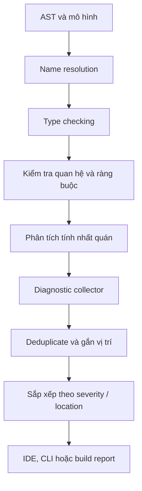

# Cảnh báo và lỗi

Trong ngôn ngữ chuyên biệt miền (Domain-Specific Language, DSL), một chương trình có thể đúng cú pháp nhưng vẫn không hợp lệ về ý nghĩa. Parser xác nhận văn bản tuân theo grammar; bước kiểm tra ngữ nghĩa (semantic analysis) tiếp tục kiểm tra tên, kiểu, quan hệ, quyền và các quy tắc của miền. Khi phát hiện vấn đề, hệ thống cần thông báo cho người viết bằng **lỗi (error)** hoặc **cảnh báo (warning)**. Những thông báo này thường được gọi chung là **chẩn đoán (diagnostics)**.

Ví dụ, parser có thể chấp nhận khai báo:

```text
policy giao_hang {
    base_fee = 30000 VND
    free_when don_hang.tong_tien >= 500000 VND
    area = NOII_THANH
}
```

Cấu trúc trên có thể đúng grammar, nhưng `NOII_THANH` có thể là tên vùng chưa được khai báo. Đây là lỗi phân giải tham chiếu hoặc lỗi ngữ nghĩa. Nếu người viết khai báo một vùng không được sử dụng, hệ thống có thể đưa ra cảnh báo để nhắc xem lại cấu hình. Nếu một quy tắc sắp bị loại bỏ nhưng vẫn được dùng, hệ thống cũng có thể cảnh báo về khả năng không tương thích trong phiên bản tương lai.

Chẩn đoán tốt giúp người dùng biết vấn đề nằm ở đâu, vì sao nó quan trọng và có thể sửa bằng cách nào. Trong DSL, điều này đặc biệt quan trọng vì người dùng thường là chuyên gia miền, không nhất thiết là lập trình viên compiler. Thông báo cần dùng thuật ngữ quen thuộc của miền, phân biệt lỗi ngăn chương trình được chấp nhận với cảnh báo chỉ ra rủi ro, và giữ đủ thông tin để IDE, build tool hoặc pipeline tự động xử lý.

## 1. Chẩn đoán trong kiểm tra ngữ nghĩa

**Chẩn đoán** là một bản ghi có cấu trúc mô tả vấn đề, vị trí liên quan và mức độ nghiêm trọng. Chẩn đoán có thể được tạo bởi lexer, parser, name resolver, type checker, domain validator hoặc runtime. Trong bài này, trọng tâm là những vấn đề được phát hiện khi kiểm tra ngữ nghĩa.

Kiểm tra ngữ nghĩa thường diễn ra sau khi parser đã tạo AST hoặc mô hình cú pháp. Hệ thống có thể phân giải tên, suy luận kiểu, xác minh tham chiếu, kiểm tra ràng buộc và đánh giá các quy tắc miền có thể xác định tĩnh.

### 1.1. Vì sao cần phân biệt lỗi và cảnh báo?

Không phải mọi vấn đề đều có cùng mức độ. Một tham chiếu đến tài nguyên không tồn tại có thể khiến chương trình không thể thực thi đúng; đó là lỗi. Một thuộc tính tùy chọn chưa được đặt có thể vẫn hợp lệ nhưng đáng chú ý; đó có thể là cảnh báo. Một khai báo đã được chấp nhận nhưng ít được dùng có thể chỉ cần thông tin.

Nếu mọi vấn đề đều bị coi là lỗi, DSL trở nên quá nghiêm ngặt và khó sử dụng. Nếu mọi vấn đề chỉ là cảnh báo, chương trình không hợp lệ có thể đi vào runtime và gây hỏng dữ liệu. Mức độ cần phản ánh hậu quả thực tế và hợp đồng của ngôn ngữ.

### 1.2. Chẩn đoán không phải exception

Chẩn đoán thường là dữ liệu mà compiler hoặc validator thu thập để trình bày cho người dùng. Exception là cơ chế điều khiển luồng hoặc báo sự cố trong quá trình thực thi phần mềm. Một lỗi ngữ nghĩa của chương trình DSL không nhất thiết phải được triển khai bằng cách ném exception.

Ví dụ, validator có thể thu thập mười lỗi độc lập trong một lượt phân tích và trả về một danh sách diagnostics. Việc ném exception ở lỗi đầu tiên sẽ khiến người dùng chỉ thấy một vấn đề và phải lặp lại quá trình nhiều lần.

### 1.3. Chẩn đoán có thể xuất hiện ở nhiều giai đoạn

Một pipeline DSL có thể phát sinh thông báo ở các giai đoạn:

- Lexer: ký tự hoặc literal không hợp lệ.
- Parser: cấu trúc văn bản không đúng grammar.
- Name resolution: tên biến, lớp, hàm hoặc tài nguyên không được tìm thấy.
- Type checking: kiểu toán hạng, tham số hoặc kết quả không tương thích.
- Semantic validation: vi phạm quy tắc cấu trúc hoặc quy tắc miền.
- Runtime: dữ liệu thực tế hoặc môi trường thực thi làm thao tác thất bại.

Mỗi giai đoạn nên gắn chẩn đoán với nguồn phát sinh và giữ mã lỗi ổn định để người dùng cũng như công cụ có thể phân loại.

## 2. Phân loại mức độ chẩn đoán

Các mức phổ biến là error, warning, information và hint. Một dự án có thể dùng tên khác, nhưng cần định nghĩa rõ mức độ và ảnh hưởng của chúng.

| Mức độ | Ý nghĩa | Ảnh hưởng thường gặp |
|---|---|---|
| Error | Chương trình vi phạm điều kiện bắt buộc | Không được build hoặc thực thi ở chế độ nghiêm ngặt |
| Warning | Có rủi ro, cấu hình đáng ngờ hoặc khả năng lỗi trong tương lai | Có thể tiếp tục nếu chính sách cho phép |
| Information | Thông tin hữu ích về chương trình hoặc hành vi | Không chặn build |
| Hint | Gợi ý cải thiện hoặc cách viết khác | Không chặn build |

### 2.1. Error

Error biểu thị một vi phạm khiến chương trình không đáp ứng hợp đồng ngữ nghĩa. Ví dụ:

- Dùng tên tài nguyên không tồn tại.
- Gán giá trị `Date` cho thuộc tính yêu cầu `Money`.
- Khai báo hai định danh duy nhất trùng nhau trong cùng phạm vi.
- Tham chiếu một phần tử không được phép truy cập.
- Vi phạm invariant bắt buộc của mô hình.
- Gọi hàm với đối số không thỏa chữ ký kiểu.

Thông thường, nếu có error chưa được xử lý, compiler không sinh artifact thực thi hoặc build pipeline đánh dấu thất bại. Một số editor vẫn tiếp tục phân tích để hiển thị thêm lỗi và hỗ trợ autocomplete.

### 2.2. Warning

Warning biểu thị một tình huống đáng chú ý nhưng chưa nhất thiết làm chương trình không hợp lệ. Ví dụ:

- Biến hoặc khai báo không được sử dụng.
- Giá trị cấu hình khác xa khoảng thường gặp.
- Quy tắc bị che khuất bởi một quy tắc có ưu tiên cao hơn.
- Một API hoặc thuộc tính đã bị đánh dấu deprecated.
- Cấu hình có thể gây chi phí cao hoặc hành vi khó dự đoán.
- Một nhánh có vẻ không thể được kích hoạt.

Warning nên có căn cứ và giải thích được hậu quả. Không nên dùng warning để diễn đạt một điều kiện bắt buộc mà compiler thực sự cần từ chối.

### 2.3. Information

Information cung cấp dữ liệu giúp người dùng hiểu kết quả phân tích, chẳng hạn “quy tắc này áp dụng cho 12 loại tài nguyên” hoặc “giá trị mặc định 30 phút đang được sử dụng”. Thông tin không nhất thiết yêu cầu hành động.

### 2.4. Hint

Hint thường gợi ý cách viết gọn, dễ đọc hoặc nhất quán hơn. Ví dụ, DSL có thể gợi ý dùng cú pháp literal tiền tệ chuyên biệt thay cho một lời gọi chuyển đổi dài. Hint nên có mức độ nhẹ và không tạo cảm giác chương trình đang sai.

### 2.5. Severity và mức ưu tiên hiển thị

Severity phản ánh mức độ ảnh hưởng về ngữ nghĩa. Priority có thể dùng để sắp xếp thông báo theo mức độ cấp thiết hoặc khả năng người dùng cần xử lý ngay. Hai khái niệm này không nhất thiết giống nhau: một warning có thể có ưu tiên hiển thị cao nếu nó liên quan đến dữ liệu sắp bị mất.

## 3. Lỗi ngữ nghĩa và các nhóm thường gặp

Lỗi ngữ nghĩa phát sinh khi cấu trúc chương trình đã parse được nhưng vi phạm quy tắc về ý nghĩa. Có thể phân loại theo loại hợp đồng bị vi phạm.

### 3.1. Lỗi phân giải tên

Tên được dùng nhưng không tồn tại trong phạm vi có thể truy cập:

```text
policy giao_hang {
    free_when don_hang.tong_tien >= 500000 VND
    area = NOII_THANH
}
```

Nếu mô hình chỉ khai báo `NOI_THANH`, tên `NOII_THANH` không thể được phân giải. Đây là lỗi tham chiếu. Hệ thống có thể gợi ý tên gần giống nhưng không nên tự thay thế khi có nhiều ứng viên.

### 3.2. Lỗi kiểu

Một thao tác nhận giá trị không tương thích:

```text
don_hang.tong_tien + don_hang.ngay_tao
```

Nếu `tong_tien` có kiểu `Money` và `ngay_tao` có kiểu `Date`, phép cộng không hợp lệ nếu DSL không định nghĩa thao tác đó.

### 3.3. Lỗi trùng lặp

Hai khai báo cùng tên trong phạm vi yêu cầu tính duy nhất có thể gây xung đột:

```text
variable phi_giao_hang = 30000 VND
variable phi_giao_hang = 45000 VND
```

Nếu DSL không cho phép khai báo lại, compiler cần chỉ ra cả khai báo đầu và khai báo sau để người dùng biết vị trí xung đột.

### 3.4. Lỗi quan hệ và tham chiếu mô hình

Một quan hệ có thể trỏ đến đối tượng không tồn tại, sai loại hoặc không thỏa bội số. Ví dụ đơn hàng yêu cầu đúng một khách hàng nhưng không có tham chiếu khách hàng hợp lệ.

### 3.5. Lỗi ràng buộc miền

Giá trị đúng kiểu vẫn có thể vi phạm quy tắc miền:

```text
khoi_luong = -2 kg
```

`-2 kg` vẫn là một giá trị có kiểu `Weight`, nhưng có thể vi phạm invariant khối lượng phải lớn hơn 0.

### 3.6. Lỗi quyền và khả năng

Một DSL workflow có thể tham chiếu thao tác mà vai trò hiện tại không được phép thực hiện. Đây là lỗi ngữ nghĩa về quyền nếu quyền được xác định trong mô hình tĩnh; nếu quyền phụ thuộc danh tính runtime, hệ thống có thể phải kiểm tra lại khi chạy.

### 3.7. Lỗi cấu hình không nhất quán

Hai phần cấu hình có thể mâu thuẫn, chẳng hạn timeout của bước con dài hơn deadline toàn workflow hoặc hai chính sách cùng sở hữu một phạm vi mà không có quy tắc ưu tiên. Đây thường là lỗi hoặc warning tùy hợp đồng DSL.

## 4. Warning ngữ nghĩa thường gặp

Warning không chỉ là lỗi nhẹ. Nó có thể chỉ ra hành vi hợp lệ nhưng đáng ngờ, khó bảo trì hoặc có nguy cơ gây bất ngờ.

### 4.1. Khai báo không được sử dụng

Một biến, hàm, policy hoặc thuộc tính được khai báo nhưng không có tham chiếu. Điều này có thể là dấu hiệu mã thừa, cấu hình bỏ quên hoặc phần đang phát triển.

Không phải khai báo nào không được sử dụng cũng là vấn đề. Một API công khai hoặc entry point có thể được gọi từ bên ngoài nên không xuất hiện tham chiếu nội bộ. Validator cần phân biệt phạm vi public với private.

### 4.2. Giá trị mặc định được dùng ngầm

Nếu người dùng bỏ qua một thuộc tính và runtime áp dụng mặc định, có thể phát thông tin hoặc warning khi giá trị mặc định ảnh hưởng đáng kể đến hành vi.

Ví dụ, một policy không khai báo `retry_count` nên dùng mặc định 3 lần. Nếu đây là lựa chọn quan trọng, thông báo có thể giúp người dùng nhận ra hành vi thực tế.

### 4.3. Cấu hình không hiệu quả

Một rule có thể hợp lệ nhưng không bao giờ được kích hoạt vì điều kiện bị một rule trước đó bao phủ hoàn toàn. Đây là ứng viên warning về rule unreachable hoặc shadowed.

### 4.4. API hoặc cú pháp sắp bị loại bỏ

Khi một thuộc tính hoặc hàm đã deprecated, compiler có thể cảnh báo để người dùng chuyển sang cách mới trước khi phiên bản sau loại bỏ nó.

### 4.5. Chuyển đổi có nguy cơ mất dữ liệu

Một chuyển đổi kiểu được phép nhưng có thể làm tròn, cắt bớt hoặc mất thông tin có thể phát warning. Ví dụ chuyển `Decimal` sang `Integer` hoặc chuyển `DateTime` thành `Date`.

### 4.6. Phạm vi cấu hình quá rộng

Một policy có thể áp dụng cho toàn bộ tài nguyên khi người viết có lẽ định giới hạn cho một nhóm nhỏ. Nếu hệ thống có đủ thông tin để nhận diện, nó có thể cảnh báo về phạm vi tác động rộng.

### 4.7. Điều kiện luôn đúng hoặc luôn sai

Nếu phân tích tĩnh chứng minh một điều kiện luôn đúng hoặc luôn sai, warning có thể giúp người viết phát hiện nhánh thừa hoặc rule không có tác dụng. Cần tránh warning dựa trên phỏng đoán yếu khi điều kiện phụ thuộc dữ liệu runtime.

## 5. Phân biệt lỗi ngữ nghĩa với lỗi cú pháp và lỗi runtime

Phân loại đúng giúp thông báo xuất hiện ở giai đoạn thích hợp và tránh đổ lỗi cho sai thành phần.

| Loại | Ví dụ | Thời điểm phát hiện thường gặp |
|---|---|---|
| Lỗi từ vựng | Chuỗi không đóng | Lexing |
| Lỗi cú pháp | Thiếu dấu `}` | Parsing |
| Lỗi phân giải tên | Tham chiếu `NOII_THANH` chưa khai báo | Semantic analysis |
| Lỗi kiểu | Cộng `Money` với `Date` | Type checking |
| Lỗi ràng buộc miền | Khối lượng âm | Semantic validation hoặc runtime |
| Lỗi môi trường | Dịch vụ tỷ giá không phản hồi | Runtime |

### 5.1. Một cấu trúc có thể đúng cú pháp nhưng sai ngữ nghĩa

Parser chỉ xác nhận cấu trúc theo grammar. Nó có thể chấp nhận `area = NOII_THANH` vì `NOII_THANH` là một identifier hợp lệ. Name resolver mới biết tên đó không tồn tại trong registry vùng.

### 5.2. Một giá trị có thể đúng kiểu nhưng sai miền

`-2 kg` có kiểu `Weight`; kiểm tra kiểu không nhất thiết từ chối. Domain validator kiểm tra điều kiện `weight > 0` và phát hiện vi phạm.

### 5.3. Một lỗi runtime không thể luôn phát hiện tĩnh

Nếu giá trị được nạp từ API hoặc database, compiler có thể không biết trước dịch vụ có trả dữ liệu hợp lệ hay không. Chương trình cần kiểm tra runtime và báo lỗi tích hợp nếu dữ liệu không đáp ứng hợp đồng.

## 6. Pipeline tạo và xử lý diagnostics

Một pipeline semantic analysis có thể thu thập chẩn đoán từ nhiều bộ kiểm tra, sau đó chuẩn hóa và sắp xếp trước khi trả về cho người dùng.



### 6.1. Các bộ kiểm tra độc lập

Mỗi analyzer nên chịu trách nhiệm cho một nhóm quy tắc rõ ràng. Name resolver không nên tự kiểm tra mọi invariant miền; type checker không nên quyết định quyền runtime nếu quyền phụ thuộc người dùng đang đăng nhập.

### 6.2. Diagnostic collector

Collector nhận chẩn đoán từ các analyzer và chuẩn hóa định dạng. Nó có thể gắn mã nguồn, severity, source span, related locations và metadata phục vụ IDE.

### 6.3. Phân tích phụ thuộc

Một số analyzer cần kết quả của bước trước. Type checking thường cần name resolution thành công; kiểm tra quan hệ cần biết lớp và kiểu của hai đầu tham chiếu. Pipeline cần quy định thứ tự và cách xử lý node đã lỗi.

### 6.4. Tiếp tục sau lỗi

Một lỗi không nên luôn khiến mọi analyzer dừng ngay. Nếu một khai báo độc lập bị lỗi, các phần khác vẫn có thể được kiểm tra. Tuy nhiên, analyzer phải tránh suy luận dựa trên dữ liệu chưa đáng tin cậy và tránh tạo hàng loạt lỗi thứ cấp.

### 6.5. Chế độ strict và editor

Chế độ build có thể yêu cầu không có error và có thể coi một số warning là lỗi theo chính sách dự án. Chế độ editor thường ưu tiên thu thập nhiều diagnostics để hỗ trợ người dùng sửa mã. Cùng một analyzer có thể dùng trong cả hai chế độ, nhưng chính sách trình bày và điều kiện chấp nhận khác nhau.

## 7. Cấu trúc của một diagnostic

Không nên lưu chẩn đoán chỉ dưới dạng chuỗi văn bản. Một cấu trúc dữ liệu có trường rõ ràng giúp IDE, CLI, log và công cụ tự động dùng lại thông tin mà không phải phân tích ngược câu chữ.

### 7.1. Các trường cơ bản

Một diagnostic thường có:

| Trường | Mục đích |
|---|---|
| `code` | Mã ổn định của quy tắc hoặc loại vấn đề |
| `severity` | Error, warning, information hoặc hint |
| `message` | Mô tả ngắn gọn cho người dùng |
| `source` | Analyzer hoặc thành phần phát hiện |
| `range` | Vị trí bắt đầu và kết thúc trong nguồn |
| `relatedInformation` | Vị trí hoặc thông tin liên quan |
| `tags` | Ví dụ deprecated hoặc unnecessary |
| `help` | Tài liệu hoặc hướng dẫn bổ sung |
| `fixes` | Các đề xuất sửa nếu có |

### 7.2. Ví dụ cấu trúc

```json
{
  "code": "DSL-SEM-021",
  "severity": "error",
  "source": "name-resolver",
  "message": "Không tìm thấy vùng giao hàng 'NOII_THANH'.",
  "range": {
    "startLine": 4,
    "startColumn": 12,
    "endLine": 4,
    "endColumn": 22
  },
  "relatedInformation": [],
  "help": "Kiểm tra tên vùng đã khai báo trong registry."
}
```

Đây là cấu trúc minh họa, không phải schema bắt buộc. Một ứng dụng có thể dùng LSP Diagnostic, JSON riêng hoặc kiểu dữ liệu nội bộ.

### 7.3. Mã lỗi ổn định

Mã lỗi nên ổn định qua các phiên bản trong phạm vi mà công cụ bên ngoài phụ thuộc vào nó. Câu chữ có thể được cải thiện hoặc dịch sang ngôn ngữ khác, nhưng mã giúp test, suppression và tích hợp không phải phụ thuộc vào nội dung thông báo.

### 7.4. Source và analyzer

Trường `source` cho biết chẩn đoán đến từ `type-checker`, `domain-validator`, `deprecation-analyzer` hoặc thành phần khác. Điều này hữu ích khi người dùng cần lọc thông báo hoặc nhóm phát triển muốn điều tra một quy tắc.

## 8. Vị trí nguồn và thông tin liên quan

Một thông báo đúng nhưng không chỉ được vị trí vẫn khó sửa. Semantic analyzer cần giữ liên kết giữa AST/model và văn bản nguồn.

### 8.1. Source span

Source span là khoảng vị trí của node hoặc token trong tệp nguồn. Nó thường có offset bắt đầu và kết thúc, hoặc dòng/cột bắt đầu và kết thúc.

Ví dụ, nếu `NOII_THANH` không được phân giải, range nên bao phủ chính identifier đó thay vì toàn bộ khai báo `policy`.

### 8.2. Vị trí chính và vị trí liên quan

Một lỗi trùng khai báo cần chỉ vị trí khai báo thứ hai và liên kết đến khai báo đầu tiên. Một lỗi vi phạm quan hệ có thể cần chỉ cả hai đầu tham chiếu. `relatedInformation` giúp trình bày nhiều vị trí trong một chẩn đoán.

### 8.3. AST được sinh hoặc biến đổi

Nếu AST được tạo từ nhiều tệp, macro hoặc include, node có thể không có một vị trí nguồn trực tiếp. Hệ thống cần giữ source map hoặc origin chain để người dùng biết vấn đề bắt nguồn từ tệp nào và đoạn nào.

### 8.4. Vị trí tổng hợp

Một số lỗi liên quan đến giá trị mặc định hoặc node do compiler sinh ra. Khi không có đoạn văn bản tương ứng, có thể gắn lỗi vào khai báo chứa giá trị đó hoặc hiển thị như diagnostic cấp tệp. Không nên tạo vị trí giả khiến người dùng nhảy đến sai dòng.

### 8.5. Dòng và cột trong Unicode

DSL có thể chứa ký tự Unicode và dấu tiếng Việt. Hệ thống cần thống nhất cột được tính theo byte, code point hay UTF-16 code unit, đặc biệt khi tích hợp với editor hoặc Language Server Protocol. Nếu các thành phần dùng quy ước khác nhau, vị trí gạch chân sẽ lệch.

## 9. Viết thông điệp lỗi rõ ràng

Thông điệp cần giúp người dùng hiểu vấn đề ngay cả khi họ không biết thuật ngữ nội bộ của compiler.

### 9.1. Nêu vấn đề trước

Nên viết “Không tìm thấy vùng giao hàng `NOII_THANH`” thay vì “Resolution failure at symbol node”. Câu đầu nói trực tiếp điều người dùng cần sửa.

### 9.2. Nêu kỳ vọng và thực tế

Với lỗi kiểu, thông báo nên nói rõ kiểu mong đợi và kiểu nhận được:

```text
Không thể gán Date cho thuộc tính tong_tien.
Kiểu mong đợi: Money<VND>
Kiểu thực tế: Date
```

### 9.3. Giải thích tác động

Với warning, hãy nói vì sao tình huống đáng chú ý:

```text
Quy tắc 'mien_phi_vung_A' không thể được kích hoạt vì quy tắc
'mien_phi_tat_ca' có cùng điều kiện và được xét trước.
```

### 9.4. Dùng thuật ngữ nhất quán

Nếu tài liệu dùng “vùng giao hàng”, không nên lúc khác gọi cùng khái niệm là “khu vực”, “region” hoặc “zone” mà không giải thích. Tên miền nhất quán giúp người dùng nhận diện vấn đề.

### 9.5. Tránh đổ lỗi hoặc phán xét

Thông báo nên mô tả trạng thái chương trình, không đánh giá người viết. “Thuộc tính này chưa được khai báo” rõ ràng hơn “Bạn viết sai thuộc tính”.

### 9.6. Phân biệt message và help

Message nên ngắn, mô tả vấn đề chính. Help hoặc documentation có thể giải thích chi tiết quy tắc, cách sửa và ví dụ. Không nên nhồi toàn bộ tài liệu vào một dòng thông báo.

## 10. Related information và lỗi liên quan

Một lỗi ngữ nghĩa có thể phụ thuộc vào nhiều khai báo hoặc nguồn dữ liệu. Chỉ vị trí hiện tại có thể không đủ để giải thích.

### 10.1. Khai báo trùng lặp

```text
variable retry_count = 3
...
variable retry_count = 5
```

Chẩn đoán chính có thể nằm ở khai báo thứ hai, còn related information trỏ đến khai báo đầu tiên:

```text
Tên 'retry_count' đã được khai báo trong phạm vi này.
Khai báo trước nằm tại config.dsl:2:1.
```

### 10.2. Vi phạm quan hệ

Nếu một đối tượng tham chiếu đến đối tượng khác sai kiểu, chẩn đoán có thể chỉ tham chiếu sai và liên kết đến định nghĩa kiểu đích.

### 10.3. Vi phạm invariant nhiều thuộc tính

Một ràng buộc có thể phụ thuộc `start_time` và `end_time`. Khi `end_time` nhỏ hơn `start_time`, thông báo nên chỉ cả hai giá trị để người dùng hiểu quan hệ gây lỗi.

### 10.4. Chuỗi nguyên nhân

Một lỗi có thể dẫn đến nhiều lỗi thứ cấp. Ví dụ, tên lớp không phân giải được khiến type checker không biết kiểu của thuộc tính, rồi nhiều phép toán tiếp theo không thể kiểm tra. Diagnostics nên liên kết lỗi thứ cấp với nguyên nhân gốc hoặc giảm thông báo lặp.

## 11. Quick fix và gợi ý sửa

Một số chẩn đoán có thể đi kèm hành động sửa nhanh. Quick fix giúp người dùng sửa lỗi trong editor mà không phải tự tìm cú pháp thay thế.

### 11.1. Gợi ý tên gần giống

Nếu `NOII_THANH` gần với `NOI_THANH` và chỉ có một ứng viên hợp lệ, IDE có thể gợi ý thay tên. Nếu có nhiều ứng viên, nên trình bày danh sách lựa chọn.

### 11.2. Thêm khai báo còn thiếu

Khi tên được tham chiếu chưa tồn tại, một quick fix có thể tạo khai báo mẫu. Tuy nhiên, cần biết đúng phạm vi và loại khai báo; không nên tự tạo đối tượng nghiệp vụ chỉ dựa trên một tên chưa biết.

### 11.3. Thay API deprecated

Nếu API cũ có API mới tương đương, compiler có thể cung cấp một edit chuyển đổi. Cần bảo đảm chuyển đổi giữ nguyên ý nghĩa và không làm mất tham số.

### 11.4. Chuyển đổi kiểu tường minh

Với warning về chuyển đổi mất dữ liệu, quick fix có thể thêm hàm chuyển đổi hoặc chú thích làm tròn. Hành động này cần thể hiện chính sách cụ thể thay vì tự chọn một quy tắc không rõ.

### 11.5. Code action không phải auto-fix vô điều kiện

Một diagnostic có thể có nhiều code actions. Người dùng chọn hành động phù hợp. Auto-fix chỉ nên áp dụng tự động khi phép sửa chắc chắn, ít tác động và được cấu hình cho phép.

### 11.6. Mô hình hóa edit

Một code action thường chứa một hoặc nhiều text edit: tệp, range và nội dung thay thế. Nếu có nhiều edit phụ thuộc nhau, nên áp dụng như một thay đổi nguyên tử để tránh trạng thái trung gian sai.

## 12. Warning có thể nâng thành error

Một tổ chức có thể muốn quy định một số warning phải được xử lý trước khi build hoặc phát hành. Cơ chế này thường được gọi là warnings-as-errors.

### 12.1. Chính sách severity

Severity mặc định do DSL hoặc analyzer xác định. Dự án có thể cấu hình mức độ cho một số mã cảnh báo, ví dụ:

```text
diagnostics {
    unused-variable = warning
    deprecated-api = error
    implicit-lossy-conversion = error
}
```

Cú pháp trên chỉ minh họa. Một toolchain có thể dùng file cấu hình riêng.

### 12.2. Không thay đổi bản chất quy tắc

Nâng warning thành error là chính sách chấp nhận của dự án. Nó không có nghĩa quy tắc ngữ nghĩa nền tảng đã thay đổi. IDE vẫn có thể hiển thị nguồn gốc cảnh báo và mức severity hiệu lực.

### 12.3. Tác động đến build

Build có thể thất bại nếu còn warning thuộc nhóm bị nâng cấp. CI nên in rõ warning nào đã bị coi là error theo cấu hình để người dùng hiểu vì sao build không thành công.

### 12.4. Tránh nâng tất cả warning một cách thiếu chọn lọc

Nếu quá nhiều warning không quan trọng bị nâng thành error, nhóm có thể bắt đầu bỏ qua hoặc tắt cảnh báo. Nên ưu tiên những warning có rủi ro rõ và có đường sửa khả thi.

## 13. Suppression và quản lý cảnh báo

Có trường hợp warning là có chủ đích. Hệ thống có thể cho phép suppression (bỏ qua có kiểm soát), nhưng cần giới hạn phạm vi và lưu lý do.

### 13.1. Suppression theo mã

Người dùng có thể tắt một loại warning cụ thể trong phạm vi dự án. Cấu hình nên tham chiếu mã diagnostic ổn định, không dựa vào chuỗi thông báo.

### 13.2. Suppression tại vị trí

Một annotation hoặc directive có thể bỏ qua warning cho một khai báo:

```text
@suppress("DSL-WARN-012", reason = "Tương thích hệ thống cũ")
policy legacy_shipping {
    ...
}
```

Đây là cú pháp minh họa. DSL cần xác định suppression áp dụng cho node nào, có kế thừa vào node con hay không và cách kiểm tra mã warning tồn tại.

### 13.3. Suppression có lý do

Yêu cầu ghi lý do giúp người xem hiểu vì sao cảnh báo được bỏ qua. Với hệ thống quản lý thay đổi, có thể yêu cầu mã ticket hoặc người chịu trách nhiệm.

### 13.4. Không che error bắt buộc

Không nên cho phép suppression biến một lỗi an toàn hoặc lỗi ngữ nghĩa bắt buộc thành chương trình hợp lệ nếu điều đó phá vỡ hợp đồng DSL. Nếu cần ngoại lệ, phải có cơ chế được đặc tả rõ và có quyền phù hợp.

### 13.5. Theo dõi suppression cũ

Một suppression có thể không còn cần thiết sau khi mã được sửa. Analyzer hoặc công cụ riêng có thể cảnh báo suppression không còn tác dụng để nhóm dọn dẹp cấu hình.

## 14. Diagnostic trong IDE và Language Server

IDE cần chẩn đoán cập nhật nhanh, có vị trí chính xác và có thể tương tác. Một giao thức phổ biến là Language Server Protocol (LSP), trong đó server gửi danh sách diagnostics cho client.

### 14.1. Công bố diagnostics

Language server thường phân tích tệp khi nội dung thay đổi và gửi diagnostics gắn với URI tài liệu. Mỗi diagnostic có range, severity, code, source và message.

### 14.2. Cập nhật và xóa lỗi cũ

Khi người dùng sửa tệp, server cần công bố tập diagnostics mới. Nếu một lỗi đã được sửa, lỗi cũ phải biến mất khỏi editor. Cần tránh chỉ thêm lỗi mới mà không thay thế kết quả trước đó.

### 14.3. Diagnostic liên quan nhiều tệp

Một lỗi có thể bắt nguồn từ module khác. Server có thể chỉ ra vị trí trong tệp hiện tại và thông tin liên quan ở tệp định nghĩa. Với workspace lớn, cần quản lý việc cập nhật diagnostics khi dependency thay đổi.

### 14.4. Code actions

IDE có thể yêu cầu code actions tại một vị trí hoặc diagnostic cụ thể. Server trả về các lựa chọn như thêm import, sửa tên, chuyển API hoặc thêm thuộc tính bắt buộc.

### 14.5. Diagnostic không đồng bộ

Semantic analysis có thể mất thời gian. Nếu người dùng sửa tệp trong lúc phân tích, kết quả cũ không nên ghi đè kết quả mới. Có thể gắn version của tài liệu hoặc generation id cho mỗi lượt phân tích và chỉ công bố kết quả phù hợp.

## 15. Diagnostic trong CLI, build và CI

Không phải người dùng DSL nào cũng làm việc trong IDE. CLI và CI cần cách trình bày có thể đọc bằng người và máy.

### 15.1. Định dạng terminal

CLI có thể hiển thị:

```text
shipping.dsl:4:12: error DSL-SEM-021: Không tìm thấy vùng 'NOII_THANH'.
  4 |     area = NOII_THANH
    |            ^^^^^^^^^^
    = help: Kiểm tra tên vùng đã khai báo trong registry.
```

Thông tin tệp, dòng, cột và đoạn nguồn giúp người dùng tìm đúng vị trí.

### 15.2. Định dạng máy đọc được

CI có thể cần JSON, SARIF hoặc định dạng riêng để tích hợp với dashboard. Khi xuất định dạng máy đọc được, cần giữ mã lỗi, severity, vị trí và related information.

### 15.3. Exit code

CLI nên có exit code rõ ràng. Ví dụ, build thất bại nếu có error hoặc warning được cấu hình thành error. Chỉ in chữ “error” nhưng trả exit code 0 có thể khiến CI hiểu nhầm build thành công.

### 15.4. Tóm tắt kết quả

Build report có thể tóm tắt số error, warning và info, đồng thời liệt kê các diagnostic chi tiết. Tóm tắt không được thay thế thông tin vị trí và mã lỗi cần để sửa.

### 15.5. Kết quả tái lập

Với cùng source, dependency và cấu hình, thứ tự diagnostics nên ổn định. Điều này giúp log CI dễ so sánh và tránh thay đổi không cần thiết trong pull request.

## 16. Chống lỗi dây chuyền và chẩn đoán trùng lặp

Một lỗi ngữ nghĩa có thể làm nhiều bước sau không thể đưa ra kết luận. Nếu không kiểm soát, người dùng nhận quá nhiều thông báo không giúp ích.

### 16.1. Phân biệt lỗi gốc và lỗi phụ thuộc

Ví dụ, tên `khach_hnag` không được phân giải. Các biểu thức `khach_hnag.ten` và `khach_hnag.ma` đều có thể tạo lỗi tiếp theo. Hệ thống có thể báo lỗi gốc một lần rồi đánh dấu các node phụ thuộc là unresolved để tránh lặp lại cùng thông báo.

### 16.2. Error symbol hoặc unknown type

Compiler có thể dùng một kiểu hoặc symbol đặc biệt để biểu diễn kết quả chưa xác định. Analyzer tiếp theo nhận biết trạng thái đó và không phát thêm lỗi nếu nó chỉ là hệ quả trực tiếp của lỗi trước.

### 16.3. Deduplication

Hai analyzer có thể phát cùng một vấn đề tại cùng source range. Collector có thể loại bỏ bản trùng dựa trên mã, vị trí và nguồn, hoặc gộp chúng thành một diagnostic có liên kết.

Không nên gộp hai vấn đề khác nhau chỉ vì chúng nằm gần nhau. Deduplication cần dựa trên danh tính và ngữ nghĩa của chẩn đoán.

### 16.4. Giới hạn số thông báo

Một chương trình hỏng có thể tạo ra hàng nghìn diagnostics. Công cụ có thể giới hạn số thông báo, nhóm theo tệp hoặc analyzer và cho biết còn bao nhiêu vấn đề chưa hiển thị.

### 16.5. Giữ lỗi gốc dễ thấy

Nếu lỗi gốc khiến nhiều lỗi phụ thuộc, nên ưu tiên hiển thị lỗi gốc trước. Điều này giúp người dùng sửa nguyên nhân thay vì xử lý từng triệu chứng.

## 17. Warning dựa trên phân tích tĩnh

Một số warning không phát sinh từ vi phạm trực tiếp mà từ phân tích hành vi hoặc cấu trúc chương trình.

### 17.1. Unused declaration

Khai báo không được tham chiếu có thể là mã thừa. Analyzer cần xét entry point, API public, reflection hoặc cơ chế plugin trước khi cảnh báo.

### 17.2. Unreachable rule

Nếu một rule luôn bị rule có ưu tiên cao hơn chặn, nó có thể không bao giờ được áp dụng. Phân tích này cần mô hình chính xác về thứ tự và điều kiện rule.

### 17.3. Dead branch

Nếu điều kiện có thể chứng minh luôn false, nhánh tương ứng không thể chạy. Với điều kiện phụ thuộc dữ liệu runtime, analyzer nên tránh kết luận chắc chắn.

### 17.4. Shadowed declaration

Một biến cục bộ có thể che khuất tên ở phạm vi ngoài. Đây có thể là hành vi hợp lệ, nhưng dễ gây nhầm nếu hai tên có ý nghĩa miền khác nhau.

### 17.5. Cấu hình đáng ngờ

Một timeout bằng 0, retry vô hạn hoặc phạm vi tài nguyên quá rộng có thể là dấu hiệu cấu hình sai. Warning cần dựa trên quy tắc được tài liệu hóa hoặc heuristic có thể giải thích.

### 17.6. Deprecated element

Khi một thành phần sắp bị loại bỏ, warning nên nêu phiên bản thay đổi, lựa chọn thay thế và mốc thời gian nếu có. Điều này hỗ trợ di trú dần.

## 18. Cấu hình và phân loại diagnostics

Một dự án DSL có thể cần điều chỉnh cách hiển thị hoặc chấp nhận warning theo môi trường phát triển, kiểm thử và production.

### 18.1. Mức severity mặc định

Mỗi quy tắc nên có severity mặc định do nhóm phát triển ngôn ngữ công bố. Không nên để mỗi analyzer tự chọn tùy ý mà không có chính sách chung.

### 18.2. Override theo dự án

Dự án có thể nâng hoặc hạ một số warning tùy nhu cầu. Việc override cần được lưu trong cấu hình có phiên bản để mọi thành viên và CI dùng cùng chính sách.

### 18.3. Profile kiểm tra

Có thể định nghĩa các profile:

- **Development:** Hiển thị nhiều warning và hint để hỗ trợ cải thiện.
- **CI:** Dùng severity nghiêm ngặt, có thể nâng warning quan trọng thành error.
- **Migration:** Tập trung vào deprecated API và thay đổi tương thích.
- **Editor:** Ưu tiên phản hồi nhanh, giữ các diagnostics có ích khi mã chưa hoàn chỉnh.

Tên profile và mức độ cụ thể tùy dự án. Cần tránh để profile làm thay đổi ý nghĩa của một chương trình mà không được ghi nhận trong build configuration.

### 18.4. Suppression có phạm vi

Suppression có thể áp dụng cho một dòng, một khai báo, một tệp hoặc toàn dự án. Phạm vi càng rộng thì càng cần lý do và quản lý chặt.

### 18.5. Không làm mất mã diagnostic

Ngay cả khi severity bị thay đổi hoặc thông báo bị suppression, hệ thống nên giữ khả năng truy xuất mã gốc để báo cáo và phân tích xu hướng.

## 19. Ví dụ tổng hợp: diagnostics cho DSL giao hàng

Giả sử mô hình miền khai báo:

```text
enum DeliveryArea {
    NOI_THANH
    NGOAI_THANH
}

class ShippingPolicy {
    base_fee: Money<VND>
    area: DeliveryArea
    max_weight: Weight
}
```

Người dùng viết:

```text
policy giao_hang {
    base_fee = "30000 VND"
    area = NOII_THANH
    max_weight = -5 kg
    retry_count = 3
}
```

Giả sử `base_fee` yêu cầu `Money<VND>`, vùng phải thuộc enum `DeliveryArea`, khối lượng phải dương và `retry_count` không phải thuộc tính được mô hình khai báo.

### 19.1. Diagnostics có thể phát sinh

| Mã minh họa | Severity | Vấn đề |
|---|---|---|
| `DSL-SEM-101` | Error | `String` không tương thích với `Money<VND>` |
| `DSL-SEM-102` | Error | Không tìm thấy giá trị enum `NOII_THANH` |
| `DSL-SEM-103` | Error | `max_weight` vi phạm invariant phải lớn hơn 0 |
| `DSL-SEM-104` | Error hoặc warning | Thuộc tính `retry_count` không được khai báo, tùy DSL có cho phép extension hay không |

### 19.2. Chẩn đoán có gợi ý

Với `NOII_THANH`, nếu `NOI_THANH` là ứng viên duy nhất gần giống, hệ thống có thể gợi ý sửa tên. Với `base_fee`, có thể gợi ý dùng literal `30000 VND` thay cho chuỗi. Với `max_weight`, thông báo cần nói giá trị phải dương và trỏ vào `-5 kg`.

### 19.3. Error và warning trong cùng chương trình

Giả sử policy còn có một rule cũ đã deprecated nhưng vẫn hợp lệ. Hệ thống có thể phát warning cho rule cũ, đồng thời phát error cho những vấn đề khiến policy không hợp lệ. Người dùng cần thấy rõ warning không phải nguyên nhân duy nhất làm build thất bại.

### 19.4. Kết quả build

Ở chế độ build nghiêm ngặt, ba error chắc chắn làm chương trình không được chấp nhận. Vấn đề `retry_count` tùy thuộc hợp đồng DSL: nếu mọi thuộc tính phải được khai báo trước, đó là error; nếu mô hình cho phép metadata mở rộng, nó có thể hợp lệ hoặc cần analyzer riêng.

## 20. Kiểm thử hệ thống cảnh báo và lỗi

Diagnostics cần được kiểm thử như một phần của hợp đồng ngôn ngữ. Chỉ kiểm tra rằng compiler thất bại là chưa đủ; cần kiểm tra loại thông báo, vị trí và nội dung.

### 20.1. Kiểm thử từng quy tắc

Với mỗi semantic rule, chuẩn bị:

- Trường hợp hợp lệ không phát lỗi.
- Trường hợp vi phạm phát đúng mã lỗi.
- Trường hợp chỉ đáng cảnh báo phát đúng warning.
- Trường hợp biên để xác định ranh giới severity.

### 20.2. Kiểm thử source range

Xác minh range bao phủ đúng identifier, literal, toán tử hoặc khai báo liên quan. Kiểm tra Unicode và vị trí nhiều dòng.

### 20.3. Kiểm thử related information

Với duplicate declaration, xác minh vị trí khai báo thứ hai là vị trí chính và khai báo đầu tiên được liên kết. Với lỗi quan hệ, xác minh cả hai đầu tham chiếu được chỉ ra.

### 20.4. Kiểm thử severity policy

Kiểm tra warning mặc định, warning được nâng thành error, suppression theo phạm vi và profile CI. Cùng một source với cùng cấu hình phải tạo kết quả ổn định.

### 20.5. Kiểm thử lỗi dây chuyền

Tạo một lỗi gốc kéo theo nhiều lỗi phụ thuộc. Xác minh hệ thống không phát quá nhiều diagnostics trùng lặp và lỗi gốc vẫn nổi bật.

### 20.6. Kiểm thử quick fix

Với mỗi code action, kiểm tra edit được áp dụng vào đúng range và kết quả sau sửa có ý nghĩa mong đợi. Không nên chỉ kiểm tra rằng nút quick fix xuất hiện.

### 20.7. Kiểm thử CLI và CI

Xác minh định dạng đầu ra, exit code, số lượng diagnostics và khả năng đọc bằng công cụ máy. Cần kiểm tra build không thành công khi có error theo chính sách.

### 20.8. Kiểm thử ổn định và hiệu năng

Phân tích lại cùng chương trình nhiều lần cần cho cùng diagnostics theo thứ tự ổn định. Với tệp lớn, số lượng lỗi nhiều hoặc cấu trúc lồng sâu, collector và analyzer cần hoạt động trong giới hạn tài nguyên hợp lý.

## 21. Những sai lầm thường gặp

### 21.1. Dùng error cho mọi vấn đề

Nếu unused variable hoặc cách viết chưa tối ưu đều bị coi là error, người dùng khó phân biệt vi phạm bắt buộc với đề xuất cải thiện. Severity cần phản ánh hậu quả.

### 21.2. Dùng warning cho vi phạm bắt buộc

Một tham chiếu bắt buộc nhưng không tồn tại không nên chỉ là warning nếu runtime không thể xác định đối tượng cần dùng. Điều này khiến chương trình không hợp lệ lọt qua build.

### 21.3. Thông báo không có vị trí

Một lỗi chỉ nêu “invalid model” buộc người dùng tự tìm vùng sai. Cần gắn source range hoặc vị trí mô hình tương ứng.

### 21.4. Phụ thuộc vào nội dung message

Test hoặc tool tích hợp không nên nhận diện loại lỗi bằng cách so sánh câu chữ. Dùng mã lỗi ổn định và trường dữ liệu có cấu trúc.

### 21.5. Phát quá nhiều lỗi dây chuyền

Một lỗi phân giải tên có thể khiến nhiều lỗi kiểu tiếp theo xuất hiện. Cần giữ trạng thái unknown/error và liên kết nguyên nhân.

### 21.6. Quick fix đoán ý định

Tự đổi tên, chuyển kiểu hoặc xóa cấu hình mà không đủ căn cứ có thể làm thay đổi nghiệp vụ. Quick fix nên là lựa chọn có thể xem trước và kiểm tra.

### 21.7. Suppression quá rộng

Tắt toàn bộ analyzer để tránh một warning sẽ che cả những lỗi quan trọng. Nên suppression theo mã và phạm vi hẹp.

### 21.8. Severity khác nhau giữa local và CI

Nếu máy cá nhân bỏ qua warning nhưng CI nâng nó thành error mà không có cấu hình chung, kết quả build khó dự đoán. Cấu hình diagnostics cần được chia sẻ và quản lý phiên bản.

### 21.9. Coi warning là bằng chứng chắc chắn

Phân tích tĩnh có giới hạn. Một điều kiện có vẻ không thể xảy ra có thể phụ thuộc dữ liệu runtime mà analyzer chưa biết. Thông báo cần thể hiện mức độ chắc chắn và tránh khẳng định quá mức.

## 22. Nguyên tắc thiết kế diagnostics cho DSL

Một hệ thống diagnostics hữu ích cần nhất quán từ quy tắc ngữ nghĩa đến cách hiển thị.

### 22.1. Định nghĩa severity theo hậu quả

Hãy xác định chương trình có còn đáp ứng hợp đồng ngôn ngữ hay không, có thể thực thi an toàn hay không và người dùng có cần hành động trước khi tiếp tục hay không.

### 22.2. Mỗi quy tắc có mã ổn định

Mã giúp test, suppression, CI và tài liệu tham chiếu. Không tái sử dụng mã cũ cho một ý nghĩa khác.

### 22.3. Giữ vị trí và nguồn gốc

Mỗi diagnostic nên trỏ đến đoạn nguồn hoặc phần tử mô hình liên quan. Nếu có nhiều vị trí, hãy dùng related information.

### 22.4. Thông điệp hướng đến người dùng miền

Mô tả vấn đề bằng khái niệm của DSL, bổ sung kiểu hoặc tên nội bộ khi cần. Giữ thuật ngữ nhất quán với tài liệu ngôn ngữ.

### 22.5. Kiểm soát lỗi dây chuyền

Analyzer cần nhận biết node chưa phân giải hoặc đã lỗi để tránh lặp lại cùng nguyên nhân. Collector nên có cơ chế gộp và sắp xếp hợp lý.

### 22.6. Tách phát hiện khỏi chính sách chấp nhận

Analyzer xác định vấn đề; cấu hình dự án quyết định severity hiệu lực, suppression và điều kiện build. Tách hai phần giúp cùng một quy tắc được dùng trong IDE và CI.

### 22.7. Gợi ý sửa có căn cứ

Quick fix nên bảo toàn ý nghĩa hoặc nói rõ lựa chọn có thể làm thay đổi hành vi. Người dùng cần có khả năng xem trước và từ chối.

### 22.8. Hỗ trợ con người và công cụ

Diagnostics nên có cả message dễ đọc và cấu trúc máy đọc được. Không nên buộc IDE hoặc CI phải phân tích câu văn để tìm mã lỗi, vị trí hoặc severity.

## 23. Thuật ngữ cần nhớ

| Thuật ngữ | Ý nghĩa |
|---|---|
| Diagnostic | Bản ghi có cấu trúc mô tả lỗi, cảnh báo hoặc thông tin |
| Error | Vi phạm khiến chương trình không đáp ứng điều kiện hợp lệ |
| Warning | Tình huống đáng chú ý nhưng chưa nhất thiết làm chương trình không hợp lệ |
| Information | Thông tin hữu ích về kết quả phân tích hoặc hành vi |
| Hint | Gợi ý cải thiện cách viết hoặc cấu hình |
| Severity | Mức độ nghiêm trọng của chẩn đoán |
| Source Span / Range | Vị trí bắt đầu và kết thúc của vùng liên quan trong nguồn |
| Related Information | Vị trí hoặc thông tin bổ sung liên quan đến diagnostic |
| Diagnostic Code | Mã ổn định nhận diện một loại vấn đề |
| Quick Fix / Code Action | Hành động sửa được công cụ đề xuất |
| Suppression | Cơ chế bỏ qua một diagnostic trong phạm vi xác định |
| Warnings as Errors | Chính sách nâng một số hoặc tất cả warning thành error |
| Error Cascade | Chuỗi lỗi thứ cấp phát sinh từ một lỗi gốc |
| Deduplication | Loại bỏ hoặc gộp các diagnostics trùng lặp |
| Semantic Analysis | Giai đoạn kiểm tra ý nghĩa chương trình sau parsing |
| Domain Validation | Kiểm tra các ràng buộc và quy tắc riêng của miền |
| LSP Diagnostic | Định dạng chẩn đoán được trao đổi giữa language server và editor |

Cảnh báo và lỗi là giao diện quan trọng giữa semantic analyzer với người sử dụng DSL. Error phải chỉ ra vi phạm làm chương trình không đáp ứng hợp đồng; warning phải nêu rủi ro hoặc tình huống đáng chú ý mà không phóng đại mức độ; information và hint hỗ trợ hiểu hoặc cải thiện chương trình. Khi diagnostics có mã ổn định, severity rõ ràng, source range chính xác, thông tin liên quan và gợi ý sửa có căn cứ, cùng một kết quả phân tích có thể phục vụ IDE, CLI, CI và công cụ quản trị mà vẫn nhất quán.
