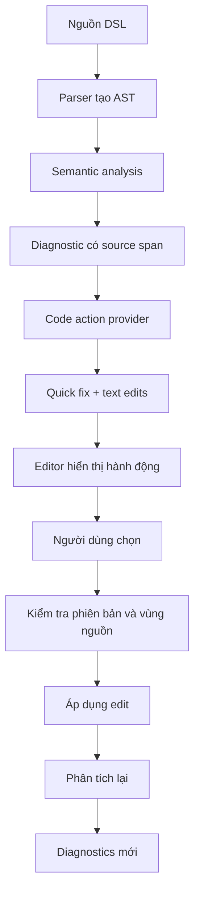

# Sửa nhanh trong DSL

Trong một DSL (*Domain-Specific Language*), parser có thể nhận diện được cấu trúc nhưng semantic analyzer vẫn phát hiện những vấn đề như tên trường không tồn tại, kiểu dữ liệu không tương thích, thiếu thuộc tính bắt buộc hoặc hai tùy chọn mâu thuẫn. Người dùng cần hiểu lỗi và sửa lại văn bản. Một công cụ tốt có thể hỗ trợ bằng cách đề xuất thay đổi cụ thể ngay tại vị trí liên quan.

**Sửa nhanh** (*quick fix*) là một hành động chỉnh sửa được gắn với diagnostic hoặc một vùng mã nguồn. Khi người dùng chọn hành động đó, editor áp dụng một hay nhiều thay đổi đã được xác định trước. Quick fix thường sửa một lỗi cụ thể, chẳng hạn đổi tên thuộc tính, thêm trường còn thiếu, thay giá trị enum hoặc điều chỉnh kiểu biểu thức.

Ví dụ, DSL cấu hình đơn hàng có thể có:

```text
when order.totla > 100000
then shipping.fee = 0
```

Semantic analyzer phát hiện không có thuộc tính `totla` trong kiểu Order và gợi ý `total`. Một quick fix có thể thay đúng đoạn `totla` bằng `total`. Người dùng xem gợi ý rồi chọn áp dụng; editor cập nhật văn bản và phân tích lại.

Quick fix giúp rút ngắn vòng lặp sửa lỗi, nhưng phải dựa trên thông tin đủ tin cậy. Một hành động sửa sai có thể thay đổi ý nghĩa chính sách, cấu hình hoặc workflow. Vì vậy, thiết kế quick fix cần quan tâm tới phạm vi chỉnh sửa, điều kiện áp dụng, khả năng xem trước và cách hoàn tác.

## 1. Quick fix là gì?

Quick fix là một thao tác có thể được thực hiện để khắc phục một diagnostic hoặc cải thiện cấu trúc DSL tại vị trí đang chọn. Nó thường được cung cấp dưới dạng code action trong editor, menu ngữ cảnh, biểu tượng gợi ý hoặc lệnh trong CLI.

Một quick fix thường có:

- **Diagnostic liên quan:** vấn đề làm xuất hiện hành động sửa.
- **Tiêu đề:** mô tả ngắn điều sẽ thay đổi.
- **Phạm vi áp dụng:** vị trí hoặc các vùng văn bản bị ảnh hưởng.
- **Edit:** một hoặc nhiều phép thay thế, chèn hoặc xóa văn bản.
- **Điều kiện áp dụng:** ngữ cảnh mà hành động còn hợp lệ.
- **Mức độ chắc chắn:** sửa an toàn hay chỉ là gợi ý cần xem xét.
- **Thông tin bổ sung:** lý do, preview hoặc tài liệu liên quan.

Ví dụ:

```text
error DSL-NAME-004: không tìm thấy thuộc tính "totla"

help: có thể bạn muốn viết "total"

Quick fix:
  Đổi "totla" thành "total"
```

Quick fix khác với một thông báo lỗi thông thường ở chỗ nó mô tả được một chỉnh sửa có thể áp dụng. Một diagnostic có thể chỉ giải thích vấn đề mà không có quick fix nếu hệ thống không đủ thông tin để chọn cách sửa đáng tin cậy.

### Quick fix và refactoring

Hai khái niệm có phần giao nhau nhưng mục tiêu thường khác:

- **Quick fix:** xử lý một vấn đề cụ thể hoặc một cảnh báo tại vị trí hiện tại.
- **Refactoring:** thay đổi cấu trúc chương trình trên một phạm vi rộng hơn nhưng giữ nguyên hành vi theo mục tiêu đã định.

Ví dụ, đổi một tên trường gõ sai là quick fix. Đổi tên một thuộc tính trên toàn bộ module và cập nhật mọi tham chiếu thường là refactoring.

Một công cụ có thể dùng cùng cơ chế edit cho cả hai, nhưng nên phân loại hành động để người dùng hiểu phạm vi và tác động.

## 2. Quick fix xuất phát từ semantic analysis như thế nào?

Semantic analyzer hiểu mô hình miền và có thể xác định những vấn đề mà parser không thể phát hiện chỉ bằng grammar.

Ví dụ:

```text
service "catalog" {
    replicas = "three"
    regoin = "ap-southeast"
}
```

Parser có thể chấp nhận block, phép gán và literal chuỗi. Semantic analysis có thể phát hiện:

- `replicas` cần kiểu Integer nhưng nhận String.
- `regoin` không phải thuộc tính đã khai báo; có thể người viết muốn `region`.

Từ những diagnostic này, công cụ có thể cung cấp các quick fix khác nhau:

- Đổi `"three"` thành một số nguyên, nếu có cách chuyển đổi rõ ràng.
- Đổi `regoin` thành `region` nếu tên gợi ý đủ chắc chắn.

Không phải mọi semantic error đều có thể sửa tự động. Nếu `replicas` có giá trị chuỗi `"three"`, công cụ không thể biết người dùng muốn 3, một biểu thức khác hay một trường cấu hình khác. Nó có thể đề xuất cách sửa nhưng nên để người dùng quyết định.

### Quan hệ giữa diagnostic và code action

Một diagnostic có thể có không hành động sửa nào, một hành động sửa hoặc nhiều hành động sửa. Một hành động cũng có thể liên quan đến nhiều diagnostic nếu chúng cùng xuất phát từ một nguyên nhân.

Ví dụ, thiếu một khai báo biến có thể tạo diagnostic ở nhiều vị trí sử dụng. Hành động “Thêm khai báo” có thể sửa toàn bộ các tham chiếu nếu ngữ cảnh và phạm vi rõ ràng.

## 3. Những dạng quick fix phổ biến

### 3.1. Sửa tên không tồn tại

Người dùng gõ sai tên trường, biến, hàm hoặc tài nguyên.

```text
when customer.regoin == "north"
```

Nếu schema có `region` và độ tương đồng đủ cao, công cụ có thể đề xuất đổi `regoin` thành `region`.

### 3.2. Thêm thành phần bắt buộc

Một khai báo thiếu thuộc tính bắt buộc có thể được sửa bằng cách chèn một dòng hoặc một trường.

```text
service "catalog" {
    image = "catalog:v2"
}
```

Nếu schema yêu cầu `replicas`, quick fix có thể chèn `replicas = 1`. Tuy nhiên, giá trị mặc định phải có căn cứ từ schema hoặc đặc tả; không nên tự đoán một giá trị nghiệp vụ.

### 3.3. Thay giá trị enum

```text
environment = "prodution"
```

Nếu tập giá trị hợp lệ gồm `development`, `staging` và `production`, công cụ có thể đề xuất thay `prodution` thành `production`.

### 3.4. Chuyển đổi kiểu

Một giá trị có thể được chuyển sang kiểu đích khi chuyển đổi không mất thông tin hoặc có quy tắc rõ.

```text
timeout = 30000
```

Nếu DSL yêu cầu Duration và đặc tả quy định số không đơn vị được hiểu là mili giây, quick fix có thể đổi thành `timeout = 30000ms`. Nếu không có quy ước đó, công cụ không nên tự thêm đơn vị dựa trên phỏng đoán.

### 3.5. Xóa hoặc thay thế thuộc tính xung đột

```text
cache = true
cache = false
```

Nếu DSL không cho phép khai báo trùng, có thể đề xuất xóa một khai báo. Nhưng nếu hai giá trị có thể phản ánh cấu hình được kế thừa hoặc override, công cụ cần hiểu semantics trước khi chọn dòng cần xóa.

### 3.6. Cập nhật cú pháp đã deprecated

Một thuộc tính cũ có thể được thay bằng tên mới:

```text
region_name = "ap-southeast"
```

Quick fix có thể đổi `region_name` thành `region` nếu hai thuộc tính tương đương trong phiên bản hiện tại. Nếu cách hiểu hoặc giá trị mặc định thay đổi, cần giải thích tác động trước khi áp dụng.

### 3.7. Thêm import hoặc khai báo tham chiếu

Nếu một kiểu hoặc hàm đã tồn tại trong module khác nhưng chưa được đưa vào phạm vi, công cụ có thể thêm import hoặc khai báo tham chiếu. Cần xác định đúng namespace, phiên bản và cách tổ chức module.

## 4. Phân biệt safe fix và suggestion

Không phải mọi hành động sửa đều có mức độ chắc chắn như nhau.

**Safe fix** là chỉnh sửa có thể được suy ra trực tiếp từ quy tắc và ngữ cảnh, với tác động hẹp và có thể dự đoán. Ví dụ, thêm dấu phân cách bị thiếu hoặc thay một token bằng tên chuẩn duy nhất được xác định.

**Suggestion** là đề xuất có khả năng đúng nhưng cần người dùng xem xét. Ví dụ, đổi tên trường sang một trong nhiều tên gần giống, hoặc chọn giá trị cấu hình thay thế.

Có thể phân loại:

| Loại | Mức độ chắc chắn | Cách trình bày |
|---|---|---|
| Safe fix | Cao, quy tắc rõ | “Thêm dấu đóng block” |
| Suggested fix | Có nhiều khả năng | “Có thể bạn muốn dùng region” |
| Refactoring action | Phạm vi rộng, nhiều nơi | Hiển thị số vị trí và preview |
| Manual guidance | Không thể tạo edit an toàn | Hướng dẫn người dùng sửa thủ công |

Việc phân loại không chỉ là màu sắc hoặc biểu tượng. Nó cần phản ánh cách hành động được suy ra và phạm vi thay đổi thực tế.

### Không có quick fix cũng là kết quả hợp lệ

Nếu diagnostic không có cách sửa đủ chắc chắn, hệ thống nên giải thích lỗi và chỉ ra nơi tìm thông tin. Việc luôn cố đưa ra một nút “Fix” có thể khiến người dùng tin rằng thao tác đó an toàn dù không phải vậy.

## 5. Mô hình hóa một quick fix

Một hệ thống có thể biểu diễn quick fix thành đối tượng có cấu trúc thay vì chỉ lưu chuỗi hiển thị.

Ví dụ JSON minh họa:

```json
{
  "id": "rename-unknown-field",
  "title": "Đổi 'regoin' thành 'region'",
  "kind": "quickfix",
  "diagnosticCode": "DSL-NAME-004",
  "applicability": "automatic",
  "edits": [
    {
      "source": "pipeline.dsl",
      "startOffset": 42,
      "endOffset": 48,
      "newText": "region"
    }
  ]
}
```

Các trường có thể gồm:

- **id:** định danh hành động trong phiên làm việc hoặc API.
- **title:** nhãn hiển thị cho người dùng.
- **kind:** quick fix, refactor hoặc source action.
- **diagnosticCode:** loại diagnostic liên quan.
- **applicability:** mức độ áp dụng hoặc yêu cầu xác nhận.
- **edits:** danh sách thay đổi văn bản.
- **command:** hành động phụ nếu cần, chẳng hạn yêu cầu semantic analysis chạy lại.
- **metadata:** thông tin phục vụ preview, grouping hoặc telemetry theo chính sách.

Định danh nội bộ không nhất thiết phải ổn định qua mọi phiên bản. Nếu client cần nhận diện loại hành động lâu dài, nên có code hoặc kind được tài liệu hóa riêng.

### Edit là phép thay thế một khoảng nguồn

Một text edit thường gồm:

- Nguồn hoặc tài liệu cần sửa.
- Vị trí bắt đầu.
- Vị trí kết thúc.
- Nội dung mới.

Quy ước phổ biến là khoảng nửa mở: bắt đầu được tính vào vùng, kết thúc nằm ngay sau vùng. Với quy ước này, độ dài vùng là end trừ start và có thể biểu diễn thao tác chèn bằng start bằng end.

## 6. Xây dựng edit chính xác

Quick fix cần thay đúng vùng nguồn. Nếu vị trí bị lệch, công cụ có thể sửa nhầm token hoặc làm hỏng cấu trúc.

Giả sử nguồn:

```text
when order.totla > 100000
```

Edit chỉ nên thay vùng của identifier:

```text
start = vị trí đầu của "totla"
end   = vị trí ngay sau "totla"
newText = "total"
```

Không nên thay cả dòng nếu chỉ cần đổi một tên. Phạm vi nhỏ giúp giảm rủi ro làm mất comment, khoảng trắng hoặc định dạng mà người dùng đã chọn.

### Offset, dòng và cột

Các công cụ có thể biểu diễn vị trí bằng offset hoặc cặp dòng/cột. Cần thống nhất đơn vị:

- Byte trong UTF-8.
- Unicode code point.
- UTF-16 code unit.
- Cột hiển thị trong editor.

Nếu lexer lưu offset theo UTF-16 nhưng quick fix lại tính theo byte, vùng thay thế có thể lệch khi văn bản chứa ký tự ngoài ASCII. DSL hỗ trợ tiếng Việt cần xử lý Unicode nhất quán.

### Không tự dựng vị trí từ chuỗi đã hiển thị

Source range nên đến từ token hoặc node AST có source span. Tìm kiếm lại chuỗi tên trong toàn bộ văn bản có thể chọn nhầm một lần xuất hiện khác.

Ví dụ, từ `region` có thể xuất hiện trong comment, một block khác hoặc nhiều tham chiếu. Diagnostic phải giữ vị trí chính xác của node gây lỗi.

## 7. Nhiều edit trong một quick fix

Một hành động có thể cần nhiều thay đổi cùng lúc.

Ví dụ, khi đổi tên thuộc tính trên toàn bộ một tài liệu, quick fix hoặc refactoring có thể tạo nhiều edit:

```text
service "catalog" {
    regoin = "ap-southeast"
}

service "billing" {
    regoin = "eu-west"
}
```

Một hành động “Đổi tất cả regoin thành region” có thể thay hai vùng. Trước khi áp dụng, công cụ cần xác định các tham chiếu đó thực sự cùng biểu thị một symbol hoặc cùng một trường hợp cần sửa.

### Áp dụng edit theo thứ tự an toàn

Nếu các vị trí được lưu theo offset của văn bản ban đầu, áp dụng edit từ cuối về đầu sẽ tránh việc thay đổi ở đầu làm dịch offset của những edit phía sau. Một cách khác là dùng API workspace edit có quản lý phiên bản và vùng tài liệu.

Không nên tự áp dụng từng edit một cách rời rạc nếu hành động được xem là một đơn vị. Nếu edit thứ ba thất bại sau khi hai edit đầu đã được ghi, tài liệu có thể rơi vào trạng thái chỉ được sửa một phần.

### Tính nguyên tử

Một quick fix gồm nhiều edit nên được áp dụng như một giao dịch:

1. Xác nhận mọi vùng edit còn hợp lệ.
2. Kiểm tra các edit không xung đột hoặc có quy tắc hợp nhất.
3. Tạo phiên bản văn bản mới.
4. Áp dụng toàn bộ thay đổi.
5. Nếu có lỗi, giữ nguyên phiên bản trước.
6. Ghi nhận một bước undo cho toàn bộ hành động.

Tính nguyên tử giúp người dùng không phải tự khôi phục khi một phần của quick fix không thể thực hiện.

## 8. Điều kiện áp dụng và kiểm tra lại ngữ cảnh

Một quick fix được đề xuất tại thời điểm phân tích có thể không còn hợp lệ khi người dùng đã sửa tài liệu.

Ví dụ:

1. Parser phát hiện tên `regoin` sai.
2. Editor đề xuất thay bằng `region`.
3. Người dùng sửa đoạn đó thành `regionCode`.
4. Quick fix cũ vẫn còn trong menu do giao diện chưa cập nhật.

Nếu áp dụng edit cũ theo offset, nó có thể thay nhầm nội dung mới.

### Version hoặc document snapshot

Mỗi quick fix nên gắn với phiên bản tài liệu hoặc snapshot nguồn mà nó được tạo ra. Trước khi áp dụng, editor có thể:

- Kiểm tra document version còn khớp.
- Xác nhận source range vẫn chứa nội dung dự kiến.
- Chạy lại điều kiện applicability.
- Yêu cầu semantic analysis tạo action mới nếu tài liệu đã thay đổi.

Nếu không thể xác nhận, nên từ chối edit cũ và yêu cầu tính lại quick fix.

### Preconditions

Một quick fix có thể định nghĩa điều kiện:

- Diagnostic liên quan vẫn tồn tại.
- Node AST vẫn có cùng loại.
- Symbol đích vẫn tồn tại và còn truy cập được.
- Schema hoặc phiên bản DSL chưa thay đổi.
- Vùng nguồn chưa bị sửa.
- Không có edit khác xung đột.

Điều kiện nên được kiểm tra ngay trước khi áp dụng, không chỉ lúc tạo menu.

## 9. Preview, xác nhận và undo

Trước khi áp dụng một hành động có phạm vi đáng kể, công cụ nên cho người dùng xem nội dung sẽ thay đổi.

### Preview

Preview có thể hiển thị:

- Đoạn trước và sau.
- Số tệp hoặc số vùng bị sửa.
- Giá trị cũ và giá trị mới.
- Các khai báo hoặc tham chiếu liên quan.
- Tác động có thể có đến cấu hình hoặc semantics.

Ví dụ:

```diff
-    regoin = "ap-southeast"
+    region = "ap-southeast"
```

Với một quick fix đơn giản chỉ thay một token, preview có thể ngắn gọn. Với refactoring nhiều tệp, preview nên cho phép xem từng vùng và tổng số thay đổi.

### Xác nhận

Safe fix nhỏ có thể được áp dụng trực tiếp theo thiết kế editor. Hành động có khả năng đổi semantics, xóa dữ liệu hoặc thay đổi nhiều tệp nên yêu cầu người dùng xác nhận rõ ràng.

Không nên dùng một quy tắc chung rằng mọi quick fix đều tự động áp dụng hoặc mọi quick fix đều cần nhiều bước xác nhận. Mức xác nhận cần phù hợp với phạm vi và rủi ro của edit.

### Undo

Mỗi quick fix nên có khả năng hoàn tác qua cơ chế undo của editor. Với nhiều edit, undo nên hoàn tác toàn bộ hành động như một đơn vị.

Undo giúp người dùng thử một đề xuất mà không sợ mất trạng thái trước đó. Tuy nhiên, undo văn bản không nhất thiết hoàn tác tác dụng phụ bên ngoài nếu một công cụ đã chạy lệnh hoặc thay đổi hệ thống. Quick fix nên ưu tiên chỉnh sửa nguồn; các hành động thực thi cần có ranh giới và xác nhận riêng.

## 10. Ví dụ: sửa tên trường không tồn tại

Giả sử schema của Order có các trường `id`, `total` và `status`. Người dùng viết:

```text
when order.totla > 500000
then shipping.fee = 0
```

Semantic analyzer tạo diagnostic:

```text
DSL-NAME-004: Không tìm thấy thuộc tính "totla" trong Order.
Có thể bạn muốn dùng "total".
```

Quy trình tạo quick fix:

1. Analyzer lấy symbol hoặc schema của `order`.
2. Tra danh sách trường hợp lệ trong kiểu Order.
3. Tìm ứng viên gần với `totla`.
4. Kiểm tra có một ứng viên đủ chắc chắn hay không.
5. Lấy source span của identifier gây lỗi.
6. Tạo text edit thay đúng vùng đó.
7. Gắn edit với diagnostic và phiên bản tài liệu.
8. Editor hiển thị hành động “Đổi 'totla' thành 'total'”.
9. Khi người dùng chọn, editor xác thực vùng và áp dụng edit.
10. Parser và semantic analyzer chạy lại để cập nhật diagnostics.

Kết quả:

```text
when order.total > 500000
then shipping.fee = 0
```

Nếu có nhiều trường như `total`, `totalBeforeTax` và `totalPaid`, hệ thống có thể hiển thị nhiều gợi ý thay vì tự chọn một trường.

## 11. Ví dụ: thêm thuộc tính bắt buộc

Giả sử một resource cần khai báo `region` và `image`:

```text
service "catalog" {
    image = "catalog:v2"
}
```

Diagnostic cho biết thiếu `region`. Nếu schema quy định một giá trị mặc định duy nhất trong môi trường hiện tại, công cụ có thể cung cấp:

```text
Thêm thuộc tính region = "ap-southeast"
```

Nếu có nhiều region hợp lệ hoặc lựa chọn ảnh hưởng tới nơi triển khai, công cụ không nên tự chọn. Có thể đề xuất chèn placeholder:

```text
region = "<choose-region>"
```

Nhưng placeholder phải được đánh dấu để người dùng biết cần thay thế. Một cách khác là mở danh sách lựa chọn trong editor. Quick fix nên tránh tạo ra cấu hình trông hợp lệ nhưng mang một quyết định nghiệp vụ mà người dùng chưa đưa ra.

## 12. Ví dụ: sửa kiểu dữ liệu

Giả sử thuộc tính `retries` yêu cầu Integer từ 0 đến 5:

```text
task "build" {
    retries = "3"
}
```

Nếu chuỗi chứa một biểu diễn số đơn giản, công cụ có thể đề xuất bỏ dấu ngoặc kép:

```diff
-    retries = "3"
+    retries = 3
```

Tuy nhiên, không phải chuỗi nào cũng có thể chuyển đổi an toàn. Với `"three"`, công cụ không thể tự biết số mong muốn. Nó nên nêu kiểu yêu cầu và cho người dùng nhập giá trị.

Cũng cần xét semantics của kiểu đích. Nếu DSL phân biệt số nguyên, số thập phân và số có đơn vị, chuyển đổi phải tuân thủ chính xác quy tắc đó. Ví dụ, không nên tự đổi `30000` thành `30s` nếu không biết số ban đầu biểu thị mili giây.

## 13. Ví dụ: thay cú pháp deprecated

Một phiên bản DSL có thể thay thuộc tính `region_name` bằng `region`:

```text
service "catalog" {
    region_name = "ap-southeast"
}
```

Diagnostic có thể thông báo thuộc tính cũ vẫn được chấp nhận nhưng sẽ bị loại bỏ trong phiên bản sau. Quick fix “Dùng thuộc tính region” có thể thay tên khóa.

Trước khi đề xuất, analyzer cần xác nhận:

- Thuộc tính mới thay thế đúng thuộc tính cũ.
- Kiểu dữ liệu và đơn vị không đổi hoặc có phép chuyển đổi được định nghĩa.
- Giá trị mặc định không thay đổi theo cách làm đổi hành vi.
- Không có khóa mới đã được khai báo trong cùng block.
- Phiên bản DSL hiện tại hỗ trợ thuộc tính mới.

Nếu có khác biệt semantics, quick fix nên giải thích hoặc yêu cầu người dùng chọn cách chuyển đổi thay vì chỉ đổi tên.

## 14. Quick fix trong semantic analysis và editor

Semantic analyzer thường tạo diagnostics dựa trên AST và domain model. Một lớp code action provider có thể chuyển diagnostic thành hành động sửa.

Luồng tổng quát:



Vai trò nên được tách:

- Parser tạo cấu trúc và source span.
- Semantic analyzer phát hiện vấn đề và có thể cung cấp thông tin sửa.
- Code action provider xây dựng danh sách hành động phù hợp với vị trí hoặc diagnostic được chọn.
- Editor hiển thị, preview và áp dụng edit.
- Parser/analyzer chạy lại trên văn bản mới.

Không nhất thiết mọi DSL phải có editor riêng. CLI hoặc công cụ web cũng có thể hiển thị quick fix theo cùng mô hình dữ liệu.

## 15. Phạm vi quick fix: dòng, block, tệp hay workspace

Quick fix có thể tác động ở nhiều phạm vi:

| Phạm vi | Ví dụ | Lưu ý |
|---|---|---|
| Token | Đổi tên trường gõ sai | Edit nhỏ, thường dễ preview |
| Biểu thức | Bọc ngoặc hoặc chuyển kiểu | Cần giữ precedence và semantics |
| Block | Thêm thuộc tính bắt buộc | Phải giữ indent và thứ tự |
| Tệp | Đổi tên nhiều tham chiếu | Cần kiểm tra mọi vị trí |
| Workspace | Cập nhật import hoặc schema tham chiếu | Cần xác nhận nhiều tài liệu và phiên bản |

Phạm vi càng rộng, nguy cơ xung đột và tác động ngoài ý muốn càng cao. Công cụ nên nêu rõ số vùng hoặc số tệp sẽ thay đổi trước khi áp dụng.

### Bảo toàn format và comment

Khi chèn thuộc tính vào block, quick fix cần giữ quy tắc indent, newline, dấu phân cách và style của tài liệu. Nếu có comment gắn với một dòng, việc xóa hoặc di chuyển dòng cần giữ comment đúng ngữ cảnh.

Không nên serialize lại toàn bộ AST thành văn bản nếu chỉ cần sửa một đoạn nhỏ, trừ khi formatter được thiết kế để chuẩn hóa toàn bộ tệp và người dùng đã chọn hành động đó.

## 16. Quick fix nhiều lựa chọn và ưu tiên hành động

Một diagnostic có thể có nhiều cách sửa. Ví dụ, một trường không tồn tại có thể gần với hai tên hợp lệ.

Công cụ có thể cung cấp:

- Đổi thành `region`.
- Đổi thành `regionCode`.
- Mở schema để tra cứu.

Không nên tự chọn chỉ vì một tên có khoảng cách ký tự nhỏ hơn. Có thể xếp hạng ứng viên dựa trên tên, kiểu, ngữ cảnh và các trường được phép tại vị trí đó, nhưng cần có ngưỡng tin cậy.

### Ưu tiên hành động

Một số tiêu chí để sắp xếp:

- Hành động sửa trực tiếp diagnostic hiện tại.
- Hành động an toàn và có tác động nhỏ.
- Hành động phù hợp với kiểu và schema hiện hành.
- Hành động không làm mất dữ liệu hoặc thay đổi cấu hình rộng.
- Hành động có thể preview và undo.

Thứ tự hiển thị không nên che giấu những lựa chọn khác có thể quan trọng. Nếu có nhiều lựa chọn tương đương, hãy trình bày rõ ràng.

## 17. Batch fixes – áp dụng nhiều quick fix

Khi một tệp có nhiều lỗi cùng loại, công cụ có thể hỗ trợ áp dụng nhiều quick fix cùng lúc.

Ví dụ, nhiều thuộc tính cùng dùng tên cũ `region_name`. Người dùng có thể chọn cập nhật tất cả.

Batch fix cần chú ý:

1. Mỗi edit được tính trên cùng một phiên bản nguồn.
2. Các edit không được chồng lấn trừ khi có quy tắc hợp nhất.
3. Nếu một edit không còn hợp lệ, cần xác định có hủy toàn bộ batch hay bỏ riêng edit đó.
4. Preview cần hiển thị tổng số thay đổi và các vùng ảnh hưởng.
5. Undo nên hoàn tác toàn bộ batch như một đơn vị.
6. Sau khi áp dụng, phân tích lại để xác nhận trạng thái mới.

Một hành động batch có thể thuận tiện nhưng rủi ro cao hơn quick fix cục bộ. Đặc biệt với tên trường hoặc giá trị nghiệp vụ, cần bảo đảm các vị trí thật sự cùng tham chiếu một symbol và không chỉ giống nhau về văn bản.

## 18. Tương tác với formatter và AST transformation

Quick fix thường sửa văn bản nguồn, còn một số công cụ có thể tạo AST mới rồi serialize lại. Hai cách có tradeoff khác nhau.

### Text edit

Ưu điểm:

- Thay đúng vùng nhỏ.
- Giữ phần lớn format và comment.
- Dễ tích hợp với editor API.
- Preview diff trực tiếp.

Hạn chế:

- Cần source span chính xác.
- Nhiều edit có thể xung đột.
- Phải tính lại vị trí sau thay đổi.

### AST transformation

Ưu điểm:

- Làm việc ở mức cấu trúc ngữ nghĩa.
- Có thể áp dụng quy tắc phức tạp trên node.
- Dễ bảo đảm node mới tuân thủ schema AST.

Hạn chế:

- Khi in lại toàn bộ AST có thể thay đổi format hoặc comment.
- Cần source mapping để giữ vị trí.
- Có thể khó tạo diff nhỏ, dễ hiểu.

Một kiến trúc có thể dùng AST để quyết định cách sửa, rồi tạo text edit nhỏ dựa trên source span. Cách này kết hợp hiểu biết ngữ nghĩa với việc bảo toàn văn bản nguồn.

## 19. Quick fix và bảo mật

Quick fix có thể thay đổi cấu hình, chính sách hoặc tham chiếu tài nguyên. Không nên xem mọi hành động sửa là vô hại.

Một số nguyên tắc:

- Không tự động điền secret hoặc thông tin xác thực.
- Không đổi quyền truy cập, endpoint hoặc môi trường triển khai nếu người dùng chưa chọn.
- Không xóa cấu hình có thể ảnh hưởng đến tài nguyên đang chạy chỉ để làm biến mất diagnostic.
- Kiểm tra quyền ghi của tài liệu và workspace trước khi áp dụng.
- Escape nội dung không tin cậy trong preview.
- Giới hạn quick fix chỉ tác động tới tài liệu hoặc phạm vi đã được cấp quyền.
- Với hành động có tác động vận hành, chỉ sửa nguồn cấu hình; việc triển khai hoặc thực thi cần là bước riêng.

Một quick fix tốt giải quyết lỗi trong văn bản mà không tạo tác dụng phụ ngoài dự kiến.

## 20. Những lỗi thiết kế quick fix thường gặp

**Sửa dựa trên vị trí cũ.** Người dùng đã thay đổi văn bản nhưng action cũ vẫn được áp dụng theo offset lỗi thời. Cần kiểm tra document version và nội dung vùng nguồn.

**Thay cả dòng khi chỉ cần thay token.** Điều này có thể làm mất comment, khoảng trắng hoặc format. Hãy giới hạn edit vào source span nhỏ nhất hợp lý.

**Đoán giá trị nghiệp vụ.** Tự chọn region, quyền hoặc mức retry có thể làm thay đổi hành vi. Chỉ điền default khi đặc tả hoặc schema quy định rõ.

**Luôn cung cấp quick fix dù không chắc chắn.** Một suggestion yếu có thể khiến người dùng áp dụng sửa sai. Không có quick fix là lựa chọn hợp lệ.

**Áp dụng nhiều edit không nguyên tử.** Nếu một phần thất bại, tài liệu có thể ở trạng thái sửa dở. Hãy kiểm tra trước và áp dụng như một giao dịch.

**Không có preview cho thay đổi lớn.** Người dùng không biết hành động sẽ ảnh hưởng bao nhiêu vị trí hoặc tệp. Cần hiển thị phạm vi.

**Không hỗ trợ undo.** Người dùng khó thử một đề xuất. Hành động nên được ghi nhận như một đơn vị undo.

**Bỏ qua comment và định dạng.** Việc serialize lại cả tệp có thể tạo ra thay đổi không liên quan. Ưu tiên edit nhỏ khi phù hợp.

**Nhầm quick fix với refactoring.** Hành động sửa một lỗi và hành động đổi cấu trúc trên workspace có phạm vi, rủi ro khác nhau. Cần đặt tên và preview rõ.

**Không phân tích lại sau khi sửa.** Quick fix có thể sửa lỗi đầu tiên nhưng làm xuất hiện lỗi khác. Editor cần cập nhật diagnostics trên phiên bản mới.

## 21. Quy trình thiết kế và áp dụng quick fix

Khi tạo một quick fix cho DSL, có thể thực hiện theo trình tự:

1. Xác định diagnostic và nguyên nhân ngữ nghĩa của nó.
2. Xác định dữ liệu miền hoặc schema cần thiết để suy ra cách sửa.
3. Liệt kê các phương án hợp lệ và đánh giá mức độ chắc chắn.
4. Chọn một safe fix hoặc tạo nhiều suggestion nếu có nhiều khả năng.
5. Lấy source span từ AST/token thay vì tìm chuỗi trong văn bản.
6. Tạo text edit hoặc AST transformation với phạm vi nhỏ nhất hợp lý.
7. Gắn action với document version và điều kiện áp dụng.
8. Xác định có cần preview hoặc xác nhận không.
9. Kiểm tra xung đột và áp dụng các edit một cách nguyên tử.
10. Ghi nhận undo để có thể hoàn tác.
11. Phân tích lại tài liệu và cập nhật diagnostics.
12. Bảo đảm edit không làm lộ secret hoặc thay đổi tài nguyên ngoài phạm vi.

Một quick fix nên giúp người dùng hiểu hành động sẽ thay đổi gì, vì sao thay đổi đó phù hợp và cách quay lại nếu kết quả không đúng mong đợi.

## 22. Câu hỏi tự kiểm tra

1. Quick fix là gì và khác diagnostic thông thường như thế nào?
2. Quick fix khác refactoring ở mục tiêu và phạm vi nào?
3. Phân biệt safe fix với suggestion.
4. Một quick fix có cấu trúc thường cần những trường nào?
5. Vì sao source span phải đến từ token hoặc AST thay vì tìm chuỗi trong tệp?
6. Offset, dòng và cột cần thống nhất những quy ước nào?
7. Làm thế nào để áp dụng nhiều edit mà không làm lệch vị trí?
8. Vì sao một batch fix nên được áp dụng như một giao dịch?
9. Document version giúp ngăn lỗi gì khi áp dụng action cũ?
10. Khi nào nên cung cấp preview và xác nhận?
11. Vì sao undo quan trọng với quick fix?
12. Khi nào nên dùng text edit và khi nào AST transformation phù hợp hơn?
13. Tại sao không nên tự đoán giá trị nghiệp vụ khi thêm thuộc tính bắt buộc?
14. Làm thế nào để xử lý nhiều gợi ý sửa tên trường?
15. Hãy thiết kế quick fix cho lỗi tên thuộc tính sai trong một DSL cấu hình và mô tả toàn bộ luồng từ diagnostic đến phân tích lại.

Khi hiểu cách xây dựng quick fix, người học có thể kết nối semantic diagnostics với thao tác chỉnh sửa an toàn, tạo đề xuất có căn cứ và giúp người dùng sửa DSL nhanh mà vẫn kiểm soát được thay đổi đối với văn bản và ý nghĩa cấu hình.
