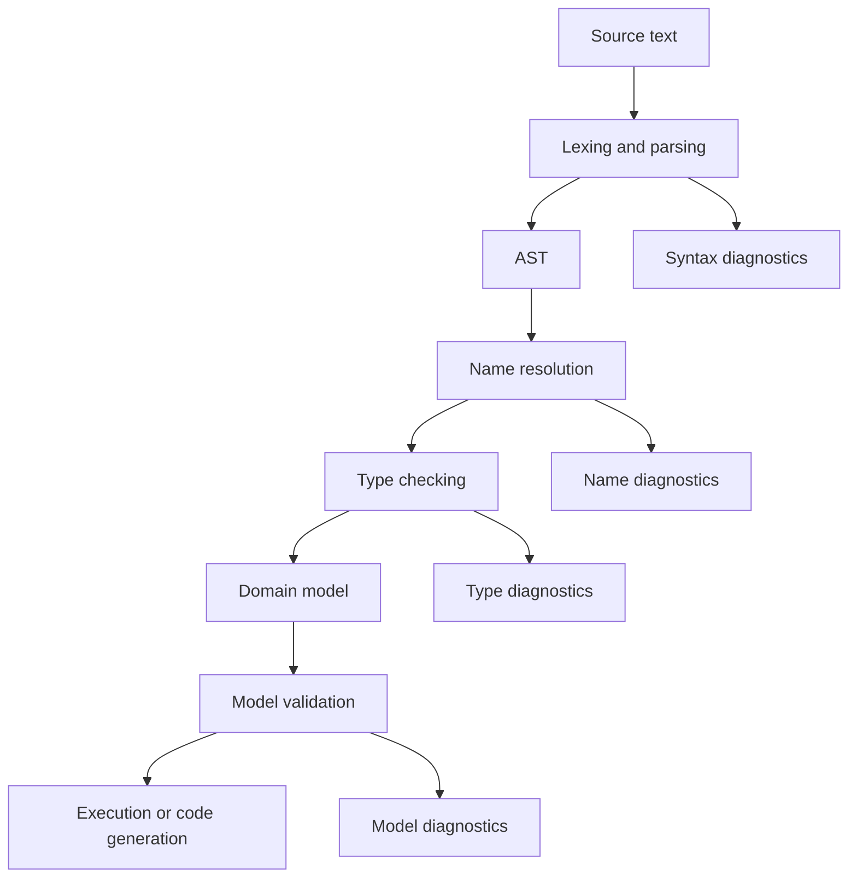
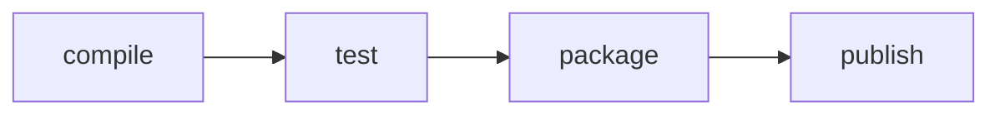
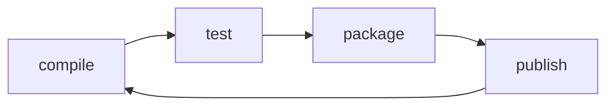
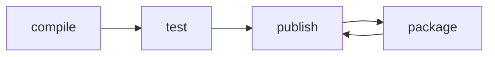
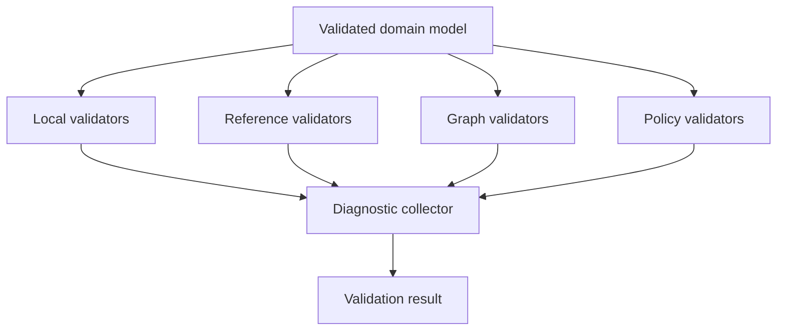

# Kiểm chứng mô hình

Trong một ngôn ngữ miền chuyên biệt (Domain-Specific Language, DSL), parser chuyển văn bản thành cây cú pháp (AST), sau đó các bước phân giải tên và kiểm tra kiểu tạo ra một mô hình có ý nghĩa trong miền. **Kiểm chứng mô hình (model validation)** là quá trình xác nhận mô hình đó thỏa mãn các quy tắc cấu trúc, quan hệ và bất biến nghiệp vụ trước khi được thực thi, sinh mã hoặc lưu thành cấu hình chính thức.

Một tài liệu DSL có thể đúng cú pháp nhưng vẫn mô tả một mô hình không hợp lệ. Ví dụ, workflow có thể chứa task phụ thuộc vào task không tồn tại; một dịch vụ có thể yêu cầu số bản sao âm; một quy trình thanh toán có thể chuyển từ trạng thái `DRAFT` thẳng sang `SHIPPED`; hoặc đồ thị tác vụ có thể chứa chu trình khiến không thể xác định thứ tự thực thi. Parser không nhất thiết phát hiện được các lỗi này vì chúng không phải lỗi grammar. Chúng thuộc phạm vi kiểm tra ngữ nghĩa và kiểm chứng mô hình.

Kiểm chứng mô hình giúp hệ thống phát hiện vấn đề sớm, đưa ra chẩn đoán có thể hành động và bảo đảm runtime chỉ nhận những mô hình đã vượt qua các điều kiện cần thiết. Để làm được điều đó, cần xác định rõ mô hình nào được kiểm tra, quy tắc nào áp dụng, dữ liệu nào cần có, lỗi được tổng hợp ra sao và những điều kiện nào chỉ có thể xác nhận khi chạy.

## 1. Mô hình là gì trong một DSL?

Mô hình (model) là biểu diễn có cấu trúc của các khái niệm thuộc miền mà DSL mô tả. Nó thường gồm đối tượng, thuộc tính, kiểu dữ liệu, quan hệ và các tham chiếu giữa đối tượng.

Ví dụ, DSL triển khai có thể mô tả:

```text
application "shop" {
    service "catalog" {
        replicas = 3
        port = 8080
    }

    service "checkout" {
        replicas = 2
        port = 8081
        depends_on = ["catalog"]
    }
}
```

Sau khi phân tích, mô hình có thể chứa một `Application` với hai `Service`. Mỗi service có tên, số bản sao, cổng và danh sách phụ thuộc. Tham chiếu `"catalog"` có thể được phân giải thành liên kết trực tiếp tới đối tượng service `catalog`.

Mô hình khác với văn bản nguồn ở chỗ nó tập trung vào ý nghĩa. Mô hình thường không cần giữ khoảng trắng, dấu xuống dòng hoặc cách người dùng sắp xếp thuộc tính. Nó có thể chứa thêm thông tin được suy ra trong quá trình phân tích, như kiểu đã xác định, tham chiếu đã phân giải hoặc giá trị mặc định.

## 2. Kiểm chứng mô hình khác gì với parsing và type checking?

Một pipeline DSL thường có nhiều bước kiểm tra với mục đích khác nhau:



- **Parsing:** xác nhận token và cấu trúc tuân theo grammar. Ví dụ, khai báo service thiếu dấu `}` là lỗi cú pháp.
- **Name resolution:** xác định tên tham chiếu đến khai báo nào. Ví dụ, `depends_on = ["unknown"]` tham chiếu đến service chưa khai báo.
- **Type checking:** xác nhận giá trị và biểu thức có kiểu phù hợp. Ví dụ, `replicas = "three"` không hợp lệ nếu trường cần số nguyên.
- **Model validation:** xác nhận toàn bộ mô hình hoặc các nhóm đối tượng thỏa mãn quy tắc miền. Ví dụ, số bản sao phải dương, cổng không được trùng trong cùng một phạm vi hoặc đồ thị phụ thuộc không có chu trình.

Ranh giới giữa các bước có thể khác nhau theo kiến trúc. Một số kiểm tra mô hình đơn giản có thể được thực hiện ngay trong semantic analysis. Tuy nhiên, việc phân biệt trách nhiệm giúp tổ chức diagnostics, kiểm thử và các quy tắc phụ thuộc vào nhiều đối tượng.

## 3. Các cấp độ kiểm chứng

Có thể chia kiểm chứng mô hình thành nhiều cấp độ, từ cục bộ đến toàn cục.

### 3.1. Kiểm tra thuộc tính đơn lẻ

Kiểm tra một giá trị độc lập với các đối tượng khác:

- Số lượng phải lớn hơn 0.
- Tên không được rỗng.
- Cổng mạng nằm trong khoảng cho phép.
- Chuỗi có độ dài không vượt giới hạn.
- Thời gian chờ không âm.

Ví dụ, `replicas = -2` có thể đúng kiểu `Integer` nhưng vi phạm quy tắc miền.

### 3.2. Kiểm tra quan hệ giữa các thuộc tính

Một số quy tắc phụ thuộc vào nhiều trường của cùng một đối tượng:

- `startDate` phải trước `endDate`.
- Nếu `enabled = true`, trường `endpoint` phải được cung cấp.
- Nếu phương thức thanh toán là `BANK_TRANSFER`, thông tin tài khoản ngân hàng phải có.
- `minReplicas` không được lớn hơn `maxReplicas`.

Các quy tắc này thường được gọi là cross-field constraints.

### 3.3. Kiểm tra quan hệ giữa các đối tượng

Mô hình thường có tham chiếu và quan hệ giữa nhiều đối tượng:

- Mỗi dependency phải trỏ đến task tồn tại.
- Mỗi đơn hàng phải tham chiếu đến một khách hàng hợp lệ.
- Một cổng hoặc tên tài nguyên phải duy nhất trong phạm vi xác định.
- Quan hệ cha-con phải tuân theo cardinality được quy định.

### 3.4. Kiểm tra toàn mô hình

Một số điều kiện chỉ có thể xác định khi xem toàn bộ mô hình:

- Đồ thị phụ thuộc không có chu trình.
- Mọi thành phần bắt buộc đều có thể truy cập từ entry point.
- Không có hai tài nguyên chiếm cùng một định danh duy nhất.
- Các bước trong quy trình có thể được sắp xếp thành một thứ tự thực thi hợp lệ.
- Mọi tham chiếu liên module đều nằm trong tập module được phép.

### 3.5. Kiểm tra theo môi trường thực thi

Một số quy tắc phụ thuộc vào thông tin bên ngoài như quyền, tài nguyên, phiên bản dịch vụ hoặc trạng thái hệ thống. Ví dụ, tài khoản triển khai có quyền tạo service hay không chỉ có thể xác nhận khi biết danh tính và môi trường chạy. Đây thường là runtime validation hoặc preflight validation, không phải kiểm tra tĩnh thuần túy.

## 4. Bất biến miền (domain invariants)

Bất biến miền là điều kiện phải luôn đúng đối với một đối tượng hoặc mô hình trong phạm vi mà nó đại diện. Nếu bất biến bị vi phạm, mô hình không thể được xem là hợp lệ.

Ví dụ với đơn hàng:

- Số lượng mỗi mặt hàng phải dương.
- Tổng tiền không được âm.
- Đơn hàng đã giao phải có địa chỉ giao hàng.
- Đơn hàng đã thanh toán phải có giao dịch thanh toán tương ứng.
- Trạng thái `CANCELLED` không được đồng thời có trạng thái giao hàng `DELIVERED`.

Có thể mô tả một số bất biến trong DSL:

```text
entity Order {
    quantity: Integer
    total: Money
    status: OrderStatus

    invariant quantity > 0
    invariant total >= 0 VND
}
```

Cú pháp cụ thể tùy ngôn ngữ. Điểm quan trọng là bất biến được gắn với khái niệm miền mà nó bảo vệ, thay vì phân tán ở nhiều nơi không rõ trách nhiệm.

### 4.1. Bất biến cục bộ và bất biến toàn cục

Bất biến cục bộ chỉ cần dữ liệu của một đối tượng, ví dụ `quantity > 0`. Bất biến toàn cục cần xem nhiều đối tượng, ví dụ tất cả `service.port` trong một application phải duy nhất.

Bất biến cục bộ thường dễ kiểm tra ngay khi tạo đối tượng. Bất biến toàn cục cần một bước duyệt hoặc chỉ mục trên toàn mô hình. Cần tránh đưa kiểm tra toàn cục vào constructor của từng đối tượng nếu điều đó khiến đối tượng phải truy cập trạng thái toàn hệ thống.

### 4.2. Bất biến phải được bảo vệ ở đâu?

Nếu mô hình có thể được tạo từ nhiều nguồn (DSL, API, biểu mẫu, import dữ liệu), không nên chỉ dựa vào parser để bảo vệ bất biến. Mô hình miền hoặc lớp validation dùng chung cần bảo đảm quy tắc được áp dụng bất kể nguồn đầu vào.

Parser có thể phát hiện lỗi sớm để chỉ vị trí trong văn bản, nhưng lớp mô hình vẫn cần bảo vệ những điều kiện quan trọng trước khi dữ liệu được lưu hoặc thực thi.

## 5. Ràng buộc cấu trúc và cardinality

Ràng buộc cấu trúc xác định những đối tượng nào phải có, có thể có bao nhiêu và chúng được lồng ghép ra sao.

Ví dụ:

- Một application phải có ít nhất một service.
- Một service có đúng một tên và một image.
- Một task có thể có không hoặc nhiều dependency.
- Mỗi workflow có đúng một entry task.
- Một quan hệ `parent` chỉ được trỏ đến tối đa một đối tượng cha.

Có thể mô tả cardinality bằng ký hiệu:

| Ký hiệu | Ý nghĩa | Ví dụ |
|---|---|---|
| `0..1` | Không hoặc một | Một service có thể có health check |
| `1` | Chính xác một | Mỗi task có một tên |
| `0..*` | Không hoặc nhiều | Một workflow có danh sách task |
| `1..*` | Ít nhất một | Một application cần ít nhất một service |

Ví dụ, nếu `Application.services` có cardinality `1..*`, mô hình rỗng cần bị từ chối dù nó có thể được tạo ra từ một cấu trúc cú pháp hợp lệ.

## 6. Tính duy nhất và ràng buộc khóa

Tên hoặc định danh có thể phải duy nhất trong một phạm vi cụ thể. Cần xác định rõ phạm vi của tính duy nhất:

- Duy nhất trong một khối.
- Duy nhất trong một module.
- Duy nhất trong toàn application.
- Duy nhất theo một tổ hợp trường.

Ví dụ, hai service có thể cùng tên nếu nằm ở hai namespace khác nhau, nhưng không thể trùng tên trong cùng application nếu tên là khóa tra cứu.

Một ràng buộc duy nhất theo tổ hợp có thể áp dụng cho cặp `(region, serviceName)`: cùng tên service được phép ở region khác nhau, nhưng không được trùng trong một region. Bộ kiểm chứng cần xây dựng khóa tương ứng thay vì chỉ so sánh từng trường riêng lẻ.

## 7. Toàn vẹn tham chiếu

Toàn vẹn tham chiếu (referential integrity) bảo đảm mọi quan hệ trong mô hình đều trỏ đến đối tượng hợp lệ.

Ví dụ DSL workflow:

```text
workflow "release" {
    task "compile" {}
    task "test" {
        depends_on = ["compile"]
    }
    task "publish" {
        depends_on = ["test"]
    }
}
```

Các tham chiếu `compile` và `test` phải được phân giải thành task thực sự. Nếu `publish` phụ thuộc vào `package` nhưng không có task `package`, mô hình vi phạm toàn vẹn tham chiếu.

Kiểm chứng cần xác nhận:

- Đối tượng đích tồn tại.
- Đối tượng đích có đúng loại mà quan hệ yêu cầu.
- Đối tượng đích có nằm trong phạm vi được phép tham chiếu.
- Quan hệ không vi phạm cardinality hoặc quy tắc miền.
- Nếu có quy tắc chống phụ thuộc vòng, đồ thị quan hệ phải không có chu trình.

Nên phân giải tên trước khi chạy các validator cần truy cập đối tượng đích. Nếu tham chiếu chưa được giải quyết, validator cần tránh phát thêm hàng loạt lỗi phụ như “thiếu thuộc tính của đối tượng không tồn tại”.

## 8. Kiểm chứng đồ thị phụ thuộc

Nhiều DSL mô tả workflow, pipeline, build hoặc triển khai bằng đồ thị. Mỗi đối tượng là một đỉnh (vertex), quan hệ phụ thuộc là một cạnh (edge). Một workflow có thể chạy theo thứ tự topo nếu đồ thị có hướng không chu trình (DAG).

Ví dụ:



Đồ thị này không có chu trình và có thứ tự thực thi hợp lệ: `compile`, `test`, `package`, `publish`.

Nếu có thêm quan hệ `compile depends_on publish`, đồ thị sẽ tạo chu trình:



Không thể tìm thứ tự thực thi thỏa mãn tất cả phụ thuộc.

### 8.1. Phát hiện chu trình bằng DFS

Một thuật toán phổ biến dùng ba trạng thái cho mỗi đỉnh:

- `WHITE`: chưa thăm.
- `GRAY`: đang nằm trên đường DFS hiện tại.
- `BLACK`: đã xử lý xong.

Nếu DFS đi đến một đỉnh `GRAY`, nó đã tìm thấy cạnh quay về tổ tiên và phát hiện chu trình. Với adjacency list, thời gian là `O(V + E)`, trong đó `V` là số đỉnh và `E` là số cạnh.

### 8.2. Topological sort

Kahn's algorithm dùng bậc vào (in-degree). Bắt đầu từ các đỉnh có in-degree bằng 0, lần lượt đưa chúng vào hàng đợi và giảm bậc vào của các đỉnh phụ thuộc. Nếu xử lý được tất cả `V` đỉnh, đồ thị là DAG. Nếu còn đỉnh chưa xử lý, đồ thị có chu trình.

Topological sort vừa giúp xác nhận tính hợp lệ vừa tạo thứ tự thực thi. Tuy nhiên, nếu có nhiều thứ tự topo, DSL cần quyết định runtime có thể chọn bất kỳ thứ tự nào hay phải dùng một quy tắc ổn định như thứ tự khai báo hoặc thứ tự tên.

## 9. Ràng buộc liên trường và điều kiện có điều kiện

Một số quy tắc phụ thuộc vào sự kết hợp của nhiều thuộc tính.

Ví dụ:

```text
service "api" {
    exposure = PUBLIC
    tlsEnabled = true
    certificate = "api-cert"
}
```

Nếu `exposure = PUBLIC`, trường `certificate` có thể bắt buộc. Nếu `exposure = INTERNAL`, trường đó có thể không cần thiết. Đây là conditional constraint.

Có thể mô tả bằng logic:

\[
exposure = PUBLIC \Rightarrow certificate \neq null
\]

Tương tự, nếu `retryPolicy.enabled = false`, các trường `maxAttempts` hoặc `backoff` có thể không cần; nếu bật retry, chúng phải có giá trị hợp lệ.

Khi thiết kế validator, nên gom các quy tắc liên quan thành nhóm có tên miền rõ ràng. Tránh viết một hàm kiểm tra khổng lồ chứa mọi điều kiện vì khó kiểm thử và khó giải thích lỗi.

## 10. Ràng buộc trạng thái và chuyển trạng thái

Một mô hình có thể chứa trạng thái của đối tượng hoặc quy trình. Việc giá trị trạng thái thuộc enum chưa đủ bảo đảm trạng thái hợp lệ trong lịch sử chuyển đổi.

Ví dụ trạng thái đơn hàng:

```text
DRAFT -> PENDING_PAYMENT -> PAID -> SHIPPED -> DELIVERED
   \                       \
    -> CANCELLED            -> CANCELLED
```

Một đơn hàng ở `DRAFT` có thể được chuyển sang `PENDING_PAYMENT`; không nên chuyển thẳng sang `DELIVERED`. Validator có thể kiểm tra trạng thái hiện tại và các sự kiện/chuyển đổi được mô hình mô tả.

Cần phân biệt:

- **State validity:** trạng thái có thuộc tập trạng thái hợp lệ không?
- **Transition validity:** chuyển từ trạng thái trước sang trạng thái sau có được phép không?
- **Historical validity:** chuỗi sự kiện đã xảy ra có thể tạo ra trạng thái hiện tại theo quy tắc không?

Nếu DSL chỉ mô tả trạng thái đích, có thể kiểm tra state validity và các bất biến hiện tại. Nếu DSL mô tả workflow hoặc event history, cần kiểm tra transition và thứ tự sự kiện.

## 11. Ràng buộc kiểu và miền giá trị

Type checking xác nhận biểu thức có kiểu phù hợp; model validation có thể bổ sung các miền giá trị (value ranges) và quy tắc phụ thuộc ngữ cảnh.

Ví dụ:

- `replicas` là Integer và phải thuộc `[1, 100]`.
- `port` là Integer và phải thuộc `[1, 65535]`.
- `timeout` là Duration và phải lớn hơn 0.
- `percentage` là Decimal và nằm trong `[0, 100]`.
- `currency` phải nằm trong tập mã tiền tệ được hỗ trợ.

Có thể mô tả giới hạn đơn giản trong schema:

```text
field replicas: Integer {
    minimum = 1
    maximum = 100
}
```

Nhưng giới hạn có thể phụ thuộc môi trường. Ví dụ, môi trường development cho phép tối đa 5 replica, production cho phép 50. Khi đó validator cần nhận một context hoặc policy tương ứng, và kết quả phải ghi rõ đã được kiểm tra theo môi trường nào.

## 12. Kiểm chứng theo schema và quy tắc tùy chỉnh

Một DSL có thể dùng schema để mô tả cấu trúc và constraint cơ bản:

- Trường bắt buộc hoặc tùy chọn.
- Kiểu dữ liệu.
- Cardinality của danh sách.
- Giá trị mặc định.
- Giới hạn số hoặc chuỗi.
- Enum và tập giá trị cho phép.
- Quan hệ giữa các trường ở mức đơn giản.

Schema validator hữu ích cho các quy tắc khai báo lặp lại. Tuy nhiên, quy tắc phức tạp như đồ thị không chu trình, trạng thái chuyển hợp lệ hoặc điều kiện phụ thuộc nhiều đối tượng thường cần validator chuyên biệt.

Một kiến trúc thường tách:

1. Schema validation cho cấu trúc và thuộc tính cơ bản.
2. Reference validation cho quan hệ và định danh.
3. Domain validators cho bất biến nghiệp vụ.
4. Environment validators cho điều kiện phụ thuộc môi trường.

Cách tách này giúp xác định validator nào chạy ở giai đoạn nào và dữ liệu đầu vào cần thiết là gì.

## 13. Thiết kế validator và kết quả kiểm chứng

Một validator nên có đầu vào rõ ràng và tạo ra kết quả có cấu trúc. Thay vì trả về một boolean duy nhất, hệ thống thường cần danh sách diagnostics để giải thích tất cả vấn đề có thể phát hiện.

Ví dụ Java giản lược:

```java
record Diagnostic(
    String code,
    Severity severity,
    String message,
    SourceSpan span
) {}

enum Severity {
    ERROR,
    WARNING,
    INFO
}

interface ModelValidator<T> {
    List<Diagnostic> validate(T model, ValidationContext context);
}
```

Một validator có thể kiểm tra số bản sao:

```java
final class ReplicaValidator implements ModelValidator<Service> {
    @Override
    public List<Diagnostic> validate(
            Service service,
            ValidationContext context) {
        if (service.replicas() < 1) {
            return List.of(new Diagnostic(
                "MODEL-REPLICAS-POSITIVE",
                Severity.ERROR,
                "replicas must be at least 1",
                service.replicasSpan()
            ));
        }
        return List.of();
    }
}
```

Các kiểu `Service`, `ValidationContext` và `SourceSpan` là mô hình minh họa. Trong hệ thống thực tế, validator nên tránh sửa mô hình trong lúc kiểm tra; đầu ra nên mô tả vấn đề thay vì âm thầm thay đổi dữ liệu.

### 13.1. Boolean hay danh sách diagnostics?

Một hàm `isValid(model)` có thể hữu ích khi caller chỉ cần quyết định có cho phép bước tiếp theo hay không. Nhưng trong công cụ dành cho người viết DSL, chỉ trả `false` không đủ để sửa lỗi. Một kết quả phong phú hơn có thể gồm:

- Trạng thái hợp lệ tổng thể.
- Danh sách lỗi, cảnh báo và thông tin.
- Vị trí nguồn và đối tượng mô hình liên quan.
- Mã quy tắc đã vi phạm.
- Giá trị mong đợi hoặc gợi ý khắc phục.

Có thể tính trạng thái hợp lệ từ diagnostics: mô hình không hợp lệ nếu có ít nhất một diagnostic mức `ERROR`. Cảnh báo không nhất thiết chặn thực thi, tùy policy của ứng dụng.

### 13.2. Validation context

Một số validator cần thông tin ngoài mô hình như phiên bản DSL, profile triển khai, capability của nền tảng hoặc chính sách tổ chức. Nên truyền những dữ liệu đó qua một `ValidationContext` bất biến, thay vì đọc biến toàn cục hoặc gọi dịch vụ bên ngoài tùy tiện trong từng validator.

Context cần ghi rõ nguồn và phiên bản của dữ liệu phụ thuộc. Nếu policy thay đổi, kết quả kiểm chứng cũ có thể không còn đúng.

## 14. Thứ tự chạy các bước kiểm chứng

Thứ tự kiểm chứng ảnh hưởng đến chất lượng diagnostics. Ví dụ, nếu tham chiếu chưa được phân giải mà validator vẫn cố truy cập thuộc tính của đối tượng đích, nó có thể phát sinh lỗi thứ cấp không hữu ích.

Một trình tự thường dùng:

1. Xác nhận cấu trúc mô hình và các trường bắt buộc.
2. Xác nhận kiểu dữ liệu và miền giá trị cục bộ.
3. Phân giải và xác nhận tham chiếu.
4. Kiểm tra uniqueness và cardinality trên phạm vi phù hợp.
5. Kiểm tra quan hệ liên đối tượng và đồ thị.
6. Kiểm tra bất biến toàn mô hình.
7. Chạy kiểm tra phụ thuộc môi trường nếu có context.
8. Tổng hợp diagnostics và quyết định có thể tiếp tục hay không.

Không phải mọi dự án đều cần chính xác thứ tự này. Một số hệ thống phân giải tên trước type checking; một số schema validator chạy ngay sau parsing. Điều quan trọng là các validator khai báo phụ thuộc của chúng và không tạo lỗi dây chuyền khi dữ liệu nền chưa hợp lệ.

## 15. Kiểm chứng toàn phần và kiểm chứng gia tăng

### 15.1. Kiểm chứng toàn phần

Full validation duyệt toàn bộ mô hình và chạy các quy tắc cần thiết. Cách này đơn giản, phù hợp với CLI, build, lưu cấu hình hoặc mô hình có kích thước vừa phải.

Ưu điểm là kết quả dễ tái lập và ít phải quản lý cache phụ thuộc. Hạn chế là có thể tốn thời gian khi mô hình rất lớn hoặc người dùng chỉ thay đổi một trường nhỏ.

### 15.2. Kiểm chứng gia tăng

Incremental validation chỉ chạy lại những validator bị ảnh hưởng bởi thay đổi. Ví dụ, đổi `replicas` có thể chỉ cần chạy validator của service và một số quy tắc tổng số tài nguyên; không nhất thiết kiểm tra lại đồ thị phụ thuộc nếu quan hệ không đổi.

Để làm được điều đó, hệ thống cần biết:

- Validator phụ thuộc vào trường hoặc đối tượng nào.
- Quan hệ nào bị ảnh hưởng khi một khai báo thay đổi.
- Kết quả trước đó còn hợp lệ với revision hiện tại hay không.
- Khi thay đổi một đối tượng, các đối tượng tham chiếu đến nó có cần kiểm tra lại không.

Incremental validation cải thiện phản hồi IDE, nhưng tăng độ phức tạp của dependency tracking và cache invalidation. Nếu phụ thuộc không được khai báo đầy đủ, hệ thống có thể bỏ sót lỗi. Với DSL nhỏ, full validation thường là lựa chọn tốt để bắt đầu.

## 16. Kiểm chứng và sửa đổi mô hình

Validation nên có tính quan sát và dự đoán được. Một validator lý tưởng chỉ đọc mô hình và trả diagnostics. Nếu tự sửa mô hình, nó có thể làm thay đổi ý định người dùng hoặc khiến lần chạy sau có kết quả khác.

Cần phân biệt:

- **Validation:** phát hiện và báo vấn đề.
- **Normalization:** chuyển mô hình sang dạng chuẩn tương đương về ý nghĩa, ví dụ sắp xếp thuộc tính hoặc điền giá trị mặc định.
- **Repair:** đề xuất hoặc áp dụng thay đổi để mô hình trở nên hợp lệ.

Có thể cung cấp quick fix, nhưng nên thể hiện đó là một thao tác riêng có thể xem trước và chấp nhận. Ví dụ, nếu thiếu giá trị `timeout`, IDE có thể gợi ý `timeout = 30s` dựa trên default đã công bố. Người dùng cần biết giá trị được thêm vào và có thể chấp nhận hoặc từ chối.

Nếu hệ thống có normalization tự động, cần xác định nó có chạy trước hay sau validation. Một giá trị mặc định có thể làm mô hình hợp lệ sau normalization; diagnostics cần giải thích rõ giá trị đó được suy ra chứ không được viết trong nguồn.

## 17. Chẩn đoán lỗi mô hình

Diagnostic hữu ích cần chỉ rõ quy tắc bị vi phạm, đối tượng liên quan và cách khắc phục có thể thực hiện.

Ví dụ không đủ rõ:

```text
Invalid model
```

Thông báo tốt hơn:

```text
workflow.dsl:12:9: error MODEL-UNKNOWN-DEPENDENCY
Task "publish" depends on task "package", but no task named "package" exists in workflow "release".
```

Một diagnostic có thể chứa:

- Mã quy tắc ổn định.
- Severity: error, warning hoặc info.
- Thông điệp mô tả điều kiện bị vi phạm.
- Source span của trường hoặc quan hệ liên quan.
- Đối tượng mô hình hoặc ID nội bộ.
- Vị trí khai báo khác nếu lỗi liên quan nhiều đối tượng.
- Gợi ý sửa hoặc tài liệu quy tắc.

Với lỗi toàn cục như chu trình phụ thuộc, không có một vị trí duy nhất. Có thể chỉ ra các cạnh hoặc task tham gia chu trình và gắn nhiều related locations. Điều này giúp người dùng lần theo quan hệ gây lỗi.

## 18. Phân biệt lỗi, cảnh báo và thông tin

Không phải mọi vi phạm quy tắc đều cần chặn thực thi. Một hệ thống có thể phân loại:

- **Error:** mô hình không thể được thực thi hoặc không bảo đảm đúng nghĩa.
- **Warning:** mô hình vẫn có thể chạy nhưng có rủi ro, cấu hình không khuyến nghị hoặc khả năng tương thích thấp.
- **Info:** thông tin hữu ích như giá trị mặc định được áp dụng hoặc tính năng sắp bị loại bỏ.

Ví dụ, service không có tên là error; service dùng phiên bản image cũ có thể là warning; trường `timeout` được đặt về giá trị mặc định có thể là info.

Severity có thể phụ thuộc policy. Một cảnh báo về image không ký số có thể trở thành error trong môi trường production. Nếu severity thay đổi theo profile, diagnostics cần ghi nhận profile đã dùng để kết quả có thể giải thích và tái lập.

## 19. Kiểm chứng mô hình với dữ liệu và môi trường bên ngoài

Một số điều kiện không thể xác nhận chỉ từ mô hình tĩnh:

- Tên miền hoặc endpoint có truy cập được không.
- Tài khoản có đủ quyền triển khai không.
- Cơ sở dữ liệu có tồn tại schema yêu cầu không.
- Tài nguyên còn đủ dung lượng không.
- Secret có tồn tại trong vault không.
- Phiên bản runtime có hỗ trợ tính năng được khai báo không.

Có thể thực hiện preflight validation trước khi triển khai. Tuy nhiên, những kiểm tra này phụ thuộc vào môi trường và có thể thay đổi giữa thời điểm kiểm tra và thời điểm thực thi. Vì vậy, runtime vẫn cần xử lý lỗi và kiểm tra quyền tại thời điểm hành động.

Nên phân biệt rõ:

- **Static model validation:** chỉ dùng mô hình và schema/policy đã biết.
- **Environment validation:** dùng thông tin môi trường được cung cấp hoặc truy vấn.
- **Runtime enforcement:** kiểm tra điều kiện ngay tại thời điểm thực hiện hành động.

Không nên để validator tĩnh gọi mạng hoặc truy vấn tài nguyên tùy tiện vì điều đó làm kết quả không xác định, chậm và khó kiểm thử.

## 20. Tính xác định và khả năng tái lập

Cùng một mô hình, cùng phiên bản quy tắc và cùng validation context nên tạo cùng kết quả kiểm chứng. Nếu validator phụ thuộc vào thời gian hiện tại, thứ tự duyệt map không ổn định hoặc dữ liệu bên ngoài không được phiên bản hóa, diagnostics có thể thay đổi giữa các lần chạy.

Để tăng tính xác định:

- Sắp xếp diagnostics theo source location và mã quy tắc.
- Không phụ thuộc vào thứ tự duyệt không được bảo đảm của collection.
- Ghi nhận phiên bản schema, DSL và policy.
- Đưa các giá trị môi trường cần thiết vào validation context.
- Tách kiểm tra thuần khỏi truy vấn bên ngoài.
- Cache kết quả theo revision và toàn bộ phụ thuộc liên quan.

Tính xác định rất quan trọng với build reproducible, CI và kiểm toán cấu hình. Người dùng cần có khả năng hiểu vì sao cùng một mô hình bị chấp nhận hoặc từ chối.

## 21. Kiểm chứng bảo mật và ranh giới tin cậy

Mô hình DSL có thể chứa tên file, URL, plugin, script, tài nguyên cloud hoặc tham chiếu secret. Không nên coi mô hình hợp lệ về cấu trúc là an toàn để thực thi.

Một số kiểm tra bảo mật có thể gồm:

- Chỉ cho phép loại plugin hoặc extension nằm trong allowlist.
- Giới hạn đường dẫn file trong thư mục được phép.
- Từ chối URL hoặc scheme không được hỗ trợ.
- Kiểm tra quyền truy cập tài nguyên theo danh tính runtime.
- Không đưa secret thực vào diagnostics hoặc log.
- Giới hạn kích thước, số lượng đối tượng và độ sâu mô hình.
- Xác nhận các tham chiếu không vượt qua ranh giới tenant hoặc project.

Các quy tắc này nên được đặt ở đúng tầng. Một số có thể kiểm tra tĩnh từ mô hình; quyền truy cập thực tế vẫn cần enforcement trong runtime. Validation không thay thế sandbox hoặc kiểm soát quyền.

## 22. Ví dụ tổng hợp: kiểm chứng workflow

Xét DSL:

```text
workflow "release" {
    task "compile" {
        retries = 2
    }
    task "test" {
        depends_on = ["compile"]
    }
    task "publish" {
        depends_on = ["test", "package"]
    }
    task "package" {
        depends_on = ["publish"]
    }
}
```

Sau parsing và name resolution, mô hình có bốn task. Các tham chiếu `compile`, `test`, `package` và `publish` có thể được phân giải nếu tên tồn tại. Tuy nhiên, validation toàn mô hình phát hiện chu trình giữa `publish` và `package`:



Một bộ validator có thể chạy:

1. Kiểm tra `retries` là số nguyên không âm.
2. Kiểm tra mỗi task có tên duy nhất trong workflow.
3. Kiểm tra mọi dependency tham chiếu đến task tồn tại.
4. Xây đồ thị phụ thuộc.
5. Chạy thuật toán phát hiện chu trình.
6. Báo lỗi gắn với các task hoặc cạnh tạo chu trình.

Mô hình không hợp lệ vì không thể xác định thứ tự thực thi thỏa mãn mọi phụ thuộc. Runtime không nên chạy workflow này cho đến khi người dùng sửa chu trình.

## 23. Tổ chức nhiều validator

Trong DSL lớn, có thể chia validator thành các nhóm theo đối tượng hoặc loại quy tắc:



Mỗi validator nên có trách nhiệm hẹp và khai báo dữ liệu cần thiết. Một registry có thể đăng ký validator theo loại mô hình hoặc theo phase. Diagnostic collector tổng hợp kết quả, loại bỏ trùng lặp theo quy tắc đã định và sắp xếp theo vị trí nguồn.

Nếu validator chạy song song, cần bảo đảm chúng không sửa mô hình dùng chung và kết quả được tổng hợp theo thứ tự ổn định. Một validator phụ thuộc vào kết quả của validator khác cần được đặt ở phase sau hoặc khai báo dependency rõ ràng.

## 24. Kiểm thử quy tắc kiểm chứng

Kiểm thử model validation cần bao gồm trường hợp hợp lệ, trường hợp vi phạm và tương tác giữa nhiều quy tắc.

### 24.1. Kiểm thử đơn vị

Mỗi validator nên có ví dụ mô hình thỏa mãn và vi phạm quy tắc. Ví dụ `ReplicaValidator` kiểm tra `replicas = 1`, `replicas = 100` và `replicas = 0` nếu giới hạn là từ 1 đến 100.

### 24.2. Kiểm thử tích hợp

Dùng tài liệu DSL hoàn chỉnh để xác nhận parser, name resolution, type checking và model validation phối hợp đúng. Kiểm tra diagnostics có vị trí nguồn chính xác và không phát lỗi dây chuyền khi tham chiếu chưa được phân giải.

### 24.3. Kiểm thử đồ thị

Với dependency graph, kiểm tra:

- Đồ thị rỗng hoặc chỉ có một đỉnh.
- Chuỗi phụ thuộc không chu trình.
- Nhiều task độc lập.
- Chu trình gồm hai hoặc nhiều đỉnh.
- Self-dependency.
- Tham chiếu đến task không tồn tại.

### 24.4. Kiểm thử tính chất

Có thể sinh mô hình ngẫu nhiên trong giới hạn rồi xác nhận validator không bị treo, không thay đổi mô hình đầu vào và luôn trả kết quả có cấu trúc. Với validator đồ thị, có thể tạo DAG ngẫu nhiên và thêm cạnh tạo chu trình để kiểm tra khả năng phát hiện.

### 24.5. Kiểm thử tái lập

Chạy cùng mô hình và cùng context nhiều lần để xác nhận diagnostics và thứ tự kết quả ổn định. Nếu kết quả phụ thuộc policy hoặc phiên bản schema, cần kiểm thử thay đổi đó được phản ánh đúng.

## 25. Quy trình xây dựng model validation

Có thể triển khai theo trình tự:

1. **Xác định mô hình miền:** liệt kê đối tượng, thuộc tính, quan hệ và định danh.
2. **Thu thập quy tắc:** phân loại quy tắc thuộc tính, liên trường, tham chiếu, đồ thị, trạng thái và môi trường.
3. **Đặt quy tắc vào đúng tầng:** parsing, name resolution, type checking, model validation hay runtime enforcement.
4. **Thiết kế validator nhỏ:** mỗi validator có đầu vào, phụ thuộc và kết quả rõ ràng.
5. **Tạo ValidationContext:** truyền schema, policy, profile và phiên bản cần thiết.
6. **Định nghĩa diagnostics:** mã lỗi, severity, thông điệp, source span và related locations.
7. **Chọn thứ tự chạy:** bảo đảm validator không phụ thuộc dữ liệu chưa được xác nhận.
8. **Quyết định full hay incremental:** bắt đầu với full validation nếu chưa có nhu cầu hiệu năng rõ.
9. **Ngăn thực thi mô hình lỗi:** chỉ đưa mô hình qua cổng thực thi khi các điều kiện bắt buộc đã đạt.
10. **Kiểm thử và theo dõi:** kiểm tra quy tắc riêng, toàn pipeline, hiệu năng và tính tái lập.

## 26. Nguyên tắc thiết kế

- **Kiểm tra đúng lớp:** grammar, kiểu, tham chiếu và bất biến miền có trách nhiệm khác nhau.
- **Bảo vệ bất biến ở mô hình:** không phụ thuộc duy nhất vào một parser hoặc giao diện đầu vào.
- **Tách validator:** quy tắc nhỏ, có tên và có thể kiểm thử độc lập.
- **Không sửa dữ liệu âm thầm:** validation báo vấn đề; normalization và repair là thao tác riêng.
- **Tổng hợp nhiều diagnostics:** giúp người dùng sửa nhiều vấn đề trong một lượt.
- **Giữ nguồn gốc:** liên kết lỗi mô hình với vị trí DSL và đối tượng liên quan.
- **Quản lý phụ thuộc:** chạy kiểm tra tham chiếu và toàn cục sau khi dữ liệu nền đã sẵn sàng.
- **Phân biệt tĩnh và runtime:** điều kiện phụ thuộc môi trường hoặc quyền cần được kiểm tra đúng thời điểm.
- **Bảo đảm tính xác định:** cùng mô hình, policy và context tạo cùng kết quả.
- **Chỉ thực thi mô hình hợp lệ:** AST một phần hoặc mô hình còn lỗi không được xem là cấu hình đã được xác nhận.

Kiểm chứng mô hình là bước bảo đảm một DSL không chỉ được viết đúng cú pháp mà còn mô tả một cấu trúc có ý nghĩa và tuân thủ các quy tắc của miền. Bằng cách kiểm tra thuộc tính, quan hệ, tham chiếu, đồ thị, trạng thái và policy theo từng cấp độ; tổ chức validator độc lập; giữ diagnostics gắn với nguồn; và phân biệt kiểm tra tĩnh với điều kiện runtime, hệ thống có thể phát hiện lỗi sớm và chỉ đưa mô hình hợp lệ sang bước thực thi hoặc sinh mã.
