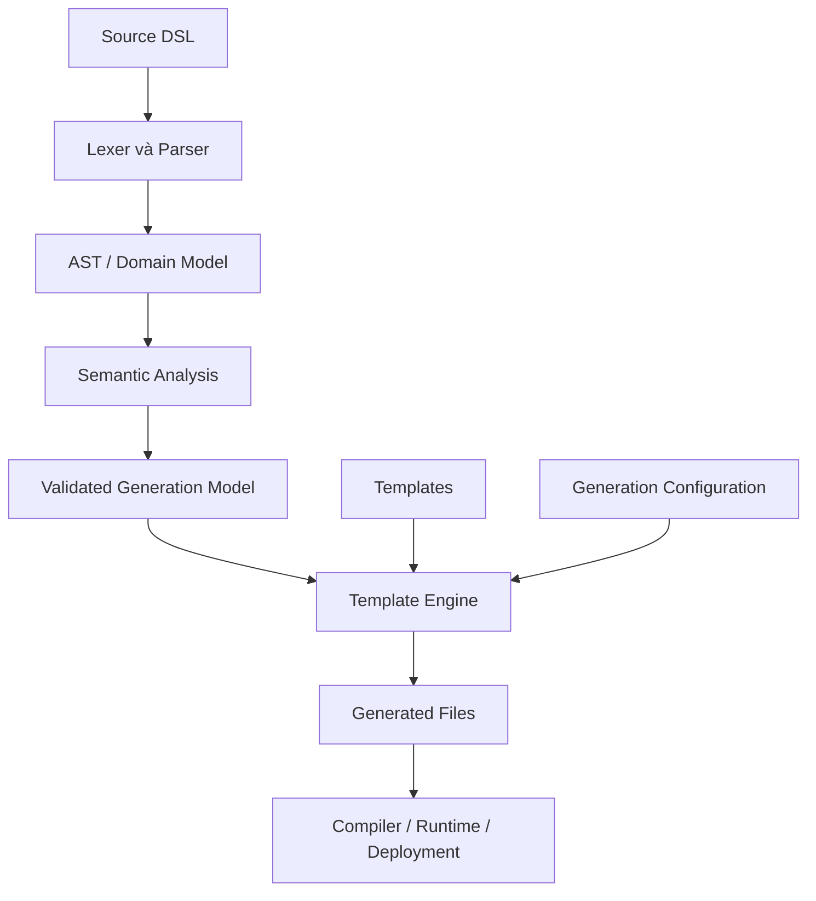

# Mẫu sinh mã

Trong ngôn ngữ chuyên biệt miền (Domain-Specific Language, DSL), **sinh mã (code generation)** là quá trình chuyển chương trình hoặc mô hình DSL thành một dạng đầu ra khác để biên dịch, thực thi, triển khai hoặc tích hợp với hệ thống khác. Đầu ra có thể là mã Java, Kotlin, TypeScript, SQL, YAML, JSON, cấu hình hạ tầng, định nghĩa API hoặc một ngôn ngữ trung gian.

Một cách triển khai phổ biến là dùng **mẫu sinh mã (code generation template)**. Template mô tả cấu trúc văn bản đầu ra và những vị trí sẽ được điền bằng dữ liệu lấy từ mô hình DSL. Nó có thể chứa placeholder, biểu thức, vòng lặp, điều kiện và lời gọi template con. Bộ sinh mã cung cấp context gồm các lớp, thuộc tính, quan hệ, tên đã phân giải và thông tin cấu hình; template đọc context đó để tạo ra nội dung đích.

Ví dụ, một DSL mô tả dịch vụ có thể khai báo:

```text
service DonHang {
    id: OrderId
    tongTien: Money
    trangThai: TrangThaiDonHang
}
```

Một template Java có thể chuyển khai báo này thành lớp `DonHang` với các trường, constructor, getter hoặc annotation tương ứng. Một template TypeScript khác có thể tạo interface để phía giao diện sử dụng. Cùng một mô hình nguồn có thể sinh nhiều loại đầu ra nếu mỗi template định nghĩa rõ hợp đồng chuyển đổi.

Mẫu sinh mã giúp tách cấu trúc đầu ra khỏi logic phân tích DSL. Tuy nhiên, template không tự bảo đảm mã được sinh là đúng. Thiết kế tốt cần xác định rõ dữ liệu đầu vào, quy tắc đặt tên, escaping, xử lý kiểu, cách tổ chức file, định dạng đầu ra và cách kiểm tra sản phẩm được sinh.

## 1. Mẫu sinh mã là gì?

Template là một tài liệu hoặc cấu trúc khai báo có chứa văn bản cố định cùng những phần động. Khi render, engine thay placeholder bằng giá trị, duyệt danh sách, chọn nhánh điều kiện và kết hợp các đoạn đầu ra thành văn bản cuối cùng.

Ví dụ template đơn giản:

```text
public class {{ className }} {
{{#each fields}}
    private {{ type }} {{ name }};
{{/each}}
}
```

Nếu context có `className = DonHang` và hai trường `id: OrderId`, `tongTien: Money`, đầu ra có thể là:

```java
public class DonHang {
    private OrderId id;
    private Money tongTien;
}
```

Ký hiệu `{{...}}` và `{{#each ...}}` chỉ là cú pháp minh họa. Mỗi template engine có quy tắc riêng về placeholder, vòng lặp, điều kiện, include và escaping.

### 1.1. Thành phần của một hệ thống template

Một hệ thống mẫu sinh mã thường có các thành phần:

- **Template source:** Nội dung mẫu quy định hình dạng đầu ra.
- **Template engine:** Thành phần đọc template và đánh giá các biểu thức động.
- **Context/model:** Dữ liệu mà template được phép truy cập.
- **Helper/function:** Các hàm hỗ trợ đổi tên, định dạng kiểu, escape hoặc tạo giá trị dẫn xuất.
- **Renderer:** Thành phần phối hợp engine, context và template để tạo văn bản.
- **Output writer:** Ghi kết quả thành file, stream hoặc vùng nhớ.
- **Generation configuration:** Cấu hình target language, package, namespace, thư mục và tùy chọn sinh mã.

### 1.2. Template và chương trình DSL

Chương trình DSL là dữ liệu nguồn mà người dùng viết để mô tả miền. Template là quy tắc chuyển đổi được nhóm phát triển DSL hoặc người tích hợp định nghĩa. Người dùng DSL thường không cần chỉnh template trong mỗi lần sử dụng; họ cung cấp model, còn generator áp dụng template phù hợp.

### 1.3. Template và mã nguồn được sinh

Mã nguồn được sinh là kết quả render tại một lần chạy cụ thể. Template có thể dùng lại cho nhiều model; một model có thể được render bằng nhiều template. Khi template thay đổi, cùng một model có thể tạo ra đầu ra khác, vì vậy template và phiên bản generator là một phần của quy trình build.

## 2. Vị trí của template trong kiến trúc sinh mã

Một pipeline sinh mã thường bắt đầu từ văn bản DSL, qua parsing và semantic analysis, rồi chuyển mô hình đã kiểm tra sang template engine.



### 2.1. Parsing và semantic analysis

Parser tạo AST hoặc model từ chương trình DSL. Semantic analysis phân giải tên, kiểm tra kiểu, quan hệ và ràng buộc miền. Generator nên nhận dữ liệu đã được xác minh ở mức cần thiết để tránh tạo ra mã từ tham chiếu không hợp lệ.

### 2.2. Generation model

Không nhất thiết template phải truy cập trực tiếp AST thô. Một lớp trung gian có thể chuẩn hóa dữ liệu thành generation model, ví dụ:

- Tên lớp và package đã được chuẩn hóa.
- Kiểu đích đã ánh xạ từ kiểu miền.
- Danh sách import cần thiết.
- Quan hệ cha/con đã được phân giải.
- Tên file đầu ra.
- Annotation hoặc metadata cần phát sinh.

Generation model giúp template đơn giản hơn và giảm việc lặp lại logic chuyển đổi ở nhiều template.

### 2.3. Render và ghi file

Template engine tạo chuỗi đầu ra. Output writer chịu trách nhiệm xác định file, mã hóa ký tự, tạo thư mục, xử lý file trùng tên và ghi nội dung. Nên tách bước render khỏi bước ghi file để có thể kiểm tra hoặc xem trước đầu ra trước khi thay đổi filesystem.

### 2.4. Biên dịch hoặc thực thi đầu ra

Sinh văn bản thành công không chứng minh đầu ra hợp lệ. Mã Java vẫn cần compile; SQL cần được kiểm tra theo dialect và schema; YAML cần được parse; cấu hình triển khai cần được xác minh theo công cụ đích. Đây là bước kiểm chứng đầu ra trong pipeline riêng.

## 3. Các loại template

Template có thể được tổ chức theo phạm vi và mục đích khác nhau.

### 3.1. Template file

Template file tạo một file đầu ra hoàn chỉnh, chẳng hạn một lớp Java, một file cấu hình hoặc một migration SQL. Mỗi template thường chịu trách nhiệm cho một loại artifact.

### 3.2. Template fragment

Fragment là đoạn nhỏ được tái sử dụng bên trong template khác, ví dụ khai báo một trường, một phương thức, một annotation hoặc một khối import. Fragment giúp tránh lặp cấu trúc và giữ định dạng nhất quán.

### 3.3. Template group

Template group gom các template liên quan để tạo một tập file nhất quán. Ví dụ nhóm `java-service` có template cho entity, repository, service, controller và test.

### 3.4. Template theo target platform

Một model có thể sinh ra nhiều target:

| Target | Đầu ra có thể tạo |
|---|---|
| Java | Class, enum, interface, annotation |
| TypeScript | Type, interface, client, validator |
| SQL | DDL, index, migration, query |
| JSON/YAML | Cấu hình, manifest, metadata |
| OpenAPI | Định nghĩa endpoint và schema |
| Terraform/HCL | Khai báo tài nguyên hạ tầng |
| C/C++ | Header và source file |

### 3.5. Template tĩnh và template có logic

Template tĩnh chủ yếu thay placeholder. Template có logic hỗ trợ điều kiện, vòng lặp, gọi fragment và xử lý biểu thức. Logic càng nhiều thì template càng linh hoạt nhưng cũng khó đọc, khó kiểm thử và dễ chứa quy tắc nghiệp vụ không nên đặt ở tầng trình bày.

## 4. Placeholder và binding dữ liệu

Placeholder là vị trí trong template được thay bằng giá trị từ context.

### 4.1. Placeholder đơn giản

Ví dụ:

```text
package {{ packageName }};

public class {{ className }} {
}
```

Engine tìm `packageName` và `className` trong context rồi thay bằng giá trị tương ứng.

### 4.2. Truy cập thuộc tính lồng nhau

Context có thể chứa object lồng nhau:

```text
model.name
model.package.name
model.metadata.version
```

Khả năng truy cập và cú pháp cụ thể tùy engine. Cần xác định hành vi khi một phần tử không tồn tại hoặc có giá trị null.

### 4.3. Giá trị mặc định

Một placeholder có thể hỗ trợ giá trị mặc định:

```text
{{ classDescription | default("Generated model") }}
```

Giá trị mặc định phù hợp với metadata tùy chọn. Không nên dùng default để che giấu một thuộc tính bắt buộc bị thiếu trong generation model.

### 4.4. Binding có kiểu

Context có thể được định nghĩa bằng kiểu rõ ràng thay vì một map tùy ý. Ví dụ:

```java
record ClassContext(
    String packageName,
    String className,
    List<FieldContext> fields
) {}

record FieldContext(
    String typeName,
    String fieldName
) {}
```

Kiểu context giúp compiler hoặc generator phát hiện dữ liệu thiếu và giảm lỗi do đánh sai tên placeholder.

### 4.5. Phạm vi biến

Trong vòng lặp, template engine thường tạo một scope cho phần tử hiện tại. Cần biết placeholder tham chiếu đến phần tử lặp hay context cha. Cú pháp như `this`, `item`, `parent` hoặc `../name` khác nhau theo engine.

### 4.6. Null và giá trị thiếu

Template cần phân biệt thuộc tính không tồn tại, thuộc tính null, chuỗi rỗng và danh sách rỗng. Nếu engine tự thay mọi trường hợp bằng chuỗi rỗng, lỗi thiếu dữ liệu có thể khó phát hiện. Với trường bắt buộc, nên xác thực context trước khi render.

## 5. Điều kiện trong template

Điều kiện cho phép sinh các đoạn đầu ra khác nhau dựa trên đặc điểm của model hoặc cấu hình.

Ví dụ:

```text
public class {{ className }} {
{{#if hasIdentifier}}
    private String id;
{{/if}}
}
```

### 5.1. Điều kiện Boolean

Điều kiện đơn giản kiểm tra cờ như `isAbstract`, `isDeprecated`, `hasDefaultValue` hoặc `isNullable`. Boolean nên được chuẩn hóa trong generation model để template không phải suy luận từ chuỗi.

### 5.2. Điều kiện nhiều nhánh

Template có thể hỗ trợ `if/else` hoặc `switch`:

```text
{{#if isEnum}}
    // render enum
{{else if isInterface}}
    // render interface
{{else}}
    // render class
{{/if}}
```

Cú pháp trên chỉ mang tính minh họa. Nếu nhiều nhánh đại diện cho những loại model khác nhau, có thể tách thành các template riêng thay vì nhồi nhiều nhánh vào một file.

### 5.3. Điều kiện theo target

Một template group có thể sinh khác nhau theo phiên bản Java, SQL dialect hoặc runtime target. Ví dụ, một kiểu có thể được ánh xạ sang `record` ở phiên bản Java mới, còn phiên bản cũ cần class thông thường.

Nên truyền target capability đã được xác định trong cấu hình thay vì để template tự dò môi trường không rõ ràng.

### 5.4. Điều kiện lồng nhau

Điều kiện lồng nhau có thể cần thiết, nhưng nếu quá sâu sẽ khó đọc. Có thể đưa logic quyết định vào generation model thành cờ rõ nghĩa như `needsNullCheck` hoặc `supportsBuilder`.

## 6. Vòng lặp và duyệt mô hình

Vòng lặp cho phép template sinh nhiều phần tử từ một collection trong model.

Ví dụ:

```text
public class {{ className }} {
{{#each attributes}}
    private {{ targetType }} {{ targetName }};
{{/each}}
}
```

### 6.1. Duyệt thuộc tính

Một lớp DSL có thể có nhiều thuộc tính. Template lặp qua danh sách để sinh field, getter, setter, constructor parameter hoặc schema property.

### 6.2. Duyệt quan hệ

Template có thể duyệt quan hệ để tạo import, association field, foreign key hoặc navigation method. Quan hệ cần được phân giải và xác định hướng trước khi render.

### 6.3. Duyệt lồng nhau

Một model có thể có package chứa nhiều class, class chứa nhiều attribute và attribute có annotation. Template có thể lặp lồng nhau, nhưng cần giới hạn độ sâu và đặt tên biến vòng lặp rõ ràng.

### 6.4. Separator và phần tử đầu/cuối

Sinh danh sách thường cần dấu phẩy, dấu phẩy cuối hoặc xuống dòng. Engine có thể cung cấp `join`, `separator` hoặc biến trạng thái như `isLast`. Nên dùng cơ chế có sẵn thay vì thêm dấu phân cách bằng điều kiện phức tạp.

Ví dụ tạo danh sách tham số:

```text
({{#each parameters as p}}{{p.type}} {{p.name}}{{#unless p.last}}, {{/unless}}{{/each}})
```

### 6.5. Thứ tự duyệt ổn định

Nếu collection đến từ map hoặc cấu trúc không bảo đảm thứ tự, output có thể thay đổi giữa các lần build. Nên chuẩn hóa thứ tự theo quy tắc được công bố, ví dụ thứ tự khai báo, tên hoặc dependency order.

### 6.6. Đồ thị và vòng phụ thuộc

Không phải mọi mô hình đều là cây. Các lớp có thể tham chiếu lẫn nhau. Nếu generator cần sinh theo thứ tự dependency, phải phát hiện chu trình và quyết định cách xử lý: forward declaration, tham chiếu tên, chia nhiều giai đoạn hoặc báo lỗi nếu chu trình không được phép.

## 7. Include, import và template fragment

Template lớn nên được chia thành những phần có thể tái sử dụng.

### 7.1. Include template

Một template có thể include fragment:

```text
{{> common/header}}

public class {{ className }} {
    {{> common/fields}}
}
```

Fragment có thể chứa phần header, field hoặc annotation dùng chung. Cú pháp include phụ thuộc engine.

### 7.2. Truyền context cho fragment

Fragment có thể nhận toàn bộ context cha hoặc một object cụ thể. Truyền context tối thiểu giúp fragment ít phụ thuộc và dễ kiểm thử.

Ví dụ, `fieldDeclaration` chỉ cần `FieldContext`, không cần truy cập toàn bộ project.

### 7.3. Macro và helper

Macro có thể nhận tham số và tạo đoạn template có thể gọi nhiều lần. Helper thường là hàm xử lý dữ liệu, ví dụ `camelCase`, `escapeJavaString`, `toJavaType` hoặc `formatComment`.

### 7.4. Tránh phụ thuộc vòng giữa template

Nếu template A include B và B lại include A, engine có thể đệ quy vô hạn hoặc báo lỗi. Cần xác định đồ thị include và kiểm tra chu trình khi nạp template.

### 7.5. Tổ chức thư mục

Một cấu trúc minh họa:

```text
templates/
  java/
    class.tpl
    enum.tpl
    interface.tpl
    fragments/
      header.tpl
      imports.tpl
      fields.tpl
      accessors.tpl
  typescript/
    interface.tpl
    client.tpl
  sql/
    schema.tpl
    migration.tpl
```

Tổ chức theo target và vai trò giúp người phát triển tìm đúng template, giới hạn include và quản lý phiên bản.

## 8. Context và mô hình dữ liệu cho template

Template chỉ dễ bảo trì khi context có cấu trúc ổn định và tên gọi có ý nghĩa.

### 8.1. Context tối thiểu

Ví dụ context cho class generator:

```json
{
  "packageName": "com.example.orders",
  "className": "DonHang",
  "visibility": "public",
  "fields": [
    { "name": "id", "type": "OrderId", "nullable": false },
    { "name": "tongTien", "type": "Money", "nullable": false }
  ]
}
```

Đây là dữ liệu minh họa. Trong triển khai thật, context nên có schema hoặc kiểu tương ứng.

### 8.2. Tách model nguồn và generation context

Model nguồn phản ánh khái niệm DSL. Generation context phản ánh dữ liệu cần thiết cho một target cụ thể. Ví dụ, model nguồn có kiểu miền `Money`, còn context Java đã ánh xạ thành `Money` và thêm import `com.example.money.Money`.

Tách hai tầng giúp thay đổi target language mà không làm biến dạng mô hình miền.

### 8.3. Chuẩn hóa tên

Tên trong DSL có thể là `tong_tien`, còn tên Java cần `tongTien` và tên SQL cần `tong_tien`. Helper hoặc bước chuẩn hóa cần định nghĩa rõ:

- camelCase cho biến và thuộc tính.
- PascalCase cho class và type.
- UPPER_SNAKE_CASE cho hằng số nếu target yêu cầu.
- Quy tắc xử lý từ khóa dành riêng.
- Quy tắc giữ hoặc loại bỏ ký tự Unicode.
- Quy tắc tránh xung đột sau chuẩn hóa.

Hai tên DSL khác nhau có thể biến thành cùng một tên đích. Generator phải phát hiện collision thay vì ghi đè hoặc tạo mã không biên dịch.

### 8.4. Kiểu đích

Ánh xạ kiểu nên được thực hiện tập trung. Ví dụ:

| Kiểu DSL | Java minh họa | TypeScript minh họa |
|---|---|---|
| `Integer` | `int` hoặc `Integer` | `number` |
| `Decimal` | `BigDecimal` | `number` hoặc decimal type |
| `Boolean` | `boolean` | `boolean` |
| `String` | `String` | `string` |
| `Date` | `LocalDate` | `string` hoặc date abstraction |
| `Money` | `Money` | `Money` |
| `List<T>` | `List<T>` | `T[]` |

Ánh xạ chính xác phụ thuộc runtime và hợp đồng miền. Không nên mặc định dùng kiểu số dấu phẩy động cho tiền tệ nếu yêu cầu độ chính xác thập phân.

### 8.5. Context bất biến

Nếu template engine chỉ đọc context, nên cung cấp object bất biến hoặc snapshot. Điều này tránh một helper vô tình sửa model trong lúc render và làm kết quả phụ thuộc thứ tự template.

## 9. Escaping và an toàn khi sinh mã

Template thường chèn dữ liệu do người dùng cung cấp vào đầu ra. Nếu không escape đúng theo ngữ cảnh, đầu ra có thể sai cú pháp hoặc tạo lỗ hổng injection.

### 9.1. Escaping theo ngôn ngữ đích

Escape HTML khác escape Java string, SQL literal, JSON string hoặc YAML scalar. Không có một hàm escape dùng an toàn cho mọi target.

Ví dụ, tên hoặc mô tả có dấu nháy kép cần được escape nếu được đặt trong Java string:

```text
description = "Người dùng nói: \"Xin chào\""
```

Template nên gọi helper chuyên biệt như `escapeJavaString` thay vì tự thay dấu nháy bằng một chuỗi đơn giản.

### 9.2. SQL injection

Nếu generator tạo SQL từ dữ liệu người dùng, cần phân biệt identifier, literal và parameter. Với câu truy vấn runtime, ưu tiên prepared statement và bind parameter. Với DDL phải sinh identifier, cần validate theo quy tắc dialect và quote identifier đúng cách.

### 9.3. Identifier injection

Một tên lớp hoặc cột có thể chứa ký tự không hợp lệ hoặc từ khóa dành riêng của target. Generator cần validate và chuẩn hóa identifier, đồng thời kiểm tra collision.

### 9.4. Path traversal

Nếu tên model được dùng để tạo đường dẫn file, giá trị như `../../outside` không được phép quyết định tùy ý vị trí ghi. Output path cần được tạo từ root đã cấu hình, chuẩn hóa và xác minh nằm trong thư mục đích.

### 9.5. Template injection

Nếu người dùng DSL được phép cung cấp template, engine có thể vô tình cho template truy cập filesystem, mạng hoặc thực thi mã tùy ý. Cần sandbox, giới hạn helper, giới hạn thời gian và quyền truy cập dữ liệu. Không nên đưa toàn bộ đối tượng ứng dụng vào context nếu template chỉ cần một số trường.

### 9.6. Tin cậy template và tin cậy dữ liệu

Template do nhóm phát triển kiểm soát vẫn có thể nhận dữ liệu không đáng tin cậy từ model. Ngược lại, template do người dùng cung cấp cần được xem là mã có thể thực thi theo khả năng của engine. Hai nguồn rủi ro này cần được xử lý riêng.

## 10. Whitespace và định dạng đầu ra

Template sinh mã phải kiểm soát xuống dòng, thụt lề và khoảng trắng để đầu ra dễ đọc và ổn định.

### 10.1. Whitespace control

Một số engine hỗ trợ trim whitespace trước hoặc sau directive. Cơ chế này có thể hữu ích khi vòng lặp hoặc điều kiện tạo ra dòng trống không cần thiết.

Không nên trim toàn bộ whitespace một cách mù quáng vì nó có thể làm hỏng literal, chuỗi nhiều dòng hoặc nội dung nhạy cảm với khoảng trắng.

### 10.2. Newline convention

Nên chọn quy ước xuống dòng nhất quán, ví dụ LF, hoặc tuân theo cấu hình dự án. Nếu cùng một generator tạo CRLF trên máy này và LF trên máy khác, diff có thể thay đổi toàn bộ file dù nội dung logic không đổi.

### 10.3. Encoding

Đầu ra cần xác định encoding, thường là UTF-8. Nếu DSL hỗ trợ tiếng Việt hoặc Unicode, phải bảo đảm template engine, writer và compiler đích xử lý nhất quán.

### 10.4. Formatter sau sinh mã

Có thể chạy formatter của ngôn ngữ đích sau khi render, ví dụ Java formatter hoặc Prettier. Formatter giúp chuẩn hóa định dạng nhưng không sửa được lỗi cấu trúc hay kiểu. Cần giữ source mapping nếu muốn chẩn đoán sau format trỏ về template hoặc model nguồn.

### 10.5. Khoảng trắng có ý nghĩa

Trong một số target như YAML, Python hoặc Makefile, thụt lề có thể ảnh hưởng cú pháp. Template cần thể hiện indentation chính xác và kiểm thử với parser của target.

## 11. Sinh nhiều file từ một mô hình

Một model thường tạo ra nhiều artifact. Generator cần quy định cách ánh xạ model sang tập file và tránh ghi đè ngoài ý muốn.

### 11.1. Một model, nhiều file

Ví dụ một service DSL có thể sinh:

```text
generated/
  DonHang.java
  DonHangRepository.java
  DonHangService.java
  DonHangController.java
  DonHangTest.java
```

Mỗi file có thể được tạo từ một template riêng hoặc một template group điều phối nhiều fragment.

### 11.2. Quy tắc tên file

Tên file có thể được suy ra từ tên lớp, package hoặc module. Cần chuẩn hóa separator, chữ hoa/thường và phần mở rộng theo target. Trên filesystem không phân biệt hoa thường, hai tên chỉ khác chữ hoa có thể xung đột.

### 11.3. Thư mục package

Package Java có thể ánh xạ thành đường dẫn `com/example/orders`. Generator cần bảo đảm đường dẫn phản ánh package và không chứa thành phần nguy hiểm.

### 11.4. Xử lý file đã tồn tại

Generator cần có chính sách rõ:

- Ghi đè file do generator quản lý.
- Từ chối ghi đè file không thuộc generator.
- Chỉ cập nhật file nếu nội dung thay đổi.
- Ghi vào thư mục tạm rồi thay thế nguyên tử.
- Đánh dấu file generated để người dùng biết không nên chỉnh sửa trực tiếp.

Không nên ghi đè file do người dùng quản lý nếu không có cơ chế xác định quyền sở hữu và chính sách rõ ràng.

### 11.5. Manifest đầu ra

Generator có thể tạo manifest ghi lại file nào được sinh, từ template nào, phiên bản generator nào và checksum của nội dung. Manifest giúp nhận diện file cũ không còn được sinh ở lần chạy mới.

### 11.6. Xóa file lỗi thời

Nếu model xóa một lớp, file tương ứng có thể không còn được sinh. Generator cần biết file nào do mình sở hữu trước khi xóa. Không nên xóa mọi file trong output directory chỉ vì chúng không xuất hiện trong lần render hiện tại.

## 12. Tính xác định và khả năng tái lập

Một generator xác định (deterministic) tạo cùng đầu ra khi nhận cùng model, template, cấu hình và dependency phiên bản.

### 12.1. Nguồn gây không xác định

Đầu ra có thể thay đổi do:

- Thứ tự duyệt collection không ổn định.
- Timestamp hiện tại được chèn vào header.
- Đường dẫn tuyệt đối phụ thuộc máy.
- Locale hoặc timezone khác nhau.
- Phiên bản template/helper thay đổi mà không được ghi nhận.
- Giá trị ngẫu nhiên hoặc ID sinh tại thời điểm render.

### 12.2. Chuẩn hóa đầu vào

Trước khi render, nên chuẩn hóa thứ tự, tên, kiểu, đơn vị, locale và các giá trị phụ thuộc môi trường. Nếu timestamp cần thiết, nên truyền nó qua generation configuration để có thể cố định khi kiểm thử.

### 12.3. Stable output

Nếu nội dung không đổi, generator nên tạo byte output giống nhau. Điều này giúp Git diff sạch, cache hiệu quả và build có thể tái lập.

### 12.4. Idempotence

Một thao tác sinh mã idempotent khi chạy lại với cùng đầu vào không làm thay đổi trạng thái hoặc nội dung đã sinh sau lần đầu. Không nên thêm comment timestamp mới hoặc sắp xếp import ngẫu nhiên ở mỗi lần chạy.

## 13. Template engine và cách lựa chọn

Có nhiều engine khác nhau. Việc lựa chọn phụ thuộc ngôn ngữ triển khai, độ phức tạp template, khả năng sandbox, hiệu năng và nhu cầu của người viết template.

| Engine / công nghệ | Đặc điểm khái quát | Trường hợp thường gặp |
|---|---|---|
| Mustache | Logic-light, placeholder và section đơn giản | Template cần dễ đọc, ít logic |
| Handlebars | Mở rộng Mustache với helper và block | Sinh văn bản có điều kiện, helper |
| FreeMarker | Template engine Java có biểu thức và directive phong phú | Ứng dụng Java, sinh file cấu hình hoặc mã |
| Velocity | Template engine Java với reference và directive | Hệ thống Java dùng template văn bản |
| StringTemplate | Tập trung vào template sinh mã, tách logic khỏi định dạng | Compiler và code generator |
| Jinja | Template engine phổ biến trong Python | Công cụ Python, cấu hình và mã nguồn |
| Xtend templates | Template trong hệ sinh thái Eclipse/Xtext | DSL dựa trên Xtext/EMF |

### 13.1. Logic-light template

Engine logic-light hạn chế biểu thức và điều khiển trong template. Quyết định phức tạp được thực hiện trong code hoặc generation model. Cách này giúp template tập trung vào hình dạng đầu ra và thường dễ cho người không chuyên lập trình đọc.

### 13.2. Engine giàu biểu thức

Engine có điều kiện, vòng lặp, macro và helper linh hoạt hơn. Chúng phù hợp khi cần tạo nhiều loại artifact, nhưng dễ biến template thành một ngôn ngữ lập trình thứ hai.

### 13.3. Tiêu chí lựa chọn

Hãy cân nhắc:

- Engine có tích hợp tốt với ngôn ngữ triển khai không?
- Template có cần được chỉnh sửa bởi chuyên gia miền không?
- Có hỗ trợ escaping đúng theo target không?
- Có sandbox và giới hạn tài nguyên không?
- Có hỗ trợ template fragment, include và inheritance không?
- Có thể kiểm soát whitespace và source location không?
- Lỗi render có thông báo dòng template rõ ràng không?
- Có thể cache template đã biên dịch không?
- Phiên bản engine có được duy trì và tương thích không?

### 13.4. Không để engine quyết định kiến trúc

Template engine là công cụ render. Nó không thay thế parser, type checker hoặc semantic model. Không nên chọn engine rồi đưa toàn bộ logic ngôn ngữ vào template chỉ vì engine hỗ trợ biểu thức phức tạp.

## 14. Ví dụ sinh mã Java từ DSL

Giả sử DSL định nghĩa:

```text
package don_hang

class DonHang {
    id: OrderId
    tong_tien: Money
    trang_thai: TrangThaiDonHang
}
```

Generation model đã chuẩn hóa:

```json
{
  "packageName": "com.example.order",
  "className": "DonHang",
  "imports": [
    "com.example.types.OrderId",
    "com.example.money.Money",
    "com.example.order.TrangThaiDonHang"
  ],
  "fields": [
    { "type": "OrderId", "name": "id" },
    { "type": "Money", "name": "tongTien" },
    { "type": "TrangThaiDonHang", "name": "trangThai" }
  ]
}
```

Template minh họa:

```text
package {{ packageName }};

{{#each imports}}
import {{ this }};
{{/each}}

public class {{ className }} {
{{#each fields}}
    private {{ type }} {{ name }};
{{/each}}
}
```

Đầu ra:

```java
package com.example.order;

import com.example.types.OrderId;
import com.example.money.Money;
import com.example.order.TrangThaiDonHang;

public class DonHang {
    private OrderId id;
    private Money tongTien;
    private TrangThaiDonHang trangThai;
}
```

Ví dụ minh họa cách binding và lặp. Một generator thực tế cần xử lý import trùng, import cùng package, constructor, visibility, nullability, annotation và quy tắc đặt tên theo target.

### 14.1. Tách template theo trách nhiệm

Thay vì tạo một template rất dài, có thể tách thành `classHeader`, `imports`, `fieldDeclarations`, `constructors` và `accessors`. Template chính chỉ điều phối các fragment.

### 14.2. Không tạo import trực tiếp từ chuỗi không được kiểm tra

Tên kiểu và package phải đến từ type mapping đã xác thực. Nếu template nối một chuỗi tùy ý vào dòng import, đầu ra có thể sai cú pháp hoặc chứa nội dung không mong muốn.

## 15. Ví dụ sinh SQL và cấu hình

Template không chỉ sinh mã lập trình. Nó cũng có thể tạo schema, migration hoặc file cấu hình.

### 15.1. Sinh DDL

Một model:

```text
entity DonHang {
    id: UUID primary
    tong_tien: Decimal(18, 2) required
    trang_thai: String(30) required
}
```

Template SQL khái niệm:

```text
CREATE TABLE {{ tableName }} (
{{#each columns}}
    {{ quoteIdentifier(name) }} {{ sqlType }}{{ constraints }}{{#unless last}},{{/unless}}
{{/each}}
);
```

Đầu ra minh họa:

```sql
CREATE TABLE don_hang (
    id UUID PRIMARY KEY,
    tong_tien DECIMAL(18, 2) NOT NULL,
    trang_thai VARCHAR(30) NOT NULL
);
```

`quoteIdentifier` và `sqlType` phải phụ thuộc dialect. SQL Server, PostgreSQL và MySQL có quy tắc identifier và kiểu dữ liệu khác nhau.

### 15.2. Sinh YAML

Template YAML có thể tạo manifest hoặc cấu hình triển khai. Do YAML nhạy với indentation và kiểu scalar, cần dùng serializer an toàn khi dữ liệu phức tạp thay vì nối chuỗi thủ công ở mọi vị trí.

### 15.3. Sinh JSON

JSON yêu cầu escape chuỗi và dấu điều khiển chính xác. Nếu đầu ra là JSON thuần, serializer thường an toàn và dễ bảo trì hơn một template văn bản tự ghép dấu ngoặc.

### 15.4. Sinh OpenAPI

Một DSL endpoint có thể sinh OpenAPI schema, path, operation, request body và response. Template nên nhận model đã phân giải kiểu và tham chiếu, không tự suy đoán schema từ tên trường.

## 16. Template inheritance và mở rộng generator

Một số engine hỗ trợ template kế thừa hoặc override fragment. Điều này hữu ích khi một generator có template mặc định nhưng dự án cần thay đổi một phần đầu ra.

### 16.1. Base template

Base template định nghĩa cấu trúc chung, ví dụ header, package, imports và vùng nội dung. Template con có thể ghi đè block cụ thể.

### 16.2. Override có kiểm soát

Cho phép dự án thay template giúp tùy biến nhưng có nguy cơ làm đầu ra khác với generator mặc định. Cần xác định API extension ổn định và versioning cho các block có thể override.

### 16.3. Plugin generator

Một plugin có thể đăng ký target mới, template group hoặc helper bổ sung. Plugin cần khai báo phiên bản tương thích, quyền truy cập context và danh sách file được phép sinh.

### 16.4. Template customization và fork

Copy toàn bộ template mặc định để chỉnh sửa có thể tạo gánh nặng khi nâng phiên bản. Ưu tiên override điểm mở rộng nhỏ nếu generator cung cấp. Nếu phải fork, cần ghi nhận nguồn gốc và cách đồng bộ thay đổi.

### 16.5. Không để customization phá hợp đồng

Một template tùy chỉnh vẫn phải tạo output tuân theo hợp đồng target. Generator có thể kiểm tra schema, compile hoặc validate artifact sau render để phát hiện customization không tương thích.

## 17. Lỗi trong quá trình render template

Lỗi render khác với lỗi cú pháp DSL. Nó có thể xuất phát từ template sai, context thiếu, helper lỗi hoặc đầu ra không thể ghi.

### 17.1. Template syntax error

Template có thể thiếu dấu đóng block, dùng sai cú pháp include hoặc biểu thức không hợp lệ. Engine thường phát lỗi khi nạp hoặc biên dịch template.

### 17.2. Missing variable

Template tham chiếu `classNmae` thay vì `className`. Nếu engine trả chuỗi rỗng, đầu ra có thể sai mà không có lỗi rõ ràng. Với placeholder quan trọng, nên bật chế độ strict để báo biến không tồn tại.

### 17.3. Helper failure

Helper chuyển kiểu hoặc escape có thể thất bại khi nhận giá trị không hợp lệ. Lỗi nên nêu tên helper và vị trí trong template.

### 17.4. Include không tìm thấy

Template con có thể bị thiếu hoặc đường dẫn include sai. Engine cần báo tên template và nguồn gọi include.

### 17.5. Output failure

Render có thể thành công nhưng ghi file thất bại do quyền, đường dẫn, dung lượng hoặc file bị khóa. Cần phân biệt lỗi render với lỗi filesystem.

### 17.6. Error context

Một lỗi render hữu ích nên gồm tên template, dòng/cột template, tên biến hoặc helper liên quan, tên model đang xử lý và target. Không nên chỉ trả stack trace nội bộ cho người dùng DSL.

## 18. Kiểm soát lỗi và tính hợp lệ trước khi sinh

Template không nên là nơi đầu tiên phát hiện mọi vấn đề của model. Nhiều điều kiện cần được kiểm tra trước khi render.

### 18.1. Validate generation model

Trước khi gọi engine, kiểm tra các trường bắt buộc, tên file, package, kiểu đích và quan hệ. Nếu thiếu dữ liệu, tạo diagnostic có nguồn gốc từ model thay vì để template thất bại ở placeholder bất kỳ.

### 18.2. Phân biệt lỗi semantic và lỗi template

Nếu model tham chiếu kiểu không tồn tại, đó là lỗi semantic. Nếu template gọi helper không tồn tại, đó là lỗi template. Mã lỗi và hướng sửa khác nhau.

### 18.3. Strict mode

Trong strict mode, placeholder không tồn tại, include lỗi hoặc chuyển đổi không hợp lệ nên làm render thất bại. Chế độ permissive có thể hữu ích cho preview hoặc editor, nhưng không nên âm thầm tạo artifact production thiếu dữ liệu.

### 18.4. Render theo giao dịch

Với nhiều file, nên render tất cả vào vùng tạm trước. Nếu một template thất bại, có thể không công bố tập file dở dang. Sau khi toàn bộ output được xác thực, writer mới thay thế file đích theo chính sách an toàn.

### 18.5. Không thực thi mã chưa xác thực

Nếu đầu ra là script hoặc cấu hình có thể gây tác động, cần có bước review/validation trước khi áp dụng. Việc render thành công chỉ chứng minh template đã tạo văn bản, không chứng minh hành động đích là an toàn hoặc đúng.

## 19. Source mapping và truy vết mã được sinh

Khi mã đích phát sinh lỗi biên dịch, người dùng thường cần biết lỗi bắt nguồn từ khai báo DSL hoặc template nào.

### 19.1. Source map

Source map ánh xạ vị trí trong output về vị trí nguồn, template hoặc model element. Nó có thể lưu file nguồn, source span, template name và node ID.

### 19.2. Comment đánh dấu nguồn

Một cách đơn giản là chèn comment:

```java
// Generated from DSL element: DonHang.tongTien
private Money tongTien;
```

Comment giúp truy vết nhưng làm tăng output và có thể không phù hợp với mọi target. Source map riêng linh hoạt hơn khi cần giữ đầu ra sạch.

### 19.3. Chẩn đoán ngược

Nếu compiler đích báo lỗi ở dòng 42 của file sinh, generator có thể dùng mapping để chỉ về template fragment hoặc thuộc tính DSL đã tạo dòng đó. Điều này đặc biệt hữu ích khi người dùng không được khuyến khích sửa trực tiếp file generated.

### 19.4. Mapping sau formatter

Formatter có thể thay đổi số dòng và vị trí. Nếu cần chẩn đoán ngược sau format, cần cập nhật source map hoặc dùng formatter có hỗ trợ mapping. Nếu không, thông báo nên chỉ rõ vị trí trong file generated và hướng dẫn truy cập template/model liên quan.

## 20. Kiểm thử template và generator

Template là một phần của chương trình sinh mã nên cần được kiểm thử bằng đầu vào đại diện và đầu ra mong đợi.

### 20.1. Unit test cho fragment

Kiểm tra fragment riêng với context nhỏ. Ví dụ field fragment phải tạo đúng kiểu, tên, visibility và annotation.

### 20.2. Golden file test

Golden test render một model mẫu rồi so sánh output với file chuẩn đã lưu. Khi output thay đổi, diff giúp reviewer thấy chính xác nội dung nào đổi.

### 20.3. Kiểm thử ranh giới

Bao gồm model rỗng, một thuộc tính, nhiều thuộc tính, tên Unicode, tên trùng sau chuẩn hóa, giá trị null, danh sách rỗng và quan hệ lồng nhau.

### 20.4. Kiểm thử target compiler/parser

Đầu ra Java nên được compile; JSON/YAML nên được parse; SQL nên được kiểm tra theo dialect hoặc chạy trên schema kiểm thử phù hợp. Kiểm thử render string đơn thuần không phát hiện mọi lỗi cú pháp đích.

### 20.5. Kiểm thử bảo mật

Thử dữ liệu có dấu nháy, ký tự điều khiển, dấu phân cách, tên chứa path segment và nội dung có thể gây injection. Xác minh escape và validation theo đúng target.

### 20.6. Kiểm thử tính xác định

Render cùng context nhiều lần và so sánh byte output. Nếu thứ tự collection hoặc timestamp làm thay đổi đầu ra, cần xác định đó là hành vi mong muốn hay lỗi.

### 20.7. Kiểm thử compatibility

Khi thay engine hoặc template, kiểm tra output cũ, plugin và template override. Có thể lưu fixture theo phiên bản target để phát hiện thay đổi ngoài dự kiến.

### 20.8. Kiểm thử hiệu năng

Với model lớn, đo thời gian render, số file, dung lượng output và bộ nhớ. Template lồng sâu hoặc helper có truy vấn lặp lại có thể tạo chi phí lớn.

## 21. Quản lý phiên bản template

Template quyết định hình dạng output, do đó thay đổi template có thể làm thay đổi API, schema hoặc hành vi của artifact.

### 21.1. Version generator

Ghi phiên bản generator hoặc template bundle trong manifest. Điều này giúp xác định đầu ra được tạo từ quy tắc nào.

### 21.2. Thay đổi tương thích

Đổi tên field đích, đổi package, thay kiểu dữ liệu hoặc thay cấu trúc JSON có thể phá vỡ consumer. Cần phân loại thay đổi breaking và non-breaking.

### 21.3. Migration template

Khi thay đổi lớn, có thể cung cấp migration guide, compatibility template hoặc tool chuyển model. Không nên kỳ vọng người dùng tự đoán vì sao đầu ra mới khác.

### 21.4. Khóa phiên bản dependency

Nếu template phụ thuộc helper hoặc library bên ngoài, cần khóa phiên bản. Một helper đổi hành vi có thể làm output khác dù template không thay đổi.

### 21.5. Template provenance

Manifest có thể ghi tên template, version, checksum, target language và cấu hình. Provenance hỗ trợ audit, debug và tái tạo đầu ra.

## 22. Quy trình xây dựng mẫu sinh mã

Một quy trình có thể triển khai theo các bước:

1. **Xác định đầu ra:** Chọn ngôn ngữ, định dạng, runtime và artifact cần sinh.
2. **Xác định hợp đồng model:** Liệt kê dữ liệu, kiểu, quan hệ và metadata template cần.
3. **Thiết kế generation model:** Chuẩn hóa tên, kiểu đích, import, thứ tự và đường dẫn.
4. **Chọn template engine:** Cân nhắc cú pháp, helper, sandbox, tích hợp và khả năng bảo trì.
5. **Tạo template nhỏ:** Bắt đầu từ file hoặc fragment có trách nhiệm rõ.
6. **Định nghĩa helper:** Tập trung mapping type, escaping, naming và formatting.
7. **Xác thực context:** Kiểm tra dữ liệu bắt buộc trước khi render.
8. **Render vào vùng tạm:** Tạo output mà chưa ghi đè file đích.
9. **Kiểm tra đầu ra:** Parse, compile hoặc validate theo target.
10. **Ghi file có kiểm soát:** Áp dụng chính sách ghi đè, manifest và cleanup.
11. **Kiểm thử và tài liệu hóa:** Lưu fixture, golden output và mô tả điểm mở rộng.
12. **Quản lý phiên bản:** Ghi nhận thay đổi template và compatibility.

Quy trình này có thể lặp lại khi target hoặc mô hình DSL mở rộng.

## 23. Những sai lầm thường gặp

### 23.1. Đưa quá nhiều logic nghiệp vụ vào template

Template nên mô tả hình dạng output. Quyết định về kiểu, quyền, quan hệ và quy tắc miền nên được xử lý trong semantic analysis hoặc generation model.

### 23.2. Truy cập AST thô ở mọi nơi

Nếu mỗi template tự đi qua AST và tự ánh xạ kiểu, logic bị lặp và khó đồng bộ. Nên chuẩn hóa dữ liệu cần thiết trước khi render.

### 23.3. Không kiểm tra placeholder thiếu

Biến không tồn tại có thể trở thành chuỗi rỗng và tạo mã sai. Bật strict mode hoặc validate context.

### 23.4. Dùng một hàm escape cho mọi target

Escape Java, SQL, JSON, YAML và HTML có quy tắc khác nhau. Cần helper riêng theo ngữ cảnh.

### 23.5. Sinh tên và đường dẫn trực tiếp từ dữ liệu

Tên có thể chứa từ khóa, ký tự không hợp lệ hoặc path traversal. Cần chuẩn hóa, validate và kiểm tra collision.

### 23.6. Không ổn định thứ tự đầu ra

Collection không có thứ tự có thể làm file thay đổi ở mỗi lần build. Cần quy tắc sắp xếp nhất quán.

### 23.7. Ghi file từng phần khi render còn lỗi

Nếu một file được ghi trước khi template khác thất bại, output directory có thể ở trạng thái nửa cũ nửa mới. Nên render và validate vào vùng tạm trước khi công bố.

### 23.8. Sửa trực tiếp file generated

Lần sinh tiếp theo có thể ghi đè thay đổi thủ công. Nên dùng extension point, template override hoặc vùng mã do người dùng quản lý.

### 23.9. Không kiểm tra bằng compiler hoặc parser đích

Template render thành công không đồng nghĩa mã đích hợp lệ. Cần kiểm tra theo công cụ target thích hợp trong pipeline kiểm thử của generator.

### 23.10. Không quản lý phiên bản template

Thay đổi template có thể làm output thay đổi lớn. Cần ghi version và mô tả tác động để người dùng có thể tái tạo và di trú.

## 24. Thuật ngữ cần nhớ

| Thuật ngữ | Ý nghĩa |
|---|---|
| Code Generation | Quá trình chuyển model hoặc chương trình DSL thành đầu ra khác |
| Template | Mẫu văn bản có phần cố định và phần động |
| Template Engine | Thành phần đánh giá template với context để tạo đầu ra |
| Placeholder | Vị trí nhận giá trị từ context |
| Context | Dữ liệu được cung cấp cho template |
| Helper | Hàm hỗ trợ xử lý dữ liệu hoặc định dạng trong template |
| Fragment / Partial | Đoạn template nhỏ có thể tái sử dụng |
| Template Group | Nhóm template phối hợp tạo nhiều artifact |
| Generation Model | Mô hình trung gian đã chuẩn hóa cho một target |
| Target Language | Ngôn ngữ hoặc định dạng đầu ra |
| Escaping | Chuyển ký tự theo quy tắc của ngữ cảnh đích |
| Strict Mode | Chế độ báo lỗi khi placeholder hoặc dữ liệu bắt buộc không tồn tại |
| Golden File Test | Kiểm thử bằng cách so sánh đầu ra với file chuẩn |
| Deterministic Generation | Cùng đầu vào và cấu hình tạo cùng đầu ra |
| Idempotence | Chạy lại cùng thao tác không làm thay đổi kết quả đã ổn định |
| Source Map | Ánh xạ vị trí output về nguồn, template hoặc model |
| Template Provenance | Thông tin nguồn gốc và phiên bản của template đã tạo output |
| Code Action | Hành động sửa hoặc thao tác do công cụ đề xuất |

Mẫu sinh mã là cầu nối giữa mô hình DSL và artifact mà compiler, runtime hoặc hệ thống khác có thể sử dụng. Template xác định hình dạng đầu ra; context cung cấp dữ liệu đã được phân giải; engine xử lý placeholder, điều kiện và vòng lặp; writer quản lý file và nguồn gốc kết quả. Khi logic miền được chuẩn hóa trước render, escaping đúng theo target, đầu ra ổn định và có thể kiểm tra, template trở thành một phần dễ bảo trì của toolchain DSL thay vì một tập chuỗi văn bản khó kiểm soát.
