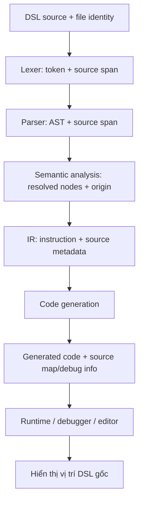

# Chú thích nguồn trong quá trình sinh mã DSL

Khi một DSL (*Domain-Specific Language*) được biên dịch hoặc chuyển thành ngôn ngữ đích, mã được sinh ra thường có cấu trúc khác với văn bản nguồn. Một câu lệnh DSL có thể tạo ra nhiều dòng mã, nhiều câu lệnh đích hoặc một đoạn mã trung gian. Khi lỗi xuất hiện trong mã được sinh, người dùng cần biết lỗi đó bắt nguồn từ phần nào của DSL.

**Chú thích nguồn** (*source annotations*) là metadata gắn với cấu trúc hoặc đoạn mã được sinh ra để giữ lại nguồn gốc của nó. Thông tin này có thể gồm tệp DSL, dòng, cột, vùng văn bản, node AST, quy tắc sinh mã hoặc chuỗi các bước biến đổi. Compiler, runtime, debugger và editor dùng thông tin đó để liên hệ mã đích với mã nguồn DSL.

Ví dụ, người dùng viết:

```text
rule "free-shipping" {
    when order.total >= 500000
    then shipping.fee = 0
}
```

Compiler có thể sinh mã JavaScript:

```javascript
if (order.total >= 500000) {
    shipping.fee = 0;
}
```

Nếu dòng gán trong JavaScript gây lỗi, thông tin chú thích nguồn giúp công cụ chỉ người dùng về dòng gán trong tệp DSL. Nếu không có thông tin này, người dùng có thể chỉ nhìn thấy tên tệp tạm hoặc dòng trong mã JavaScript đã sinh, vốn không phản ánh cấu trúc họ đã viết.

Chú thích nguồn là một phần quan trọng của code generation. Nó hỗ trợ diagnostics, debugging, stack trace, profiling, coverage, tracing và khả năng giải thích hành vi của mã đích.

## 1. Chú thích nguồn là gì?

**Source annotation** là metadata mô tả mối liên hệ giữa một thành phần trong mã được sinh ra và nguồn đã tạo ra nó. Nó có thể được lưu trong AST, IR, bảng ánh xạ riêng, debug information hoặc được xuất thành directive hay comment trong mã đích.

Một source annotation thường trả lời các câu hỏi:

- Thành phần mã đích này được tạo từ tệp DSL nào?
- Nó tương ứng với dòng, cột hoặc đoạn văn bản nào?
- Node AST hay quy tắc DSL nào đã tạo ra nó?
- Nó được sinh trực tiếp hay qua macro, template hoặc transformation?
- Nếu mã đích được tạo từ nhiều vị trí nguồn, những vị trí nào có liên quan?
- Nếu mã đích là phần compiler tự sinh, nó có nguồn gốc tổng hợp nào?

Ví dụ, một node trong IR có thể mang metadata:

```text
GeneratedInstruction {
    operation: "assign"
    target: "shipping.fee"
    value: 0
    source: {
        file: "shipping.dsl"
        startLine: 3
        startColumn: 10
        endLine: 3
        endColumn: 27
    }
}
```

Metadata này không nhất thiết xuất hiện trong mã thực thi. Compiler có thể giữ nó trong bộ nhớ, ghi vào source map hoặc chuyển thành debug symbol tùy target.

### Source annotation không chỉ là comment

Comment như:

```javascript
// Generated from shipping.dsl, line 3
shipping.fee = 0;
```

có thể giúp người đọc mã sinh hiểu nguồn gốc, nhưng comment chỉ là văn bản. Debugger hoặc runtime không tự hiểu comment đó nếu không có công cụ riêng để phân tích.

Source annotation có cấu trúc có thể được máy xử lý, kiểm tra, biến đổi và xuất sang định dạng mà debugger hiểu. Comment sinh ra chỉ là một trong nhiều cách trình bày metadata nguồn.

## 2. Vì sao code generation cần giữ thông tin nguồn?

Mã DSL thường được viết bằng ngôn ngữ gần với miền nghiệp vụ, còn mã đích được tổ chức để phù hợp với runtime hoặc nền tảng. Sự khác biệt đó làm mất mối liên hệ trực tiếp giữa dòng nguồn và dòng đích.

Chú thích nguồn giúp:

### Hiển thị lỗi tại nơi người dùng viết

Nếu mã sinh ném exception, compiler hoặc runtime có thể ánh xạ vị trí lỗi trở lại DSL thay vì chỉ hiển thị vị trí trong tệp sinh.

### Debug theo khái niệm của DSL

Người dùng có thể đặt breakpoint tại rule, biểu thức hoặc action DSL. Debugger ánh xạ breakpoint đó sang vị trí tương ứng trong mã đích.

### Hiểu hành vi được sinh

Khi một câu lệnh DSL tạo ra nhiều lệnh đích, source mapping giúp giải thích lệnh nào thuộc về câu lệnh nguồn nào.

### Hỗ trợ coverage và profiling

Kết quả coverage hoặc thời gian thực thi có thể được tổng hợp theo rule DSL thay vì chỉ theo hàm hoặc dòng mã đích.

### Hỗ trợ công cụ phân tích

Editor, linter, debugger, tracer và công cụ kiểm tra bảo mật có thể dùng cùng metadata để đưa ra kết quả theo ngôn ngữ nguồn.

### Bảo trì compiler

Khi thuật toán sinh mã thay đổi, source metadata giúp xác định transformation nào tạo ra một đoạn mã và vì sao vị trí đích liên hệ với vị trí nguồn.

## 3. Phân biệt source location, source span và source origin

Ba khái niệm này thường liên quan nhưng không hoàn toàn giống nhau.

### Source location – vị trí nguồn

Một vị trí xác định một điểm trong văn bản, thường gồm source hoặc file identifier, dòng, cột và offset trong chuỗi nguồn.

Ví dụ: tệp shipping.dsl, dòng 3, cột 10.

### Source span – vùng nguồn

Một span xác định đoạn văn bản bắt đầu và kết thúc tại hai vị trí. Nó phù hợp để đánh dấu cả biểu thức hoặc câu lệnh.

Ví dụ, trong biểu thức:

```text
when order.total >= 500000
```

span có thể bao phủ toàn bộ biểu thức điều kiện hoặc chỉ token 500000, tùy node cần gắn metadata.

Một quy ước phổ biến là dùng khoảng nửa mở: offset bắt đầu được tính vào vùng, offset kết thúc nằm ngay sau vùng. Độ dài vùng bằng endOffset trừ startOffset.

### Source origin – nguồn gốc

Origin mô tả thành phần mã đích được tạo ra từ đâu và qua những bước nào. Nó có thể chứa một span chính, nhiều span liên quan, macro expansion, template hoặc node tổng hợp.

Ví dụ, một câu lệnh audit có thể sinh thêm lệnh kiểm tra quyền và ghi log. Những lệnh này không có token tương ứng trực tiếp trong DSL nhưng vẫn có origin là câu lệnh audit đã kích hoạt chúng.

| Khái niệm | Trả lời câu hỏi | Ví dụ |
|---|---|---|
| Source location | Ở điểm nào? | Tệp A, dòng 8, cột 4 |
| Source span | Đoạn nào? | Từ offset 30 đến 48 |
| Source origin | Được tạo từ đâu và qua bước nào? | Node RuleAction sau khi mở rộng macro |

Một hệ thống code generation tốt nên phân biệt vị trí chính xác với nguồn gốc mang tính truy vết. Một đoạn mã đích có thể có source span chính để hiển thị và origin chain để giải thích quá trình tạo ra nó.

## 4. Source annotation đi qua pipeline như thế nào?

Để metadata nguồn còn tồn tại đến mã đích, mỗi giai đoạn cần giữ hoặc chuyển tiếp thông tin đó.



Một luồng điển hình:

1. **Lexer** gắn vị trí nguồn cho token.
2. **Parser** kết hợp token thành AST và xác định span của node.
3. **Semantic analysis** bổ sung symbol, type hoặc origin cần thiết.
4. **Lowering** chuyển AST sang IR và truyền metadata sang node mới.
5. **Optimization** thay đổi cấu trúc nhưng giữ hoặc kết hợp origin phù hợp.
6. **Code generator** ghi nhận vị trí đích tương ứng với origin.
7. **Source map hoặc debug information** được xuất cùng artifact.
8. **Runtime/tooling** dùng mapping để hiển thị vị trí DSL.

Nếu metadata bị bỏ ở một bước, các bước sau có thể không khôi phục được mối liên hệ chính xác. Vì vậy, source annotation cần được xem như một phần dữ liệu xuyên suốt pipeline, không phải chi tiết thêm vào cuối quá trình.

## 5. Lưu metadata nguồn trong AST và IR

Một node AST có thể giữ source span ngay khi parser tạo nó.

Ví dụ mô hình khái niệm:

```text
BinaryExpression {
    operator: ">="
    left: MemberAccess("order", "total")
    right: NumberLiteral(500000)
    sourceSpan: SourceSpan(
        file = "shipping.dsl",
        start = 42,
        end = 66
    )
}
```

Khi lowering node này sang IR, compiler có thể giữ metadata:

```text
CompareInstruction {
    operator: GREATER_OR_EQUAL
    left: LoadField("order.total")
    right: Constant(500000)
    origin: SourceOrigin(
        primarySpan = "shipping.dsl:2:10-2:35",
        nodeKind = "Condition"
    )
}
```

### Gắn metadata trực tiếp vào node

Ưu điểm:

- Metadata luôn đi cùng node.
- Transformation có thể nhận node và origin trong cùng một đối tượng.
- Dễ tạo diagnostic từ AST hoặc IR.

Hạn chế:

- Node chứa nhiều dữ liệu hơn.
- Equality và hashing cần xác định metadata có tham gia hay không.
- Một node có thể cần nhiều nguồn gốc nhưng trường đơn giản chỉ lưu được một span.

### Dùng side table

Một lựa chọn khác là lưu node ID hoặc node identity trong một bảng riêng, rồi ánh xạ tới source metadata.

Ưu điểm:

- Cấu trúc ngữ nghĩa của AST ít phụ thuộc vào tooling.
- Có thể lưu nhiều loại metadata theo từng giai đoạn.
- Không phải sao chép metadata vào mọi node.

Hạn chế:

- Bảng cần vòng đời phù hợp với AST.
- Transformation tạo node mới cần cập nhật mapping.
- Nếu node bị loại bỏ hoặc ID được tái sử dụng, bảng có thể chứa dữ liệu lỗi thời.

Lựa chọn phụ thuộc kiến trúc compiler. Điều quan trọng là mọi transformation phải có quy tắc rõ ràng về metadata.

## 6. Source map là gì?

**Source map** là dữ liệu ánh xạ vị trí trong một tệp được sinh ra về vị trí trong tệp nguồn ban đầu. Nó thường được dùng khi mã nguồn được chuyển đổi hoặc nén, chẳng hạn JavaScript/TypeScript, CSS hoặc các ngôn ngữ được biên dịch sang JavaScript.

Ví dụ:

- shipping.dsl là tệp nguồn.
- rules.generated.js là mã được sinh.
- rules.generated.js.map lưu các mapping giữa vị trí trong JavaScript và vị trí trong DSL.

Khi runtime hoặc debugger báo lỗi tại một vị trí của mã JavaScript, công cụ có thể tra source map để hiển thị vị trí tương ứng trong shipping.dsl.

### Ánh xạ không nhất thiết là một-một

Một câu lệnh DSL có thể sinh nhiều dòng mã. Nhiều vị trí đích có thể cùng trỏ về một span nguồn.

Ngược lại, một biểu thức DSL có thể được chia thành nhiều đoạn mã đích. Khi đó, một span nguồn có thể liên hệ với nhiều đoạn đích.

Source map thường lưu các điểm hoặc đoạn mapping chứ không phải một phép biến đổi một-một hoàn hảo.

### Source map không phải mã nguồn

Source map không thay thế tệp DSL hoặc mã đích. Nó là metadata bổ sung. Nếu source map thiếu, sai hoặc không được runtime/tooling nạp, lỗi có thể chỉ hiện ở mã đã sinh.

## 7. Các kiểu ánh xạ nguồn

Tùy compiler và target, có thể chọn mức độ ánh xạ khác nhau.

### Line mapping – ánh xạ theo dòng

Mỗi dòng mã đích được gắn với một dòng DSL. Cách này đơn giản và đủ cho một số compiler nhỏ, nhưng không thể chỉ chính xác một token trong dòng dài.

### Column mapping – ánh xạ theo cột

Mapping bao gồm cả dòng và cột. Nó giúp debugger hoặc editor đánh dấu đoạn nhỏ hơn.

### Segment mapping – ánh xạ theo đoạn

Mỗi đoạn mã đích có thể liên hệ với một span nguồn cụ thể. Cách này hữu ích khi một dòng đích chứa nhiều biểu thức được sinh từ các vị trí DSL khác nhau.

### Node mapping – ánh xạ theo node

Mã đích liên hệ với node AST hoặc IR. Tooling có thể dùng node ID để hiển thị tên rule, action hoặc biểu thức, ngoài vị trí văn bản.

### Origin-chain mapping – ánh xạ chuỗi nguồn gốc

Mapping giữ nhiều bước trung gian, chẳng hạn:

```text
DSL expression
    -> macro expansion
    -> template expansion
    -> IR instruction
    -> generated JavaScript
```

Cách này đặc biệt hữu ích khi DSL có macro, template, include hoặc code generation nhiều tầng.

## 8. Source map cho mã JavaScript

Trong hệ sinh thái JavaScript, source map thường được xuất thành tệp JSON có metadata về tệp đích, tệp nguồn và các mapping.

Ví dụ cấu trúc rút gọn:

```json
{
  "version": 3,
  "file": "rules.generated.js",
  "sourceRoot": "",
  "sources": ["rules.dsl"],
  "names": [],
  "mappings": "AAAA;AACA"
}
```

Đây là ví dụ minh họa rất nhỏ; trường mappings thực tế dùng định dạng mã hóa compact, không phải văn bản mô tả trực tiếp từng dòng.

Các trường thường gặp:

- version: phiên bản định dạng source map.
- file: tệp mã đích.
- sourceRoot: gốc dùng để giải quyết đường dẫn nguồn.
- sources: danh sách tệp nguồn.
- names: danh sách tên symbol nếu có.
- mappings: dữ liệu ánh xạ vị trí đã mã hóa.
- sourcesContent: nội dung nguồn được nhúng, nếu công cụ chọn cung cấp.

### Mappings được mã hóa như thế nào?

Source map phiên bản phổ biến dùng các segment được mã hóa bằng Base64 VLQ. Mapping thường mô tả các trường như:

- Generated column: cột trong tệp đích.
- Source index: chỉ số tệp nguồn.
- Original line: dòng trong nguồn.
- Original column: cột trong nguồn.
- Name index: chỉ số tên, nếu có.

Nhiều giá trị được lưu theo dạng delta so với segment trước để giảm kích thước. Người triển khai nên dùng thư viện hoặc định dạng chuẩn thay vì tự tạo chuỗi mapping không tương thích.

### Gắn source map vào tệp đích

Một tệp JavaScript có thể chứa comment cuối tệp:

```javascript
//# sourceMappingURL=rules.generated.js.map
```

Comment này cho tooling biết vị trí source map. Nó không tự làm runtime hiểu DSL; công cụ hỗ trợ cần đọc mapping và biết nguồn tương ứng.

## 9. Line directive trong mã đích

Một số ngôn ngữ đích hỗ trợ directive để thông báo cho compiler hoặc runtime rằng các dòng tiếp theo có nguồn gốc từ tệp và dòng khác.

Ví dụ trong C/C++:

```cpp
#line 25 "shipping.dsl"
shipping_fee = 0;
```

Directive #line có thể làm compiler gắn diagnostics với vị trí shipping.dsl, dòng 25, dù câu lệnh thực tế nằm trong tệp sinh. Cú pháp và semantics cụ thể phụ thuộc ngôn ngữ đích.

C# cũng có directive #line để điều khiển vị trí nguồn mà compiler dùng trong diagnostics và debug information.

### Ưu điểm

- Dễ tích hợp khi target đã hỗ trợ line directive.
- Có thể cải thiện vị trí trong compiler diagnostic mà không cần source map riêng.
- Hữu ích cho mã được sinh từ template hoặc DSL.

### Giới hạn

- Thường chủ yếu ánh xạ theo dòng, độ chính xác cột có thể hạn chế.
- Directive có thể ảnh hưởng tới cách compiler hiển thị tên tệp và dòng.
- Không phải ngôn ngữ đích nào cũng hỗ trợ.
- Một dòng mã sinh từ nhiều span nguồn có thể không biểu diễn đầy đủ bằng một directive.
- Directive không tự lưu origin chain của macro hoặc transformation.

Line directive là một cơ chế của ngôn ngữ đích. Không nên giả định có thể chèn cùng cú pháp vào mọi target.

## 10. Debug information và symbol information

Một compiler native có thể xuất **debug information** để debugger liên hệ instruction hoặc địa chỉ máy với source file, dòng, biến và phạm vi lexical.

Ví dụ, khi DSL được biên dịch thành mã native:

```text
shipping.dsl
    -> DSL AST
    -> IR
    -> LLVM IR
    -> machine code + debug information
```

Debug information có thể chứa:

- Tên tệp nguồn.
- Dòng và cột.
- Phạm vi lexical.
- Tên biến và vị trí lưu trữ.
- Kiểu dữ liệu.
- Quan hệ giữa instruction và source location.
- Thông tin về inline hoặc function được sinh.

Trên các nền tảng khác nhau, debug information có thể được lưu theo định dạng như DWARF hoặc PDB. Compiler thường dùng backend và toolchain tương ứng để tạo dữ liệu này.

### Source annotation và debug symbol

Source annotation là thông tin nguồn ở mức mô hình hoặc pipeline compiler. Debug information là dạng dữ liệu cụ thể mà debugger/toolchain có thể sử dụng. Compiler có thể chuyển annotation thành debug information, nhưng hai khái niệm không đồng nhất.

## 11. Chú thích nguồn dưới dạng comment hoặc header

Một số compiler chèn comment vào mã được sinh để giúp người đọc hiểu tệp đó đến từ đâu.

Ví dụ:

```javascript
// Generated from rules.dsl. Do not edit this file directly.
function evaluateShipping(order) {
    return order.total >= 500000 ? 0 : 25000;
}
```

Header này hữu ích để:

- Nhận biết tệp là generated artifact.
- Chỉ ra nguồn hoặc lệnh tạo mã.
- Cảnh báo người dùng không sửa trực tiếp tệp sinh.
- Hỗ trợ truy tìm generator hoặc phiên bản DSL.

Tuy nhiên, header comment không đủ để ánh xạ từng đoạn mã về DSL. Nó chỉ cung cấp thông tin ở mức tệp hoặc con người đọc được.

### Khi nào nên dùng comment?

Comment phù hợp khi mục tiêu là giải thích nguồn gốc chung hoặc ghi chú về quy trình sinh. Nếu cần debugger, coverage hoặc diagnostic chính xác, nên dùng source map, line directive hoặc debug metadata.

Không nên chèn comment cho mọi node nếu điều đó làm mã đích quá lớn hoặc gây nhiễu. Cần chọn mức chi tiết phù hợp với mục đích.

## 12. Một nguồn sinh ra nhiều đoạn mã

Trong code generation, một node DSL có thể sinh nhiều đoạn mã đích.

Ví dụ:

```text
audit order
```

có thể sinh:

```javascript
checkPermission("order.read");
const value = loadOrder();
writeAuditLog("order.read", value);
```

Cả ba câu lệnh có thể có origin là một node audit order, dù chỉ một phần nội dung xuất hiện trực tiếp trong DSL.

Compiler có thể gắn cùng source span cho cả ba đoạn, hoặc phân biệt:

- checkPermission: sinh từ semantics của action.
- loadOrder: liên hệ với tên order.
- writeAuditLog: sinh tự động để thực hiện audit.

Việc phân loại origin giúp debugger hoặc diagnostic giải thích mã nào được viết trực tiếp và mã nào do compiler thêm vào.

## 13. Nhiều nguồn tạo thành một đoạn mã

Trường hợp ngược lại cũng phổ biến: một đoạn mã đích được tạo từ nhiều node hoặc nhiều tệp nguồn.

Ví dụ, một template có thể kết hợp:

- Tên dịch vụ trong service.dsl.
- Giá trị cấu hình trong environment.dsl.
- Biểu thức điều kiện trong policy.dsl.

Mã sinh ra có thể chứa một lời gọi hàm tổng hợp từ cả ba nguồn. Một source location đơn không thể mô tả đầy đủ.

Có thể lưu:

```text
GeneratedNode {
    primaryOrigin: policy.dsl:12:5-12:30
    relatedOrigins: [
        service.dsl:4:1-4:18,
        environment.dsl:8:3-8:22
    ]
}
```

Primary origin dùng để đặt vị trí chính trong diagnostics; related origins giúp giải thích các thành phần khác tham gia tạo ra kết quả.

Compiler cần quy định cách chọn primary origin. Thông thường, đó là biểu thức hoặc khai báo trực tiếp chịu trách nhiệm cho hành vi được sinh; các nguồn còn lại được giữ làm related locations.

## 14. Macro, template và include

DSL có thể hỗ trợ macro, template hoặc include để tái sử dụng cấu trúc. Các cơ chế này tạo thêm tầng nguồn gốc.

### Macro expansion

Một macro được gọi tại vị trí A nhưng phần thân macro được định nghĩa ở vị trí B. Mã đích có thể được tạo từ cả hai.

Ví dụ:

```text
macro logAction(action) {
    writeLog(action)
}

rule "publish" {
    logAction("release")
}
```

Khi lỗi xảy ra trong phần writeLog, người dùng có thể cần biết:

- Vị trí gọi macro logAction.
- Vị trí định nghĩa macro.
- Vị trí tham số action được truyền vào.

Một origin chain có thể giữ cả macro call site và macro definition site.

### Template expansion

Template có thể kết hợp văn bản cố định với biểu thức DSL. Mỗi phần được sinh có thể có origin khác nhau: phần literal từ template, phần giá trị từ DSL.

### Include hoặc import nguồn

Khi một tệp DSL include tệp khác, compiler cần giữ tên tệp gốc của từng node. Không nên gán mọi node về tệp gốc duy nhất chỉ vì quá trình biên dịch bắt đầu từ tệp đó.

### Call site và definition site

Hai vị trí này có mục đích khác nhau:

- **Call site:** nơi macro/template được gọi.
- **Definition site:** nơi macro/template được định nghĩa.

Debugger có thể ưu tiên call site để người dùng hiểu hành động nào đã kích hoạt mã. Khi lỗi nằm trong nội dung macro, definition site cũng rất quan trọng.

## 15. Node tổng hợp và mã do compiler sinh

Không phải mọi lệnh trong mã đích đều có một đoạn nguồn trực tiếp. Compiler có thể tạo khởi tạo biến tạm, kiểm tra null hoặc quyền truy cập, bộ điều phối, hàm wrapper, lệnh ghi log, mã quản lý vòng đời, nhánh mặc định hoặc cleanup.

Các node này là **synthetic nodes** hoặc generated nodes. Chúng cần được đánh dấu là do compiler sinh ra.

Ví dụ metadata:

```text
GeneratedInstruction {
    operation: "checkPermission"
    synthetic: true
    origin: SourceOrigin(
        primarySpan: "policy.dsl:8:5-8:18",
        generatedBy: "PermissionLowering"
    )
}
```

Một node synthetic có thể liên hệ với một span nguồn gần nhất, nhưng cần phân biệt “được viết trực tiếp tại đây” với “được sinh vì quy tắc tại đây”. Nếu không, diagnostics có thể gây hiểu lầm rằng người dùng đã viết một câu lệnh mà thực tế compiler tự thêm.

Một số lệnh runtime hoặc bootstrap có thể được sinh từ cấu hình compiler chứ không từ node DSL. Khi đó, origin có thể là compiler configuration, runtime prelude hoặc built-in template. Debugger có thể ẩn các node này trong chế độ người dùng, hoặc hiển thị chúng trong chế độ chi tiết.

## 16. Truyền source annotation qua optimization

Optimization có thể thay đổi, gộp hoặc loại bỏ node. Metadata nguồn phải được cập nhật theo transformation.

Ví dụ, DSL:

```text
x = 2 + 3
```

có thể được constant folding thành:

```text
x = 5
```

Node mới không còn hai literal và toán tử riêng. Nó được tạo từ cả biểu thức 2 + 3, vì vậy origin nên trỏ về span của toàn biểu thức hoặc giữ related origins của các thành phần.

Các trường hợp phổ biến:

- **Constant folding:** node kết quả mang origin của biểu thức đã tính.
- **Inlining:** mã được inline cần giữ cả vị trí call site và vị trí định nghĩa hàm.
- **Dead code elimination:** node bị xóa không còn mapping thực thi; metadata có thể vẫn cần cho diagnostics tĩnh.
- **Common subexpression elimination:** một instruction có thể đại diện cho nhiều vị trí nguồn.
- **Loop transformation:** một node có thể được nhân bản thành nhiều instruction; mỗi bản sao cần origin phù hợp.

Mỗi transformation nên xác định node đầu vào nào tạo ra node đầu ra, origin nào được giữ làm primary, origin nào được giữ làm related, node mới có phải synthetic không, có cần giữ call site hoặc definition site không và metadata nào không còn ý nghĩa sau biến đổi.

Không nên mặc định sao chép source span của node đầu tiên sang mọi node đầu ra. Điều đó có thể tạo mapping sai khi transformation kết hợp nhiều nguồn.

## 17. Ánh xạ nguồn và diagnostics lúc runtime

Một runtime có thể báo lỗi khi thực thi mã đích. Nếu có source mapping, thông báo có thể được chuyển về DSL.

Ví dụ, generated code gây lỗi:

```javascript
const result = order.total / order.itemCount;
```

Nếu itemCount bằng 0, runtime có thể báo lỗi ở dòng JavaScript đã sinh. Source map hoặc debug metadata có thể ánh xạ về biểu thức DSL:

```text
shipping.dsl:14:18
order.total / order.itemCount
                  ^^^^^^^^^^^^^
```

Thông báo cuối cùng nên ưu tiên thông tin có ý nghĩa với người dùng DSL. Có thể cung cấp thêm vị trí mã đích trong phần chi tiết để hỗ trợ nhóm phát triển compiler.

Một lỗi runtime có thể do cấu hình được khai báo ở nơi khác, do dữ liệu nhập vào hoặc do một điều kiện ở call site. Source map chỉ giúp liên hệ instruction với source origin; nó không tự xác định nguyên nhân nghiệp vụ cuối cùng.

Một hệ thống tốt có thể hiển thị vị trí DSL nơi thao tác được định nghĩa, vị trí DSL nơi rule được kích hoạt, dữ liệu hoặc điều kiện gây lỗi nếu được phép hiển thị và vị trí mã đích trong chế độ debug.

## 18. Breakpoint, stepping và coverage

Source annotation có thể hỗ trợ các công cụ tương tác.

### Breakpoint

Người dùng đặt breakpoint tại dòng hoặc node DSL. Debugger tra mapping để đặt breakpoint tương ứng trong mã đích. Nếu một dòng DSL sinh nhiều đoạn mã, debugger cần quy tắc chọn điểm dừng phù hợp.

### Stepping

Khi thực hiện step over hoặc step into, debugger có thể di chuyển theo node hoặc action DSL thay vì từng lệnh máy hoặc dòng mã sinh. Source mapping giúp gom nhiều lệnh đích thành một bước logic.

### Coverage

Coverage có thể tổng hợp theo dòng DSL, rule hoặc action, biểu thức điều kiện, nhánh logic, tài nguyên hoặc workflow.

Một dòng DSL có thể sinh nhiều lệnh; chỉ đánh dấu một lệnh được thực thi chưa chắc có nghĩa toàn bộ biểu thức nguồn đã được kiểm tra. Coverage cần định nghĩa rõ đơn vị đo và quy tắc ánh xạ.

### Profiling

Profiler có thể nhóm thời gian thực thi theo rule hoặc action DSL. Nếu nhiều node nguồn cùng tạo một instruction, hệ thống cần quy tắc phân bổ hoặc giữ nhiều origin để tránh đếm sai.

## 19. Source annotation trong nhiều target code

Một DSL có thể sinh nhiều ngôn ngữ đích, chẳng hạn JavaScript, Java, SQL hoặc cấu hình triển khai. Mỗi target có cách hỗ trợ metadata khác nhau.

| Target | Cơ chế thường dùng | Lưu ý |
|---|---|---|
| JavaScript | Source map | Tooling cần nạp map và nguồn |
| C/C++ | #line, debug information | Directive và debug format phụ thuộc compiler |
| C# | #line, PDB/debug symbols | Có thể điều khiển vị trí diagnostics |
| Java | Annotation/comment, debug line table | Không có một cơ chế source map phổ quát cho mọi DSL |
| SQL | Comment, metadata của query engine hoặc mapping riêng | Engine thường không hiểu DSL source origin mặc định |
| JSON/YAML | Sidecar metadata hoặc mapping của tool | Định dạng dữ liệu thường không có directive nguồn chuẩn |

Không nên cố ép một định dạng source mapping duy nhất cho mọi target. Compiler có thể giữ mô hình origin nội bộ chung rồi xuất ra cơ chế phù hợp với target.

## 20. Đường dẫn nguồn và thông tin nhạy cảm

Source metadata có thể chứa đường dẫn máy phát triển, tên thư mục nội bộ hoặc nội dung nguồn. Nếu được phát hành trong artifact, những thông tin này có thể tiết lộ cấu trúc hệ thống.

Một số lựa chọn:

- Dùng đường dẫn tương đối theo source root thay vì đường dẫn tuyệt đối.
- Chuẩn hóa separator để artifact hoạt động trên nhiều hệ điều hành.
- Không nhúng nội dung nguồn nếu không cần thiết.
- Có chế độ ẩn source content trong bản phân phối.
- Không đưa token, secret hoặc dữ liệu cấu hình nhạy cảm vào source map.
- Xác thực đường dẫn khi debugger hoặc tool mở source từ mapping.
- Phân biệt source ID ổn định với đường dẫn hiển thị trên máy cục bộ.

Nếu source map được công bố công khai, cần quyết định rõ người dùng có được phép xem mã DSL gốc hay chỉ cần vị trí và tên tệp.

## 21. Source annotation và tính tái lập của build

Source metadata cũng ảnh hưởng tới tính tái lập (*reproducible builds*). Nếu source map ghi đường dẫn tuyệt đối hoặc timestamp thay đổi theo từng lần build, artifact có thể khác nhau dù nội dung DSL không đổi.

Để giữ build ổn định:

- Chuẩn hóa đường dẫn nguồn.
- Tránh đưa timestamp không cần thiết vào annotation.
- Dùng thứ tự xác định khi xuất source map.
- Giữ cách mã hóa và serialization ổn định.
- Gắn compiler version và DSL version theo schema rõ ràng.
- Tách metadata chỉ phục vụ môi trường phát triển khỏi artifact phát hành nếu không cần.

Một build tái lập giúp so sánh artifact, cache kết quả và điều tra khác biệt giữa môi trường.

## 22. Kiểm soát source mapping

Mapping cần được duy trì cùng với mã sinh. Nếu code generator thay đổi thứ tự lệnh nhưng source map vẫn giữ vị trí cũ, debugger có thể chỉ sai dòng DSL.

### Tạo mapping từ cùng một quá trình sinh mã

Không nên sinh mã đích rồi cố suy ra source mapping bằng cách tìm kiếm chuỗi sau đó. Code generator đã biết node nào tạo ra đoạn mã nào; nó nên ghi nhận mapping ngay trong lúc phát output.

### Dùng một abstraction cho source origin

Các backend khác nhau nên nhận cùng một mô hình origin nội bộ. Backend JavaScript có thể xuất source map, backend C++ xuất line directive hoặc debug info, còn backend SQL có thể xuất sidecar metadata.

### Giữ mapping qua transformation

Mỗi pass cần xác định cách truyền, kết hợp hoặc đánh dấu origin. Node synthetic cần được nhận diện rõ.

### Kiểm tra mapping trong các trường hợp đại diện

Có thể dùng các ví dụ nguồn và vị trí mong đợi để bảo đảm mapping trỏ đúng. Đặc biệt cần chú ý macro, template, include, Unicode, inline và node tổng hợp.

### Xử lý mapping thiếu

Nếu không thể ánh xạ chính xác, công cụ nên báo vị trí gần nhất hoặc nói rõ mã được sinh tự động. Không nên hiển thị một vị trí nguồn giả chính xác.

## 23. Những lỗi thường gặp

**Chỉ thêm comment “Generated from...” rồi cho rằng đã có source map.** Comment giúp người đọc nhưng không đủ cho debugger hoặc diagnostic có cấu trúc.

**Gắn mọi mã đích với một dòng nguồn duy nhất.** Một node có thể sinh nhiều lệnh hoặc một lệnh có thể đến từ nhiều nguồn. Mapping cần hỗ trợ quan hệ nhiều-nhiều.

**Làm mất metadata khi lowering.** Nếu một transformation tạo node mới mà không truyền origin, các bước sau không thể truy vết về DSL.

**Sao chép span đầu vào cho mọi node đầu ra.** Node mới có thể kết hợp nhiều nguồn hoặc được sinh tự động. Cần xác định primary và related origins.

**Nhầm source location với source origin.** Vị trí là điểm hoặc vùng; origin có thể chứa nhiều vị trí và chuỗi biến đổi.

**Tính cột không nhất quán với Unicode.** Mapping theo byte trong khi editor dùng UTF-16 hoặc cột hiển thị có thể làm caret lệch.

**Để đường dẫn tuyệt đối lọt vào artifact.** Điều này có thể làm lộ cấu trúc máy phát triển và khiến build không tái lập.

**Không phân biệt node synthetic.** Debugger có thể đưa người dùng đến một câu lệnh không tồn tại trong DSL mà không giải thích nó do compiler sinh.

**Dùng source map sai phiên bản hoặc sai artifact.** Mapping phải đi cùng đúng mã đích. Nếu file JavaScript được cập nhật nhưng map cũ còn lại, mọi vị trí có thể sai.

**Giả định source map tự giải thích semantics.** Mapping chỉ liên hệ vị trí; nó không thay thế semantic model hoặc phân tích nguyên nhân lỗi.

## 24. Quy trình triển khai chú thích nguồn trong DSL

Khi xây dựng compiler hoặc generator, có thể thực hiện theo trình tự:

1. Xác định tooling cần hỗ trợ: diagnostics, debugger, stack trace, coverage hay profiling.
2. Định nghĩa mô hình SourceLocation, SourceSpan và SourceOrigin.
3. Gắn source span cho token và AST node từ lexer/parser.
4. Quy định cách semantic analysis bổ sung symbol và origin.
5. Thiết kế metadata trong IR hoặc side table.
6. Định nghĩa quy tắc truyền origin qua mỗi transformation.
7. Đánh dấu node synthetic và lưu nguồn gốc tạo ra chúng.
8. Ghi nhận mapping ngay khi code generator phát từng đoạn mã.
9. Chọn output phù hợp với target: source map, line directive, debug information, comment hoặc sidecar file.
10. Xác định primary origin và related origins cho node được tạo từ nhiều nguồn.
11. Chuẩn hóa đường dẫn, đơn vị offset và quy ước dòng/cột.
12. Gắn source map/debug artifact với đúng phiên bản mã đích.
13. Kết nối runtime, debugger và editor để hiển thị vị trí DSL.
14. Giữ metadata cần thiết qua optimization, inlining và macro expansion.
15. Xác định chính sách bảo mật và việc có nhúng nội dung nguồn hay không.

## 25. Câu hỏi tự kiểm tra

1. Source annotation là gì và vì sao code generation cần nó?
2. Phân biệt source location, source span và source origin.
3. Vì sao metadata nguồn cần được giữ từ lexer đến code generator?
4. Source map dùng để ánh xạ những vị trí nào?
5. Mapping một-một khác gì với mapping nhiều-nhiều?
6. Source map JavaScript thường chứa những trường thông tin nào?
7. Directive #line có tác dụng gì và giới hạn ra sao?
8. Debug information khác source annotation nội bộ như thế nào?
9. Vì sao comment “Generated from...” không thay thế source map?
10. Một node DSL có thể sinh nhiều lệnh đích như thế nào?
11. Khi một đoạn mã đích được tạo từ nhiều tệp DSL, cần lưu origin ra sao?
12. Macro call site và definition site có ý nghĩa khác nhau thế nào?
13. Compiler cần xử lý source origin ra sao khi constant folding hoặc inlining?
14. Node synthetic là gì và debugger nên trình bày nó thế nào?
15. Source annotation hỗ trợ breakpoint, stepping, coverage và profiling ra sao?
16. Vì sao cần chuẩn hóa đường dẫn và đơn vị cột khi hỗ trợ Unicode?
17. Làm thế nào để bảo đảm source map đi cùng đúng phiên bản mã được sinh?
18. Hãy mô tả cách ánh xạ một runtime error trong JavaScript trở lại biểu thức DSL đã tạo ra nó.

Khi nắm được chú thích nguồn, người học có thể thiết kế pipeline sinh mã giữ được mối liên hệ giữa DSL và artifact đích, giúp diagnostics và debugger đưa người dùng về đúng vị trí nguồn, đồng thời duy trì khả năng truy vết qua macro, template, optimization và các bước biến đổi của compiler.

