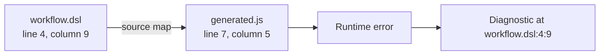
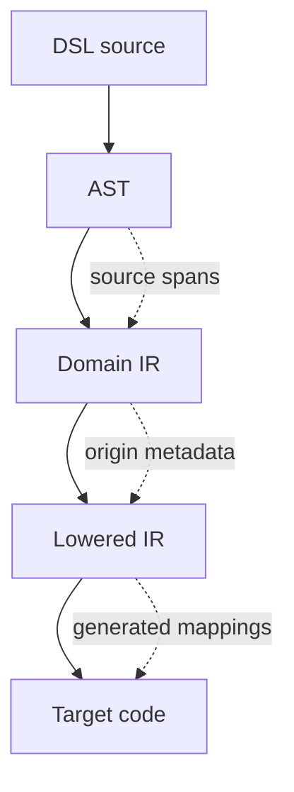
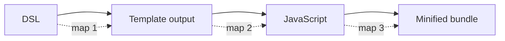
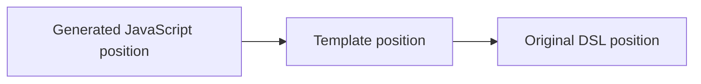

# Source map

Khi một ngôn ngữ miền chuyên biệt (Domain-Specific Language, DSL) được biên dịch hoặc chuyển đổi thành mã của một ngôn ngữ khác, người dùng thường đọc và sửa tệp DSL nhưng lỗi lại xuất hiện trong mã được sinh ra. Ví dụ, người dùng viết một quy tắc trong `workflow.dsl`, công cụ chuyển quy tắc đó thành JavaScript, Java hoặc mã cấu hình triển khai; khi chạy, stack trace chỉ ra `generated.js:120`. Nếu không có cách liên hệ vị trí trong mã sinh với vị trí trong DSL ban đầu, người dùng phải tự lần theo nhiều lớp chuyển đổi.

**Source map (bản đồ nguồn)** là dữ liệu ánh xạ vị trí trong đầu ra được sinh ra về vị trí trong nguồn gốc. Trong quy trình sinh mã DSL, source map giúp IDE, debugger, runtime adapter và công cụ chẩn đoán chỉ lỗi tại dòng và cột mà người viết DSL quen thuộc. Nó cũng hỗ trợ điều hướng từ mã sinh đến cấu trúc DSL tương ứng, xem nội dung nguồn và hiểu vì sao một đoạn đầu ra được tạo ra.

Source map là một phần của thông tin nguồn gốc (source provenance) trong quá trình chuyển đổi. Nó không thay thế parser, AST hoặc mô hình miền; nó giữ quan hệ giữa các biểu diễn sau khi code generator đã biến đổi cấu trúc. Để ánh xạ chính xác, pipeline cần giữ vị trí nguồn từ lexer và parser, truyền thông tin đó qua AST hoặc IR, rồi ghi nhận vị trí đầu ra khi sinh từng đoạn mã.

## 1. Vì sao code generation cần source map?

Một DSL thường được thiết kế để người dùng diễn đạt ý định ở mức miền. Mã sinh ra có thể dài hơn, chứa nhiều hàm hỗ trợ, biến tạm, nhánh điều khiển và lời gọi thư viện. Một cấu trúc DSL ngắn có thể tạo ra hàng chục dòng mã đích.

Ví dụ DSL:

```text
workflow "release" {
    task "compile" {}
    task "publish" {
        depends_on = ["compile"]
        retries = 3
    }
}
```

Code generator có thể tạo ra JavaScript gần như sau:

```javascript
const workflow = createWorkflow("release");
workflow.addTask(createTask("compile"));
workflow.addTask(
  createTask("publish", {
    dependencies: ["compile"],
    retries: 3
  })
);
registerWorkflow(workflow);
```

Nếu runtime báo lỗi khi khởi tạo task `publish`, vị trí trong JavaScript có thể là dòng 3 hoặc dòng 4. Người dùng DSL cần được đưa về khai báo `task "publish"` hoặc trường `retries = 3`, thay vì phải đọc mã JavaScript mà họ không trực tiếp viết.

Source map hữu ích trong các tình huống:

- **Debugging:** stack trace từ mã sinh có thể được chuyển về dòng DSL.
- **Diagnostics:** lỗi runtime hoặc lỗi từ thư viện đích được gắn với cấu trúc nguồn liên quan.
- **IDE navigation:** người dùng có thể mở mã nguồn gốc từ một vị trí trong output hoặc ngược lại.
- **Profiling:** một số công cụ có thể nhóm chi phí thực thi theo cấu trúc DSL nếu runtime cung cấp thông tin tương ứng.
- **Code review:** người xem đầu ra có thể lần về khai báo DSL đã tạo ra nó.
- **Build và triển khai:** lỗi ở artifact sinh ra có thể được báo trong tệp cấu hình ban đầu.

## 2. Source map ánh xạ điều gì?

Một source map liên kết ít nhất hai không gian vị trí:

1. **Generated position:** vị trí trong mã đầu ra, thường gồm tệp, dòng và cột.
2. **Original position:** vị trí trong tệp nguồn, chẳng hạn tệp DSL, template hoặc module ban đầu.

Một ánh xạ có thể được hình dung như sau:



Trong ví dụ, một lệnh được sinh ra ở dòng 7 của JavaScript bắt nguồn từ trường `retries` ở dòng 4 của DSL. Khi lỗi được phát hiện tại mã sinh, công cụ tra source map để tìm vị trí DSL.

Một mapping thường có các thành phần:

- Tệp nguồn gốc (source file hoặc source URI).
- Dòng và cột nguồn.
- Tệp đầu ra được sinh.
- Dòng và cột trong đầu ra.
- Có thể có tên symbol hoặc tên định danh liên quan.
- Có thể có thông tin về vùng nguồn hoặc phạm vi được ánh xạ.

Một source map không nhất thiết lưu toàn bộ nội dung hai tệp. Nó có thể chỉ lưu các vị trí và chỉ mục nguồn. Một số định dạng hỗ trợ nhúng nội dung nguồn để debugger hoặc công cụ có thể hiển thị tệp gốc ngay cả khi tệp đó không được triển khai cùng artifact.

## 3. Source span từ parser là nền tảng

Để tạo source map, code generator cần biết mỗi nút AST hoặc IR bắt nguồn từ đâu. Vì vậy, token và AST nên giữ source span ngay từ đầu pipeline.

Ví dụ DSL:

```text
service "catalog" {
    replicas = 3
}
```

AST có thể lưu:

```text
ServiceDeclaration
  name: "catalog"
  span: service.dsl:1:1-3:2
  properties:
    ReplicaProperty
      value: 3
      span: service.dsl:2:5-2:16
```

Khi generator sinh lời gọi `setReplicas(3)`, nó dùng span của `ReplicaProperty` hoặc literal `3` để tạo mapping tương ứng. Nếu AST không lưu vị trí nguồn, generator phải cố gắng suy ra lại từ văn bản, điều này rất khó sau khi parser đã loại bỏ khoảng trắng, chú thích hoặc chuẩn hóa cấu trúc.

Một cấu trúc vị trí có thể được biểu diễn trong Java:

```java
record SourceId(String uri) {}

record SourcePosition(int offset, int line, int column) {}

record SourceSpan(
    SourceId source,
    SourcePosition start,
    SourcePosition end
) {}
```

Các chỉ số dòng/cột và offset phải có quy ước rõ ràng. Ví dụ, offset có thể dùng UTF-16 code unit nếu nguồn được lưu bằng Java `String`; một định dạng source map khác có thể yêu cầu cột bắt đầu từ 0. Chuyển đổi giữa quy ước nội bộ và định dạng ngoài cần được thực hiện ở adapter, không nên để mỗi generator tự chọn.

## 4. Mapping theo điểm và mapping theo vùng

### 4.1. Mapping theo điểm

Một mapping theo điểm liên kết một vị trí đầu ra với một vị trí nguồn. Ví dụ, điểm bắt đầu của lời gọi `createTask` được liên kết với vị trí bắt đầu của khai báo `task` trong DSL.

Cách này đủ cho nhiều debugger và định dạng source map phổ biến. Khi công cụ nhận vị trí lỗi, nó tìm mapping gần nhất phù hợp theo quy tắc của định dạng.

### 4.2. Mapping theo vùng

Mapping theo vùng liên kết một đoạn đầu ra với một source span. Ví dụ, toàn bộ lời gọi:

```javascript
createTask("publish", { retries: 3 });
```

có thể bắt nguồn từ toàn bộ khai báo task trong DSL. Mapping theo vùng hữu ích cho công cụ cần chọn hoặc tô sáng cả cấu trúc nguồn.

Một số định dạng source map chỉ lưu các điểm mapping rời rạc. Khi đó, công cụ có thể suy ra vùng bằng cách dùng mapping tiếp theo hoặc thông tin span bổ sung. Nếu cần vùng chính xác, pipeline có thể giữ metadata riêng hoặc dùng định dạng nội bộ phong phú hơn.

### 4.3. Granularity của mapping

Granularity (mức độ chi tiết) quyết định ánh xạ ở cấp độ nào:

- Toàn bộ tệp DSL tới toàn bộ tệp sinh.
- Một khai báo tới một khối mã sinh.
- Một thuộc tính tới một biểu thức hoặc lời gọi.
- Một biểu thức con tới một toán tử hoặc literal.
- Một token nguồn tới một token đầu ra.

Mapping càng chi tiết thì điều hướng và chẩn đoán càng chính xác, nhưng dữ liệu source map lớn hơn và generator cần ghi nhiều metadata hơn. Mapping quá thô có thể khiến mọi lỗi trong một tệp được trỏ về cùng một dòng, làm giảm giá trị thực tế.

Một lựa chọn cân bằng thường là ánh xạ ở cấp độ khai báo và biểu thức có thể gây lỗi. Các ký tự cú pháp được sinh tự động như dấu ngoặc hoặc dấu chấm phẩy có thể không cần mapping riêng nếu chúng không đại diện cho một phần nguồn cụ thể.

## 5. Source map trong các bước biến đổi

Code generation có thể gồm nhiều bước thay vì chuyển thẳng từ DSL sang mã đích:



Ví dụ:

1. DSL khai báo một task.
2. AST được chuyển thành mô hình workflow.
3. Mô hình được hạ xuống IR đơn giản hơn.
4. IR được sinh thành JavaScript.
5. Một optimizer gộp hoặc tách biểu thức trước khi ghi output.

Mỗi bước có thể tạo nút mới, gộp nhiều nút hoặc loại bỏ cấu trúc cũ. Nếu metadata nguồn không được truyền qua, mapping bị mất trước khi generator cuối cùng có thể ghi nó.

Một quy tắc hữu ích là mọi nút được tạo ra trong quá trình biến đổi nên giữ thông tin nguồn gốc (origin metadata), nếu nó có thể được quy về một hoặc nhiều cấu trúc nguồn. Khi một nút mới kết hợp nhiều nút nguồn, metadata có thể chứa nhiều origin hoặc một span bao trùm tùy mục tiêu chẩn đoán.

## 6. Giữ source origin trong AST và IR

Có thể gắn nguồn gốc trực tiếp vào mỗi nút:

```java
sealed interface IrNode permits CallNode, LiteralNode, BlockNode {
    SourceSpan sourceSpan();
}

record CallNode(
    String functionName,
    List<IrNode> arguments,
    SourceSpan sourceSpan
) implements IrNode {}

record LiteralNode(
    Object value,
    SourceSpan sourceSpan
) implements IrNode {}
```

Cách này đơn giản khi mỗi nút có một nguồn chính. Nhưng một nút IR có thể được tạo từ nhiều nút DSL. Ví dụ, generator biến một biểu thức `a and b` thành nhánh điều khiển với nhiều lệnh. Có thể cần một cấu trúc origin phong phú hơn:

```java
record Origin(
    List<SourceSpan> sourceSpans,
    String description
) {}
```

`description` có thể mô tả quan hệ như “điều kiện của rule” hoặc “giá trị mặc định được suy ra”. Không phải mọi định dạng source map bên ngoài đều hỗ trợ nhiều nguồn gốc cho một vị trí đầu ra, nhưng metadata nội bộ có thể giữ chúng để diagnostics chọn vị trí phù hợp.

Cần tránh gắn một span tùy tiện vào mọi nút chỉ để không bị null. Nếu helper code do compiler sinh ra không bắt nguồn từ một cấu trúc DSL cụ thể, nên đánh dấu nó là generated/synthetic thay vì trỏ sai đến một dòng người dùng.

## 7. Sinh mã có ghi nhận vị trí đầu ra

Một code generator có thể dùng writer chuyên dụng để theo dõi dòng và cột đầu ra. Trước khi sinh đoạn mã từ một nút IR, generator ghi nhận vị trí hiện tại và thêm mapping từ vị trí đó đến source span của nút.

Ví dụ Java giản lược:

```java
final class CodeWriter {
    private final StringBuilder output = new StringBuilder();
    private int line = 0;
    private int column = 0;

    void write(String text) {
        output.append(text);
        for (int i = 0; i < text.length(); i++) {
            char ch = text.charAt(i);
            if (ch == '\n') {
                line++;
                column = 0;
            } else {
                column++;
            }
        }
    }

    GeneratedPosition position() {
        return new GeneratedPosition(line, column);
    }

    void writeMapped(String text, SourceSpan source, MappingBuilder mappings) {
        GeneratedPosition generated = position();
        mappings.add(generated, source);
        write(text);
    }

    String result() {
        return output.toString();
    }
}
```

Ví dụ chỉ minh họa nguyên tắc. Writer thực tế cần xử lý CRLF, Unicode và quy ước cột của định dạng source map. Nếu định dạng đích đếm UTF-16 code unit, `column++` theo `char` có thể phù hợp với Java `String`; nếu định dạng đếm code point hoặc byte, cần cách tính khác.

Một API sinh mã có thể được thiết kế theo dạng:

```java
void emitExpression(ExpressionNode node) {
    writer.mark(node.sourceSpan());
    writer.write("evaluate(");
    emitChildren(node);
    writer.write(")");
}
```

`mark` ghi nhận vị trí đầu ra hiện tại cùng nguồn gốc của node. Một số generator cần `markStart` và `markEnd` để lưu vùng. Việc đánh dấu nên được tập trung trong writer hoặc mapping builder để các generator con không tự tính cột theo cách khác nhau.

## 8. Một ví dụ mapping từ DSL sang JavaScript

Nguồn DSL:

```text
rule "large-order" {
    when order.total >= 1000
    then approve(order)
}
```

Mã sinh:

```javascript
registerRule("large-order", (context) => {
  if (context.order.total >= 1000) {
    approve(context.order);
  }
});
```

Một bảng mapping minh họa:

| Generated position | Original position | Nguồn gốc |
|---|---|---|
| `generated.js:1:1` | `rules.dsl:1:1` | Khai báo rule |
| `generated.js:2:3` | `rules.dsl:2:5` | Biểu thức `when` |
| `generated.js:2:7` | `rules.dsl:2:10` | Truy cập `order.total` |
| `generated.js:3:5` | `rules.dsl:3:5` | Hành động `approve(order)` |
| `generated.js:4:1` | `rules.dsl:1:1` | Kết thúc khối rule hoặc cấu trúc bao ngoài |

Bảng trên chỉ là ví dụ khái niệm. Một source map thực tế có thể chỉ ghi một số điểm mapping, dùng chỉ số dòng/cột bắt đầu từ 0 và mã hóa các segment theo định dạng cụ thể.

Khi runtime ném lỗi bên trong `approve`, debugger có thể đưa người dùng về dòng hành động trong DSL. Nếu lỗi xuất phát từ điều kiện, nó có thể trỏ về biểu thức `order.total >= 1000`.

## 9. Source map v3 cho JavaScript

Trong hệ sinh thái JavaScript, Source Map v3 là một định dạng phổ biến để liên kết mã sinh với nguồn gốc. Một tệp source map thường là JSON với các trường như:

```json
{
  "version": 3,
  "file": "generated.js",
  "sourceRoot": "",
  "sources": ["rules.dsl"],
  "sourcesContent": ["rule ..."],
  "names": ["large-order", "approve"],
  "mappings": "AAAA;EACA,..."
}
```

Ý nghĩa tổng quát:

- `version`: phiên bản định dạng source map.
- `file`: tên tệp đầu ra được ánh xạ.
- `sourceRoot`: tiền tố tùy chọn cho các đường dẫn nguồn.
- `sources`: danh sách nguồn gốc.
- `sourcesContent`: nội dung nguồn tương ứng nếu được nhúng.
- `names`: danh sách tên định danh có thể được tham chiếu trong mapping.
- `mappings`: chuỗi mã hóa các mapping giữa vị trí sinh và vị trí nguồn.

Trong Source Map v3, `mappings` được chia theo dòng đầu ra bằng dấu `;`; các segment trong một dòng được phân cách bằng dấu `,`. Một segment mã hóa các trường delta bằng Base64 VLQ. Các trường thường gồm cột đầu ra, chỉ số nguồn, dòng nguồn, cột nguồn và tùy chọn chỉ số tên. Việc dùng delta giúp chuỗi mapping gọn hơn.

Ví dụ JSON trên chỉ minh họa cấu trúc trường; giá trị `mappings` cần được tạo theo đúng thuật toán Base64 VLQ và quy tắc delta của định dạng. Không nên tự ghép chuỗi mapping bằng tay trong compiler thực tế. Hãy dùng thư viện hoặc triển khai tuân thủ đặc tả đã được kiểm thử.

Một số source map hỗ trợ comment hoặc URL tham chiếu từ tệp JavaScript đến tệp `.map`, để browser hoặc debugger biết nơi tải mapping. Cách triển khai phụ thuộc công cụ build và môi trường chạy.

## 10. Ánh xạ nhiều nguồn và sourceRoot

Một tệp đầu ra có thể được sinh từ nhiều tệp DSL hoặc module:

```text
main.dsl
modules/sales.dsl
modules/billing.dsl
```

JavaScript đầu ra có thể chứa mã của cả ba nguồn. Source map cần lưu danh sách nguồn và mỗi segment chỉ đến nguồn tương ứng.

Ví dụ:

```json
{
  "version": 3,
  "file": "application.js",
  "sources": [
    "main.dsl",
    "modules/sales.dsl",
    "modules/billing.dsl"
  ],
  "names": [],
  "mappings": "..."
}
```

`sourceRoot` có thể dùng làm tiền tố chung để tránh lặp đường dẫn. Tuy nhiên, đường dẫn cần được chuẩn hóa nhất quán giữa máy build, máy phát triển và máy triển khai. Tránh ghi đường dẫn tuyệt đối chứa tên người dùng hoặc cấu trúc thư mục nội bộ vào artifact phát hành nếu không cần thiết.

Nếu hai module có cùng tên tệp nhưng nằm ở thư mục khác nhau, source map cần giữ URI hoặc đường dẫn phân biệt. Chỉ dùng basename có thể làm debugger mở nhầm nguồn.

## 11. Nguồn được sinh từ template hoặc nguồn trung gian

Một DSL có thể được chuyển qua template trước khi thành mã đích. Ví dụ:

```text
DSL -> template engine -> JavaScript -> minifier -> bundle.js
```

Nếu chỉ tạo source map ở bước cuối mà không giữ mapping từ template sang DSL, công cụ có thể chỉ đưa người dùng về template, không phải DSL ban đầu.

Mỗi bước chuyển đổi nên tạo hoặc truyền source map:



Các map có thể được hợp thành (compose) để tạo mapping trực tiếp từ bundle cuối về DSL. Nếu không hợp thành, debugger có thể cần đi qua nhiều lớp trung gian hoặc chỉ thấy vị trí của bước chuyển đổi gần nhất.

## 12. Hợp thành source map

Giả sử:

- Map A liên kết vị trí trong JavaScript với vị trí trong template.
- Map B liên kết vị trí trong template với vị trí trong DSL.

Muốn ánh xạ JavaScript trực tiếp về DSL, cần tra Map A để lấy vị trí template, sau đó dùng vị trí đó tra Map B để lấy vị trí DSL.



Quá trình này gọi là source map composition hoặc chaining. Nó cần xử lý trường hợp một vị trí trung gian không có mapping, mapping chỉ có điểm gần nhất, hoặc nhiều nguồn gốc hội tụ vào cùng một đoạn đầu ra.

Khi compose, không nên chỉ ghép hai chuỗi `mappings`. Cần giải mã từng map thành cấu trúc mapping, tra cứu theo quy tắc của định dạng rồi tạo map mới. Nếu một bước biến đổi làm mất vị trí hoặc thay đổi nội dung mà không cung cấp map, độ chính xác cuối cùng sẽ bị giới hạn.

## 13. Mapping khi tối ưu hóa và biến đổi IR

Optimizer có thể biến đổi mã theo nhiều cách:

- Inline một hàm.
- Gộp biểu thức hằng.
- Xóa nhánh không thể chạy.
- Tách một biểu thức thành nhiều biến tạm.
- Gộp nhiều câu lệnh thành một lời gọi.
- Sinh thêm helper hoặc wrapper.

Các biến đổi này làm quan hệ nguồn-đích không còn một-một.

### 13.1. Một nguồn sinh nhiều đoạn đầu ra

Một biểu thức DSL có thể được lặp lại trong mã sinh, ví dụ điều kiện được dùng trong cả nhánh kiểm tra và thông báo lỗi. Hai vị trí đầu ra có thể cùng ánh xạ về một source span.

### 13.2. Nhiều nguồn sinh một đoạn đầu ra

Một lời gọi đầu ra có thể kết hợp nhiều phần nguồn, chẳng hạn một biểu thức điều kiện được tạo từ hai biểu thức DSL và một toán tử do generator chèn. Một vị trí đầu ra thường chỉ có một mapping chính trong định dạng đơn giản; metadata nội bộ có thể giữ nhiều origins để diagnostics chọn nguồn phù hợp.

### 13.3. Mã không có nguồn trực tiếp

Runtime helper, import, wrapper hoặc boilerplate do compiler tạo ra có thể không tương ứng với một đoạn DSL cụ thể. Các lựa chọn:

- Để vị trí đó không có mapping.
- Ánh xạ về khai báo DSL bao ngoài nếu lỗi trong helper có ý nghĩa đối với khai báo đó.
- Gắn nhãn là mã compiler-generated để debugger có thể bỏ qua hoặc hiển thị riêng.

Không nên ánh xạ toàn bộ boilerplate về dòng đầu tệp một cách tùy tiện. Điều đó khiến mọi lỗi nội bộ đều xuất hiện như thể người dùng viết sai dòng đầu tiên.

## 14. Xử lý vị trí không có mapping

Không phải mọi vị trí trong output đều có mapping. Khi debugger hoặc diagnostics yêu cầu tra vị trí không được ánh xạ, hệ thống cần có chính sách:

- Tìm mapping gần nhất trước đó trên cùng dòng nếu định dạng hỗ trợ.
- Tìm mapping gần nhất theo quy tắc của source map.
- Hiển thị vị trí trong mã sinh nếu không tìm được nguồn.
- Đưa ra thông báo “compiler-generated code” nếu vị trí thuộc helper.
- Dùng source span của cấu trúc cha khi vị trí con không có mapping riêng.

Chính sách cần tránh tạo cảm giác chính xác giả. Nếu chỉ có mapping ở cấp độ service, không nên hiển thị một cột cụ thể trong biểu thức như thể nó đã được ghi chính xác.

## 15. Mapping tên và định danh

Một số định dạng source map có danh sách `names` để liên kết tên định danh trong output với tên trong nguồn. Điều này hữu ích khi minifier đổi tên biến hoặc compiler chuyển tên DSL thành tên target khác.

Ví dụ:

```text
DSL:       task "publish"
Generated: const t_17 = createTask(...)
```

Source map có thể giữ thông tin tên `publish` hoặc symbol miền tương ứng, giúp debugger hiển thị tên có ý nghĩa hơn. Tuy nhiên, tên DSL không phải lúc nào cũng tương đương tên biến JavaScript; một task có thể được biểu diễn bằng nhiều biến hoặc không có biến riêng.

Nếu DSL có symbol table, generator có thể gắn stable symbol ID bên cạnh tên hiển thị. ID ổn định hữu ích cho navigation và refactoring hơn tên chuỗi đơn thuần, nhất là khi người dùng đổi tên hoặc có shadowing.

## 16. Source map và diagnostics runtime

Runtime thường báo lỗi theo vị trí mã sinh, ví dụ stack trace JavaScript có file, line và column. Một adapter có thể chuyển từng frame qua source map để tạo stack trace thân thiện với DSL.

Quy trình:

1. Runtime phát sinh exception tại generated file và vị trí cụ thể.
2. Error adapter xác định source map tương ứng với artifact và revision.
3. Adapter tra mapping để tìm source file và vị trí DSL.
4. Diagnostic được tạo với thông điệp runtime, source span gốc và thông tin frame.
5. IDE mở đúng tệp và đánh dấu đoạn DSL liên quan.

Cần giữ liên hệ giữa artifact và source map đúng phiên bản. Nếu JavaScript được triển khai từ revision A nhưng source map tải về thuộc revision B, stack trace có thể trỏ sai. Artifact và map nên được tạo, đóng gói và phát hành như một cặp có định danh hoặc hash chung.

Nếu exception được ném trong một hàm thư viện không có mapping, adapter có thể giữ frame gốc và bổ sung frame DSL gần nhất ở phía trên. Không nên loại bỏ mọi frame không map được vì chúng có thể cần thiết để chẩn đoán lỗi trong runtime hoặc thư viện.

## 17. Source map cho các ngôn ngữ đích khác nhau

Khái niệm source map không giới hạn ở JavaScript. Các nền tảng có thể dùng định dạng hoặc cơ chế debug mapping riêng:

- **JavaScript:** Source Map v3 thường được dùng với mã chuyển đổi, bundle và minification.
- **Java:** thông tin debug trong class file, như bảng số dòng (LineNumberTable) và thông tin biến cục bộ khi được bật, liên kết bytecode với mã nguồn Java. Nếu DSL sinh Java rồi biên dịch, cần bảo đảm vị trí Java được sinh phản ánh vị trí DSL hoặc cung cấp một lớp mapping bổ sung.
- **JVM source debugging:** JSR-45 SMAP được thiết kế để ánh xạ mã đã biến đổi về nguồn như JSP hoặc ngôn ngữ sinh mã khác trong môi trường JVM hỗ trợ.
- **Web assets:** CSS và các tài nguyên được bundle cũng có thể dùng source map để đưa lỗi hoặc vị trí style về nguồn ban đầu.

Không nên giả định mọi debugger hiểu cùng một định dạng. Code generator cần biết công cụ đích mong đợi mapping nào và tạo metadata tương thích.

## 18. Source map và bảo mật

Source map có thể chứa nội dung nguồn gốc, tên biến, tên module, đường dẫn tệp và cấu trúc nội bộ. Những thông tin này hữu ích khi debug nhưng có thể tiết lộ chi tiết không nên công khai trong artifact production.

Cần quyết định:

- Có nhúng `sourcesContent` hay không.
- Có phát hành source map công khai hay chỉ lưu trong hệ thống nội bộ.
- Có loại bỏ đường dẫn tuyệt đối hoặc thông tin máy build không.
- Có giữ tên symbol nội bộ hoặc thông tin secret không.
- Ai được phép tải source map và nội dung nguồn.
- Source map có được lưu cùng artifact và kiểm soát quyền truy cập không.

Không bao giờ đưa secret hoặc giá trị cấu hình nhạy cảm vào source map. Nếu DSL nguồn chứa token hoặc mật khẩu, cần xử lý dữ liệu nhạy cảm trước khi nhúng nội dung nguồn. Việc bỏ `sourcesContent` không tự động bảo vệ mọi thông tin, vì tên tệp và mapping vẫn có thể tiết lộ cấu trúc dự án.

## 19. Hiệu năng và kích thước source map

Mapping quá chi tiết có thể làm source map lớn, tăng thời gian sinh mã, thời gian tải và bộ nhớ của debugger. Có thể tối ưu bằng cách:

- Chỉ tạo mapping ở những điểm có giá trị chẩn đoán.
- Dùng delta encoding hoặc định dạng nén phù hợp.
- Tránh lặp tên và đường dẫn nguồn.
- Chỉ nhúng nội dung nguồn khi môi trường cần.
- Tách source map development và production.
- Giữ mapping ở cấp độ biểu thức hoặc khai báo thay vì từng ký tự nếu đủ chính xác.
- Compose map ở bước build thay vì tính lại trong runtime.

Tuy nhiên, giảm mapping quá mức làm debugger kém hữu ích. Mức chi tiết nên được quyết định dựa trên cách người dùng debug DSL và kích thước artifact thực tế.

## 20. Kiểm thử source map

Source map cần được kiểm thử cùng code generator. Không chỉ xác nhận tệp `.map` tồn tại, mà cần kiểm tra mapping trỏ đúng về nguồn.

### 20.1. Kiểm thử mapping cơ bản

Tạo một DSL nhỏ với một khai báo và xác nhận vị trí đầu ra tương ứng với source span mong đợi. Có thể kiểm tra trực tiếp cấu trúc mapping sau khi giải mã.

### 20.2. Kiểm thử nhiều nguồn

Sinh output từ nhiều module và xác nhận mỗi đoạn mã trỏ đến đúng source URI, kể cả khi hai tệp có cùng basename.

### 20.3. Kiểm thử biến đổi IR

Kiểm tra các trường hợp inline, constant folding, helper generation và biểu thức bị tách. Đảm bảo mapping vẫn trỏ về nguồn gốc có ý nghĩa.

### 20.4. Kiểm thử round-trip vị trí

Với các vị trí nguồn đã biết:

1. Chọn source span trong DSL.
2. Sinh mã và source map.
3. Tìm mapping tương ứng trong output.
4. Tra ngược về nguồn.
5. Xác nhận tệp, dòng, cột hoặc vùng nằm trong giới hạn mong đợi.

Do source map có thể chỉ lưu điểm chứ không lưu vùng chính xác, tiêu chí kiểm thử cần phù hợp với granularity đã chọn.

### 20.5. Kiểm thử lỗi runtime

Tạo một lỗi có chủ đích trong đoạn mã sinh từ một biểu thức DSL. Chạy runtime, lấy vị trí generated stack frame và xác nhận adapter đưa lỗi về đúng tệp DSL.

### 20.6. Kiểm thử artifact và revision

Đảm bảo source map thuộc đúng phiên bản mã sinh, không bị cache hoặc triển khai nhầm giữa hai revision. Kiểm tra hash hoặc build ID được lưu cùng artifact.

## 21. Quy trình triển khai source map trong DSL compiler

Một quy trình thực tế có thể gồm:

1. **Giữ source span từ lexer:** mỗi token có vị trí bắt đầu và kết thúc.
2. **Truyền span vào AST:** nút cú pháp lưu source origin tương ứng.
3. **Giữ origin qua IR:** các phép biến đổi phải truyền, hợp nhất hoặc đánh dấu metadata nguồn.
4. **Thiết kế writer có vị trí:** code generator theo dõi dòng/cột của output.
5. **Đánh dấu khi sinh đoạn mã:** trước khi ghi mã từ một node, thêm mapping từ generated position về source origin.
6. **Xử lý mã tổng hợp:** phân biệt helper do compiler sinh với mã bắt nguồn từ DSL.
7. **Xuất source map:** dùng định dạng tương thích với ngôn ngữ đích và debugger.
8. **Compose qua các bước build:** hợp thành mapping nếu có template, transpiler, bundler hoặc minifier.
9. **Đóng gói theo revision:** bảo đảm output và map có cùng build ID hoặc hash.
10. **Tích hợp diagnostics:** chuyển stack trace và lỗi runtime về nguồn DSL.
11. **Kiểm thử mapping:** kiểm tra nhiều nguồn, Unicode, biến đổi IR và vị trí không có mapping.
12. **Áp dụng chính sách bảo mật:** kiểm soát nội dung nguồn và đường dẫn được phát hành.

## 22. Nguyên tắc thiết kế

- **Giữ source origin từ sớm:** không chờ đến code generation mới tìm cách đoán nguồn gốc.
- **Dùng source span nhất quán:** thống nhất offset, dòng, cột và quy ước encoding.
- **Chọn granularity phù hợp:** đủ chi tiết để debug nhưng không tạo metadata quá lớn.
- **Truyền origin qua mọi phép biến đổi:** IR mới cần giữ hoặc giải thích nguồn gốc của nó.
- **Phân biệt mã sinh và mã từ DSL:** không ánh xạ boilerplate tùy tiện về một dòng nguồn.
- **Hỗ trợ nhiều nguồn:** giữ URI hoặc định danh đầy đủ, tránh nhầm tệp cùng tên.
- **Compose mapping đúng cách:** giải mã và hợp thành theo quy tắc định dạng, không ghép chuỗi thô.
- **Gắn map với artifact:** source map phải khớp chính xác phiên bản mã được chạy.
- **Giữ diagnostics có ngữ cảnh:** runtime error nên giữ cả frame nguồn DSL và frame thư viện cần thiết.
- **Bảo vệ thông tin nguồn:** không phát hành nội dung hoặc đường dẫn nhạy cảm ngoài ý muốn.
- **Kiểm thử bằng vị trí thực:** xác nhận stack trace và mapping đưa người dùng về đúng đoạn DSL.

Source map giúp nối mã được sinh ra với ngôn ngữ mà người dùng thực sự viết. Khi vị trí nguồn được giữ từ lexer qua AST và IR, code generator ghi nhận vị trí đầu ra nhất quán, các bước build hợp thành mapping đúng cách và runtime dùng map cùng revision với artifact, lỗi trong mã đích có thể được hiển thị tại DSL ban đầu. Điều đó làm cho quá trình sinh mã dễ gỡ lỗi, dễ tích hợp IDE và đáng tin cậy hơn khi DSL được triển khai qua nhiều tầng chuyển đổi.
