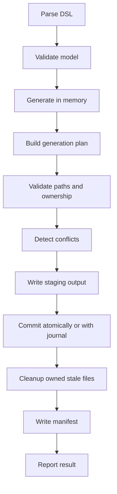

# Sinh mã lặp lại an toàn

Trong một dự án sử dụng ngôn ngữ miền chuyên biệt (Domain-Specific Language, DSL), code generator thường được chạy nhiều lần: mỗi khi người dùng sửa tệp DSL, mỗi lần build, khi cập nhật schema hoặc khi triển khai cấu hình mới. **Sinh mã lặp lại an toàn** là khả năng chạy lại generator mà không tạo ra dữ liệu trùng lặp, làm mất thay đổi không thuộc quyền quản lý của generator hoặc để dự án rơi vào trạng thái không nhất quán khi quá trình sinh mã bị gián đoạn.

Một generator an toàn cần tạo đầu ra có thể dự đoán, nhận diện chính xác những tệp hoặc vùng nội dung mà nó sở hữu, ghi dữ liệu theo cách hạn chế trạng thái dở dang và xử lý rõ xung đột với nội dung do con người chỉnh sửa. Nếu cùng đầu vào và cùng cấu hình được chạy nhiều lần, kết quả nên ổn định. Nếu đầu vào thay đổi, generator chỉ cập nhật những phần thuộc phạm vi của nó. Nếu một bước thất bại, người dùng cần biết tệp nào đã được tạo, tệp nào chưa cập nhật và cách khôi phục.

Khả năng chạy lặp an toàn đặc biệt quan trọng với DSL sinh mã nguồn, cấu hình, schema, client API, migration hoặc pipeline. Generator có thể tạo hàng trăm tệp; chỉ một lần chạy lặp không được kiểm soát cũng có thể nhân đôi import, ghi đè mã tùy chỉnh hoặc xóa nhầm tệp.

## 1. Sinh mã lặp lại an toàn là gì?

Một generator được gọi là an toàn khi nhiều lần chạy trên cùng một đầu vào không làm đầu ra sai lệch dần theo thời gian. Có thể mô tả kỳ vọng cơ bản như sau:

\[
G(I, C) = O
\]

Trong đó:

- `G` là generator.
- `I` là đầu vào, chẳng hạn AST hoặc mô hình miền.
- `C` là cấu hình sinh mã.
- `O` là tập đầu ra.

Nếu đầu vào và cấu hình không thay đổi, chạy lại generator nên tạo ra cùng đầu ra theo quy tắc xác định:

\[
G(I, C) = G(I, C)
\]

Đây là tính xác định (determinism). Ở cấp độ hệ thống tệp, sau khi lần chạy đầu đã hoàn tất, lần chạy tiếp theo không nên tạo thêm nội dung hoặc tệp trùng lặp. Trạng thái cuối cùng cần tương đương với trạng thái sau lần chạy đầu.

Cần phân biệt hai khái niệm:

- **Deterministic generation:** cùng đầu vào tạo cùng nội dung và đường dẫn đầu ra.
- **Idempotent application:** áp dụng cùng kết quả nhiều lần không làm thay đổi trạng thái sau lần đầu.

Một generator có thể deterministic nhưng vẫn không idempotent nếu mỗi lần chạy đều append cùng đoạn mã vào tệp. Ngược lại, một thao tác ghi tệp có thể idempotent nhưng nội dung được sinh ra lại không deterministic do chứa timestamp hoặc thứ tự collection ngẫu nhiên.

## 2. Các rủi ro khi chạy generator nhiều lần

Một số lỗi phổ biến xuất hiện khi generator không được thiết kế cho việc chạy lặp:

- **Nhân đôi nội dung:** mỗi lần chạy append thêm import, đăng ký route hoặc phương thức.
- **Ghi đè mã tùy chỉnh:** generator thay toàn bộ tệp trong khi người dùng đã thêm logic thủ công.
- **Tệp cũ còn sót:** một schema hoặc khai báo bị xóa nhưng tệp tương ứng vẫn tồn tại.
- **Xóa nhầm tệp:** bước cleanup xóa cả tệp không do generator tạo.
- **Đầu ra không ổn định:** thứ tự khai báo, tên tạm hoặc định dạng thay đổi giữa các lần chạy.
- **Ghi dở dang:** tiến trình bị dừng giữa lúc ghi khiến tệp chỉ chứa một phần nội dung.
- **Chạy đồng thời:** hai tiến trình generator ghi vào cùng một thư mục và ghi đè lẫn nhau.
- **Xung đột phiên bản:** generator mới diễn giải metadata cũ theo cách khác rồi làm mất dữ liệu.
- **Đường dẫn không an toàn:** tên từ DSL tạo đường dẫn thoát khỏi thư mục đích hoặc ghi vào vị trí ngoài dự kiến.

Các rủi ro này không chỉ gây lỗi build. Chúng có thể làm mất dữ liệu, tạo thay đổi khó review trong Git hoặc khiến mã được triển khai khác với ý định trong DSL.

## 3. Thiết kế generator có đầu vào và đầu ra rõ ràng

Generator nên nhận một mô hình đã được parse và kiểm chứng, cùng cấu hình sinh mã tường minh. Nó không nên phụ thuộc vào trạng thái ẩn như thư mục làm việc hiện tại, thời gian hệ thống, thứ tự duyệt file hoặc biến môi trường không được khai báo.

Một giao diện khái niệm:

```java
record GenerationRequest(
    DomainModel model,
    Path outputDirectory,
    GeneratorOptions options
) {}

record GeneratedFile(
    Path relativePath,
    String content
) {}

interface CodeGenerator {
    List<GeneratedFile> generate(GenerationRequest request);
}
```

Ở đây, `generate` tạo danh sách kết quả trong bộ nhớ hoặc một biểu diễn kế hoạch. Bước ghi file được tách riêng để có thể kiểm tra đường dẫn, phát hiện xung đột, so sánh nội dung và thực hiện commit an toàn.

Việc tách sinh nội dung khỏi ghi hệ thống tệp đem lại một số lợi ích:

- Có thể kiểm thử generator mà không cần tạo tệp thật.
- Có thể hiển thị trước danh sách tệp sẽ được tạo hoặc cập nhật.
- Có thể kiểm tra đường dẫn trùng nhau trước khi ghi.
- Có thể so sánh nội dung mới với nội dung hiện có.
- Có thể chuẩn bị toàn bộ kế hoạch trước khi thực hiện thay đổi.

## 4. Tính xác định của đầu ra

Để chạy lặp an toàn, generator cần tạo nội dung ổn định. Cùng một mô hình không nên sinh ra nội dung khác nhau chỉ vì thứ tự phần tử trong một `HashMap`, thời gian chạy hoặc môi trường máy.

Các yếu tố cần kiểm soát:

- Sắp xếp khai báo theo quy tắc rõ ràng nếu thứ tự đầu vào không có ý nghĩa.
- Giữ nguyên thứ tự nếu DSL coi thứ tự khai báo là có ý nghĩa.
- Chuẩn hóa newline, encoding và thụt lề.
- Quy định cách viết literal, escape chuỗi và tên định danh.
- Tránh timestamp hoặc đường dẫn máy cục bộ trong nội dung nếu chúng không cần thiết.
- Dùng thuật toán tạo tên ổn định cho biến tạm và symbol.
- Không phụ thuộc vào thứ tự trả về của hệ thống tệp hoặc dịch vụ ngoài.
- Gắn phiên bản generator và schema theo cách có chủ đích.

Ví dụ, nếu các endpoint trong mô hình được lưu bằng map không có thứ tự, generator có thể sắp xếp theo tên endpoint trước khi sinh. Nhưng nếu danh sách route trong DSL có thứ tự ưu tiên, việc sắp xếp sẽ làm thay đổi ngữ nghĩa và không được áp dụng.

### 4.1. Newline và encoding

Một máy có thể dùng LF, máy khác dùng CRLF. Nếu generator không quy định newline, cùng đầu vào có thể tạo diff toàn bộ tệp khi chuyển môi trường. Nên chọn một quy ước, ví dụ UTF-8 và LF, hoặc dùng cấu hình dự án nhất quán.

Nếu generator phải giữ newline gốc trong vùng nội dung do người dùng quản lý, cần phân biệt vùng đó với vùng được sinh. Không nên chuẩn hóa toàn bộ tệp một cách vô điều kiện nếu điều đó tạo thay đổi không cần thiết.

### 4.2. Tên được sinh ổn định

Tên biến tạm hoặc ID được sinh nên phụ thuộc vào cấu trúc logic ổn định. Dùng số tăng dựa trên thứ tự duyệt không ổn định có thể làm mọi tên thay đổi khi thêm một khai báo ở đầu danh sách.

Có thể dùng symbol ID ổn định, tên đã chuẩn hóa hoặc hash có phạm vi phù hợp. Nếu dùng hash, cần xác định đầu vào hash, thuật toán và cách xử lý va chạm; không nên dựa vào `Object.hashCode()` nếu giá trị không ổn định giữa các tiến trình.

## 5. Không append nội dung một cách mù quáng

Một lỗi thường gặp là mở tệp ở chế độ append và thêm đoạn mã mỗi lần chạy:

```java
Files.writeString(
    outputFile,
    generatedCode,
    StandardOpenOption.CREATE,
    StandardOpenOption.APPEND
);
```

Nếu generator chạy ba lần, cùng một đoạn có thể xuất hiện ba lần. Cách này chỉ phù hợp khi thao tác thực sự là ghi nhật ký hoặc một luồng dữ liệu có semantics append được định nghĩa. Với mã nguồn hoặc cấu hình được sinh, thường nên tạo nội dung hoàn chỉnh rồi thay thế có kiểm soát.

Cách tiếp cận an toàn hơn:

1. Tạo toàn bộ nội dung mới.
2. Đọc nội dung hiện tại nếu có.
3. So sánh nội dung hiện tại và nội dung mới.
4. Nếu giống nhau, không ghi lại.
5. Nếu khác nhau và tệp thuộc quyền quản lý của generator, thay thế an toàn.
6. Nếu tệp có nội dung không thuộc quyền quản lý, báo xung đột hoặc dùng vùng được đánh dấu riêng.

## 6. Xác định quyền sở hữu tệp sinh ra

Generator cần biết tệp nào do nó quản lý. Nếu không có thông tin ownership, bước cleanup hoặc update có thể tác động nhầm tệp của người dùng.

Một số cách nhận diện:

- Header trong tệp, ví dụ `// Generated by Acme DSL compiler. Do not edit.`
- Manifest liệt kê đường dẫn, hash và generator đã tạo tệp.
- Thư mục đầu ra riêng, ví dụ `build/generated/`.
- Metadata bên ngoài liên kết tệp với model element hoặc generator ID.
- Marker vùng nội dung được quản lý bên trong tệp.

Ví dụ header:

```java
// Generated by Workflow DSL Generator.
// Source: workflows/release.dsl
// Generator-Version: 2.4
```

Header giúp con người nhận biết nguồn gốc, nhưng không nên là cơ chế duy nhất để xác định quyền sở hữu nếu người dùng có thể chỉnh sửa hoặc xóa nó. Manifest có thể cung cấp dữ liệu có cấu trúc để xác minh.

### 6.1. Thư mục generated riêng

Đặt đầu ra trong thư mục như `build/generated/` giúp phân biệt mã sinh với mã viết tay. Thư mục này có thể được xóa và tạo lại trong build vì ownership rõ ràng.

Tuy nhiên, nếu generator ghi vào `src/main/java` hoặc thư mục dự án do người dùng quản lý, cần cơ chế ownership chi tiết hơn. Không được giả định mọi tệp trong thư mục nguồn đều có thể xóa.

### 6.2. Manifest đầu ra

Manifest có thể lưu danh sách tệp generator đã tạo:

```json
{
  "generator": "workflow-dsl",
  "version": "2.4",
  "files": [
    {
      "path": "generated/ReleaseWorkflow.java",
      "sha256": "..."
    },
    {
      "path": "generated/TaskRegistry.java",
      "sha256": "..."
    }
  ]
}
```

Manifest giúp biết tệp nào thuộc lần chạy trước và hỗ trợ phát hiện tệp đã bị sửa thủ công. Hash cần được tính trên nội dung theo encoding/newline đã chuẩn hóa, hoặc phải ghi rõ chính sách hash.

Manifest cũng cần được cập nhật an toàn cùng với các tệp đầu ra. Nếu manifest mới được ghi nhưng một tệp chưa được thay thế, trạng thái ownership sẽ không phản ánh đúng nội dung trên đĩa.

## 7. Marker vùng mã do generator quản lý

Đôi khi cần sinh mã vào một tệp mà người dùng cũng có thể chỉnh sửa. Có thể đánh dấu vùng nội dung được generator sở hữu:

```java
// <generated id="imports">
import com.example.runtime.Workflow;
import com.example.runtime.Task;
// </generated>

// User-maintained code below.
public class ReleaseExtension {
    // Người dùng có thể bổ sung logic riêng ở đây.
}
```

Generator chỉ thay phần nằm giữa marker `generated`, giữ nguyên nội dung bên ngoài.

Một cách biểu diễn khác:

```text
# <dsl-generated:routes>
route GET /orders -> OrderController
# </dsl-generated:routes>
```

### 7.1. Marker phải duy nhất và cân bằng

Generator cần xác nhận:

- Marker mở và đóng đều tồn tại.
- ID vùng không bị trùng trong cùng tệp.
- Marker đóng thuộc đúng marker mở.
- Các vùng không lồng nhau nếu thiết kế không hỗ trợ lồng.
- Nội dung giữa marker có thể được thay thế an toàn.

Nếu marker bị xóa hoặc sửa sai, không nên đoán vị trí và ghi đè tệp. Hãy báo lỗi ownership hoặc conflict để người dùng xử lý.

### 7.2. Không chỉnh sửa bên trong vùng generated

Nếu người dùng sửa trực tiếp nội dung giữa marker, lần chạy tiếp theo sẽ thay thế thay đổi đó. Cần ghi rõ quy ước: vùng generated không phải nơi để thêm logic thủ công. Người dùng nên đặt phần mở rộng bên ngoài vùng hoặc dùng hook/extension point được thiết kế riêng.

Nếu cần bảo toàn chỉnh sửa thủ công trong vùng, generator phải có cơ chế merge hoặc cấu trúc extension rõ ràng. Chỉ có marker không đủ để hợp nhất hai phiên bản nội dung.

## 8. Phát hiện xung đột khi người dùng sửa tệp sinh

Một tệp do generator tạo vẫn có thể bị người dùng sửa. Nếu generator chạy lại và ghi đè, thay đổi thủ công có thể mất.

Có thể phát hiện bằng cách so sánh hash hiện tại với hash đã lưu trong manifest:

- `H_generated_previous`: hash nội dung generator ghi ở lần trước.
- `H_current`: hash nội dung hiện tại trên đĩa.
- `H_new`: hash nội dung generator định ghi lần này.

Các trường hợp:

| Điều kiện | Diễn giải | Hành động gợi ý |
|---|---|---|
| `H_current = H_generated_previous` | Tệp chưa bị sửa kể từ lần trước | Có thể cập nhật bằng nội dung mới |
| `H_current = H_new` | Tệp đã đúng nội dung cần sinh | Bỏ qua ghi, chỉ cập nhật metadata nếu cần |
| `H_current != H_generated_previous` và `H_current != H_new` | Có thay đổi ngoài dự kiến | Báo conflict hoặc yêu cầu merge |
| Không có manifest cũ nhưng tệp đã tồn tại | Ownership chưa rõ | Không ghi đè mặc định; yêu cầu xác nhận hoặc kiểm tra marker |

Cách này tương tự kiểm tra optimistic concurrency: generator chỉ cập nhật khi tệp vẫn ở trạng thái mà nó dựa vào. Không nên dùng timestamp đơn thuần để xác định tệp có bị sửa, vì độ phân giải thời gian và đồng hồ hệ thống không phải lúc nào cũng đáng tin.

## 9. Ghi tệp theo cách nguyên tử

Nếu ghi trực tiếp vào tệp đích và tiến trình bị dừng giữa chừng, tệp có thể chỉ chứa một phần nội dung. Một kỹ thuật phổ biến là ghi vào tệp tạm cùng thư mục, flush nếu cần, rồi đổi tên tệp tạm thành tệp đích.

Ví dụ Java:

```java
import java.io.IOException;
import java.nio.charset.StandardCharsets;
import java.nio.file.AtomicMoveNotSupportedException;
import java.nio.file.Files;
import java.nio.file.Path;
import java.nio.file.StandardCopyOption;

static void writeAtomically(Path target, String content) throws IOException {
    Path directory = target.toAbsolutePath().getParent();
    Files.createDirectories(directory);

    Path temporary = Files.createTempFile(directory, ".generated-", ".tmp");
    boolean moved = false;

    try {
        Files.writeString(temporary, content, StandardCharsets.UTF_8);
        try {
            Files.move(
                temporary,
                target,
                StandardCopyOption.ATOMIC_MOVE,
                StandardCopyOption.REPLACE_EXISTING
            );
        } catch (AtomicMoveNotSupportedException ex) {
            Files.move(
                temporary,
                target,
                StandardCopyOption.REPLACE_EXISTING
            );
        }
        moved = true;
    } finally {
        if (!moved) {
            Files.deleteIfExists(temporary);
        }
    }
}
```

Ví dụ minh họa ghi nguyên tử ở cấp một tệp. `ATOMIC_MOVE` phụ thuộc hệ thống tệp; không phải mọi môi trường đều hỗ trợ. Fallback `REPLACE_EXISTING` không có cùng bảo đảm nguyên tử. Hệ thống cần quyết định có chấp nhận fallback hay phải dừng nếu atomic move không khả dụng.

Tệp tạm nên được tạo trong cùng filesystem với tệp đích để tăng khả năng move nguyên tử. Với yêu cầu độ bền cao trước mất điện, có thể cần flush dữ liệu và metadata theo API/hệ điều hành phù hợp; chỉ gọi `writeString` chưa đảm bảo dữ liệu đã được ghi bền vững xuống thiết bị lưu trữ.

## 10. Ghi an toàn cho nhiều tệp

Atomic move của một tệp không tạo thành giao dịch nguyên tử cho cả một tập tệp. Nếu generator tạo 20 tệp và thất bại ở tệp thứ 12, thư mục có thể chứa một phần đầu ra mới và một phần đầu ra cũ.

Một quy trình an toàn hơn:

1. Tạo toàn bộ đầu ra trong staging directory.
2. Kiểm tra nội dung và đường dẫn trong staging.
3. So sánh với trạng thái hiện tại và phát hiện conflict.
4. Chuẩn bị danh sách file cần tạo, cập nhật và xóa.
5. Commit các thay đổi theo một kế hoạch có thể khôi phục.
6. Chỉ cập nhật manifest sau khi các tệp liên quan đã được commit.

Với hệ thống yêu cầu tính nhất quán mạnh, có thể dùng thư mục versioned và đổi một con trỏ hoặc thư mục active sau khi staging hoàn tất. Với dự án thông thường, có thể dùng journal ghi lại các thao tác đã hoàn thành và rollback nếu một bước thất bại.

Cần lưu ý rằng đổi tên thư mục hoặc cập nhật nhiều tệp không tự động là giao dịch trên mọi hệ điều hành và filesystem. Thiết kế nên mô tả rõ mức đảm bảo thực tế: atomic per-file, rollback best-effort hay switch toàn bộ output directory.

## 11. Lập kế hoạch trước khi ghi

Trước khi thay đổi hệ thống tệp, generator nên tạo một GenerationPlan. Kế hoạch có thể liệt kê:

- Tệp mới cần tạo.
- Tệp hiện có cần cập nhật.
- Tệp không đổi.
- Tệp cũ có thể xóa vì không còn được sinh.
- Tệp có conflict do bị sửa ngoài generator.
- Manifest mới.
- Lý do mỗi tệp được thêm, cập nhật hoặc xóa.

Ví dụ kết quả kế hoạch:

| Tệp | Trạng thái | Hành động |
|---|---|---|
| `generated/Order.java` | Nội dung thay đổi | Update |
| `generated/Customer.java` | Giống nội dung hiện tại | Skip |
| `generated/Invoice.java` | Chưa tồn tại | Create |
| `generated/OldReport.java` | Không còn trong model, ownership đã xác nhận | Delete |
| `src/CustomExtension.java` | Không thuộc generator | Preserve |

Việc lập kế hoạch tách quyết định khỏi thao tác ghi. Nó cũng cho phép hiển thị preview, chạy dry-run và yêu cầu người dùng xác nhận các thao tác có rủi ro như xóa tệp.

## 12. Dry-run và chế độ kiểm tra

Một generator hữu ích thường có ít nhất ba chế độ:

- **Generate:** thực hiện tạo/cập nhật đầu ra.
- **Dry-run:** tính toán kế hoạch nhưng không ghi tệp.
- **Check/verify:** kiểm tra đầu ra hiện có có khớp với kết quả cần sinh hay không; trả trạng thái khác 0 nếu có drift.

Dry-run giúp người dùng biết generator sẽ làm gì trước khi thay đổi dự án. Check mode phù hợp với CI: thay vì tự sửa file, nó báo rằng đầu ra được commit trong repository đã lỗi thời.

Ví dụ giao diện CLI:

```text
dsl generate --output build/generated

dsl generate --dry-run --output build/generated

dsl generate --check --output src/generated
```

Cần xác định rõ chế độ check có ghi cache hoặc metadata không. Lý tưởng là check không làm thay đổi workspace để CI có thể phát hiện drift một cách tin cậy.

## 13. Cleanup tệp không còn được sinh

Khi người dùng xóa một khai báo DSL, generator có thể không còn sinh tệp tương ứng. Tệp cũ cần được xử lý, nếu không thư mục output sẽ chứa mã lỗi thời.

Tuy nhiên, cleanup là thao tác nguy hiểm vì có thể xóa tệp người dùng tạo hoặc sửa. Chỉ xóa tệp khi có bằng chứng ownership, chẳng hạn:

- Đường dẫn nằm trong thư mục output riêng do generator quản lý hoàn toàn.
- Tệp được liệt kê trong manifest của lần chạy trước.
- Hash hiện tại vẫn khớp với hash generator đã ghi, hoặc policy cho phép xóa tệp đã sửa sau khi xác nhận.
- Tệp không bị chuyển sang vị trí khác hoặc được tái sử dụng bởi một thành phần khác.

Nếu tệp đã bị sửa thủ công, mặc định an toàn là báo conflict và giữ tệp. Người dùng có thể quyết định lưu trữ, xóa hoặc hợp nhất.

### 13.1. Không xóa theo wildcard thiếu kiểm soát

Lệnh kiểu “xóa mọi file `*.java` trong thư mục nguồn rồi sinh lại” có thể xóa mã viết tay. Cleanup cần dựa trên danh sách tệp đã được generator sở hữu, không dựa trên phần mở rộng hoặc tên gần giống.

### 13.2. Xóa theo manifest cũ

Sau khi sinh thành công, so sánh manifest cũ và manifest mới:

- Có trong cả hai: kiểm tra để cập nhật hoặc bỏ qua.
- Chỉ có trong manifest mới: tạo mới.
- Chỉ có trong manifest cũ: xem xét xóa nếu ownership vẫn hợp lệ.

Manifest mới chỉ được công bố sau khi commit thành công. Nếu ghi manifest quá sớm, lần chạy sau có thể tưởng một tệp đã được tạo dù thực tế chưa có.

## 14. Bảo vệ đường dẫn đầu ra

Tên khai báo trong DSL có thể được dùng để tạo tên tệp. Nếu không kiểm tra, tên như `../../outside/secret` có thể khiến generator ghi ra ngoài thư mục đích. Đây là path traversal.

Các nguyên tắc:

- Chỉ chấp nhận thành phần tên theo grammar và quy tắc đặt tên được hỗ trợ.
- Không ghép trực tiếp dữ liệu đầu vào thành đường dẫn tùy ý.
- Chuẩn hóa đường dẫn đích và xác nhận nó nằm dưới output root.
- Xử lý symlink theo policy; không đi theo symlink ra ngoài thư mục quản lý.
- Chặn tên tuyệt đối, drive prefix hoặc UNC path nếu không được phép.
- Kiểm tra đường dẫn trùng sau khi chuẩn hóa, kể cả khác chữ hoa/chữ thường trên filesystem không phân biệt case.
- Không ghi vào thư mục hệ thống hoặc thư mục ngoài phạm vi cấu hình.

Ví dụ Java:

```java
static Path resolveOutput(Path root, Path relative) throws IOException {
    Path normalizedRoot = root.toAbsolutePath().normalize();
    Path target = normalizedRoot.resolve(relative).normalize();

    if (!target.startsWith(normalizedRoot)) {
        throw new IOException("Generated path escapes output directory");
    }
    return target;
}
```

Đây là kiểm tra lexical path cơ bản. Với symlink, cần kiểm tra thêm đường dẫn thực tế (real path) và các thư mục cha hiện có. Nếu attacker có thể thay symlink giữa lúc kiểm tra và lúc ghi, có thể xuất hiện race condition; môi trường nhạy cảm cần API thao tác file an toàn hơn hoặc thư mục build cô lập.

## 15. Chạy đồng thời và khóa generator

Hai tiến trình generator chạy đồng thời trên cùng output directory có thể:

- Ghi đè kết quả của nhau.
- Đọc cùng manifest cũ rồi tạo hai manifest mới khác nhau.
- Xóa tệp mà tiến trình kia vừa tạo.
- Trộn nội dung staging hoặc dùng cùng tên tệp tạm.

Một số giải pháp:

- Dùng file lock hoặc cơ chế lock theo project/output root.
- Tạo staging directory duy nhất cho mỗi lần chạy.
- Ghi build ID hoặc revision vào manifest.
- Kiểm tra manifest revision trước khi commit.
- Dùng optimistic concurrency: nếu trạng thái đã đổi từ lúc lập kế hoạch, hủy commit và tính lại.
- Đảm bảo tệp tạm không trùng tên giữa các tiến trình.

Khóa cần có timeout và thông báo rõ tiến trình nào đang giữ khóa. Không nên chờ vô hạn nếu một tiến trình trước đó bị treo. Nếu lock file có thể còn sót sau crash, cần cơ chế xác định lock stale an toàn; chỉ xóa lock dựa trên thời gian có thể gây xung đột với tiến trình vẫn đang chạy.

## 16. Tách mã sinh khỏi phần mở rộng thủ công

Nếu người dùng cần tùy chỉnh hành vi, generator nên cung cấp extension point thay vì yêu cầu chỉnh trực tiếp vùng generated.

Một số mẫu thiết kế:

- **Partial class hoặc partial declaration:** phần generated và phần custom nằm ở tệp khác nhưng được kết hợp bởi nền tảng hỗ trợ.
- **Subclass hoặc adapter:** generator tạo lớp cơ sở, người dùng viết lớp con.
- **Hook/interface:** generator gọi một interface hoặc callback do người dùng triển khai.
- **Plugin registry:** người dùng đăng ký thành phần mở rộng qua API riêng.
- **Template override:** người dùng thay template theo cơ chế được công bố.
- **Protected region:** marker chỉ định vùng người dùng có thể chỉnh sửa và generator phải giữ lại.

Ví dụ:

```java
// Generated file: OrderServiceBase.java
public abstract class OrderServiceBase {
    public final void createOrder(Order order) {
        validate(order);
        beforeCreate(order);
        persist(order);
    }

    protected void beforeCreate(Order order) {
        // Extension hook
    }
}
```

Người dùng có thể triển khai hook trong lớp riêng. Lần sinh lại `OrderServiceBase.java` không làm mất lớp mở rộng.

## 17. Tính tương thích giữa các phiên bản generator

Generator có thể thay đổi cách đặt tên, cấu trúc output, runtime helper hoặc metadata. Một lần chạy generator mới trên output cũ cần biết phiên bản trước và cách chuyển đổi.

Manifest có thể chứa:

- Generator ID và version.
- Version grammar hoặc schema đầu vào.
- Phiên bản format manifest.
- Danh sách tệp và hash.
- Cấu hình ảnh hưởng đầu ra.
- Build ID hoặc revision nguồn.

Khi phiên bản thay đổi, có thể:

- Cập nhật trực tiếp nếu output cũ tương thích.
- Chạy migration có kiểm soát.
- Yêu cầu xóa và tạo lại thư mục generated nếu ownership hoàn toàn rõ.
- Từ chối chạy nếu không thể xác định cách chuyển đổi an toàn.

Không nên giả định mọi output cũ đều có thể được ghi đè. Nếu manifest không tồn tại hoặc không hiểu được, generator cần chế độ adoption riêng hoặc yêu cầu người dùng xác nhận.

## 18. Giao dịch sinh mã và khôi phục khi thất bại

Một lần sinh mã có thể bao gồm nhiều thao tác: tạo thư mục, ghi tệp, xóa tệp cũ, cập nhật manifest và tạo source map. Nếu một bước thất bại, cần biết trạng thái nào đã được áp dụng.

Một quy trình commit có thể là:

1. Parse và validate đầu vào.
2. Sinh tất cả nội dung vào staging.
3. Xác nhận đường dẫn và ownership.
4. Kiểm tra conflict với tệp hiện tại.
5. Ghi journal chứa kế hoạch và trạng thái dự kiến.
6. Commit tệp mới/cập nhật theo thứ tự đã chọn.
7. Thực hiện cleanup các tệp cũ đã xác nhận.
8. Ghi manifest mới cuối cùng.
9. Xóa staging và journal sau khi xác nhận hoàn tất.

Nếu thất bại trước khi commit, có thể xóa staging. Nếu thất bại giữa commit, journal giúp biết thao tác nào đã xong để tiếp tục hoặc rollback. Rollback không phải lúc nào cũng khôi phục được mọi metadata của filesystem, vì vậy cần xác định mức đảm bảo và giữ backup khi dữ liệu có giá trị.

Một lựa chọn khác là sinh toàn bộ output vào thư mục versioned mới, rồi đổi một đường dẫn active sau khi hoàn tất. Cách này giảm thời gian mà người dùng thấy trạng thái nửa cũ nửa mới, nhưng cần filesystem hỗ trợ thao tác đổi tên phù hợp và cần quản lý thư mục phiên bản cũ.

## 19. Sinh mã an toàn khi có lỗi đầu vào

Không nên bắt đầu ghi output trước khi đầu vào DSL đã qua các bước kiểm tra cần thiết. Nếu parser hoặc semantic validation phát hiện lỗi, generator cần quyết định rõ:

- Từ chối toàn bộ lần sinh.
- Cho phép sinh một phần trong chế độ preview hoặc IDE, nhưng không công bố là artifact hoàn chỉnh.
- Sinh các module độc lập đã hợp lệ nếu hợp đồng cho phép partial build.

Với build hoặc triển khai, lựa chọn phổ biến là validate toàn bộ mô hình trước khi ghi output chính thức. Điều này tránh trường hợp một nửa tệp được cập nhật từ mô hình mới còn nửa kia giữ nội dung cũ.

Nếu generator hỗ trợ partial generation, output cần được đánh dấu incomplete hoặc nằm trong staging riêng. Runtime không nên tải nó như artifact đã xác nhận.

## 20. Dry-run, diff và trải nghiệm người dùng

Một generator an toàn nên giải thích trước những gì nó sắp thay đổi. Dry-run có thể hiển thị:

```text
CREATE  generated/Order.java
UPDATE  generated/Customer.java
SKIP    generated/Registry.java (unchanged)
DELETE  generated/LegacyOrder.java (owned, unchanged)
CONFLICT generated/Payment.java (modified outside generator)
```

Diff giúp người dùng review thay đổi thực tế. Với tệp lớn, có thể hiển thị thống kê hoặc chỉ đường dẫn và hash; với thay đổi có rủi ro, cần cho xem nội dung hoặc bản diff đầy đủ.

Chế độ `--check` trong CI có thể trả lỗi nếu tệp generated không khớp đầu ra mong đợi. Điều này giúp phát hiện developer quên chạy generator hoặc commit output cũ.

Các thông báo cần phân biệt rõ:

- Đầu ra đã được tạo.
- Đầu ra đã được cập nhật.
- Nội dung không thay đổi và được bỏ qua.
- Có conflict cần xử lý.
- Có tệp cũ cần cleanup.
- Lần sinh thất bại và output chưa được commit hoàn chỉnh.

## 21. Ví dụ Java: so sánh trước khi ghi

Một thao tác đơn giản là chỉ ghi khi nội dung thay đổi:

```java
import java.io.IOException;
import java.nio.charset.StandardCharsets;
import java.nio.file.Files;
import java.nio.file.Path;

static boolean writeIfChanged(Path target, String generated)
        throws IOException {
    if (Files.exists(target)) {
        String current = Files.readString(target, StandardCharsets.UTF_8);
        if (current.equals(generated)) {
            return false;
        }
    }

    writeAtomically(target, generated);
    return true;
}
```

Hàm trả về `false` nếu nội dung không đổi và `true` nếu đã ghi. Nó tránh thay đổi timestamp và tạo diff không cần thiết khi đầu ra giống nhau.

Tuy nhiên, hàm này chưa tự xác minh ownership. Nếu tệp tồn tại và chứa nội dung do người dùng viết, nó vẫn ghi đè. Trong hệ thống thực tế, cần kiểm tra manifest, header hoặc marker trước khi gọi `writeAtomically`.

## 22. Ví dụ: manifest và phát hiện chỉnh sửa ngoài generator

Một manifest có thể lưu hash nội dung đã sinh ở lần trước. Quy trình khái niệm:

```java
String previousHash = manifest.hashFor(relativePath);
String currentHash = sha256IfExists(target);
String newHash = sha256(generatedContent);

if (previousHash == null && currentHash != null) {
    throw new GenerationConflict("Existing file has unknown ownership");
}

if (previousHash != null
        && currentHash != null
        && !previousHash.equals(currentHash)
        && !newHash.equals(currentHash)) {
    throw new GenerationConflict("Generated file was modified manually");
}

if (!newHash.equals(currentHash)) {
    writeAtomically(target, generatedContent);
}
```

Đây là logic minh họa. Cần xử lý thêm trường hợp tệp bị xóa, hash không đọc được, manifest hỏng, đường dẫn thay đổi và generator version khác. Hash chỉ giúp phát hiện nội dung thay đổi; nó không xác định ai đã sửa hoặc sửa với mục đích gì.

## 23. Kiểm thử tính an toàn khi chạy lặp

Kiểm thử generator nên chạy cùng một đầu vào nhiều lần và so sánh cả nội dung lẫn trạng thái hệ thống tệp.

### 23.1. Kiểm thử idempotence

1. Sinh mã lần đầu.
2. Chụp nội dung và danh sách tệp.
3. Chạy lại cùng đầu vào.
4. Xác nhận nội dung và danh sách tệp không đổi.
5. Xác nhận không có đoạn mã hoặc import bị nhân đôi.

### 23.2. Kiểm thử deterministic output

Chạy generator trên cùng mô hình nhưng với thứ tự duyệt collection hoặc thứ tự tải module khác nhau nếu thứ tự không có ý nghĩa. Kết quả cần giống nhau.

### 23.3. Kiểm thử conflict

Sửa thủ công một tệp generated rồi chạy lại. Xác nhận generator báo conflict hoặc giữ phần custom theo chính sách, không âm thầm ghi đè.

### 23.4. Kiểm thử cleanup

Xóa một khai báo trong DSL. Xác nhận chỉ tệp được manifest xác nhận là thuộc generator mới được xem xét xóa. Tệp viết tay và tệp đã sửa ngoài generator phải được giữ hoặc yêu cầu xác nhận.

### 23.5. Kiểm thử lỗi giữa chừng

Mô phỏng lỗi khi ghi tệp thứ hai hoặc cập nhật manifest. Xác nhận hệ thống có thể rollback, tiếp tục hoặc báo trạng thái partial rõ ràng. Không được tuyên bố thành công nếu chỉ một phần output đã commit.

### 23.6. Kiểm thử đường dẫn và đồng thời

Thử tên chứa `..`, đường dẫn tuyệt đối, ký tự phân cách và symlink. Chạy hai generator cùng lúc trên một output root để xác nhận lock hoặc optimistic concurrency ngăn ghi đè lẫn nhau.

## 24. Quy trình sinh mã lặp lại an toàn

Một pipeline có thể được tổ chức như sau:



Các bước quan trọng:

1. **Parse và kiểm chứng:** không sinh output chính thức từ mô hình còn lỗi.
2. **Sinh nội dung xác định:** cùng input/config tạo cùng nội dung.
3. **Lập kế hoạch:** phân loại create, update, skip, delete và conflict.
4. **Kiểm tra ownership:** biết rõ tệp hoặc vùng nào generator được phép sửa.
5. **Kiểm tra đường dẫn:** bảo đảm output nằm trong root được phép.
6. **Ghi staging:** chuẩn bị toàn bộ nội dung trước khi commit.
7. **Commit:** dùng atomic replace cho từng tệp hoặc cơ chế giao dịch phù hợp.
8. **Cleanup:** chỉ xóa tệp cũ có ownership đã xác nhận.
9. **Cập nhật manifest:** ghi metadata sau khi các thay đổi liên quan đã hoàn tất.
10. **Báo cáo:** cung cấp diff, conflict và trạng thái hoàn thành rõ ràng.

## 25. Những nguyên tắc thiết kế quan trọng

- **Tách generate khỏi write:** có thể kiểm tra và preview kết quả trước khi thay đổi hệ thống tệp.
- **Deterministic output:** chuẩn hóa thứ tự, encoding, newline, tên và literal.
- **Không append mù quáng:** tạo nội dung hoàn chỉnh rồi so sánh và thay thế có kiểm soát.
- **Xác định ownership:** dùng thư mục riêng, manifest, marker hoặc metadata đáng tin cậy.
- **Bảo vệ chỉnh sửa thủ công:** phát hiện conflict thay vì âm thầm ghi đè.
- **Ghi tệp nguyên tử:** dùng staging file và atomic move khi môi trường hỗ trợ.
- **Quản lý nhiều tệp:** có kế hoạch commit, journal hoặc thư mục versioned.
- **Cleanup có bằng chứng:** chỉ xóa tệp generator thực sự sở hữu.
- **Chặn path traversal:** chuẩn hóa và kiểm tra đường dẫn dưới output root.
- **Điều phối chạy đồng thời:** lock hoặc kiểm tra revision trước commit.
- **Cung cấp extension point:** để người dùng tùy chỉnh trong vùng không bị ghi đè.
- **Quản lý phiên bản:** manifest ghi nhận generator, schema và cấu hình liên quan.
- **Có dry-run và check mode:** cho phép review và phát hiện drift trong CI.
- **Kiểm thử failure path:** thử crash, conflict, cleanup, đường dẫn độc hại và chạy đồng thời.

Sinh mã lặp lại an toàn giúp generator trở thành một phần đáng tin cậy của vòng đời phát triển DSL. Khi đầu ra có tính xác định, quyền sở hữu tệp được theo dõi, thay đổi được lập kế hoạch trước, thao tác ghi có thể khôi phục và chỉnh sửa thủ công được bảo vệ, người dùng có thể chạy generator nhiều lần mà không lo nội dung bị nhân đôi hoặc dữ liệu ngoài phạm vi bị mất. Đây là nền tảng để tự động hóa code generation trong IDE, build pipeline và quy trình triển khai một cách ổn định.
