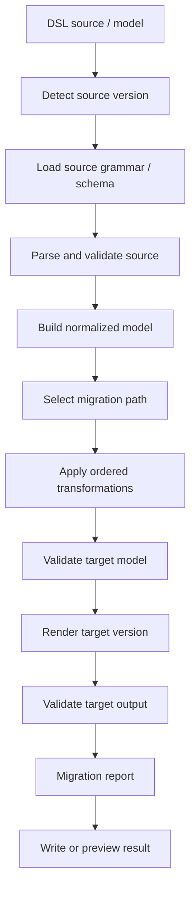
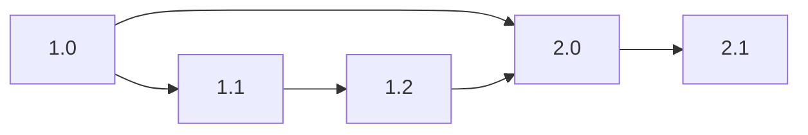

# Chuyển đổi phiên bản

Trong quá trình phát triển ngôn ngữ chuyên biệt miền (Domain-Specific Language, DSL), cú pháp, mô hình dữ liệu, kiểu, quy tắc và cách diễn giải chương trình có thể thay đổi. Một phiên bản mới có thể đổi tên thuộc tính, thay cấu trúc khai báo, bổ sung kiểu dữ liệu, loại bỏ cú pháp cũ hoặc điều chỉnh ý nghĩa của một quy tắc. Khi đó, các chương trình DSL được viết theo phiên bản trước cần được xử lý để tiếp tục sử dụng được với toolchain mới.

**Chuyển đổi phiên bản (version migration hoặc version conversion)** là quá trình biến đổi một chương trình, mô hình hoặc dữ liệu DSL từ phiên bản ngôn ngữ hay schema này sang phiên bản khác. Mục tiêu thường là đưa nội dung cũ về dạng mới mà vẫn giữ nguyên ý nghĩa nghiệp vụ, hoặc chỉ thay đổi ý nghĩa khi có quyết định rõ ràng và được ghi nhận.

Ví dụ, phiên bản 1 của DSL có thể dùng thuộc tính `timeout`, còn phiên bản 2 tách thành `connect_timeout` và `response_timeout`. Một chương trình cũ chỉ có `timeout = 30s` không thể được đổi tên máy móc nếu hai giá trị mới có ý nghĩa khác nhau. Công cụ migration cần biết quy tắc ánh xạ: có thể gán cả hai bằng 30 giây, hoặc yêu cầu người dùng chọn chính sách phù hợp.

Chuyển đổi phiên bản không chỉ là thay chuỗi trong file. Nó có thể liên quan đến grammar, AST, metamodel, kiểu, ràng buộc, thư viện, runtime, dữ liệu lưu trữ và các artifact được sinh ra. Vì vậy, một quy trình migration tốt cần nhận diện phiên bản nguồn, xác định phiên bản đích, áp dụng các bước biến đổi có kiểm soát, báo rõ những trường hợp không thể tự quyết định và xác minh kết quả sau chuyển đổi.

## 1. Chuyển đổi phiên bản là gì?

Một DSL có vòng đời. Phiên bản đầu có thể chỉ hỗ trợ một nhóm khái niệm cơ bản; các phiên bản sau mở rộng mô hình, cải thiện cách diễn đạt hoặc sửa các điểm chưa hợp lý. Khi cấu trúc thay đổi, nội dung đã viết theo phiên bản cũ cần được đọc và chuyển đổi theo quy tắc tương ứng.

Ví dụ DSL phiên bản 1:

```text
languageVersion = "1.0"

service DonHang {
    timeout = 30s
    retry = 3
}
```

Giả sử phiên bản 2 chuẩn hóa tên thuộc tính và tách timeout:

```text
languageVersion = "2.0"

service DonHang {
    connect_timeout = 30s
    response_timeout = 30s
    retry_count = 3
}
```

Migration từ 1.0 sang 2.0 cần thực hiện ít nhất hai biến đổi: đổi `retry` thành `retry_count` và ánh xạ `timeout` sang hai thuộc tính mới. Biến đổi thứ hai cần quy tắc ngữ nghĩa, không chỉ thao tác đổi tên.

### 1.1. Đối tượng được chuyển đổi

Tùy kiến trúc DSL, đối tượng migration có thể là:

- **Văn bản nguồn:** File DSL mà người dùng trực tiếp chỉnh sửa.
- **AST hoặc CST:** Cây cú pháp đã parse, có thể giữ hoặc không giữ trivia.
- **Metamodel/domain model:** Mô hình lớp, thuộc tính, quan hệ và ràng buộc.
- **Dữ liệu instance:** Các bản ghi hoặc đối tượng được tạo theo schema DSL.
- **Cấu hình runtime:** Tham số điều khiển cách interpreter hoặc engine hoạt động.
- **Artifact sinh ra:** Mã nguồn, schema, manifest hoặc cấu hình được tạo từ DSL.

Các đối tượng này có quan hệ nhưng không đồng nhất. Chuyển đổi file nguồn không tự động cập nhật dữ liệu đang lưu trong database; đổi metamodel không tự động sửa API client đã sinh.

### 1.2. Phiên bản nguồn và phiên bản đích

Migration luôn có một phiên bản nguồn (source version) và một phiên bản đích (target version). Công cụ cần biết cả hai để chọn đúng chuỗi biến đổi.

Ví dụ:

```text
sourceVersion = 1.4
targetVersion = 2.1
```

Nếu chỉ có một phiên bản mà không xác định nguồn, toolchain có thể parse chương trình bằng grammar sai hoặc áp dụng migration không phù hợp.

### 1.3. Chuyển đổi khác với biên dịch

Biên dịch thường chuyển chương trình từ DSL sang một target language hoặc representation khác để thực thi. Migration chuyển chương trình giữa các phiên bản của cùng một DSL hoặc schema. Hai quá trình có thể dùng chung AST và transformation framework, nhưng mục tiêu khác nhau.

### 1.4. Chuyển đổi khác với nâng cấp runtime

Nâng cấp runtime thay đổi interpreter, engine hoặc thư viện thực thi. Một runtime mới có thể vẫn đọc được file DSL cũ, hoặc có thể yêu cầu file phải được migration trước. Cần quy định riêng khả năng tương thích giữa định dạng nguồn và runtime.

## 2. Vì sao DSL cần quản lý phiên bản?

Một DSL được dùng trong dự án lâu dài thường phải thay đổi để đáp ứng yêu cầu mới. Nếu không có chiến lược phiên bản và migration, mỗi thay đổi nhỏ đều có thể buộc người dùng viết lại thủ công nhiều file.

### 2.1. Cải thiện thiết kế ngôn ngữ

Tên thuộc tính, cấu trúc khối hoặc cách khai báo ban đầu có thể gây nhầm lẫn. Phiên bản mới có thể làm cú pháp nhất quán hơn, bỏ cấu trúc dư thừa hoặc thay cách biểu diễn khó mở rộng.

### 2.2. Mở rộng khả năng miền

Một DSL logistics có thể bổ sung loại phương tiện, vùng giao hàng hoặc cách tính phí. Một DSL hạ tầng có thể thêm loại tài nguyên hoặc chính sách bảo mật. Mô hình mới cần được tích hợp mà không làm mất các cấu hình hiện có.

### 2.3. Sửa lỗi ngữ nghĩa

Phiên bản mới có thể sửa một quy tắc đã diễn giải sai, ví dụ thay cách tính timeout hoặc thay thứ tự ưu tiên giữa các rule. Đây là thay đổi nhạy cảm vì cùng văn bản có thể tạo hành vi khác.

### 2.4. Chuẩn hóa kiểu và mô hình

DSL có thể chuyển từ kiểu chuỗi chung sang kiểu miền cụ thể, chẳng hạn `String` thành `OrderId`, hoặc tách `Number` thành `Money`, `Duration` và `Percentage`. Chuyển đổi giúp dữ liệu cũ phù hợp với mô hình kiểu mới.

### 2.5. Tương thích với hệ sinh thái

Generator, IDE, plugin, schema, API và runtime có thể phát triển độc lập. Quản lý phiên bản giúp các thành phần biết chúng có tương thích với nhau hay cần adapter hoặc migration.

### 2.6. Giảm chi phí nâng cấp

Khi có migration tự động, người dùng có thể chuyển hàng trăm file theo cùng một quy tắc, xem báo cáo và xử lý những trường hợp ngoại lệ. Điều này giảm thao tác lặp và giúp kết quả nhất quán.

## 3. Phân biệt các loại phiên bản

Một hệ thống DSL có thể có nhiều loại phiên bản cùng lúc. Không nên dùng một trường `version` chung cho mọi thứ nếu chúng có vòng đời khác nhau.

| Loại phiên bản | Mô tả | Ví dụ |
|---|---|---|
| Language version | Phiên bản cú pháp và ngữ nghĩa DSL | DSL 2.0 |
| Schema/metamodel version | Phiên bản cấu trúc dữ liệu hoặc metamodel | Model schema 4 |
| Runtime version | Phiên bản interpreter hoặc execution engine | Runtime 3.2 |
| Generator version | Phiên bản bộ sinh mã và template | Generator 5.1 |
| Target version | Phiên bản ngôn ngữ hoặc nền tảng đầu ra | Java 21, SQL dialect |
| Data version | Phiên bản dữ liệu instance được lưu | Record schema 7 |
| Plugin/API version | Phiên bản hợp đồng tích hợp | Plugin API 2 |

Ví dụ, một file có thể dùng DSL language version 2.0, metamodel version 3, được xử lý bởi runtime 4.1 và sinh mã Java 21. Mỗi phiên bản trả lời một câu hỏi khác nhau.

### 3.1. Language version

Language version quy định grammar, từ khóa, kiểu và quy tắc ngữ nghĩa mà parser và semantic analyzer cần áp dụng.

### 3.2. Metamodel version

Metamodel version quy định cấu trúc mô hình: lớp, thuộc tính, quan hệ, bội số, kiểu và constraint. Nó có thể thay đổi ngay cả khi cú pháp văn bản gần như không đổi.

### 3.3. Runtime version

Runtime version quy định khả năng thực thi, API, thư viện và hành vi của engine. Runtime mới có thể hỗ trợ nhiều language version hoặc chỉ hỗ trợ một tập phiên bản nhất định.

### 3.4. Generator và target version

Generator có thể đổi template hoặc cách ánh xạ kiểu mà không thay đổi DSL. Target version quyết định cấu trúc output được phép sinh, ví dụ Java 17 và Java 21 có thể hỗ trợ các cấu trúc ngôn ngữ khác nhau.

### 3.5. Ma trận tương thích

Với sản phẩm có nhiều thành phần, nên công bố ma trận tương thích. Ví dụ runtime 4.x có thể đọc language 1.5 đến 2.2; generator 5.x có thể nhận metamodel 3.x. Ma trận giúp tránh giả định rằng thành phần mới nhất luôn đọc được mọi định dạng cũ.

## 4. Quy tắc đặt số phiên bản

Phiên bản cần có định dạng và ý nghĩa nhất quán để toolchain xác định mức độ thay đổi.

### 4.1. Semantic Versioning

Một cách đặt phiên bản phổ biến là `MAJOR.MINOR.PATCH`:

- **MAJOR:** Thay đổi không tương thích, có thể yêu cầu migration hoặc sửa chương trình.
- **MINOR:** Bổ sung tính năng theo cách tương thích trong phạm vi hợp đồng đã công bố.
- **PATCH:** Sửa lỗi hoặc cải thiện không chủ đích làm thay đổi hợp đồng tương thích.

Ví dụ `2.4.1` có major là 2, minor là 4 và patch là 1. Quy tắc SemVer ban đầu thường áp dụng cho API hoặc sản phẩm; khi dùng cho DSL, nhóm phát triển cần định nghĩa rõ điều gì được coi là breaking change của ngôn ngữ.

### 4.2. Version của file DSL

File có thể khai báo phiên bản rõ ràng:

```text
language "shipping-policy" version "2.0"

policy giao_hang {
    ...
}
```

Hoặc dùng metadata ở đầu file:

```yaml
language: shipping-policy
languageVersion: 2.0
```

Đây là các dạng minh họa. Cần chọn một cách biểu diễn duy nhất hoặc xác định rõ thứ tự ưu tiên nếu dự án hỗ trợ cả metadata và khai báo trong nội dung.

### 4.3. Version range

Một project có thể yêu cầu một khoảng phiên bản:

```text
requires language >= 2.0, < 3.0
```

Version range hữu ích khi một ứng dụng hỗ trợ nhiều minor release nhưng chưa tương thích với major tiếp theo.

### 4.4. Phiên bản chưa phát hành

Các nhãn như `2.0.0-alpha.1`, `2.0.0-beta.2` hoặc `2.0.0-rc.1` có thể biểu diễn bản thử nghiệm. Không nên dùng file production phụ thuộc vào cú pháp thử nghiệm nếu runtime và migration chưa cam kết ổn định.

## 5. Tương thích ngược và tương thích xuôi

Tương thích là khái niệm quan trọng khi thiết kế thay đổi phiên bản.

### 5.1. Backward compatibility

Tương thích ngược thường có nghĩa phiên bản mới của công cụ vẫn đọc hoặc xử lý được nội dung được tạo theo phiên bản cũ. Ví dụ runtime 2.x vẫn chấp nhận file DSL 1.x.

Tương thích ngược có thể được thực hiện bằng parser nhiều phiên bản, adapter hoặc migration ngầm. Cần phân biệt “đọc được” với “giữ nguyên hành vi”: parser có thể chấp nhận file cũ nhưng semantics mới vẫn làm kết quả thay đổi.

### 5.2. Forward compatibility

Tương thích xuôi thường có nghĩa công cụ cũ có thể bỏ qua hoặc xử lý an toàn một số nội dung được tạo bởi phiên bản mới hơn. Điều này khó bảo đảm nếu phiên bản mới bổ sung cú pháp hoặc ý nghĩa mà công cụ cũ không hiểu.

Một định dạng có extension point hoặc metadata không ảnh hưởng đến phần cũ có thể hỗ trợ forward compatibility tốt hơn.

### 5.3. Source compatibility

Source compatibility xem xét chương trình nguồn cũ có còn được chấp nhận bởi compiler/parser mới hay không. Đổi tên từ khóa hoặc bỏ một production có thể phá source compatibility.

### 5.4. Binary/API compatibility

Nếu DSL sinh bytecode, class hoặc API, thay đổi schema nguồn có thể ảnh hưởng binary compatibility hoặc hợp đồng của consumer. Đây là vấn đề ở artifact được sinh, không chỉ ở file DSL.

### 5.5. Semantic compatibility

Hai phiên bản có thể parse cùng văn bản nhưng diễn giải khác nhau. Ví dụ, `timeout = 30s` trước đây áp dụng cho toàn bộ request, còn phiên bản mới chỉ áp dụng cho kết nối. Đây là thay đổi ngữ nghĩa và cần được xem là breaking nếu làm thay đổi hành vi quan sát được.

### 5.6. Data compatibility

Dữ liệu instance được lưu theo schema cũ có thể cần chuyển đổi để phù hợp schema mới. Tương thích của file khai báo không tự bảo đảm dữ liệu lưu trữ đã tương thích.

## 6. Phân loại thay đổi phiên bản

Trước khi viết migration, cần phân loại thay đổi để biết loại biến đổi nào cần thực hiện.

| Loại thay đổi | Ví dụ | Hướng xử lý thường gặp |
|---|---|---|
| Rename | `retry` thành `retry_count` | Đổi tên node/thuộc tính |
| Add optional field | Thêm `description` tùy chọn | Bổ sung giá trị mặc định hoặc bỏ trống |
| Add required field | Thêm `region` bắt buộc | Suy ra, hỏi người dùng hoặc báo lỗi |
| Remove field | Bỏ `legacy_mode` | Xóa nếu không còn ý nghĩa, hoặc chuyển sang thay thế |
| Split field | `timeout` thành hai timeout | Ánh xạ theo quy tắc hoặc cần quyết định |
| Merge fields | `host` và `port` thành `endpoint` | Kết hợp giá trị theo cú pháp mới |
| Change type | `String` thành `Duration` | Parse và validate dữ liệu |
| Change cardinality | Một endpoint thành danh sách endpoint | Bọc giá trị đơn thành collection |
| Change semantics | Đổi thứ tự ưu tiên rule | Phân tích tác động và yêu cầu xác nhận |
| Change grammar | Đổi dấu phân cách hoặc cấu trúc block | Rewrite cú pháp hoặc render lại source |

### 6.1. Thay đổi cú pháp

Thay đổi cú pháp ảnh hưởng đến lexer/parser. Migration thường parse nguồn cũ bằng grammar tương ứng, sau đó render lại theo grammar mới.

### 6.2. Thay đổi mô hình

Metamodel có thể đổi tên class, thuộc tính, quan hệ hoặc bội số. Nếu model trung gian có biểu diễn ổn định, migration có thể biến đổi model rồi dùng serializer mới.

### 6.3. Thay đổi kiểu

Chuyển `String` sang `Date`, `Money` hoặc `Duration` đòi hỏi parse giá trị và xác định đơn vị. Không nên chỉ đổi tên kiểu trong văn bản nếu dữ liệu bên trong có thể không hợp lệ.

### 6.4. Thay đổi ngữ nghĩa

Thay đổi ngữ nghĩa cần phân tích ảnh hưởng. Một phép đổi cú pháp có thể giữ nguyên nghĩa; một thay đổi rất nhỏ trong tên thuộc tính lại có thể đổi phạm vi áp dụng của chính sách.

## 7. Kiến trúc pipeline chuyển đổi phiên bản

Một pipeline migration nên tách nhận diện phiên bản, đọc nguồn, biến đổi và ghi kết quả.



### 7.1. Nhận diện phiên bản nguồn

Toolchain đọc version marker, metadata hoặc cấu hình project. Nếu không có marker, cần quy tắc rõ ràng: giả định một phiên bản mặc định, yêu cầu người dùng chọn hoặc thử nhận diện bằng parser. Không nên âm thầm đoán khi nhiều grammar có thể nhận cùng văn bản.

### 7.2. Nạp grammar hoặc schema nguồn

Để hiểu đúng chương trình cũ, parser cần biết grammar và semantics của phiên bản nguồn. Parse một file cũ bằng grammar mới có thể thất bại hoặc tạo cách hiểu khác.

### 7.3. Xác thực nguồn

Kiểm tra file có hợp lệ theo phiên bản nguồn không. Nếu nguồn đã có lỗi, migration có thể vẫn hỗ trợ một số trường hợp, nhưng cần giữ lỗi gốc và phân biệt lỗi trước chuyển đổi với lỗi do transformation.

### 7.4. Tạo mô hình trung gian

Có thể dùng AST theo phiên bản, metamodel chuẩn hóa hoặc intermediate representation (IR). IR giúp tách grammar từng phiên bản khỏi transformation và target renderer.

### 7.5. Chọn migration path

Nếu hỗ trợ nhiều phiên bản, công cụ cần tìm chuỗi biến đổi từ nguồn đến đích. Ví dụ 1.0 → 1.1 → 2.0 → 2.2. Mỗi bước cần khai báo đầu vào, đầu ra và điều kiện áp dụng.

### 7.6. Validate target

Sau khi biến đổi, kiểm tra model theo schema và quy tắc phiên bản đích. Việc transformation chạy xong không có nghĩa model đích hợp lệ.

### 7.7. Render và ghi kết quả

Có thể render thành văn bản mới, hiển thị diff hoặc ghi vào file đích. Nên hỗ trợ preview và backup trước khi thay thế nguồn.

## 8. Nhận diện và khai báo phiên bản trong DSL

Nhận diện phiên bản đúng là bước đầu tiên để chọn parser và migration phù hợp.

### 8.1. Version marker trong file

Một cách là đặt marker ở đầu file:

```text
// DSL-Version: 1.3
policy giao_hang {
    ...
}
```

Marker cần có cú pháp dễ nhận diện trước khi parser đầy đủ chạy. Có thể đặt nó trong header hoặc metadata ngoài file.

### 8.2. Version trong project manifest

Một project nhiều file có thể khai báo phiên bản ở manifest chung:

```yaml
project: shipping-config
language: shipping-policy
languageVersion: 2.1
```

Các file con kế thừa phiên bản project trừ khi DSL cho phép override. Nếu có nhiều nguồn khai báo version, cần quy định ưu tiên và báo lỗi khi chúng mâu thuẫn.

### 8.3. Version theo namespace hoặc schema identifier

Một model dạng XML/JSON có thể dùng namespace hoặc schema URI mang phiên bản. Cách này hữu ích khi công cụ có thể xác định schema trước khi đọc nội dung.

### 8.4. Không có version marker

Với file cũ chưa từng ghi version, công cụ có thể:

- Dùng phiên bản mặc định đã công bố cho các file legacy.
- Dựa trên phiên bản project hoặc metadata bên ngoài.
- Phân tích thử bằng grammar cũ nếu kết quả không mơ hồ.
- Yêu cầu người dùng chọn phiên bản nguồn.

Kết quả nhận diện nên được ghi vào migration report để có thể kiểm tra lại.

### 8.5. Version không hợp lệ hoặc không hỗ trợ

Nếu file khai báo phiên bản cao hơn toolchain hỗ trợ, không nên parse như phiên bản gần nhất một cách âm thầm. Hãy báo rõ phiên bản yêu cầu, phiên bản tối đa được hỗ trợ và lựa chọn nâng cấp toolchain.

## 9. Chiến lược chuyển đổi trực tiếp và nhiều bước

Có hai cách tổ chức migration phổ biến.

### 9.1. Chuyển đổi trực tiếp

Mỗi phiên bản nguồn có một migration trực tiếp đến phiên bản đích:

```text
1.0 -> 2.0
1.1 -> 2.0
1.2 -> 2.0
```

Ưu điểm là có thể tối ưu riêng cho từng nguồn. Hạn chế là số lượng đường chuyển đổi tăng nhanh khi số phiên bản tăng.

### 9.2. Chuyển đổi theo từng bước

Migration được chia thành các bước nhỏ:

```text
1.0 -> 1.1 -> 1.2 -> 2.0
```

Mỗi bước chỉ xử lý một thay đổi hoặc nhóm thay đổi liên quan. Cách này tái sử dụng transformation và dễ kiểm thử từng giai đoạn.

### 9.3. Đồ thị migration

Có thể mô hình hóa các phiên bản thành node và transformation thành cạnh có hướng. Migration planner tìm đường đi hợp lệ từ source đến target.



Nếu có nhiều đường đi, cần chọn theo chính sách: số bước ít nhất, đường đã được kiểm thử, hoặc đường được nhà phát triển khuyến nghị. Không nên chọn đường tùy ý vì các migration có thể không giao hoán.

### 9.4. Khi nào dùng migration trực tiếp?

Migration trực tiếp phù hợp khi có ít phiên bản được hỗ trợ hoặc một thay đổi lớn cần chuyển đổi đặc biệt. Migration nhiều bước phù hợp khi có nhiều bản phát hành và mỗi bước có thể tái sử dụng.

### 9.5. Không bắt buộc hỗ trợ mọi đường đi

Một sản phẩm có thể chỉ hỗ trợ nâng cấp từ một tập phiên bản nguồn. Những phiên bản quá cũ có thể phải nâng qua công cụ trung gian hoặc xuất sang định dạng trung lập trước.

## 10. Biến đổi cú pháp và AST

Một phương pháp mạnh là parse văn bản cũ thành AST, biến đổi node rồi serialize theo grammar mới.

### 10.1. Đổi tên node hoặc thuộc tính

Ví dụ AST cũ:

```text
Service
  name: DonHang
  property:
    name: retry
    value: 3
```

AST mới:

```text
Service
  name: DonHang
  property:
    name: retry_count
    value: 3
```

Transformation đổi tên thuộc tính trong model thay vì tìm và thay chuỗi trong file.

### 10.2. Thêm node mới

Nếu phiên bản mới yêu cầu một thuộc tính tùy chọn, migration có thể thêm node với giá trị mặc định:

```text
cache_enabled = false
```

Giá trị mặc định phải đến từ hợp đồng ngôn ngữ hoặc cấu hình migration đã được xác định. Không nên tự chọn giá trị tùy tiện.

### 10.3. Xóa node cũ

Nếu một thuộc tính đã bị loại bỏ và không còn ý nghĩa, transformation có thể xóa node. Nếu thuộc tính chứa dữ liệu người dùng có giá trị, cần cảnh báo hoặc lưu nội dung vào metadata/extension field trước khi xóa.

### 10.4. Tách node

Một thuộc tính có thể được tách thành nhiều thuộc tính mới. Ví dụ `timeout` thành `connect_timeout` và `response_timeout`. Nếu không có cách suy ra duy nhất, migration cần tạo hai giá trị theo chính sách được công bố hoặc yêu cầu quyết định thủ công.

### 10.5. Gộp node

Hai trường `host` và `port` có thể được gộp thành `endpoint`. Transformation cần xử lý định dạng, giá trị mặc định và trường hợp thiếu một trong hai.

### 10.6. Bảo toàn comment và formatting

AST thông thường có thể bỏ comment, khoảng trắng và cách viết ban đầu. Nếu cần giữ các chi tiết này, hãy dùng CST, token trivia hoặc source-preserving rewrite. Nếu không, serializer có thể định dạng lại toàn bộ file theo chuẩn mới.

## 11. Biến đổi metamodel và domain model

Khi cấu trúc mô hình thay đổi, migration có thể hoạt động trên metamodel thay vì văn bản.

### 11.1. Rename class hoặc property

Ví dụ lớp `DeliveryOrder` được đổi thành `ShipmentOrder`. Transformation cần cập nhật định nghĩa, tham chiếu, association, constraint và metadata liên quan.

### 11.2. Thay đổi kiểu thuộc tính

Một thuộc tính `duration: String` có thể đổi thành `duration: Duration`. Migration cần parse các chuỗi như `"30s"`, kiểm tra đơn vị và chuyển thành representation mới.

### 11.3. Thay đổi multiplicity

Một quan hệ đơn `customer: Customer` có thể đổi thành `customers: List<Customer>`. Migration cần bọc tham chiếu cũ thành danh sách một phần tử, hoặc xác định giá trị rỗng nếu thuộc tính cũ có thể thiếu.

### 11.4. Thay đổi kế thừa và composition

Một mô hình có thể chuyển thuộc tính chung từ nhiều lớp sang lớp cha. Migration cần di chuyển thuộc tính và cập nhật đường dẫn truy cập, đồng thời bảo toàn giá trị của từng instance.

### 11.5. Thay đổi constraint

Constraint có thể được đổi tên, tách hoặc bổ sung điều kiện. Nếu điều kiện mới chặt hơn, một số model cũ có thể không hợp lệ. Migration cần báo những instance vi phạm thay vì tự sửa dữ liệu mà không có chính sách.

### 11.6. Giữ định danh ổn định

Nếu có thể, model element nên có ID ổn định không phụ thuộc tên hiển thị. Khi đổi tên, ID giúp giữ liên kết với tài liệu, mapping, plugin hoặc dữ liệu ngoài.

## 12. Chuyển đổi kiểu và giá trị

Đổi kiểu thường là phần dễ gây mất dữ liệu nhất.

### 12.1. Chuyển chuỗi sang kiểu miền

Ví dụ:

```text
timeout = "30s"
```

được chuyển thành:

```text
timeout = 30s
```

Migration cần parse số và đơn vị, xử lý khoảng trắng, ký hiệu viết tắt và định dạng cũ. Giá trị không parse được cần diagnostic và giữ lại dữ liệu gốc trong báo cáo.

### 12.2. Chuyển số sang đơn vị có kiểu

Một trường `retry_delay = 5000` có thể được hiểu là millisecond trong phiên bản cũ. Phiên bản mới yêu cầu `Duration`. Transformation cần biết đơn vị cũ từ đặc tả, không thể suy ra chỉ từ số 5000.

### 12.3. Chuyển enum

Enum có thể đổi tên giá trị hoặc tách một giá trị thành nhiều giá trị. Mapping có thể là:

| Giá trị cũ | Giá trị mới | Ghi chú |
|---|---|---|
| `LOCAL` | `NOI_THANH` | Ánh xạ trực tiếp theo quy tắc miền |
| `REMOTE` | `NGOAI_THANH` | Ánh xạ trực tiếp theo quy tắc miền |
| `SPECIAL` | Không xác định | Cần người dùng chọn giá trị mới |

### 12.4. Chuyển tiền tệ

Nếu dữ liệu cũ chỉ lưu số tiền mà không lưu mã tiền tệ, migration cần lấy currency từ cấu hình hoặc yêu cầu người dùng cung cấp. Không nên tự suy ra mã tiền tệ từ locale máy chạy.

### 12.5. Làm tròn và mất độ chính xác

Chuyển Decimal sang Integer hoặc giảm scale của số thập phân có thể làm mất thông tin. Chính sách làm tròn phải được công bố và báo cáo; trường hợp không thể bảo toàn chính xác có thể cần xác nhận.

### 12.6. Ngày giờ và timezone

Nếu phiên bản cũ lưu thời gian không có timezone, migration không thể luôn biết thời điểm tuyệt đối. Cần xác định timezone nguồn từ cấu hình hoặc đánh dấu giá trị chưa xác định để người dùng xử lý.

## 13. Thay đổi ngữ nghĩa và bảo toàn hành vi

Mục tiêu quan trọng của migration thường là giữ nguyên hành vi quan sát được, ngay cả khi cú pháp mới khác.

### 13.1. Behavioral equivalence

Hai chương trình tương đương hành vi nếu với cùng đầu vào và môi trường được quy định, chúng tạo kết quả hoặc tác động quan sát được tương đương theo hợp đồng DSL.

Không phải lúc nào cũng chứng minh được tương đương hoàn toàn. Tuy vậy, migration có thể bảo toàn những thuộc tính quan trọng như điều kiện kích hoạt, thứ tự ưu tiên, timeout, quyền và kết quả tính toán.

### 13.2. Thay đổi default

Nếu giá trị mặc định thay đổi giữa phiên bản, file cũ bỏ qua thuộc tính có thể có hành vi khác khi chạy trên runtime mới. Migration có thể ghi rõ giá trị mặc định cũ vào file mới để giữ hành vi.

Ví dụ, v1 mặc định `retry = 3`, v2 mặc định `retry_count = 5`. Để bảo toàn hành vi, migration nên sinh `retry_count = 3` thay vì bỏ thuộc tính và để v2 dùng mặc định 5.

### 13.3. Thay đổi thứ tự ưu tiên

Nếu rule được đánh giá theo thứ tự khai báo ở v1 nhưng theo priority ở v2, migration cần chuyển thứ tự khai báo thành giá trị priority tương ứng. Nếu hai rule có thứ tự không rõ hoặc phụ thuộc runtime, cần báo trường hợp không xác định.

### 13.4. Thay đổi đơn vị hoặc phạm vi

Một timeout trước đây tính bằng millisecond nhưng phiên bản mới dùng second có thể tạo sai lệch lớn nếu chỉ giữ con số. Một thuộc tính trước đây áp dụng toàn hệ thống nhưng phiên bản mới áp dụng theo service cũng có thể đổi hành vi.

### 13.5. Migration có chủ đích thay đổi hành vi

Có những migration nhằm sửa lỗi hoặc loại bỏ hành vi không an toàn. Khi đó không thể yêu cầu giữ nguyên mọi hành vi cũ. Cần ghi rõ thay đổi có chủ đích, nêu tác động và cung cấp lựa chọn nếu cần.

## 14. Deprecation và giai đoạn chuyển tiếp

Không phải thay đổi nào cũng cần loại bỏ ngay. **Deprecation** là quá trình đánh dấu một cú pháp, thuộc tính hoặc API cũ không còn được khuyến nghị và sẽ bị loại bỏ trong tương lai.

### 14.1. Đánh dấu deprecated

Compiler có thể chấp nhận cú pháp cũ nhưng phát warning:

```text
retry = 3  // deprecated; use retry_count
```

Thông báo nên nêu phần thay thế và phiên bản dự kiến loại bỏ nếu đã xác định.

### 14.2. Giai đoạn tương thích

Một lộ trình có thể gồm:

1. Phiên bản A giới thiệu cú pháp mới và vẫn chấp nhận cú pháp cũ.
2. Phiên bản B phát warning khi gặp cú pháp cũ.
3. Phiên bản C cung cấp migration tool và yêu cầu chuyển đổi.
4. Phiên bản D loại bỏ cú pháp cũ.

Lộ trình cụ thể phụ thuộc mức độ rủi ro và chính sách phát hành.

### 14.3. Alias tạm thời

Parser có thể chấp nhận cả tên cũ và mới trong một thời gian. Semantic model chuẩn hóa chúng thành cùng một thuộc tính nội bộ. Cần phát warning cho tên cũ để người dùng biết nên migration.

### 14.4. Không kéo dài alias vô hạn

Alias cũ làm tăng độ phức tạp grammar, tài liệu và test. Cần có mốc loại bỏ hoặc quyết định rõ rằng alias sẽ được hỗ trợ lâu dài.

### 14.5. Tương thích theo phạm vi

Một phiên bản có thể chấp nhận cú pháp cũ trong file legacy nhưng từ chối trong file mới. Điều này có thể được điều khiển bởi version marker hoặc compatibility mode.

## 15. Viết transformation rule

Migration nên được chia thành những quy tắc nhỏ, có tên và điều kiện áp dụng rõ ràng.

### 15.1. Cấu trúc một transformation

Một transformation có thể mô tả:

- ID hoặc tên quy tắc.
- Phiên bản nguồn và phiên bản đích.
- Node hoặc cấu trúc được áp dụng.
- Điều kiện trước (precondition).
- Phép biến đổi.
- Điều kiện sau (postcondition).
- Diagnostic hoặc cảnh báo.
- Thông tin có thể đảo ngược hay không.

### 15.2. Ví dụ đổi tên thuộc tính

Pseudocode:

```java
void migrateRetry(PropertyNode property) {
    if (property.name().equals("retry")) {
        property.setName("retry_count");
    }
}
```

Quy tắc này đơn giản nếu `retry` chỉ có một ý nghĩa trong phiên bản cũ. Nếu cùng tên xuất hiện ở nhiều loại model với ý nghĩa khác nhau, cần kiểm tra loại node và ngữ cảnh trước khi đổi.

### 15.3. Ví dụ chuyển chuỗi thành Duration

```java
Duration migrateDuration(String oldValue) {
    return parseLegacyDuration(oldValue);
}
```

`parseLegacyDuration` cần xác định rõ các định dạng được hỗ trợ như `"30s"`, `"500ms"` hoặc `"2m"`. Nếu giá trị không hợp lệ, migration phải trả lỗi có vị trí thay vì chọn giá trị mặc định tùy tiện.

### 15.4. Precondition và postcondition

Precondition có thể yêu cầu node cũ có đúng kiểu và chưa được chuyển đổi. Postcondition có thể yêu cầu tên cũ không còn tồn tại và thuộc tính mới có giá trị tương đương.

### 15.5. Transformation có điều kiện

Một rule có thể chỉ áp dụng khi version nguồn nằm trong khoảng nhất định hoặc khi metadata có cờ cụ thể. Điều kiện phải được ghi rõ để không áp dụng nhầm lên model đã migration.

## 16. Thứ tự và khả năng kết hợp transformation

Nhiều transformation có thể cùng áp dụng lên một model. Thứ tự của chúng có thể ảnh hưởng kết quả.

### 16.1. Dependency giữa các bước

Ví dụ, trước khi đổi `timeout` thành hai thuộc tính mới, cần chuẩn hóa kiểu chuỗi thành `Duration`. Vì vậy, transformation parse duration phải chạy trước transformation tách trường.

### 16.2. Transformation không giao hoán

Hai phép biến đổi A và B không giao hoán nếu `A(B(model))` khác `B(A(model))`. Khi đó, migration planner cần quy định thứ tự.

### 16.3. Dependency graph

Có thể biểu diễn phụ thuộc giữa các bước thành đồ thị có hướng không chu trình. Topological sort tạo thứ tự chạy hợp lệ. Nếu có chu trình phụ thuộc, cần xem lại cách chia transformation.

### 16.4. Tránh áp dụng lặp ngoài ý muốn

Một rule nên biết model đã được chuyển đổi chưa, thông qua version marker, metadata hoặc dạng node đích. Chạy lặp cùng migration không nên đổi dữ liệu thêm lần nữa.

### 16.5. Gộp bước có liên quan

Nếu hai transformation chỉ có ý nghĩa khi thực hiện cùng nhau, có thể gộp thành một migration step để tránh trạng thái trung gian không hợp lệ.

## 17. Tính idempotent, reversible và an toàn dữ liệu

Migration có thể chạy lại do lỗi tiến trình, retry hoặc pipeline tự động. Cần hiểu đặc tính của từng phép biến đổi.

### 17.1. Idempotence

Một migration idempotent khi chạy nhiều lần với cùng đầu vào đã chuyển đổi không làm thay đổi kết quả sau lần đầu. Ví dụ đổi tên `retry` thành `retry_count` cần bỏ qua node đã có tên mới.

Idempotence hữu ích cho hệ thống có retry, nhưng không phải transformation nào cũng tự nhiên idempotent. Tạo ID mới hoặc cộng thêm giá trị mỗi lần chạy cần cơ chế chống lặp.

### 17.2. Reversibility

Migration reversible nếu có thể chuyển đổi ngược để khôi phục thông tin ban đầu. Đổi tên trường thường có thể đảo ngược nếu không có xung đột. Chuyển nhiều giá trị thành một giá trị hoặc làm tròn số có thể mất thông tin và không thể đảo ngược hoàn toàn.

### 17.3. Backup và snapshot

Trước khi migration hàng loạt, nên tạo bản sao lưu hoặc snapshot. Nếu chuyển đổi dữ liệu instance, cần có kế hoạch khôi phục khi một phần migration thất bại.

### 17.4. Transactional migration

Với một file, có thể ghi kết quả vào file tạm rồi thay thế nguyên tử. Với nhiều file hoặc database, cần transaction hoặc cơ chế staging/commit phù hợp để tránh trạng thái nửa cũ nửa mới.

### 17.5. Lossy migration

Nếu chuyển đổi làm mất thông tin, cần nêu rõ trường nào bị mất và vì sao. Có thể lưu giá trị cũ trong extension metadata hoặc migration log nếu cần truy vết.

### 17.6. Không xóa nguồn trước khi xác minh đích

Giữ bản gốc đến khi output được parse và validate thành công. Với migration dữ liệu lớn, nên có checkpoint và quy trình rollback.

## 18. Chuyển đổi nhiều file và dependency

Một DSL project có thể gồm nhiều file tham chiếu lẫn nhau. Migration một file riêng lẻ có thể làm hỏng liên kết giữa các file.

### 18.1. Project-level migration

Project migration cần nạp toàn bộ manifest và dependency graph, sau đó chuyển đổi các module theo thứ tự phù hợp.

### 18.2. Rename symbol xuyên file

Khi đổi tên một class hoặc property, cần cập nhật định nghĩa và mọi tham chiếu. Tìm/thay chuỗi toàn văn có thể sửa nhầm comment hoặc literal; symbol-aware refactoring dựa trên name resolution an toàn hơn.

### 18.3. Dependency order

Nếu module B phụ thuộc module A, có thể cần migration schema của A trước để kiểm tra B. Tuy nhiên, việc ghi file nên được thực hiện sau khi toàn bộ project đã qua validation.

### 18.4. Circular dependencies

Project có dependency vòng cần xử lý theo nhóm strongly connected components hoặc một mô hình migration cho phép cập nhật đồng thời. Không nên giả định luôn tồn tại thứ tự tuyến tính.

### 18.5. Cross-file reference

Sau migration, kiểm tra mọi tham chiếu có thể phân giải đến phần tử đích. Một file có thể parse riêng nhưng project vẫn không hợp lệ vì tham chiếu chéo đã lỗi thời.

## 19. Migration dữ liệu và schema

Khi DSL mô tả dữ liệu lưu trữ, chuyển đổi phiên bản có thể phải cập nhật cả schema và dữ liệu đã tồn tại.

### 19.1. Schema migration

Schema migration thay đổi cấu trúc bảng, collection hoặc object store: thêm cột, đổi kiểu, tách bảng, gộp trường hoặc thay constraint.

### 19.2. Data migration

Data migration chuyển giá trị hiện có theo schema mới. Ví dụ cột `timeout_ms` có thể được đổi thành `timeout_duration` với kiểu interval.

### 19.3. Expand-and-contract

Một chiến lược phổ biến cho hệ thống đang chạy là:

1. **Expand:** Thêm trường hoặc cấu trúc mới nhưng vẫn giữ trường cũ.
2. **Dual read/write:** Ứng dụng tạm thời hỗ trợ cả hai dạng nếu cần.
3. **Backfill:** Chuyển dữ liệu cũ sang trường mới.
4. **Switch:** Chuyển consumer sang đọc dạng mới.
5. **Contract:** Xóa trường cũ sau khi mọi consumer đã nâng cấp.

Chiến lược này giảm downtime nhưng cần quản lý trạng thái hai dạng dữ liệu trong giai đoạn chuyển tiếp.

### 19.4. Data validation

Sau backfill, cần kiểm tra số lượng bản ghi, giá trị null, uniqueness, referential integrity và invariant miền. Chỉ hoàn thành migration khi các điều kiện sau chuyển đổi được đáp ứng.

### 19.5. Dữ liệu lớn và checkpoint

Với dữ liệu lớn, migration có thể chạy theo batch và lưu checkpoint. Mỗi batch cần có cơ chế retry an toàn và theo dõi số bản ghi thành công/thất bại.

## 20. Diagnostic và báo cáo migration

Không phải mọi trường hợp đều có thể tự chuyển đổi. Migration tool cần cung cấp báo cáo rõ ràng để người dùng biết phần nào đã hoàn tất và phần nào cần quyết định.

### 20.1. Các loại kết quả

Một migration run có thể ghi nhận:

- **Migrated:** Đã chuyển đổi tự động.
- **Unchanged:** Không cần thay đổi.
- **Skipped:** Không áp dụng do cấu hình hoặc phạm vi.
- **Needs review:** Có nhiều cách chuyển đổi hoặc có nguy cơ đổi ý nghĩa.
- **Failed:** Không thể thực hiện do dữ liệu không hợp lệ hoặc lỗi kỹ thuật.

Các trạng thái này thuộc báo cáo migration; không nên nhầm với status của file công việc hoặc trạng thái runtime.

### 20.2. Diagnostic có vị trí

Một thông báo nên chỉ ra file, dòng, node, thuộc tính cũ và quy tắc migration liên quan.

Ví dụ:

```text
MIG-204: Không thể tự tách 'timeout' thành hai giá trị.
File: services/shipping.dsl
Node: service DonHang
Giá trị cũ: 30s
Đề xuất: Chọn connect_timeout và response_timeout riêng.
```

### 20.3. Migration summary

Báo cáo tổng kết có thể gồm số file đã đọc, số file đã thay đổi, số transformation áp dụng, số warning, số trường hợp cần review và số lỗi.

### 20.4. Diff preview

Trước khi ghi, công cụ nên hiển thị diff giữa nguồn và đích. Người dùng có thể xem những thay đổi cú pháp, giá trị bị xóa hoặc những quyết định ảnh hưởng hành vi.

### 20.5. Audit trail

Với môi trường quản trị, nên lưu phiên bản nguồn/đích, tool version, timestamp, người khởi tạo, transformation ID và kết quả. Audit trail giúp tái hiện hoặc điều tra migration.

## 21. Migration tự động và migration cần người dùng quyết định

Tự động hóa nên dựa trên mức độ chắc chắn của ánh xạ.

### 21.1. Có thể tự động

Những thay đổi có ánh xạ một-một và giữ nguyên ý nghĩa thường phù hợp tự động, ví dụ đổi tên thuộc tính không mơ hồ hoặc thêm metadata có default đã được đặc tả.

### 21.2. Cần review

Những thay đổi có thể làm đổi hành vi, mất dữ liệu hoặc có nhiều cách ánh xạ cần được đánh dấu. Ví dụ tách một timeout tổng thành hai timeout độc lập.

### 21.3. Cần thông tin bổ sung

Nếu giá trị cũ thiếu đơn vị hoặc timezone, migration có thể cần cấu hình do người dùng cung cấp. Thông tin này nên được truyền tường minh và lưu trong report.

### 21.4. Không thể migration an toàn

Nếu dữ liệu không đủ để xác định một giá trị đích hợp lệ, công cụ nên dừng ở node đó và yêu cầu sửa thủ công. Tự chọn giá trị mặc định có thể tạo cấu hình hợp lệ về cú pháp nhưng sai nghiệp vụ.

### 21.5. Chính sách tương tác

CLI có thể hỏi người dùng trong chế độ interactive; CI thường không thể hỏi nên cần cấu hình mapping hoặc fail với báo cáo rõ ràng. Không nên dùng giá trị ngầm định khác nhau giữa local và CI.

## 22. Quy trình phát hành và rollout phiên bản

Migration là một phần của chiến lược phát hành DSL, không chỉ là tiện ích sau khi có thay đổi.

### 22.1. Công bố thay đổi

Release note nên liệt kê cú pháp mới, cú pháp deprecated, breaking changes, default mới, thay đổi semantics và migration path.

### 22.2. Cung cấp công cụ migration trước khi loại bỏ

Nếu có thể, phát hành migration tool trước hoặc cùng phiên bản bỏ cú pháp cũ. Người dùng cần thời gian thử nghiệm trên bản sao project.

### 22.3. Chạy dry run

Dry run phân tích và tạo báo cáo/diff mà không ghi file. Nó giúp nhóm đánh giá phạm vi thay đổi và các trường hợp cần review.

### 22.4. Thử trên một phần project

Với project lớn, có thể migration một module hoặc tập file đại diện trước. Sau khi xác minh, mới chạy trên toàn bộ project.

### 22.5. Rollout theo giai đoạn

Một số hệ thống có thể cần nâng cấp runtime, schema và file DSL theo nhiều bước. Cần xác định khoảng thời gian mà phiên bản cũ và mới cùng tồn tại, cùng với khả năng đọc/ghi giữa chúng.

### 22.6. Rollback

Nếu migration thất bại, cần biết có thể quay về snapshot cũ hay phải chạy migration ngược. Với phép biến đổi mất thông tin, backup thường là cách khôi phục đáng tin cậy hơn một reverse transformation tự suy đoán.

## 23. Kiểm thử chuyển đổi phiên bản

Migration cần được kiểm thử bằng fixture của các phiên bản nguồn và xác minh theo schema/grammar đích.

### 23.1. Fixture theo phiên bản

Lưu các file mẫu đại diện cho từng phiên bản được hỗ trợ. Mỗi fixture nên có đầu ra mong đợi hoặc các thuộc tính cần được bảo toàn.

### 23.2. Kiểm thử transformation đơn lẻ

Với mỗi rule, kiểm tra precondition, output, postcondition và trường hợp không áp dụng. Test cần bao gồm giá trị biên và dữ liệu sai định dạng.

### 23.3. Kiểm thử end-to-end

Đọc file cũ, nhận diện version, parse, migrate, render và parse lại bằng grammar mới. Xác minh diagnostics và migration report.

### 23.4. Kiểm thử tương đương hành vi

Nếu mục tiêu là giữ hành vi, chạy chương trình cũ và mới trên cùng tập input hoặc mô hình kiểm thử, rồi so sánh kết quả và tác động quan sát được.

### 23.5. Kiểm thử idempotence

Chạy migration hai lần và xác nhận lần thứ hai không tạo thay đổi ngoài dự kiến. Nếu tool từ chối file đã ở phiên bản đích, cần kiểm tra thông báo và exit status.

### 23.6. Kiểm thử dữ liệu mất mát

Với transformation có thể mất thông tin, kiểm tra dữ liệu gốc được backup hoặc report ghi nhận đầy đủ. Không chỉ so sánh cấu trúc đích.

### 23.7. Kiểm thử nhiều file

Kiểm tra tham chiếu xuyên file, dependency order, tên file, import và project manifest sau migration.

### 23.8. Kiểm thử phiên bản không hỗ trợ

Đầu vào quá cũ, quá mới hoặc không có version marker cần tạo kết quả rõ ràng. Không được parse bằng grammar sai mà không cảnh báo.

## 24. Ví dụ tổng hợp: nâng cấp DSL dịch vụ từ 1.x lên 2.x

Giả sử DSL 1.x có dạng:

```text
language "service-config" version "1.4"

service DonHang {
    timeout = "30s"
    retry = 3
    endpoint = "https://api.example.test/orders"
}
```

DSL 2.x chuẩn hóa kiểu và tên:

```text
language "service-config" version "2.0"

service DonHang {
    connect_timeout = 30s
    response_timeout = 30s
    retry_count = 3
    endpoint = Uri("https://api.example.test/orders")
}
```

### 24.1. Xác định mapping

| Trường 1.x | Trường 2.x | Quy tắc |
|---|---|---|
| `retry` | `retry_count` | Đổi tên trực tiếp |
| `timeout` | `connect_timeout` | Parse Duration và gán theo chính sách |
| `timeout` | `response_timeout` | Gán cùng giá trị cũ nếu giữ hành vi cũ yêu cầu |
| `endpoint` | `endpoint: Uri` | Parse chuỗi thành URI và validate scheme |

Quy tắc gán cùng timeout cho hai trường là một quyết định migration của ví dụ. Một hệ thống khác có thể yêu cầu người dùng chọn hai giá trị riêng.

### 24.2. Parse giá trị cũ

`"30s"` được parse thành `Duration.ofSeconds(30)`. Nếu giá trị là `"soon"`, migration không thể chuyển an toàn và cần báo lỗi tại literal đó.

### 24.3. Biến đổi model

Transformation đổi tên `retry`, tách `timeout` thành hai node và đổi kiểu `endpoint` từ String sang Uri. Các node cũ được đánh dấu đã xử lý để không áp dụng lại.

### 24.4. Validate đích

Kiểm tra hai timeout có giá trị hợp lệ, `retry_count` không âm, URI có scheme được hỗ trợ và service có đủ thuộc tính bắt buộc.

### 24.5. Render và kiểm tra

Renderer ghi version 2.0 và serialize các kiểu mới. Parser 2.0 đọc lại output để xác nhận cú pháp. Semantic validator xác minh model đích.

### 24.6. Báo cáo

```text
Source version: 1.4
Target version: 2.0
Files scanned: 12
Files migrated: 10
Files unchanged: 1
Needs review: 1
Errors: 0
Warnings: 2
```

Các số liệu chỉ minh họa dạng báo cáo. Trong thực tế, migration report nên liệt kê từng file và transformation đã áp dụng.

## 25. Những sai lầm thường gặp

### 25.1. Thay chuỗi trực tiếp trên file

Tìm/thay toàn văn có thể đổi nhầm comment, string literal hoặc tên không liên quan. Với thay đổi cấu trúc, nên parse và biến đổi AST/model có nhận biết ngữ cảnh.

### 25.2. Không nhận diện version nguồn

Dùng grammar mới cho file cũ có thể làm parser hiểu sai. Cần xác định phiên bản nguồn trước khi chọn parser hoặc migration.

### 25.3. Gộp mọi loại version thành một

Language, schema, runtime và generator có vòng đời khác nhau. Dùng một số version duy nhất có thể khiến toolchain chọn nhầm quy tắc.

### 25.4. Chỉ đổi cú pháp mà bỏ qua semantics

Một file có thể parse thành công sau migration nhưng tạo hành vi khác do default, đơn vị hoặc thứ tự ưu tiên thay đổi. Cần xác minh những thuộc tính hành vi quan trọng.

### 25.5. Tự đoán dữ liệu thiếu

Nếu không biết timezone, currency hoặc ý nghĩa trường cũ, chọn mặc định tùy tiện có thể làm hỏng dữ liệu. Hãy yêu cầu cấu hình hoặc đánh dấu cần review.

### 25.6. Không kiểm tra tham chiếu xuyên file

Đổi tên một model mà chỉ sửa file định nghĩa có thể để lại reference cũ ở module khác. Project-level migration cần phân giải và cập nhật symbol.

### 25.7. Migration không idempotent

Chạy lại có thể thêm trường lặp, nhân đôi giá trị hoặc tiếp tục thay đổi dữ liệu. Cần đánh dấu phiên bản và trạng thái transformation.

### 25.8. Không có backup hoặc diff

Ghi đè trực tiếp khiến khó khôi phục khi mapping sai. Hãy hỗ trợ dry run, diff và backup trước khi thay thế.

### 25.9. Không kiểm tra output bằng grammar đích

Transformation có thể tạo văn bản sai cú pháp. Cần parse lại bằng parser đích và validate model sau chuyển đổi.

### 25.10. Bỏ qua version compatibility của plugin

Plugin có thể phụ thuộc API hoặc metamodel cũ. Nâng DSL mà không kiểm tra plugin có thể làm hỏng toàn bộ toolchain dù file nguồn đã migration thành công.

## 26. Nguyên tắc thiết kế hệ thống migration

Một hệ thống chuyển đổi phiên bản đáng tin cậy cần có hợp đồng rõ ràng và khả năng quan sát kết quả.

### 26.1. Version marker rõ ràng

Mỗi file hoặc project cần có cách xác định phiên bản không mơ hồ. Quy tắc mặc định cho file legacy phải được công bố.

### 26.2. Transformation nhỏ và có tên

Mỗi migration rule nên xử lý một thay đổi rõ ràng, có ID, precondition, postcondition và test tương ứng.

### 26.3. Giữ ngữ nghĩa khi có thể

Đổi cú pháp không nên tự ý đổi hành vi. Nếu thay đổi ngữ nghĩa là chủ đích, cần báo rõ và cung cấp hướng dẫn xử lý.

### 26.4. Phân biệt tự động và cần quyết định

Chỉ tự động hóa khi ánh xạ có căn cứ. Trường hợp mơ hồ hoặc mất dữ liệu cần dừng ở phạm vi liên quan và yêu cầu review.

### 26.5. Hỗ trợ dry run và diff

Người dùng cần xem trước thay đổi trước khi ghi file hoặc dữ liệu. Dry run cũng giúp CI đánh giá phạm vi migration.

### 26.6. Bảo vệ dữ liệu gốc

Backup, staging, transaction và audit trail giúp khôi phục khi migration thất bại.

### 26.7. Kiểm tra phiên bản đích

Parse lại, validate metamodel và kiểm tra tham chiếu sau migration. Với thay đổi ngữ nghĩa, cần thêm test hành vi.

### 26.8. Quản lý compatibility có thời hạn

Deprecation, alias và compatibility mode cần lộ trình. Hỗ trợ cú pháp cũ vô thời hạn làm tăng chi phí duy trì và khó loại bỏ lỗi thiết kế cũ.

### 26.9. Ghi nhận provenance

Lưu phiên bản nguồn/đích, công cụ, rule và cấu hình để có thể giải thích cách kết quả được tạo.

## 27. Thuật ngữ cần nhớ

| Thuật ngữ | Ý nghĩa |
|---|---|
| Version Migration | Chuyển chương trình hoặc model từ phiên bản này sang phiên bản khác |
| Source Version | Phiên bản của dữ liệu hoặc chương trình đầu vào |
| Target Version | Phiên bản mà kết quả cần đạt tới |
| Language Version | Phiên bản cú pháp và ngữ nghĩa của DSL |
| Metamodel Version | Phiên bản cấu trúc mô hình DSL |
| Runtime Version | Phiên bản engine thực thi DSL |
| Backward Compatibility | Khả năng phiên bản mới xử lý nội dung cũ theo hợp đồng tương thích |
| Forward Compatibility | Khả năng phiên bản cũ xử lý an toàn một phần nội dung mới |
| Semantic Compatibility | Khả năng giữ nguyên ý nghĩa và hành vi quan sát được |
| Migration Path | Chuỗi transformation từ source version đến target version |
| Transformation Rule | Quy tắc biến đổi một cấu trúc hoặc giá trị |
| Intermediate Representation (IR) | Mô hình trung gian dùng để tách các phiên bản nguồn và đích |
| Deprecation | Đánh dấu thành phần cũ không còn được khuyến nghị và sẽ bị loại bỏ |
| Idempotence | Tính chất chạy lặp lại không làm thay đổi thêm kết quả đã ổn định |
| Reversible Migration | Migration có thể đảo ngược để khôi phục thông tin ban đầu |
| Lossy Migration | Migration làm mất một phần thông tin hoặc độ chính xác |
| Dry Run | Chạy thử để tạo báo cáo mà không ghi thay đổi thật |
| Expand-and-Contract | Chiến lược thay đổi schema theo giai đoạn để duy trì tương thích |
| Migration Report | Báo cáo các file, node và transformation đã xử lý |
| Source Map | Ánh xạ giữa phần tử sau biến đổi và vị trí nguồn ban đầu |

Chuyển đổi phiên bản giúp DSL phát triển mà vẫn bảo vệ các chương trình, mô hình và dữ liệu đã được tạo từ trước. Một migration đáng tin cậy cần biết chính xác phiên bản nguồn, áp dụng transformation theo thứ tự, bảo toàn hành vi khi đó là mục tiêu, công khai những trường hợp mất thông tin hoặc cần quyết định, rồi xác minh kết quả theo hợp đồng phiên bản đích. Khi versioning, deprecation, compatibility và migration được thiết kế cùng nhau, thay đổi ngôn ngữ trở thành một quy trình có thể dự đoán, kiểm thử và kiểm soát thay vì một lần sửa hàng loạt đầy rủi ro.
