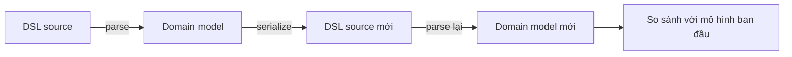
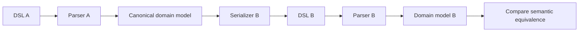

# Round-trip

Trong quá trình biến đổi ngôn ngữ, một biểu diễn thường được chuyển sang một biểu diễn khác để phục vụ phân tích, chỉnh sửa, lưu trữ, sinh mã hoặc trao đổi dữ liệu. Với ngôn ngữ miền chuyên biệt (Domain-Specific Language, DSL), văn bản nguồn có thể được phân tích thành AST hoặc mô hình miền; mô hình đó có thể được tuần tự hóa thành DSL, JSON, YAML hoặc một ngôn ngữ đích khác. **Round-trip** là quá trình chuyển đổi qua một hoặc nhiều biểu diễn rồi quay trở lại, nhằm xác nhận rằng thông tin hoặc ý nghĩa cần bảo toàn vẫn còn nguyên.

Ví dụ, người dùng viết một cấu hình DSL, parser tạo mô hình, serializer sinh lại DSL, rồi parser đọc văn bản mới. Nếu mô hình sau lần đọc thứ hai tương đương với mô hình ban đầu, chu trình đã bảo toàn ý nghĩa theo tiêu chí đã chọn. Nếu yêu cầu giữ cả chú thích, khoảng trắng và cách sắp xếp ban đầu, điều kiện sẽ nghiêm ngặt hơn: chỉ giữ AST thường không đủ, vì AST có thể loại bỏ các chi tiết trình bày.

Round-trip là một kỹ thuật quan trọng để kiểm tra tính đúng đắn của parser, serializer, formatter, bộ chuyển đổi schema và compiler. Nó cũng giúp xác định rõ hợp đồng của một phép biến đổi: thông tin nào phải được giữ, thông tin nào được chuẩn hóa, thông tin nào có thể mất và hệ thống phải xử lý ra sao khi không thể chuyển đổi ngược.

## 1. Round-trip là gì?

Round-trip (chuyển đổi khứ hồi) gồm ít nhất hai phép biến đổi theo hai chiều. Một biểu diễn ban đầu được chuyển sang biểu diễn khác, sau đó kết quả được chuyển ngược về miền ban đầu hoặc một biểu diễn tương đương.

Ví dụ đơn giản:



Gọi:

- `parse` là hàm chuyển văn bản DSL thành mô hình.
- `serialize` là hàm chuyển mô hình thành văn bản DSL.
- `S` là văn bản nguồn.
- `M` là mô hình miền.

Một chu trình phổ biến là:

\[
S \xrightarrow{parse} M \xrightarrow{serialize} S' \xrightarrow{parse} M'
\]

Ta thường mong muốn `M'` tương đương với `M` theo một quan hệ tương đương đã định nghĩa. Không nhất thiết `S'` giống từng ký tự với `S`, bởi serializer có thể chuẩn hóa khoảng trắng hoặc thứ tự thuộc tính.

## 2. Vì sao round-trip quan trọng?

Round-trip giúp kiểm tra các thành phần biến đổi có phối hợp đúng hay không. Trong DSL, cùng một ý nghĩa có thể đi qua nhiều dạng biểu diễn:

- Văn bản DSL do người dùng viết.
- Concrete Syntax Tree (CST) giữ token, dấu phân cách và trivia.
- Abstract Syntax Tree (AST) thể hiện cấu trúc có ý nghĩa.
- Mô hình miền đã phân giải tên và kiểu.
- Biểu diễn trung gian (IR) dùng cho tối ưu hoặc sinh mã.
- JSON/YAML dùng để lưu trữ hoặc trao đổi.
- Mã Java, JavaScript hoặc cấu hình nền tảng được sinh ra.

Round-trip có thể được dùng để:

- Xác nhận serializer không làm mất thuộc tính của mô hình.
- Xác nhận parser có thể đọc lại nội dung mà serializer tạo ra.
- Kiểm tra formatter không làm thay đổi ý nghĩa chương trình.
- Kiểm tra migration giữa các phiên bản schema.
- Kiểm tra bộ chuyển đổi giữa hai DSL.
- Phát hiện lỗi xử lý giá trị mặc định, enum, số thập phân, ngày giờ và tham chiếu.
- Bảo đảm công cụ chỉnh sửa trực quan và editor văn bản cùng nhìn thấy một mô hình nhất quán.

Round-trip không chỉ là một bài kiểm thử parser. Nó là cách kiểm tra hợp đồng giữa các phép biến đổi liên quan.

## 3. Các dạng round-trip thường gặp

### 3.1. Parse rồi serialize

Văn bản nguồn được parse thành AST hoặc mô hình, sau đó được serialize trở lại thành văn bản:

```text
DSL text -> AST/model -> DSL text
```

Dạng này thường được dùng để kiểm tra formatter hoặc serializer. Kết quả có thể được chuẩn hóa về một phong cách định dạng thống nhất.

### 3.2. Serialize rồi parse

Một mô hình được tạo từ API, giao diện trực quan hoặc chương trình khác, sau đó được serialize và parse lại:

```text
Domain model -> DSL text -> AST/model
```

Dạng này xác nhận mọi trạng thái hợp lệ của mô hình đều có thể được biểu diễn bằng cú pháp DSL đã chọn.

### 3.3. Chuyển đổi giữa hai ngôn ngữ

Một DSL có thể được chuyển sang một DSL khác, rồi chuyển ngược:

```text
DSL A -> Intermediate model -> DSL B
      <-                  <-
```

Nếu DSL B không biểu diễn được một số tính năng của DSL A, round-trip có thể không bảo toàn toàn bộ thông tin. Khi đó cần xác định tập con được hỗ trợ, metadata mở rộng hoặc chính sách từ chối chuyển đổi.

### 3.4. Round-trip qua định dạng lưu trữ

Mô hình có thể được lưu thành JSON hoặc YAML rồi nạp lại:

```text
Model -> JSON/YAML -> Model mới
```

Đây là cách kiểm tra serialization, persistence và tương thích schema. Nó đặc biệt quan trọng khi dữ liệu được lưu lâu dài hoặc được trao đổi giữa các phiên bản ứng dụng.

### 3.5. Round-trip trong compiler

Compiler có thể chuyển DSL thành IR, tối ưu IR rồi chuyển ngược về một biểu diễn có thể đọc được, chẳng hạn DSL chuẩn hóa hoặc mã nguồn đích. Khi đó, cần xác định ý nghĩa nào phải được bảo toàn qua tối ưu hóa. Một phép biến đổi tối ưu có thể thay đổi cấu trúc nhưng phải giữ hành vi quan sát được theo ngữ nghĩa của ngôn ngữ.

## 4. Phân biệt bảo toàn văn bản, cú pháp và ngữ nghĩa

Không có một tiêu chí round-trip duy nhất phù hợp với mọi hệ thống. Cần xác định mức độ bảo toàn mong muốn.

| Mức bảo toàn | Điều cần giữ | Ví dụ |
|---|---|---|
| Bảo toàn văn bản | Từng ký tự, khoảng trắng, comment và thứ tự | Đầu ra giống hệt nguồn ban đầu |
| Bảo toàn cú pháp cụ thể | Token và cấu trúc trình bày quan trọng | Giữ comment và vị trí tương đối của chúng |
| Bảo toàn cấu trúc trừu tượng | AST hoặc mô hình cú pháp tương đương | Ngoặc thừa có thể được loại bỏ |
| Bảo toàn ngữ nghĩa | Hành vi hoặc ý nghĩa miền | `1 + 2` có thể được chuẩn hóa thành `3` nếu ngữ nghĩa cho phép |
| Bảo toàn hành vi | Kết quả quan sát được khi thực thi | Hai chương trình có cùng kết quả và hiệu ứng được quy định |

Ví dụ, hai đoạn DSL sau có thể tạo cùng một mô hình:

```text
service "catalog" { replicas = 3 }
```

```text
service "catalog" {
    replicas = 3
}
```

Chúng khác nhau về khoảng trắng và xuống dòng nhưng tương đương về cấu trúc miền. Nếu chỉ dùng AST, serializer có thể luôn sinh dạng thứ hai. Đó là round-trip ngữ nghĩa, không phải round-trip văn bản.

## 5. Các luật round-trip cơ bản

Trong thiết kế phép biến đổi hai chiều, thường sử dụng một số luật để diễn đạt tính nhất quán.

Giả sử:

- `get(S)` chuyển nguồn `S` thành một góc nhìn hoặc mô hình `V`.
- `put(S, V')` cập nhật nguồn `S` theo góc nhìn đã sửa `V'`.

Đây là cách ký hiệu thường gặp trong bidirectional transformations và lenses.

### 5.1. Get-Put

Lấy mô hình từ nguồn rồi ghi lại chính mô hình đó không nên làm thay đổi nguồn theo tiêu chí bảo toàn đã cam kết:

\[
put(S, get(S)) \approx S
\]

Nếu yêu cầu giữ văn bản chính xác, `\approx` có thể là bằng nhau từng ký tự. Nếu serializer chuẩn hóa định dạng, nó chỉ có thể là tương đương ngữ nghĩa hoặc tương đương cú pháp.

### 5.2. Put-Get

Cập nhật mô hình rồi đọc lại từ nguồn đã cập nhật phải trả về mô hình mới:

\[
get(put(S, V')) \equiv V'
\]

Luật này bảo đảm thay đổi qua giao diện mô hình thực sự được phản ánh vào nguồn và có thể được parser đọc lại.

### 5.3. Put-Put

Nếu thực hiện hai cập nhật liên tiếp, kết quả cuối phải phản ánh cập nhật mới nhất và giữ những phần không liên quan theo chính sách hợp nhất:

\[
put(put(S, V_1), V_2) \approx put(S, V_2)
\]

Luật này hữu ích cho editor có nhiều thao tác chỉnh sửa. Tuy nhiên, nếu các cập nhật phụ thuộc vào nhau hoặc có xung đột, hệ thống cần định nghĩa rõ cách hợp nhất.

### 5.4. Các luật cần được điều chỉnh theo miền

Không phải mọi hệ thống đều có thể thỏa mãn các luật trên theo nghĩa bằng nhau tuyệt đối. Một serializer có thể chuẩn hóa thứ tự thuộc tính; một schema migration có thể thêm giá trị mặc định; một compiler có thể loại bỏ cú pháp không ảnh hưởng đến hành vi.

Do đó, cần định nghĩa quan hệ tương đương (`≈` hoặc `≡`) cho từng phép biến đổi. Nếu không, một kiểm thử round-trip có thể thất bại vì thay đổi định dạng vô hại, hoặc ngược lại có thể bỏ sót thay đổi ngữ nghĩa nghiêm trọng.

## 6. Round-trip cho parser và pretty printer

Parser biến văn bản thành AST; pretty printer biến AST thành văn bản có định dạng chuẩn. Một tính chất quan trọng là parse lại kết quả pretty printer phải tạo AST tương đương:

\[
parse(print(AST)) \equiv AST
\]

Ví dụ AST biểu diễn phép cộng có thể được in thành:

```text
price + tax * rate
```

Nếu grammar quy định phép nhân ưu tiên cao hơn phép cộng, parser phải tạo lại đúng cây AST ban đầu. Nếu pretty printer bỏ ngoặc cần thiết, round-trip sẽ làm thay đổi cấu trúc.

Ngược lại, với văn bản nguồn `S`, có thể mong muốn:

\[
print(parse(S)) = canonicalize(S)
\]

Trong đó `canonicalize` là hàm chuẩn hóa định dạng. Kết quả không nhất thiết bằng `S`, nhưng phải là cách viết chuẩn và giữ ngữ nghĩa.

### 6.1. Ngoặc và độ ưu tiên

Pretty printer cần đặt ngoặc khi biểu thức con có độ ưu tiên thấp hơn ngữ cảnh chứa nó.

Ví dụ AST:

```text
Multiply
  left: Add(a, b)
  right: c
```

Cách in an toàn:

```text
(a + b) * c
```

Nếu in thành `a + b * c`, parser sẽ tạo `Add(a, Multiply(b, c))`, khác AST ban đầu. Round-trip test có thể phát hiện lỗi này.

### 6.2. Tính kết hợp

Với toán tử kết hợp trái, AST `Subtract(Subtract(a, b), c)` có thể in thành `a - b - c`. Nhưng AST `Subtract(a, Subtract(b, c))` cần in `a - (b - c)` để giữ cấu trúc.

Vì vậy, pretty printer cần biết cả precedence lẫn associativity, không chỉ thêm ngoặc dựa trên mức ưu tiên.

## 7. Round-trip văn bản cần CST hoặc trivia

AST thường loại bỏ những chi tiết không ảnh hưởng đến ngữ nghĩa:

- Khoảng trắng và tab.
- Dòng trống.
- Comment thông thường.
- Dấu ngoặc dư.
- Cách viết literal tương đương.
- Thứ tự thuộc tính nếu mô hình xem chúng là không có thứ tự.

Nếu yêu cầu giữ nguyên văn bản hoặc chỉ sửa một phần nhỏ mà không làm thay đổi phần còn lại, cần giữ Concrete Syntax Tree (CST), token gốc hoặc trivia.

Ví dụ:

```text
# Chạy sau khi kiểm tra release
workflow "release" {
    task "compile" {}  # tạo artifact
}
```

Nếu parser chỉ tạo AST gồm workflow và task, hai comment có thể bị loại bỏ. Serializer không thể khôi phục nội dung comment từ AST vì thông tin đã mất.

Một CST hoặc cấu trúc trivia có thể giữ comment gắn với token hoặc nút tương ứng. Khi mô hình thay đổi, formatter có thể cập nhật vùng liên quan và giữ các comment không bị ảnh hưởng.

### 7.1. Gắn trivia vào token hoặc nút

Trivia thường gồm khoảng trắng, newline và comment. Có thể gắn trivia trước/sau token hoặc liên kết comment với nút AST gần nhất theo quy tắc cụ thể.

Cần quyết định comment thuộc về khai báo phía trên, khai báo phía dưới hay chỉ là comment độc lập. Nếu quy tắc không rõ, formatter có thể di chuyển comment sang vị trí khác khi serialize.

### 7.2. Patch cục bộ

Một editor có thể dùng source span để thay đúng vùng của một thuộc tính thay vì serialize toàn bộ tài liệu. Ví dụ, đổi `replicas = 3` thành `replicas = 4` trong khi giữ nguyên comment, thụt lề và thứ tự các trường khác.

Patch cục bộ giảm thay đổi không cần thiết trong diff, nhưng cần cập nhật source span và revision sau mỗi lần chỉnh sửa. Nếu thay đổi làm cấu trúc lồng nhau khác đi, vùng patch có thể phải mở rộng đến khối bao ngoài.

## 8. Round-trip giữa mô hình miền và DSL

Một hệ thống DSL thường có mô hình miền riêng. Parser chuyển DSL thành mô hình; serializer chuyển mô hình thành DSL. Hai chiều cần thống nhất về:

- Kiểu dữ liệu và literal.
- Giá trị mặc định.
- Thuộc tính tùy chọn.
- Danh sách và thứ tự phần tử.
- Định danh và tham chiếu.
- Enum và giá trị mở rộng.
- Null, missing và unknown.
- Các trường nội bộ không xuất hiện trong cú pháp.

Ví dụ:

```text
service "catalog" {
    replicas = 3
    enabled = true
}
```

Mô hình có thể là:

```java
record Service(
    String name,
    int replicas,
    boolean enabled
) {}
```

Nếu serializer tạo lại DSL từ `Service`, parser phải khôi phục cùng tên, số bản sao và trạng thái bật/tắt. Nếu trường `enabled` có mặc định `true` và serializer bỏ trường khi giá trị bằng mặc định, mô hình sau parse vẫn có thể tương đương dù văn bản không giống ban đầu.

## 9. Giá trị mặc định và trạng thái bị lược bỏ

Giá trị mặc định là một trong những nguồn gây sai lệch round-trip phổ biến.

Giả sử DSL cho phép:

```text
service "catalog" {
    replicas = 3
}
```

Mô hình có trường `enabled` mặc định là `true`. Khi serialize, có hai lựa chọn:

1. Ghi rõ `enabled = true`.
2. Bỏ trường vì parser sẽ áp dụng cùng giá trị mặc định khi đọc lại.

Cả hai có thể giữ ý nghĩa nếu default ổn định. Nhưng nếu default thay đổi ở phiên bản sau, văn bản đã bỏ trường có thể được hiểu khác.

Cần phân biệt:

- Trường bị bỏ qua vì dùng default.
- Trường có giá trị `null`.
- Trường không được hỗ trợ trong phiên bản hiện tại.
- Trường chưa biết vì nguồn bên ngoài không cung cấp.
- Trường không áp dụng cho loại đối tượng đó.

Nếu tất cả được biểu diễn thành cùng một giá trị, serializer có thể không biết nên ghi gì ra nguồn. Có thể dùng trạng thái riêng hoặc lưu metadata về việc người dùng có khai báo trường hay không.

## 10. Bảo toàn số, ngày giờ và kiểu dữ liệu

Các kiểu dữ liệu có thể mất thông tin nếu chuyển đổi không đúng.

### 10.1. Số thập phân

Không nên chuyển một số thập phân chính xác sang kiểu dấu phẩy động nhị phân rồi serialize lại mà không xét sai số. Ví dụ, `0.1` có thể không được biểu diễn chính xác bằng `double`.

Nếu DSL dùng số tiền hoặc số thập phân chính xác, có thể lưu bằng `BigDecimal` và serialize bằng biểu diễn thập phân có quy tắc rõ.

### 10.2. Ngày giờ và múi giờ

`2026-11-15T10:00:00+07:00` và `2026-11-15T03:00:00Z` có thể biểu diễn cùng một thời điểm nhưng khác văn bản. Nếu mô hình chỉ lưu instant, thông tin offset ban đầu có thể mất. Nếu cần giữ offset hoặc múi giờ vùng như `Asia/Ho_Chi_Minh`, mô hình cần lưu chúng riêng.

### 10.3. Enum và giá trị chưa biết

Nếu phiên bản mới thêm enum `SUSPENDED`, phiên bản cũ có thể không hiểu giá trị đó. Khi đọc dữ liệu cần tương thích tiến, có thể giữ nguyên giá trị chưa biết dưới dạng unknown enum thay vì làm mất hoặc thay bằng một giá trị mặc định.

### 10.4. Đơn vị đo

`5 km` và `5000 m` có thể tương đương về độ dài nhưng không tương đương văn bản. Nếu người dùng cần giữ đơn vị đã viết, mô hình phải lưu đơn vị gốc; nếu chỉ cần giá trị chuẩn hóa, serializer có thể chọn một đơn vị chuẩn.

## 11. Round-trip cho định danh và tham chiếu

Mô hình miền thường có định danh nội bộ và tham chiếu giữa các đối tượng. DSL có thể chỉ viết tên hiển thị:

```text
workflow "release" {
    task "test" {
        depends_on = ["compile"]
    }
    task "compile" {}
}
```

Sau name resolution, tham chiếu `compile` có thể trở thành object reference tới task tương ứng. Khi serialize, hệ thống phải chuyển tham chiếu trở lại tên hoặc ID có thể được phân giải.

Nếu chỉ lưu tên hiển thị, đổi tên task có thể làm mất liên kết. Nếu lưu ID nội bộ, serializer cần quyết định có ghi ID đó ra DSL hay tìm tên hiện tại của đối tượng đích.

Một round-trip đúng cần bảo đảm:

- Mỗi tham chiếu sau khi parse lại trỏ đến đúng đối tượng logic.
- Không tạo tham chiếu mồ côi.
- Không làm mất phân biệt giữa hai đối tượng cùng tên ở namespace khác nhau.
- Định danh ổn định được giữ nếu hợp đồng yêu cầu.
- Thứ tự khai báo có thể thay đổi mà không làm đổi liên kết nếu DSL cho phép forward reference.

## 12. Round-trip và các phép biến đổi không khả nghịch

Không phải mọi phép biến đổi đều có thể đảo ngược hoàn toàn. Một phép biến đổi là mất thông tin (lossy) khi nhiều đầu vào khác nhau tạo cùng một đầu ra hoặc khi đầu ra không chứa đủ dữ liệu để khôi phục nguồn.

Ví dụ:

- AST loại bỏ comment và khoảng trắng.
- Hai đơn vị khác nhau được chuẩn hóa về cùng một đơn vị cơ sở.
- Một số trường tùy chọn bị bỏ khi bằng default.
- Một DSL nguồn có tính năng không tồn tại trong DSL đích.
- Compiler inline nhiều hàm và loại bỏ cấu trúc ban đầu.
- Serializer làm tròn số hoặc chuẩn hóa chữ hoa/chữ thường.

Nếu phép biến đổi mất thông tin, không thể kỳ vọng round-trip khôi phục văn bản ban đầu. Có ba hướng xử lý:

1. **Chấp nhận mất thông tin:** định nghĩa round-trip chỉ bảo toàn ngữ nghĩa hoặc một tập con thông tin.
2. **Lưu metadata phụ:** giữ comment, định dạng, giá trị gốc hoặc thông tin không biểu diễn trong mô hình chính.
3. **Từ chối trường hợp không thể biểu diễn:** báo lỗi khi chuyển đổi sẽ làm mất dữ liệu quan trọng.

Điều quan trọng là không âm thầm tuyên bố round-trip thành công nếu thông tin có ý nghĩa đã bị loại bỏ.

## 13. Bidirectional transformation và lens

Bidirectional transformation (biến đổi hai chiều) nghiên cứu cách giữ nhất quán giữa hai biểu diễn có liên quan. Lens là một mô hình phổ biến để diễn đạt một góc nhìn được lấy từ nguồn và cách cập nhật nguồn theo góc nhìn mới.

Một lens đơn giản có hai phép toán:

```text
get(source) -> view
put(source, updatedView) -> updatedSource
```

Ví dụ, `get` lấy danh sách task từ workflow; `put` nhận danh sách task đã sửa và cập nhật workflow nguồn, giữ các thuộc tính khác nếu có thể.

Lens không chỉ là hai hàm parse và serialize độc lập. `put` cần biết nguồn ban đầu để giữ thông tin không xuất hiện trong view, chẳng hạn comment, metadata hoặc trường không liên quan. Nếu chỉ có `serialize(view)`, hệ thống có thể không biết cần bảo toàn những gì từ nguồn.

### 13.1. View không chứa toàn bộ nguồn

Giả sử một biểu mẫu chỉ hiển thị `name` và `replicas`, trong khi DSL còn có `image`, `labels` và comment. Khi người dùng đổi `replicas`, `put` cần cập nhật trường đó trong nguồn và giữ những phần khác.

### 13.2. Xung đột khi cập nhật

Nếu nguồn thay đổi đồng thời với view, hệ thống cần phát hiện revision khác nhau và hợp nhất hoặc yêu cầu người dùng giải quyết. Lens không tự giải quyết mọi xung đột; nó cung cấp cách mô hình hóa quan hệ giữa hai biểu diễn.

### 13.3. Partial lens

Một số view chỉ hợp lệ với một phần nguồn. Khi dữ liệu nguồn thiếu hoặc không thể biểu diễn, `get` hoặc `put` có thể thất bại. API nên thể hiện kết quả lỗi thay vì giả định mọi phép chuyển đổi đều thành công.

## 14. Round-trip giữa các phiên bản schema

Mô hình có thể được lưu ở phiên bản schema cũ rồi đọc bằng phiên bản mới. Đây là một dạng round-trip liên quan đến migration.

Ví dụ phiên bản 1:

```json
{
  "name": "catalog",
  "replicas": 3
}
```

Phiên bản 2 bổ sung `scaling`:

```json
{
  "name": "catalog",
  "replicas": 3,
  "scaling": {
    "min": 3,
    "max": 10
  }
}
```

Khi đọc v1 bằng ứng dụng v2, hệ thống có thể tạo giá trị mặc định cho `scaling`. Khi ghi lại, dữ liệu sẽ có cấu trúc v2. Nếu đưa tệp đó trở lại ứng dụng v1, trường `scaling` có thể bị bỏ hoặc không được hiểu.

Cần xác định chính sách:

- Migration một chiều hay hai chiều.
- Có giữ unknown fields không.
- Có lưu phiên bản schema trong tài liệu không.
- Có hỗ trợ downgrade không.
- Giá trị mới được suy ra bằng cách nào.
- Trường không thể biểu diễn có làm chuyển đổi thất bại không.

Migration thường không khả nghịch. Nếu v2 bổ sung thông tin mà v1 không thể chứa, chuyển v2 về v1 có thể mất dữ liệu. Round-trip qua nhiều phiên bản cần kiểm tra đúng phạm vi tương thích đã cam kết.

## 15. Round-trip giữa hai DSL

Hai DSL có thể mô tả cùng miền nhưng có cú pháp và khả năng khác nhau. Một mô hình trung gian có thể giúp chuyển đổi:



Ví dụ DSL A biểu diễn thời gian chờ bằng giây:

```text
timeout = 30s
```

DSL B biểu diễn bằng số mili giây:

```text
timeoutMillis: 30000
```

Mô hình trung gian có thể dùng `Duration` để chuẩn hóa. Chuyển đổi ngược về DSL A có thể chọn giây; chuyển sang DSL B có thể chọn mili giây.

Nếu DSL B không hỗ trợ một tính năng của DSL A, bộ chuyển đổi cần báo rõ. Ví dụ, DSL A có thể hỗ trợ điều kiện động, trong khi DSL B chỉ hỗ trợ hằng số. Không nên thay điều kiện động bằng một giá trị cố định mà không có cảnh báo vì hành vi sẽ thay đổi.

## 16. Round-trip trong compiler và tối ưu hóa

Compiler thường biến đổi chương trình qua nhiều IR. Mỗi bước có thể thay đổi cấu trúc nhưng phải bảo toàn ngữ nghĩa theo mục tiêu của phép biến đổi.

Ví dụ constant folding:

```text
result = 2 + 3 * 4
```

có thể được tối ưu thành:

```text
result = 14
```

Cấu trúc AST đã thay đổi, nhưng nếu phép toán thuần và không có hiệu ứng phụ, kết quả quan sát được có thể tương đương.

Với phép biến đổi tối ưu, round-trip văn bản không phải lúc nào cũng là tiêu chí đúng. Cần kiểm tra semantic preservation:

\[
semantics(program) = semantics(transform(program))
\]

Trong thực tế, `semantics` có thể là kết quả đánh giá, trace hiệu ứng hoặc quan hệ tương đương được định nghĩa cho ngôn ngữ. Với DSL có concurrency, thời gian, I/O hoặc hiệu ứng bên ngoài, chứng minh tương đương phức tạp hơn so với so sánh kết quả biểu thức thuần.

Nếu compiler có khả năng decompile hoặc tái tạo DSL từ IR, kết quả thường là một biểu diễn chuẩn hóa chứ không phải nguồn ban đầu. Cần phân biệt decompilation với khôi phục chính xác nguồn.

## 17. Xử lý lỗi và dữ liệu không thể chuyển đổi

Round-trip có thể thất bại ở nhiều giai đoạn:

- Parser không nhận diện cú pháp.
- Mô hình vi phạm bất biến.
- Serializer không có cách biểu diễn một kiểu hoặc thuộc tính.
- Dữ liệu nguồn chứa trường chưa biết.
- Phiên bản schema không tương thích.
- Tham chiếu không thể phân giải.
- Phép chuyển đổi gây mất thông tin ngoài chính sách cho phép.

API nên trả kết quả có cấu trúc, ví dụ:

```java
sealed interface ConversionResult<T>
    permits ConversionSuccess, ConversionFailure {}

record ConversionSuccess<T>(T value)
    implements ConversionResult<T> {}

record ConversionFailure<T>(List<Diagnostic> diagnostics)
    implements ConversionResult<T> {}
```

Ví dụ chỉ minh họa kiểu kết quả. Một serializer có thể trả lỗi `UnsupportedFeature` nếu mô hình chứa một tính năng không có cú pháp tương ứng. Một migration có thể trả danh sách trường bị loại bỏ để người dùng quyết định.

Không nên trả về một chuỗi rỗng hoặc một mô hình mặc định khi chuyển đổi thất bại. Điều đó khiến caller khó phân biệt thành công với dữ liệu bị mất.

## 18. Kiểm thử round-trip

Round-trip là một ứng dụng tự nhiên của property-based testing. Thay vì chỉ viết vài ví dụ cố định, có thể sinh nhiều mô hình hợp lệ, serialize rồi parse lại và so sánh theo quan hệ tương đương.

### 18.1. Kiểm thử mô hình sang văn bản rồi quay lại

```text
for each valid model M:
    text = serialize(M)
    M2 = parse(text)
    assert equivalent(M, M2)
```

Phép kiểm thử này phát hiện trường hợp serializer bỏ trường, ghi literal sai, tạo cú pháp không hợp lệ hoặc không giữ tham chiếu.

### 18.2. Kiểm thử văn bản sang mô hình rồi chuẩn hóa

```text
for each valid source S:
    M = parse(S)
    canonical = serialize(M)
    M2 = parse(canonical)
    assert equivalent(M, M2)
```

Kiểm thử này xác nhận parser và serializer phối hợp đúng. Nó cũng cho phép serializer chuẩn hóa khoảng trắng hoặc thứ tự thuộc tính.

### 18.3. Kiểm thử idempotence của formatter

Một formatter chuẩn hóa nên có tính idempotent:

\[
format(format(S)) = format(S)
\]

Sau lần định dạng đầu tiên, chạy formatter thêm lần nữa không nên tiếp tục thay đổi văn bản. Nếu đầu ra thay đổi ở mỗi lần chạy, formatter có thể không ổn định về thứ tự thuộc tính, xuống dòng hoặc ngoặc.

### 18.4. Kiểm thử round-trip nhiều lần

Có thể kiểm tra:

```text
S1 = serialize(parse(S0))
S2 = serialize(parse(S1))
assert S2 == S1
```

Đây là kiểm tra điểm cố định của serializer/parser. Sau khi văn bản được chuẩn hóa một lần, các chu trình sau không nên tiếp tục thay đổi nó.

### 18.5. Kiểm thử lỗi và trường hợp biên

Cần kiểm tra cả dữ liệu không hợp lệ, dữ liệu lớn, Unicode, số thập phân, comment, trường không biết, danh sách rỗng, tham chiếu lồng nhau và phiên bản schema khác nhau. Với dữ liệu không thể chuyển đổi, kết quả mong đợi thường là lỗi rõ ràng, không phải round-trip thành công giả tạo.

## 19. So sánh mô hình: không nên chỉ dùng equals mặc định

Một kiểm thử round-trip cần xác định cách so sánh hai mô hình. `equals()` mặc định có thể không phù hợp nếu mô hình chứa cache, ID tạm, vị trí nguồn hoặc metadata chỉ dùng trong một phiên.

Có thể định nghĩa hàm so sánh ngữ nghĩa:

```java
boolean semanticallyEquivalent(Model left, Model right) {
    return left.name().equals(right.name())
        && left.services().equals(right.services())
        && left.policies().equals(right.policies());
}
```

Đây là ví dụ giản lược. Hàm so sánh có thể cần:

- Bỏ qua source span và metadata trình bày.
- Chuẩn hóa thứ tự collection nếu thứ tự không có ý nghĩa.
- Giữ thứ tự nếu DSL coi danh sách là có thứ tự.
- So sánh số thập phân theo chính xác hoặc scale đã quy định.
- So sánh tham chiếu theo định danh ổn định thay vì identity của object trong bộ nhớ.
- Xử lý giá trị mặc định theo hợp đồng.

Không nên bỏ qua quá nhiều trường trong semantic equality. Nếu `timeout` hoặc `enabled` bị bỏ qua, kiểm thử có thể không phát hiện serializer làm mất cấu hình quan trọng.

## 20. Round-trip và dữ liệu chưa biết

Khi một phiên bản parser đọc tài liệu có trường hoặc cú pháp mới hơn, nó có thể gặp nội dung chưa biết. Nếu hệ thống bỏ qua chúng rồi serialize lại, dữ liệu sẽ mất.

Ví dụ:

```yaml
service:
  name: catalog
  replicas: 3
  futureOption: enabled
```

Ứng dụng cũ chỉ hiểu `name` và `replicas`. Nếu cần bảo toàn tài liệu qua một công cụ trung gian, có thể giữ unknown fields trong một cấu trúc mở rộng và ghi lại khi serialize.

Một số chiến lược:

- **Strict mode:** từ chối trường không biết để tránh hiểu sai.
- **Preserve unknown:** giữ nguyên trường không biết như dữ liệu opaque.
- **Drop unknown:** bỏ trường theo chính sách rõ ràng, thường chỉ phù hợp khi người dùng chấp nhận mất dữ liệu.
- **Extension namespace:** cho phép plugin hoặc module bổ sung trường dưới namespace riêng.

Việc giữ unknown fields giúp round-trip giữa phiên bản khác nhau, nhưng cần tránh diễn giải hoặc thực thi nội dung chưa được xác thực.

## 21. Round-trip trong editor và giao diện mô hình

Một công cụ DSL có thể cho phép chỉnh sửa cùng tài liệu bằng editor văn bản và giao diện trực quan. Người dùng đổi `replicas` trên biểu mẫu; hệ thống cần cập nhật văn bản. Sau đó người dùng đổi tên service trong editor; mô hình giao diện phải được cập nhật theo.

Một luồng đồng bộ có thể là:

1. Ghi nhận revision hiện tại của nguồn và mô hình.
2. Chuyển thao tác chỉnh sửa thành thay đổi mô hình hoặc source patch.
3. Kiểm tra thay đổi có hợp lệ và có thể biểu diễn hay không.
4. Serialize hoặc patch văn bản.
5. Parse lại hoặc cập nhật AST tương ứng.
6. So sánh mô hình mới với trạng thái đã chỉnh sửa.
7. Commit hai biểu diễn cùng revision nếu nhất quán.

Nếu văn bản và mô hình cùng thay đổi trên hai revision khác nhau, cần phát hiện xung đột. Không nên để một round-trip ghi đè âm thầm chỉnh sửa mới hơn.

## 22. Round-trip và tính ổn định của serializer

Một serializer ổn định nên tạo cùng đầu ra cho cùng mô hình và cùng cấu hình. Tính xác định giúp:

- Diff trong hệ thống quản lý phiên bản ít nhiễu.
- Build có thể tái lập.
- Cache hoạt động đúng.
- Kiểm thử snapshot ổn định.
- Người dùng dễ dự đoán kết quả khi lưu.

Cần quy định thứ tự thuộc tính, thứ tự import, cách viết literal, cách escape chuỗi, quy tắc thụt lề và newline. Nếu dùng map không có thứ tự, serializer nên sắp xếp theo khóa hoặc dùng cấu trúc giữ thứ tự nếu DSL coi thứ tự khai báo có ý nghĩa.

Tính idempotent của formatter và tính xác định của serializer liên quan nhưng khác nhau. Idempotence nói rằng định dạng lại đầu ra không thay đổi nó; determinism nói rằng cùng đầu vào tạo cùng đầu ra giữa các lần chạy hoặc môi trường được hỗ trợ.

## 23. Ví dụ tổng hợp: round-trip workflow

Xét mô hình:

```text
Workflow(name = "release")
Tasks:
  compile(retries = 1)
  test(dependsOn = [compile])
  publish(dependsOn = [test], retries = 3)
```

Serializer tạo DSL:

```text
workflow "release" {
    task "compile" {
        retries = 1
    }
    task "test" {
        depends_on = ["compile"]
    }
    task "publish" {
        depends_on = ["test"]
        retries = 3
    }
}
```

Parser đọc lại văn bản và tạo mô hình mới. So sánh ngữ nghĩa cần xác nhận:

- Workflow vẫn có tên `release`.
- Có đúng ba task.
- Mỗi task giữ đúng số lần thử.
- `test` vẫn phụ thuộc vào `compile`.
- `publish` vẫn phụ thuộc vào `test`.
- Quan hệ tham chiếu trỏ đến đúng đối tượng, không chỉ giữ chuỗi tên.

Nếu serializer sắp xếp task theo tên thay vì thứ tự ban đầu, cần biết thứ tự có ý nghĩa trong DSL hay không. Nếu workflow thực thi theo dependency graph và thứ tự khai báo không có ý nghĩa, thay đổi thứ tự có thể được chấp nhận. Nếu DSL dùng thứ tự khai báo làm thứ tự mặc định, phép chuyển đổi phải giữ nó.

## 24. Quy trình thiết kế và triển khai round-trip

Một quy trình thực tế có thể gồm:

1. **Xác định hai biểu diễn:** ví dụ DSL và domain model, AST và pretty-printed source, hoặc schema cũ và schema mới.
2. **Định nghĩa thông tin cần bảo toàn:** văn bản, cú pháp, ngữ nghĩa, hành vi hay metadata.
3. **Chọn quan hệ tương đương:** xác định cách so sánh kết quả sau khi quay lại.
4. **Thiết kế hai phép chuyển đổi:** quy định đầu vào, đầu ra, lỗi và dữ liệu không hỗ trợ.
5. **Giữ thông tin phụ cần thiết:** CST, trivia, source span, unknown fields, đơn vị gốc hoặc metadata.
6. **Quy định default và normalization:** tránh làm thay đổi ý nghĩa khi trường bị bỏ hoặc giá trị được chuẩn hóa.
7. **Xử lý dữ liệu mất thông tin:** chấp nhận, lưu metadata, cảnh báo hoặc từ chối.
8. **Định nghĩa luật round-trip:** Get-Put, Put-Get, Put-Put hoặc các luật phù hợp với miền.
9. **Viết kiểm thử ví dụ và property-based:** kiểm tra nhiều mô hình và văn bản khác nhau.
10. **Kiểm tra tính ổn định:** serializer xác định, formatter idempotent và migration có chính sách rõ.
11. **Theo dõi phiên bản:** gắn kết quả với revision nguồn, schema và cấu hình chuyển đổi.
12. **Tích hợp diagnostics:** báo lỗi chuyển đổi và vị trí nguồn có thể sửa.

## 25. Nguyên tắc thiết kế

- **Định nghĩa tiêu chí bảo toàn trước:** cần biết round-trip giữ văn bản, cấu trúc hay ngữ nghĩa.
- **Không giả định hai chiều là nghịch đảo hoàn hảo:** nhiều phép biến đổi có mất thông tin.
- **Dùng quan hệ tương đương phù hợp:** bỏ qua metadata trình bày nhưng không bỏ qua thuộc tính miền quan trọng.
- **Giữ CST hoặc trivia khi cần bảo toàn nguồn:** AST thường không đủ để tái tạo comment và khoảng trắng.
- **Xử lý default tường minh:** phân biệt trường bị lược bỏ với null, unknown và not applicable.
- **Bảo toàn kiểu và độ chính xác:** đặc biệt với số thập phân, ngày giờ, múi giờ và đơn vị.
- **Giữ tham chiếu ổn định:** tránh làm đứt liên kết khi đổi tên hoặc thay đổi thứ tự khai báo.
- **Từ chối chuyển đổi mất dữ liệu ngoài dự kiến:** không âm thầm bỏ tính năng không được hỗ trợ.
- **Kiểm tra idempotence và determinism:** formatter và serializer cần tạo kết quả ổn định.
- **Dùng property-based testing:** kiểm tra nhiều mô hình và trường hợp biên thay vì chỉ vài ví dụ thủ công.
- **Gắn revision và version:** tránh dùng kết quả cũ hoặc schema không tương thích.

Round-trip là cách kiểm tra một chuỗi phép biến đổi có giữ được thông tin hoặc ý nghĩa đã cam kết hay không. Trong DSL, điều đó có thể là parse rồi serialize, mô hình rồi văn bản, chuyển đổi giữa hai ngôn ngữ hoặc lưu và nạp qua các phiên bản schema. Khi định nghĩa rõ mức bảo toàn, luật hai chiều, dữ liệu phụ cần giữ và quan hệ tương đương; đồng thời kiểm thử round-trip, idempotence và các trường hợp mất thông tin, hệ thống có thể biến đổi biểu diễn một cách đáng tin cậy mà không làm thay đổi ý nghĩa ngoài dự kiến.
