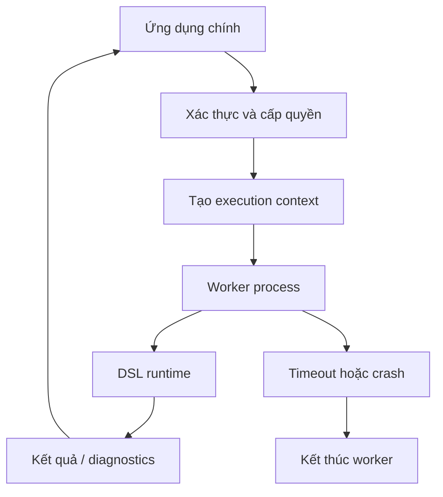
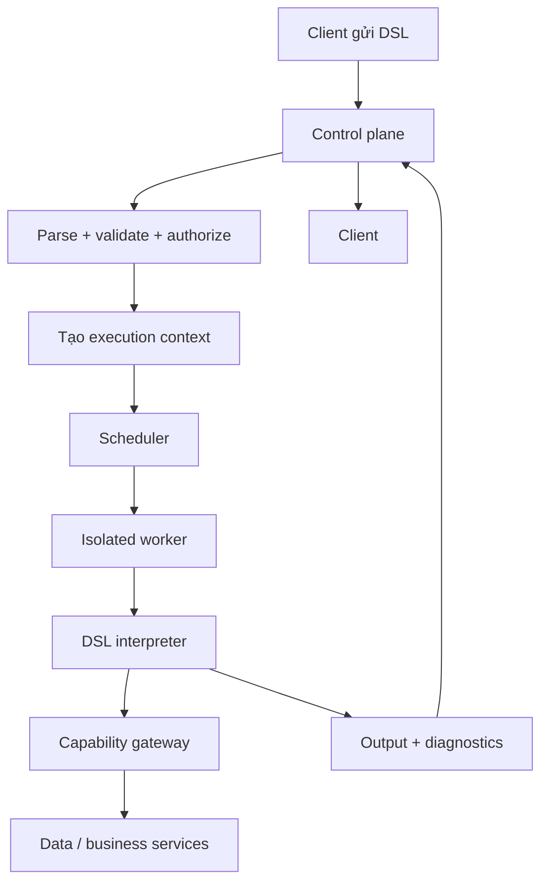

# Cô lập môi trường chạy DSL

Một DSL (*Domain-Specific Language*) có thể cho phép người dùng mô tả quy tắc, truy vấn, workflow, tác vụ tự động hoặc cấu hình. Khi hệ thống thực thi các mô tả này, chương trình có thể cần đọc dữ liệu, gọi hàm, ghi tệp hoặc giao tiếp với dịch vụ. Nếu mọi DSL chạy trực tiếp trong tiến trình chính với toàn bộ quyền của ứng dụng, một rule sai hoặc độc hại có thể ảnh hưởng tới dữ liệu và tài nguyên ngoài phạm vi mong muốn.

**Cô lập môi trường chạy** (*runtime isolation*) là việc giới hạn tài nguyên, quyền và phạm vi ảnh hưởng của một lần thực thi DSL. Mục tiêu là bảo đảm mỗi chương trình chỉ sử dụng những khả năng được cấp, không tùy ý can thiệp vào host hoặc phiên chạy khác, đồng thời giúp hệ thống quản lý lỗi và tài nguyên có kiểm soát.

Ví dụ, một nền tảng workflow cho phép khách hàng viết:

```text
workflow "monthly-report" {
    read dataset "sales"
    filter where region == "north"
    write report "monthly-sales"
}
```

Workflow này có thể cần đọc một dataset và tạo report. Nó không nhất thiết cần quyền đọc mọi tệp trên máy chủ, truy cập database của khách hàng khác hoặc gọi bất kỳ địa chỉ mạng nào. Runtime isolation giới hạn workflow trong dataset, thao tác và tài nguyên đã được cấp.

Cô lập không chỉ là chạy trong container hoặc tạo process riêng. Đây là thiết kế nhiều lớp gồm danh tính, quyền, filesystem, network, tài nguyên, vòng đời và giám sát.

## 1. Vì sao cần cô lập môi trường chạy?

Một DSL có thể được viết bởi đội phát triển nội bộ, người dùng cuối, đối tác hoặc dịch vụ tự động sinh nội dung. Mức độ tin cậy của đầu vào có thể khác nhau. Ngay cả khi người viết có thiện chí, rule vẫn có thể chứa vòng lặp vô hạn, truy vấn quá lớn hoặc thao tác sai phạm vi.

Cô lập giúp:

- **Bảo vệ dữ liệu:** workflow chỉ đọc dữ liệu thuộc workspace hoặc tenant của nó.
- **Bảo vệ host:** DSL không tự ý đọc file hệ thống, ghi đè thư viện hoặc truy cập socket quản trị.
- **Giới hạn tác động của lỗi:** worker bị treo hoặc crash không làm sập toàn bộ ứng dụng.
- **Ngăn lạm dụng tài nguyên:** quota giới hạn CPU, memory, thời gian, số tác vụ và dung lượng đầu ra.
- **Kiểm soát truy cập bên ngoài:** rule chỉ gọi dịch vụ và destination đã được cấp quyền.
- **Hỗ trợ nhiều người dùng:** một tenant không chiếm tài nguyên hoặc đọc dữ liệu của tenant khác.

## 2. Trust boundary và threat model

Trước khi chọn công nghệ sandbox, cần xác định ai có thể cung cấp DSL, dữ liệu nào cần bảo vệ và hậu quả nào cần ngăn chặn.

Một số câu hỏi thiết kế:

- Người viết DSL là nhân viên đáng tin cậy hay người dùng bên ngoài?
- DSL có cho phép gọi hàm mở rộng hoặc plugin không?
- Chương trình có thể đọc file, truy cập mạng hoặc gọi database không?
- Một lần chạy có thể ảnh hưởng tới phiên chạy khác không?
- Runtime có dùng chung process hoặc tài khoản hệ điều hành với ứng dụng chính không?
- Dữ liệu đầu vào và output có chứa secret hoặc thông tin cá nhân không?
- Khi chương trình treo, ai có quyền hủy và giải phóng tài nguyên?
- Có cần bảo vệ trước mã cố ý tìm cách thoát sandbox không?

**Trust boundary** là ranh giới mà dữ liệu hoặc hành động đi qua từ một miền tin cậy sang miền khác. DSL do người dùng cung cấp là dữ liệu không đáng tin cậy cho tới khi được phân tích và cấp quyền phù hợp. Việc parse thành công không làm chương trình trở nên đáng tin cậy.

**Threat model** mô tả tài sản cần bảo vệ, tác nhân có thể gây rủi ro, đường tấn công và biện pháp giảm thiểu. Không có một mức cô lập phù hợp cho mọi DSL: trình cấu hình nội bộ đơn giản có thể cần sandbox nhẹ, còn nền tảng chạy rule tùy ý từ khách hàng cần ranh giới mạnh hơn.

## 3. Các lớp cô lập

Runtime isolation thường kết hợp nhiều lớp:

| Lớp | Phạm vi kiểm soát | Ví dụ |
|---|---|---|
| Language/runtime | Khả năng DSL được phép biểu đạt | Chỉ cung cấp hàm đã đăng ký |
| Process | Bộ nhớ và vòng đời tiến trình | Worker process riêng |
| OS security | Quyền của tiến trình | User riêng, syscall policy |
| Filesystem | Đường dẫn được đọc/ghi | Workspace riêng, root read-only |
| Network | Kết nối được phép | Chỉ gọi API qua gateway |
| Resource | CPU, memory, thời gian, I/O | Quota và timeout |
| Container/VM | Ranh giới môi trường | Container hoặc microVM |
| Application/tenant | Danh tính và dữ liệu nghiệp vụ | Tenant-scoped credentials |

Container có thể giới hạn filesystem và process nhưng không tự quyết định DSL được phép truy cập bảng dữ liệu nào. Quyền nghiệp vụ vẫn phải được kiểm tra ở application layer.

## 4. Giới hạn khả năng ngay trong DSL runtime

Lớp cô lập đầu tiên là thiết kế ngôn ngữ và runtime API. Nếu DSL không cần thực thi mã tùy ý, không nên cung cấp những khả năng đó.

Một runtime có thể chỉ công bố:

```text
readDataset(name)
writeReport(name, rows)
sendNotification(channel, message)
currentUser()
```

Mỗi hàm kiểm tra danh tính và quyền trong ngữ cảnh hiện tại. DSL không trực tiếp nhận đối tượng hệ điều hành như File, Process, Socket hoặc ClassLoader.

### Allowlist và denylist

- **Allowlist:** chỉ thao tác được liệt kê mới được phép.
- **Denylist:** mặc định cho phép rồi chặn một số thao tác bị cấm.

Với DSL nhận nội dung từ nguồn không đáng tin cậy, allowlist thường dễ kiểm soát hơn. Một API mới chỉ có quyền khi được chủ động đưa vào hợp đồng runtime. Denylist dễ bỏ sót khả năng mới hoặc đường vòng không được dự đoán.

### Capability-based design

**Capability** là quyền cụ thể được biểu diễn bằng đối tượng hoặc handle mà chương trình phải sở hữu mới có thể thực hiện thao tác.

```text
dataset = capabilities.openDataset("sales", mode = READ_ONLY)
rows = dataset.query(...)
```

DSL không nhận quyền truy cập database tổng quát. Nó chỉ nhận capability cho dataset cụ thể, với thao tác cụ thể. Capability nên có phạm vi hẹp, thời hạn rõ và không thể tự nâng quyền.

## 5. Process isolation

Một cách triển khai là chạy mỗi tác vụ hoặc nhóm tác vụ trong process worker riêng. Ứng dụng chính gửi đầu vào qua IPC hoặc giao thức có cấu trúc. Worker phân tích và thực thi DSL, sau đó trả kết quả.



Ưu điểm:

- Lỗi native hoặc crash trong worker thường không làm sập process chính.
- Có thể giới hạn thời gian và kết thúc process.
- Hệ điều hành thu hồi bộ nhớ của worker khi process kết thúc.
- Có thể chạy worker dưới user hoặc quyền riêng.
- Có thể dùng pool worker để giảm chi phí khởi tạo.

Process riêng không tự động là sandbox an toàn. Nếu worker chạy cùng user với ứng dụng chính, nó có thể vẫn đọc được nhiều file hoặc truy cập tài nguyên giống ứng dụng. Cần kết hợp process isolation với OS user riêng, filesystem policy, network policy và giới hạn tài nguyên. Giao thức IPC cũng phải xác thực và giới hạn kích thước message.

## 6. Container isolation

Container đóng gói ứng dụng cùng dependencies và cung cấp môi trường chạy với namespace, control group và filesystem view riêng theo cơ chế của nền tảng.

Container có thể giới hạn process nhìn thấy, network namespace, mount, CPU, memory, số process, user/group, capability hệ điều hành và syscall được phép.

Container thường dùng chung kernel với host. Cấu hình sai hoặc lỗ hổng kernel/runtime có thể làm giảm mức cô lập. Một số nguyên tắc:

- Chạy bằng user không có quyền root khi có thể.
- Không bật privileged mode nếu không có yêu cầu đặc biệt.
- Không mount thư mục host nhạy cảm.
- Không đưa socket quản trị container vào worker.
- Dùng filesystem root read-only nếu phù hợp.
- Chỉ cấp capability hệ điều hành cần thiết.
- Áp dụng seccomp hoặc cơ chế policy tương đương.
- Đặt CPU, memory, PID và I/O limits.
- Dùng network policy mặc định chặn hoặc giới hạn egress.
- Dùng image tối giản, có nguồn gốc và phiên bản xác định.

Container cần được xem xét như một phần của security boundary, không chỉ là cách đóng gói ứng dụng.

## 7. Virtual machine và microVM

VM cung cấp kernel và hệ điều hành guest riêng. Hypervisor quản lý việc phân chia CPU, memory và thiết bị ảo. **MicroVM** là máy ảo được tối giản để khởi động nhanh và dùng cho workload ngắn hoặc cô lập theo phiên.

| Cơ chế | Ranh giới chính | Chi phí tương đối | Trường hợp phù hợp |
|---|---|---|---|
| Runtime sandbox | API và semantics ngôn ngữ | Thấp | DSL giới hạn khả năng |
| Process | Không gian bộ nhớ và vòng đời process | Thấp đến vừa | Worker tách biệt |
| Container | Namespace, cgroup, filesystem và policy | Vừa | Worker dùng chung kernel |
| VM/microVM | Guest kernel và hypervisor | Cao hơn | Code ít tin cậy, cần boundary mạnh |

VM vẫn cần cấu hình quyền, mạng và tài nguyên. Một guest có quyền truy cập metadata service hoặc credentials rộng vẫn có thể gây rủi ro. Ranh giới mạnh hơn không thay thế thiết kế least privilege.

Nếu DSL chỉ biểu đạt biểu thức thuần, interpreter giới hạn hàm có thể đủ. Nếu DSL cho phép plugin hoặc native extension, process/container/VM có thể cần thiết. Nếu chạy code do khách hàng không tin cậy cung cấp, cần đánh giá khả năng thoát sandbox và lỗ hổng của nền tảng.

## 8. WebAssembly và sandbox theo runtime

WebAssembly (Wasm) cung cấp mô hình thực thi module với bộ nhớ tuyến tính và các import/host function được khai báo. Module chỉ truy cập những khả năng mà host cung cấp qua imports.

Ví dụ, host chỉ cung cấp:

```text
imports:
  read_record(record_id)
  emit_result(value)
  log_message(message)
```

Nếu module không được import hàm truy cập filesystem hoặc network, nó không thể gọi trực tiếp những khả năng đó qua giao diện host đã định nghĩa.

Ưu điểm của Wasm là mô hình module và import/export rõ, có thể đặt giới hạn memory và fuel/instruction theo runtime hỗ trợ, có nhiều runtime nhúng được vào ứng dụng và phù hợp cho plugin cần tính di động.

Wasm không tự bảo đảm an toàn cho host function. Nếu host cung cấp hàm truy cập tệp hoặc gọi mạng quá rộng, module vẫn có thể sử dụng quyền đó. Host cũng phải kiểm tra tenant, resource và operation cho mỗi lần gọi.

## 9. Cô lập filesystem

DSL có thể cần đọc tệp cấu hình, template hoặc dữ liệu được tải lên. Cần xác định chính xác thư mục nào có thể truy cập và thao tác nào được phép.

### Workspace riêng

Mỗi execution có thể có thư mục làm việc riêng:

```text
/workspaces/
    execution-1001/
        input/
        temp/
        output/
    execution-1002/
        input/
        temp/
        output/
```

Worker chỉ nhìn thấy workspace được cấp. Input có thể read-only, output được ghi vào vùng riêng, còn thư mục hệ thống không được mount nếu không cần.

### Path traversal

Không nên chỉ kiểm tra đường dẫn bằng cách xem nó có bắt đầu bằng chuỗi tên workspace hay không. Đường dẫn có .., symbolic link hoặc khác biệt chuẩn hóa có thể dẫn ra ngoài thư mục cho phép.

Cần chuẩn hóa và resolve đường dẫn theo cơ chế an toàn của hệ điều hành, kiểm tra quyền sau khi resolve và tránh race condition giữa lúc kiểm tra với lúc mở tệp. Nếu có thể, dùng API mở file tương đối với directory handle đã được cấp.

### Read-only và writable mounts

- Input chứa DSL và dữ liệu có thể được mount read-only.
- Output có thể được mount riêng với quota.
- Thư mục tạm cần được dọn sau khi hoàn tất.
- Root filesystem có thể read-only.
- Không chia sẻ thư mục tạm giữa các tenant.

Không nên cho worker ghi trực tiếp vào thư mục source hoặc cấu hình vận hành của host.

## 10. Cô lập network

Network access mở rộng đáng kể bề mặt tấn công: chương trình có thể gửi dữ liệu ra ngoài, dò mạng nội bộ hoặc gọi endpoint không mong muốn.

### Default deny và egress control

Một chính sách an toàn thường bắt đầu bằng việc chặn kết nối không được khai báo. Chỉ cho phép destination, protocol và operation cần thiết.

Ví dụ, thay vì cung cấp socket tổng quát, runtime cấp capability:

```text
currency = services.currencyRates()
notify = services.sendNotification("ops-channel", message)
```

Host thực hiện xác thực, kiểm tra quyền và gọi dịch vụ. DSL không tự chọn IP tùy ý.

Cần cân nhắc:

- Chỉ cho phép hostname hoặc service đã duyệt.
- Chặn truy cập metadata endpoint và mạng quản trị.
- Kiểm tra DNS resolution và địa chỉ IP sau khi resolve.
- Chặn loopback, link-local hoặc private ranges nếu không cần.
- Kiểm soát redirect để không chuyển request sang destination bị cấm.
- Giới hạn request size, số lần gọi và thời gian chờ.
- Dùng proxy hoặc gateway để ghi nhận và áp dụng policy tập trung.

Chỉ kiểm tra hostname một lần là chưa đủ nếu DNS có thể trả địa chỉ khác hoặc request redirect. Policy cần được áp dụng ở tầng kết nối thực tế.

Worker thường không cần mở cổng nhận kết nối từ mạng bên ngoài. Nếu cần callback, nên dùng broker hoặc gateway có xác thực thay vì expose trực tiếp worker.

## 11. Quản lý credentials và secrets

Không nên đặt secret trực tiếp trong DSL hoặc truyền toàn bộ biến môi trường của ứng dụng chính vào worker.

Nguyên tắc quản lý:

- Cấp credential riêng cho từng execution hoặc tenant.
- Chỉ cấp quyền cần thiết và thời hạn ngắn.
- Tránh đưa secret vào source text, AST dump hoặc error message.
- Không ghi secret vào log.
- Thu hồi credential khi execution kết thúc hoặc bị hủy.
- Không tái sử dụng token của ứng dụng quản trị cho worker.
- Truy cập secret qua broker hoặc host capability có kiểm soát.

Thay vì DSL tự đọc biến môi trường chứa mật khẩu database, runtime có thể cấp một database capability đã giới hạn schema và operation. Worker không cần nhìn thấy password thô.

Nếu execution chạy lâu, credential có thể hết hạn hoặc bị thu hồi. Runtime cần xác định hành vi khi token hết hạn, cách refresh có kiểm soát và cách dừng execution khi quyền không còn hợp lệ. Không nên cấp credential dài hạn chỉ để tránh xử lý vòng đời token.

## 12. Giới hạn CPU, memory và thời gian

Một chương trình hợp lệ về cú pháp vẫn có thể tiêu thụ tài nguyên không giới hạn.

```text
while true {
    total = total + 1
}
```

Các giới hạn phổ biến:

| Tài nguyên | Cách giới hạn |
|---|---|
| Wall-clock time | Deadline hoặc timeout |
| CPU time | CPU quota hoặc execution budget |
| Memory | Heap limit hoặc container memory limit |
| Số process/thread | PID/thread quota |
| Số lần gọi host function | Call budget |
| Dung lượng output | Output size limit |
| Dung lượng tệp tạm | Workspace quota |
| Network | Request count, bandwidth, timeout |
| Độ sâu đệ quy | Recursion limit |

**Wall-clock timeout** đo thời gian thực tế từ lúc bắt đầu đến lúc kết thúc, gồm cả thời gian chờ I/O. **CPU time** đo thời gian CPU thực sự dùng. Một tác vụ có thể dùng ít CPU nhưng chờ network rất lâu, vì vậy hai giới hạn giải quyết vấn đề khác nhau.

Khi hết deadline, runtime cần có cách dừng worker. Nếu interpreter chạy trong cùng thread và không kiểm tra cancellation, tín hiệu hủy có thể không có tác dụng. Cần thiết kế cancellation point hoặc thực thi trong process có thể kết thúc.

Sau khi hủy, hệ thống cần giải phóng file handle, socket, temporary data và quota đang giữ.

## 13. Giới hạn độ phức tạp của chương trình DSL

Ngoài tài nguyên hệ điều hành, runtime có thể giới hạn:

- Số lượng AST node hoặc instruction.
- Độ sâu lồng nhau và đệ quy.
- Số vòng lặp hoặc iteration.
- Số truy vấn dữ liệu.
- Số lượng record được xử lý.
- Kích thước collection.
- Số lượng event hoặc message được phát.

Một DSL có thể dùng **fuel** hoặc instruction budget: mỗi thao tác tiêu thụ một lượng budget; khi hết budget, execution bị dừng.

```text
ExecutionContext {
    deadline: 10 seconds
    instructionBudget: 1000000
    maxOutputBytes: 2 MB
    maxQueryRows: 50000
}
```

Các con số chỉ minh họa. Giá trị thực tế cần dựa trên workload, latency mục tiêu và chi phí hạ tầng.

## 14. Multi-tenancy và cô lập dữ liệu

Trong nền tảng phục vụ nhiều khách hàng, cô lập runtime cần gắn với tenant identity.

Một execution context nên có danh tính tenant, user hoặc service account, danh sách capability và quota tương ứng. Mọi thao tác đọc/ghi dữ liệu phải kiểm tra quyền ở phía dịch vụ sở hữu dữ liệu. Không nên chỉ dựa vào tên bảng hoặc đường dẫn do DSL cung cấp để xác định quyền.

Ví dụ:

```text
ExecutionContext {
    tenantId: "tenant-42"
    executionId: "run-1001"
    principal: "user-18"
    capabilities: [
        ReadDataset("sales-west"),
        WriteReport("monthly-sales")
    ]
}
```

Runtime truyền context này tới host service. Service xác thực capability và tenant trước khi trả dữ liệu hoặc thực hiện thao tác.

### Confused deputy

**Confused deputy** xảy ra khi một thành phần có quyền cao thực hiện hành động thay cho caller mà không kiểm tra caller có được phép hay không.

Ví dụ, worker gọi host function có quyền truy cập database quản trị. Nếu host function chỉ kiểm tra rằng chính nó có credentials mà không kiểm tra tenant của execution, worker có thể khiến dịch vụ dùng quyền của host để truy cập dữ liệu ngoài phạm vi.

Mỗi host function cần kiểm tra principal và resource scope của execution context.

## 15. Cô lập trạng thái và dữ liệu tạm

Một execution có thể tạo biến, cache, file tạm, connection hoặc stateful object. Cần xác định trạng thái nào chỉ tồn tại trong lần chạy và trạng thái nào được lưu bền vững.

- **Ephemeral state:** biến runtime, temporary file, cache cục bộ, buffer và intermediate result. Khi execution kết thúc, các tài nguyên này cần được giải phóng.
- **Persistent state:** dữ liệu cần tồn tại qua nhiều lần chạy, được lưu qua API hoặc storage service có authorization, transaction và audit.

Nếu dùng worker pool, cần reset context, globals, caches và handles trước khi gán worker cho execution tiếp theo. Nếu không thể chứng minh reset đầy đủ, nên hủy worker và tạo worker mới sau mỗi execution hoặc sau một số lần chạy được kiểm soát.

## 16. Deterministic execution và reproducibility

Kết quả DSL có thể phụ thuộc vào phiên bản runtime và thư viện, time zone và locale, thời gian hiện tại, random seed, environment variables, dataset snapshot, network response, thứ tự xử lý đồng thời và phiên bản schema/policy.

Nếu cần reproducibility, runtime nên cung cấp những giá trị này qua execution context thay vì để chương trình đọc trạng thái host tùy ý.

Ví dụ, thay vì DSL tự lấy thời gian hệ thống, runtime có thể cung cấp clock:

```text
now = context.clock.currentTime()
```

Trong chế độ replay, clock có thể được cố định. Randomness cũng có thể nhận seed xác định. Request bên ngoài có thể được ghi nhận hoặc thay bằng fixture theo chính sách.

Không phải mọi DSL đều cần deterministic execution tuyệt đối. Nhưng cần biết yếu tố nào được kiểm soát để giải thích vì sao hai lần chạy cho kết quả khác nhau.

## 17. Kiến trúc runtime và execution lifecycle

Một kiến trúc thực tế có thể tách:

- **Control plane:** xác thực người dùng, kiểm tra quyền, tạo execution, chọn worker, áp dụng policy và theo dõi trạng thái.
- **Execution plane:** chạy parser/runtime trong môi trường được cô lập và trả kết quả.
- **Data/service plane:** cung cấp capability truy cập dữ liệu và dịch vụ nghiệp vụ.



Gateway giữ credentials và quyền truy cập dịch vụ ở phía host. Worker chỉ nhận kết quả của thao tác được cho phép.

Một lần chạy thường có các trạng thái:

1. **Submitted:** nhận DSL và metadata.
2. **Validated:** parse, semantic check và authorization đã hoàn tất.
3. **Queued:** chờ tài nguyên worker.
4. **Starting:** tạo sandbox và cấp context.
5. **Running:** thực thi DSL.
6. **Completed/Failed/Cancelled/Timed out:** kết thúc với trạng thái tương ứng.
7. **Cleanup:** thu hồi credential, đóng handle, xóa dữ liệu tạm và giải phóng quota.

Cleanup phải xảy ra cả khi có exception, timeout hoặc worker crash. Có thể dùng finally block ở application layer và cơ chế thu hồi ở scheduler/orchestrator để tránh tài nguyên mồ côi.

## 18. Quan sát và audit execution

Cô lập cũng giúp hiểu điều gì đã xảy ra trong một lần chạy. Các thông tin có thể ghi nhận:

- Execution ID và tenant ID.
- Phiên bản DSL và runtime.
- Thời điểm bắt đầu/kết thúc.
- CPU, memory và output size.
- Capability được sử dụng.
- Số lần gọi service.
- Trạng thái hoàn thành, lỗi hoặc bị hủy.
- Diagnostic và source location liên quan.

Không nên ghi toàn bộ source text hoặc dữ liệu nhạy cảm vào log nếu không cần. Audit event nên mô tả hành động và danh tính theo chính sách, đồng thời bảo vệ nội dung secret.

Một execution ID có thể được truyền qua worker, gateway và service để liên kết log của cùng một lần chạy. DSL có thể tạo lượng log lớn hoặc đưa nội dung không tin cậy vào log; cần giới hạn kích thước, tốc độ và thời gian lưu, đồng thời escape dữ liệu trước khi hiển thị.

## 19. Xử lý lỗi và phục hồi

Một execution có thể thất bại vì lỗi DSL, lỗi dịch vụ, hết quota hoặc lỗi hạ tầng. Cần phân biệt các loại này để quyết định retry hoặc báo lỗi.

| Loại lỗi | Ví dụ | Hành vi thường phù hợp |
|---|---|---|
| DSL error | Type mismatch, undefined field | Không retry; trả diagnostic |
| Policy violation | Capability không được cấp | Từ chối thao tác và audit |
| Resource limit | Hết memory hoặc deadline | Kết thúc execution |
| External transient error | Dịch vụ tạm thời unavailable | Retry có giới hạn nếu thao tác an toàn |
| Worker crash | Process thoát bất thường | Đánh dấu failed, tạo worker mới |
| Host failure | Node hoặc scheduler lỗi | Khôi phục theo trạng thái orchestration |

Không nên tự động retry mọi thao tác. Nếu DSL đã gửi email hoặc tạo giao dịch rồi worker crash trước khi ghi nhận kết quả, retry có thể gây hành động lặp. Host service cần idempotency key hoặc transaction semantics khi thao tác có tác dụng phụ.

## 20. Cô lập plugin và host function

Plugin mở rộng khả năng của DSL nhưng cũng mở rộng trust boundary. Một plugin có thể chạy code riêng, giữ state hoặc gọi API.

Một số lựa chọn:

- Chỉ cho phép plugin đã được duyệt và ký.
- Chạy plugin trong process hoặc sandbox riêng nếu code không đáng tin cậy.
- Cấp capability theo từng plugin.
- Giới hạn thời gian, memory và số lần gọi.
- Version hóa API và schema.
- Kiểm soát dependency và nguồn tải plugin.
- Không truyền secret chung cho mọi plugin.
- Thu hồi plugin hoặc capability khi phát hiện rủi ro.

Host function cũng cần được xem xét như API công khai của runtime. Một hàm tiện lợi nhưng có quyền quá rộng có thể làm mất hiệu lực của sandbox bên dưới.

## 21. Chọn mức cô lập phù hợp

| Tình huống | Hướng tiếp cận thường dùng |
|---|---|
| Biểu thức thuần, không có I/O | Interpreter giới hạn operations |
| Rule nội bộ, nguồn được kiểm soát | Runtime capability + process worker |
| Plugin từ nhiều đội phát triển | Process/container riêng và API giới hạn |
| DSL do khách hàng cung cấp | Container/VM hoặc Wasm kết hợp policy chặt |
| Native extension không tin cậy | Ranh giới OS/VM mạnh, không chạy trong host process |
| Workload cần môi trường nhất quán | Image/container bất biến hoặc VM template |

Đây là các hướng tham khảo. Quyết định cuối cùng cần dựa trên threat model, nền tảng triển khai và mức độ bảo đảm cần đạt.

### Defense in depth

Một kiến trúc an toàn thường kết hợp:

1. Giới hạn khả năng trong DSL.
2. Kiểm tra quyền tại host API.
3. Chạy worker bằng danh tính riêng.
4. Giới hạn filesystem và network.
5. Đặt quota và deadline.
6. Giám sát và audit.
7. Có quy trình hủy, cleanup và cập nhật runtime.

Nếu một lớp bị cấu hình sai, các lớp còn lại vẫn có thể hạn chế tác động.

## 22. Những sai lầm thường gặp

**Chỉ dùng process riêng và cho rằng đã an toàn.** Process vẫn có thể dùng cùng user, credentials và filesystem với host. Cần kết hợp OS policy và capability.

**Chỉ dùng container mặc định.** Container privileged, mount host rộng hoặc network mở có thể phá vỡ boundary. Cần cấu hình least privilege.

**Cho DSL truy cập filesystem tùy ý.** Path traversal hoặc symbolic link có thể đưa thao tác ra ngoài workspace. Cần resolve và kiểm tra đường dẫn an toàn.

**Cho phép network mặc định.** DSL có thể gửi dữ liệu ra ngoài hoặc dò mạng nội bộ. Dùng default deny và gateway/capability.

**Truyền toàn bộ environment variables.** Worker có thể đọc secret hoặc credentials của ứng dụng. Chỉ truyền cấu hình cần thiết và dùng credential riêng.

**Chỉ giới hạn wall-clock timeout.** Một tác vụ có thể tạo quá nhiều memory hoặc file trước khi timeout. Cần nhiều quota độc lập.

**Tái sử dụng worker mà không reset state.** Biến global, cache hoặc handle có thể rò rỉ giữa các execution. Cần reset có kiểm chứng hoặc hủy worker.

**Retry thao tác có tác dụng phụ mà không có idempotency.** Có thể gửi thông báo hoặc tạo giao dịch nhiều lần. Cần idempotency key hoặc quy tắc transaction.

**Cho host function quyền quá rộng.** Sandbox không thể bù cho API host thiếu kiểm tra authorization. Mỗi capability cần phạm vi hẹp.

**Không dọn tài nguyên sau crash.** Temporary file, credential và quota có thể bị giữ lại. Cleanup cần chạy cả trong đường lỗi và cơ chế phục hồi bên ngoài worker.

**Nhầm isolation với authorization.** Container tách môi trường nhưng không tự biết user có quyền đọc dataset nào. Authorization nghiệp vụ phải được kiểm tra riêng.

## 23. Quy trình thiết kế runtime isolation

Khi triển khai hệ thống thực thi DSL, có thể thực hiện theo trình tự:

1. Xác định nguồn cung cấp DSL và mức độ tin cậy của từng nguồn.
2. Liệt kê dữ liệu, tài nguyên và dịch vụ cần bảo vệ.
3. Xác định thao tác DSL thực sự cần và tạo allowlist capability.
4. Chọn execution model: interpreter, process, container, VM hoặc Wasm.
5. Tạo execution context gắn tenant, principal, deadline và quota.
6. Cấp filesystem workspace riêng, giới hạn read/write và dung lượng.
7. Thiết kế network policy mặc định chặn, chỉ mở destination cần thiết.
8. Cấp credential riêng, thời hạn ngắn và quyền tối thiểu.
9. Đặt CPU, memory, wall-clock, instruction và output limits.
10. Xây dựng cancellation, worker termination và cleanup.
11. Kiểm tra mọi host function theo capability và tenant context.
12. Ghi nhận execution metadata và audit mà không làm lộ secret.
13. Định nghĩa retry, idempotency và trạng thái lỗi.
14. Quản lý phiên bản runtime, image, plugin và schema.
15. Đánh giá lại threat model khi thêm khả năng mới vào DSL.

## 24. Câu hỏi tự kiểm tra

1. Runtime isolation là gì và vì sao DSL cần cô lập môi trường chạy?
2. Trust boundary và threat model giúp quyết định mức cô lập như thế nào?
3. Phân biệt cô lập ở cấp language runtime, process, container và VM.
4. Vì sao process riêng chưa đủ để bảo vệ host?
5. Container sử dụng những cơ chế nào để giới hạn process, filesystem và tài nguyên?
6. Khi nào VM hoặc microVM có thể phù hợp hơn container?
7. WebAssembly giới hạn khả năng module như thế nào và host function tạo ra rủi ro gì?
8. Capability-based design khác việc cấp một tài khoản có quyền rộng ra sao?
9. Làm thế nào để giới hạn filesystem và tránh path traversal?
10. Vì sao network egress cần default deny và kiểm tra redirect/DNS?
11. Cách quản lý credential nào giúp tránh lộ secret giữa các execution?
12. Phân biệt wall-clock timeout, CPU limit và instruction budget.
13. Làm thế nào để ngăn một tenant truy cập dữ liệu của tenant khác?
14. Confused deputy là gì và host function cần kiểm tra điều gì?
15. Vì sao worker pool cần reset state hoặc thay worker?
16. Deterministic execution hỗ trợ replay và điều tra lỗi như thế nào?
17. Cần làm gì khi worker crash sau khi đã thực hiện một thao tác có tác dụng phụ?
18. Hãy thiết kế runtime cho DSL workflow do khách hàng cung cấp, nêu capability, filesystem, network, quota và cleanup.

Cô lập môi trường chạy giúp DSL thực thi trong phạm vi quyền và tài nguyên đã xác định. Khi kết hợp giới hạn ở cấp ngôn ngữ, hệ điều hành, filesystem, network, tenant và lifecycle, hệ thống có thể hỗ trợ nhiều execution mà vẫn kiểm soát được dữ liệu, tài nguyên và tác động của từng lần chạy.

