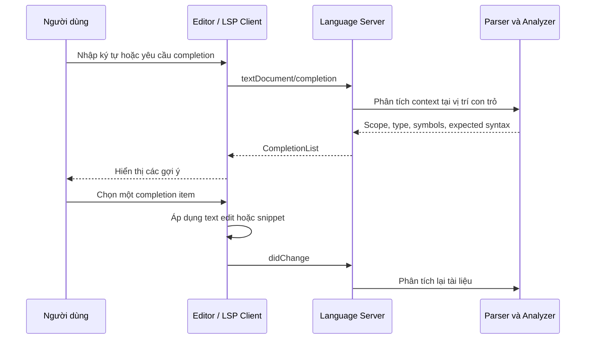

# Hoàn thành mã trong Language Server

**Hoàn thành mã** (*code completion*) là khả năng đề xuất từ khóa, tên biến, hàm, thuộc tính, kiểu dữ liệu, cấu trúc cú pháp hoặc đoạn mã phù hợp với vị trí con trỏ khi người dùng viết DSL. Trong một ngôn ngữ chuyên biệt, tính năng này đặc biệt hữu ích vì người dùng thường cần nhớ tên trường miền, tập giá trị hợp lệ và cách viết các cấu trúc của ngôn ngữ.

Language Server cung cấp khả năng phân tích ngôn ngữ độc lập với editor. Editor gửi yêu cầu hoàn thành tới server; server dùng văn bản hiện tại, vị trí con trỏ, cú pháp, symbol table, type information và domain schema để tạo danh sách gợi ý. Editor hiển thị danh sách đó và áp dụng nội dung được chọn.

Ví dụ, trong DSL mô tả quy tắc:

```text
when order.
```

Khi con trỏ nằm sau dấu chấm, language server có thể đề xuất các thuộc tính của Order như total, status, createdAt hoặc customer. Nếu người dùng nhập:

```text
when order.st
```

server có thể lọc danh sách và ưu tiên status. Gợi ý dựa trên ngữ cảnh giúp người dùng khám phá DSL và tránh phải nhớ toàn bộ schema.

## 1. Hoàn thành mã giải quyết vấn đề gì?

Người viết DSL thường phải biết tên cấu trúc và quy tắc của một miền cụ thể. Ví dụ, DSL cấu hình dịch vụ có thể có các trường replicas, image, region và healthCheck; DSL workflow có thể có các lệnh read, transform, branch và publish.

Nếu chỉ có tài liệu tĩnh, người dùng phải chuyển qua lại giữa editor và tài liệu để tìm tên chính xác. Code completion đưa những lựa chọn phù hợp đến ngay vị trí đang viết.

Các lợi ích chính:

- **Khám phá ngôn ngữ:** người dùng thấy những keyword, field và operation được hỗ trợ.
- **Giảm lỗi chính tả:** tên trường, biến và hàm được chọn từ symbol hợp lệ.
- **Tăng tốc độ viết:** editor có thể chèn cả cấu trúc, tham số hoặc snippet.
- **Hỗ trợ schema:** gợi ý thay đổi theo kiểu của đối tượng và ngữ cảnh miền.
- **Học DSL ngay trong editor:** mô tả và tài liệu ngắn có thể đi kèm từng gợi ý.
- **Giữ tính nhất quán:** tên API và cấu trúc được lấy từ mô hình ngôn ngữ thay vì người dùng tự nhớ.

Code completion không chỉ là tìm chuỗi bắt đầu bằng vài ký tự. Một language server tốt cần hiểu người dùng đang viết ở vị trí nào và loại thành phần nào hợp lệ tại vị trí đó.

## 2. Language Server và Language Server Protocol

**Language Server Protocol (LSP)** là giao thức chuẩn hóa trao đổi giữa editor/client và language server. Client quản lý giao diện, tài liệu đang mở và thao tác của người dùng. Server phân tích ngôn ngữ và trả về thông tin như diagnostics, completion, hover, definition, references và formatting.

Với code completion, luồng cơ bản là:



Server thường nhận thông tin văn bản qua các notification như mở, thay đổi và đóng tài liệu. Khi nhận completion request, server dùng phiên bản tài liệu mới nhất mà nó đã đồng bộ.

LSP tách phần hiểu ngôn ngữ khỏi phần hiển thị. Cùng một language server có thể phục vụ nhiều editor, trong khi mỗi editor tự quyết định cách trình bày danh sách, phím điều hướng và giao diện documentation.

## 3. Completion request chứa thông tin gì?

Một completion request thường xác định:

- URI của tài liệu đang được chỉnh sửa.
- Vị trí con trỏ trong tài liệu.
- Context của request, nếu client cung cấp.
- Trigger character hoặc loại trigger, nếu completion được gọi tự động.
- Phiên bản và nội dung tài liệu đã đồng bộ trước đó.

Ví dụ request LSP minh họa:

```json
{
  "textDocument": {
    "uri": "file:///workspace/rules.dsl"
  },
  "position": {
    "line": 4,
    "character": 12
  },
  "context": {
    "triggerKind": 2,
    "triggerCharacter": "."
  }
}
```

Trong LSP, dòng và character trong position được đánh số từ 0. Đơn vị character phụ thuộc encoding được thương lượng giữa client và server; nhiều hệ thống sử dụng UTF-16 code units. Server cần tôn trọng quy ước encoding thay vì mặc định cột là số byte hoặc số ký tự hiển thị.

### Trigger kind

Các trigger thường gồm:

- **Invoked:** người dùng chủ động yêu cầu completion, chẳng hạn nhấn tổ hợp phím.
- **Trigger character:** một ký tự được cấu hình làm tự động mở danh sách, ví dụ dấu chấm.
- **Trigger for incomplete completion:** client yêu cầu server tính tiếp danh sách trước đó khi người dùng nhập thêm.

Server cũng có thể nhận request không có context chi tiết. Vì vậy, việc phân tích vị trí và văn bản hiện tại vẫn là nền tảng để xác định gợi ý.

## 4. Xác định ngữ cảnh tại vị trí con trỏ

Chất lượng completion phụ thuộc lớn vào việc server hiểu người dùng đang viết loại cấu trúc nào.

Ví dụ, dấu chấm trong:

```text
order.total
```

có thể mở đầu cho member access. Nhưng dấu chấm trong literal số hoặc một cú pháp khác có ý nghĩa khác. Server cần dựa vào token, AST và trạng thái parser để xác định context.

Một số context phổ biến trong DSL:

| Vị trí con trỏ | Loại gợi ý phù hợp |
|---|---|
| Đầu một statement | Keyword và command hợp lệ |
| Sau keyword when | Biểu thức điều kiện |
| Sau dấu chấm của object | Thuộc tính hoặc method của kiểu object |
| Sau dấu bằng của field | Giá trị theo kiểu và schema |
| Trong danh sách tham số | Tham số hoặc giá trị được phép |
| Sau từ khóa import | Module hoặc namespace |
| Trong block service | Field của service |
| Trong biểu thức boolean | Toán tử, biến và biểu thức Boolean |

### Context không hoàn chỉnh

Khi người dùng đang gõ, văn bản thường chưa phải chương trình hợp lệ. Ví dụ:

```text
service "catalog" {
    region =
}
```

Parser cần có khả năng phục hồi hoặc cung cấp context một phần để completion vẫn hoạt động. Nếu server chỉ tạo gợi ý khi toàn bộ tài liệu parse thành công, người dùng có thể mất completion ngay lúc họ cần nhất.

Có thể dùng parser tolerant, error recovery hoặc phân tích token/AST gần vị trí con trỏ để dựng context tạm thời. Những node lỗi cần được đánh dấu để không tạo ra gợi ý sai từ cấu trúc không đáng tin cậy.

## 5. Nguồn dữ liệu cho completion

Một completion item có thể đến từ nhiều nguồn. Server cần kết hợp chúng dựa trên context và scope.

### Keyword và grammar

Parser hoặc grammar định nghĩa những keyword, dấu phân cách và cấu trúc có thể xuất hiện tại vị trí hiện tại.

Ví dụ, sau keyword then, DSL có thể chấp nhận một action:

```text
then notify(...)
then assign(...)
then publish(...)
```

### Symbol table

Symbol table lưu các định danh có thể được tham chiếu trong chương trình:

- Biến cục bộ.
- Tham số.
- Hàm.
- Kiểu.
- Module.
- Hằng số.
- Khai báo trong scope hiện tại hoặc scope cha.

Completion cần tôn trọng lexical scope, visibility và shadowing. Một biến cục bộ có thể che tên biến cùng tên ở scope bên ngoài.

### Type information

Type checker có thể cho biết kiểu của biểu thức tại vị trí con trỏ. Từ đó server chỉ đề xuất thành viên hoặc giá trị phù hợp.

Ví dụ, nếu order có kiểu Order, completion sau order. lấy các field và method được định nghĩa cho Order.

### Domain schema

DSL chuyên biệt thường có schema mô tả đối tượng nghiệp vụ, resource, thuộc tính, enum và quan hệ. Schema là nguồn quan trọng để đề xuất những tên mà parser không thể suy ra chỉ từ grammar.

### Imported modules và dependencies

Nếu DSL hỗ trợ module hoặc plugin, server có thể tra cứu symbol được export từ những module đã import hoặc dependency được cấu hình cho workspace.

### Built-in functions

Các hàm do runtime cung cấp, chẳng hạn date(), length(), currentUser() hoặc log(), có thể xuất hiện trong completion khi context cho phép.

## 6. Completion dựa trên scope và symbol resolution

Không phải mọi symbol trong project đều hợp lệ tại mọi vị trí. Server cần áp dụng quy tắc scope.

Ví dụ:

```text
let threshold = 100

rule "discount" {
    let rate = 0.1
    when order.total > threshold
    then discount = rate
}
```

Trong block rule, threshold và rate có thể nhìn thấy nếu DSL cho phép scope lồng nhau. Một biến chỉ được khai báo trong block khác có thể không được đề xuất.

### Scope chain

Server có thể tra cứu từ scope gần nhất ra scope cha:

1. Scope của biểu thức hoặc block hiện tại.
2. Scope của function/rule hiện tại.
3. Scope module.
4. Built-in scope của DSL.

Nếu nhiều scope có cùng tên, symbol ở scope gần nhất thường được ưu tiên theo quy tắc name resolution của ngôn ngữ.

### Visibility và access control

Completion cũng cần tôn trọng visibility như public, private, exported hoặc quyền theo module. Không nên đề xuất symbol mà người dùng không thể tham chiếu hợp lệ.

Trong workspace multi-tenant hoặc môi trường có dữ liệu nhạy cảm, server chỉ nên index và đề xuất symbol mà principal hiện tại được phép nhìn thấy.

## 7. Member completion và type-directed completion

Một tình huống phổ biến là hoàn thành thành viên sau dấu chấm.

Ví dụ:

```text
order.
```

Nếu kiểu của order là Order, server có thể đề xuất:

| Completion | Kiểu | Mô tả |
|---|---|---|
| id | String | Mã đơn hàng |
| total | Decimal | Tổng giá trị |
| status | OrderStatus | Trạng thái |
| createdAt | DateTime | Thời điểm tạo |
| customer | Customer | Khách hàng |

Khi người dùng tiếp tục:

```text
order.customer.
```

server cần biết customer có kiểu Customer rồi đề xuất các member của kiểu đó. Đây là type-directed completion.

### Type inference

Nếu kiểu của biểu thức được suy luận từ context, completion có thể dùng kết quả type inference. Ví dụ, sau:

```text
let customer = findCustomer(...)
customer.
```

Server cần suy ra kiểu trả về của findCustomer. Nếu không thể suy luận, nó có thể đề xuất một số lựa chọn ít chắc chắn hơn hoặc chỉ đưa ra symbol trong scope.

### Expected type

Completion cũng có thể dùng kiểu mong đợi ở vị trí hiện tại.

Ví dụ, nếu field cần Boolean:

```text
enabled =
```

server có thể ưu tiên true, false và biểu thức Boolean. Nếu field cần Duration, server ưu tiên literal thời lượng và hàm trả về Duration.

## 8. Value completion theo schema và enum

Với DSL khai báo, nhiều thuộc tính chỉ chấp nhận tập giá trị đã định nghĩa.

Ví dụ:

```text
service "catalog" {
    environment =
}
```

Nếu environment có kiểu enum Environment với các giá trị development, staging và production, server có thể đề xuất ba lựa chọn đó.

Completion item có thể chứa label, loại symbol hoặc enum value, mô tả ngắn, tài liệu chi tiết, nội dung được chèn và text edit xác định vùng thay thế.

Giá trị enum nên lấy từ schema hoặc type model hiện hành. Nếu schema thay đổi theo phiên bản hoặc workspace, server cần dùng đúng phiên bản đã cấu hình.

### Giá trị phụ thuộc context

Một field có thể chỉ cho phép một số giá trị theo field khác. Ví dụ, khi provider là cloud-A, danh sách region khác với cloud-B. Server có thể đọc giá trị đã khai báo trong cùng block để lọc gợi ý, nhưng cần tránh thực hiện network request chậm trong mỗi completion request.

## 9. Prefix matching và fuzzy matching

Sau khi tạo tập ứng viên, server cần lọc theo phần văn bản người dùng đã nhập.

### Prefix matching

Prefix matching giữ các candidate bắt đầu bằng chuỗi đang gõ. Ví dụ, prefix sta có thể khớp status, state và startDate. Cách này đơn giản và dễ dự đoán.

### Fuzzy matching

Fuzzy matching cho phép bỏ qua hoặc sai một số ký tự. Ví dụ, stts có thể khớp status. Điều này hữu ích khi tên miền dài hoặc người dùng gõ sai nhẹ.

Fuzzy matching cần có ngưỡng và ranking phù hợp. Nếu quá rộng, danh sách có thể chứa nhiều kết quả không liên quan.

### Filter text

Trong LSP, completion item có thể chỉ định filterText khác với label. Ví dụ, label hiển thị là createResource, nhưng filterText có thể bao gồm alias hoặc dạng viết tắt được chấp nhận.

Server cần giữ rõ sự khác nhau giữa văn bản dùng để lọc và văn bản được chèn vào tài liệu.

## 10. Xếp hạng completion items

Có thể có hàng chục hoặc hàng trăm candidate hợp lệ. Ranking quyết định thứ tự hiển thị.

Các tín hiệu thường dùng:

- Độ khớp với prefix hoặc fuzzy query.
- Mức độ gần của scope.
- Tính phù hợp với expected type.
- Mức độ phù hợp với context grammar.
- Tần suất hoặc lịch sử sử dụng, nếu chính sách cho phép.
- Symbol được import hoặc sử dụng trong workspace.
- Mức độ phổ biến của keyword hoặc domain field.
- Độ tin cậy của nguồn candidate.

Một cách ưu tiên thường gặp là:

1. Symbol cục bộ trong scope hiện tại.
2. Member phù hợp với receiver type.
3. Giá trị khớp expected type hoặc schema.
4. Symbol từ module đã import.
5. Built-in function và keyword phù hợp.
6. Candidate cần thêm import hoặc có độ chắc chắn thấp.

Thứ tự thực tế phụ thuộc ngôn ngữ. Không nên ưu tiên một gợi ý chỉ vì nó thường được dùng nếu nó không hợp lệ tại vị trí hiện tại.

### Sorting text

LSP cho phép completion item cung cấp sortText để client sắp xếp theo thứ tự mong muốn. Server có thể mã hóa nhóm ưu tiên và điểm ranking vào chuỗi này, nhưng cần bảo đảm thứ tự ổn định và dễ dự đoán.

Không nên dùng ranking ngẫu nhiên hoặc phụ thuộc vào thứ tự iteration của hash map, vì danh sách có thể thay đổi giữa các request dù tài liệu không đổi.

## 11. Completion item chứa những gì?

Một completion item thường có nhiều trường ngoài label.

| Trường | Vai trò |
|---|---|
| label | Tên hiển thị trong danh sách |
| kind | Loại item như function, field, variable, keyword |
| detail | Thông tin ngắn về kiểu hoặc chữ ký |
| documentation | Mô tả chi tiết |
| filterText | Văn bản dùng để lọc |
| sortText | Khóa sắp xếp |
| insertText | Nội dung được chèn |
| insertTextFormat | Plain text hoặc snippet |
| textEdit | Vùng và nội dung thay thế |
| additionalTextEdits | Chỉnh sửa bổ sung, ví dụ thêm import |
| commitCharacters | Ký tự có thể xác nhận lựa chọn |
| data | Dữ liệu server dùng khi resolve item |

Ví dụ completion item minh họa:

```json
{
  "label": "total",
  "kind": 5,
  "detail": "Decimal — Tổng giá trị đơn hàng",
  "documentation": "Giá trị trước khi áp dụng các khoản điều chỉnh.",
  "filterText": "total",
  "insertText": "total"
}
```

Trong LSP, kind là một enum số. Ví dụ trên minh họa cấu trúc, không phải một item đầy đủ cho mọi client.

## 12. Text edit và vùng thay thế

Khi người dùng đã gõ một phần tên, completion thường cần thay thế đúng đoạn prefix.

Ví dụ tài liệu:

```text
when order.tot
```

Nếu server chỉ chèn total tại vị trí con trỏ mà không thay tot, kết quả có thể thành tot total. Thay vào đó, completion item dùng textEdit để thay vùng tot bằng total.

Text edit có range bắt đầu và kết thúc, nội dung mới và quy ước position encoding của tài liệu.

### Insert range và replace range

Một số client hỗ trợ hai vùng:

- **Insert range:** vùng được thay khi chèn completion thông thường.
- **Replace range:** vùng rộng hơn được thay khi commit lựa chọn.

Điều này hữu ích khi người dùng gõ một prefix nhưng sau con trỏ vẫn còn phần identifier. Server có thể thay cả identifier thay vì chỉ phần đã nhập.

### Additional text edits

Một completion có thể cần chỉnh sửa ở nơi khác. Ví dụ, chọn hàm từ module chưa import có thể thêm import ở đầu tài liệu và chèn lời gọi hàm tại vị trí con trỏ.

Các edit bổ sung không nên chồng lấn với edit chính hoặc vi phạm quy tắc của client. Server cần tính toán vị trí chèn import theo snapshot văn bản hiện tại.

## 13. Snippet completion

**Snippet** là mẫu văn bản có placeholder hoặc tab stop để người dùng điền từng phần sau khi chèn.

Ví dụ, khi chọn if statement, server có thể chèn một cấu trúc gồm điều kiện, block và vị trí nhập action. Sau khi chèn, con trỏ chuyển đến placeholder đầu tiên. Người dùng nhập điều kiện, nhấn Tab để chuyển tới action, rồi hoàn tất snippet.

Trong LSP, insertTextFormat có thể chỉ ra PlainText hoặc Snippet. Không phải mọi client đều hỗ trợ đầy đủ snippet syntax, nên server cần thương lượng client capability và có fallback phù hợp.

### Snippet cho DSL

Một số snippet hữu ích:

- Rule có when/then.
- Block service với các field thường dùng.
- Workflow gồm trigger, steps và output.
- Function call với các tham số.
- Khai báo resource có tên và thuộc tính bắt buộc.

Snippet nên phản ánh grammar thực tế. Nếu chèn một cấu trúc không hợp lệ hoặc chứa placeholder không được client hỗ trợ, trải nghiệm hoàn thành sẽ kém.

## 14. Trigger characters và commit characters

**Trigger character** là ký tự khiến client tự động gửi completion request. Ví dụ, dấu chấm có thể kích hoạt member completion.

Một số trigger thường gặp:

- Dấu chấm sau identifier.
- Dấu hai chấm sau keyword mở đầu field.
- Dấu ngoặc mở khi bắt đầu danh sách tham số.
- Dấu phẩy khi người dùng nhập phần tử tiếp theo.

Trigger cần được chọn cẩn thận. Nếu quá nhiều ký tự kích hoạt request, server có thể bị gọi liên tục khi người dùng gõ văn bản thông thường.

**Commit character** là ký tự khi người dùng nhập vào sẽ xác nhận completion item đang chọn. Ví dụ, dấu ngoặc mở có thể xác nhận tên hàm rồi tiếp tục chèn dấu ngoặc.

Commit character khác trigger character: trigger yêu cầu server tạo danh sách; commit character xác nhận một item đang được chọn.

## 15. Resolve documentation theo yêu cầu

Không phải lúc nào server cũng cần gửi toàn bộ documentation cho mọi candidate. Nếu danh sách có hàng trăm item và mỗi item chứa mô tả dài, response sẽ lớn và chậm.

LSP hỗ trợ completion item resolve. Server có thể gửi item ban đầu với label, kind, sortText và data. Khi client cần hiển thị chi tiết, nó gửi request resolve để server bổ sung documentation, detail hoặc dữ liệu liên quan.

Luồng ví dụ:

1. Server trả danh sách item gọn.
2. Người dùng di chuyển tới một item.
3. Client yêu cầu resolve item.
4. Server dùng data hoặc item identity để lấy documentation.
5. Server trả item đã bổ sung chi tiết.

Resolve cần kiểm tra item thuộc workspace và document context nào. Không nên tin dữ liệu data từ client nếu nó có thể bị sửa hoặc dùng để truy cập tài nguyên ngoài quyền.

## 16. CompletionList và incomplete results

Một completion response có thể là danh sách đơn giản hoặc CompletionList có metadata.

CompletionList có thể đánh dấu isIncomplete. Điều này cho client biết danh sách chưa đầy đủ và có thể cần yêu cầu lại khi người dùng nhập thêm.

Ví dụ, server có hàng nghìn tên resource trong workspace. Thay vì tải tất cả và lọc mỗi lần, server có thể trả một tập candidate ban đầu cùng trạng thái incomplete. Khi prefix thay đổi, client gửi request tiếp theo và server truy vấn index theo prefix mới.

Cần phân biệt danh sách đầy đủ, danh sách bị giới hạn theo số lượng hoặc thời gian, danh sách chưa đầy đủ do tìm kiếm lười và danh sách chỉ chứa candidate hợp lệ trong context hiện tại.

isIncomplete không có nghĩa server gặp lỗi; nó là tín hiệu về tính đầy đủ của kết quả.

## 17. Completion cho các cấu trúc DSL khác nhau

Một language server cho DSL có thể cần nhiều chiến lược completion theo grammar.

### Statement completion

Ở đầu block, đề xuất keyword hoặc command hợp lệ:

```text
workflow "sync" {
    
}
```

Server có thể đề xuất read, transform, branch, retry và publish nếu những command đó được phép trong block.

### Expression completion

Sau when hoặc where, đề xuất biến, field, literal và toán tử phù hợp với expected type.

```text
when 
```

### Member completion

Sau dấu chấm, dùng kiểu receiver để tìm member:

```text
customer.
```

### Argument completion

Trong lời gọi hàm, server có thể đề xuất tên tham số, giá trị enum hoặc biểu thức có kiểu phù hợp:

```text
sendNotification(channel = )
```

### Import completion

Sau import, đề xuất module, package hoặc symbol được export trong workspace và dependencies.

### Key completion

Trong block cấu hình, đề xuất những field còn thiếu hoặc field được phép khai báo tại vị trí đó. Nếu schema không cho phép field trùng, server có thể loại các key đã xuất hiện.

## 18. Completion dựa trên expected type và ngữ nghĩa

Grammar cho biết hình dạng cú pháp có thể có, nhưng type information giúp chọn giá trị phù hợp hơn.

Ví dụ, field timeout:

```text
timeout =
```

có kiểu Duration. Server có thể đề xuất 500ms, 30s, 2m hoặc durationFromConfig().

Nếu field là Boolean, các gợi ý có thể là true, false hoặc biểu thức trả về Boolean.

### Type compatibility

Một candidate có thể được xếp hạng dựa trên khả năng chuyển đổi kiểu. Ví dụ, hàm trả về Integer có thể phù hợp với field Number nếu DSL cho phép widening conversion.

Server cần tuân thủ đúng quy tắc type checker. Không nên đề xuất một hàm chỉ vì tên có vẻ liên quan nếu kiểu trả về không hợp lệ.

### Union và optional types

Nếu expected type là String hoặc Null, completion có thể đưa cả string literal và null. Nếu field là Optional, server có thể đề xuất cách bỏ qua hoặc khai báo giá trị tùy grammar.

### Contextual values

Một số giá trị phụ thuộc vào trạng thái hiện tại, chẳng hạn tên dataset được cấp cho execution hoặc region được cho phép trong environment. Những candidate này cần được lấy từ nguồn có authorization và cache phù hợp.

## 19. Auto-import và completion từ dependency

Một số completion item đại diện cho symbol chưa nằm trong scope hiện tại. Khi người dùng chọn, server có thể thêm import hoặc namespace qualification.

Ví dụ, người dùng gõ:

```text
formatDate(
```

Server tìm thấy hàm formatDate trong module date-utils. Completion có thể chèn lời gọi và thêm:

```text
import date-utils
```

Đây là hành động nhiều edit. Server cần xác định:

- Module có nằm trong dependency của workspace không.
- Symbol có được export và có thể truy cập không.
- Import đã tồn tại chưa.
- Cú pháp import đúng với phiên bản DSL không.
- Vị trí chèn import có bảo toàn comment và thứ tự nhóm import không.
- Edit bổ sung có xung đột với edit chính không.

Nếu có nhiều module cùng export một tên, nên hiển thị nguồn module trong detail để người dùng chọn đúng.

## 20. Completion trong workspace lớn

Với dự án lớn, symbol có thể đến từ nhiều tệp và dependency. Quét toàn bộ workspace trong mỗi request sẽ làm editor chậm.

Language server thường duy trì index:

- Danh sách file và module.
- Symbol được khai báo và export.
- Quan hệ import.
- Schema và domain type.
- Dependency metadata.
- Cache kết quả phân tích.

Khi một tệp thay đổi, server cập nhật phần index bị ảnh hưởng thay vì xây lại toàn bộ.

### Workspace symbol index

Một index có thể lưu tên, loại symbol, module, scope, type, visibility và vị trí khai báo. Completion query index theo prefix hoặc fuzzy key, sau đó lọc theo context.

### Incremental update

Khi nhận didChange, server cập nhật parse tree hoặc index. Nếu tài liệu chưa hoàn chỉnh, server vẫn cần giữ kết quả tốt nhất có thể.

### Cache invalidation

Cache phải được vô hiệu hóa khi schema, dependency, import hoặc file liên quan thay đổi. Dùng cache cũ có thể tạo completion cho symbol đã bị xóa hoặc không còn quyền truy cập.

## 21. Hiệu năng và khả năng phản hồi

Completion là tính năng tương tác; độ trễ nhỏ cũng có thể ảnh hưởng cảm nhận khi gõ.

Một số nguyên tắc:

- Giữ đường xử lý completion nhẹ và có giới hạn thời gian.
- Dùng index và cache thay vì quét toàn bộ workspace.
- Trì hoãn documentation nặng tới resolve.
- Giới hạn số lượng candidate trả về.
- Hủy request cũ khi người dùng tiếp tục gõ.
- Không gọi network service chậm trên đường xử lý chính nếu có thể.
- Tránh phân tích lại toàn bộ workspace cho mỗi ký tự.
- Đo latency theo loại context và kích thước workspace.

### Cancellation

Client có thể hủy completion request khi một request mới thay thế nó. Server nên kiểm tra cancellation token trong quá trình tìm kiếm và dừng công việc không còn cần thiết.

Nếu server tiếp tục xử lý mọi request cũ, nhiều lần gõ nhanh có thể tạo hàng loạt truy vấn không còn giá trị.

### Debounce và trigger policy

Client có thể debounce một số request để tránh gọi server cho từng phím. Tuy nhiên, debounce quá lâu khiến gợi ý xuất hiện chậm. Cần cân bằng theo loại trigger và hiệu năng thực tế.

## 22. Completion trong tài liệu chưa hợp lệ

Người dùng thường gọi completion khi đang viết dở:

```text
rule "discount" {
    when order.total >
}
```

Parser có thể chưa tạo được node điều kiện hoàn chỉnh. Server vẫn có thể xác định vị trí đang ở biểu thức và đề xuất identifier, literal hoặc dấu mở ngoặc.

Một số kỹ thuật:

- Error-tolerant parsing.
- Partial AST.
- Token-based context detection.
- Expected-token information từ parser.
- Recovery node có source span.
- Fallback theo grammar khi semantic model chưa có.

Fallback nên có giới hạn. Nếu parser không xác định được context, server có thể trả keyword hoặc symbol phổ biến thay vì giả vờ biết chính xác kiểu mong đợi.

## 23. Bảo mật và quyền riêng tư trong completion

Completion có thể tiết lộ tên bảng, resource, module, user hoặc dữ liệu workspace. Vì vậy, đây cũng là một API cần kiểm soát quyền.

Một số nguyên tắc:

- Chỉ index tài liệu và dependency mà người dùng được phép truy cập.
- Không đề xuất secret hoặc giá trị credential.
- Kiểm tra quyền trước khi trả tên resource nhạy cảm.
- Không dùng completion resolve để truy cập đường dẫn tùy ý từ client data.
- Giới hạn thông tin documentation theo visibility.
- Không gửi nội dung workspace tới dịch vụ ngoài nếu chưa có cơ sở và quyền phù hợp.
- Escape nội dung không tin cậy trong documentation hoặc label.
- Tránh để completion timing tiết lộ thông tin nhạy cảm về resource không được phép xem.

Một item xuất hiện trong danh sách có thể tiết lộ sự tồn tại của symbol dù người dùng không thể đọc nội dung của nó. Authorization cần được áp dụng trước khi tạo candidate, không chỉ khi người dùng thực thi DSL.

## 24. Các capability LSP liên quan

Client và server thương lượng capability khi khởi tạo phiên LSP. Điều này cho biết client hỗ trợ những dạng completion nào.

Các khả năng liên quan có thể gồm:

- Completion item kinds.
- Snippet support.
- Insert/replace edit support.
- Documentation format như Markdown.
- Completion item resolve.
- Commit characters.
- Completion list item defaults.
- Label details.
- Insert text mode.
- Position encoding.

Server nên chỉ gửi trường hoặc hành vi mà client hỗ trợ, hoặc có fallback phù hợp. Một số client cũ có thể bỏ qua snippet hoặc additionalTextEdits.

### Completion item defaults

Với danh sách lớn, LSP cho phép chia sẻ một số thuộc tính mặc định giữa các item để giảm payload. Server có thể dùng cơ chế này khi client khai báo hỗ trợ.

Không nên giả định mọi editor đều hỗ trợ mọi capability giống nhau. Khả năng tương thích cần dựa trên thông tin initialize của client.

## 25. Ví dụ end-to-end cho DSL

Giả sử người dùng viết:

```text
rule "free-shipping" {
    when order.st
}
```

Server xử lý như sau:

1. Nhận completion request tại vị trí sau st.
2. Lấy phiên bản văn bản hiện tại từ document store.
3. Xác định vị trí nằm trong biểu thức điều kiện.
4. Parser nhận diện member access với receiver order.
5. Resolver tìm kiểu Order của order.
6. Type model cung cấp các field của Order.
7. Server lọc các field theo prefix st.
8. Ranking ưu tiên status nếu field này hợp lệ và khớp tốt.
9. Tạo completion item với label, kind, detail và textEdit thay prefix st.
10. Trả CompletionList cho client.
11. Người dùng chọn status.
12. Client thay prefix và gửi didChange.
13. Server cập nhật parse tree và diagnostics.

Kết quả:

```text
rule "free-shipping" {
    when order.status
}
```

Nếu context mong đợi Boolean, server có thể tiếp tục gợi ý phép so sánh hoặc enum value phù hợp sau member access. Completion có thể được gọi nhiều lần khi người dùng tiếp tục viết biểu thức.

## 26. Những lỗi thiết kế thường gặp

**Chỉ lọc theo prefix.** Danh sách có thể chứa symbol không thuộc scope hoặc không hợp lệ theo kiểu. Cần phân tích context và visibility.

**Chỉ hoạt động khi tài liệu parse hoàn toàn.** Người dùng thường gọi completion khi đang gõ dở. Cần partial parsing hoặc fallback.

**Chèn văn bản thay vì thay prefix.** Kết quả có thể lặp phần người dùng đã gõ. Cần tính textEdit range chính xác.

**Bỏ qua position encoding.** Offset có thể lệch khi tài liệu chứa Unicode. Client/server phải thống nhất encoding.

**Trả quá nhiều documentation ngay lập tức.** Payload lớn làm completion chậm. Dùng resolve cho chi tiết khi cần.

**Ranking không ổn định.** Gợi ý đổi thứ tự giữa các request mà không có thay đổi ngữ cảnh. Dùng sorting rule xác định.

**Không hủy request cũ.** Người dùng gõ nhanh có thể tạo nhiều truy vấn dư thừa. Hỗ trợ cancellation.

**Gợi ý symbol không có quyền truy cập.** Danh sách có thể tiết lộ resource hoặc module nhạy cảm. Áp dụng authorization trước khi tạo candidate.

**Auto-import sai hoặc trùng.** Chèn import không kiểm tra dependency và nội dung hiện tại có thể làm tài liệu không hợp lệ. Cần kiểm tra workspace và additional edits.

**Snippet không tương thích client.** Placeholder không được hỗ trợ có thể xuất hiện như văn bản thô. Kiểm tra client capability và fallback.

**Dùng dữ liệu schema cũ.** Cache không được cập nhật có thể đề xuất field đã bị xóa. Cần invalidation theo phiên bản schema.

## 27. Quy trình triển khai code completion cho DSL

Một kế hoạch triển khai có thể gồm:

1. Xác định các vị trí trong grammar cần completion.
2. Định nghĩa loại candidate: keyword, symbol, member, enum, function, snippet và module.
3. Bảo đảm lexer/parser có thể cung cấp context ngay cả khi văn bản chưa hoàn chỉnh.
4. Tích hợp scope resolver, symbol table, type checker và domain schema.
5. Xây dựng API lấy candidate theo context.
6. Triển khai prefix/fuzzy filtering và ranking xác định.
7. Tạo CompletionItem với label, kind, detail, documentation và textEdit.
8. Hỗ trợ snippet, commit character và additionalTextEdits khi client cho phép.
9. Thương lượng LSP capabilities trong initialize.
10. Thêm resolve cho documentation hoặc dữ liệu nặng.
11. Dùng index, cache và incremental update cho workspace lớn.
12. Hỗ trợ cancellation và giới hạn thời gian xử lý.
13. Áp dụng authorization trước khi trả symbol hoặc resource.
14. Cập nhật diagnostics và semantic model sau khi client áp dụng edit.
15. Theo dõi latency và hành vi completion theo từng context.

## 28. Câu hỏi tự kiểm tra

1. Code completion là gì và có vai trò gì trong Language Server?
2. LSP client và language server chia sẻ trách nhiệm như thế nào?
3. Một completion request thường chứa những thông tin nào?
4. Trigger character khác commit character ra sao?
5. Vì sao server cần xác định context tại vị trí con trỏ?
6. Symbol table, type information và domain schema đóng góp gì cho completion?
7. Scope chain và shadowing ảnh hưởng danh sách gợi ý như thế nào?
8. Type-directed completion khác prefix matching ở điểm nào?
9. Fuzzy matching hữu ích trong trường hợp nào và cần kiểm soát ra sao?
10. Các trường label, kind, detail, filterText, sortText và textEdit có vai trò gì?
11. Vì sao textEdit cần thay prefix thay vì chỉ chèn thêm văn bản?
12. Snippet và additionalTextEdits hỗ trợ những tình huống nào?
13. Completion item resolve giúp giảm payload ra sao?
14. isIncomplete có ý nghĩa gì trong CompletionList?
15. Incremental parsing, indexing và cache hỗ trợ workspace lớn như thế nào?
16. Vì sao cancellation quan trọng khi người dùng gõ liên tục?
17. Completion cần áp dụng authorization để tránh tiết lộ thông tin nào?
18. Hãy mô tả luồng hoàn thành một field của đối tượng Order từ request LSP đến khi editor áp dụng edit.

Hoàn thành mã biến Language Server thành trợ lý hiểu ngôn ngữ ngay trong editor. Khi kết hợp grammar, scope, type information, domain schema, ranking và text edits chính xác, DSL trở nên dễ khám phá, ít lỗi và nhanh hơn để viết.

