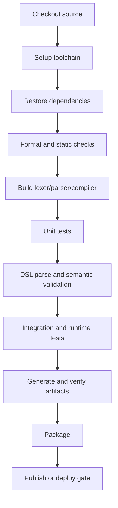

# Tích hợp CI cho dự án DSL

**Continuous Integration (CI)** là quy trình tự động kiểm tra các thay đổi mã nguồn khi chúng được đẩy lên repository hoặc gửi vào pull request. Với dự án xây dựng và sử dụng một DSL (*Domain-Specific Language*), CI giúp phát hiện sớm lỗi trong grammar, parser, semantic analysis, compiler, thư viện runtime, schema và các chương trình DSL do dự án quản lý.

Một dự án DSL thường có nhiều loại nội dung cần kiểm tra: mã triển khai language server hoặc compiler, định nghĩa grammar, file schema, ví dụ DSL, test case, plugin, template và cấu hình build. Nếu chỉ biên dịch source code của compiler mà không kiểm tra các chương trình viết bằng DSL, thay đổi có thể làm hỏng ngôn ngữ mà pipeline vẫn báo thành công.

Tích hợp CI nghĩa là thiết kế pipeline hiểu được các thành phần này, chạy đúng các bước kiểm tra và đưa kết quả về nơi nhóm phát triển làm việc. Ví dụ, khi một pull request thay đổi grammar, CI có thể build parser, chạy parser tests, kiểm tra các file DSL mẫu, tạo diagnostics và báo lỗi trực tiếp trên pull request.

## 1. CI giải quyết vấn đề gì trong dự án DSL?

Một DSL có thể phát triển qua nhiều thành phần liên quan. Thay đổi nhỏ ở một thành phần có thể ảnh hưởng tới những thành phần khác:

- Thay đổi grammar có thể làm parser sinh ra AST khác.
- Thay đổi type checker có thể khiến chương trình DSL cũ không còn hợp lệ.
- Thay đổi runtime có thể làm hành vi thực thi khác đi.
- Thay đổi code generator có thể tạo mã đích sai hoặc không tương thích.
- Thay đổi schema có thể làm ví dụ, template và cấu hình hiện tại không còn dùng được.
- Thay đổi language server có thể làm completion, hover hoặc diagnostics hoạt động khác.

Nếu chỉ kiểm tra thủ công, lỗi thường được phát hiện muộn, khó xác định commit gây ra lỗi và tốn thời gian tái hiện.

CI giúp:

1. Kiểm tra mọi thay đổi theo cùng một quy trình.
2. Phát hiện lỗi trước khi merge.
3. Giữ grammar, compiler, runtime và tài liệu ví dụ nhất quán.
4. Tạo artifact có thể truy vết về commit và phiên bản toolchain.
5. Cung cấp phản hồi nhanh cho người tạo thay đổi.
6. Giảm sự phụ thuộc vào môi trường máy cá nhân.

CI không thay thế review hoặc kiểm thử chuyên sâu. Nó tự động hóa các bước có thể lặp lại và cung cấp bằng chứng để người review đưa ra quyết định.

## 2. CI khác Continuous Delivery và Continuous Deployment

Các thuật ngữ này thường đi cùng nhau nhưng mô tả những phạm vi khác nhau.

| Khái niệm | Mục tiêu | Ví dụ trong dự án DSL |
|---|---|---|
| Continuous Integration | Tích hợp và kiểm tra thay đổi thường xuyên | Build compiler, chạy parser tests, validate DSL examples |
| Continuous Delivery | Chuẩn bị artifact có thể phát hành | Đóng gói compiler, runtime, grammar và tài liệu |
| Continuous Deployment | Tự động triển khai thay đổi đã đạt điều kiện | Phát hành language server hoặc runtime lên môi trường production |

Một pipeline có thể kết thúc ở bước tạo artifact để nhóm phát hành thủ công. Một pipeline khác có thể tự động triển khai sau khi vượt qua các quality gate. Việc triển khai cần có điều kiện phù hợp với rủi ro của artifact.

Với DSL được dùng để cấu hình hệ thống production, thay đổi grammar hoặc runtime có thể ảnh hưởng tới nhiều chương trình. Vì vậy, bước deploy thường cần thêm kiểm tra tương thích và phê duyệt theo chính sách phát hành.

## 3. Xác định những gì cần chạy trong CI

Trước khi viết pipeline, cần liệt kê loại tài nguyên trong repository và quan hệ giữa chúng.

Một repository DSL có thể gồm:

| Thành phần | Kiểm tra CI phù hợp |
|---|---|
| Grammar | Sinh parser, kiểm tra xung đột hoặc lỗi grammar |
| Lexer và parser | Unit tests, parser fixtures, malformed input |
| AST và IR | Kiểm tra cấu trúc và transformation |
| Semantic analyzer | Name resolution, type checking, domain validation |
| Compiler/code generator | Build, golden tests, output validation |
| Runtime | Unit/integration tests, resource limits |
| DSL examples | Parse, validate và execute trong môi trường test |
| Schema và metadata | Schema validation, compatibility checks |
| Language server | Protocol tests, completion/diagnostic tests |
| Plugin và extension | Build, contract tests, dependency checks |
| Documentation | Kiểm tra code samples và liên kết nếu có công cụ hỗ trợ |

Không phải mọi repository đều có đủ các thành phần trên. Pipeline nên phản ánh kiến trúc thực tế và các rủi ro của sản phẩm.

### Phân loại thay đổi

Có thể xác định những bước cần chạy dựa trên vùng file thay đổi:

- Grammar thay đổi: build parser và chạy parser tests.
- Semantic rules thay đổi: chạy type và domain validation tests.
- Runtime thay đổi: chạy runtime tests và DSL integration tests.
- Documentation example thay đổi: kiểm tra các ví dụ tương ứng.
- Dependency hoặc build configuration thay đổi: chạy build đầy đủ và kiểm tra dependency.

Tuy nhiên, nếu các thành phần có phụ thuộc chéo, chỉ chạy test theo thư mục có thể bỏ sót lỗi. Nên có một bộ kiểm tra bắt buộc ở mức project để xác nhận các thành phần tích hợp vẫn hoạt động.

## 4. Thiết kế pipeline CI theo các stage

Một pipeline cơ bản có thể chia thành các stage:



Mỗi stage có thể chạy một hoặc nhiều job. Những job độc lập có thể chạy song song để giảm thời gian, còn job phụ thuộc cần chờ kết quả của bước trước.

### Checkout

Lấy đúng commit cần kiểm tra. Với pull request, pipeline cần kiểm tra nội dung thay đổi theo chính sách của repository, bao gồm cả merge result nếu hệ thống CI hỗ trợ.

### Setup toolchain

Cài hoặc chọn đúng phiên bản JDK, compiler, parser generator, runtime, package manager và các công cụ cần thiết. Phiên bản phải được cố định hoặc quản lý theo file cấu hình của dự án.

### Restore dependencies

Tải dependencies và khôi phục cache. Nguồn package nên được xác định rõ, có thể dùng lockfile hoặc dependency constraints để tránh kết quả khác nhau giữa các lần chạy.

### Build và test

Build các thành phần ngôn ngữ, chạy unit tests, parser tests, semantic tests và integration tests.

### Validate DSL programs

Phân tích những file DSL mẫu hoặc chương trình DSL trong repository bằng đúng compiler/runtime đang được build.

### Package và publish gate

Tạo artifact có thể phát hành. Publish hoặc deploy chỉ diễn ra khi các quality gate và chính sách phê duyệt được đáp ứng.

## 5. Thiết lập môi trường build nhất quán

Một lỗi phổ biến của CI là môi trường build khác máy lập trình viên. Ví dụ, local dùng JDK mới nhưng CI dùng JDK cũ; parser generator khác phiên bản; locale hoặc line ending khiến golden file thay đổi.

Cần xác định rõ:

- Phiên bản JDK hoặc runtime.
- Phiên bản parser generator và compiler.
- Phiên bản package manager.
- Hệ điều hành hoặc container image.
- Locale, timezone và encoding.
- Các biến môi trường được phép.
- Cách tải dependencies.
- Cách xử lý cache và artifact.

Nếu dự án dùng Java, có thể cố định toolchain trong cấu hình build và để CI dùng cùng cấu hình đó. Tránh dựa vào phiên bản mặc định có sẵn trên runner.

### Encoding và line ending

DSL có thể chứa tiếng Việt, Unicode, ký tự escape hoặc newline nhạy cảm với parser. CI nên dùng encoding nhất quán, thường là UTF-8, và kiểm soát line ending trong repository.

Nếu parser xử lý offset theo UTF-16 nhưng test fixture hoặc generator tính theo byte, test nên bao gồm ký tự Unicode để phát hiện sai lệch.

## 6. Build grammar, lexer và parser

Khi grammar được quản lý như mã nguồn, CI cần kiểm tra rằng parser có thể được sinh hoặc biên dịch thành công.

Các bước thường gặp:

1. Kiểm tra file grammar có đúng cú pháp của parser generator.
2. Chạy parser generator với phiên bản đã cố định.
3. Build lexer và parser được sinh.
4. Biên dịch phần visitor/listener hoặc adapter.
5. Chạy parser tests với input hợp lệ và không hợp lệ.
6. Kiểm tra output AST hoặc parse tree nếu dự án có golden fixtures.

### Parser fixtures

Một bộ fixture có thể gồm:

- DSL tối thiểu hợp lệ.
- DSL sử dụng từng cấu trúc quan trọng.
- Biểu thức có precedence và associativity.
- Block lồng nhau.
- Comment, string và escape sequence.
- Unicode và newline.
- Input bị thiếu token hoặc dấu đóng.
- Token không hợp lệ.

Ví dụ:

```text
# valid
rule "active-order" {
    when order.total >= 100
    then notify("ops")
}

# invalid
rule "broken" {
    when order.total >=
}
```

CI có thể chạy parser trên từng fixture và xác nhận trạng thái parse, loại diagnostic và vị trí lỗi mong đợi.

Không nên chỉ kiểm tra rằng parser không crash. Parser có thể chấp nhận sai cấu trúc hoặc tạo AST không đúng mà test crash-only vẫn thành công.

## 7. Semantic validation cho chương trình DSL

Parser xác nhận cấu trúc cú pháp. Semantic analyzer kiểm tra ý nghĩa: tên có tồn tại không, kiểu có tương thích không, tham chiếu có hợp lệ không và quy tắc miền có được tuân thủ không.

CI nên có các chương trình DSL mẫu đại diện cho những trường hợp:

- Tham chiếu symbol hợp lệ.
- Symbol không tồn tại.
- Kiểu dữ liệu tương thích và không tương thích.
- Thuộc tính bắt buộc.
- Giá trị enum.
- Giới hạn nghiệp vụ.
- Import và module resolution.
- Phạm vi biến và shadowing.
- Cấu hình xung đột hoặc khai báo trùng.

Ví dụ:

```text
service "catalog" {
    replicas = 3
    region = "ap-southeast"
}
```

Một fixture hợp lệ cần vượt qua parse và semantic validation. Fixture lỗi cần tạo diagnostic phù hợp. CI có thể so sánh diagnostic code và source range thay vì phụ thuộc hoàn toàn vào câu message đã dịch.

### Chạy validator ở chế độ CI

Một CLI của DSL có thể cung cấp lệnh tương tự:

```bash
dslc validate examples/
```

Lệnh nên có exit code khác 0 khi có lỗi chặn. Cảnh báo có thể được cấu hình thành warning hoặc error theo chính sách repository. Output máy đọc được giúp CI tạo annotation hoặc báo cáo.

## 8. Kiểm thử compiler và code generation

Compiler có thể tạo mã JavaScript, Java, SQL, bytecode hoặc một định dạng cấu hình khác. CI cần xác nhận mã đích phản ánh đúng semantics của DSL.

### Golden tests

Golden test lưu output mong đợi cho một input nhất định. Khi compiler chạy, test so sánh output thực tế với file chuẩn.

Ví dụ:

```text
input: examples/shipping.dsl
expected: golden/shipping.generated.js
```

Golden tests hữu ích để phát hiện thay đổi không mong muốn trong code generation. Khi output thay đổi có chủ đích, cần review diff và cập nhật golden file cùng thay đổi tương ứng.

### Kiểm tra semantics

So sánh chuỗi generated code chưa đủ nếu nhiều dạng code khác nhau có thể biểu diễn cùng semantics. Có thể bổ sung:

- Parse generated code bằng parser của target.
- Chạy generated code trong runtime test.
- So sánh kết quả với interpreter.
- Kiểm tra source map hoặc debug metadata.
- Kiểm tra không sinh code có cấu trúc nguy hiểm hoặc không hợp lệ.

### Deterministic output

Nếu cùng input và cùng toolchain tạo output khác nhau giữa các lần chạy, golden test và cache trở nên khó tin cậy. Cần kiểm soát thứ tự map, timestamp, đường dẫn tuyệt đối, random seed và metadata không xác định.

## 9. Kiểm thử runtime và tích hợp

Unit tests kiểm tra từng thành phần. Integration tests xác nhận parser, semantic analyzer, compiler và runtime phối hợp đúng.

Một test end-to-end có thể:

1. Đọc file DSL.
2. Parse thành AST.
3. Chạy semantic analysis.
4. Compile hoặc interpret.
5. Thực thi trong runtime test.
6. So sánh kết quả với expected output.
7. Kiểm tra diagnostics và source mapping nếu có.

Ví dụ:

```text
Input DSL:
    calculate discount for order "A-100"

Expected:
    discount = 10%
    status = "eligible"
```

Test nên sử dụng dữ liệu giả lập và service stub thay vì gọi hệ thống production. Nếu cần database, có thể dùng database test riêng được khởi tạo và dọn trong job.

### Kiểm tra isolation và resource limits

Nếu runtime hỗ trợ sandbox, CI có thể kiểm tra:

- Execution bị timeout khi vượt deadline.
- Memory limit được áp dụng.
- File access ngoài workspace bị từ chối.
- Network request không được phép bị chặn.
- Capability thiếu quyền bị từ chối.
- Worker crash không làm hỏng process điều phối.
- Temporary data được cleanup.

Các test này cần chạy trong môi trường runner phù hợp với cơ chế isolation thực tế.

## 10. Kiểm thử Language Server và tooling

Nếu DSL có Language Server, CI nên kiểm tra các giao thức mà editor sử dụng.

Một số nhóm test:

- Khởi tạo LSP và thương lượng capabilities.
- Mở, thay đổi và đóng tài liệu.
- Diagnostics khi văn bản hợp lệ hoặc lỗi.
- Completion trong các context khác nhau.
- Hover, definition, references và rename nếu được hỗ trợ.
- Position encoding với Unicode.
- Cancellation và tài liệu thay đổi nhanh.
- Workspace indexing và cache invalidation.

Completion test có thể gửi request tại vị trí sau dấu chấm và xác nhận server trả các field đúng theo receiver type. Diagnostics test nên xác nhận code, severity và source range.

Nếu language server chạy như process riêng, CI có thể khởi động server trong test harness, gửi JSON-RPC messages và kiểm tra response.

## 11. Chất lượng code và static analysis

CI có thể chạy formatter, compiler warnings, linter, static analyzer và dependency checks.

Các bước thường gặp:

- Kiểm tra formatting.
- Kiểm tra import hoặc dependency không dùng.
- Phát hiện lỗi kiểu và cảnh báo compiler.
- Static analysis cho code Java hoặc ngôn ngữ triển khai.
- Kiểm tra API compatibility.
- Kiểm tra dependency license và vulnerability theo chính sách.
- Kiểm tra generated source có được cập nhật đúng hay không.

Static analysis của compiler code khác semantic validation của chương trình DSL. Một pipeline tốt cần phân biệt hai lớp:

- Code triển khai compiler có đúng và an toàn không?
- Chương trình DSL đầu vào có hợp lệ theo grammar và semantics không?

## 12. Ví dụ workflow CI

Một workflow minh họa có thể dùng GitHub Actions. Cú pháp cụ thể cần điều chỉnh theo build tool và cấu trúc repository:

```yaml
name: DSL CI

on:
  pull_request:
  push:
    branches:
      - main

jobs:
  build-and-validate:
    runs-on: ubuntu-latest

    steps:
      - name: Checkout
        uses: actions/checkout@v4

      - name: Set up Java
        uses: actions/setup-java@v4
        with:
          distribution: temurin
          java-version: "21"

      - name: Build
        run: ./gradlew build

      - name: Validate DSL examples
        run: ./gradlew validateDslExamples

      - name: Run integration tests
        run: ./gradlew integrationTest

      - name: Package
        run: ./gradlew assemble
```

Đây chỉ là ví dụ cấu trúc. Tên task validateDslExamples và integrationTest phải tồn tại trong build của dự án; không nên thêm một lệnh giả định rồi kỳ vọng CI tự hiểu.

### Chia job

Pipeline có thể tách thành các job độc lập:

- Build và static analysis.
- Parser và semantic tests.
- Runtime integration.
- DSL examples validation.
- Package artifact.

Job có thể chạy song song nếu không phụ thuộc output của nhau. Nếu cần dùng generated parser hoặc artifact từ job build, hãy khai báo dependency và truyền artifact một cách rõ ràng.

## 13. Chạy CI cho pull request

Pull request là thời điểm phù hợp để phản hồi trước khi thay đổi được merge.

CI có thể:

- Chạy các bước bắt buộc.
- Hiển thị trạng thái check.
- Đính kèm test report.
- Tạo annotation cho dòng lỗi.
- Upload generated artifact để reviewer xem.
- Báo thống kê thời gian build hoặc số diagnostics.
- Chặn merge khi required checks thất bại.

### Annotation theo source location

Nếu validator trả diagnostic có file, line, column và severity, CI provider có thể hiển thị lỗi ngay trong diff.

Ví dụ output máy đọc được:

```json
{
  "severity": "error",
  "code": "DSL-NAME-004",
  "message": "Không tìm thấy thuộc tính region",
  "file": "examples/deploy.dsl",
  "line": 4,
  "column": 5
}
```

Adapter của CI chuyển dữ liệu này thành annotation theo định dạng mà nền tảng hỗ trợ. Nếu vị trí nằm ngoài diff, kết quả vẫn cần xuất hiện trong log hoặc report tổng hợp.

### Required checks

Nhóm có thể yêu cầu build, parser tests, semantic validation và integration tests phải thành công trước khi merge. Những check không ổn định hoặc phụ thuộc dịch vụ bên ngoài cần có cách xử lý rõ ràng để tránh chặn merge ngẫu nhiên.

## 14. Caching để tăng tốc pipeline

Build compiler hoặc language server có thể tốn thời gian do dependencies, parser generation, indexing và compilation.

Cache có thể lưu:

- Package dependencies.
- Build tool cache.
- Generated parser nếu có thể tái sử dụng an toàn.
- Incremental compilation outputs.
- Workspace index hoặc test fixture đã chuẩn bị.

### Cache key

Cache key cần phản ánh những yếu tố ảnh hưởng đến kết quả:

- Hệ điều hành và kiến trúc.
- Phiên bản JDK hoặc compiler.
- Lockfile và dependency declarations.
- Build configuration.
- Grammar hoặc schema version nếu cache chứa parser/index.
- Phiên bản công cụ sinh mã.

Nếu cache key quá rộng, pipeline có thể dùng artifact cũ sau khi grammar hoặc toolchain thay đổi. Nếu quá hẹp, cache ít được tái sử dụng và không đem lại lợi ích.

### Cache không phải nguồn chân lý

Khi cache bị thiếu hoặc hỏng, build vẫn phải có khả năng tạo lại kết quả từ source và dependencies đã khai báo. Không nên phụ thuộc vào file cache không được tạo lại trong một clean checkout.

## 15. Artifact và khả năng truy vết

Artifact là đầu ra được lưu sau một pipeline, ví dụ:

- Compiler binary hoặc package.
- Runtime library.
- Language server executable.
- Generated parser.
- Generated code từ ví dụ.
- Test report và coverage report.
- Documentation bundle.
- Source map hoặc debug symbols.

Artifact nên gắn với commit, phiên bản compiler, phiên bản DSL, toolchain và build metadata. Nhờ vậy, nhóm có thể xác định binary nào đã được tạo từ source nào.

### Artifact không đồng nghĩa với publish

CI có thể tạo và lưu artifact để reviewer kiểm tra. Publish đưa artifact vào registry hoặc phân phối cho người dùng. Deploy đưa nó vào môi trường chạy. Ba hành động này có quyền và rủi ro khác nhau, nên pipeline cần tách rõ.

### Retention

Không cần giữ mọi artifact vô thời hạn. Có thể áp dụng retention theo loại: artifact pull request lưu ngắn, release artifact lưu lâu hơn theo chính sách phát hành.

## 16. Quản lý secrets và quyền trong CI

Pipeline có thể cần token để tải private dependency hoặc publish package. Secrets phải được quản lý riêng, không đặt trong DSL sample, source code hoặc log.

Nguyên tắc:

- Chỉ cấp secret cho job thực sự cần.
- Dùng token có scope hẹp và thời hạn phù hợp.
- Không chạy job có quyền publish với nội dung pull request không đáng tin cậy.
- Tách quyền build/test khỏi quyền release.
- Không in environment variables hoặc secret vào log.
- Dùng protected environment hoặc approval gate cho publish/deploy.
- Thu hồi token khi không còn sử dụng.

### Pull request từ fork

Một pull request từ fork có thể chứa code hoặc workflow sửa đổi do người ngoài gửi. Không nên cung cấp secrets có quyền ghi cho job chạy trên nội dung đó. Build và test không cần credential publish thì nên chạy với quyền tối thiểu.

## 17. Kiểm tra dependency và supply chain

Compiler và language server thường phụ thuộc parser generator, thư viện runtime, plugin và package bên ngoài. Một dependency bị thay đổi có thể ảnh hưởng tới tính đúng đắn hoặc bảo mật của DSL.

CI có thể kiểm tra:

- Lockfile có được cập nhật có chủ đích không.
- Dependency có phiên bản và nguồn rõ ràng không.
- Có package bị phát hiện lỗ hổng theo policy không.
- License có phù hợp không.
- Artifact có thể truy vết tới dependency version không.
- Generated code hoặc plugin có nguồn tải đáng tin cậy không.

Nếu dùng dependency scanning, cần xác định mức severity nào làm pipeline thất bại. Kết quả scanner cần được review; không phải mọi cảnh báo đều có cùng mức rủi ro.

## 18. Reproducible builds

**Reproducible build** là khả năng tạo ra artifact giống nhau từ cùng source, dependencies và toolchain trong điều kiện build được xác định.

Đối với DSL, reproducibility đặc biệt quan trọng khi compiler sinh parser, generated source, package hoặc mã đích.

Các yếu tố cần kiểm soát:

- Phiên bản toolchain.
- Dependency lockfile.
- Thứ tự file và symbol khi sinh output.
- Timestamp và metadata biến động.
- Đường dẫn tuyệt đối trên runner.
- Locale, timezone và encoding.
- Random seed nếu có.
- Biến môi trường ảnh hưởng tới build.

Nếu artifact thay đổi giữa hai lần build mà source không đổi, cần xác định nguyên nhân trước khi dựa vào checksum hoặc cache.

## 19. Quality gates và chính sách thất bại

Một **quality gate** là điều kiện pipeline phải đạt trước khi chuyển sang bước tiếp theo hoặc cho phép merge/release.

Ví dụ:

| Gate | Điều kiện mẫu |
|---|---|
| Build | Compiler và language server build thành công |
| Parser | Tất cả parser fixtures bắt buộc đạt |
| Semantic | Không có semantic error trong examples |
| Runtime | Integration tests bắt buộc đạt |
| Compatibility | Public DSL compatibility không bị phá ngoài kế hoạch |
| Security | Không có phát hiện vượt ngưỡng policy |
| Coverage | Đạt ngưỡng đã thống nhất nếu dự án áp dụng |
| Release | Artifact đã ký và được phê duyệt |

Không nên chọn ngưỡng tùy tiện chỉ để làm pipeline có vẻ nghiêm ngặt. Mỗi gate cần có lý do và chủ sở hữu.

### Warning và error

Có thể cho phép warning trong giai đoạn phát triển nhưng yêu cầu không có warning mới trong release. Với DSL, một warning deprecation có thể quan trọng vì chương trình cũ sẽ cần migration trong phiên bản sau.

Cần phân biệt lỗi của compiler với warning trong chương trình DSL và cảnh báo từ dependency scanner.

## 20. Compatibility testing cho DSL

DSL thường có người dùng lưu trữ chương trình qua nhiều phiên bản. Một thay đổi compiler có thể làm chương trình cũ không parse hoặc thay đổi kết quả.

CI có thể giữ một tập compatibility fixtures:

- Ví dụ từ phiên bản DSL trước.
- Chương trình mẫu của khách hàng đã được ẩn dữ liệu nhạy cảm.
- Cấu hình production đại diện.
- File dùng cú pháp deprecated.
- Fixture cho schema version cũ.

Có thể chạy chúng qua compiler mới và kiểm tra:

- Parse vẫn thành công.
- Semantic validation vẫn đúng hoặc tạo cảnh báo migration dự kiến.
- Generated output không đổi ngoài thay đổi có chủ đích.
- Runtime behavior giữ tương thích theo contract.
- Diagnostics chỉ rõ những thay đổi không tương thích.

Nếu DSL có version declaration, CI nên chạy fixture với đúng version semantics tương ứng.

## 21. Kiểm tra tài liệu và ví dụ DSL

Ví dụ trong tài liệu thường được sao chép vào project thực tế. Nếu code sample lỗi, tài liệu nhanh chóng mất độ tin cậy.

Có thể đánh dấu code block cần thực thi bằng metadata hoặc lưu ví dụ thành file fixture. CI đọc các fixture này và chạy:

1. Parse.
2. Semantic validation.
3. Compile hoặc execute trong test environment nếu phù hợp.
4. So sánh output hoặc diagnostics mong đợi.

Không phải mọi code block đều là chương trình hoàn chỉnh. Ví dụ minh họa một biểu thức chưa đóng hoặc đoạn pseudo-code không nên bị đưa vào bộ kiểm tra như fixture hợp lệ. Cần phân biệt rõ snippet minh họa với sample có thể chạy.

## 22. Ma trận build và nhiều môi trường

Nếu compiler hỗ trợ nhiều hệ điều hành, phiên bản runtime hoặc backend, CI có thể dùng matrix build để kiểm tra các tổ hợp quan trọng.

Ví dụ:

```yaml
strategy:
  matrix:
    os:
      - ubuntu-latest
      - windows-latest
    java:
      - "17"
      - "21"
```

Ma trận đầy đủ có thể tốn thời gian và tài nguyên. Có thể chọn một tổ hợp chính cho mọi commit, còn các tổ hợp bổ sung chạy theo lịch hoặc trước release.

Nếu DSL sinh nhiều target code, cần kiểm tra từng backend quan trọng. Không nên giả định backend JavaScript hoạt động tốt đồng nghĩa backend SQL hoặc Java cũng đúng.

## 23. Flaky tests và độ ổn định CI

**Flaky test** là test lúc thành công, lúc thất bại dù source không thay đổi. Nguyên nhân thường gặp:

- Phụ thuộc thời gian hoặc timezone.
- Test chạy song song và chia sẻ state.
- Network hoặc service bên ngoài không ổn định.
- Thứ tự file hoặc collection không xác định.
- Race condition trong language server.
- Test dùng chung workspace hoặc temporary file.
- Timeout quá ngắn so với runner.

Với DSL, test có thể flaky nếu runtime dùng clock thật, random không seed, service integration không được stub hoặc parser test chia sẻ cache mutable.

Cách xử lý:

- Làm test độc lập và có dữ liệu xác định.
- Dùng fake clock hoặc seed cố định khi phù hợp.
- Tách tài nguyên tạm theo test.
- Tránh phụ thuộc network thật trong unit tests.
- Ghi lại log và artifact đủ để điều tra.
- Không che giấu flaky test bằng retry vô hạn.

Retry có thể giảm false failure tạm thời nhưng không sửa nguyên nhân gốc.

## 24. Theo dõi hiệu năng pipeline

CI chậm làm giảm tần suất tích hợp và khiến nhóm trì hoãn việc sửa lỗi. Nên đo thời gian từng job và xác định bước tốn nhiều thời gian.

Các chỉ số hữu ích:

- Thời gian checkout và dependency restore.
- Thời gian parser generation.
- Thời gian compile.
- Thời gian test theo nhóm.
- Thời gian validate DSL examples.
- Thời gian đóng gói artifact.
- Cache hit/miss.
- Số test và số fixture.
- Tỷ lệ flaky test.
- Thời gian từ push đến feedback.

Có thể chia unit tests nhanh chạy sớm, còn integration tests và compatibility suite chạy ở job sau hoặc theo điều kiện. Tuy nhiên, các check quan trọng trước merge vẫn cần được thực thi bắt buộc.

## 25. CI cho monorepo và nhiều module DSL

Một monorepo có thể chứa compiler, runtime, language server, plugin và nhiều bộ DSL examples. Pipeline cần hiểu dependency giữa module.

Có thể dùng:

- Build graph của build tool.
- Path-based change detection.
- Module-level tests.
- Shared dependency cache.
- Contract tests giữa compiler và runtime.
- Full integration job theo lịch hoặc trước release.

Path-based detection giúp tránh chạy mọi job cho thay đổi không liên quan. Tuy nhiên, thay đổi trong module chung như AST, grammar API hoặc runtime interface có thể ảnh hưởng nhiều module; cần đánh dấu dependency để kích hoạt các job liên quan.

## 26. Release pipeline và triển khai

Sau khi CI xác nhận thay đổi, pipeline phát hành có thể:

1. Tạo version và release notes.
2. Build artifact từ commit đã xác định.
3. Chạy lại các check bắt buộc trên release candidate.
4. Tạo checksum và chữ ký nếu chính sách yêu cầu.
5. Đưa package lên registry.
6. Cập nhật tài liệu và metadata phiên bản.
7. Triển khai staging.
8. Chạy smoke test với DSL sample.
9. Chờ approval nếu cần.
10. Triển khai production và theo dõi.

Với compiler hoặc runtime DSL, có thể cần kiểm tra migration trước khi rollout. Nếu có nhiều phiên bản chương trình DSL đang chạy, release cần xác định compatibility policy và cách rollback.

Không nên để job kiểm tra pull request tự động có quyền phát hành production. Quyền release nên được giới hạn trong workflow và branch/environment được bảo vệ.

## 27. Ví dụ pipeline đầy đủ cho dự án DSL

Một cấu trúc tổng quát có thể như sau:

```yaml
stages:
  - validate
  - build
  - test
  - package

validate-format:
  stage: validate
  script:
    - ./gradlew checkFormatting

build-language-tools:
  stage: build
  script:
    - ./gradlew buildLexer buildParser buildCompiler

parser-tests:
  stage: test
  script:
    - ./gradlew parserTest

semantic-tests:
  stage: test
  script:
    - ./gradlew semanticTest

dsl-examples:
  stage: test
  script:
    - ./gradlew validateDslExamples

runtime-integration:
  stage: test
  script:
    - ./gradlew runtimeIntegrationTest

package:
  stage: package
  script:
    - ./gradlew assemble
  artifacts:
    paths:
      - build/distributions/
```

Đây là ví dụ minh họa theo cấu trúc pipeline của GitLab CI. Tên task và đường dẫn artifact phải được thay bằng những gì project thực sự cung cấp. Một pipeline có thể dùng GitHub Actions, GitLab CI, Jenkins hoặc hệ thống khác; các nguyên tắc về stage, dependency, quyền và artifact vẫn tương tự.

## 28. Những lỗi tích hợp CI thường gặp

**Chỉ build compiler mà không validate chương trình DSL.** Compiler có thể build thành công nhưng grammar hoặc semantics mới làm hỏng chương trình người dùng. Cần có DSL fixtures và integration tests.

**Dùng toolchain mặc định của runner.** Phiên bản JDK hoặc parser generator có thể thay đổi. Cố định phiên bản theo cấu hình project.

**Bỏ qua generated parser.** Grammar thay đổi nhưng parser sinh ra hoặc source generated không được cập nhật. Pipeline cần kiểm tra generation và build.

**Golden file được cập nhật tự động mà không review.** Điều này có thể hợp thức hóa output sai. Diff cần được xem xét trước khi chấp nhận.

**Chạy test phụ thuộc dịch vụ production.** Kết quả dễ flaky và có thể gây tác dụng phụ. Dùng service test hoặc stub.

**Cache không gắn với toolchain và grammar.** Pipeline có thể dùng parser hoặc index cũ. Thiết kế cache key dựa trên đầu vào ảnh hưởng kết quả.

**Không giới hạn quyền của pull request job.** Code không đáng tin cậy có thể lấy secret. Tách quyền build/test khỏi publish/release.

**Artifact không có metadata truy vết.** Khó xác định package đến từ commit và toolchain nào. Gắn build metadata và checksum.

**Không có compatibility suite.** Thay đổi ngôn ngữ có thể làm hỏng DSL cũ. Giữ fixture theo phiên bản và kiểm tra migration.

**Flaky tests bị che bằng retry.** Lỗi ngẫu nhiên tiếp tục tồn tại. Thu thập bằng chứng và sửa nguồn gây không ổn định.

**CI chỉ báo log tổng quát.** Người viết phải tìm thủ công vị trí lỗi. Xuất diagnostics có cấu trúc và annotation khi có thể.

## 29. Quy trình triển khai CI cho DSL

Một quy trình triển khai có thể đi theo các bước:

1. Liệt kê compiler, grammar, runtime, language server, schema, plugin và DSL fixtures trong repository.
2. Xác định phụ thuộc giữa các module và những thay đổi có thể ảnh hưởng tới người dùng DSL.
3. Cố định toolchain, dependency và môi trường build.
4. Thiết lập checkout, restore dependency và cache có key phù hợp.
5. Chạy format, static analysis và build grammar/parser.
6. Chạy unit tests cho lexer, parser, AST, semantic analyzer và compiler.
7. Validate các chương trình DSL mẫu và compatibility fixtures.
8. Chạy runtime, code generation và language server integration tests.
9. Xuất diagnostics, test reports, coverage và generated artifacts.
10. Thiết lập required checks và quality gates cho pull request.
11. Tách quyền build/test khỏi quyền publish/deploy.
12. Quản lý secrets, dependency scanning và artifact provenance.
13. Đo thời gian pipeline, cache hit và flaky tests.
14. Tạo release candidate, kiểm tra compatibility và triển khai theo approval policy.
15. Duy trì pipeline khi grammar, runtime hoặc cấu trúc repository thay đổi.

## 30. Câu hỏi tự kiểm tra

1. CI là gì và mang lại lợi ích gì cho dự án DSL?
2. Continuous Integration khác Continuous Delivery và Continuous Deployment như thế nào?
3. Vì sao pipeline cần validate các chương trình DSL chứ không chỉ build compiler?
4. Những stage nào thường xuất hiện trong pipeline cho DSL?
5. Cần kiểm tra grammar, lexer và parser bằng những loại fixture nào?
6. Semantic validation bổ sung điều gì so với parser tests?
7. Golden tests có ưu điểm và rủi ro gì?
8. Làm thế nào để kiểm tra code generation và runtime integration?
9. Vì sao language server cần có protocol tests trong CI?
10. Cache key nên phụ thuộc vào những yếu tố nào?
11. Artifact cần metadata gì để truy vết về source và toolchain?
12. Vì sao pull request từ fork không nên nhận secrets có quyền ghi?
13. Reproducible build giúp ích gì cho compiler và generated artifacts?
14. Quality gate là gì và nên chọn điều kiện thất bại như thế nào?
15. Compatibility fixtures giúp phát hiện loại regression nào?
16. Flaky test thường xuất phát từ đâu và cách xử lý ra sao?
17. Khi nào nên dùng path-based job selection và khi nào cần full build?
18. Hãy thiết kế pipeline CI cho một DSL có grammar, compiler, runtime, language server và bộ ví dụ, nêu thứ tự stage và các điều kiện chặn merge.

Tích hợp CI giúp dự án DSL kiểm tra thay đổi một cách nhất quán từ grammar đến chương trình và runtime. Khi pipeline có môi trường tái lập, test phù hợp, diagnostics dễ đọc, artifact truy vết được và quyền phát hành được kiểm soát, nhóm có thể tích hợp thay đổi thường xuyên với độ tin cậy cao hơn.

