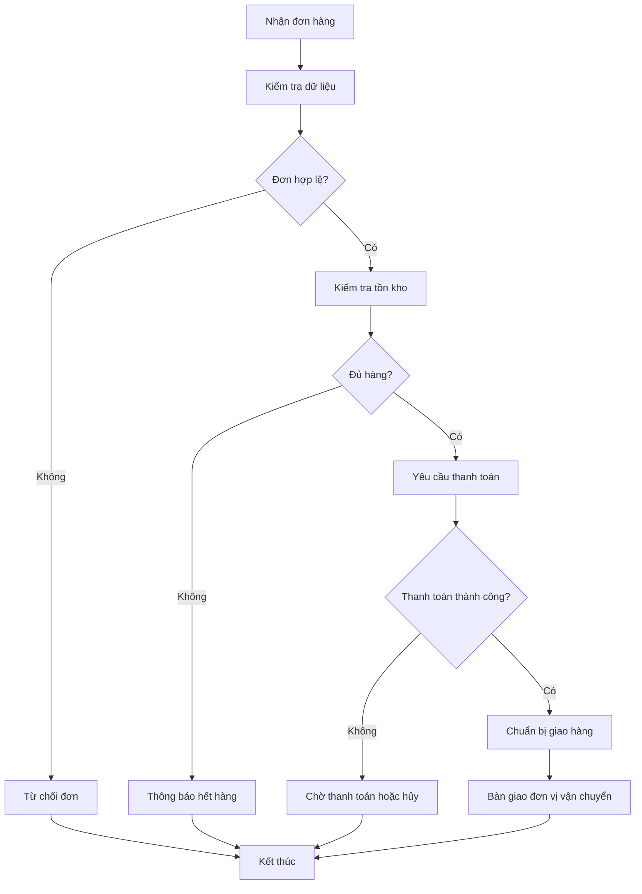
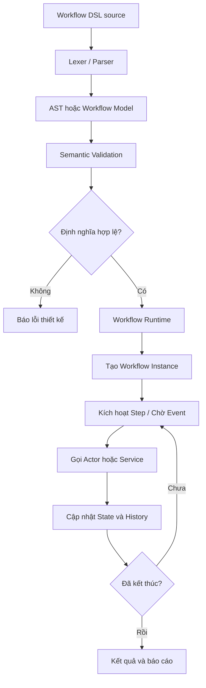

# Luồng công việc trong Domain-Specific Language (DSL)

Trong một miền nghiệp vụ hoặc kỹ thuật, công việc thường diễn ra theo một chuỗi bước có thứ tự, có điều kiện và có kết quả. Ví dụ, xử lý đơn hàng có thể đi từ tiếp nhận, kiểm tra thanh toán, chuẩn bị hàng đến giao hàng; xử lý yêu cầu hỗ trợ có thể gồm tiếp nhận, phân loại, phân công, giải quyết và đóng yêu cầu. Chuỗi hoạt động có liên hệ như vậy được gọi là **luồng công việc** (*workflow*).

Trong thiết kế Domain-Specific Language (DSL), luồng công việc là cách mô tả quy trình của miền bằng các khái niệm mà người sử dụng hiểu được. DSL có thể cho phép khai báo các bước, điều kiện chuyển bước, người hoặc hệ thống chịu trách nhiệm, dữ liệu đầu vào, sự kiện và hành động cần thực hiện. Nhờ đó, quy trình có thể được đọc, kiểm tra, thay đổi và thực thi bằng một bộ xử lý phù hợp.

Một workflow không chỉ là danh sách lệnh chạy lần lượt. Nó còn mô tả trạng thái của đối tượng, các điều kiện quyết định đường đi, những sự kiện làm quy trình tiếp tục, và cách hệ thống xử lý lỗi hoặc trường hợp ngoại lệ.

## 1. Workflow là gì?

**Workflow** là mô hình mô tả cách một công việc được thực hiện từ điểm bắt đầu đến một hoặc nhiều kết quả. Workflow thường gồm các hoạt động (*activities*), thứ tự hoặc quan hệ phụ thuộc giữa chúng, điều kiện lựa chọn, vai trò tham gia và dữ liệu được truyền qua các bước.

Ví dụ, một quy trình duyệt đơn nghỉ phép có thể gồm:

1. Nhân viên gửi yêu cầu.
2. Hệ thống kiểm tra số ngày phép còn lại.
3. Quản lý xem xét yêu cầu.
4. Nếu được duyệt, hệ thống ghi nhận lịch nghỉ.
5. Nếu bị từ chối, hệ thống lưu lý do và thông báo cho nhân viên.
6. Quy trình kết thúc.

Workflow mô tả cả hai nhánh được duyệt và bị từ chối. Nếu chỉ ghi lại danh sách các hoạt động mà không thể hiện nhánh từ chối thì mô tả chưa đầy đủ.

Một workflow có thể:

- **Tuần tự:** bước sau bắt đầu khi bước trước hoàn thành.
- **Có điều kiện:** chọn một nhánh tùy theo dữ liệu hoặc kết quả.
- **Song song:** nhiều bước độc lập được thực hiện đồng thời.
- **Chờ sự kiện:** quy trình tạm dừng cho đến khi nhận được tín hiệu như xác nhận thanh toán.
- **Lặp:** quay lại một bước khi cần bổ sung hoặc thử lại.
- **Có thời hạn:** một bước phải hoàn thành trong khoảng thời gian quy định.

Workflow có thể được thực hiện bởi con người, phần mềm, thiết bị hoặc sự phối hợp của nhiều tác nhân.

## 2. Phân biệt workflow, process và task

Các thuật ngữ này thường được dùng gần nhau nhưng nhấn mạnh những khía cạnh khác nhau.

- **Process – quy trình:** tập hợp hoạt động và quy tắc tạo ra kết quả trong một miền. Process thường nói đến toàn bộ cách một loại công việc được vận hành.
- **Workflow – luồng công việc:** cách các hoạt động được sắp xếp, kích hoạt và nối với nhau trong một lần thực hiện quy trình.
- **Task – tác vụ:** một đơn vị công việc cụ thể cần được hoàn thành, chẳng hạn xác minh địa chỉ hoặc tính phí vận chuyển.
- **Activity – hoạt động:** hành động hoặc nhóm công việc có ý nghĩa trong mô hình quy trình. Một activity có thể bao gồm nhiều task nhỏ.
- **Case – hồ sơ xử lý:** một lần áp dụng quy trình cho một đối tượng cụ thể, chẳng hạn một đơn hàng hoặc một yêu cầu hoàn tiền.
- **Instance – phiên bản thực thi:** một lần chạy cụ thể của workflow theo định nghĩa đã cấu hình.

Ví dụ, “xử lý đơn hàng trực tuyến” là một process. Workflow mô tả đường đi từ lúc nhận đơn đến khi giao hoặc hủy. Task “xác nhận tồn kho” là một việc cụ thể trong workflow. Đơn hàng A102 là một case; lần chạy quy trình xử lý đơn hàng A102 là một workflow instance.

Phân biệt các khái niệm này giúp xác định DSL cần mô tả định nghĩa quy trình, một bước riêng lẻ hay dữ liệu của một lần thực thi.

## 3. Thành phần cốt lõi của một workflow

### 3.1. Trigger – tác nhân kích hoạt

**Trigger** là điều kiện hoặc sự kiện khiến workflow bắt đầu, hoặc khiến một phần của workflow được kích hoạt.

Ví dụ:

- Khách hàng gửi đơn hàng.
- Một khoản thanh toán được xác nhận.
- Đồng hồ hệ thống đến thời điểm chạy báo cáo.
- Nhân viên nhấn nút gửi yêu cầu.
- Một dịch vụ phát ra sự kiện hàng tồn kho xuống dưới ngưỡng.

Trigger xác định thời điểm quy trình cần phản ứng. Một DSL nên quy định trigger là sự kiện bên ngoài, lịch chạy, thao tác của người dùng hay điều kiện trên dữ liệu.

### 3.2. Step – bước công việc

**Step** là một đơn vị có vị trí và mục đích trong workflow. Bước có thể thực hiện một hành động, chờ người dùng, gọi dịch vụ hoặc kiểm tra một điều kiện.

Ví dụ trong quy trình đơn hàng:

- ValidateOrder: kiểm tra dữ liệu đơn.
- ReserveInventory: giữ hàng trong kho.
- ChargePayment: thu tiền.
- ArrangeDelivery: tạo yêu cầu giao hàng.

Tên bước nên mô tả kết quả hoặc hành động rõ ràng. Những tên chung chung như Step1, Step2 gây khó hiểu khi đọc workflow và khó tìm lỗi khi vận hành.

### 3.3. Transition – chuyển tiếp

**Transition** là quan hệ chỉ ra workflow chuyển từ bước hoặc trạng thái này sang bước hoặc trạng thái khác khi điều kiện thích hợp được đáp ứng.

Ví dụ:

- Sau khi kiểm tra đơn thành công, chuyển sang giữ hàng.
- Nếu không đủ hàng, chuyển sang trạng thái chờ bổ sung hoặc từ chối đơn.
- Sau khi thanh toán thành công, chuyển sang chuẩn bị giao hàng.

Transition thường có nguồn, đích và có thể có điều kiện hoặc sự kiện kích hoạt.

### 3.4. State – trạng thái

**State** mô tả tình trạng hiện tại của một đối tượng hoặc tiến trình tại một thời điểm.

Ví dụ, đơn hàng có thể ở các trạng thái:

- Draft: bản nháp.
- Submitted: đã gửi.
- AwaitingPayment: chờ thanh toán.
- Paid: đã thanh toán.
- Processing: đang xử lý.
- Shipped: đã gửi đi.
- Delivered: đã giao.
- Cancelled: đã hủy.

State trả lời câu hỏi “đối tượng hiện đang ở tình trạng nào?”. Step trả lời “công việc nào đang được thực hiện?”. Hai khái niệm có liên hệ nhưng không đồng nhất. Một step có thể đưa đối tượng từ state này sang state khác.

### 3.5. Actor – tác nhân thực hiện

**Actor** là người, vai trò, hệ thống hoặc thành phần chịu trách nhiệm thực hiện một bước hoặc tham gia vào workflow.

Ví dụ:

- Customer: khách hàng.
- SalesAgent: nhân viên bán hàng.
- Manager: quản lý phê duyệt.
- PaymentService: dịch vụ thanh toán.
- WarehouseSystem: hệ thống kho.

Actor giúp làm rõ trách nhiệm và quyền hạn. Với bước cần con người phê duyệt, DSL có thể chỉ định vai trò được phép xử lý thay vì gắn với một cá nhân cụ thể.

### 3.6. Data – dữ liệu workflow

Workflow thường nhận dữ liệu đầu vào, tạo dữ liệu trung gian và sinh kết quả. Dữ liệu có thể gồm thông tin đơn hàng, người gửi yêu cầu, số tiền, trạng thái thanh toán, quyết định phê duyệt và dấu thời gian.

DSL nên làm rõ:

- Dữ liệu nào được cung cấp khi workflow bắt đầu?
- Bước nào đọc hoặc cập nhật dữ liệu?
- Giá trị nào được truyền sang bước tiếp theo?
- Dữ liệu nào là bắt buộc, tùy chọn hoặc chỉ có trong một nhánh?
- Ai được phép đọc hoặc thay đổi dữ liệu?

Việc mô hình hóa dữ liệu rõ ràng giúp tránh tình trạng một bước sử dụng trường chưa được tạo hoặc dựa vào giá trị không hợp lệ.

## 4. Điều kiện, sự kiện và hành động

### Condition – điều kiện

**Condition** là biểu thức Boolean hoặc quy tắc xác định một đường đi có được chọn hay không.

Ví dụ:

```text
order.total >= 500000
```

Nếu điều kiện đúng, workflow có thể yêu cầu quản lý phê duyệt. Nếu sai, đơn hàng có thể đi theo luồng thông thường.

Một điều kiện cần có ngữ nghĩa rõ ràng về kiểu dữ liệu, giá trị rỗng, múi giờ, đơn vị đo và cách kết hợp nhiều biểu thức. Chẳng hạn, so sánh tiền cần thống nhất đơn vị tiền tệ; so sánh ngày giờ cần xác định múi giờ.

### Event – sự kiện

**Event** là thông tin cho biết một điều gì đó đã xảy ra tại một thời điểm, chẳng hạn PaymentConfirmed, OrderCancelled hoặc InventoryRestocked.

Event thường kích hoạt bước tiếp theo hoặc làm thay đổi trạng thái. Khác với condition, vốn là biểu thức được đánh giá trên dữ liệu, event biểu thị một sự việc đã xảy ra. Một event có thể mang theo dữ liệu như mã đơn hàng, số tiền và thời điểm phát sinh.

### Action – hành động

**Action** là thao tác được thực hiện khi một bước chạy hoặc khi điều kiện được thỏa mãn. Ví dụ:

- Gửi email xác nhận.
- Giữ một lượng hàng trong kho.
- Tạo hóa đơn.
- Cập nhật trạng thái đơn hàng.
- Gọi dịch vụ thanh toán.

Action có thể làm thay đổi hệ thống bên ngoài. Vì vậy, khi thiết kế DSL, cần quy định action có thể được gọi bao nhiêu lần, kết quả được ghi nhận ra sao và xử lý thế nào nếu lời gọi thất bại.

### Guard – điều kiện bảo vệ chuyển tiếp

**Guard** là điều kiện phải đúng để một transition được phép xảy ra. Guard thường được gắn trực tiếp với cạnh chuyển tiếp trong mô hình workflow.

Ví dụ, transition từ AwaitingPayment sang Paid chỉ được phép khi sự kiện PaymentConfirmed hợp lệ và số tiền nhận được khớp với số tiền cần thanh toán.

Guard có vai trò kiểm soát tính hợp lệ của đường đi. Nó giúp ngăn workflow chuyển sang trạng thái không được phép.

## 5. Biểu diễn workflow bằng đồ thị

Một workflow có thể được biểu diễn như một đồ thị có hướng:

- **Node – nút:** đại diện cho bước, trạng thái, sự kiện hoặc điểm quyết định.
- **Edge – cạnh:** đại diện cho quan hệ chuyển tiếp hoặc phụ thuộc giữa các nút.
- **Start node:** điểm bắt đầu.
- **End node:** điểm kết thúc.
- **Decision node:** điểm lựa chọn nhánh.
- **Join node:** điểm đồng bộ các nhánh song song.

Đồ thị giúp nhìn thấy đường đi, nhánh rẽ, vòng lặp và quan hệ phụ thuộc. Một workflow tuyến tính đơn giản có thể là một chuỗi node; workflow phức tạp có thể có nhiều nhánh và nhiều điểm đồng bộ.

Ví dụ quy trình xử lý đơn hàng:



Sơ đồ chỉ là ví dụ khái niệm. Trong hệ thống thật, nhánh “chờ thanh toán” có thể tạm dừng để chờ event, có thời hạn và có thể được tiếp tục sau đó.

## 6. Các kiểu luồng điều khiển

### 6.1. Tuần tự (Sequence)

Các bước được thực hiện theo thứ tự. Bước tiếp theo chỉ bắt đầu sau khi bước trước hoàn thành.

```text
ReceiveOrder -> ValidateOrder -> ReserveStock -> ConfirmOrder
```

Sequence phù hợp khi các bước phụ thuộc kết quả của bước trước. Nếu không có phụ thuộc, việc buộc tất cả bước chạy tuần tự có thể làm tăng thời gian xử lý.

### 6.2. Rẽ nhánh (Branching)

Workflow chọn một trong nhiều đường đi dựa trên điều kiện hoặc kết quả.

```text
if payment.status == "SUCCESS":
    continue_to_fulfillment
else:
    wait_for_payment_or_cancel
```

DSL cần quy định thứ tự đánh giá các nhánh, hành vi khi không nhánh nào khớp và cách xử lý khi nhiều điều kiện cùng đúng. Có thể có nhánh mặc định (*default branch*) để đảm bảo mọi trường hợp đều có đường đi.

### 6.3. Song song (Parallel execution)

Nhiều nhánh độc lập có thể chạy đồng thời. Ví dụ, sau khi đơn hàng được xác nhận, hệ thống có thể đồng thời gửi email cho khách hàng và ghi nhận dữ liệu phân tích.

Điểm cần chú ý là các nhánh có thể hoàn thành ở thời điểm khác nhau. Nếu một bước sau cần kết quả của tất cả nhánh, workflow cần một điểm đồng bộ (*join*).

### 6.4. Đồng bộ (Join)

**Join** là điểm hợp nhất hoặc đồng bộ các nhánh. Quy tắc join có thể yêu cầu:

- Chờ tất cả nhánh hoàn thành.
- Chỉ cần một nhánh hoàn thành.
- Chờ một số lượng hoặc tỷ lệ nhánh nhất định.
- Tiếp tục khi có kết quả thỏa điều kiện.

Quy tắc join ảnh hưởng trực tiếp đến tính đúng đắn. Nếu workflow chờ tất cả nhánh nhưng một nhánh không thể hoàn thành, quy trình có thể bị treo nếu không có timeout hoặc xử lý lỗi.

### 6.5. Lặp (Loop)

Workflow có thể lặp một bước hoặc nhóm bước. Ví dụ, hệ thống gửi nhắc thanh toán tối đa ba lần, hoặc yêu cầu người dùng sửa hồ sơ cho đến khi hợp lệ.

Cần xác định điều kiện tiếp tục, điều kiện dừng và giới hạn số lần lặp. Một vòng lặp không có điều kiện kết thúc có thể khiến workflow chạy vô hạn.

### 6.6. Chờ (Wait)

Một bước chờ workflow tạm dừng cho đến khi một event, thời điểm hoặc điều kiện xuất hiện.

Ví dụ, sau khi gửi yêu cầu thanh toán, hệ thống chờ event PaymentConfirmed. Workflow có thể được lưu trạng thái và khôi phục khi event đến, thay vì giữ một luồng xử lý hoạt động liên tục.

## 7. Mô hình trạng thái và vòng đời workflow

Một workflow thường có vòng đời riêng, chẳng hạn:

- **Created:** instance đã được tạo.
- **Running:** đang thực thi.
- **Waiting:** tạm dừng để chờ event, thời gian hoặc người xử lý.
- **Completed:** hoàn thành thành công.
- **Failed:** kết thúc do lỗi không thể tiếp tục.
- **Cancelled:** bị hủy theo yêu cầu hoặc quy tắc.
- **TimedOut:** vượt quá thời hạn cho phép.

Cần phân biệt trạng thái của workflow instance với trạng thái nghiệp vụ của đối tượng. Ví dụ, workflow xử lý đơn hàng có thể đã Completed trong khi đơn hàng có state Delivered. Một workflow bị Failed không có nghĩa đối tượng nghiệp vụ nhất thiết mang trạng thái Failed; hệ thống có thể giữ đơn ở trạng thái Processing để nhân viên xử lý tiếp.

Một mô hình trạng thái tốt quy định:

1. Các trạng thái được phép.
2. Trạng thái bắt đầu và trạng thái kết thúc.
3. Các transition hợp lệ.
4. Guard hoặc event cần thiết cho mỗi transition.
5. Hành động đi kèm khi vào hoặc rời trạng thái.
6. Cách xử lý trạng thái không mong đợi.

## 8. Orchestration và choreography

Đây là hai cách tổ chức sự phối hợp giữa nhiều thành phần trong một quy trình.

### Orchestration – điều phối tập trung

Một bộ điều phối (*orchestrator*) quyết định bước tiếp theo, gọi các dịch vụ hoặc actor, theo dõi kết quả và điều khiển luồng tổng thể.

Ví dụ, OrderWorkflow gọi InventoryService để giữ hàng, sau đó gọi PaymentService để thu tiền và cuối cùng gọi DeliveryService để tạo vận đơn.

Ưu điểm của orchestration là luồng xử lý tập trung, dễ quan sát thứ tự và trạng thái tổng thể. Đổi lại, bộ điều phối trở thành thành phần quan trọng cần được thiết kế để có khả năng chịu lỗi và mở rộng.

### Choreography – phối hợp qua sự kiện

Các thành phần phối hợp bằng cách phát và nhận event. Mỗi thành phần phản ứng với sự kiện phù hợp và tự thực hiện phần việc của mình.

Ví dụ:

1. OrderService phát OrderCreated.
2. InventoryService nhận sự kiện và giữ hàng.
3. Khi giữ hàng thành công, InventoryService phát InventoryReserved.
4. PaymentService nhận sự kiện và xử lý thanh toán.
5. Khi thanh toán thành công, PaymentService phát PaymentConfirmed.

Choreography giảm sự phụ thuộc vào một bộ điều phối trung tâm, nhưng luồng tổng thể có thể khó nhìn thấy hơn vì logic được phân tán ở nhiều thành phần. Hệ thống cần có khả năng theo dõi tương quan event, xử lý sự kiện trùng và phát hiện quy trình bị mắc kẹt.

| Tiêu chí | Orchestration | Choreography |
|---|---|---|
| Điều khiển | Bộ điều phối trung tâm | Các thành phần phản ứng với event |
| Quan sát luồng | Thường tập trung hơn | Cần ghép thông tin từ nhiều thành phần |
| Phụ thuộc | Các thành phần phụ thuộc vào điều phối | Các thành phần phụ thuộc vào hợp đồng event |
| Phù hợp | Quy trình cần kiểm soát thứ tự và trạng thái tổng thể | Hệ thống sự kiện, các dịch vụ cần phối hợp lỏng |
| Thách thức | Độ tin cậy và khả năng mở rộng của orchestrator | Theo dõi, tương quan và xử lý event phân tán |

Hai cách tiếp cận có thể được kết hợp trong cùng một hệ thống.

## 9. Xử lý lỗi, thử lại và bù trừ

Workflow thực tế phải tính đến lỗi từ mạng, dịch vụ bên ngoài, dữ liệu không hợp lệ, người dùng không phản hồi hoặc tài nguyên không còn sẵn có.

### Error handling – xử lý lỗi

DSL cần phân biệt lỗi có thể phục hồi và lỗi không thể phục hồi. Ví dụ, lỗi kết nối tạm thời có thể thử lại; dữ liệu đơn hàng sai định dạng có thể yêu cầu sửa; thanh toán bị từ chối có thể dẫn đến nhánh xử lý khác.

Một bước có thể khai báo:

- Loại lỗi có thể xảy ra.
- Nhánh xử lý khi lỗi xuất hiện.
- Có thử lại hay không.
- Thông tin cần ghi log.
- Điều kiện kết thúc hoặc chuyển cho người xử lý.

### Retry – thử lại

**Retry** là thực hiện lại một bước sau khi thất bại. Cần giới hạn số lần thử và quy định khoảng chờ.

Một số chiến lược phổ biến:

- **Fixed delay:** chờ một khoảng cố định giữa các lần thử.
- **Exponential backoff:** tăng dần thời gian chờ sau mỗi lần thất bại.
- **Retry with jitter:** thêm độ ngẫu nhiên vào thời gian chờ để tránh nhiều client thử lại cùng lúc.

Không phải lỗi nào cũng nên thử lại. Thử lại một thao tác không an toàn có thể tạo giao dịch hoặc gửi thông báo trùng lặp.

### Idempotency – tính lặp an toàn

Một thao tác có tính **idempotent** khi thực hiện nhiều lần với cùng yêu cầu vẫn tạo ra cùng hiệu quả nghiệp vụ như thực hiện một lần.

Ví dụ, đặt trạng thái đơn hàng thành Delivered có thể được thiết kế idempotent. Ngược lại, thao tác cộng thêm 100.000 đồng vào tài khoản thường không idempotent nếu không có cơ chế chống ghi nhận lặp.

Với các bước có thể được gửi lại do timeout hoặc event trùng, DSL hoặc runtime cần hỗ trợ khóa idempotency, mã yêu cầu duy nhất hay cơ chế kiểm tra trạng thái trước khi thực hiện.

### Timeout – hết thời gian chờ

**Timeout** xác định khoảng thời gian tối đa mà một bước hoặc toàn workflow được phép chờ. Khi vượt ngưỡng, runtime kích hoạt nhánh timeout, thử lại hoặc hủy theo chính sách.

Ví dụ, nếu khách hàng không hoàn tất thanh toán trong 30 phút, workflow có thể chuyển đơn sang trạng thái PaymentExpired.

### Compensation – hành động bù trừ

Trong workflow nhiều bước, một số hành động đã hoàn thành có thể cần được bù trừ nếu bước sau thất bại. Compensation là thao tác nghiệp vụ nhằm đưa hệ thống về trạng thái nhất quán theo chính sách.

Ví dụ, quy trình đặt hàng đã giữ hàng nhưng thanh toán không thể hoàn tất. Hệ thống có thể gọi ReleaseInventory để giải phóng hàng đã giữ.

Bù trừ không nhất thiết khôi phục chính xác trạng thái vật lý trước đó. Ví dụ, không thể thu hồi email đã gửi; hệ thống chỉ có thể gửi thông báo đính chính hoặc ghi nhận sự kiện hủy.

## 10. Workflow DSL: mô tả quy trình bằng ngôn ngữ miền

**Workflow DSL** là DSL có cấu trúc và từ vựng dành cho việc mô tả luồng công việc. Tùy mục đích, ngôn ngữ có thể khai báo:

- Tên workflow và sự kiện bắt đầu.
- Dữ liệu đầu vào và đầu ra.
- Các step cùng actor thực hiện.
- Điều kiện và transition.
- Nhánh song song, join, loop và wait.
- Chính sách retry, timeout và xử lý lỗi.
- Trạng thái, log và thông tin theo dõi.

Một workflow DSL có thể là external DSL với cú pháp riêng, hoặc embedded DSL dựa trên ngôn ngữ chủ như Kotlin, Java hay Python. Điểm quan trọng là các cấu trúc được tổ chức quanh khái niệm workflow của miền.

Ví dụ giả định:

```text
workflow OrderFulfillment {
    input order

    start when OrderSubmitted

    step validate:
        action ValidateOrder(order)
        on success -> check_stock
        on failure -> reject

    step check_stock:
        action ReserveInventory(order.items)
        on success -> charge_payment
        on out_of_stock -> wait_for_restock

    step charge_payment:
        action ChargePayment(order.payment)
        retry 3 times with exponential_backoff
        on success -> prepare_delivery
        on failure -> release_inventory

    step prepare_delivery:
        action CreateShipment(order)
        on success -> completed

    step release_inventory:
        action ReleaseInventory(order.items)
        then -> payment_failed

    end completed
    end rejected
    end payment_failed
}
```

Đây là cú pháp minh họa để giải thích ý tưởng, không phải cú pháp của một sản phẩm hoặc framework cụ thể. Một DSL thực tế cần có grammar và semantics xác định rõ ý nghĩa của từng cấu trúc.

Trong ví dụ:

- workflow khai báo một quy trình.
- input xác định dữ liệu đầu vào.
- start when chỉ ra trigger.
- step khai báo một bước.
- action chỉ định thao tác.
- on success và on failure mô tả đường chuyển tiếp.
- retry mô tả chính sách thử lại.
- end khai báo các kết quả kết thúc.

## 11. Từ workflow DSL đến thực thi

Một hệ thống hỗ trợ workflow DSL thường có các thành phần xử lý như sau:

1. **Source definition:** văn bản hoặc cấu hình workflow do người dùng viết.
2. **Lexical analysis và parsing:** nhận diện token, kiểm tra grammar và tạo AST hoặc mô hình workflow.
3. **Semantic validation:** kiểm tra tên step, trigger, actor, dữ liệu, kiểu, transition và trạng thái kết thúc.
4. **Workflow planning:** xây dựng đồ thị phụ thuộc hoặc kế hoạch thực thi.
5. **Runtime engine:** tạo instance, theo dõi state, kích hoạt step và xử lý event.
6. **Integration layer:** kết nối dịch vụ, cơ sở dữ liệu, hàng đợi hoặc giao diện người dùng.
7. **Observability:** lưu lịch sử, log, metric và dấu vết để người vận hành hiểu quy trình đã đi qua đâu.

Luồng khái quát:



Định nghĩa workflow và workflow instance là hai thứ khác nhau. Định nghĩa mô tả quy trình có thể được tái sử dụng; instance lưu tiến trình của một lần chạy cụ thể, bao gồm dữ liệu, trạng thái, lịch sử và kết quả.

## 12. Ví dụ phân tích: quy trình duyệt yêu cầu nghỉ phép

Giả sử một tổ chức muốn mô tả quy trình xin nghỉ phép bằng DSL. Người dùng gửi số ngày nghỉ và khoảng thời gian. Hệ thống kiểm tra số dư phép, sau đó chuyển yêu cầu đến quản lý nếu hợp lệ.

### Xác định miền và vai trò

- **Domain:** quản lý yêu cầu nghỉ phép.
- **Đối tượng chính:** LeaveRequest, Employee, Manager, LeaveBalance.
- **Actor:** Employee, LeaveService, Manager.
- **Dữ liệu:** ngày bắt đầu, ngày kết thúc, số ngày xin nghỉ, số dư phép, lý do.
- **Trigger:** LeaveRequestSubmitted.

### Xác định các bước và trạng thái

Các bước:

1. ReceiveRequest: nhận yêu cầu.
2. ValidateDates: kiểm tra khoảng ngày.
3. CheckBalance: kiểm tra số dư phép.
4. ManagerApproval: chờ quản lý quyết định.
5. RecordLeave: ghi nhận ngày nghỉ.
6. NotifyEmployee: thông báo kết quả.

Các trạng thái yêu cầu:

- Submitted.
- Invalid.
- AwaitingApproval.
- Approved.
- Rejected.
- Recorded.

### Xác định transition

- Submitted → Invalid nếu ngày nghỉ không hợp lệ.
- Submitted → AwaitingApproval nếu dữ liệu và số dư hợp lệ.
- AwaitingApproval → Approved nếu quản lý duyệt.
- AwaitingApproval → Rejected nếu quản lý từ chối.
- Approved → Recorded sau khi hệ thống ghi nhận lịch nghỉ.

### Mô tả DSL giả định

```text
workflow LeaveApproval {
    input request

    start when LeaveRequestSubmitted

    step validate:
        action ValidateDates(request)
        on valid -> check_balance
        on invalid -> rejected

    step check_balance:
        action CheckLeaveBalance(request.employee, request.days)
        on sufficient -> manager_approval
        on insufficient -> rejected

    step manager_approval:
        actor Manager
        wait for ApprovalDecision
        on approved -> record_leave
        on rejected -> rejected
        timeout 5 days -> escalate

    step record_leave:
        action RecordLeave(request)
        then -> approved

    end approved
    end rejected
}
```

Mô tả trên làm rõ điều kiện và trách nhiệm ở từng bước. Nó cũng cho thấy workflow có thể chờ người dùng phản hồi và có timeout để tránh yêu cầu bị treo vô thời hạn. Trong triển khai thực tế, cần định nghĩa thêm cách escalation, quyền phê duyệt, lịch làm việc, ngày nghỉ lễ và cách xử lý khi số dư phép thay đổi trong lúc chờ.

## 13. Kiểm tra tính đúng đắn của workflow

Trước khi đưa workflow vào vận hành, cần kiểm tra cả cấu trúc lẫn quy tắc nghiệp vụ. Đây là hoạt động xác thực thiết kế và kiểm thử, không chỉ là kiểm tra cú pháp.

### Kiểm tra cấu trúc

- Có điểm bắt đầu hợp lệ không?
- Các step và transition được tham chiếu có tồn tại không?
- Có đường đi đến trạng thái kết thúc không?
- Có bước nào không thể được kích hoạt hoặc không thể hoàn thành không?
- Có vòng lặp không có điều kiện thoát không?
- Các nhánh song song có điểm đồng bộ hợp lý không?

### Kiểm tra ngữ nghĩa

- Actor có quyền thực hiện step không?
- Dữ liệu đầu vào có đầy đủ và đúng kiểu không?
- Guard có thể được đánh giá trong mọi trường hợp không?
- Các transition có vi phạm quy tắc trạng thái nghiệp vụ không?
- Action có an toàn khi được thực hiện lại không?
- Có chính sách cho timeout, lỗi và event trùng không?

### Kiểm thử theo tình huống

Nên thử các đường đi quan trọng:

- Đường đi thành công bình thường.
- Dữ liệu đầu vào không hợp lệ.
- Một điều kiện chọn nhánh khác.
- Dịch vụ bên ngoài thất bại.
- Event đến trễ hoặc đến nhiều lần.
- Người xử lý không phản hồi trước timeout.
- Workflow bị hủy giữa chừng.
- Một bước đã hoàn thành nhưng bước tiếp theo thất bại.

Một workflow có thể đúng cú pháp nhưng vẫn sai logic nghiệp vụ. Ví dụ, quy trình cho phép giao hàng trước khi thanh toán được xác nhận có thể không phù hợp với chính sách của hệ thống. Vì vậy, người hiểu miền cần xác nhận cả các đường đi và kết quả.

## 14. Theo dõi và vận hành workflow

Khi workflow chạy trong môi trường thật, người vận hành cần biết instance đang ở đâu, bước nào chậm, lỗi nào xuất hiện và ai chịu trách nhiệm xử lý.

Một số khái niệm quan trọng:

- **Workflow history:** lịch sử các sự kiện và bước đã xảy ra.
- **Execution log:** bản ghi kỹ thuật về hoạt động của runtime và các dịch vụ.
- **Correlation ID:** mã dùng để liên kết log, event và yêu cầu thuộc cùng một workflow instance.
- **Trace:** dấu vết cho thấy một yêu cầu đi qua các dịch vụ và bước xử lý nào.
- **Metric:** số liệu tổng hợp như thời gian hoàn thành, số instance đang chờ và tỷ lệ thất bại.
- **Audit trail:** lịch sử có thể kiểm tra về hành động, người thực hiện và thay đổi quan trọng.

Các thông tin này hỗ trợ tìm nguyên nhân khi workflow bị treo hoặc đi sai nhánh. Với workflow liên quan đến quyết định nghiệp vụ, audit trail còn giúp giải thích vì sao một yêu cầu được duyệt, từ chối hoặc chuyển cấp.

## 15. Nguyên tắc thiết kế workflow DSL

Một workflow DSL hữu ích cần cân bằng giữa khả năng biểu đạt và mức độ dễ hiểu.

**Dùng từ vựng của miền.** Tên step, state và event nên phản ánh cách người trong lĩnh vực gọi công việc. Ví dụ, ApproveLeaveRequest rõ nghĩa hơn ExecuteStep4.

**Tách định nghĩa khỏi dữ liệu thực thi.** Workflow definition mô tả quy trình; instance chứa dữ liệu và tiến trình của một lần chạy. Sự phân biệt này giúp một định nghĩa phục vụ nhiều trường hợp.

**Khai báo rõ transition.** Mỗi đường đi cần có điều kiện, event hoặc kết quả xác định. Tránh transition ngầm khiến người đọc khó dự đoán bước tiếp theo.

**Làm rõ trạng thái kết thúc.** Một workflow nên xác định các kết quả cuối như completed, rejected, cancelled hoặc failed. Các trạng thái này có ý nghĩa nghiệp vụ và vận hành khác nhau.

**Thiết kế lỗi ngay từ đầu.** Mỗi bước có thể thất bại cần chính sách phù hợp: retry, timeout, compensation, chuyển cho người xử lý hoặc kết thúc có kiểm soát.

**Giữ action có thể quan sát.** Tên hành động, đầu vào, đầu ra và lỗi nên được ghi nhận để người vận hành hiểu được những gì đã xảy ra.

**Quy định ngữ nghĩa song song và lặp.** DSL phải nêu rõ điều kiện join, giới hạn vòng lặp và cách xử lý khi một nhánh lỗi.

**Bảo đảm quyền hạn.** Các bước phê duyệt, thay đổi dữ liệu nhạy cảm hoặc thực hiện giao dịch cần xác định actor và quyền được phép.

**Quản lý phiên bản.** Khi workflow definition thay đổi, các instance đang chạy cần có chính sách tương thích, tiếp tục theo phiên bản cũ, chuyển đổi hoặc dừng có kiểm soát.

## 16. Những nhầm lẫn thường gặp

**Coi workflow chỉ là danh sách task.** Danh sách task không thể hiện đầy đủ nhánh điều kiện, event, vòng lặp, trạng thái, đồng bộ và lỗi. Workflow mô tả quan hệ điều khiển giữa các công việc.

**Đồng nhất step với state.** Step là đơn vị công việc; state là tình trạng của đối tượng hoặc tiến trình. Một step có thể làm thay đổi state, nhưng hai khái niệm trả lời hai câu hỏi khác nhau.

**Cho rằng mọi bước đều chạy tuần tự.** Một workflow có thể có nhánh song song, bước chờ event, vòng lặp và điểm đồng bộ. Cần biểu diễn quan hệ phụ thuộc thay vì mặc định mọi việc nối tiếp nhau.

**Cho rằng event và condition giống nhau.** Event thông báo một việc đã xảy ra; condition là biểu thức được đánh giá để quyết định đường đi. Event có thể làm thay đổi dữ liệu khiến condition trở thành đúng.

**Cho rằng retry luôn an toàn.** Nếu action không idempotent, thử lại có thể tạo giao dịch hoặc hiệu ứng trùng. Cần thiết kế cơ chế chống lặp hoặc compensation.

**Cho rằng kết thúc lỗi đồng nghĩa đã khôi phục hệ thống.** Một workflow có thể dừng nhưng các hành động trước đó vẫn còn hiệu lực. Cần có chính sách bù trừ hoặc xử lý thủ công nếu nghiệp vụ yêu cầu.

**Nhầm workflow definition với instance.** Definition là bản mô tả có thể tái sử dụng; instance là lần chạy cụ thể có trạng thái và dữ liệu riêng.

## 17. Quy trình phân tích một workflow trong miền

Khi khảo sát một quy trình để thiết kế DSL, có thể đi theo các bước sau:

1. **Xác định mục tiêu:** quy trình tạo ra kết quả gì và điều kiện nào được xem là hoàn thành?
2. **Xác định ranh giới:** workflow bắt đầu từ sự kiện nào và kết thúc ở đâu?
3. **Xác định đối tượng:** những entity, dữ liệu và trạng thái nào tham gia?
4. **Xác định actor:** ai hoặc hệ thống nào thực hiện từng hoạt động?
5. **Liệt kê step:** tách quy trình thành các đơn vị có mục đích rõ ràng.
6. **Nối transition:** mô tả thứ tự, điều kiện, event và nhánh lựa chọn.
7. **Xác định chờ và song song:** tìm các bước phụ thuộc, độc lập hoặc cần đồng bộ.
8. **Mô tả ngoại lệ:** ghi nhận lỗi, timeout, retry, hủy và compensation.
9. **Chọn cách biểu diễn:** quyết định DSL cần cú pháp tuần tự, khai báo đồ thị, bảng quyết định hay cấu trúc kết hợp.
10. **Xác nhận với chuyên gia miền:** kiểm tra các đường đi bình thường và ngoại lệ có phản ánh đúng nghiệp vụ.
11. **Thử nghiệm:** dùng các case thực tế để kiểm tra workflow definition và runtime behavior.

Không nên bắt đầu bằng cách chọn cú pháp trước khi hiểu quy trình. Cú pháp cần phản ánh những khái niệm và quan hệ thực sự tồn tại trong miền.

## 18. Câu hỏi tự kiểm tra

1. Workflow là gì và khác process ở điểm nào?
2. Phân biệt step, task, activity và state bằng ví dụ xử lý đơn hàng.
3. Trigger, event, condition và guard có vai trò gì?
4. Transition mô tả điều gì trong workflow?
5. Vì sao workflow có thể cần decision node và join node?
6. Khi nào nên thực hiện các bước song song? Khi nào cần đồng bộ?
7. Orchestration và choreography khác nhau như thế nào?
8. Retry, timeout và compensation giải quyết những tình huống nào?
9. Vì sao idempotency quan trọng khi workflow có thể gửi lại một action?
10. Workflow definition khác workflow instance ở điểm nào?
11. Một workflow DSL cần khai báo những thành phần nào để mô tả quy trình phê duyệt?
12. Hãy mô hình hóa một quy trình thực tế bằng trigger, step, state, transition, actor và các nhánh lỗi.

Khi có thể trả lời những câu hỏi này, người học sẽ biết cách đọc một workflow, nhận diện các thành phần và phân tích cách công việc di chuyển qua các bước. Đây là cơ sở để thiết kế DSL diễn đạt quy trình trong miền một cách rõ ràng, kiểm tra được và có thể thực thi.
