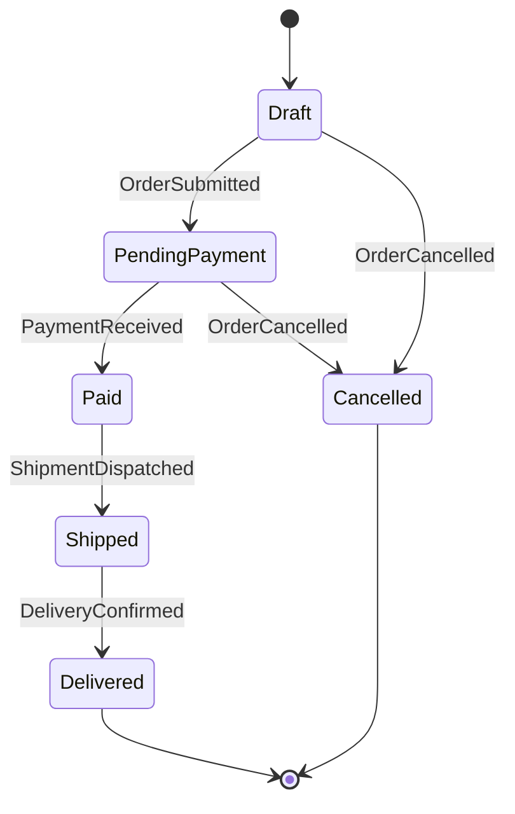

# Sự kiện và trạng thái

Khi mô hình hóa một miền bằng ngôn ngữ miền chuyên biệt (Domain-Specific Language, DSL), hai khái niệm quan trọng là **sự kiện (event)** và **trạng thái (state)**. Sự kiện mô tả một điều đã xảy ra hoặc vừa được ghi nhận trong miền; trạng thái mô tả tình hình hiện tại của một đối tượng tại một thời điểm. Ví dụ, `OrderPlaced` là sự kiện cho biết một đơn hàng đã được đặt, còn `PendingPayment` có thể là trạng thái hiện tại của đơn hàng đó.

Phân biệt rõ hai khái niệm giúp DSL biểu diễn quy trình và hành vi của miền một cách chính xác. Sự kiện thường là đầu vào kích hoạt xử lý hoặc làm thay đổi dữ liệu. Trạng thái cho biết đối tượng đang ở giai đoạn nào, những hành động nào được phép và những điều kiện nào cần được thỏa mãn trước khi chuyển sang giai đoạn tiếp theo. Trong một DSL mô tả quy trình, mô hình sự kiện và trạng thái thường kết hợp thành một máy trạng thái hoặc một luồng xử lý theo sự kiện.

## 1. Sự kiện trong miền nghiệp vụ

Sự kiện là một sự việc có ý nghĩa đối với miền, xảy ra tại một thời điểm và có thể được hệ thống hoặc người dùng quan tâm. Sự kiện thường được đặt tên ở dạng đã xảy ra, chẳng hạn `OrderPlaced`, `PaymentReceived`, `ShipmentDispatched` hoặc `AccountSuspended`.

Một sự kiện có thể được phát sinh bởi người dùng, một hệ thống bên ngoài, một thiết bị, một lịch định kỳ hoặc kết quả xử lý của chính ứng dụng. Ví dụ:

- Khách hàng gửi yêu cầu đặt hàng.
- Cổng thanh toán xác nhận đã nhận tiền.
- Kho hàng ghi nhận một lô hàng đã được xuất.
- Hệ thống phát hiện thời hạn hợp đồng đã kết thúc.
- Nhân viên phê duyệt một hồ sơ.

Sự kiện diễn tả điều đã xảy ra, thay vì chỉ mô tả ý định hoặc một lệnh cần thực hiện. `PaymentReceived` có nghĩa là khoản thanh toán đã được ghi nhận; `ReceivePayment` có thể là một yêu cầu hoặc lệnh yêu cầu hệ thống xử lý thanh toán. Phân biệt này quan trọng vì một yêu cầu có thể bị từ chối hoặc thất bại, trong khi sự kiện xác nhận kết quả đã xảy ra.

### 1.1. Cấu trúc của một sự kiện

Một sự kiện thường có các thông tin sau:

- **Định danh:** mã duy nhất để nhận biết một lần phát sinh sự kiện.
- **Loại sự kiện:** tên thể hiện ý nghĩa, ví dụ `PaymentReceived`.
- **Đối tượng liên quan:** đơn hàng, tài khoản, hợp đồng hoặc thực thể chịu ảnh hưởng.
- **Dữ liệu sự kiện:** các giá trị cần thiết để mô tả điều đã xảy ra, ví dụ số tiền và mã giao dịch.
- **Thời điểm:** thời điểm sự kiện xảy ra hoặc được hệ thống ghi nhận.
- **Nguồn phát sinh:** người dùng, dịch vụ, thiết bị hoặc hệ thống tạo sự kiện.
- **Ngữ cảnh tương quan:** mã yêu cầu, phiên giao dịch hoặc quy trình để liên kết sự kiện với các sự kiện khác.

Ví dụ một sự kiện thanh toán có thể được biểu diễn dưới dạng dữ liệu:

```json
{
  "eventId": "evt-1042",
  "type": "PaymentReceived",
  "orderId": "order-582",
  "amount": 1250000,
  "currency": "VND",
  "occurredAt": "2026-11-15T08:30:00+07:00",
  "source": "payment-gateway"
}
```

Đây là một cấu trúc minh họa. DSL có thể cung cấp cú pháp ngắn gọn hơn, nhưng vẫn cần quy định trường nào bắt buộc, kiểu dữ liệu, đơn vị, múi giờ và cách xử lý dữ liệu không hợp lệ.

### 1.2. Sự kiện và lệnh

Lệnh (command) thể hiện yêu cầu thực hiện một hành động; sự kiện (event) thể hiện kết quả hoặc sự việc đã xảy ra. Một lệnh có thể được chấp nhận hoặc từ chối. Nếu được chấp nhận và xử lý thành công, nó có thể dẫn đến một hoặc nhiều sự kiện.

| Khái niệm | Ý nghĩa | Ví dụ |
|---|---|---|
| Command | Yêu cầu hệ thống thực hiện việc gì đó | `PlaceOrder` |
| Event | Ghi nhận việc gì đã xảy ra | `OrderPlaced` |
| State | Tình hình hiện tại của đối tượng | `PendingPayment` |
| Query | Yêu cầu đọc thông tin | `GetOrderStatus` |

Ví dụ, khách hàng gửi lệnh `PlaceOrder`. Hệ thống kiểm tra dữ liệu và tồn kho. Nếu đơn hàng hợp lệ, hệ thống ghi nhận sự kiện `OrderPlaced`; trạng thái đơn hàng sau đó có thể chuyển sang `PendingPayment`. Nếu tồn kho không đủ, lệnh có thể bị từ chối và không phát sinh sự kiện `OrderPlaced`.

Một DSL có thể biểu diễn cả lệnh và sự kiện, nhưng không nên dùng cùng một tên hoặc ngữ nghĩa cho cả hai. Nếu người đọc không biết một câu lệnh là yêu cầu hay thông báo về kết quả đã xảy ra, việc hiểu luồng xử lý sẽ trở nên khó khăn.

## 2. Trạng thái của đối tượng miền

Trạng thái mô tả tình hình hiện tại của một đối tượng tại một thời điểm. Nó thường được xác định từ các dữ liệu đã ghi nhận và những sự kiện đã được xử lý. Một đơn hàng có thể ở trạng thái `Draft`, `PendingPayment`, `Paid`, `Shipped`, `Delivered` hoặc `Cancelled`.

Trạng thái giúp hệ thống trả lời các câu hỏi như:

- Đối tượng đang ở giai đoạn nào của quy trình?
- Hành động nào được phép ở giai đoạn này?
- Điều kiện nào cần có để chuyển sang giai đoạn tiếp theo?
- Đối tượng đã hoàn thành hay đang chờ xử lý?

Không phải mọi thuộc tính của đối tượng đều là trạng thái của một máy trạng thái. Tên khách hàng, địa chỉ giao hàng và ghi chú là dữ liệu mô tả. `PendingPayment` và `Shipped` là các trạng thái quy trình vì chúng xác định giai đoạn và những chuyển tiếp hợp lệ. Trong một số miền, giá trị thuộc tính cũng có thể quyết định trạng thái, chẳng hạn số dư tài khoản âm dẫn đến trạng thái `Overdrawn`.

### 2.1. Trạng thái hiện tại và lịch sử

Trạng thái hiện tại là kết quả đang có hiệu lực tại thời điểm quan sát. Lịch sử là tập hợp các sự kiện hoặc thay đổi đã xảy ra trước đó. Hai đơn hàng có thể cùng ở trạng thái `Paid` nhưng có lịch sử khác nhau: một đơn được thanh toán bằng thẻ, đơn còn lại được thanh toán bằng chuyển khoản.

Trạng thái hiện tại thường phù hợp cho việc hiển thị nhanh hoặc kiểm tra hành động tiếp theo. Lịch sử cần thiết khi phải giải thích vì sao đối tượng đến trạng thái đó, kiểm toán thay đổi hoặc tái tạo một quá trình xử lý. Một hệ thống có thể lưu cả trạng thái hiện tại lẫn lịch sử sự kiện.

### 2.2. Trạng thái đơn và trạng thái kết hợp

Một đối tượng có thể có một trạng thái đơn tại mỗi thời điểm, ví dụ đơn hàng chỉ ở một trong các trạng thái `Draft`, `PendingPayment`, `Paid` hoặc `Cancelled`. Tuy nhiên, hệ thống thực tế có thể theo dõi nhiều khía cạnh độc lập. Đơn hàng có thể đã thanh toán nhưng chưa đóng gói; thanh toán có trạng thái `Settled`, còn giao hàng có trạng thái `Preparing`.

Khi nhiều khía cạnh có vòng đời riêng, nên mô hình chúng thành các máy trạng thái hoặc thuộc tính trạng thái riêng thay vì tạo một danh sách trạng thái kết hợp quá lớn như `PaidAndPreparing`, `PaidAndShipped`, `UnpaidAndPreparing`... Cách tách này giảm số tổ hợp và làm rõ trách nhiệm của từng quy trình.

## 3. Mối quan hệ giữa sự kiện và trạng thái

Sự kiện và trạng thái liên hệ với nhau theo một quy tắc cơ bản: một sự kiện được xử lý trong ngữ cảnh trạng thái hiện tại có thể tạo ra trạng thái mới. Tuy nhiên, không phải sự kiện nào cũng làm thay đổi trạng thái. Một sự kiện như `CustomerViewedOrder` có thể chỉ được ghi nhận để phân tích, còn `PaymentReceived` có thể làm đơn hàng chuyển từ `PendingPayment` sang `Paid`.

Có thể mô tả quan hệ này bằng hàm chuyển trạng thái:

\[
S_{t+1} = \delta(S_t, E_t, C_t)
\]

Trong đó:

- \(S_t\) là trạng thái trước khi xử lý.
- \(E_t\) là sự kiện được tiếp nhận.
- \(C_t\) là ngữ cảnh hoặc dữ liệu cần thiết để đánh giá.
- \(\delta\) là quy tắc chuyển trạng thái.
- \(S_{t+1}\) là trạng thái sau khi xử lý.

Nếu sự kiện không hợp lệ trong trạng thái hiện tại, hệ thống có thể từ chối xử lý, ghi nhận sự kiện vào vùng chờ hoặc áp dụng một chính sách khôi phục. Cách xử lý phải được định nghĩa trong ngữ nghĩa DSL.

Ví dụ:

| Trạng thái hiện tại | Sự kiện | Trạng thái tiếp theo |
|---|---|---|
| `Draft` | `OrderSubmitted` | `PendingPayment` |
| `PendingPayment` | `PaymentReceived` | `Paid` |
| `Paid` | `ShipmentDispatched` | `Shipped` |
| `Shipped` | `DeliveryConfirmed` | `Delivered` |
| `Draft` | `OrderCancelled` | `Cancelled` |
| `PendingPayment` | `OrderCancelled` | `Cancelled` |

Bảng này là một phần của mô hình trạng thái. Nó cho biết chuyển tiếp nào được phép. Ví dụ, `DeliveryConfirmed` không nên đưa một đơn hàng đang ở `PendingPayment` sang `Delivered` nếu quy trình yêu cầu thanh toán và giao hàng theo đúng thứ tự.

## 4. Máy trạng thái hữu hạn

Máy trạng thái hữu hạn (Finite-State Machine, FSM) là mô hình gồm một tập trạng thái hữu hạn và các chuyển tiếp giữa chúng. Máy trạng thái thường có:

- Tập trạng thái có thể có.
- Trạng thái bắt đầu.
- Các sự kiện hoặc điều kiện kích hoạt chuyển tiếp.
- Quy tắc xác định trạng thái tiếp theo.
- Một hoặc nhiều trạng thái kết thúc, nếu quy trình có điểm kết thúc.

Máy trạng thái giúp DSL mô tả vòng đời đối tượng một cách trực quan. Người viết có thể khai báo trạng thái và chuyển tiếp thay vì tự xây dựng nhiều nhánh điều kiện rải rác trong mã ứng dụng.

Ví dụ sơ đồ vòng đời đơn hàng:



Sơ đồ cho thấy `Delivered` và `Cancelled` là các trạng thái kết thúc trong quy trình minh họa. Một hệ thống thực tế có thể có thêm trạng thái hoàn tiền, giao thất bại hoặc yêu cầu trả hàng. Khi thiết kế, cần xác định liệu trạng thái kết thúc có thể được mở lại hay không và sự kiện nào được phép xảy ra sau đó.

### 4.1. Trạng thái bắt đầu và kết thúc

Trạng thái bắt đầu là trạng thái mà đối tượng nhận khi được tạo hoặc khi quy trình khởi động. Trạng thái kết thúc biểu thị quy trình đã hoàn tất theo một kết quả xác định. Một quy trình có thể có nhiều trạng thái kết thúc, chẳng hạn `Completed`, `Rejected` và `Cancelled`.

Không nên mặc định rằng mọi trạng thái có tên nghe như kết thúc đều không thể thay đổi. Một đơn hàng `Cancelled` có thể được mở lại theo chính sách đặc biệt; một hồ sơ `Approved` có thể bị thu hồi nếu xuất hiện thông tin mới. Nếu có chuyển tiếp như vậy, DSL cần khai báo rõ điều kiện và quyền thực hiện.

### 4.2. Chuyển tiếp có điều kiện

Một sự kiện có thể chỉ hợp lệ khi điều kiện bảo vệ (guard condition) được thỏa mãn. Ví dụ, sự kiện `ShipmentDispatched` chỉ được chấp nhận khi đơn hàng đã thanh toán và kho đã xác nhận đủ hàng.

```text
transition Paid -> Shipped
    on ShipmentDispatched
    when inventory.reserved == order.itemCount
```

Điều kiện `when` quyết định chuyển tiếp có được phép hay không. Nếu điều kiện không thỏa mãn, hệ thống cần xác định phản hồi: từ chối sự kiện, trì hoãn xử lý, hoặc phát sinh một kết quả nghiệp vụ như `ShipmentBlocked`. Không nên âm thầm bỏ qua sự kiện vì người vận hành sẽ khó biết vì sao quy trình không tiến triển.

### 4.3. Hành động khi chuyển tiếp

Một chuyển tiếp có thể phát sinh hành động phụ, ví dụ ghi thời điểm thanh toán, tạo yêu cầu đóng gói hoặc phát thông báo. DSL nên phân biệt điều kiện chuyển tiếp, thay đổi trạng thái và hiệu ứng phụ để có thể kiểm tra và kiểm soát chúng.

```text
transition PendingPayment -> Paid
    on PaymentReceived
    do record payment.transactionId
    do emit OrderPaid
```

Trong ví dụ, sự kiện `PaymentReceived` kích hoạt chuyển tiếp. Hệ thống ghi mã giao dịch và phát sự kiện miền `OrderPaid`. Nếu hành động phụ gọi dịch vụ bên ngoài, cần quy định cách xử lý lỗi và tránh thực hiện lặp lại khi cùng một sự kiện được xử lý nhiều lần.

## 5. Biểu diễn sự kiện và trạng thái trong DSL

Một DSL có thể dùng cú pháp khai báo để mô tả loại sự kiện, cấu trúc dữ liệu, trạng thái và chuyển tiếp. Cú pháp cụ thể phụ thuộc vào người dùng và mục tiêu của ngôn ngữ, nhưng mô hình cần thể hiện được ý nghĩa của từng thành phần.

Ví dụ một DSL giả định:

```text
event PaymentReceived {
    orderId: OrderId
    transactionId: TransactionId
    amount: Money
    receivedAt: Instant
}

state OrderLifecycle {
    initial Draft

    Draft {
        on OrderSubmitted -> PendingPayment
        on OrderCancelled -> Cancelled
    }

    PendingPayment {
        on PaymentReceived -> Paid
        on OrderCancelled -> Cancelled
    }

    Paid {
        on ShipmentDispatched -> Shipped
    }

    Shipped {
        on DeliveryConfirmed -> Delivered
    }

    terminal Delivered
    terminal Cancelled
}
```

Đoạn mã cho thấy cách khai báo kiểu sự kiện, dữ liệu đi kèm và chuyển tiếp theo từng trạng thái. Đây là cú pháp minh họa để giải thích khái niệm, không phải cú pháp của một công cụ cụ thể. Một DSL hoàn chỉnh cần xác định cách khai báo định danh, kiểu dữ liệu, trạng thái không hợp lệ, quyền truy cập và cách xử lý sự kiện chưa được hỗ trợ.

### 5.1. Định kiểu dữ liệu sự kiện

Dữ liệu sự kiện nên có kiểu rõ ràng. Ví dụ, `amount` nên có kiểu tiền tệ thay vì một số thực không đơn vị; `receivedAt` nên có kiểu thời điểm thay vì chuỗi tùy ý. Kiểu dữ liệu giúp phát hiện lỗi trước khi chạy và ngăn việc so sánh hoặc tính toán sai đơn vị.

Một số trường nên bất biến sau khi sự kiện đã được ghi nhận. Nếu sự kiện `PaymentReceived` bị sửa số tiền sau khi lưu, lịch sử không còn phản ánh điều đã xảy ra. Khi cần điều chỉnh, hệ thống có thể phát sinh một sự kiện mới như `PaymentCorrected` hoặc `RefundIssued`, có liên hệ với giao dịch ban đầu.

### 5.2. Tên và phiên bản sự kiện

Tên sự kiện nên diễn đạt một sự việc đã xảy ra, có nghĩa ổn định trong miền và tránh phụ thuộc vào tên lớp hoặc bảng cơ sở dữ liệu. `CustomerAddressChanged` mô tả ý nghĩa miền tốt hơn một tên kỹ thuật như `CustomerRowUpdated`.

Nếu cấu trúc sự kiện được lưu lâu dài hoặc truyền qua nhiều dịch vụ, việc thay đổi trường có thể ảnh hưởng đến các thành phần đang tiêu thụ sự kiện. DSL hoặc nền tảng đi kèm nên hỗ trợ phiên bản schema, quy tắc tương thích và cách chuyển đổi dữ liệu cũ khi cần.

## 6. Các mô hình xử lý sự kiện

Sự kiện có thể được dùng theo nhiều cách. Việc chọn mô hình ảnh hưởng đến cách DSL lưu dữ liệu, tính trạng thái và xử lý lỗi.

### 6.1. Xử lý sự kiện để cập nhật trạng thái

Trong mô hình đơn giản, hệ thống nhận sự kiện rồi cập nhật trạng thái hiện tại của đối tượng. Ví dụ, khi nhận `PaymentReceived`, đơn hàng được đổi từ `PendingPayment` sang `Paid`. Sau khi cập nhật, hệ thống có thể chỉ lưu trạng thái mới và các trường liên quan.

Mô hình này dễ triển khai và truy vấn trạng thái nhanh. Tuy nhiên, nếu không lưu lịch sử, việc giải thích vì sao đơn hàng chuyển sang `Paid` có thể khó khăn. Nhiều hệ thống vì vậy lưu thêm nhật ký hoặc lịch sử sự kiện.

### 6.2. Event sourcing

Event sourcing là cách tổ chức dữ liệu trong đó chuỗi sự kiện đã được ghi nhận là nguồn dữ liệu chính cho trạng thái của đối tượng. Trạng thái hiện tại được tái tạo bằng cách áp dụng lần lượt các sự kiện lên trạng thái ban đầu hoặc một bản chụp (snapshot).

Ví dụ, lịch sử đơn hàng có thể gồm:

```text
OrderPlaced
PaymentReceived
ShipmentDispatched
DeliveryConfirmed
```

Áp dụng chuỗi này theo thứ tự hợp lệ sẽ tạo ra trạng thái hiện tại `Delivered`. Snapshot có thể được lưu định kỳ để không phải phát lại toàn bộ lịch sử mỗi lần cần đọc trạng thái.

Event sourcing hữu ích khi cần kiểm toán, giải thích lịch sử hoặc tái tạo trạng thái theo thời gian. Nó cũng làm tăng yêu cầu về quản lý schema sự kiện, thứ tự, tính tương thích và lưu trữ. Không phải DSL hướng sự kiện nào cũng cần event sourcing; việc dùng sự kiện để kích hoạt xử lý không đồng nghĩa với việc toàn bộ dữ liệu được lưu dưới dạng chuỗi sự kiện bất biến.

### 6.3. Event-driven architecture

Kiến trúc hướng sự kiện (event-driven architecture) tổ chức các thành phần phần mềm giao tiếp bằng cách phát và tiêu thụ sự kiện. Thành phần phát sự kiện không nhất thiết biết thành phần nào sẽ xử lý nó. Ví dụ, dịch vụ đơn hàng phát `OrderPlaced`; dịch vụ kho tiêu thụ để giữ hàng, còn dịch vụ thông báo tiêu thụ để gửi xác nhận.

DSL có thể mô tả sự kiện nào được phát, thành phần hoặc quy tắc nào quan tâm, điều kiện lọc và hành động được kích hoạt. Cần xác định hợp đồng sự kiện và cách xử lý khi người tiêu thụ chậm, lỗi hoặc nhận cùng một sự kiện nhiều lần.

## 7. Thời gian, thứ tự và tính nhất quán

Sự kiện mang thông tin thời gian, nhưng thời điểm xảy ra và thời điểm hệ thống nhận được có thể khác nhau. Một thiết bị có thể phát sự kiện lúc 10:00 nhưng kết nối mạng khiến hệ thống nhận lúc 10:03. Vì vậy, mô hình cần phân biệt `occurredAt` (thời điểm xảy ra) và `receivedAt` (thời điểm tiếp nhận), nếu nghiệp vụ cần cả hai.

### 7.1. Thứ tự sự kiện

Trong cùng một đối tượng, thứ tự sự kiện có thể quyết định trạng thái hợp lệ. `PaymentReceived` thường phải được xử lý trước `ShipmentDispatched`. Tuy nhiên, hệ thống phân tán có thể nhận sự kiện không đúng thứ tự do độ trễ hoặc gửi lại.

Có thể sử dụng số thứ tự theo đối tượng, phiên bản aggregate, dấu thời gian kèm quy tắc xử lý hoặc cơ chế sắp xếp lại. Không nên giả định rằng thời gian đồng hồ trên các máy luôn đồng bộ hoàn hảo. DSL cần xác định thứ tự nào có ý nghĩa nghiệp vụ và cách xử lý sự kiện đến muộn.

### 7.2. Sự kiện trùng lặp và idempotency

Một hệ thống truyền thông điệp có thể gửi lại sự kiện khi không nhận được xác nhận. Vì thế, một sự kiện có thể đến nhiều lần. Nếu xử lý lặp `PaymentReceived` dẫn đến ghi nhận tiền hai lần, hệ thống sẽ sai.

Xử lý idempotent có nghĩa là việc xử lý lại cùng một thông điệp không làm phát sinh thêm hiệu ứng ngoài dự kiến. Một cách phổ biến là dùng `eventId` hoặc khóa nghiệp vụ để nhận diện sự kiện đã xử lý. DSL có thể cho phép khai báo chính sách chống trùng lặp hoặc yêu cầu bộ thực thi bảo đảm điều đó.

### 7.3. Sự kiện đến muộn hoặc không hợp lệ

Sự kiện đến muộn có thể không còn phù hợp với trạng thái hiện tại. Ví dụ, `PaymentReceived` đến sau khi đơn hàng đã bị hủy. Hệ thống cần chính sách như từ chối, đưa vào hàng chờ xử lý thủ công, phát sinh quy trình hoàn tiền hoặc ghi nhận ngoại lệ.

Sự kiện không hợp lệ cũng có thể xuất phát từ schema sai, thiếu định danh hoặc dữ liệu không tương thích. Nên phân biệt lỗi định dạng, lỗi xác thực, vi phạm chuyển tiếp và lỗi tích hợp để có thể xử lý phù hợp.

## 8. Bất biến và tính hợp lệ của trạng thái

Bất biến (invariant) là điều kiện phải luôn đúng trong mọi trạng thái hợp lệ của miền. Ví dụ:

- Một đơn hàng đã giao phải có thông tin giao hàng hoàn tất.
- Một giao dịch thanh toán đã hoàn tiền không được tiếp tục được xem là đã thu tiền đầy đủ.
- Một tài khoản bị đóng không được tạo giao dịch mới.
- Số lượng hàng đã xuất không được vượt số lượng đã được giữ hoặc cấp phát theo chính sách.

DSL có thể khai báo bất biến ở cấp đối tượng hoặc ở từng trạng thái. Bộ kiểm tra nên xác nhận bất biến sau mỗi chuyển tiếp hoặc tại các điểm giao dịch phù hợp. Nếu một sự kiện khiến bất biến bị vi phạm, hệ thống phải từ chối chuyển tiếp hoặc đưa đối tượng vào trạng thái xử lý lỗi được định nghĩa trước.

Bất biến giúp mô hình miền vững chắc hơn vì chúng mô tả những điều luôn phải đúng, trong khi guard condition chỉ xác định điều kiện cho một chuyển tiếp cụ thể. Ví dụ, “đơn hàng phải có ít nhất một sản phẩm” có thể là bất biến; “chỉ chuyển sang `Shipped` khi đã thanh toán” là điều kiện của chuyển tiếp.

## 9. Sự kiện và trạng thái trong các miền khác nhau

Cùng một kỹ thuật có thể được áp dụng cho nhiều miền, nhưng tên và ý nghĩa sự kiện phải xuất phát từ miền cụ thể.

| Miền | Ví dụ sự kiện | Ví dụ trạng thái |
|---|---|---|
| Bán hàng | `OrderPlaced`, `PaymentReceived` | `PendingPayment`, `Paid` |
| Quản lý tài khoản | `AccountVerified`, `PasswordReset` | `Unverified`, `Active`, `Locked` |
| Nhân sự | `LeaveRequested`, `LeaveApproved` | `Draft`, `PendingApproval`, `Approved` |
| Vận chuyển | `PackagePickedUp`, `DeliveryAttempted` | `AwaitingPickup`, `InTransit`, `Delivered` |
| Xử lý dữ liệu | `FileUploaded`, `ValidationCompleted` | `Received`, `Validating`, `Ready` |

Các tên này là ví dụ minh họa. Khi thiết kế DSL, nhóm phát triển nên làm việc với chuyên gia miền để xác nhận cách gọi và ý nghĩa của từng sự kiện, trạng thái cũng như chuyển tiếp. Một thuật ngữ có thể có nghĩa khác nhau giữa các tổ chức hoặc quy trình.

## 10. Quy trình mô hình hóa sự kiện và trạng thái

Có thể xây dựng mô hình theo một quy trình có hệ thống:

1. **Chọn đối tượng miền:** xác định đối tượng có vòng đời cần mô tả, chẳng hạn đơn hàng, hồ sơ hoặc tài khoản.
2. **Xác định các sự việc quan trọng:** liệt kê sự kiện làm thay đổi tình hình hoặc có ý nghĩa đối với quy trình.
3. **Đặt tên trạng thái:** xác định các giai đoạn có ý nghĩa và phân biệt chúng với thuộc tính dữ liệu thông thường.
4. **Vẽ chuyển tiếp:** chỉ ra sự kiện nào có thể đưa đối tượng từ trạng thái hiện tại sang trạng thái mới.
5. **Bổ sung điều kiện và bất biến:** ghi rõ điều kiện bảo vệ, giới hạn và các quy tắc luôn phải đúng.
6. **Xác định hiệu ứng:** mô tả hành động phụ hoặc sự kiện mới được phát ra sau chuyển tiếp.
7. **Xử lý ngoại lệ:** quyết định hành vi khi sự kiện sai thứ tự, trùng lặp, đến muộn hoặc không hợp lệ.
8. **Kiểm thử các đường đi:** kiểm tra đường đi thông thường, nhánh từ chối, hủy bỏ, khôi phục và các trường hợp biên.

Trong quá trình này, nên dùng ví dụ thực tế và ngôn ngữ của người làm nghiệp vụ. Một sơ đồ trạng thái chỉ có ích khi các trạng thái và sự kiện phản ánh đúng cách công việc diễn ra.

## 11. Ví dụ tổng hợp: quy trình xử lý hồ sơ

Giả sử một tổ chức dùng DSL để mô tả vòng đời hồ sơ đăng ký. Hồ sơ bắt đầu ở `Draft`, được gửi để xét duyệt, có thể được yêu cầu bổ sung, được phê duyệt hoặc bị từ chối.

```text
event ApplicationSubmitted {
    applicationId: ApplicationId
    submittedAt: Instant
}

event MoreInformationRequested {
    applicationId: ApplicationId
    reason: Text
}

event InformationProvided {
    applicationId: ApplicationId
    documentIds: List<DocumentId>
}

event ApplicationApproved {
    applicationId: ApplicationId
    reviewerId: UserId
}

event ApplicationRejected {
    applicationId: ApplicationId
    reason: Text
}

state ApplicationLifecycle {
    initial Draft

    Draft {
        on ApplicationSubmitted -> UnderReview
    }

    UnderReview {
        on MoreInformationRequested -> AwaitingInformation
        on ApplicationApproved -> Approved
        on ApplicationRejected -> Rejected
    }

    AwaitingInformation {
        on InformationProvided -> UnderReview
    }

    terminal Approved
    terminal Rejected
}
```

Mô hình thể hiện các sự kiện nghiệp vụ và những trạng thái chính. Trong thực tế, DSL cần bổ sung điều kiện như hồ sơ có đủ tài liệu bắt buộc trước khi chuyển sang `UnderReview`, người phê duyệt có quyền phù hợp và lý do từ chối không được để trống.

Có thể khai báo bất biến và guard condition:

```text
invariant Application {
    Approved implies reviewerId is not null
    Rejected implies rejectionReason is not empty
}

transition Draft -> UnderReview
    on ApplicationSubmitted
    when documents.containsAll(requiredDocuments)
```

Khi hồ sơ được yêu cầu bổ sung, trạng thái chuyển sang `AwaitingInformation`. Sau khi người nộp cung cấp tài liệu, sự kiện `InformationProvided` đưa hồ sơ trở lại `UnderReview`. Việc quay lại trạng thái xét duyệt không tạo ra một hồ sơ mới; nó tiếp tục vòng đời của cùng một đối tượng.

Nếu hệ thống nhận `ApplicationApproved` khi hồ sơ đang ở `Draft`, chuyển tiếp đó không hợp lệ theo mô hình. Bộ thực thi cần từ chối, ghi nhận lỗi hoặc chuyển yêu cầu đến quy trình xử lý ngoại lệ. Quy tắc này bảo vệ tính nhất quán của vòng đời hồ sơ.

## 12. Kiểm thử và quan sát mô hình sự kiện

Mô hình sự kiện và trạng thái cần được kiểm thử cả về đường đi hợp lệ lẫn những chuyển tiếp bị cấm. Một bộ kiểm thử hữu ích có thể xác nhận:

- Trạng thái ban đầu được gán đúng khi tạo đối tượng.
- Sự kiện hợp lệ đưa đối tượng sang trạng thái mong đợi.
- Sự kiện không hợp lệ không làm thay đổi trạng thái.
- Guard condition chặn chuyển tiếp khi điều kiện không thỏa mãn.
- Bất biến vẫn đúng sau mọi chuyển tiếp được chấp nhận.
- Sự kiện trùng lặp không gây hiệu ứng phụ lặp lại.
- Sự kiện đến sai thứ tự được xử lý theo chính sách đã khai báo.
- Lịch sử sự kiện đủ thông tin để giải thích trạng thái hiện tại.

Có thể kiểm tra toàn bộ đường đi bằng chuỗi sự kiện đầu vào và trạng thái mong đợi:

```text
given state Draft
when OrderSubmitted
then state is PendingPayment

when PaymentReceived
then state is Paid

when ShipmentDispatched
then state is Shipped
```

Ngoài kiểm thử, hệ thống nên cung cấp khả năng quan sát (observability) như nhật ký sự kiện, trạng thái hiện tại, lịch sử chuyển tiếp, thời gian ở mỗi trạng thái và lý do chuyển tiếp bị từ chối. Những thông tin này giúp tìm các quy trình bị mắc kẹt, phát hiện sự kiện đến trễ và giải thích hành vi của ứng dụng.

Khi ghi log hoặc hiển thị dấu vết, cần kiểm soát dữ liệu cá nhân và thông tin nhạy cảm. Nhật ký nên lưu định danh và thông tin đủ để truy vết, nhưng không nhất thiết phải sao chép toàn bộ dữ liệu bí mật trong payload sự kiện.

## 13. Nguyên tắc thiết kế DSL cho sự kiện và trạng thái

Một DSL mô hình hóa sự kiện và trạng thái hiệu quả nên tuân theo một số nguyên tắc:

- **Tên theo ngôn ngữ miền:** sự kiện mô tả điều đã xảy ra; trạng thái mô tả giai đoạn hoặc tình hình hiện tại.
- **Tách lệnh khỏi sự kiện:** yêu cầu thực hiện hành động và thông báo kết quả là hai khái niệm khác nhau.
- **Định kiểu dữ liệu rõ ràng:** quy định kiểu, đơn vị, thời điểm và trường bắt buộc của payload.
- **Chuyển tiếp tường minh:** khai báo sự kiện, trạng thái nguồn, trạng thái đích và điều kiện bảo vệ.
- **Bảo vệ bất biến:** xác định những điều phải luôn đúng và thời điểm kiểm tra.
- **Quản lý hiệu ứng phụ:** mô tả hành động phát sinh và cách xử lý lỗi, gửi lại hoặc xử lý trùng lặp.
- **Xác định ngữ nghĩa thời gian:** phân biệt thời điểm xảy ra và thời điểm nhận, quy định thứ tự và sự kiện đến muộn.
- **Hỗ trợ tiến hóa schema:** quản lý phiên bản sự kiện để các thành phần có thể tương thích khi mô hình thay đổi.
- **Giải thích được lịch sử:** cung cấp dấu vết để hiểu vì sao đối tượng đang ở trạng thái hiện tại.

Sự kiện cho biết điều gì đã xảy ra; trạng thái cho biết đối tượng đang ở tình hình nào sau những sự việc đó. DSL kết nối hai khái niệm bằng các quy tắc chuyển tiếp, điều kiện và bất biến để mô tả vòng đời của đối tượng miền. Khi mô hình được đặt tên theo nghiệp vụ và có ngữ nghĩa rõ ràng về thứ tự, dữ liệu, lỗi và hiệu ứng phụ, chương trình trở nên dễ đọc, dễ kiểm tra và có thể dự đoán hơn.
