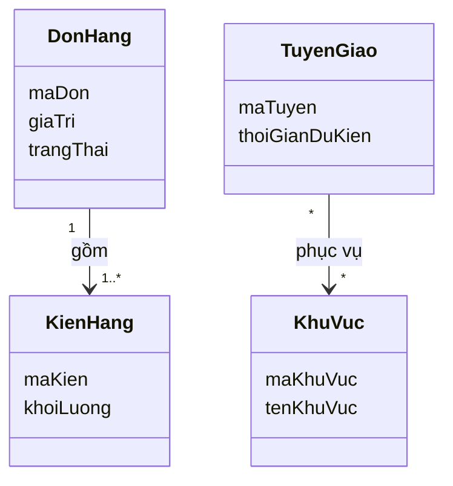

# Phân tích ngôn ngữ tự nhiên

Khi khám phá một miền để xây dựng ngôn ngữ chuyên biệt miền (Domain-Specific Language, DSL), nguồn thông tin quan trọng nhất thường là cách con người đang nói và viết về công việc của họ. Chuyên gia miền hiếm khi bắt đầu bằng cú pháp, kiểu dữ liệu hay cấu trúc chương trình. Họ mô tả tình huống, mục tiêu, quy tắc, ngoại lệ và khó khăn bằng ngôn ngữ tự nhiên: tiếng Việt, tiếng Anh hoặc ngôn ngữ mà tổ chức đang sử dụng.

**Phân tích ngôn ngữ tự nhiên** trong quá trình khám phá miền là hoạt động thu thập, đọc hiểu và cấu trúc hóa những phát biểu đó để tìm ra khái niệm, đối tượng, quan hệ, hành động, quy tắc và ý định thuộc miền. Hoạt động này có thể do nhà phân tích thực hiện thủ công, được hỗ trợ bởi các kỹ thuật xử lý ngôn ngữ tự nhiên (Natural Language Processing, NLP), hoặc kết hợp cả hai.

Mục tiêu cuối cùng là tạo ra một mô hình miền và một bộ từ vựng đủ rõ để nhóm thiết kế DSL có thể quyết định người dùng cần diễn đạt điều gì, cấu trúc nào nên có trong ngôn ngữ và hệ thống phải hiểu các cấu trúc ấy ra sao. Phân tích ngôn ngữ tự nhiên không đơn thuần là tìm danh từ để đặt tên biến. Nó còn phải làm rõ ý nghĩa trong ngữ cảnh, quan hệ giữa các khái niệm, điều kiện áp dụng và những điểm mà người nói chưa xác định.

## 1. Vai trò của phân tích ngôn ngữ tự nhiên khi khám phá miền

Ngôn ngữ tự nhiên là phương tiện giao tiếp linh hoạt. Người dùng có thể mô tả cùng một công việc bằng nhiều cách, dùng từ viết tắt, bỏ qua thông tin mà họ cho là hiển nhiên hoặc dựa vào kiến thức ngầm của tổ chức. Những đặc điểm đó hữu ích trong giao tiếp giữa con người nhưng tạo ra khó khăn khi chuyển yêu cầu thành một ngôn ngữ máy có thể phân tích và thực thi.

Ví dụ, nhân viên vận hành có thể nói:

> Nếu đơn hàng lớn thì miễn phí giao hàng, trừ khu vực xa.

Phát biểu này gợi ra một số khái niệm miền như đơn hàng, giá trị hoặc kích thước đơn hàng, giao hàng, khu vực và chính sách miễn phí. Tuy nhiên, nó chưa đủ chính xác để thực thi. “Lớn” được xác định theo giá trị tiền, số lượng sản phẩm hay khối lượng? “Xa” tính từ kho nào và theo đơn vị nào? Ngoại lệ khu vực xa có nghĩa là luôn thu phí hay áp dụng một công thức khác?

Phân tích ngôn ngữ tự nhiên giúp biến phát biểu ban đầu thành những câu hỏi có thể xác minh, những khái niệm có định nghĩa và những quy tắc có điều kiện rõ ràng. Nhờ đó, nhóm phát triển tránh việc tự suy đoán ngữ nghĩa khi thiết kế DSL.

### 1.1. Vị trí trong quy trình thiết kế DSL

Quy trình tổng quát có thể hình dung như sau:

```text
Trao đổi và tài liệu của người dùng
              |
              v
       Thu thập ngữ liệu
              |
              v
   Phân tích ngôn ngữ tự nhiên
              |
              v
 Khái niệm, thuật ngữ, quan hệ,
     hành động và quy tắc miền
              |
              v
       Mô hình miền
              |
              v
   Thiết kế từ vựng và cú pháp DSL
              |
              v
    Định nghĩa ngữ nghĩa DSL
              |
              v
       Kiểm chứng với người dùng
```

Các bước có thể lặp lại. Khi thử nghiệm DSL, người dùng có thể chỉ ra rằng một thuật ngữ không đúng cách họ nói, một quy tắc thiếu ngoại lệ hoặc một khái niệm đang bị gộp nhầm. Khi đó, nhóm cần quay lại ngữ liệu và mô hình miền để điều chỉnh.

### 1.2. Phân tích ngôn ngữ tự nhiên không chỉ là xử lý văn bản tự động

Trong ngữ cảnh kỹ thuật, NLP thường chỉ các phương pháp tính toán giúp máy xử lý ngôn ngữ con người. Trong khám phá miền, phạm vi công việc rộng hơn: nhà phân tích phải hiểu quy trình, hỏi lại người cung cấp thông tin, đối chiếu các cách diễn đạt và xác nhận ý nghĩa với chuyên gia miền.

Một công cụ NLP có thể nhận diện cụm từ “đơn hàng”, “khu vực xa” và “miễn phí”. Nhưng chỉ chuyên gia miền hoặc người có thẩm quyền mới có thể xác nhận “đơn hàng lớn” được định nghĩa theo ngưỡng nào và chính sách ngoại lệ thực sự hoạt động ra sao. Công cụ hỗ trợ tìm dấu hiệu; hiểu biết nghiệp vụ và xác nhận của con người quyết định mô hình có đúng hay không.

## 2. Thu thập ngữ liệu từ miền

**Ngữ liệu (corpus)** là tập hợp các phát biểu hoặc tài liệu được chọn để phân tích. Chất lượng ngữ liệu ảnh hưởng trực tiếp đến chất lượng mô hình miền. Nếu chỉ thu thập một tài liệu hướng dẫn chính thức, nhóm có thể bỏ sót cách nhân viên thực hiện công việc thực tế. Nếu chỉ phỏng vấn một cá nhân, kết quả có thể phản ánh cách hiểu riêng của người đó.

Các nguồn ngữ liệu thường gặp gồm:

- Phỏng vấn chuyên gia miền, người vận hành và người sử dụng hệ thống.
- Biên bản họp, tài liệu quy trình và hướng dẫn nghiệp vụ.
- Biểu mẫu, hợp đồng, chính sách và quy định.
- Phiếu yêu cầu, báo cáo sự cố, câu hỏi hỗ trợ và phản hồi người dùng.
- Mô tả quy trình, kịch bản sử dụng và câu chuyện người dùng.
- Email, hội thoại hoặc nội dung trao đổi nội bộ được phép sử dụng.
- Tài liệu sản phẩm, danh mục thuật ngữ và hệ thống mã nghiệp vụ.

Không phải nguồn nào cũng có cùng độ tin cậy. Tài liệu quy định có thể mô tả quy tắc chính thức, trong khi hội thoại cho thấy cách quy tắc được hiểu và áp dụng trên thực tế. Phiếu sự cố thường chứa những trường hợp biên mà tài liệu quy trình chưa đề cập. Nên ghi nhận nguồn, thời điểm và bối cảnh của mỗi phát biểu để có thể đối chiếu khi xuất hiện mâu thuẫn.

### 2.1. Đặt câu hỏi để khai thác ngôn ngữ miền

Phỏng vấn hiệu quả nên tập trung vào tình huống cụ thể. Thay vì chỉ hỏi “quy trình này hoạt động như thế nào?”, hãy yêu cầu người tham gia kể lại một trường hợp gần đây, giải thích quyết định họ đã đưa ra và chỉ ra dữ liệu họ cần để quyết định.

Một số câu hỏi gợi mở:

- Anh/chị gọi đối tượng này là gì trong công việc hằng ngày?
- Khi nói một yêu cầu đã hợp lệ, điều kiện cụ thể là gì?
- Ai tạo, sửa, phê duyệt hoặc hủy đối tượng này?
- Sự kiện nào làm trạng thái thay đổi?
- Có trường hợp nào quy tắc thông thường không áp dụng không?
- Khi thiếu dữ liệu hoặc hai quy tắc mâu thuẫn, anh/chị xử lý thế nào?
- Hai thuật ngữ này có cùng nghĩa không? Nếu khác, khác ở điểm nào?
- Có ví dụ nào mà cách diễn đạt hiện tại dễ bị hiểu sai không?

Hãy hỏi về ví dụ và phản ví dụ. Một định nghĩa nghe có vẻ rõ ràng có thể bộc lộ sự mơ hồ khi áp dụng vào một trường hợp cụ thể. Ví dụ, người tham gia nói “đơn hàng đủ điều kiện được giao” thì cần hỏi đơn hàng nào, đủ điều kiện theo tiêu chí nào và ai xác nhận điều kiện đó.

### 2.2. Chọn ngữ liệu có tính đại diện

Ngữ liệu nên bao gồm cả tình huống thông thường và trường hợp ít gặp nhưng quan trọng. Có thể phân tầng theo vai trò người dùng, loại quy trình, trạng thái đối tượng, khu vực, kênh giao dịch hoặc mức độ ngoại lệ.

Ví dụ, khi khám phá miền xử lý đơn hàng, chỉ đọc các đơn hàng hoàn tất sẽ bỏ qua cách hệ thống xử lý đơn bị hủy, thanh toán thất bại, thiếu hàng hoặc giao nhiều lần. Những trường hợp này thường làm lộ ra các khái niệm và quy tắc cần thiết cho DSL.

Không nên coi số lượng tài liệu lớn là bằng chứng rằng ngữ liệu đã đại diện. Cần kiểm tra xem các nhóm người dùng và tình huống quan trọng đã xuất hiện chưa, đồng thời ghi rõ những phần chưa có dữ liệu.

### 2.3. Bảo vệ thông tin trong ngữ liệu

Hội thoại và tài liệu nghiệp vụ có thể chứa tên khách hàng, địa chỉ, số điện thoại, thông tin tài chính hoặc bí mật kinh doanh. Chỉ thu thập dữ liệu cần thiết và bảo đảm người tham gia, tổ chức cùng quy định nội bộ cho phép sử dụng nguồn đó. Khi có thể, hãy ẩn danh hoặc thay thế thông tin nhận dạng bằng dữ liệu giả lập trước khi đưa vào công cụ phân tích.

Ngữ liệu phục vụ khám phá khái niệm thường không cần giữ nguyên danh tính của người thật. Ví dụ, “Khách hàng Nguyễn Văn A” có thể được thay bằng “Khách hàng X” mà vẫn giữ nguyên ý nghĩa của quy tắc. Cần kiểm soát quyền truy cập, thời hạn lưu giữ và cách chia sẻ ngữ liệu theo chính sách của tổ chức.

## 3. Chuẩn bị và tổ chức ngữ liệu

Trước khi phân tích, cần đưa các nguồn về dạng có thể tìm kiếm và đối chiếu. Việc chuẩn bị không được làm mất ngữ cảnh hoặc thay đổi ý nghĩa ban đầu.

Các thao tác thường gặp:

1. **Tập hợp:** Lưu các phát biểu và tài liệu vào kho ngữ liệu có nguồn gốc rõ ràng.
2. **Phân đoạn:** Chia tài liệu thành đoạn, câu hoặc lượt trao đổi có ý nghĩa.
3. **Gắn thông tin nguồn:** Ghi vai trò người nói, loại tài liệu, thời điểm, quy trình và phiên bản nếu có.
4. **Chuẩn hóa có kiểm soát:** Sửa lỗi định dạng, thống nhất cách biểu diễn ngày tháng hoặc ký hiệu khi cần, nhưng giữ lại bản gốc.
5. **Ẩn danh:** Loại bỏ hoặc thay thế dữ liệu nhận dạng không cần thiết.
6. **Gắn nhãn:** Đánh dấu thuật ngữ, thực thể, hành động, điều kiện, quan hệ hoặc loại phát biểu phục vụ phân tích.
7. **Lưu dấu vết:** Liên kết kết quả phân tích với câu hoặc tài liệu nguồn để có thể kiểm tra lại.

### 3.1. Phân đoạn văn bản

Một tài liệu dài thường chứa nhiều chủ đề. Chia tài liệu thành các đơn vị nhỏ giúp nhận diện ý nghĩa và truy xuất bằng chứng. Tuy nhiên, không nên tách câu khỏi đoạn trước khi hiểu các từ tham chiếu như “nó”, “trường hợp này”, “quy tắc trên” hoặc “sau đó”. Những cụm từ này có thể chỉ đến đối tượng hoặc sự kiện được giới thiệu ở phần trước.

Trong hội thoại, một câu trả lời ngắn như “chỉ khi đã thanh toán” có thể không có nghĩa đầy đủ nếu không giữ câu hỏi trước đó. Vì vậy, cần lưu quan hệ giữa các lượt trao đổi và ngữ cảnh liên quan.

### 3.2. Chuẩn hóa nhưng không xóa biến thể

Một khái niệm có thể được viết bằng nhiều dạng: “đơn hàng”, “đơn”, “order” hoặc một mã nội bộ. Có thể tạo ánh xạ chuẩn hóa để tìm kiếm và thống kê, nhưng cần giữ lại cách viết gốc. Biến thể đôi khi cho biết khác biệt về vai trò, quy trình hoặc ngữ cảnh.

Ví dụ, “khách hàng”, “người mua” và “người nhận” có thể cùng chỉ một người trong một quy trình đơn giản, nhưng trong giao dịch quà tặng, người mua và người nhận là hai vai trò khác nhau. Gộp chúng chỉ vì gần nghĩa sẽ làm sai mô hình miền.

## 4. Những thành phần cần tìm trong phát biểu tự nhiên

Khi đọc ngữ liệu, hãy phân tích phát biểu theo nhiều chiều. Một câu có thể chứa nhiều loại thông tin cùng lúc; một khái niệm cũng có thể xuất hiện trong nhiều câu với vai trò khác nhau.

### 4.1. Thuật ngữ và khái niệm miền

**Thuật ngữ miền** là từ hoặc cụm từ dùng để gọi một khái niệm trong lĩnh vực. Các cụm danh từ thường là điểm bắt đầu tốt để tìm ứng viên, nhưng không phải danh từ nào cũng là khái niệm cần đưa vào DSL.

Ví dụ trong miền vận chuyển:

- Đơn hàng
- Kiện hàng
- Tuyến giao hàng
- Khu vực phục vụ
- Phí cơ bản
- Phụ phí
- Thời gian giao dự kiến

Với mỗi thuật ngữ, cần xác định định nghĩa, phạm vi sử dụng, ví dụ, từ đồng nghĩa, từ dễ nhầm và nguồn xác nhận. Không nên quyết định rằng một cụm danh từ là thực thể chỉ dựa vào hình thức ngữ pháp của nó.

### 4.2. Thực thể, thuộc tính và giá trị

**Thực thể** là đối tượng được miền nhận diện và theo dõi. **Thuộc tính** mô tả đặc điểm của đối tượng. **Giá trị** là nội dung cụ thể của thuộc tính.

Ví dụ:

| Phát biểu | Ứng viên cần nhận diện |
|---|---|
| “Đơn hàng có mã DH102” | Thực thể `Đơn hàng`; thuộc tính `mã đơn hàng`; giá trị `DH102` |
| “Kiện hàng nặng 2 kg” | Thực thể `Kiện hàng`; thuộc tính `khối lượng`; giá trị `2 kg` |
| “Tuyến giao hàng đang hoạt động” | Thực thể `Tuyến giao hàng`; thuộc tính hoặc trạng thái `hoạt động` |
| “Đơn hàng được tạo lúc 9 giờ” | Sự kiện tạo đơn; thời điểm `9 giờ` |

Hãy phân biệt thuộc tính có giá trị tự do với thuộc tính có miền giá trị xác định. Ví dụ, `trạng_thái_đơn_hàng` có thể chỉ nhận các giá trị đã định nghĩa như `mới_tạo`, `đã_xác_nhận`, `đang_giao`, `đã_giao` và `đã_hủy`.

### 4.3. Quan hệ giữa các khái niệm

Quan hệ cho biết các đối tượng liên kết với nhau như thế nào. Những cụm từ như “thuộc về”, “bao gồm”, “được gửi đến”, “được xử lý bởi”, “phụ thuộc vào” thường gợi ra quan hệ.

Ví dụ:

- Một đơn hàng **gồm** một hoặc nhiều dòng hàng.
- Một kiện hàng **thuộc về** một đơn hàng.
- Một tuyến giao hàng **phục vụ** nhiều khu vực.
- Một lần giao hàng **được thực hiện bởi** một nhân viên giao hàng.
- Một phụ phí **áp dụng cho** một nhóm điều kiện.

Không chỉ ghi tên quan hệ; cần xác định hướng, số lượng và điều kiện nếu có. “Một đơn hàng gồm nhiều kiện hàng” khác với “một kiện hàng có thể chứa nhiều đơn hàng”. Sự khác biệt này ảnh hưởng đến mô hình dữ liệu và ngữ nghĩa của DSL.

### 4.4. Hành động và sự kiện

Động từ thường gợi ý hành động hoặc sự kiện. Hãy phân biệt hành động do người dùng hoặc hệ thống chủ động thực hiện với sự kiện mô tả điều đã xảy ra.

Ví dụ:

- `xác_nhận_đơn_hàng`: hành động xác nhận.
- `đơn_hàng_được_xác_nhận`: sự kiện xác nhận đã xảy ra.
- `hủy_đơn_hàng`: hành động hủy.
- `thanh_toán_thất_bại`: sự kiện thanh toán thất bại.

Một hành động thường có tác nhân, đối tượng, điều kiện trước và kết quả. Một sự kiện thường có thời điểm, nguồn phát sinh và dữ liệu liên quan. Việc tách hai loại này giúp mô hình hóa vòng đời và quy trình chính xác hơn.

### 4.5. Trạng thái và chuyển trạng thái

Phát biểu tự nhiên có thể mô tả trạng thái hiện tại hoặc sự chuyển đổi giữa các trạng thái. Các cụm như “đang chờ”, “đã duyệt”, “chuyển sang”, “không còn hiệu lực” là dấu hiệu cần chú ý.

Ví dụ, “đơn hàng chuyển từ `đã_xác_nhận` sang `đang_giao` khi nhân viên nhận kiện hàng” mô tả trạng thái nguồn, trạng thái đích và sự kiện kích hoạt. Cần làm rõ trạng thái nào được phép chuyển sang trạng thái nào, ai có quyền thực hiện và điều kiện nào phải thỏa mãn.

### 4.6. Quy tắc, điều kiện và ràng buộc

Những từ như “nếu”, “khi”, “chỉ khi”, “trừ khi”, “phải”, “không được”, “ít nhất”, “tối đa” thường biểu đạt quy tắc hoặc ràng buộc.

Ví dụ:

> Chỉ được hủy đơn hàng khi đơn chưa được bàn giao cho đơn vị vận chuyển.

Có thể tách phát biểu thành:

- Hành động: hủy đơn hàng.
- Điều kiện cần: đơn chưa được bàn giao.
- Đối tượng chịu tác động: đơn hàng.
- Quy tắc: chỉ cho phép hành động khi điều kiện đúng.

Từ “chỉ khi” cần được giữ chính xác. Trong logic, “A chỉ khi B” thường có nghĩa B là điều kiện cần để A xảy ra; nó không tự động có nghĩa B luôn dẫn đến A. Nhầm lẫn giữa điều kiện cần và điều kiện đủ có thể làm thay đổi chính sách.

### 4.7. Tác nhân, vai trò và quyền hạn

Các cụm như “nhân viên”, “quản lý”, “khách hàng”, “hệ thống” hoặc “đơn vị vận chuyển” có thể là tác nhân thực hiện hành động hoặc chủ thể chịu trách nhiệm.

Ví dụ, “quản lý phê duyệt yêu cầu hoàn tiền” thể hiện tác nhân `quản_lý`, hành động `phê_duyệt` và đối tượng `yêu_cầu_hoàn_tiền`. Tuy nhiên, câu này chưa nói mọi quản lý đều có quyền phê duyệt hay chỉ quản lý của bộ phận liên quan. Cần hỏi rõ phạm vi vai trò và điều kiện phân quyền.

### 4.8. Mục tiêu và ý định người dùng

Không phải phát biểu nào cũng mô tả đối tượng hoặc quy tắc. Người dùng còn nêu mục tiêu: tìm kiếm đơn hàng, kiểm tra tính hợp lệ, so sánh phương án, dự báo thời gian hoặc tạo báo cáo.

Ví dụ, “tôi muốn xem các đơn bị giao trễ trong tuần này” thể hiện ý định truy vấn, đối tượng là đơn hàng, điều kiện là giao trễ và phạm vi thời gian là tuần này. Những ý định lặp lại có thể trở thành nhóm câu lệnh hoặc thao tác của DSL.

## 5. Nhận diện sự mơ hồ và thông tin còn thiếu

Ngôn ngữ tự nhiên cho phép người nói dựa vào ngữ cảnh và kiến thức chung. DSL cần ngữ nghĩa ổn định, vì vậy mọi điểm mơ hồ có ảnh hưởng đến kết quả phải được làm rõ hoặc được quy định thành mặc định có chủ đích.

### 5.1. Mơ hồ từ vựng

Một từ có thể mang nhiều nghĩa. “Tài khoản” có thể là danh tính đăng nhập, tài khoản kế toán hoặc tài khoản thanh toán. “Đóng” có thể là đóng cửa sổ, đóng hồ sơ hay kết thúc một kỳ kế toán.

Hãy xác định nghĩa dựa trên ngữ cảnh, vai trò và đối tượng liên quan. Nếu các nghĩa thực sự khác nhau, nên dùng thuật ngữ riêng trong mô hình và DSL.

### 5.2. Đồng nghĩa và biến thể cách gọi

Nhiều từ có thể cùng chỉ một khái niệm: “đơn”, “đơn hàng”, “order”. Ngược lại, các từ gần nghĩa có thể đại diện cho những vai trò khác nhau. Không nên gộp từ chỉ vì chúng có độ tương đồng cao; cần xác nhận xem người dùng có thể thay thế chúng cho nhau trong mọi trường hợp hay không.

### 5.3. Mơ hồ cú pháp

Thứ tự từ và phạm vi bổ nghĩa có thể làm câu có nhiều cách hiểu.

Ví dụ:

> Áp dụng ưu đãi cho khách hàng mới có đơn hàng trên 500.000 đồng.

“Mới” có thể bổ nghĩa cho khách hàng hoặc đơn hàng. Nếu ý định là khách hàng mới, cần diễn đạt lại: “Áp dụng ưu đãi cho khách hàng mới nếu giá trị đơn hàng vượt 500.000 đồng.”

### 5.4. Mơ hồ tham chiếu

Đại từ hoặc cụm từ như “nó”, “đơn đó”, “quy tắc này” có thể chỉ nhiều đối tượng đã nhắc đến. Ví dụ: “Nếu đơn hàng có nhiều kiện, hãy gộp chúng trước khi tính phí.” Cần xác định “chúng” là các kiện hay các mặt hàng.

### 5.5. Khái niệm định tính hoặc không có ngưỡng

Các từ “lớn”, “nhanh”, “gần”, “quan trọng”, “thường xuyên” không xác định một giá trị duy nhất. Muốn dùng chúng trong DSL, cần chuyển thành tiêu chí có thể kiểm tra hoặc xác định rõ chúng chỉ mang tính mô tả.

Ví dụ, “giao nhanh” có thể được định nghĩa là giao trong tối đa 24 giờ kể từ thời điểm xác nhận, nhưng chỉ khi chuyên gia miền xác nhận đây là quy tắc đúng.

### 5.6. Điều kiện cần, điều kiện đủ và ngoại lệ

Các cấu trúc “nếu”, “khi”, “chỉ khi”, “trừ khi”, “ngoại trừ” và “chỉ áp dụng cho” có ý nghĩa logic khác nhau. Cần ghi rõ:

- Điều kiện nào bắt buộc phải đúng?
- Điều kiện nào đủ để kích hoạt hành động?
- Có ngoại lệ nào loại bỏ quy tắc chung không?
- Khi nhiều điều kiện cùng đúng, quy tắc nào được ưu tiên?
- Nếu không có điều kiện nào đúng, hành vi mặc định là gì?

### 5.7. Phạm vi của phủ định và lượng từ

Phủ định có thể áp dụng cho hành động, đối tượng hoặc một phần điều kiện. “Không cho phép khách hàng chưa xác minh tạo đơn hàng trả góp” cần làm rõ hệ thống cấm tạo mọi loại đơn hàng hay chỉ cấm đơn trả góp.

Các lượng từ “mọi”, “một số”, “ít nhất một”, “không có”, “chỉ một” cũng cần được biểu diễn chính xác. “Mỗi đơn hàng có ít nhất một dòng hàng” khác với “mỗi đơn hàng chỉ có một dòng hàng”.

### 5.8. Mơ hồ về thời gian

Những từ “hôm nay”, “tuần này”, “trước đó”, “trong vòng 24 giờ” hoặc “sau khi duyệt” phụ thuộc vào múi giờ, thời điểm tham chiếu và cách tính khoảng thời gian.

Ví dụ, “hủy trong vòng 24 giờ” có thể tính từ lúc tạo đơn, thanh toán hay xác nhận. DSL cần nêu rõ mốc bắt đầu, mốc kết thúc, múi giờ và việc hai đầu khoảng có được tính hay không nếu điều đó ảnh hưởng đến kết quả.

### 5.9. Phân biệt quy tắc chính thức và thói quen thực tế

Một người có thể nói “thường thì quản lý sẽ duyệt” để mô tả thói quen, không phải quy tắc bắt buộc. Cần phân biệt từ ngữ chỉ nghĩa vụ (“phải”, “bắt buộc”), cho phép (“có thể”), khuyến nghị (“nên”) và mô tả tần suất (“thường”, “đôi khi”). Không được tự chuyển một thông lệ thành quy tắc cưỡng chế.

## 6. Các kỹ thuật xử lý ngôn ngữ tự nhiên

Khi ngữ liệu lớn hoặc cần tự động hóa một phần công việc, các kỹ thuật NLP giúp tìm kiếm, phân loại và trích xuất thông tin. Một quy trình xử lý văn bản thường gồm nhiều bước; không phải dự án DSL nào cũng cần triển khai tất cả.

### 6.1. Tách câu và tách từ

**Tách câu (sentence segmentation)** chia văn bản thành câu hoặc đơn vị phát biểu. **Tách từ (tokenization)** chia chuỗi thành các đơn vị như từ, số và dấu câu.

Với tiếng Việt, ranh giới từ không phải lúc nào cũng trùng với khoảng trắng. Một cụm như “đơn hàng” gồm hai tiếng nhưng biểu đạt một đơn vị từ vựng. Công cụ phân đoạn từ tiếng Việt cần được chọn và kiểm tra phù hợp với dữ liệu miền, đặc biệt khi có mã nghiệp vụ, tên sản phẩm hoặc từ viết tắt.

### 6.2. Chuẩn hóa văn bản

Chuẩn hóa có thể gồm chuyển kiểu chữ, xử lý khoảng trắng, chuẩn hóa dấu câu, dạng ngày tháng, đơn vị đo và biến thể viết tắt. Việc chuẩn hóa phải giữ lại khả năng truy về văn bản gốc.

Ví dụ, “500 nghìn”, “500.000đ” và “500,000 VND” có thể được ánh xạ về một giá trị tiền tệ chuẩn nếu ngữ cảnh xác định rõ quy ước. Không nên thay thế chuỗi gốc khi chưa biết dấu chấm hoặc dấu phẩy đang được dùng làm dấu phân cách hàng nghìn hay thập phân.

### 6.3. Gán nhãn từ loại

**Part-of-Speech Tagging** gán nhãn từ loại như danh từ, động từ, tính từ, trạng từ hoặc giới từ. Kết quả có thể giúp tìm cụm danh từ ứng viên cho khái niệm và động từ ứng viên cho hành động.

Ví dụ, trong câu “Quản lý phê duyệt yêu cầu hoàn tiền”, hệ thống có thể nhận diện “quản lý” và “yêu cầu hoàn tiền” là các cụm danh từ, “phê duyệt” là động từ. Đây chỉ là gợi ý ban đầu; ý nghĩa miền cần được xác nhận.

### 6.4. Nhận diện thực thể có tên

**Named Entity Recognition (NER)** tìm các thực thể như người, tổ chức, địa điểm, ngày tháng, số tiền hoặc mã định danh. Trong một miền cụ thể, mô hình NER có thể được mở rộng để nhận diện mã đơn hàng, loại tài nguyên, trạng thái nghiệp vụ hoặc mã sản phẩm.

Ví dụ, từ câu “Đơn DH102 giao đến Quận 3 vào ngày 12/05”, hệ thống có thể trích xuất mã đơn `DH102`, địa điểm `Quận 3` và ngày `12/05`. Cần xác nhận định dạng ngày và múi giờ nếu dữ liệu được dùng trong quy tắc.

### 6.5. Phân tích cú pháp và phụ thuộc

**Parsing** phân tích cấu trúc câu. Phân tích phụ thuộc (dependency parsing) biểu diễn quan hệ ngữ pháp giữa các từ, chẳng hạn chủ ngữ, vị ngữ, tân ngữ và thành phần bổ nghĩa.

Kỹ thuật này có thể giúp xác định ai thực hiện hành động nào trên đối tượng nào. Tuy nhiên, câu dài, câu bị động, câu rút gọn hoặc cách nói không chuẩn có thể làm kết quả sai. Luôn kiểm tra những cấu trúc ảnh hưởng đến quy tắc quan trọng.

### 6.6. Trích xuất quan hệ

**Relation Extraction** tìm quan hệ giữa các thực thể trong câu hoặc tài liệu. Ví dụ, từ “Một tuyến phục vụ khu vực nội thành”, hệ thống có thể trích xuất quan hệ `Tuyến --phục_vụ--> Khu vực`.

Quan hệ được trích xuất cần được chuẩn hóa về một tập kiểu quan hệ của miền. Hai cách nói “thuộc khu vực”, “nằm trong khu vực” có thể cùng ánh xạ đến một quan hệ, nếu chuyên gia miền xác nhận chúng tương đương.

### 6.7. Phân tích vai nghĩa và sự kiện

Semantic Role Labeling tìm vai trò của các thành phần trong một sự kiện: tác nhân, hành động, đối tượng, nơi chốn, thời gian hoặc công cụ. Ví dụ, trong “Nhân viên giao hàng chuyển kiện DH102 đến kho lúc 10 giờ”, có thể nhận diện tác nhân là nhân viên giao hàng, hành động là chuyển, đối tượng là kiện DH102, đích đến là kho và thời điểm là 10 giờ.

Phân tích sự kiện hữu ích khi DSL cần mô tả quy trình, luồng công việc hoặc thay đổi trạng thái.

### 6.8. Phân giải đồng tham chiếu

**Coreference Resolution** xác định những cụm từ khác nhau cùng tham chiếu đến một đối tượng. Ví dụ: “Đơn hàng DH102 đã được xác nhận. Nó sẽ được giao vào ngày mai.” Cụm “nó” tham chiếu đến đơn hàng DH102.

Nếu phân giải sai, hệ thống có thể gắn nhầm hành động hoặc điều kiện vào đối tượng khác. Với quy tắc quan trọng, nên giữ câu trả lời của người tham gia và ngữ cảnh gốc để con người xác nhận.

### 6.9. Phân loại ý định và chủ đề

Intent Classification xác định người nói đang muốn thực hiện loại tác vụ nào, chẳng hạn tìm kiếm, tạo mới, cập nhật, phê duyệt hoặc báo cáo. Phân loại chủ đề giúp nhóm phát biểu theo quy trình hoặc lĩnh vực.

Ví dụ, “Tìm các đơn chưa giao” có ý định truy vấn; “Hủy đơn DH102” có ý định thay đổi trạng thái; “Vì sao đơn DH102 bị giữ?” có ý định giải thích hoặc tra cứu nguyên nhân. Những nhóm ý định lặp lại có thể gợi ý các nhóm thao tác trong DSL.

### 6.10. Phân tích cảm xúc và mức độ chắc chắn

Trong khám phá miền, phân tích cảm xúc không thay thế phân tích quy tắc, nhưng phản hồi như “quy trình này khó hiểu” hoặc “bước này thường gây nhầm lẫn” có thể chỉ ra điểm đau của người dùng. Các từ thể hiện mức độ chắc chắn, khả năng hoặc nghĩa vụ cũng cần được chú ý để không biến giả định thành quy tắc chắc chắn.

### 6.11. Mô hình ngôn ngữ lớn

Mô hình ngôn ngữ lớn (LLM) có thể hỗ trợ tóm lược phỏng vấn, gợi ý thuật ngữ, nhóm các cách diễn đạt tương tự, trích xuất điều kiện và tạo câu hỏi làm rõ. Tuy nhiên, đầu ra có thể chứa suy diễn, bỏ sót ngoại lệ hoặc tự điền thông tin không có trong nguồn.

Khi dùng LLM:

- Cung cấp ngữ cảnh miền và yêu cầu chỉ ra câu nguồn hỗ trợ cho từng nhận định.
- Phân biệt nội dung được trích nguyên văn với phần suy luận hoặc đề xuất.
- Yêu cầu liệt kê các điểm chưa rõ thay vì tự chọn một cách hiểu.
- Kiểm tra thuật ngữ và quy tắc với chuyên gia miền.
- Không đưa dữ liệu nhạy cảm vào dịch vụ không được tổ chức cho phép.
- Lưu phiên bản ngữ liệu, hướng dẫn và kết quả để có thể tái hiện quá trình phân tích.

LLM là công cụ hỗ trợ khám phá, không phải nguồn thẩm quyền tự quyết định quy tắc nghiệp vụ.

## 7. Từ phát biểu tự nhiên đến mô hình miền

Kết quả của phân tích không nên dừng ở danh sách từ khóa. Cần chuyển bằng chứng ngôn ngữ thành các cấu trúc miền có định nghĩa, quan hệ và trạng thái xác nhận.

### 7.1. Xây dựng bảng thuật ngữ

Một bảng thuật ngữ có thể gồm các trường:

| Trường | Mục đích |
|---|---|
| Thuật ngữ chuẩn | Tên được chọn để dùng thống nhất |
| Định nghĩa | Ý nghĩa trong miền và phạm vi áp dụng |
| Biến thể | Từ đồng nghĩa, viết tắt hoặc cách gọi khác |
| Ví dụ | Phát biểu hoặc tình huống minh họa |
| Thuật ngữ dễ nhầm | Khái niệm gần nghĩa nhưng cần phân biệt |
| Nguồn | Tài liệu, câu nói hoặc người xác nhận |
| Trạng thái | Đề xuất, đã xác nhận hoặc còn tranh luận |

Ví dụ:

| Thuật ngữ chuẩn | Định nghĩa | Biến thể | Cần phân biệt |
|---|---|---|---|
| Đơn hàng | Yêu cầu mua hàng được hệ thống ghi nhận | Đơn, order | Phiếu giao hàng |
| Kiện hàng | Đơn vị vật lý được đóng gói để vận chuyển | Gói hàng, package | Dòng hàng |
| Khu vực phục vụ | Vùng địa lý mà một tuyến hoặc đơn vị có thể giao đến | Vùng giao hàng | Địa chỉ cụ thể |
| Phí giao hàng | Khoản phí cho hoạt động vận chuyển | Cước giao hàng | Phụ phí phát sinh |

### 7.2. Lập bản đồ khái niệm

Từ bảng thuật ngữ, xác định các thực thể, thuộc tính, quan hệ, sự kiện và quy tắc. Có thể dùng sơ đồ lớp miền, sơ đồ quan hệ hoặc bảng liên kết. Mỗi phần tử nên có định nghĩa và liên kết tới bằng chứng ngôn ngữ.

Ví dụ đơn giản:



Sơ đồ chỉ là mô hình minh họa. Số lượng quan hệ, thuộc tính và ý nghĩa phải được xác nhận theo miền thực tế.

### 7.3. Trích xuất quy tắc thành cấu trúc có thể kiểm tra

Với mỗi quy tắc, ghi lại ít nhất:

- Tên hoặc mã quy tắc.
- Điều kiện kích hoạt.
- Điều kiện cần và điều kiện đủ.
- Hành động hoặc kết quả.
- Ngoại lệ và mức ưu tiên.
- Vai trò được phép thực hiện.
- Thời điểm và phạm vi hiệu lực.
- Phát biểu nguồn và người xác nhận.

Ví dụ, quy tắc “chỉ được hủy đơn khi chưa bàn giao cho đơn vị vận chuyển” có thể được biểu diễn:

```text
Quy_tac: HuyDonTruocBanGiao
Hanh_dong: huy_don_hang
Doi_tuong: don_hang
Dieu_kien: trang_thai_ban_giao == CHUA_BAN_GIAO
Ket_qua: cho_phep_huy
Nguon: phat_bieu_phong_van_014
Trang_thai_xac_nhan: cho_xac_nhan
```

Đây là bản ghi phân tích trung gian, chưa phải cú pháp DSL cuối cùng. Trạng thái “chờ xác nhận” nhắc nhóm không coi một cách diễn giải ban đầu là quy tắc chính thức.

### 7.4. Phân biệt dữ kiện, quy tắc và giả định

Một phát biểu có thể là dữ kiện mô tả trạng thái, quy tắc điều khiển hành vi, mong muốn của người dùng hoặc giả định của nhà phân tích. Hãy gắn nhãn rõ ràng.

Ví dụ:

- “Đơn DH102 có giá trị 600.000 đồng” là dữ kiện về một trường hợp.
- “Đơn từ 500.000 đồng được miễn phí giao hàng” là phát biểu quy tắc cần xác nhận.
- “Có lẽ đơn lớn được miễn phí” là giả định hoặc nhận định chưa chắc chắn.
- “Tôi muốn xem đơn lớn” là nhu cầu truy vấn, nhưng “đơn lớn” cần được định nghĩa.

Việc tách các loại phát biểu tránh biến một ví dụ đơn lẻ thành quy tắc tổng quát.

## 8. Ví dụ xuyên suốt: phân tích chính sách giao hàng

Giả sử trong một buổi phỏng vấn, nhân viên vận hành nói:

> Đơn hàng từ năm trăm nghìn thì thường được miễn phí giao hàng. Nhưng khu vực ngoại thành có thể vẫn thu thêm phí. Nếu kiện hàng quá nặng thì chuyển cho đội vận chuyển riêng. Nhân viên chỉ được hủy đơn trước khi bàn giao cho bên giao hàng.

Phát biểu chứa nhiều khái niệm và quy tắc. Có thể phân tích từng phần như sau.

### 8.1. Tách các phát biểu và nhận diện ứng viên

| Phát biểu | Khái niệm hoặc thông tin ứng viên |
|---|---|
| Đơn hàng từ năm trăm nghìn | Đơn hàng, giá trị đơn hàng, ngưỡng tiền |
| Được miễn phí giao hàng | Chính sách miễn phí, phí giao hàng |
| Khu vực ngoại thành | Khu vực, phân loại khu vực |
| Có thể vẫn thu thêm phí | Phụ phí, điều kiện ngoại lệ, mức độ cho phép |
| Kiện hàng quá nặng | Kiện hàng, khối lượng, ngưỡng khối lượng |
| Chuyển cho đội vận chuyển riêng | Đội vận chuyển, phân tuyến hoặc chuyển giao |
| Nhân viên chỉ được hủy đơn trước khi bàn giao | Vai trò, hành động hủy, trạng thái bàn giao, điều kiện quyền hạn |

### 8.2. Đánh dấu điểm chưa rõ

Phát biểu chưa đủ để tạo quy tắc thực thi. Cần hỏi:

1. “Từ năm trăm nghìn” tính trên tổng tiền hàng trước hay sau giảm giá, phí và thuế?
2. Ngưỡng 500.000 đồng có bao gồm đơn hàng đúng bằng 500.000 đồng không?
3. “Thường được miễn phí” là quy tắc mặc định hay chỉ mô tả phần lớn trường hợp?
4. Khu vực ngoại thành có luôn bị tính phụ phí hay phụ thuộc khoảng cách, tuyến hoặc thời điểm?
5. Phụ phí được tính theo công thức nào và có giới hạn không?
6. “Quá nặng” bắt đầu từ bao nhiêu kilogram? Khối lượng tính cho từng kiện hay tổng kiện của đơn?
7. Đội vận chuyển riêng được chọn tự động hay do nhân viên chỉ định?
8. “Bàn giao” là lúc tạo yêu cầu lấy hàng, lúc tài xế nhận hàng hay lúc hệ thống xác nhận biên bản?
9. Vai trò “nhân viên” có bao gồm quản lý hoặc nhân viên chăm sóc khách hàng không?

Các câu hỏi này cần được trả lời bởi người có thẩm quyền trong miền. Nhà phân tích không nên tự điền các con số hoặc điều kiện còn thiếu.

### 8.3. Chuyển thành mô hình quy tắc có điều kiện

Sau khi chuyên gia miền xác nhận, giả sử tổ chức thống nhất rằng tổng tiền hàng sau giảm giá được dùng để xét ngưỡng, đơn từ 500.000 đồng được miễn phí cơ bản, khu vực ngoại thành áp dụng phụ phí theo bảng khu vực, kiện có khối lượng trên 30 kg chuyển sang đội vận chuyển chuyên dụng và nhân viên chỉ hủy được đơn trước sự kiện bàn giao. Mô hình có thể ghi lại như sau:

```text
ChinhSachGiaoHang:
  dieu_kien_mien_phi_co_ban:
    tong_tien_hang_sau_giam_gia >= 500000 VND

  phu_phi_khu_vuc:
    ap_dung_theo_bang_phu_phi_khu_vuc

  dieu_kien_van_chuyen_chuyen_dung:
    ton_tai_kien_hang_co_khoi_luong > 30 kg

  dieu_kien_huy_don:
    vai_tro == NHAN_VIEN
    va trang_thai_ban_giao == CHUA_BAN_GIAO
```

Các giá trị và cách diễn giải trong ví dụ này là giả định được nêu rõ để minh họa bước chuyển đổi sau khi xác nhận. Chúng không được suy ra tự động từ phát biểu ban đầu.

### 8.4. Từ mô hình miền đến bản nháp DSL

Khi mô hình và quy tắc đã được xác nhận, nhóm có thể thử một bản nháp DSL:

```text
chinh_sach_giao_hang noi_thanh_va_ngoai_thanh {
    mien_phi_co_ban_khi {
        tong_tien_hang_sau_giam >= 500000 VND
    }

    phu_phi_khu_vuc theo bang_phu_phi_khu_vuc

    chuyen_doi_van_chuyen_khi {
        ton_tai_kien_hang(khoi_luong > 30 kg)
    } den doi_van_chuyen_chuyen_dung

    cho_phep_huy_don khi {
        vai_tro == NHAN_VIEN
        va trang_thai_ban_giao == CHUA_BAN_GIAO
    }
}
```

Đoạn mã chỉ minh họa cách các khái niệm đã phân tích có thể xuất hiện trong DSL. Cú pháp, kiểu dữ liệu, thứ tự đánh giá và cách xử lý trường hợp nhiều kiện hàng cần được định nghĩa trong đặc tả ngôn ngữ.

## 9. Kiểm chứng kết quả phân tích với chuyên gia miền

Mô hình miền được tạo từ ngôn ngữ tự nhiên là một giả thuyết có bằng chứng, cần được kiểm chứng với người hiểu công việc. Việc xác nhận không nên chỉ hỏi “có đúng không?” vì người tham gia có thể đồng ý chung chung mà không nhận ra cách diễn giải sai.

### 9.1. Đọc lại bằng ngôn ngữ của người dùng

Trình bày định nghĩa bằng từ ngữ quen thuộc và yêu cầu người tham gia giải thích lại bằng ví dụ. Nếu họ phải sửa nhiều thuật ngữ, mô hình có thể chưa phản ánh đúng cách hiểu trong miền.

### 9.2. Dùng ví dụ và phản ví dụ

Với một quy tắc, đưa ra trường hợp nằm ngay dưới ngưỡng, đúng ngưỡng và ngay trên ngưỡng. Ví dụ, nếu ngưỡng miễn phí là 500.000 đồng, hỏi kết quả cho 499.999, 500.000 và 500.001 đồng. Cách này giúp xác nhận toán tử `>`, `>=` và quy tắc làm tròn.

Với quy tắc trạng thái, kiểm tra cả chuyển đổi hợp lệ và không hợp lệ. Với quyền hạn, thử vai trò được phép, không được phép và vai trò chưa được đề cập.

### 9.3. Kiểm tra cách diễn đạt tương đương

Đưa ra hai câu có vẻ tương tự và hỏi chúng có cùng nghĩa trong nghiệp vụ không. Ví dụ: “chỉ được hủy khi chưa bàn giao” và “nếu chưa bàn giao thì được hủy” có thể không tương đương. Câu thứ hai có thể được hiểu là điều kiện đủ; câu thứ nhất thường nêu điều kiện cần.

### 9.4. Đối chiếu nhiều nguồn và vai trò

Nếu nhân viên vận hành, quản lý và tài liệu chính thức đưa ra các cách hiểu khác nhau, cần ghi nhận sự khác biệt thay vì chọn nguồn thuận tiện nhất. Có thể tồn tại quy tắc chính thức và cách làm thực tế khác nhau. Người có thẩm quyền phải quyết định nội dung nào là chuẩn cho DSL.

### 9.5. Duy trì truy xuất nguồn gốc

Mỗi khái niệm hoặc quy tắc quan trọng nên liên kết đến câu nguồn, tài liệu, người xác nhận và phiên bản. Khi quy trình thay đổi, nhóm có thể xác định phần nào của mô hình và DSL cần xem xét lại.

## 10. Từ kết quả phân tích đến thiết kế DSL

Phân tích ngôn ngữ tự nhiên cung cấp bằng chứng và mô hình miền; nó không tự quyết định mọi chi tiết cú pháp. Nhóm thiết kế cần dùng kết quả đó để lựa chọn cấu trúc ngôn ngữ phù hợp.

### 10.1. Chọn thuật ngữ xuất hiện trong DSL

Ưu tiên thuật ngữ đã được thống nhất với người dùng. Nếu có nhiều biến thể, chọn một tên chuẩn và quy định cách xử lý tên cũ trong tài liệu hoặc phiên bản tương thích. Tránh đưa tất cả từ đồng nghĩa vào cú pháp nếu chúng không mang lại lợi ích rõ ràng.

### 10.2. Chuyển hành động thành cấu trúc ngôn ngữ

Những ý định lặp lại như tạo chính sách, tìm đơn, áp dụng điều kiện, tính phí hoặc chuyển trạng thái có thể trở thành câu lệnh, biểu thức hoặc khối khai báo. Cấu trúc phải phản ánh ý nghĩa miền và làm rõ dữ liệu cần thiết.

### 10.3. Chuyển điều kiện thành biểu thức tường minh

Những từ định tính hoặc phụ thuộc ngữ cảnh cần được thay bằng biểu thức có định nghĩa. Ví dụ, “đơn lớn” có thể trở thành `tong_tien_hang >= 500000 VND` sau khi xác nhận. Không nên đưa từ “lớn” vào DSL nếu không có quy tắc xác định nó.

### 10.4. Quy định giá trị mặc định và trường hợp không xác định

Nếu người dùng không nêu một thuộc tính, DSL cần quy định giá trị mặc định, yêu cầu nhập bổ sung hoặc báo lỗi. Không được tự chọn giá trị mặc định cho quy tắc quan trọng chỉ để câu lệnh ngắn hơn.

### 10.5. Giữ ranh giới giữa ngôn ngữ tự nhiên và DSL

Một giao diện có thể cho phép người dùng nhập câu tự nhiên rồi chuyển thành DSL. Trong trường hợp đó, câu tự nhiên là đầu vào thuận tiện; DSL có cấu trúc là biểu diễn cần kiểm tra và xác nhận. Hệ thống nên cho người dùng xem kết quả chuyển đổi, các giả định và những điểm còn thiếu trước khi thực thi hành động có tác động.

Không nên coi câu tự nhiên bất kỳ là chương trình có ngữ nghĩa xác định. Nếu một phát biểu có nhiều cách hiểu, hệ thống cần hỏi lại hoặc yêu cầu người dùng chọn cách diễn giải.

## 11. Đánh giá chất lượng phân tích

Chất lượng phân tích không chỉ được đo bằng số lượng thuật ngữ trích xuất. Cần xem kết quả có phản ánh đúng miền và có thể dùng để thiết kế ngôn ngữ hay không.

Một số tiêu chí thực tế:

- **Độ bao phủ:** Các quy trình, vai trò, đối tượng và trường hợp ngoại lệ quan trọng đã được khảo sát chưa?
- **Độ chính xác:** Thuật ngữ, quan hệ và quy tắc có được gán đúng ý nghĩa không?
- **Tính nhất quán:** Cùng một khái niệm có được gọi và định nghĩa nhất quán không?
- **Khả năng phân biệt:** Những khái niệm gần nhau có được phân biệt đúng không?
- **Tính kiểm chứng:** Mỗi nhận định quan trọng có nguồn và người xác nhận không?
- **Khả năng thực thi:** Quy tắc đã đủ rõ để xác định điều kiện, hành động và kết quả chưa?
- **Tính cập nhật:** Mô hình có phản ánh phiên bản quy trình đang áp dụng không?
- **Tính bao quát ngôn ngữ:** Các cách nói, viết tắt và biến thể của những nhóm người dùng khác nhau đã được xem xét chưa?

Nếu dùng mô hình NLP, có thể đo precision, recall và F1 cho nhiệm vụ trích xuất thực thể hoặc quan hệ trên tập dữ liệu đã gắn nhãn. Tuy nhiên, chỉ số kỹ thuật tốt không đảm bảo mô hình miền đúng. Một hệ thống có thể trích xuất đúng cụm từ nhưng hiểu sai vai trò nghiệp vụ hoặc bỏ sót ngoại lệ có tác động lớn.

## 12. Những sai lầm thường gặp

### 12.1. Chỉ trích xuất danh từ

Danh sách danh từ có thể gợi ý đối tượng, nhưng thường bỏ qua hành động, trạng thái, điều kiện, vai trò và mục tiêu. Phân tích cần bao gồm cả cấu trúc câu và ý nghĩa nghiệp vụ.

### 12.2. Coi tần suất xuất hiện là tầm quan trọng

Một thuật ngữ xuất hiện nhiều có thể chỉ là từ phổ biến, trong khi một ngoại lệ hiếm lại có tác động lớn. Cần kết hợp tần suất với mức độ quan trọng, rủi ro và hậu quả của quy tắc.

### 12.3. Gộp các từ gần nghĩa quá sớm

“Người mua”, “khách hàng” và “người nhận” có thể là những vai trò khác nhau. Hãy kiểm tra bằng tình huống thực tế trước khi hợp nhất.

### 12.4. Xem mọi câu trong tài liệu là quy tắc hiện hành

Tài liệu có thể đã lỗi thời, chỉ là ví dụ hoặc mô tả một trường hợp ngoại lệ. Cần kiểm tra phiên bản, nguồn và người có thẩm quyền xác nhận.

### 12.5. Bỏ qua từ chỉ mức độ chắc chắn

“Có thể”, “thường”, “nên” và “phải” biểu đạt mức độ nghĩa vụ khác nhau. Nếu loại bỏ những từ này trong quá trình chuẩn hóa, mô hình có thể biến gợi ý thành quy tắc bắt buộc.

### 12.6. Để công cụ tự quyết định phần còn thiếu

Một mô hình NLP hoặc LLM có thể tạo ra câu trả lời nghe hợp lý nhưng không có bằng chứng. Những giá trị, ngưỡng, ngoại lệ và quan hệ không được nêu phải được đánh dấu là chưa biết và đưa ra xác nhận.

### 12.7. Bỏ qua ngôn ngữ theo vai trò và vùng miền

Các nhóm có thể dùng thuật ngữ khác nhau cho cùng một khái niệm, hoặc cùng một từ cho những khái niệm khác nhau. Cần lưu ngữ cảnh và vai trò của người nói để tránh áp đặt một cách gọi duy nhất quá sớm.

### 12.8. Chuyển thẳng câu tự nhiên thành cú pháp DSL

Việc thay từng từ trong câu thành từ khóa thường tạo ra ngôn ngữ khó hiểu và thiếu ngữ nghĩa. Trước hết cần xây dựng mô hình miền, xác định quy tắc và kiểm tra cách hiểu; sau đó mới thiết kế cú pháp để biểu đạt mô hình đó.

## 13. Sản phẩm đầu ra của hoạt động phân tích

Tùy quy mô dự án, kết quả có thể được lưu trong một hoặc nhiều tài liệu. Những sản phẩm thường hữu ích gồm:

1. **Kho ngữ liệu có nguồn:** Các phát biểu và tài liệu đã được chọn, phân đoạn và gắn thông tin nguồn.
2. **Bảng thuật ngữ miền:** Thuật ngữ chuẩn, định nghĩa, biến thể và khái niệm dễ nhầm.
3. **Bản đồ khái niệm:** Thực thể, thuộc tính, quan hệ, sự kiện và trạng thái.
4. **Danh mục quy tắc:** Điều kiện, hành động, ngoại lệ, phạm vi và mức độ xác nhận.
5. **Danh sách câu hỏi mở:** Những điểm mơ hồ hoặc thông tin còn thiếu cần chuyên gia trả lời.
6. **Tập ví dụ và phản ví dụ:** Các trường hợp dùng để kiểm tra mô hình và ngữ nghĩa.
7. **Ma trận truy xuất:** Liên kết yêu cầu, phát biểu nguồn, khái niệm miền và cấu trúc DSL dự kiến.
8. **Biên bản xác nhận:** Người xác nhận, thời điểm, phiên bản và quyết định đối với các điểm tranh luận.

Các sản phẩm này giúp nhóm thiết kế DSL giải thích được vì sao một thuật ngữ hoặc cấu trúc được đưa vào ngôn ngữ, đồng thời hỗ trợ bảo trì khi nghiệp vụ thay đổi.

## 14. Thuật ngữ cần nhớ

| Thuật ngữ | Ý nghĩa |
|---|---|
| Natural Language (ngôn ngữ tự nhiên) | Ngôn ngữ con người dùng để giao tiếp, như tiếng Việt hoặc tiếng Anh |
| NLP | Các kỹ thuật tính toán để phân tích và xử lý ngôn ngữ tự nhiên |
| Corpus (ngữ liệu) | Tập hợp văn bản hoặc phát biểu được chọn để phân tích |
| Tokenization | Chia văn bản thành các đơn vị như từ, số và dấu câu |
| POS Tagging | Gán nhãn từ loại cho các đơn vị trong câu |
| NER | Nhận diện thực thể có tên trong văn bản |
| Parsing | Phân tích cấu trúc cú pháp của câu |
| Relation Extraction | Trích xuất quan hệ giữa các thực thể |
| Semantic Role Labeling | Nhận diện vai nghĩa như tác nhân, hành động và đối tượng |
| Coreference Resolution | Xác định các cụm từ cùng tham chiếu đến một đối tượng |
| Intent Classification | Phân loại ý định hoặc tác vụ người nói muốn thực hiện |
| Domain Glossary | Bảng thuật ngữ và định nghĩa thống nhất của miền |
| Traceability | Khả năng truy xuất từ mô hình hoặc cấu trúc DSL về nguồn yêu cầu |

Phân tích ngôn ngữ tự nhiên giúp nhóm khám phá miền nhìn thấy cách người dùng thực sự gọi tên đối tượng, mô tả công việc và giải thích quy tắc. Khi các phát biểu được gắn với ngữ cảnh, kiểm tra sự mơ hồ và xác nhận với chuyên gia, chúng có thể được chuyển thành từ vựng và mô hình miền đáng tin cậy. Đó là nền tảng để thiết kế một DSL diễn đạt đúng ý định của người dùng và có ngữ nghĩa đủ rõ để hệ thống xử lý nhất quán.
