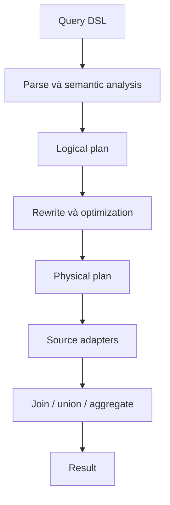

# Kết hợp nguồn dữ liệu trong DSL truy vấn

Một DSL (*Domain-Specific Language*) dùng để truy vấn dữ liệu thường cần đọc thông tin từ nhiều nơi: bảng trong database, file, API, stream sự kiện, catalog hoặc những nguồn dữ liệu được cung cấp bởi ứng dụng. Một truy vấn có thể cần ghép đơn hàng với khách hàng, kết hợp dữ liệu hiện tại với lịch sử, hoặc hợp nhất kết quả từ nhiều hệ thống.

**Kết hợp nguồn dữ liệu** là quá trình đưa dữ liệu từ hai hay nhiều nguồn vào cùng một phép truy vấn, sau đó liên hệ, hợp nhất hoặc biến đổi chúng theo một quy tắc xác định. Trong DSL truy vấn, thao tác này thường được biểu diễn bằng join, union, subquery, lookup, append hoặc các toán tử kết hợp chuyên biệt.

Ví dụ, một truy vấn báo cáo có thể lấy đơn hàng từ nguồn orders và tên khách hàng từ nguồn customers:

```text
from orders as o
join customers as c
    on o.customerId == c.id
select {
    orderId: o.id,
    customerName: c.name,
    total: o.total
}
```

Kết quả kết hợp chứa thông tin từ cả hai nguồn. Để kết quả đúng, DSL cần xác định cách định danh nguồn, điều kiện ghép, kiểu join, cách xử lý bản ghi không khớp, dữ liệu trùng và kiểu dữ liệu của từng trường.

Kết hợp nguồn dữ liệu không chỉ là viết cú pháp join. Nó còn liên quan đến semantics của truy vấn, schema, quyền truy cập, khả năng thực thi trên nhiều backend và chi phí xử lý.

## 1. Vì sao cần kết hợp nguồn dữ liệu?

Thông tin nghiệp vụ thường được phân tán theo chức năng hoặc hệ thống. Một nguồn có thể lưu giao dịch, nguồn khác lưu hồ sơ khách hàng, nguồn khác chứa trạng thái vận chuyển. Một báo cáo hoặc quyết định thường cần tổng hợp các phần này.

Các tình huống phổ biến:

- Kết hợp đơn hàng với khách hàng để hiển thị thông tin người mua.
- Kết hợp sản phẩm với tồn kho để tìm mặt hàng có thể bán.
- Ghép sự kiện với danh mục người dùng để phân tích hành vi.
- Kết hợp dữ liệu hiện tại với lịch sử thay đổi.
- Hợp nhất kết quả từ nhiều file có cùng cấu trúc.
- Kết hợp dữ liệu database với API hoặc catalog bên ngoài.
- Đối chiếu dữ liệu từ nhiều hệ thống để phát hiện sai lệch.

Một DSL tốt giúp mô tả rõ mối quan hệ giữa các nguồn và giữ truy vấn dễ đọc. Nó cũng cho phép compiler hoặc query engine lựa chọn cách thực thi phù hợp thay vì buộc người dùng tự viết mã kết nối cấp thấp.

## 2. Nguồn dữ liệu và định danh nguồn

Trước khi kết hợp, truy vấn cần khai báo nguồn nào sẽ được sử dụng. Một nguồn có thể là bảng, view, collection, file, stream, API endpoint hoặc một subquery.

Ví dụ:

```text
from database.sales.orders as o
from database.crm.customers as c
```

Tên định danh có thể được viết đầy đủ theo namespace hoặc được rút gọn bằng alias.

### Alias

Alias là tên ngắn đại diện cho một nguồn trong phạm vi truy vấn.

```text
from orders as o
join customers as c
    on o.customerId == c.id
```

Alias giúp tránh lặp tên dài và phân biệt các nguồn có field trùng tên. Nếu cả hai nguồn đều có field id, biểu thức o.id và c.id vẫn rõ ràng.

### Scope của alias

Alias thường chỉ có hiệu lực trong query block nơi nó được khai báo. Subquery có thể có scope riêng. DSL cần xác định alias bên trong có nhìn thấy alias bên ngoài hay không và có cho phép che khuất tên hay không.

Không nên để một alias tự động thay đổi ý nghĩa ở những phần khác của truy vấn. Name resolution cần nhất quán như quy tắc scope của ngôn ngữ.

## 3. Schema của từng nguồn

Query engine cần biết cấu trúc dữ liệu của mỗi nguồn để kiểm tra tên field, kiểu dữ liệu và điều kiện kết hợp.

Ví dụ:

```text
schema Order {
    id: String
    customerId: String
    total: Decimal
    createdAt: DateTime
}

schema Customer {
    id: String
    name: String
    region: String
}
```

Khi kết hợp hai nguồn, compiler có thể xác định o.customerId và c.id đều là String. Nếu một bên là String và bên kia là Integer, DSL cần quy định có conversion hợp lệ hay phải báo lỗi kiểu.

Schema có thể được lấy từ:

- Khai báo trong DSL.
- Catalog của database.
- Metadata registry.
- Schema file được version hóa.
- API contract.
- Schema registry của event stream.
- Adapter do ứng dụng đăng ký.

Schema nên gắn với phiên bản hoặc revision. Nếu cấu trúc nguồn thay đổi, truy vấn đã biên dịch hoặc cache plan cũ có thể không còn hợp lệ.

## 4. Join là gì?

**Join** kết hợp các bản ghi từ hai nguồn dựa trên một điều kiện liên hệ. Thông thường, điều kiện này so sánh một hoặc nhiều khóa giữa hai nguồn.

Ví dụ:

```text
from orders as o
join customers as c
    on o.customerId == c.id
select o.id, c.name, o.total
```

Với mỗi order, engine tìm customer có id bằng customerId. Nếu tìm thấy, kết quả chứa các trường của cả hai bản ghi.

### Equi-join

Equi-join dùng phép so sánh bằng trong điều kiện ghép:

```text
on o.customerId == c.id
```

Đây là dạng thường gặp khi liên hệ hai bảng theo khóa.

### Non-equi join

Non-equi join dùng các điều kiện khác như nhỏ hơn, lớn hơn hoặc khoảng giá trị:

```text
join pricing as p
    on o.createdAt >= p.validFrom
   and o.createdAt < p.validUntil
```

Ví dụ này tìm mức giá có hiệu lực tại thời điểm đơn hàng được tạo. Non-equi join có thể tốn kém hơn và cần quy tắc xác định nếu nhiều khoảng thời gian cùng khớp.

## 5. Các loại join cơ bản

Các loại join khác nhau ở cách xử lý bản ghi không tìm thấy đối tác.

### Inner join

Chỉ giữ các cặp bản ghi thỏa điều kiện ghép. Bản ghi không khớp ở một trong hai nguồn bị loại khỏi kết quả.

```text
from orders as o
inner join customers as c
    on o.customerId == c.id
```

Inner join phù hợp khi chỉ quan tâm các đơn hàng có khách hàng tương ứng.

### Left outer join

Giữ mọi bản ghi bên trái. Nếu không tìm thấy bản ghi bên phải, các field bên phải có giá trị null hoặc trạng thái thiếu theo semantics của DSL.

```text
from orders as o
left join shipments as s
    on o.id == s.orderId
```

Truy vấn này vẫn giữ đơn hàng chưa có shipment.

### Right outer join

Giữ mọi bản ghi bên phải và bổ sung dữ liệu bên trái khi có khớp. Một số DSL hoặc query backend có thể không hỗ trợ trực tiếp dạng này; có thể biểu diễn bằng cách đổi thứ tự nguồn và dùng left join.

### Full outer join

Giữ mọi bản ghi từ cả hai phía. Những bản ghi không khớp được điền phần thiếu ở phía còn lại.

### Cross join

Tạo tích Descartes giữa hai nguồn: mỗi bản ghi bên trái kết hợp với mọi bản ghi bên phải. Nếu nguồn A có m bản ghi và nguồn B có n bản ghi, kết quả có thể có m × n bản ghi.

Cross join hữu ích khi chủ đích tạo mọi tổ hợp, nhưng có thể làm số dòng tăng rất nhanh. Một query engine nên cảnh báo hoặc giới hạn khi kích thước kết quả có nguy cơ quá lớn.

## 6. Minh họa kết quả của các loại join

Giả sử nguồn orders có các khóa O1, O2, O3 và nguồn shipments có O1, O3, O4.

| Join | Các khóa có trong kết quả |
|---|---|
| Inner | O1, O3 |
| Left | O1, O2, O3 |
| Right | O1, O3, O4 |
| Full outer | O1, O2, O3, O4 |

Trong ví dụ này, O2 không có shipment và O4 không có order tương ứng.

Điều quan trọng là hiểu join không tự sửa dữ liệu thiếu. Nó chỉ áp dụng quy tắc giữ hoặc loại bản ghi. Người viết truy vấn phải quyết định có cần giữ dữ liệu không khớp hay không.

## 7. Join key và chất lượng dữ liệu

Điều kiện join thường dùng một khóa chung. Khóa có thể là:

- Primary key và foreign key.
- Business key như mã khách hàng.
- Composite key gồm nhiều field.
- Khóa thời gian hoặc khoảng hiệu lực.
- Khóa được chuẩn hóa từ nhiều thuộc tính.

Ví dụ composite key:

```text
join inventory as i
    on o.productId == i.productId
   and o.warehouseId == i.warehouseId
```

Nếu chỉ ghép theo productId mà bỏ warehouseId, truy vấn có thể lấy tồn kho từ kho khác.

### Khóa không duy nhất

Nếu phía bên phải có nhiều bản ghi cùng key, một bản ghi bên trái có thể tạo ra nhiều dòng kết quả. Đây có thể là hành vi đúng, ví dụ một khách hàng có nhiều địa chỉ, hoặc là lỗi dữ liệu nếu khóa đáng lẽ phải duy nhất.

DSL có thể hỗ trợ constraint hoặc annotation để mô tả cardinality, chẳng hạn one-to-one, one-to-many hoặc many-to-one. Engine có thể dùng thông tin này để kiểm tra dữ liệu hoặc tối ưu kế hoạch.

### Chuẩn hóa khóa

Một số hệ thống cần chuẩn hóa trước khi so sánh, ví dụ trim khoảng trắng, chuẩn hóa chữ hoa/thường hoặc chuyển mã. Việc chuẩn hóa cần được chỉ rõ trong query hoặc schema; không nên âm thầm áp dụng vì có thể làm hai giá trị khác nhau trở thành cùng khóa.

## 8. Cardinality và số lượng kết quả

Cardinality mô tả số lượng bản ghi có thể liên hệ giữa hai nguồn.

| Quan hệ | Ý nghĩa |
|---|---|
| One-to-one | Mỗi bản ghi bên trái khớp tối đa một bản ghi bên phải |
| One-to-many | Một bản ghi bên trái có thể khớp nhiều bản ghi bên phải |
| Many-to-one | Nhiều bản ghi bên trái có thể khớp cùng một bản ghi bên phải |
| Many-to-many | Cả hai phía đều có thể có nhiều bản ghi khớp |

Ví dụ, một customer có nhiều orders là quan hệ one-to-many từ customers sang orders.

Cardinality ảnh hưởng trực tiếp tới số dòng kết quả. Nếu một bảng có 100 khách hàng và trung bình mỗi khách hàng có 20 đơn hàng, join có thể tạo khoảng 2.000 dòng.

Nếu query engine biết trước cardinality từ schema hoặc thống kê, nó có thể chọn thuật toán join phù hợp và ước lượng chi phí chính xác hơn.

## 9. Null và điều kiện join

Null cần được xử lý rõ vì nhiều ngôn ngữ truy vấn sử dụng logic ba giá trị: true, false và unknown.

Trong SQL, phép so sánh null bằng null không trả về true; kết quả là unknown. DSL có thể chọn semantics tương tự hoặc định nghĩa null-safe equality.

Ví dụ:

```text
on o.customerId == c.id
```

Nếu một trong hai khóa là null, điều kiện có thể không khớp. Nếu muốn ghép hai giá trị null với nhau, DSL cần cú pháp hoặc hàm so sánh an toàn được định nghĩa rõ.

### Null trong outer join

Với left join, các field của nguồn bên phải có thể trở thành null khi không tìm thấy bản ghi. Điều này có nghĩa kiểu kết quả cần phản ánh khả năng thiếu dữ liệu.

Nếu field c.name vốn là String, sau left join có thể thành Optional<String> hoặc Nullable<String> tùy type system.

### Phân biệt null do dữ liệu và null do join

Một field có thể null ngay trong bản ghi nguồn. Nó cũng có thể null vì không tìm thấy bản ghi đối tác. Nếu cần phân biệt hai trường hợp, truy vấn có thể kiểm tra khóa hoặc một marker của nguồn bên phải.

## 10. Duplicate rows và distinct

Join có thể tạo bản ghi trùng nếu khóa không duy nhất hoặc dữ liệu đầu vào đã chứa duplicate.

Ví dụ, orders có một order O1, nhưng customers có hai dòng cùng id C1. Nếu join theo customerId, order O1 xuất hiện hai lần.

Không nên tự động loại duplicate trong mọi join. Duplicate có thể phản ánh đúng dữ liệu many-to-many. Nếu cần loại, hãy dùng distinct hoặc aggregation một cách tường minh.

```text
from orders as o
join customers as c
    on o.customerId == c.id
select distinct o.id, c.name
```

Distinct có chi phí vì engine cần so sánh hoặc lưu các giá trị để nhận diện trùng. Nếu có thể, nên sửa điều kiện join hoặc đảm bảo uniqueness ở nguồn khi đó mới là nguyên nhân đúng.

## 11. Union và hợp nhất các tập kết quả

**Union** kết hợp các dòng từ hai truy vấn thành một tập kết quả chung. Khác với join, union xếp các dòng từ các nguồn theo cùng cấu trúc thay vì ghép cột của hai bản ghi.

Ví dụ, hai nguồn chứa đơn hàng theo vùng:

```text
from northOrders
select id, total, "north" as region

union all

from southOrders
select id, total, "south" as region
```

### Union distinct

Union có thể loại các dòng trùng theo semantics của DSL.

### Union all

Union all giữ tất cả dòng, kể cả duplicate. Nó thường nhanh hơn vì không cần bước loại trùng.

### Schema compatibility

Hai nhánh union cần có số cột tương thích và kiểu dữ liệu có thể hợp nhất. Nếu một nhánh trả Integer và nhánh khác trả Decimal, type system có thể áp dụng widening conversion nếu được định nghĩa.

Tên cột, thứ tự cột và nullability cũng cần được xử lý nhất quán. Nên dùng projection có tên rõ ràng để tránh ghép nhầm field chỉ vì cùng vị trí.

## 12. Append, merge và lookup

Ngoài join và union, một số DSL có toán tử kết hợp chuyên biệt.

### Append

Append nối thêm các bản ghi từ nguồn này vào tập dữ liệu khác, thường giữ thứ tự hoặc partition theo semantics được quy định.

### Merge

Merge cập nhật hoặc hợp nhất bản ghi theo key. Ví dụ, đồng bộ dữ liệu khách hàng từ hai nguồn và chọn bản ghi mới hơn theo timestamp.

```text
merge customerProfiles using incomingProfiles
    key by customerId
    when matched update
    when not matched insert
```

Merge có thể làm thay đổi dữ liệu đích nên cần transaction, quyền ghi và quy tắc xử lý xung đột.

### Lookup

Lookup tra một giá trị hoặc bản ghi từ nguồn tham chiếu. Ví dụ, lấy tên vùng từ bảng regionCodes. Lookup có thể được tối ưu bằng index hoặc cache.

Các toán tử này có semantics khác nhau; không nên dùng tên chung “combine” mà không giải thích liệu chúng ghép cột, nối dòng, cập nhật dữ liệu hay chỉ tra cứu.

## 13. Subquery và nguồn dữ liệu dẫn xuất

Một nguồn có thể là kết quả của một truy vấn khác. Đây là nguồn dẫn xuất (*derived source*).

Ví dụ:

```text
from (
    from orders
    where status == "paid"
    group by customerId
    select customerId, sum(total) as lifetimeValue
) as totals
join customers as c
    on totals.customerId == c.id
select c.name, totals.lifetimeValue
```

Subquery giúp chia truy vấn phức tạp thành các bước có ý nghĩa. Alias của subquery đóng vai trò như schema của nguồn dẫn xuất.

### CTE hoặc named query

Một số DSL hỗ trợ khai báo nguồn trung gian có tên:

```text
with paidTotals as (
    from orders
    where status == "paid"
    group by customerId
    select customerId, sum(total) as amount
)
from paidTotals as p
join customers as c
    on p.customerId == c.id
select c.name, p.amount
```

Named query giúp tái sử dụng và làm rõ cấu trúc. Query engine có thể inline hoặc materialize nó tùy kế hoạch thực thi.

## 14. Kết hợp nguồn không đồng nhất

Không phải nguồn nào cũng là bảng quan hệ. DSL có thể kết hợp database với file, API hoặc stream.

Ví dụ:

- Database lưu đơn hàng.
- CSV chứa tỷ giá cập nhật.
- API cung cấp trạng thái giao hàng.
- Event stream ghi nhận sự kiện thanh toán.

Adapter của mỗi nguồn cần chuyển dữ liệu về một mô hình mà query engine hiểu được.

### Source adapter

Adapter có thể chịu trách nhiệm:

- Kết nối và xác thực.
- Đọc schema hoặc metadata.
- Chuyển đổi kiểu dữ liệu.
- Phân trang hoặc streaming.
- Ánh xạ lỗi nguồn thành diagnostic/runtime error.
- Thực thi filter hoặc projection ở phía nguồn nếu hỗ trợ.

### Pushdown

Nếu nguồn dữ liệu hỗ trợ truy vấn, engine có thể đẩy filter, projection hoặc aggregation xuống nguồn thay vì tải toàn bộ dữ liệu về.

Ví dụ, chỉ đọc orders trong tháng hiện tại sẽ tiết kiệm hơn việc tải toàn bộ lịch sử rồi lọc ở bộ nhớ.

### Giới hạn nhất quán

Các nguồn khác nhau có thể cập nhật ở thời điểm khác nhau. Một truy vấn kết hợp database snapshot với API live có thể không phản ánh cùng một thời điểm. DSL cần xác định consistency model hoặc chấp nhận dữ liệu gần đúng theo yêu cầu nghiệp vụ.

## 15. Kết hợp stream và dữ liệu tĩnh

Một số DSL truy vấn xử lý luồng sự kiện liên tục. Khi kết hợp stream với bảng tham chiếu hoặc stream khác, thời gian trở thành một phần của semantics.

Ví dụ, kết hợp sự kiện giao dịch với bảng thông tin tài khoản:

```text
from paymentEvents as p
join accounts as a
    on p.accountId == a.id
within 5 minutes
select p.amount, a.segment
```

Trong streaming systems, cần xác định:

- Event time: thời điểm sự kiện thực sự xảy ra.
- Processing time: thời điểm hệ thống xử lý sự kiện.
- Window: khoảng thời gian dùng để nhóm hoặc ghép.
- Watermark: mốc để ước lượng dữ liệu đến muộn.
- Late events: sự kiện đến sau thời gian dự kiến.
- State retention: thời gian giữ trạng thái join.

Join hai stream vô hạn nếu không giới hạn thời gian có thể cần giữ state vô hạn. Window hoặc temporal condition giúp giới hạn lượng state.

## 16. Temporal join và dữ liệu có hiệu lực theo thời gian

Một nguồn có thể lưu nhiều phiên bản của cùng một thực thể với khoảng hiệu lực.

Ví dụ, bảng giá:

```text
productId | price | validFrom | validUntil
P1        | 100   | 2025-01  | 2025-06
P1        | 120   | 2025-06  | 2026-01
```

Khi truy vấn một đơn hàng, cần lấy giá có hiệu lực tại thời điểm order được tạo.

```text
join productPrices as p
    on o.productId == p.productId
   and o.createdAt >= p.validFrom
   and o.createdAt < p.validUntil
```

Nếu các khoảng thời gian chồng lấn, một order có thể khớp nhiều mức giá. Schema hoặc validator có thể kiểm tra các khoảng hiệu lực không giao nhau nếu domain yêu cầu.

## 17. Projection sau khi kết hợp

Sau join hoặc union, kết quả có thể chứa nhiều field trùng tên. Projection chọn những field cần thiết và đặt tên kết quả.

Ví dụ:

```text
select {
    orderId: o.id,
    customerId: c.id,
    customerName: c.name,
    orderTotal: o.total
}
```

Projection giúp:

- Tránh field name ambiguity.
- Giảm dữ liệu truyền giữa các bước.
- Định nghĩa schema đầu ra rõ ràng.
- Che các field không cần thiết.
- Tạo kiểu kết quả ổn định cho bước sau.

Không nên dùng wildcard trong truy vấn dài hạn nếu schema nguồn có thể thay đổi mà không được kiểm soát. Thêm một field mới ở nguồn có thể làm thay đổi shape của kết quả ngoài ý muốn.

## 18. Grouping và aggregation sau khi kết hợp

Sau khi kết hợp, truy vấn thường cần tổng hợp theo nhóm.

Ví dụ, tính tổng giá trị đơn hàng theo vùng khách hàng:

```text
from orders as o
join customers as c
    on o.customerId == c.id
group by c.region
select {
    region: c.region,
    orderCount: count(o.id),
    revenue: sum(o.total)
}
```

Cần xác định aggregation chạy trước hay sau join. Nếu join làm nhân bản dòng, sum có thể bị tăng sai.

Ví dụ, một order ghép với nhiều shipment sẽ xuất hiện nhiều lần. Nếu cộng o.total sau join, doanh thu có thể bị nhân lên theo số shipment. Có thể cần aggregate orders trước, hoặc dùng distinct theo key, hoặc thiết kế join chỉ lấy shipment phù hợp.

Đây là lỗi logic phổ biến: truy vấn chạy thành công nhưng kết quả tổng hợp sai do cardinality.

## 19. Query planning và thứ tự thực thi

Một query engine có thể biến truy vấn DSL thành logical plan rồi physical plan.

Logical plan mô tả ý nghĩa: scan nguồn, filter, join, project, aggregate. Physical plan chọn cách thực thi cụ thể: hash join, nested loop, sort-merge join, index lookup hoặc pushdown.



### Join order

Với nhiều nguồn, thứ tự join có thể ảnh hưởng lớn tới chi phí. Engine có thể ưu tiên lọc nguồn lớn trước hoặc join nguồn nhỏ hơn để giảm intermediate rows.

### Join algorithms

- **Nested loop join:** với mỗi dòng bên trái, tìm dòng phù hợp bên phải; hữu ích khi một phía nhỏ hoặc có index.
- **Hash join:** tạo hash table theo key của một phía rồi dò phía còn lại; phù hợp với equi-join.
- **Sort-merge join:** sắp xếp hai phía theo key rồi ghép tuần tự; hữu ích khi dữ liệu đã được sort hoặc xử lý lớn.
- **Index lookup:** dùng index của nguồn để tìm bản ghi khớp.

DSL mô tả semantics, còn optimizer quyết định thuật toán phù hợp dựa trên thống kê và khả năng backend.

## 20. Filter pushdown và giảm dữ liệu trung gian

Nếu filter có thể áp dụng trước join, engine thường có thể giảm số bản ghi cần xử lý.

Ví dụ:

```text
from orders as o
where o.createdAt >= "2026-01-01"
join customers as c
    on o.customerId == c.id
select o.id, c.name
```

Một số DSL yêu cầu cú pháp thứ tự cố định; optimizer vẫn có thể biến đổi logical plan nếu phép biến đổi giữ nguyên semantics.

Projection pushdown cũng giảm số cột phải đọc. Chỉ lấy customerId từ orders và id/name từ customers nếu đó là những field cần cho join và kết quả.

Không phải mọi filter đều có thể đẩy xuống. Filter phụ thuộc kết quả của hai nguồn hoặc có function side effect có thể không được di chuyển an toàn.

## 21. Distributed join và dữ liệu lớn

Khi nguồn dữ liệu nằm trên nhiều node hoặc partition, join có thể cần trao đổi dữ liệu qua mạng.

Các chiến lược phổ biến:

- **Broadcast join:** gửi nguồn nhỏ tới các worker xử lý nguồn lớn.
- **Shuffle join:** phân phối hai nguồn theo join key để các bản ghi cùng key đến cùng partition.
- **Co-located join:** tận dụng dữ liệu đã được partition hoặc lưu cùng vị trí.
- **Federated join:** kết hợp dữ liệu từ nhiều hệ thống thông qua coordinator.

Distributed join có thể tốn network, memory và disk spill. Query engine cần theo dõi kích thước dữ liệu, skew của key và khả năng partition.

### Data skew

Nếu một key xuất hiện quá nhiều lần, một partition có thể nhận lượng dữ liệu lớn hơn hẳn các partition khác. Một số worker sẽ trở thành nút thắt dù tổng workload có vẻ phân bổ đều.

Engine có thể phát hiện skew và áp dụng salting hoặc chiến lược chia partition đặc biệt nếu semantics cho phép.

## 22. Kết hợp nguồn dữ liệu và transaction consistency

Khi nguồn nằm trong cùng database, transaction có thể cung cấp snapshot nhất quán. Khi truy vấn nhiều nguồn độc lập, không có bảo đảm rằng tất cả được đọc ở cùng thời điểm.

Ví dụ, orders được đọc lúc 10:00:00 nhưng customer profile được lấy từ API lúc 10:00:05. Nếu profile thay đổi giữa hai thời điểm, kết quả là sự kết hợp của hai snapshot khác nhau.

Các mô hình có thể gồm:

- Snapshot nhất quán từ một database.
- Read timestamp hoặc version chung nếu các nguồn hỗ trợ.
- Eventual consistency.
- Best-effort read với timestamp riêng từng nguồn.
- Materialized view được đồng bộ định kỳ.

DSL hoặc runtime nên cho biết mức consistency được bảo đảm. Với báo cáo tài chính hoặc quyết định nhạy cảm, dữ liệu không đồng thời có thể không phù hợp.

## 23. Quyền truy cập và bảo mật nguồn dữ liệu

Kết hợp nhiều nguồn làm tăng phạm vi dữ liệu mà truy vấn có thể nhìn thấy. Quyền cần được kiểm tra cho từng nguồn và từng operation.

Một số nguyên tắc:

- Xác thực principal trước khi mở nguồn.
- Kiểm tra quyền đọc trên từng dataset/table/resource.
- Giới hạn cột nhạy cảm nếu cần.
- Áp dụng row-level security theo tenant hoặc user.
- Không cho alias hoặc dynamic source name vượt qua allowlist.
- Không nối chuỗi input người dùng trực tiếp vào tên nguồn hoặc query backend.
- Giới hạn lượng dữ liệu có thể đọc và trả về.
- Audit nguồn nào đã được truy cập và theo execution nào.

### Least privilege

Một query chỉ cần đọc orders và customers thì không nên nhận credentials có quyền ghi hoặc quản trị toàn bộ database.

Có thể dùng capability riêng cho mỗi nguồn hoặc gateway kiểm tra quyền trước khi thực hiện truy vấn.

### Data exfiltration

Một truy vấn kết hợp dữ liệu nhạy cảm rồi gửi tới nguồn output không được phép có thể làm rò rỉ thông tin. Quyền đọc và quyền ghi cần được kiểm tra độc lập; việc được phép đọc một nguồn không tự động cho phép xuất dữ liệu đó tới mọi đích.

## 24. Dynamic sources và nguồn do người dùng chọn

Một số DSL cho phép chọn nguồn theo biến hoặc tham số:

```text
from source(parameter("datasetName"))
```

Cách này linh hoạt nhưng cần kiểm tra tên nguồn trước khi truy cập. Không nên cho phép input tùy ý trở thành table name, file path hoặc URL.

Một resolver có thể ánh xạ logical source name tới resource đã đăng ký và kiểm tra quyền của caller. Với nguồn không tồn tại hoặc không được phép, cần trả diagnostic hoặc authorization error rõ ràng.

Dynamic source cũng ảnh hưởng tới schema inference và query planning. Nếu không biết schema trước, engine có thể cần runtime validation hoặc yêu cầu schema contract được khai báo.

## 25. Debugging và giải thích kết quả kết hợp

Khi kết quả join sai, người dùng cần hiểu:

- Nguồn nào được đọc.
- Alias được ánh xạ tới resource nào.
- Điều kiện join thực tế.
- Có bao nhiêu dòng ở mỗi nguồn.
- Có bao nhiêu bản ghi khớp và không khớp.
- Có duplicate hoặc null phát sinh sau join không.
- Filter và aggregation được áp dụng ở bước nào.

Một công cụ có thể cung cấp explain plan:

```text
SourceScan orders
  Filter createdAt >= 2026-01-01
HashJoin on orders.customerId = customers.id
  SourceScan customers
Project orderId, customerName, total
```

Một chế độ analyze có thể cho biết số dòng ước lượng và số dòng thực tế sau mỗi bước. Thông tin này giúp phát hiện join cardinality bất ngờ hoặc filter không được pushdown.

Khi hiển thị dữ liệu mẫu, cần áp dụng cùng authorization và masking policy như truy vấn thực tế.

## 26. Ví dụ end-to-end: báo cáo đơn hàng theo vùng

Giả sử có ba nguồn:

- orders: id, customerId, total, createdAt.
- customers: id, name, region.
- refunds: orderId, amount, status.

Mục tiêu là tính doanh thu ròng theo vùng trong tháng, chỉ tính đơn hàng đã thanh toán và khoản hoàn tiền đã hoàn tất.

```text
from orders as o
join customers as c
    on o.customerId == c.id
left join refunds as r
    on o.id == r.orderId
where o.status == "paid"
  and o.createdAt >= "2026-10-01"
  and o.createdAt < "2026-11-01"
group by c.region
select {
    region: c.region,
    gross: sum(o.total),
    refunded: sum(coalesce(r.amount, 0)),
    net: sum(o.total) - sum(coalesce(r.amount, 0))
}
```

Truy vấn này minh họa cú pháp, nhưng cần xem xét cardinality. Nếu một order có nhiều refund rows, join sẽ lặp o.total cho mỗi refund. Một cách an toàn hơn là aggregate refunds theo orderId trước:

```text
with refundTotals as (
    from refunds
    where status == "completed"
    group by orderId
    select orderId, sum(amount) as refunded
)
from orders as o
join customers as c
    on o.customerId == c.id
left join refundTotals as r
    on o.id == r.orderId
where o.status == "paid"
  and o.createdAt >= "2026-10-01"
  and o.createdAt < "2026-11-01"
group by c.region
select {
    region: c.region,
    gross: sum(o.total),
    refunded: sum(coalesce(r.refunded, 0)),
    net: sum(o.total) - sum(coalesce(r.refunded, 0))
}
```

Ở đây, refundTotals đảm bảo mỗi orderId có tối đa một dòng tổng hợp, giúp tránh nhân bản order.total khi ghép.

## 27. Kiểm thử truy vấn kết hợp

Các test nên bao phủ semantics chứ không chỉ kiểm tra query parse thành công.

Những trường hợp quan trọng:

- Hai nguồn có khóa khớp.
- Một nguồn có bản ghi không khớp.
- Khóa bị null.
- Khóa trùng ở một hoặc cả hai phía.
- Composite key.
- Kiểu dữ liệu không tương thích.
- Left/full join tạo field nullable.
- Union có schema không tương thích.
- Subquery và alias scope.
- Temporal join có khoảng hiệu lực chồng lấn.
- Nguồn ngoài không khả dụng.
- Quyền truy cập bị từ chối.
- Nguồn lớn và cardinality cao.
- Kết quả aggregation sau join không bị nhân bản sai.

### Golden result và fixture

Có thể tạo bộ dữ liệu nhỏ có kết quả mong đợi để kiểm tra join semantics. Fixture cần bao gồm duplicate, null và unmatched records, vì các trường hợp đơn giản chỉ có khóa duy nhất thường không phát hiện được lỗi.

### Kiểm tra kế hoạch

Nếu optimizer được thay đổi, có thể kiểm tra plan ở mức thuộc tính quan trọng, chẳng hạn filter được pushdown hoặc broadcast join được chọn cho nguồn nhỏ. Tránh khóa chặt toàn bộ chuỗi plan nếu optimizer được phép chọn nhiều kế hoạch tương đương.

## 28. Những lỗi thường gặp

**Join thiếu điều kiện.** Có thể tạo cross join và nhân số dòng ngoài dự kiến. Cần yêu cầu điều kiện rõ hoặc cú pháp cross join tường minh.

**Join theo khóa không đủ.** Bỏ một phần composite key có thể ghép nhầm bản ghi từ tenant, kho hoặc thời kỳ khác.

**Giả định khóa là duy nhất.** Duplicate ở nguồn có thể nhân bản kết quả. Cần schema constraint hoặc kiểm tra cardinality.

**Dùng inner join khi cần giữ bản ghi chưa khớp.** Dữ liệu không có đối tác bị loại. Chọn left hoặc full join theo yêu cầu.

**Không hiểu null semantics.** Null trong điều kiện join có thể không khớp như người dùng nghĩ. Cần định nghĩa null-safe comparison khi cần.

**Dùng distinct để che lỗi join.** Loại duplicate sau join có thể che mất quan hệ many-to-many hoặc làm mất dữ liệu hợp lệ.

**Aggregate sau join nhiều-nhiều.** Giá trị có thể bị nhân lên. Cần aggregate trước hoặc kiểm soát cardinality.

**Union các cột theo vị trí mà không kiểm tra schema.** Hai nhánh có thể ghép nhầm field. Dùng projection rõ tên và kiểm tra type compatibility.

**Kết hợp nguồn có snapshot khác nhau mà không nói rõ.** Kết quả có thể không nhất quán theo thời gian. Cần mô tả consistency model.

**Đọc quá nhiều dữ liệu từ nguồn.** Không pushdown filter hoặc projection làm tăng chi phí. Dùng source capabilities và query plan.

**Không kiểm tra quyền từng nguồn.** Một truy vấn có thể đọc dữ liệu vượt quyền caller. Áp dụng authorization cho mỗi source và output.

## 29. Quy trình thiết kế truy vấn kết hợp nguồn dữ liệu

Khi xây dựng hoặc viết một truy vấn đa nguồn, có thể thực hiện theo trình tự:

1. Liệt kê các nguồn cần dùng và xác định resource thật sự phía sau mỗi source name.
2. Nạp schema và phiên bản của từng nguồn.
3. Khai báo alias rõ ràng trong từng query scope.
4. Xác định quan hệ nghiệp vụ và join key.
5. Kiểm tra uniqueness, nullability và cardinality của key.
6. Chọn inner, left, right, full hoặc cross join theo yêu cầu giữ bản ghi.
7. Xác định semantics của null và duplicate.
8. Với union, bảo đảm các nhánh có schema và kiểu tương thích.
9. Dùng subquery hoặc aggregation trước join khi cần tránh nhân bản dòng.
10. Xác định consistency model nếu nguồn cập nhật độc lập.
11. Áp dụng filter và projection sớm khi semantics cho phép.
12. Kiểm tra quyền truy cập từng nguồn và đích xuất dữ liệu.
13. Xem explain plan và ước lượng chi phí.
14. Kiểm thử unmatched rows, duplicate, null và trường hợp dữ liệu lớn.
15. Ghi nhận provenance và metadata để có thể giải thích kết quả.

## 30. Câu hỏi tự kiểm tra

1. Kết hợp nguồn dữ liệu là gì và vì sao DSL truy vấn cần hỗ trợ?
2. Source alias giúp giải quyết vấn đề gì khi nhiều nguồn có field trùng tên?
3. Schema của nguồn hỗ trợ parser, type checker và query planner như thế nào?
4. Phân biệt inner, left, right, full outer và cross join.
5. Equi-join và non-equi join khác nhau ra sao?
6. Composite key cần thiết trong tình huống nào?
7. Cardinality one-to-one, one-to-many và many-to-many ảnh hưởng số dòng kết quả thế nào?
8. Null được xử lý ra sao trong điều kiện join và outer join?
9. Vì sao không nên tự động loại duplicate sau mọi join?
10. Union khác join ở cách kết hợp dòng và cột như thế nào?
11. Khi nào nên dùng subquery hoặc CTE làm nguồn dẫn xuất?
12. Source adapter và pushdown hỗ trợ kết hợp database với API hoặc file như thế nào?
13. Temporal join và stream join cần kiểm soát yếu tố thời gian nào?
14. Vì sao aggregation sau join có thể tạo kết quả sai khi quan hệ là one-to-many?
15. Hash join, nested loop và sort-merge join phù hợp với những trường hợp nào?
16. Filter pushdown giúp giảm chi phí ra sao?
17. Distributed join có thể gặp data skew và network shuffle như thế nào?
18. Làm thế nào để kiểm tra quyền đọc từng nguồn và quyền xuất dữ liệu?
19. Hãy thiết kế truy vấn báo cáo dùng orders, customers và refunds, giải thích join type, cardinality và cách tránh nhân bản doanh thu.

Kết hợp nguồn dữ liệu giúp DSL truy vấn biểu diễn được những câu hỏi nghiệp vụ trải qua nhiều hệ thống. Khi source identity, schema, join semantics, cardinality, null, duplicate, consistency, query planning và authorization được xác định rõ, kết quả truy vấn sẽ dễ hiểu, đáng tin cậy và có thể tối ưu trên nhiều loại backend.

