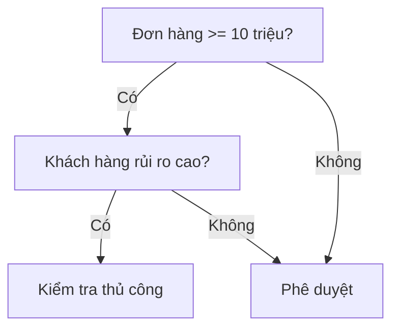
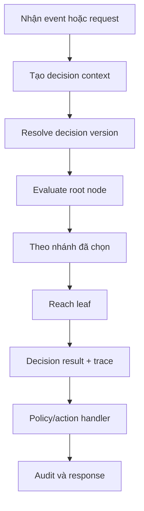

# Cây quyết định trong DSL luật và quyết định

**Cây quyết định** (*decision tree*) là một mô hình biểu diễn quá trình ra quyết định bằng các nút và nhánh. Mỗi nút kiểm tra một điều kiện hoặc thuộc tính; mỗi nhánh thể hiện kết quả có thể có của phép kiểm tra; mỗi đường đi dẫn tới một kết quả hoặc hành động ở nút lá.

Trong một DSL (*Domain-Specific Language*) dành cho luật và quyết định, cây quyết định giúp mô tả các chính sách nghiệp vụ theo cấu trúc trực quan, có thể phân tích, kiểm tra, giải thích và thực thi. Thay vì viết nhiều câu lệnh if lồng nhau trong một ngôn ngữ lập trình tổng quát, người dùng biểu diễn các điều kiện và kết quả theo mô hình mà query engine hoặc rule engine hiểu được.

Ví dụ, hệ thống xét duyệt đơn hàng có thể quyết định có cần kiểm tra thủ công hay không dựa trên giá trị đơn hàng, khu vực và trạng thái khách hàng:

```text
decision "order-review" {
    when order.total >= 10000000:
        when customer.riskLevel == "high":
            outcome manualReview
        otherwise:
            outcome approve
    otherwise:
        outcome approve
}
```

Cây này kiểm tra tổng giá trị đơn hàng trước. Nếu giá trị đạt ngưỡng, nó tiếp tục kiểm tra mức rủi ro của khách hàng. Kết quả cuối cùng là approve hoặc manualReview.

Cây quyết định có thể được dùng trong chấm điểm, định tuyến, phân loại, phê duyệt, tính giá, kiểm tra điều kiện, phân quyền và nhiều quy trình nghiệp vụ khác.

## 1. Thành phần cơ bản của cây quyết định

Một cây quyết định thường gồm bốn thành phần chính:

- **Root node:** nút gốc, nơi bắt đầu đánh giá.
- **Decision node:** nút điều kiện, thực hiện phép kiểm tra và chọn nhánh.
- **Branch/edge:** nhánh nối một nút với nút tiếp theo, biểu diễn kết quả hoặc điều kiện.
- **Leaf node:** nút lá, chứa kết quả cuối cùng, giá trị trả về hoặc hành động được chọn.

Ví dụ:



Nút gốc là điều kiện về giá trị đơn hàng. Nút tiếp theo chỉ được đánh giá nếu nhánh Có được chọn. Các nút Phê duyệt và Kiểm tra thủ công là nút lá.

### Decision node

Một decision node có thể kiểm tra:

- Biểu thức Boolean.
- So sánh một giá trị với ngưỡng.
- Giá trị enum hoặc trạng thái.
- Sự tồn tại của một thuộc tính.
- Quan hệ giữa nhiều thuộc tính.
- Kết quả của một biểu thức nghiệp vụ.
- Điều kiện được cung cấp bởi một hàm thuần hoặc một predicate đã đăng ký.

### Leaf node

Leaf có thể trả về:

- Một giá trị hoặc mã quyết định.
- Một kết quả phân loại.
- Một action đã khai báo.
- Một tập thông tin giải thích.
- Một cấu hình hoặc chính sách tiếp theo.
- Một trạng thái cần chuyển cho hệ thống khác xử lý.

Nên phân biệt việc cây chọn ra kết quả với việc hệ thống thực hiện tác dụng phụ. Một cây có thể trả về yêu cầu gửi thông báo, còn hành động gửi thực tế được thực hiện bởi runtime có quyền phù hợp.

## 2. Cây quyết định trong DSL khác gì chuỗi if/else?

Một chương trình có thể biểu diễn cùng logic bằng if/else, nhưng DSL chuyên biệt thường bổ sung mô hình khai báo cho cấu trúc quyết định.

Ví dụ dạng lệnh:

```text
if order.total >= 10000000 {
    if customer.riskLevel == "high" {
        return "manualReview"
    } else {
        return "approve"
    }
} else {
    return "approve"
}
```

Một DSL quyết định có thể diễn đạt cùng logic bằng các node và outcome có tên. Điều này giúp engine biết rõ đâu là điều kiện, đâu là kết quả, đâu là nhánh mặc định và đâu là metadata giải thích.

| If/else trong code | Cây quyết định trong DSL |
|---|---|
| Điều kiện nằm trong câu lệnh | Điều kiện là decision node |
| Nhánh được biểu diễn bằng block | Nhánh là edge có nhãn hoặc predicate |
| Return nằm trong block | Kết quả được biểu diễn bằng leaf |
| Thường gắn với một ngôn ngữ lập trình | Có thể được biên dịch sang nhiều backend |
| Khó phân tích nếu dùng logic tùy ý | Có thể kiểm tra cấu trúc và metadata |
| Giải thích phụ thuộc cách viết code | Có thể lưu path và lý do chọn nhánh |

Cây quyết định không tự động tốt hơn if/else trong mọi trường hợp. Nó hữu ích khi logic có cấu trúc rõ, cần quản trị như một tài sản nghiệp vụ hoặc cần công cụ để xem, kiểm tra và giải thích đường đi.

## 3. Khai báo cây quyết định trong DSL

Một DSL có thể dùng cú pháp dạng block:

```text
decision "shipping-method" {
    when destination.country == "VN":
        when order.weight <= 2:
            outcome "standard"
        otherwise:
            outcome "express"

    otherwise:
        outcome "international"
}
```

Tên decision định danh cây trong workspace. Các từ khóa when và otherwise xác định nhánh. Outcome là kết quả ở nút lá.

Một DSL khác có thể khai báo node tường minh bằng ID:

```text
decision "shipping-method" {
    start at domestic

    node domestic {
        test destination.country == "VN"
        if true goto lightParcel
        if false goto international
    }

    node lightParcel {
        test order.weight <= 2
        if true goto standard
        if false goto express
    }

    leaf standard returns "standard"
    leaf express returns "express"
    leaf international returns "international"
}
```

Cú pháp block thường ngắn gọn và phù hợp cho người dùng nghiệp vụ. Cú pháp node có ID phù hợp khi cần tham chiếu, tái sử dụng, chỉnh sửa trực quan hoặc quản lý graph lớn.

## 4. Điều kiện và predicate

Điều kiện tại một decision node thường là biểu thức Boolean. Ví dụ:

```text
order.total >= 5000000
customer.status == "active"
account.ageInDays > 90
risk.score between 0.0 and 0.4
```

DSL cần xác định kiểu của từng biểu thức. Điều kiện phải trả về Boolean hoặc một kiểu logic được quy định rõ. Nếu biểu thức trả về String hoặc Decimal, compiler nên báo lỗi kiểu thay vì tự diễn giải truthiness theo quy tắc không rõ ràng.

### Predicate

Predicate là biểu thức hoặc hàm trả về kết quả logic. DSL có thể cung cấp predicate dùng chung:

```text
predicate isPreferredCustomer(customer) {
    customer.membership == "gold"
    and customer.completedOrders >= 10
}
```

Decision node có thể gọi predicate này:

```text
when isPreferredCustomer(customer):
    outcome "priority"
```

Predicate tái sử dụng giúp giảm lặp lại và đặt tên cho khái niệm nghiệp vụ. Predicate nên có semantics xác định, dễ kiểm thử và không thực hiện tác dụng phụ bất ngờ.

## 5. Nhánh true/false và nhánh nhiều lựa chọn

Một decision node Boolean thường có hai nhánh: true và false.

```text
test account.isActive
if true goto eligible
if false goto inactive
```

Một số điều kiện có nhiều kết quả, chẳng hạn phân loại theo enum hoặc khoảng giá trị. Khi đó DSL có thể dùng switch, match hoặc các branch có predicate:

```text
match customer.segment {
    case "standard" => outcome "base"
    case "silver"   => outcome "discount"
    case "gold"     => outcome "premium"
    otherwise       => outcome "unknown"
}
```

Các nhánh cần có quy tắc rõ về tính loại trừ và tính đầy đủ:

- **Mutually exclusive:** không có hai nhánh cùng đúng.
- **Exhaustive:** mọi giá trị hợp lệ đều được bao phủ.
- **Fallback:** nhánh cuối xử lý trường hợp còn lại.

Nếu hai nhánh cùng đúng, engine cần biết chọn một nhánh theo thứ tự hay báo xung đột. Không nên để kết quả phụ thuộc vào thứ tự lưu trong một collection không xác định.

## 6. Thứ tự đánh giá và short-circuit

Trong cây quyết định, thứ tự đánh giá có thể ảnh hưởng cả hiệu năng lẫn kết quả nếu điều kiện không thuần hoặc dữ liệu có thể thay đổi.

Thông thường, engine bắt đầu từ root và chỉ đánh giá node thuộc nhánh đã chọn. Đây là cách đánh giá theo đường đi (*path evaluation*).

Ví dụ:

```text
when account.isActive:
    when account.balance >= 1000000:
        outcome "eligible"
    otherwise:
        outcome "lowBalance"
otherwise:
    outcome "inactive"
```

Nếu account.isActive là false, node kiểm tra balance không được đánh giá. Đây là dạng short-circuit theo cấu trúc cây.

### Điều kiện thuần

Để cây dễ dự đoán, predicate thường nên thuần: cùng đầu vào thì cùng kết quả và không gây tác dụng phụ. Nếu điều kiện gọi API hoặc đọc trạng thái thay đổi, thứ tự đánh giá có thể làm kết quả thay đổi và gây khó khăn khi retry hoặc replay.

Nếu cần dữ liệu bên ngoài, nên nạp chúng vào decision context trước khi đánh giá hoặc biểu diễn thao tác truy cập dữ liệu qua một bước rõ ràng.

### Tối ưu thứ tự

Nếu DSL cho phép engine tối ưu lại thứ tự điều kiện, chỉ nên làm khi các phép biến đổi giữ nguyên semantics. Không thể tùy ý hoán đổi điều kiện có side effect, phụ thuộc thời gian hoặc có thể ném lỗi khác nhau.

## 7. Nhánh mặc định và tính đầy đủ

Một cây cần xác định điều gì xảy ra khi không nhánh nào khớp.

Nhánh mặc định có thể được khai báo bằng otherwise, else hoặc default:

```text
when payment.method == "card":
    outcome "cardFlow"
when payment.method == "bank":
    outcome "bankFlow"
otherwise:
    outcome "unsupported"
```

Nếu không có default, DSL cần quy định kết quả: báo lỗi không có nhánh phù hợp, trả một kiểu None/Optional, hoặc yêu cầu compiler chứng minh các nhánh đã exhaustive.

Với các quyết định quan trọng như quyền truy cập hoặc phê duyệt giao dịch, nhánh mặc định nên có hành vi an toàn. Ví dụ, không xác định được quyền thì từ chối thay vì cho phép.

### Exhaustiveness checking

Với enum có tập giá trị hữu hạn, compiler có thể kiểm tra tất cả giá trị đã được bao phủ.

```text
enum PaymentStatus {
    pending
    authorized
    captured
    failed
}

match payment.status {
    case pending    => outcome "wait"
    case authorized => outcome "capture"
    case captured   => outcome "complete"
    case failed     => outcome "reject"
}
```

Nếu thiếu một trạng thái và không có otherwise, compiler có thể cảnh báo hoặc báo lỗi tùy chính sách.

## 8. Null, missing value và unknown trong điều kiện

Dữ liệu thực tế có thể thiếu hoặc null. Điều kiện như customer.age >= 18 không thể luôn trả về true hoặc false nếu age không có.

Một số hệ thống dùng logic ba giá trị:

- **True:** điều kiện đúng.
- **False:** điều kiện sai.
- **Unknown:** không đủ dữ liệu để xác định.

Ví dụ:

```text
when customer.age >= 18:
    outcome "adult"
otherwise:
    outcome "notAdult"
```

Nếu age là null, cách xử lý phụ thuộc semantics của DSL. Nếu unknown được xem như false, cây có thể đi vào otherwise. Nếu unknown được giữ riêng, DSL có thể yêu cầu nhánh onUnknown.

```text
when customer.age >= 18:
    outcome "adult"
whenUnknown:
    outcome "needsData"
otherwise:
    outcome "minor"
```

Cần phân biệt missing field, explicit null và giá trị không hợp lệ. Chúng có thể biểu thị ba tình huống khác nhau: nguồn chưa cung cấp dữ liệu, người dùng chủ động đặt null hoặc dữ liệu không chuyển đổi được.

## 9. Kết quả ở nút lá

Leaf node xác định cây trả về điều gì khi một đường đi kết thúc.

Ví dụ kết quả có thể là:

```text
outcome {
    decision: "manualReview"
    reasonCode: "HIGH_RISK"
    queue: "risk-operations"
}
```

Kết quả có thể gồm nhiều field, nhưng schema của outcome nên được định nghĩa rõ để hệ thống gọi có thể xử lý.

### Decision result và action

Một decision result thường mô tả kết luận. Action là thao tác được thực hiện sau đó.

Ví dụ:

- Result: giao dịch cần kiểm tra thủ công.
- Action: tạo case trong hệ thống vận hành.

Tách hai phần giúp cây có thể được đánh giá mà không tự tạo tác dụng phụ. Nó cũng hỗ trợ dry run, test và audit.

### Kiểu kết quả thống nhất

Các leaf nên trả về cùng một kiểu hoặc một union type được khai báo. Nếu một nhánh trả String, nhánh khác trả Object không có schema chung, compiler cần yêu cầu chuyển đổi hoặc khai báo result type rõ ràng.

## 10. Cây lồng nhau và tái sử dụng quyết định

Một decision tree có thể gọi decision khác để chia logic thành phần nhỏ.

```text
decision "loan-eligibility" {
    when applicant.income >= 20000000:
        call decision "credit-risk"
    otherwise:
        outcome "not-eligible"
}
```

decision credit-risk có thể xử lý lịch sử tín dụng và nghĩa vụ nợ. Việc tách cây giúp mỗi decision có trách nhiệm rõ ràng và có thể được kiểm thử riêng.

### Tái sử dụng

Một decision có thể được dùng bởi nhiều workflow hoặc rule khác. Khi tái sử dụng, cần biết version nào được gọi và cách thay đổi decision ảnh hưởng caller.

### Tránh đệ quy vô hạn

Nếu decision A gọi B và B gọi A, quá trình đánh giá có thể không kết thúc. Compiler hoặc validator cần phát hiện cycle trong call graph nếu ngôn ngữ không hỗ trợ recursion có kiểm soát.

Nếu recursion được cho phép, cần giới hạn độ sâu hoặc tài nguyên để tránh runaway evaluation.

## 11. Decision tree và rule table

Cây quyết định và bảng luật đều biểu diễn logic nghiệp vụ nhưng phù hợp với cách tổ chức khác nhau.

| Đặc điểm | Decision tree | Rule table |
|---|---|---|
| Cấu trúc | Phân nhánh theo đường đi | Các hàng luật |
| Đánh giá | Thường đi theo một path | Có thể kiểm tra nhiều hàng |
| Ưu điểm | Nhìn rõ trình tự quyết định | Dễ so sánh nhiều tổ hợp điều kiện |
| Phù hợp | Logic phân cấp, tuần tự | Ma trận điều kiện và kết quả |
| Rủi ro | Cây sâu, nhánh khó nhìn | Nhiều rule trùng hoặc xung đột |

Ví dụ, cây phù hợp khi bước sau phụ thuộc vào kết quả bước trước. Rule table phù hợp khi có nhiều tổ hợp điều kiện độc lập cần được liệt kê và so sánh.

Một DSL có thể hỗ trợ cả hai và cho phép gọi rule table từ leaf hoặc decision node.

## 12. Decision tree và decision table

Decision table thường mô tả tổ hợp các điều kiện theo hàng hoặc cột. Mỗi hàng biểu diễn một rule có thể áp dụng.

Ví dụ:

| Customer tier | Order total | Result |
|---|---:|---|
| Gold | >= 1.000.000 | Priority |
| Silver | >= 2.000.000 | Priority |
| Standard | >= 5.000.000 | Review |
| Any | < 500.000 | Standard |

Nếu các hàng chồng lấn, decision table cần hit policy như first, unique, any hoặc collect tùy DSL.

Cây quyết định thường làm rõ thứ tự phân nhánh, nhưng nếu có nhiều điều kiện độc lập, cây có thể lặp lại logic. Khi chuyển đổi giữa table và tree, cần giữ semantics về priority, overlap và kết quả.

## 13. Decision tree và cây phân loại học máy

Thuật ngữ decision tree cũng được dùng trong machine learning. Cây phân loại học từ dữ liệu huấn luyện để chọn điều kiện chia tập dữ liệu, chẳng hạn Gini impurity hoặc information gain.

Cây quyết định trong DSL luật thường do con người hoặc hệ thống quản trị nghiệp vụ khai báo. Điều kiện và outcome được viết theo policy cụ thể, có thể cần audit và approval.

Hai loại có thể dùng cấu trúc node/branch/leaf giống nhau nhưng khác nguồn gốc:

- Cây luật: điều kiện đến từ chính sách và yêu cầu nghiệp vụ.
- Cây học máy: điều kiện được suy ra từ dữ liệu huấn luyện.
- Cây lai: mô hình dự đoán có thể là một input cho decision tree nghiệp vụ.

Nếu dùng score từ mô hình học máy trong DSL, cần phân biệt score dự đoán với quyết định cuối cùng. Decision tree có thể áp dụng policy, ngưỡng và bước xem xét của con người sau khi nhận score.

## 14. Biểu diễn cây trong AST và IR

Parser có thể chuyển cú pháp DSL thành AST gồm decision, condition, branch và leaf node.

Ví dụ mô hình khái niệm:

```text
DecisionNode {
    id: "check-total"
    condition: GreaterThanOrEqual(
        Member("order", "total"),
        Decimal(10000000)
    )
    whenTrue: DecisionNode(...)
    whenFalse: LeafNode("approve")
}
```

Sau semantic analysis, node có thể được gắn thêm:

- Kiểu của biểu thức.
- Symbol được tham chiếu.
- Kiểm tra field tồn tại.
- Kiểu kết quả của leaf.
- Metadata nguồn gốc.
- Quyền cần thiết để đọc dữ liệu.
- Thông tin version của decision.

IR có thể biểu diễn cây dưới dạng graph có node ID và edge rõ ràng. Cấu trúc này hỗ trợ validation, visualization, optimization và code generation.

### Tree hay graph?

Nếu mỗi node chỉ có một parent, cấu trúc là tree. Nếu nhiều nhánh cùng trỏ tới một node dùng chung, cấu trúc có thể là directed acyclic graph (DAG).

DAG giúp tái sử dụng node nhưng làm việc hiển thị và giải thích path phức tạp hơn. Nếu DSL cho phép node dùng chung, cần quy định cycle có được phép không và cách tính provenance.

## 15. Kiểm tra tính hợp lệ của cây

Trước khi chạy, validator nên kiểm tra cấu trúc và semantics.

Các kiểm tra thường gặp:

- Có đúng một root node.
- Mọi nhánh đều trỏ tới node tồn tại.
- Mọi node có thể được tiếp cận từ root, trừ khi có lý do giữ node chưa dùng.
- Mọi đường đi hợp lệ kết thúc ở leaf hoặc node terminal được định nghĩa.
- Không có cycle nếu ngôn ngữ chỉ cho phép tree/DAG.
- Mọi condition trả về kiểu logic hợp lệ.
- Các leaf trả về result type tương thích.
- Nhánh bắt buộc được bao phủ.
- Không có nhánh trùng hoặc unreachable do điều kiện trước đó.
- Mọi decision call đều resolve được và không tạo recursion ngoài chính sách.

### Unreachable branch

Ví dụ:

```text
when order.total > 100:
    outcome "high"
when order.total > 200:
    outcome "veryHigh"
otherwise:
    outcome "normal"
```

Nếu các nhánh được đánh giá theo thứ tự, điều kiện thứ hai không bao giờ được chọn vì mọi giá trị lớn hơn 200 cũng đã thỏa điều kiện thứ nhất. Validator có thể cảnh báo nhánh unreachable.

## 16. Phát hiện điều kiện chồng lấn và mâu thuẫn

Hai nhánh có thể cùng đúng. Nếu DSL dùng first-match semantics, nhánh sau có thể bị che khuất. Nếu DSL yêu cầu unique match, đó là lỗi.

Ví dụ:

```text
when customer.age >= 18:
    outcome "adult"
when customer.age >= 21:
    outcome "legal-drinking-age"
otherwise:
    outcome "minor"
```

Điều kiện thứ hai là tập con của điều kiện thứ nhất. Nếu đánh giá từ trên xuống, nhánh legal-drinking-age sẽ không được tới.

Validator có thể phát hiện một số trường hợp đơn giản bằng phân tích khoảng giá trị, enum hoặc biểu thức logic. Với biểu thức phức tạp, có thể không chứng minh được overlap; khi đó công cụ nên thông báo giới hạn thay vì khẳng định cây không có xung đột.

## 17. Thứ tự nhánh và priority

Một số DSL quy định nhánh được kiểm tra từ trên xuống. Nhánh đầu tiên đúng sẽ được chọn.

Đây là **first-match semantics**.

```text
when amount >= 100000:
    outcome "large"
when amount >= 10000:
    outcome "medium"
otherwise:
    outcome "small"
```

Thứ tự này quan trọng: nếu đổi hai nhánh đầu, kết quả của amount = 150000 có thể thay đổi.

Một DSL khác có thể yêu cầu các nhánh mutually exclusive, không phụ thuộc thứ tự. Cách này phù hợp khi người viết muốn đảm bảo không có nhiều kết quả cùng đúng.

Priority nên được thể hiện rõ trong cú pháp hoặc metadata. Không nên dựa vào thứ tự file hoặc cách serialize node.

## 18. Explainability – giải thích vì sao có kết quả

Một ưu điểm của decision tree là có thể ghi lại đường đi từ root tới leaf.

Ví dụ kết quả:

```text
Decision: order-review
Outcome: manualReview

Path:
1. order.total >= 10000000 -> true
2. customer.riskLevel == "high" -> true
3. leaf manualReview
```

Thông tin này giúp người dùng hiểu quyết định được đưa ra từ điều kiện nào.

### Decision trace

Một decision trace có thể lưu:

- Decision ID và version.
- Input snapshot hoặc reference an toàn tới dữ liệu.
- Node đã được đánh giá.
- Kết quả từng predicate.
- Nhánh được chọn.
- Leaf cuối cùng.
- Thời gian đánh giá.
- Runtime version và correlation ID.

Không nên ghi toàn bộ dữ liệu nhạy cảm vào trace nếu chỉ cần lưu tên field, kết quả Boolean hoặc masked value.

### Reason code

Leaf có thể trả reason code để downstream system hoặc người vận hành giải thích kết quả theo ngôn ngữ nghiệp vụ.

Reason code nên ổn định qua các phiên bản hoặc có migration rõ. Không nên chỉ dựa vào message tự do vì nó khó lọc, thống kê và tích hợp.

## 19. Kiểm thử cây quyết định

Một decision tree cần được kiểm thử theo đường đi, điều kiện và outcome.

### Path coverage

Path coverage kiểm tra các đường đi từ root đến leaf. Với cây nhỏ, có thể liệt kê mọi path. Với cây lớn, số đường đi tăng nhanh và có thể cần chọn các path quan trọng.

### Branch coverage

Branch coverage xác nhận mỗi nhánh true/false hoặc mỗi case đã được đi qua ít nhất một lần.

### Boundary tests

Nếu điều kiện có ngưỡng, cần kiểm tra ngay trước, đúng tại và ngay sau ngưỡng.

Ví dụ với amount >= 100:

- 99 phải đi nhánh false.
- 100 phải đi nhánh true.
- 101 phải đi nhánh true.

### Missing-data tests

Cần kiểm tra null, missing field, kiểu sai và dữ liệu không thể chuyển đổi. Những trường hợp này thường quyết định cây đi vào nhánh default, unknown hoặc error.

### Golden decision tests

Có thể lưu input và outcome mong đợi:

```text
input:
  order.total: 12000000
  customer.riskLevel: high

expected:
  outcome: manualReview
  reasonCode: HIGH_RISK
```

Test có thể kiểm tra cả outcome và path trace để phát hiện thay đổi logic không mong muốn.

## 20. Kiểm thử property-based và tổ hợp điều kiện

Với cây lớn, liệt kê toàn bộ input có thể không khả thi. Property-based testing tạo nhiều input theo miền giá trị và kiểm tra invariant.

Ví dụ invariant:

- Người dưới độ tuổi tối thiểu không bao giờ nhận outcome eligible.
- Giao dịch bị block không được trả outcome approve.
- Một input hợp lệ phải kết thúc ở đúng một leaf.
- Cùng input và cùng decision version phải cho cùng kết quả nếu predicates thuần.

Có thể dùng generator để tạo số trong khoảng, enum, null và object lồng nhau. Khi test thất bại, framework nên thu nhỏ input để tạo ví dụ phản chứng đơn giản hơn.

## 21. Hiệu năng và tối ưu cây

Một cây có thể có nhiều node, nhiều predicate hoặc được đánh giá hàng triệu lần. Query/rule engine có thể tối ưu nhưng phải giữ nguyên semantics.

Các hướng tối ưu:

- Cache kết quả của predicate thuần với cùng input.
- Tiền tính biểu thức lặp lại.
- Đưa điều kiện rẻ và có tính phân loại cao lên trước khi semantics cho phép.
- Compile AST thành bytecode hoặc function chuyên biệt.
- Tối ưu chuỗi so sánh enum thành switch/table lookup.
- Loại node unreachable.
- Chia sẻ biểu thức chung.
- Giảm việc truy cập lặp lại vào object hoặc remote source.

Không nên đổi thứ tự điều kiện nếu first-match semantics làm thứ tự có ý nghĩa. Không cache predicate phụ thuộc thời gian, trạng thái bên ngoài hoặc dữ liệu mutable nếu không có cache key và invalidation phù hợp.

### Độ sâu và độ rộng

Cây quá sâu làm tăng số bước đánh giá và khó hiểu. Cây quá rộng làm danh sách nhánh khó quản lý. Có thể chia decision lớn thành các decision con có tên theo khái niệm nghiệp vụ.

## 22. Cây quyết định và dữ liệu thay đổi

Một cây có thể được đánh giá nhiều lần trong khi dữ liệu nguồn thay đổi. Nếu mỗi predicate đọc dữ liệu trực tiếp từ hệ thống bên ngoài, cùng một execution có thể nhìn thấy các trạng thái khác nhau.

Nên tạo decision context hoặc input snapshot ở đầu lần đánh giá. Các predicate trong cây dùng cùng snapshot, trừ khi DSL định nghĩa rõ một bước đọc mới.

Điều này hỗ trợ:

- Kết quả nhất quán trong cùng lần chạy.
- Replay và điều tra.
- Test xác định.
- Giảm số lần gọi nguồn dữ liệu.
- Tránh điều kiện đầu và cuối dùng các phiên bản dữ liệu khác nhau.

Nếu quyết định cần dữ liệu realtime, context nên ghi nhận timestamp hoặc version của dữ liệu đã đọc.

## 23. Phiên bản và quản trị decision tree

Cây quyết định thường thể hiện policy nghiệp vụ. Thay đổi một ngưỡng hoặc nhánh có thể ảnh hưởng tới khách hàng và vận hành.

Một hệ thống quản trị nên lưu:

- Decision ID.
- Version.
- Người tạo và người sửa.
- Thời điểm hiệu lực.
- Trạng thái draft, approved hoặc active.
- Mô tả thay đổi.
- Bộ test liên quan.
- Lịch sử phiên bản trước.
- Quy tắc rollback.

### Effective date

Có thể định nghĩa cây có hiệu lực từ một thời điểm:

```text
decision "pricing-policy" version "4" {
    effectiveFrom = "2026-11-01T00:00:00Z"
    ...
}
```

Khi chạy quyết định cho một giao dịch lịch sử, hệ thống cần xác định dùng version nào: version tại thời điểm giao dịch hay version hiện hành. Đây là một phần của business semantics, không chỉ là chi tiết lưu trữ.

### Approval workflow

Một decision thay đổi production có thể cần review và approval. Người chỉnh sửa không nhất thiết có quyền kích hoạt phiên bản mới. Tách quyền edit, approve và activate giúp giảm rủi ro.

## 24. Bảo mật và quyền trong decision tree

Điều kiện của cây có thể đọc dữ liệu nhạy cảm hoặc tạo kết quả ảnh hưởng tới quyền lợi người dùng. Runtime cần kiểm soát:

- Field nào decision được phép đọc.
- Predicate nào được phép gọi.
- Nguồn dữ liệu nào được phép truy cập.
- Outcome nào được phép phát ra.
- Ai có thể sửa hoặc kích hoạt decision.
- Ai được xem decision trace.
- Dữ liệu nào cần masking hoặc retention giới hạn.

Không nên để một cây do người dùng tự khai báo có thể gọi hàm tùy ý hoặc truy cập mọi nguồn dữ liệu.

Với quyết định có ảnh hưởng lớn, cần có quy trình kiểm tra fairness, policy compliance và human review phù hợp với domain. Explainability giúp kiểm tra đường đi nhưng không tự chứng minh rằng policy là công bằng hoặc hợp pháp.

## 25. Tích hợp cây quyết định vào rule engine

Một rule engine có thể gọi decision tree như một thành phần đánh giá.

Luồng điển hình:



Decision result có thể được dùng bởi workflow, service hoặc API. Việc thực hiện action nên qua handler có authorization, retry và idempotency rõ ràng.

## 26. Chuyển đổi cây sang graph và visualization

Một editor trực quan có thể biểu diễn decision tree thành node và edge để người dùng xem hoặc chỉnh sửa.

Mỗi node có thể hiển thị:

- Tên và ID.
- Biểu thức điều kiện.
- Kiểu dữ liệu.
- Các nhánh.
- Outcome nếu là leaf.
- Trạng thái validation.
- Thông tin version.

Graph visualization hữu ích với cây lớn, nhưng cần tránh để layout làm thay đổi semantics. Thứ tự nhánh và default branch phải được thể hiện rõ.

Nếu nhiều nhánh cùng trỏ tới một node, giao diện cần cho biết node đó được dùng chung. Nếu graph có cycle, UI cần biểu diễn rõ và validator phải tuân theo chính sách recursion của DSL.

## 27. Ví dụ hoàn chỉnh: quyết định duyệt khoản vay

Giả sử hệ thống cần phân loại hồ sơ vay theo thu nhập, lịch sử tín dụng và số tiền yêu cầu.

```text
decision "loan-review" {
    when applicant.identityVerified == false:
        outcome {
            decision: "reject"
            reasonCode: "IDENTITY_NOT_VERIFIED"
        }

    when applicant.income < 10000000:
        outcome {
            decision: "manualReview"
            reasonCode: "LOW_INCOME"
        }

    when applicant.creditScore >= 750:
        when loan.amount <= applicant.income * 5:
            outcome {
                decision: "approve"
                reasonCode: "LOW_RISK"
            }
        otherwise:
            outcome {
                decision: "manualReview"
                reasonCode: "HIGH_AMOUNT"
            }

    when applicant.creditScore >= 600:
        outcome {
            decision: "manualReview"
            reasonCode: "MEDIUM_CREDIT"
        }

    otherwise:
        outcome {
            decision: "reject"
            reasonCode: "LOW_CREDIT"
        }
}
```

Cây này thể hiện thứ tự ưu tiên:

1. Chưa xác minh danh tính thì từ chối.
2. Thu nhập thấp thì chuyển kiểm tra thủ công.
3. Điểm tín dụng cao thì kiểm tra thêm tỷ lệ khoản vay.
4. Điểm tín dụng trung bình thì kiểm tra thủ công.
5. Các trường hợp còn lại bị từ chối.

Thứ tự này là một phần của semantics nếu DSL dùng first-match. Nếu creditScore bị thiếu, hệ thống cần quy định đi nhánh unknown, trả diagnostic hoặc dùng một policy riêng. Không nên tự coi giá trị thiếu là 0 nếu điều đó không được domain quy định.

Ví dụ này chỉ minh họa cấu trúc DSL. Một hệ thống thực tế cần kiểm tra policy pháp lý, giới hạn nghiệp vụ, quyền truy cập và quy trình human review trước khi dùng kết quả để quyết định khoản vay.

## 28. Những lỗi thường gặp

**Không có nhánh mặc định.** Một số input không đi tới leaf. Cần exhaustive checking hoặc default/error semantics rõ ràng.

**Điều kiện chồng lấn.** Nhiều nhánh có thể cùng đúng. Cần first-match semantics hoặc kiểm tra unique match.

**Nhánh bị che khuất.** Điều kiện rộng đứng trước điều kiện hẹp khiến nhánh sau unreachable. Validator nên phát hiện các trường hợp có thể chứng minh.

**Không xử lý null và missing.** Dữ liệu thiếu có thể làm điều kiện thành unknown. Cần nhánh unknown hoặc quy tắc mặc định an toàn.

**Predicate có side effect.** Thứ tự đánh giá hoặc retry có thể làm kết quả thay đổi. Ưu tiên predicate thuần và đưa I/O ra ngoài bước quyết định.

**Leaf thực hiện tác dụng phụ trực tiếp.** Khó test, replay và retry. Tách decision result khỏi action handler.

**Cây quá sâu hoặc quá lớn.** Logic khó đọc và khó quản trị. Chia thành decision con có tên và kiểm thử riêng.

**Tối ưu lại thứ tự điều kiện không an toàn.** Có thể thay đổi first-match semantics. Chỉ tối ưu khi chứng minh được tính tương đương.

**Không lưu decision version.** Không thể giải thích vì sao một request trước đây có kết quả khác. Ghi nhận version và input context cần thiết.

**Không kiểm tra cycle khi gọi decision khác.** Có thể đánh giá vô hạn. Phân tích call graph và giới hạn recursion.

**Trace chứa dữ liệu nhạy cảm.** Explainability có thể làm lộ thông tin. Mask và giới hạn quyền truy cập trace.

## 29. Quy trình thiết kế decision tree trong DSL

Khi xây dựng hoặc viết một decision tree, có thể thực hiện theo trình tự:

1. Xác định mục tiêu quyết định và kiểu kết quả cần trả về.
2. Xác định input schema, kiểu dữ liệu và nguồn của từng thuộc tính.
3. Chia logic thành các decision node có tên và phạm vi rõ.
4. Xác định thứ tự nhánh và semantics first-match hoặc unique-match.
5. Xác định cách xử lý false, null, missing và unknown.
6. Bảo đảm mọi đường đi kết thúc ở leaf hoặc terminal state hợp lệ.
7. Kiểm tra overlap, unreachable branch và cycle.
8. Định nghĩa result type và reason code cho các leaf.
9. Giữ predicate thuần khi có thể và tách action ra khỏi decision.
10. Tạo test cho từng nhánh, ngưỡng và trường hợp dữ liệu thiếu.
11. Kiểm tra path coverage và invariant nghiệp vụ.
12. Lưu decision version, effective date và lịch sử thay đổi.
13. Ghi decision trace có kiểm soát quyền và dữ liệu nhạy cảm.
14. Đánh giá hiệu năng, cache và tối ưu mà không đổi semantics.
15. Thiết lập review/approval trước khi kích hoạt policy production.

## 30. Câu hỏi tự kiểm tra

1. Cây quyết định là gì và gồm những thành phần cơ bản nào?
2. Root node, decision node, branch và leaf node có vai trò gì?
3. Cây quyết định trong DSL khác chuỗi if/else thông thường như thế nào?
4. Predicate là gì và vì sao predicate thuần hữu ích?
5. Phân biệt nhánh Boolean với nhánh nhiều lựa chọn.
6. First-match semantics và unique-match semantics khác nhau ra sao?
7. Exhaustiveness checking giúp phát hiện loại lỗi nào?
8. Null, missing và unknown có thể ảnh hưởng việc chọn nhánh như thế nào?
9. Vì sao leaf nên trả decision result thay vì trực tiếp thực hiện side effect?
10. Khi nào nên tách một cây thành nhiều decision có thể tái sử dụng?
11. Decision tree khác rule table và decision table ở cách tổ chức logic nào?
12. Cây luật khác cây phân loại học máy như thế nào?
13. AST và IR có thể biểu diễn decision tree ra sao?
14. Validator có thể phát hiện cycle, unreachable branch và overlap như thế nào?
15. Decision trace cần ghi những thông tin gì để giải thích kết quả?
16. Path coverage và branch coverage kiểm tra những khía cạnh nào?
17. Vì sao không thể tùy ý thay đổi thứ tự điều kiện khi tối ưu?
18. Version và effective date giúp quản trị policy như thế nào?
19. Hãy mô tả cách thiết kế cây quyết định xét duyệt đơn hàng, gồm input, nhánh, default, outcome và reason code.

Cây quyết định giúp biểu diễn logic nghiệp vụ thành những đường đi có thể đọc, kiểm tra và giải thích. Khi DSL xác định rõ cấu trúc node, semantics của nhánh, cách xử lý dữ liệu thiếu, kiểu kết quả, version và decision trace, rule engine có thể thực thi policy nhất quán và hỗ trợ quản trị thay đổi an toàn.

