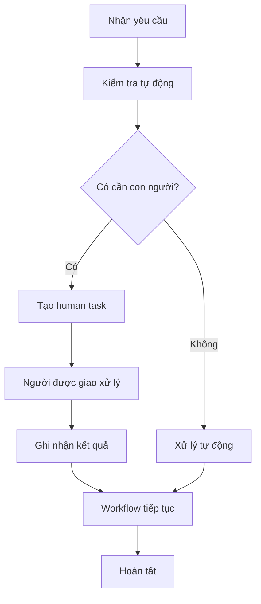
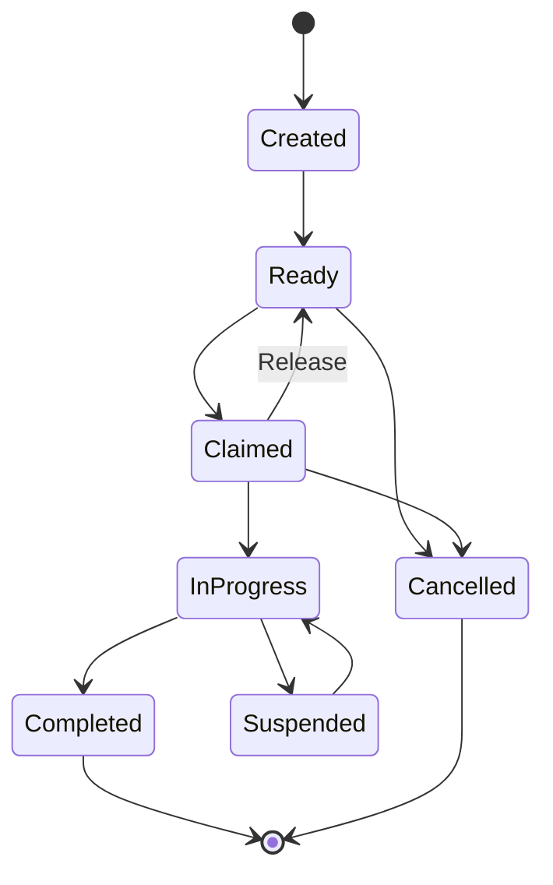

# Tác vụ con người trong DSL quy trình

Một quy trình nghiệp vụ thường kết hợp các bước tự động với những bước cần con người xem xét, nhập thông tin hoặc đưa ra quyết định. Ví dụ, hệ thống xử lý yêu cầu mua hàng có thể tự kiểm tra ngân sách, nhưng vẫn cần quản lý phê duyệt khoản chi lớn. Một quy trình tuyển dụng có thể tự gửi email, nhưng người phỏng vấn cần đánh giá ứng viên và ghi nhận kết quả.

**Tác vụ con người** (*human task*) là một đơn vị công việc trong workflow được giao cho một người hoặc một nhóm người thực hiện. Tác vụ thường có người chịu trách nhiệm, dữ liệu đầu vào, biểu mẫu hoặc giao diện thao tác, trạng thái, thời hạn và kết quả cần trả về cho quy trình.

Trong DSL (*Domain-Specific Language*) dành cho quy trình, human task cho phép mô tả phần việc của con người như một thành phần có cấu trúc. Workflow engine có thể tạo task, đưa nó vào danh sách công việc, kiểm tra quyền, theo dõi tiến độ và tiếp tục luồng khi người được giao hoàn thành.

Ví dụ, một quy trình hoàn tiền có thể khai báo:

```text
workflow "refund-request" {
    start
    validate request

    humanTask "review-refund" {
        assignee = role("support-supervisor")
        form = "refund-review"
        dueIn = 4 hours
        outcome = ["approve", "reject", "need-more-info"]
    }

    when task.outcome == "approve":
        execute refund
    when task.outcome == "reject":
        notify requester
    otherwise:
        request additional information
}
```

Đoạn DSL trên minh họa một human task được giao cho vai trò quản lý hỗ trợ. Người thực hiện điền form và chọn một kết quả. Workflow sử dụng kết quả đó để đi tiếp theo nhánh tương ứng.

Human task không chỉ là một màn hình nhập liệu. Nó là một phần của mô hình điều phối, có vòng đời, quyền truy cập, dữ liệu, thời hạn và lịch sử xử lý riêng.

## 1. Vì sao workflow cần tác vụ con người?

Tự động hóa phù hợp với các bước có quy tắc rõ và dữ liệu đầy đủ. Tuy nhiên, nhiều quy trình vẫn cần đánh giá của con người vì dữ liệu có thể chưa đầy đủ, ngoại lệ cần được xem xét hoặc quyết định liên quan đến trách nhiệm và chính sách.

Một số tình huống thường gặp:

- Quản lý phê duyệt đơn hàng vượt hạn mức.
- Nhân viên kiểm tra hồ sơ hoặc chứng từ.
- Chuyên gia đánh giá rủi ro.
- Người dùng bổ sung dữ liệu còn thiếu.
- Nhân viên hỗ trợ xử lý khiếu nại.
- Người kiểm duyệt duyệt nội dung.
- Thành viên nhóm xác nhận kết quả trước khi phát hành.
- Một người có chuyên môn xử lý ngoại lệ mà hệ thống không thể tự quyết định.

Human task giúp workflow dừng ở đúng điểm cần con người, chờ kết quả rồi tiếp tục. Engine có thể tiếp tục quản lý các bước khác mà không cần giữ một thread hoặc process chạy liên tục trong lúc chờ người dùng.

### Kết hợp công việc tự động và thủ công

Một quy trình thường có dạng:



Cách thiết kế này giữ các bước lặp lại ở dạng tự động và đưa ngoại lệ hoặc quyết định cần trách nhiệm con người vào task có thể theo dõi.

## 2. Human task trong mô hình workflow

Một human task thường được biểu diễn như một node trong workflow graph. Khi execution đến node này, engine tạo một task instance và chuyển trạng thái workflow sang chờ xử lý hoặc trạng thái tương đương.

Một task definition mô tả cấu hình dùng chung:

- ID hoặc tên tác vụ.
- Tiêu đề và mô tả.
- Người hoặc nhóm có thể nhận việc.
- Form và dữ liệu cần thiết.
- Kết quả hợp lệ.
- Thời hạn và chính sách quá hạn.
- Quy tắc hoàn tất hoặc từ chối.
- Quyền xem, nhận và cập nhật task.

Một task instance là lần xuất hiện cụ thể của definition trong một workflow execution. Nó có thể chứa:

- Task ID duy nhất.
- Workflow instance ID.
- Assignee hoặc candidate group.
- Dữ liệu form tại thời điểm tạo.
- Trạng thái hiện tại.
- Thời điểm tạo, nhận việc và hoàn tất.
- Deadline và escalation state.
- Kết quả và audit history.

Phân biệt definition với instance giúp cùng một loại task được tái sử dụng trong nhiều workflow mà vẫn theo dõi từng lần xử lý riêng.

## 3. Khai báo human task trong DSL

Một DSL có thể cung cấp cú pháp dạng block:

```text
humanTask "approve-expense" {
    title = "Phê duyệt chi phí"
    description = "Kiểm tra chứng từ và hạn mức"

    assignee = role("finance-manager")
    form = "expense-approval"

    dueIn = 2 days
    outcomes = ["approved", "rejected", "more-info"]
}
```

Tên task cần ổn định để có thể tham chiếu từ workflow, dashboard, log và công cụ quản trị. Title và description phục vụ người thực hiện, có thể hỗ trợ bản địa hóa.

Một DSL khác có thể tách định nghĩa task khỏi vị trí sử dụng:

```text
taskDefinition "expense-approval" {
    assignee = role("finance-manager")
    form = "expense-form"
    outcomes = ["approved", "rejected"]
}

workflow "purchase" {
    start
    humanTask use "expense-approval"
    continue
}
```

Cách tách này hữu ích khi nhiều workflow dùng cùng một loại tác vụ. Thay đổi task definition có thể ảnh hưởng nhiều quy trình, vì vậy cần version và kiểm soát tương thích.

## 4. Assignment – giao tác vụ cho người phù hợp

Assignment xác định ai có trách nhiệm xử lý task. Một số mô hình phổ biến:

- **Assignee:** một người cụ thể được giao task.
- **Candidate user:** người có thể nhận task.
- **Candidate group:** nhóm có thể nhận task.
- **Role-based assignment:** giao theo vai trò nghiệp vụ.
- **Expression-based assignment:** tính người nhận từ dữ liệu workflow.
- **Queue assignment:** đưa task vào hàng đợi để người đủ quyền nhận.

Ví dụ:

```text
humanTask "verify-identity" {
    assignee = user(application.ownerId)
}

humanTask "approve-large-payment" {
    candidates = group("payment-approvers")
}

humanTask "review-region" {
    assignee = user(managerFor(application.region))
}
```

Assignment động có thể dùng dữ liệu như khu vực, phòng ban, loại yêu cầu hoặc mức độ rủi ro. Kết quả phải được kiểm tra để bảo đảm người được giao còn hoạt động và có quyền thực hiện task.

### Assignee và candidate khác nhau

Assignee là người đang chịu trách nhiệm trực tiếp. Candidate là người hoặc nhóm đủ điều kiện nhận việc.

Nếu task được giao cho nhóm candidate, một thành viên có thể claim task để trở thành assignee. Khi đó, engine cần bảo đảm hai người không đồng thời nhận cùng một task theo cách gây xung đột.

### Assignment fallback

Nếu không tìm được người phù hợp, workflow cần có chính sách rõ:

- Đưa task vào queue quản trị.
- Giao cho vai trò dự phòng.
- Chuyển tới supervisor.
- Tạm dừng và phát sinh lỗi cấu hình.
- Retry assignment khi directory hoặc service tạm thời không khả dụng.

Không nên tự động giao cho một tài khoản quản trị có quyền rộng chỉ vì không tìm thấy assignee.

## 5. Claim, release và reassign

Trong mô hình queue, task có thể được tạo với một tập candidate. Người đủ điều kiện chọn **claim** để nhận trách nhiệm xử lý.

Các thao tác thường gặp:

- **Claim:** nhận task đang mở.
- **Release/unclaim:** trả task về queue khi chưa xử lý xong.
- **Reassign:** chuyển task cho người khác.
- **Delegate:** ủy quyền xử lý cho người khác theo chính sách.
- **Complete:** gửi kết quả và hoàn tất task.

Ví dụ trạng thái:

```text
CREATED -> READY -> CLAIMED -> COMPLETED
                    |
                    +-> RELEASED -> READY
                    |
                    +-> REASSIGNED -> READY
```

Engine cần kiểm tra quyền và trạng thái trước mỗi thao tác. Ví dụ, người dùng không thể claim task đã completed hoặc reassign task mà họ không có quyền quản lý.

### Tránh nhận việc đồng thời

Hai người có thể cùng mở task và bấm Claim gần như cùng lúc. Engine cần thực hiện thao tác claim theo cách nguyên tử, chẳng hạn dùng optimistic locking hoặc transaction để chỉ một yêu cầu thành công.

Người còn lại nhận phản hồi rằng task đã được nhận bởi người khác và giao diện cần làm mới trạng thái.

## 6. Vai trò, nhóm và quyền truy cập

Vai trò mô tả trách nhiệm nghiệp vụ, nhóm tập hợp người dùng, còn permission xác định thao tác được phép.

Ví dụ:

- Role finance-manager có thể phê duyệt khoản chi.
- Group compliance-reviewers có thể nhận task kiểm tra tuân thủ.
- Người tạo yêu cầu có thể xem trạng thái nhưng không được tự phê duyệt.
- Supervisor có thể reassign task khi người xử lý vắng mặt.

Không nên đồng nhất role với user cụ thể. Một role có thể được gán cho nhiều người và thay đổi theo tổ chức.

### Quyền ở cấp task

Các quyền có thể bao gồm:

- Xem task.
- Xem dữ liệu đầu vào.
- Claim hoặc release.
- Sửa form.
- Gửi kết quả.
- Reassign hoặc delegate.
- Thêm comment hoặc attachment.
- Hủy task.
- Xem lịch sử và audit.

Quyền nên được kiểm tra ở server khi thực hiện hành động. Việc ẩn nút trên giao diện không phải là cơ chế bảo vệ.

### Least privilege

Người xử lý chỉ nên nhìn thấy dữ liệu cần thiết cho task. Ví dụ, người duyệt chi phí có thể cần số tiền và chứng từ nhưng không nhất thiết cần xem toàn bộ thông tin tài khoản cá nhân.

## 7. Form và dữ liệu của human task

Form là giao diện để người dùng xem thông tin và nhập dữ liệu cần thiết để hoàn thành task.

Một form có thể chứa:

- Text field.
- Numeric field và currency.
- Date/time.
- Dropdown hoặc enum.
- Checkbox.
- File attachment.
- Comment.
- Signature hoặc xác nhận.
- Field chỉ đọc hiển thị dữ liệu từ workflow.

Ví dụ:

```text
form "expense-approval" {
    field amount: Money readOnly
    field costCenter: String readOnly
    field receipt: Attachment required
    field decision: Enum["approve", "reject"] required
    field comment: String
}
```

Form definition cần được liên kết với schema để server có thể validate dữ liệu. Client có thể kiểm tra trước để cải thiện trải nghiệm, nhưng server vẫn phải xác thực mọi dữ liệu gửi lên.

### Input và output mapping

Task có thể nhận dữ liệu từ workflow variables và trả dữ liệu đã nhập về workflow.

```text
humanTask "review-expense" {
    input {
        amount = workflow.expense.amount
        requester = workflow.expense.requester
    }

    output {
        decision -> workflow.approval.decision
        comment -> workflow.approval.comment
    }
}
```

Mapping rõ ràng giúp tránh việc form ghi đè nhầm biến workflow hoặc làm rò rỉ dữ liệu ngoài phạm vi task.

## 8. Validation dữ liệu và kết quả

Validation có thể diễn ra ở nhiều cấp:

1. **Field validation:** kiểm tra kiểu, độ dài, định dạng và required.
2. **Form validation:** kiểm tra quan hệ giữa nhiều field.
3. **Business validation:** kiểm tra chính sách nghiệp vụ.
4. **Authorization validation:** xác nhận người gửi có quyền đưa ra kết quả.
5. **Workflow validation:** xác nhận task vẫn ở trạng thái cho phép hoàn tất.

Ví dụ, nếu người duyệt chọn reject, comment có thể bắt buộc:

```text
validate form "expense-approval" {
    if decision == "reject":
        require comment
}
```

Nếu validation thất bại, task vẫn ở trạng thái đang xử lý và giao diện nhận danh sách lỗi để người dùng sửa. Không nên chuyển task sang completed rồi mới phát hiện output không hợp lệ.

### Server-side validation

Dữ liệu form là input không đáng tin cậy. Server cần kiểm tra lại schema, giới hạn file, nội dung, quyền và trạng thái workflow. Không tin giá trị hidden field hoặc user ID do client gửi.

## 9. Task lifecycle và trạng thái

Một human task thường đi qua vòng đời:

- **Created:** task instance vừa được tạo.
- **Ready/Open:** đã sẵn sàng để nhận hoặc xử lý.
- **Claimed:** một người đã nhận task.
- **In progress:** đang được xử lý.
- **Completed:** đã gửi kết quả hợp lệ.
- **Cancelled:** task bị hủy theo workflow hoặc quản trị.
- **Failed:** task không thể tiếp tục do lỗi hệ thống hoặc policy.
- **Suspended:** task tạm dừng theo chính sách.

Không phải hệ thống nào cũng cần mọi trạng thái. DSL cần định nghĩa chuyển trạng thái hợp lệ và điều kiện cho mỗi transition.



Một task đã completed thường không được chỉnh sửa trực tiếp. Nếu cần sửa kết quả, có thể tạo correction task hoặc một quy trình bổ sung để giữ audit history.

## 10. Deadline, due date và SLA

Human task thường chờ người xử lý nên cần thời hạn. DSL có thể khai báo deadline tương đối hoặc tuyệt đối:

```text
humanTask "review-case" {
    assignee = role("case-reviewer")
    dueIn = 8 hours
    priority = "high"
}
```

Cần phân biệt:

- **Due date:** thời điểm task cần hoàn thành.
- **SLA:** mục tiêu thời gian xử lý theo chính sách.
- **Reminder:** thông báo nhắc trước hoặc khi gần tới hạn.
- **Escalation:** chuyển cấp hoặc thay đổi xử lý khi quá hạn.

Thời gian có thể tính theo giờ lịch hoặc giờ làm việc. Nếu dùng business calendar, cần xác định timezone, ngày nghỉ và lịch làm việc áp dụng.

### Timer semantics

Timer cần được lưu bền vững để workflow engine có thể khôi phục sau restart. Không nên chỉ dùng timer trong bộ nhớ của một process vì task có thể mất deadline khi worker hoặc server khởi động lại.

## 11. Reminder và escalation

Reminder thông báo cho assignee hoặc candidate rằng task sắp đến hạn hoặc đã quá hạn.

Escalation có thể:

- Gửi thông báo tới supervisor.
- Nâng priority.
- Chuyển task sang nhóm khác.
- Giao cho người dự phòng.
- Tạo task follow-up.
- Kích hoạt nhánh timeout trong workflow.

Ví dụ:

```text
humanTask "approve-purchase" {
    assignee = role("department-manager")
    dueIn = 1 day

    on overdue:
        notify role("department-head")
        escalate to role("department-head")
}
```

Cần tránh gửi reminder lặp vô hạn hoặc escalation tạo nhiều task trùng. Engine nên lưu lần gửi gần nhất, số lần retry và trạng thái escalation.

Nếu task hoàn tất ngay trước khi timer được xử lý, engine cần kiểm tra lại trạng thái để không gửi escalation không cần thiết.

## 12. Approval và nhiều cấp phê duyệt

Một số quy trình yêu cầu một hoặc nhiều người phê duyệt trước khi tiếp tục.

Ví dụ, mức chi nhỏ có thể cần một cấp quản lý, mức chi lớn cần thêm finance:

```text
humanTask "manager-approval" {
    assignee = managerFor(request.department)
    outcomes = ["approved", "rejected"]
}

when request.amount > 50000000:
    humanTask "finance-approval" {
        assignee = role("finance-director")
        outcomes = ["approved", "rejected"]
    }
```

Cần xác định rõ:

- Ai có quyền phê duyệt.
- Có cho phép người tạo yêu cầu tự phê duyệt không.
- Người phê duyệt có cần khác người yêu cầu không.
- Khi bị từ chối, workflow đi nhánh nào.
- Phê duyệt có cần ghi nhận lý do hoặc chứng từ không.
- Có cần nhiều cấp tuần tự hoặc song song không.

### Separation of duties

Separation of duties yêu cầu các vai trò hoặc người khác nhau thực hiện những bước nhạy cảm. Ví dụ, người tạo khoản chi không được là người duyệt khoản chi đó.

Engine cần kiểm tra quy tắc này ở server, dựa trên danh tính đã xác thực và lịch sử task, không chỉ dựa vào giá trị do client gửi.

## 13. Nhiều người xử lý: parallel và multi-instance tasks

Một workflow có thể tạo nhiều task cho nhiều người hoặc nhiều nhóm.

### Parallel tasks

Các task được tạo và chạy đồng thời. Workflow chờ tất cả hoặc một điều kiện hoàn tất.

Ví dụ, một yêu cầu triển khai cần Security, Operations và Product review.

```text
parallel {
    humanTask "security-review" assignee role("security")
    humanTask "operations-review" assignee role("operations")
    humanTask "product-review" assignee role("product")
}
join all
```

### Multi-instance task

Một task definition được tạo thành nhiều instance, thường theo danh sách người hoặc phần tử dữ liệu.

Ví dụ, mỗi thành viên hội đồng đánh giá một hồ sơ:

```text
multiInstance reviewers as reviewer in committee.members {
    humanTask "score-candidate" {
        assignee = reviewer
        form = "candidate-score"
    }
}
```

### Completion policy

Workflow cần xác định điều kiện hoàn tất:

- **All:** tất cả task phải hoàn thành.
- **Any:** chỉ cần một task hoàn thành.
- **Quorum:** cần đủ số lượng hoặc tỷ lệ phiếu.
- **Threshold:** cần điểm hoặc số phiếu đạt ngưỡng.
- **First response:** kết quả đầu tiên được chấp nhận.

Nếu policy là Any, các task còn lại cần được hủy hoặc đóng theo quy tắc rõ ràng sau khi có kết quả đủ điều kiện.

## 14. Delegation và reassignment

Người được giao có thể vắng mặt, nghỉ phép hoặc không có chuyên môn phù hợp. Workflow cần hỗ trợ chuyển giao có kiểm soát.

**Delegation** là ủy quyền xử lý trong một phạm vi và thời gian nhất định. **Reassignment** thay đổi assignee chính thức.

Một quy trình có thể khai báo:

```text
humanTask "review-contract" {
    assignee = role("legal-reviewer")
    allowDelegate = true
    allowReassign = role("team-lead")
}
```

Khi chuyển giao, hệ thống nên ghi nhận người giao, người nhận, lý do và thời điểm. Nếu task đã được claim hoặc đang có form chưa lưu, cần quy định dữ liệu nháp được giữ hay phải xác nhận trước khi chuyển.

Không nên cho phép delegate tùy ý ra ngoài tổ chức hoặc ra ngoài phạm vi quyền của task.

## 15. Comment, attachment và trao đổi trong task

Nhiều human task cần trao đổi để làm rõ thông tin. Task có thể hỗ trợ:

- Comment theo thời gian.
- Mention người liên quan.
- Attachment hoặc liên kết tài liệu.
- Yêu cầu bổ sung thông tin.
- Lịch sử thay đổi form.
- Ghi chú nội bộ và ghi chú hiển thị cho người yêu cầu.

Cần phân biệt comment nội bộ với thông tin gửi cho khách hàng. Quyền xem phải được kiểm tra theo từng loại nội dung.

Attachment cần giới hạn kích thước, loại file, quyền truy cập và thời gian lưu. Không nên dùng đường dẫn file do client cung cấp mà không xác thực quyền đọc.

## 16. Task inbox và giao diện người dùng

Task inbox là nơi người dùng xem các công việc đang chờ, đang xử lý hoặc đã hoàn thành.

Các thông tin thường hiển thị:

- Tiêu đề và mô tả task.
- Workflow hoặc yêu cầu liên quan.
- Assignee/candidate group.
- Priority.
- Due date và trạng thái SLA.
- Thời điểm tạo.
- Trạng thái hiện tại.
- Hành động có thể thực hiện.

Một inbox có thể hỗ trợ lọc theo trạng thái, nhóm, loại task, mức ưu tiên, deadline và người yêu cầu.

### Giao diện không phải nguồn chân lý

Client có thể hiển thị nút Claim, Complete hoặc Reassign dựa trên trạng thái đã tải. Nhưng khi người dùng nhấn, server vẫn cần xác nhận task chưa thay đổi và người dùng còn quyền.

Nếu task đã được người khác nhận hoặc hoàn tất, server trả conflict và client cập nhật lại dữ liệu.

## 17. Tích hợp form và workflow variables

Human task thường đọc dữ liệu từ workflow context và trả kết quả về context đó.

Cần định nghĩa rõ:

- Input mapping.
- Output mapping.
- Biến nào chỉ đọc.
- Biến nào được phép cập nhật.
- Field nào có thể bị bỏ trống.
- Cách xử lý dữ liệu nhạy cảm.
- Kiểu dữ liệu và schema version.

Ví dụ:

```text
humanTask "confirm-address" {
    input {
        customerName = workflow.customer.name
        currentAddress = workflow.customer.address
    }

    output {
        confirmedAddress -> workflow.customer.confirmedAddress
        verified -> workflow.customer.addressVerified
    }
}
```

Không nên để form gửi toàn bộ workflow variables trở lại server rồi ghi đè. Chỉ các output field đã khai báo mới được cập nhật.

## 18. Tác vụ con người và transaction boundary

Một task có thể chờ hàng giờ hoặc nhiều ngày. Không thể giữ một database transaction mở trong suốt thời gian chờ người dùng.

Thay vào đó, workflow engine thường:

1. Lưu trạng thái workflow.
2. Tạo task instance và lưu dữ liệu cần thiết.
3. Commit transaction.
4. Chờ người dùng thao tác.
5. Nhận completion command.
6. Mở transaction mới để xác thực, ghi kết quả và tiếp tục workflow.

Task completion cần xử lý trường hợp request gửi lặp do mạng hoặc người dùng nhấn nút nhiều lần. Có thể dùng task version, idempotency key hoặc optimistic locking.

### Snapshot và dữ liệu thay đổi

Trong lúc task chờ, dữ liệu liên quan có thể thay đổi. DSL cần xác định form dùng snapshot lúc tạo task hay đọc dữ liệu mới nhất khi mở form.

Với field nhạy cảm, nên hiển thị revision hoặc cảnh báo nếu dữ liệu gốc đã thay đổi. Khi submit, server có thể kiểm tra version để tránh ghi kết quả dựa trên dữ liệu cũ.

## 19. Event và thông báo

Human task có thể phát event khi được tạo, nhận, cập nhật, hoàn tất, quá hạn hoặc bị hủy.

Ví dụ event:

```text
TaskCreated
TaskClaimed
TaskCompleted
TaskReassigned
TaskOverdue
TaskCancelled
```

Event có thể được dùng để:

- Gửi email hoặc notification.
- Cập nhật task inbox.
- Đồng bộ dashboard.
- Ghi audit log.
- Kích hoạt workflow khác.
- Theo dõi SLA và hiệu suất.

Event nên có task ID, workflow ID, event type, timestamp và version. Consumer cần xử lý duplicate event vì message broker có thể giao lại message.

Thông báo không nên chứa dữ liệu nhạy cảm đầy đủ. Thường chỉ cần thông tin đủ để người nhận mở task trong ứng dụng đã xác thực.

## 20. Bảo mật và quyền riêng tư

Human task thường chứa dữ liệu cá nhân, tài chính hoặc thông tin nội bộ. Cần bảo vệ cả nội dung task và các hành động xử lý.

Một số nguyên tắc:

- Xác thực người dùng trước khi truy cập task.
- Kiểm tra quyền theo task, workflow, tenant và resource.
- Áp dụng least privilege cho field và attachment.
- Kiểm tra quyền ở server cho mọi command.
- Không tin assignee hoặc role do client gửi.
- Bảo vệ dữ liệu khi truyền và khi lưu.
- Mask dữ liệu nhạy cảm khi không cần hiển thị đầy đủ.
- Giới hạn quyền export và download.
- Ghi audit cho thao tác quan trọng.
- Áp dụng retention policy cho task và attachment.

### Tenant isolation

Nếu workflow phục vụ nhiều khách hàng, task của tenant này không được truy cập bởi người dùng tenant khác chỉ vì họ biết task ID. Mọi truy vấn cần kiểm tra tenant context và quyền trên resource.

### Audit access

Ngoài việc ghi ai hoàn tất task, một số hệ thống cần ghi ai đã xem dữ liệu nhạy cảm hoặc tải attachment. Audit access cần cân bằng giữa khả năng điều tra và việc không thu thập dữ liệu quá mức.

## 21. Audit trail và lịch sử xử lý

Audit trail là lịch sử bất biến hoặc có kiểm soát về các sự kiện quan trọng trong vòng đời task.

Một bản ghi audit có thể gồm:

- Task ID và workflow instance ID.
- Actor ID và vai trò tại thời điểm hành động.
- Hành động được thực hiện.
- Trạng thái trước và sau.
- Timestamp.
- Lý do hoặc comment.
- Correlation ID.
- Version của task definition và form.

Ví dụ:

```text
10:02 TaskCreated      by workflow-engine
10:05 TaskClaimed      by user-42
10:17 FormSubmitted   by user-42
10:17 TaskCompleted   outcome=approved
```

Không nên cho người dùng sửa hoặc xóa audit record theo cách làm mất lịch sử. Nếu cần correction, ghi thêm event mới tham chiếu bản ghi trước.

## 22. Lỗi, retry và phục hồi

Human task có thể gặp lỗi do directory service, notification service, form validation, database hoặc workflow engine.

Cần phân biệt:

- **Validation error:** dữ liệu gửi lên không hợp lệ; người dùng có thể sửa.
- **Authorization error:** người dùng không có quyền; từ chối thao tác.
- **Concurrency conflict:** task đã thay đổi; client cần tải lại.
- **Transient infrastructure error:** có thể retry an toàn.
- **Permanent configuration error:** không tìm được assignee hoặc form; cần xử lý vận hành.
- **Workflow cancellation:** task không còn cần thiết vì nhánh khác đã kết thúc.

Retry cần idempotent. Nếu task completion đã được lưu nhưng response bị mất, request gửi lại không được tạo kết quả hoặc action downstream lần thứ hai.

Workflow engine nên lưu trạng thái bền vững để khôi phục sau restart. Timer, assignment, task form reference và pending event không nên chỉ tồn tại trong bộ nhớ.

## 23. Human task và compensation

Một human task đôi khi nằm giữa các bước đã tạo tác dụng phụ. Ví dụ, workflow giữ chỗ tài nguyên trước khi chờ quản lý phê duyệt.

Nếu task bị từ chối hoặc hết hạn, workflow có thể cần compensation để giải phóng chỗ giữ hoặc hoàn tác một hành động trước đó.

Compensation là một hành động nghiệp vụ bù trừ, không nhất thiết là rollback database transaction ban đầu. DSL nên khai báo rõ hành động bù và điều kiện thực hiện.

Không nên để việc chờ human task giữ transaction hoặc lock tài nguyên trong thời gian dài. Dùng reservation có thời hạn hoặc saga-style orchestration khi phù hợp.

## 24. Thời gian làm việc và lịch nghiệp vụ

Deadline của human task thường phụ thuộc giờ làm việc, ngày nghỉ và timezone.

Ví dụ, “hoàn thành trong 8 giờ làm việc” khác “hoàn thành trong 8 giờ lịch”. Nếu task được tạo lúc 16:00 thứ Sáu, deadline theo giờ làm việc có thể rơi vào ngày làm việc tiếp theo.

DSL hoặc runtime cần xác định:

- Calendar áp dụng.
- Timezone.
- Giờ bắt đầu/kết thúc ngày làm việc.
- Ngày nghỉ và ngày lễ.
- Xử lý daylight saving time nếu có.
- Hành vi khi calendar thay đổi sau lúc task được tạo.

Có thể snapshot calendar version tại thời điểm tạo task để deadline không tự thay đổi bất ngờ.

## 25. Human task trong mô hình BPMN và workflow engine

Trong BPMN, User Task biểu diễn công việc cần người dùng thực hiện. Workflow engine có thể tạo task cho một participant hoặc lane, sau đó chờ completion.

DSL riêng có thể dùng khái niệm tương tự nhưng cú pháp và semantics khác nhau. Điều quan trọng là mô hình task cần thể hiện:

- Điểm workflow dừng để chờ.
- Người hoặc nhóm chịu trách nhiệm.
- Dữ liệu cần cung cấp.
- Kết quả được trả về.
- Timeout và event có thể xảy ra.
- Quyền và audit.

Một DSL có thể biên dịch human task thành service task nội bộ, task record trong database hoặc message gửi tới task management service. Backend implementation có thể khác nhau nhưng contract của workflow cần nhất quán.

## 26. Ví dụ end-to-end: xử lý yêu cầu mua hàng

Giả sử nhân viên tạo yêu cầu mua hàng. Hệ thống kiểm tra dữ liệu và hạn mức. Nếu số tiền nhỏ, workflow tự động xử lý; nếu vượt hạn mức, cần quản lý phê duyệt.

```text
workflow "purchase-request" {
    start

    validate request

    when request.amount <= 5000000:
        execute autoApprove
    otherwise:
        humanTask "manager-review" {
            title = "Phê duyệt yêu cầu mua hàng"
            candidates = role("department-manager")
            form = "purchase-approval"
            dueIn = 2 businessDays
            outcomes = ["approved", "rejected", "more-info"]
        }

    when task.outcome == "approved":
        execute createPurchaseOrder
    when task.outcome == "rejected":
        notify requester
    otherwise:
        humanTask "requester-update" {
            assignee = user(request.ownerId)
            form = "purchase-correction"
            dueIn = 3 businessDays
        }
}
```

Luồng này có một nhánh tự động và một nhánh chờ người quản lý. Khi task hoàn tất, engine dùng outcome để quyết định bước tiếp theo. Nếu cần bổ sung thông tin, workflow tạo task cho người yêu cầu.

Trong triển khai thực tế, cần xác định rõ output mapping, quyền phê duyệt, cách xử lý timeout, lịch làm việc, dữ liệu snapshot và việc task cũ được đóng hay giữ lịch sử khi tạo task bổ sung.

## 27. Kiểm thử human task

Human task cần được kiểm thử cả ở cấp DSL và runtime.

Các trường hợp nên có:

- Assignment tới user, role và group.
- Không tìm thấy assignee.
- Candidate claim đồng thời.
- Người không có quyền cố xem hoặc complete task.
- Form thiếu field bắt buộc.
- Output mapping sai kiểu.
- Complete task hai lần.
- Reassign hoặc delegate.
- Deadline và reminder.
- Escalation khi quá hạn.
- Parallel task với all/any/quorum.
- Workflow bị cancel khi task đang mở.
- Dữ liệu nguồn thay đổi trong lúc task chờ.
- Attachment không hợp lệ hoặc vượt kích thước.
- Retry sau khi response bị mất.
- Khôi phục timer và task sau engine restart.

### Test lifecycle

Có thể kiểm tra state transition bằng bảng:

| Trạng thái hiện tại | Command | Trạng thái mong đợi |
|---|---|---|
| Ready | Claim | Claimed |
| Claimed | Release | Ready |
| Claimed | Complete hợp lệ | Completed |
| Completed | Complete lần nữa | Conflict hoặc idempotent result |
| Ready | Cancel | Cancelled |
| Cancelled | Claim | Từ chối |

Test cần xác nhận cả trạng thái, quyền, event và dữ liệu output.

## 28. Những lỗi thiết kế thường gặp

**Xem human task như một form đơn giản.** Task còn có assignment, lifecycle, deadline, quyền và audit. Cần mô hình hóa đầy đủ.

**Giao task cho một role không có fallback.** Nếu không có người phù hợp, workflow có thể bị kẹt. Cần queue hoặc escalation xử lý assignment failure.

**Chỉ kiểm tra quyền trên giao diện.** Người dùng có thể gọi API trực tiếp. Server phải xác thực mọi command.

**Giữ transaction trong lúc chờ người dùng.** Task có thể tồn tại nhiều ngày. Lưu trạng thái bền vững và dùng transaction ngắn cho từng thao tác.

**Cho hai người claim cùng một task.** Có thể gây ghi đè hoặc xử lý trùng. Dùng atomic claim hoặc optimistic locking.

**Không phân biệt candidate và assignee.** Không rõ ai có thể nhận và ai đang chịu trách nhiệm. Định nghĩa semantics riêng.

**Không kiểm tra dữ liệu form ở server.** Client có thể gửi kiểu sai hoặc field không được phép. Validate schema, business rule và authorization ở server.

**Không định nghĩa null hoặc dữ liệu thiếu.** Workflow có thể đi sai nhánh khi form bỏ trống. Quy định rõ required, optional và default.

**Escalation gửi lặp.** Timer và retry có thể tạo nhiều thông báo hoặc task. Lưu trạng thái và làm handler idempotent.

**Không xử lý task khi workflow bị hủy.** Task mở có thể tiếp tục xuất hiện trong inbox. Cần cancellation policy và đồng bộ trạng thái.

**Lộ dữ liệu qua notification hoặc attachment.** Chỉ gửi thông tin tối thiểu và kiểm tra quyền khi mở tài liệu.

**Không lưu audit.** Khó xác định ai đã phê duyệt hoặc thay đổi dữ liệu. Ghi event có actor, timestamp và task version.

## 29. Quy trình thiết kế human task trong DSL

Khi thiết kế một tác vụ con người, có thể thực hiện theo trình tự:

1. Xác định lý do workflow cần con người tham gia.
2. Định nghĩa task ID, title và mô tả.
3. Xác định assignee, candidate users/groups hoặc assignment expression.
4. Thiết kế role và permission cho xem, nhận, cập nhật, hoàn tất và quản trị.
5. Khai báo form schema và input/output mapping.
6. Xác định outcome hợp lệ và kiểu kết quả.
7. Định nghĩa lifecycle và state transition.
8. Thiết lập due date, SLA, calendar, reminder và escalation.
9. Xác định claim, release, reassign và delegation policy.
10. Thiết kế parallel/multi-instance và completion policy nếu cần.
11. Quy định transaction boundary, concurrency và idempotency.
12. Thiết kế event, notification và audit trail.
13. Xác định cancellation, compensation và recovery.
14. Kiểm thử quyền, validation, timeout, duplicate command và restart.
15. Version hóa task definition và form để quản lý thay đổi.

## 30. Câu hỏi tự kiểm tra

1. Human task là gì và vì sao workflow cần kết hợp tác vụ con người với tác vụ tự động?
2. Phân biệt task definition và task instance.
3. Assignee, candidate user, candidate group và role-based assignment khác nhau như thế nào?
4. Claim, release, reassign và delegate có ý nghĩa gì?
5. Vì sao assignment động cần có fallback?
6. Form schema và input/output mapping giúp bảo vệ workflow variables ra sao?
7. Task lifecycle thường gồm những trạng thái nào?
8. Due date, SLA, reminder và escalation khác nhau như thế nào?
9. Approval workflow cần kiểm tra separation of duties ra sao?
10. Parallel task và multi-instance task khác nhau ở điểm nào?
11. All, any và quorum completion policy được dùng trong tình huống nào?
12. Vì sao không nên giữ database transaction mở trong lúc chờ người dùng?
13. Optimistic locking hoặc atomic claim giúp tránh race condition như thế nào?
14. Task event và audit trail nên lưu những thông tin nào?
15. Làm thế nào để xử lý timeout, cancellation và compensation?
16. Vì sao quyền truy cập cần được kiểm tra ở server cho mọi thao tác?
17. Human task cần được kiểm thử những trường hợp concurrency và retry nào?
18. Hãy thiết kế human task phê duyệt mua hàng, gồm assignment, form, outcome, deadline, escalation và audit.

Tác vụ con người đưa trách nhiệm và đánh giá của người dùng vào trong luồng tự động một cách có kiểm soát. Khi DSL mô tả rõ assignment, form, quyền, trạng thái, deadline, kết quả và audit, workflow engine có thể điều phối công việc, chờ quyết định và tiếp tục xử lý mà vẫn giữ được khả năng truy vết và phục hồi.

