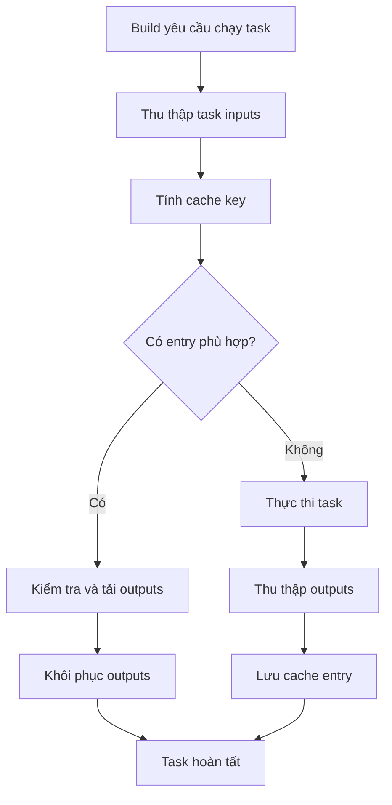
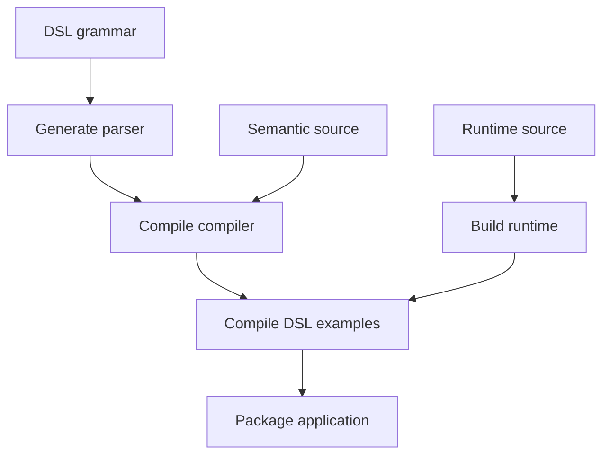

# Bộ nhớ đệm build cho dự án DSL

Một dự án DSL (*Domain-Specific Language*) thường có nhiều bước tạo ra sản phẩm từ source: đọc grammar, sinh lexer/parser, biên dịch compiler, phân tích schema, tạo mã đích, đóng gói runtime và tạo artifact để triển khai. Nhiều bước có thể tốn thời gian, nhưng đầu vào của chúng không thay đổi giữa các lần build.

**Bộ nhớ đệm build** (*build cache*) lưu kết quả của một bước build đã hoàn thành để lần sau có thể tái sử dụng khi các đầu vào liên quan vẫn giống nhau. Thay vì chạy lại parser generator hoặc compiler, build system kiểm tra cache và lấy output đã được tạo trước đó.

Ví dụ, nếu grammar của DSL và phiên bản parser generator không đổi, parser được sinh ra có thể được tái sử dụng. Nếu chỉ sửa tài liệu hướng dẫn, pipeline không cần sinh lại parser hoặc biên dịch runtime.

Cache giúp rút ngắn thời gian phản hồi, giảm tải CPU và network, tiết kiệm chi phí CI, đồng thời giúp nhóm phát triển lặp lại build nhanh hơn. Tuy nhiên, cache chỉ hữu ích khi hệ thống xác định đúng đầu vào và biết khi nào kết quả cũ không còn hợp lệ.

## 1. Vì sao dự án DSL cần build cache?

Một toolchain DSL có thể chứa nhiều tác vụ:

- Sinh lexer và parser từ grammar.
- Biên dịch AST, semantic analyzer và compiler.
- Tạo schema metadata hoặc symbol index.
- Biên dịch thư viện runtime.
- Sinh mã từ các chương trình DSL.
- Chạy các bước đóng gói, tạo tài liệu và phân phối artifact.

Một số tác vụ chỉ phụ thuộc vào một vài file. Ví dụ, parser generation phụ thuộc grammar và parser generator. Một số tác vụ khác phụ thuộc vào nhiều module, schema và cấu hình.

Khi một thay đổi nhỏ làm build system chạy lại toàn bộ pipeline, thời gian chờ tăng lên. Cache giúp tái sử dụng kết quả của những tác vụ có đầu vào không đổi.

Các lợi ích chính:

1. **Build nhanh hơn:** bỏ qua công việc đã được thực hiện với cùng đầu vào.
2. **CI tiết kiệm tài nguyên:** giảm CPU, memory, disk I/O và thời gian runner.
3. **Phản hồi sớm:** lập trình viên nhận kết quả kiểm tra nhanh hơn.
4. **Tái sử dụng giữa máy:** remote cache cho phép nhiều developer hoặc CI worker dùng chung kết quả.
5. **Ổn định quy trình:** build system có thể tái sử dụng artifact đã được tạo theo một cấu hình xác định.
6. **Mở rộng quy mô:** dự án nhiều module không cần tính toán lại mọi output cho mỗi commit.

Cache không làm cho một tác vụ sai trở thành đúng. Nếu output được lưu từ một build lỗi hoặc cache key bỏ sót đầu vào quan trọng, việc tái sử dụng có thể khiến lỗi lan rộng.

## 2. Phân biệt build cache, dependency cache và incremental build

Các khái niệm này thường được dùng cùng nhau nhưng giải quyết những vấn đề khác nhau.

| Cơ chế | Nội dung được lưu hoặc bỏ qua | Ví dụ |
|---|---|---|
| Dependency cache | Package hoặc thư viện đã tải | JAR, npm package |
| Task/build cache | Output của một tác vụ build | Parser source đã sinh |
| Compiler cache | Kết quả biên dịch theo đầu vào | Object file hoặc class output |
| Incremental build | Chỉ chạy lại phần bị ảnh hưởng | Biên dịch module thay đổi |
| Workspace cache | Dữ liệu trung gian của dự án | Symbol index, analysis state |
| Artifact repository | Artifact đã phát hành hoặc chia sẻ | Runtime package, compiler binary |

Dependency cache tránh tải lại package từ registry. Build cache tránh thực hiện lại một task. Incremental build phân tích quan hệ phụ thuộc để xác định task hoặc phần dữ liệu nào cần chạy lại.

Một dự án có thể dùng cả ba. Ví dụ, CI tải dependencies từ dependency cache, chỉ chạy các task bị ảnh hưởng nhờ incremental build, rồi lấy output của task không thay đổi từ build cache.

### Cache không thay thế dependency management

Dependency cache chỉ là bản sao cục bộ hoặc từ xa của package đã được khai báo. Lockfile, version constraint và checksum vẫn quyết định dependency nào được dùng.

Không nên xem việc một package đang có trong cache là bằng chứng rằng package đó thuộc dependency graph hợp lệ của build hiện tại.

## 3. Cache hoạt động như thế nào?

Một task build thường có:

- Đầu vào: source files, grammar, schema, dependencies, compiler options.
- Môi trường: toolchain, environment variables được phép, hệ điều hành hoặc kiến trúc.
- Đầu ra: file sinh ra, binary, metadata hoặc report.
- Hành vi: thao tác thực hiện trên đầu vào.

Build system có thể tạo một cache key từ những yếu tố ảnh hưởng đến kết quả. Khi task cần chạy, nó tính key và tìm output tương ứng.

Luồng tổng quát:



Nếu cache hit, build system tái sử dụng kết quả. Nếu cache miss, task chạy bình thường rồi có thể lưu kết quả cho lần sau.

Một cache entry thường liên kết key với metadata và các output file. Cache system có thể lưu nội dung trực tiếp hoặc tham chiếu tới content-addressable storage.

## 4. Cache key và tính đúng đắn

Cache key là yếu tố quyết định liệu một output cũ có thể được dùng cho build hiện tại hay không.

Một key tốt phải thay đổi khi bất kỳ đầu vào nào có thể làm output thay đổi. Nếu bỏ sót đầu vào, hệ thống có thể báo cache hit nhưng trả về kết quả sai.

Đối với parser generation của DSL, key có thể phụ thuộc vào:

- Nội dung grammar.
- Phiên bản parser generator.
- Các option khi sinh parser.
- Phiên bản template hoặc plugin.
- Encoding và cấu hình đầu ra.
- Những file grammar được import hoặc include.

Ví dụ, nếu grammar giữ nguyên nhưng phiên bản parser generator thay đổi, output có thể khác. Do đó toolchain version cần tham gia cache key.

### Content-based key

Một cách đáng tin cậy là tính hash từ nội dung đầu vào thay vì chỉ dựa vào tên file hoặc timestamp.

Ví dụ khái niệm:

```text
cacheKey = hash(
    taskImplementationVersion,
    grammarContent,
    parserGeneratorVersion,
    generationOptions
)
```

Nếu nội dung file không đổi, key có thể giữ nguyên dù file được checkout ở thời điểm khác. Nếu nội dung thay đổi, key thay đổi.

### Đầu vào ẩn

Một task có thể đọc dữ liệu không được khai báo trong build graph:

- Environment variable.
- File cấu hình ngoài project.
- System property.
- Thời gian hiện tại.
- Network response.
- Nội dung thư mục không được theo dõi.
- Tool được tìm thấy qua PATH.
- Locale hoặc timezone của máy.

Đây là những đầu vào ẩn. Nếu chúng ảnh hưởng output mà không nằm trong key, cache có thể trả kết quả sai.

Giải pháp là khai báo chúng thành task inputs, cố định chúng hoặc loại bỏ sự phụ thuộc bằng cách thiết kế task deterministic.

## 5. Xác định task inputs và outputs

Build system chỉ có thể cache đúng khi biết task đọc gì và tạo ra gì.

Với một task sinh parser:

| Loại | Ví dụ |
|---|---|
| Input files | Grammar, imported grammar |
| Scalar inputs | Generator version, package name |
| Configuration | Target language, visitor/listener options |
| Toolchain | JDK hoặc runtime version |
| Output files | Lexer, parser, visitor source |
| Metadata | Generation manifest |

Với task biên dịch chương trình DSL:

| Loại | Ví dụ |
|---|---|
| Input files | DSL source, imported modules |
| Schema inputs | Domain schema và version |
| Compiler inputs | Compiler binary/version |
| Options | Target, optimization level |
| Environment | Những biến được khai báo rõ |
| Output files | Generated source, source map, diagnostics report |

Output cũng cần được khai báo đầy đủ. Nếu task tạo thêm file nhưng build system không biết, file đó có thể bị bỏ sót khi cache hoặc khôi phục.

### Output phải được tạo trong vùng kiểm soát

Một task có thể ghi output vào thư mục build riêng. Tránh ghi vào thư mục source hoặc một vị trí tùy ý bên ngoài workspace, vì cache restore cần biết file nào thuộc task.

Không nên để output của task phụ thuộc vào trạng thái cũ trong thư mục build mà không xóa hoặc khai báo trạng thái đó. Nếu output được tạo bằng cách append, kết quả có thể khác giữa clean build và build tái sử dụng workspace.

## 6. Cache theo từng lớp trong toolchain DSL

Cache có thể được áp dụng ở nhiều bước.

### Grammar và parser generation

Lưu parser đã sinh theo grammar, generator version và generation options. Khi grammar không đổi, task có thể được bỏ qua.

### Semantic metadata

Lưu symbol index, schema metadata hoặc type information nếu chúng được tạo từ các input xác định. Cache cần thay đổi khi module import hoặc schema liên quan thay đổi.

### Compilation

Lưu output biên dịch theo source, dependencies, compiler options và toolchain. Với compiler DSL, generated source và source map phải được xem là output có liên quan.

### Runtime packaging

Lưu package theo binary, resource, dependency lock và cấu hình đóng gói. Thông tin build timestamp hoặc đường dẫn máy local không nên làm output biến động nếu không cần thiết.

### Documentation generation

Tài liệu được sinh từ schema hoặc grammar cũng có thể cache. Tuy nhiên, task cần đưa template, version và metadata vào key.

## 7. Dependency graph và cache invalidation

Một build graph biểu diễn quan hệ phụ thuộc giữa các task. Khi input của một task thay đổi, các task phụ thuộc trực tiếp hoặc gián tiếp có thể cần chạy lại.

Ví dụ:



Nếu grammar thay đổi, parser generation cần chạy lại, sau đó compiler và DSL examples có thể bị ảnh hưởng. Nếu chỉ sửa runtime source, parser generation không cần chạy lại nhưng runtime và các bước phụ thuộc có thể phải cập nhật.

**Cache invalidation** là quyết định khi nào một cache entry không còn hợp lệ. Build system thường thực hiện bằng cách thay đổi key khi inputs thay đổi, hoặc loại bỏ entry theo policy.

### Invalidate theo dependency

Không nên xóa toàn bộ cache mỗi khi một file thay đổi. Build graph cho phép chỉ vô hiệu hóa task bị ảnh hưởng.

### Invalidate theo toolchain

Nâng cấp compiler, parser generator, JDK hoặc plugin có thể làm output thay đổi ngay cả khi source không đổi. Phiên bản toolchain cần nằm trong key hoặc cache namespace.

### Invalidate theo schema

DSL thường phụ thuộc schema bên ngoài. Khi schema revision thay đổi, những task sử dụng schema cần chạy lại. Nếu schema được tải động mà không ghi revision, cache key không thể phản ánh thay đổi đó.

## 8. Local cache và remote cache

**Local cache** lưu kết quả trên máy hiện tại. Nó có độ trễ thấp và hữu ích khi lập trình viên build lặp lại cùng một workspace.

**Remote cache** lưu kết quả ở một dịch vụ hoặc storage dùng chung. Nhiều máy và CI worker có thể lấy cùng một output nếu task inputs tạo ra cùng key.

| Tiêu chí | Local cache | Remote cache |
|---|---|---|
| Phạm vi | Một máy hoặc workspace | Nhiều máy/CI worker |
| Tốc độ | Thường nhanh | Phụ thuộc mạng và storage |
| Chia sẻ | Hạn chế | Tái sử dụng giữa nhóm |
| Quản trị | Theo máy | Cần quyền, retention và monitoring |
| Rủi ro | Cache local hỏng hoặc cũ | Cache poisoning, quyền ghi và rò rỉ artifact |
| Sử dụng | Developer workflow | CI và nhóm nhiều người |

Một quy trình có thể kiểm tra local cache trước, sau đó remote cache. Khi không có entry phù hợp, task chạy và lưu output vào cache được phép ghi.

### Read-only và read/write cache

CI cho pull request không đáng tin cậy có thể chỉ được đọc từ remote cache đáng tin cậy hoặc dùng namespace riêng. Chỉ pipeline đã được bảo vệ mới có quyền ghi vào cache dùng chung cho release.

## 9. Content-addressable storage

Một số cache dùng **content-addressable storage (CAS)**: nội dung được định danh bằng hash của chính nội dung đó.

Thay vì lưu cùng một file nhiều lần dưới các tên khác nhau, hệ thống có thể lưu blob theo content hash và để cache entry tham chiếu tới blob.

Lợi ích:

- Khử trùng lặp nội dung giống nhau.
- Xác minh nội dung khi tải về.
- Chia sẻ output giữa các task hoặc build.
- Hỗ trợ artifact lớn theo từng khối.

Ví dụ, manifest có thể ánh xạ:

```text
task-key: 8ab...
outputs:
  parser/GeneratedParser.java: sha256: 19f...
  parser/GeneratedLexer.java: sha256: a72...
```

Khi tải output, client có thể kiểm tra hash để xác nhận bytes nhận được khớp nội dung đã tham chiếu.

CAS xác minh tính toàn vẹn của nội dung, nhưng tự nó không chứng minh người tạo artifact đáng tin cậy. Danh tính publisher và quyền ghi vẫn cần được kiểm soát.

## 10. Cache hit, cache miss và cache bypass

Các trạng thái thường gặp:

- **Hit:** tìm thấy entry phù hợp và khôi phục được output.
- **Miss:** không có entry cho key hiện tại; task cần chạy.
- **Invalid entry:** metadata hoặc output không hợp lệ; task phải chạy lại.
- **Bypass:** chủ động bỏ qua cache theo cấu hình hoặc yêu cầu.
- **Uncacheable:** task không đáp ứng điều kiện để cache.

Cache miss không phải lỗi. Nó xảy ra khi source, configuration hoặc toolchain thay đổi, hoặc khi entry đã bị eviction.

Cache hit cũng không bảo đảm build đúng nếu task khai báo thiếu input hoặc cache được ghi bởi nguồn không đáng tin cậy. Cần quan sát cả tính đúng đắn và hiệu quả.

### Khi nào nên bypass?

Có thể bypass cache để:

- Điều tra lỗi nghi ngờ do cache.
- Xác nhận clean build.
- Tạo artifact cần kiểm tra độc lập.
- Chạy tác vụ phụ thuộc trạng thái bên ngoài không thể snapshot.
- So sánh output giữa build cached và uncached.

Bypass nên là thao tác có kiểm soát, không phải cách sửa thường trực cho một cache key sai.

## 11. Deterministic tasks và reproducible builds

Một task deterministic tạo cùng output khi các input được khai báo giống nhau.

Ví dụ, sinh parser từ cùng grammar, generator version và options nên tạo output giống nhau. Nếu task chèn timestamp hiện tại hoặc đường dẫn tuyệt đối của máy, output có thể khác dù source giống nhau.

Các nguồn không deterministic thường gặp:

- Timestamp build.
- Random number không có seed cố định.
- Thứ tự iteration của collection không xác định.
- Locale và timezone.
- Đường dẫn tuyệt đối trên runner.
- Environment variable không được khai báo.
- Network response thay đổi.
- File được đọc nhưng không nằm trong dependency graph.
- Parallel task ghi chung một output.

### Làm task deterministic hơn

- Sắp xếp input theo quy tắc xác định.
- Cố định toolchain và dependency versions.
- Dùng seed rõ ràng nếu cần randomness.
- Loại timestamp không cần thiết hoặc chuẩn hóa chúng.
- Tránh đọc trạng thái host tùy ý.
- Khai báo mọi input có ảnh hưởng output.
- Ghi output vào thư mục task riêng.
- Không để task phụ thuộc kết quả từ một task chưa được khai báo.

Reproducible build giúp xác nhận cùng source và toolchain tạo artifact tương đương hoặc giống nhau. Build cache dựa vào tính xác định này để tái sử dụng output một cách an toàn.

## 12. Những task không nên cache trực tiếp

Không phải task nào cũng phù hợp với build cache.

Ví dụ:

- Task đọc thời gian thực từ API.
- Task gửi email hoặc tạo ticket.
- Task triển khai lên môi trường.
- Task tạo ID ngẫu nhiên không được cố định.
- Task phụ thuộc trạng thái người dùng hoặc credential runtime.
- Task đọc dữ liệu production thay đổi liên tục.

Những task này có side effect hoặc input biến động. Cache chúng có thể khiến lần build sau bỏ qua hành động cần thiết hoặc trả kết quả không còn đúng.

Có thể tách task thành phần thuần và phần side effect. Ví dụ, compile manifest deployment có thể cache nếu inputs đầy đủ; deploy manifest lên cluster là một hành động riêng, không nên coi như output cacheable thông thường.

## 13. Cache trong môi trường CI

CI thường chạy trên runner mới hoặc ephemeral. Local cache của runner có thể không tồn tại giữa các job, vì vậy remote cache đặc biệt hữu ích.

Một pipeline có thể:

1. Checkout commit.
2. Khôi phục dependency cache.
3. Kết nối remote build cache với quyền đọc phù hợp.
4. Chạy build và test.
5. Tải output từ cache nếu key khớp.
6. Chạy task miss.
7. Lưu output vào cache theo policy.
8. Upload artifact của build hoặc release.

### Cache theo branch

Một số nhóm dùng namespace cache theo branch hoặc loại pipeline. Branch chính có thể là nguồn cache tin cậy. Pull request có thể đọc cache từ branch chính nhưng ghi vào namespace riêng.

Cần xác định cách fallback giữa namespace và tránh để cache từ branch không đáng tin cậy ghi đè entry dùng cho release.

### Cache trong CI không thay thế clean build

Thỉnh thoảng cần chạy pipeline với cache rỗng để xác nhận build có thể tái tạo từ source và dependency đã khai báo. Clean build cũng giúp phát hiện output cũ vô tình tồn tại trong workspace.

## 14. Remote cache security và cache poisoning

Remote cache là một phần của chuỗi cung ứng build. Nếu người không đáng tin cậy có thể ghi output vào key được build đáng tin cậy sử dụng, họ có thể thay thế artifact được tái sử dụng.

Đây là rủi ro **cache poisoning**.

Các biện pháp quan trọng:

- Xác thực client và kiểm soát quyền đọc/ghi.
- Tách namespace cho nhánh, project và trust level.
- Chỉ pipeline được bảo vệ mới ghi cache release.
- Xác minh hash của blob khi tải.
- Ký hoặc xác minh provenance nếu quy trình yêu cầu.
- Không đưa secrets vào cache output.
- Không lưu file chứa credential hoặc dữ liệu nhạy cảm.
- Giới hạn quyền truy cập theo tenant/project.
- Audit các lần ghi và xóa cache.

Một cache entry được hash đúng vẫn có thể chứa output độc hại nếu người ghi có quyền tạo entry đó. Integrity và authenticity là hai vấn đề khác nhau.

### Pull request từ fork

Code từ fork có thể thay đổi build script hoặc task implementation. Không nên cho pipeline đó quyền ghi vào cache dùng chung cho nhánh release. Có thể cho phép đọc cache tin cậy, nhưng output mới nên được lưu ở vùng riêng hoặc không lưu.

## 15. Cache và secrets

Build task đôi khi cần token để tải private dependencies hoặc truy cập registry. Secret không nên trở thành một phần output được cache hoặc bị ghi vào cache metadata.

Nguyên tắc:

- Truyền secret qua cơ chế bảo mật của CI.
- Không ghi secret vào generated file nếu không cần.
- Không log command hoặc environment chứa secret.
- Không cache thư mục home chứa credentials.
- Không lưu token trong compiler output hoặc debug artifact.
- Giới hạn quyền của task cần secret.
- Tách bước xác thực khỏi bước tạo output cacheable khi có thể.

Nếu secret ảnh hưởng tới output, cần xem xét liệu output có thực sự nên được chia sẻ qua cache hay không. Một artifact được tạo bằng credential riêng của tenant có thể chứa dữ liệu tenant đó; không nên dùng chung giữa tenant khác.

## 16. Concurrency và ghi cache an toàn

Nhiều CI worker có thể đồng thời tính cùng một cache key. Hệ thống cần xử lý trường hợp nhiều writer cùng ghi.

Một số cách:

- Ghi vào temporary object rồi publish manifest nguyên tử.
- Dùng immutable key và không ghi đè nội dung đã công bố.
- Dùng compare-and-swap hoặc conditional write nếu storage hỗ trợ.
- Kiểm tra blob hoàn chỉnh trước khi đánh dấu entry sẵn sàng.
- Cho phép duplicate computation nhưng bảo đảm chỉ một entry hợp lệ được công bố.

Nếu worker bị dừng giữa lúc upload, cache không được coi một manifest chưa hoàn chỉnh là hit hợp lệ.

### Cache stampede

Cache stampede xảy ra khi nhiều worker cùng gặp miss cho một key và cùng thực hiện một task đắt tiền. Có thể dùng lock, lease hoặc request coalescing để giảm tính toán trùng.

Lock cần có timeout và cơ chế phục hồi nếu worker giữ lock bị crash. Không nên để một lock mồ côi làm mọi build chờ vô hạn.

## 17. Eviction, retention và kích thước cache

Cache tăng dần theo thời gian. Nếu không có chính sách dọn dẹp, storage và chi phí truyền tải có thể tăng không kiểm soát.

Các chiến lược phổ biến:

- **LRU:** loại entry ít được sử dụng gần đây.
- **TTL:** hết hạn sau một khoảng thời gian.
- **Size quota:** giới hạn dung lượng theo project hoặc namespace.
- **Branch retention:** giữ cache của branch chính lâu hơn branch tạm.
- **Version retention:** giữ cache cần thiết cho phiên bản đang được hỗ trợ.

Eviction chỉ xóa kết quả có thể tạo lại. Nó không nên xóa artifact release cần lưu trữ lâu dài; artifact repository và build cache có retention policy khác nhau.

Một cache nhỏ nhưng có hit rate cao có thể hữu ích hơn cache rất lớn chứa nhiều entry ít được dùng.

## 18. Theo dõi hiệu quả cache

Nên đo lường cache để biết nó có thực sự giúp build nhanh hơn hay không.

Các chỉ số hữu ích:

- Cache hit count và hit rate.
- Cache miss count.
- Số task được cache.
- Thời gian tiết kiệm ước tính.
- Thời gian tải và giải nén output.
- Kích thước upload/download.
- Cache entry invalid hoặc lỗi checksum.
- Dung lượng storage.
- Eviction count.
- Thời gian chờ lock.
- Tỷ lệ task bypass hoặc không cacheable.

Hit rate cao không luôn có nghĩa pipeline nhanh. Nếu output lớn và tải remote chậm, lấy cache có thể tốn thời gian hơn chạy lại task nhỏ.

Cần xem thời gian thực tế theo từng task và so sánh tổng thời gian với build không dùng cache.

## 19. Troubleshooting khi cache trả kết quả sai

Một số dấu hiệu thường gặp:

- Sửa grammar nhưng parser cũ vẫn được sử dụng.
- Compiler output không phản ánh source mới.
- Build local thành công nhưng CI thất bại.
- Cache hit trên máy này nhưng miss trên máy khác.
- File generated còn sót sau khi task đã bị xóa.
- Output khác nhau giữa clean build và cached build.
- Một nhánh pull request nhận artifact từ cache không đúng trust boundary.

Quy trình điều tra:

1. Xác định task có cache hit hay không.
2. Xem cache key và các input được đưa vào key.
3. So sánh toolchain, configuration và dependency versions.
4. Kiểm tra input ẩn như environment variables, schema revision hoặc file ngoài project.
5. Chạy task với cache bypass để so sánh output.
6. Kiểm tra output manifest và checksum.
7. Xem lịch sử writer, namespace và quyền remote cache.
8. Sửa khai báo input/output hoặc task implementation.
9. Tạo key mới hoặc invalidate entry bị ảnh hưởng theo policy.
10. Xác nhận build có thể chạy từ clean workspace.

Xóa toàn bộ cache có thể giúp xác định cache có liên quan tới lỗi hay không, nhưng không sửa nguyên nhân nếu key vẫn thiếu input.

## 20. Ví dụ cache cho parser generation

Giả sử dự án có grammar và task sinh parser:

```text
inputs:
  - grammar/Workflow.g4
  - grammar/Expressions.g4
  - parser-generator.version
  - generation-options.yml

outputs:
  - build/generated/parser/
```

Cache key khái niệm:

```text
key = hash(
    contents(grammar/Workflow.g4),
    contents(grammar/Expressions.g4),
    parserGeneratorVersion,
    generationOptions
)
```

Nếu chỉ thay file tài liệu, key không đổi và parser generation có thể được bỏ qua.

Nếu thay grammar hoặc generator version, key thay đổi và parser được sinh lại.

Nếu generator thực tế đọc một template file nhưng template không được khai báo, key sẽ không thay đổi khi template sửa. Đây là một đầu vào bị bỏ sót và có thể dẫn tới output stale. Vì vậy, cần xác định đầy đủ các file mà task thực sự đọc.

## 21. Ví dụ cache cho compiler DSL

Một task compile chương trình DSL có thể phụ thuộc vào:

```text
inputs:
  - src/**/*.dsl
  - modules/**/*.dsl
  - schemas/**/*.schema
  - compiler-version.txt
  - target-options.yml
  - dependency-lock.yml

outputs:
  - build/generated/
  - build/source-maps/
  - build/diagnostics/
```

Cache key cần phản ánh:

- Nội dung DSL source.
- Module được import.
- Schema version.
- Compiler version.
- Target backend.
- Optimization options.
- Dependency versions.
- Các flag ảnh hưởng code generation.

Nếu compiler sinh source map, file đó cũng cần được cache cùng output liên quan. Nếu diagnostics có chứa đường dẫn tuyệt đối của máy, cần chuẩn hóa đường dẫn hoặc đưa path mapping vào key để tránh output không tái lập.

## 22. Cache và versioning của DSL

Khi DSL thay đổi grammar hoặc semantics, cache entry từ phiên bản compiler cũ có thể không còn tương thích.

Có thể đưa compiler version, language version hoặc cache schema version vào key.

Ví dụ:

```text
cacheNamespace = "dsl-compiler-v5"
key = hash(cacheNamespace, taskInputs)
```

Namespace giúp vô hiệu hóa nhóm cache khi định dạng output hoặc semantics thay đổi lớn.

Tuy nhiên, không nên tăng cache version tùy tiện cho mọi commit. Nếu task inputs đã phản ánh thay đổi, key có thể tự thay đổi. Namespace nên dùng cho thay đổi không được mô tả đầy đủ bằng input thông thường, chẳng hạn thay đổi cách serialize cache entry hoặc quy tắc task implementation.

## 23. Cache trong build system và công cụ phổ biến

Nhiều build system hỗ trợ cache ở các mức khác nhau:

- Gradle hỗ trợ task output caching và build cache local/remote khi task được khai báo phù hợp.
- Bazel sử dụng action cache và content-addressable storage trong mô hình build theo action.
- Maven thường dùng local repository cho dependencies; các plugin hoặc hệ thống bên ngoài có thể bổ sung cache cho output.
- Compiler như ccache hoặc sccache có thể tái sử dụng kết quả biên dịch native.
- CI providers thường hỗ trợ cache dependency hoặc thư mục công cụ giữa các job.

Tên gọi và semantics khác nhau giữa các công cụ. Cần đọc tài liệu của build system đang dùng để biết task nào cacheable, input nào được fingerprint, cách remote cache xác thực và cách xử lý output.

### Task phải khai báo đúng contract

Một task chỉ nên cache khi output được xác định bởi những input mà build system có thể fingerprint. Task có side effect hoặc phụ thuộc trạng thái bên ngoài không nên được đánh dấu cacheable chỉ để giảm thời gian build.

## 24. Kiểm thử cache correctness

Cache correctness cần được xác nhận bằng cách so sánh kết quả giữa build cached và build không cache trong những tình huống đại diện.

Có thể kiểm tra:

- Cùng input cho output giống nhau.
- Thay từng input quan trọng làm key thay đổi.
- Thay toolchain version làm key thay đổi.
- Thay schema revision làm task liên quan chạy lại.
- Không thay input thì cache hit được tái sử dụng.
- Xóa cache không làm build thất bại.
- Cache entry hỏng checksum bị từ chối.
- Output khôi phục đúng đường dẫn và nội dung.
- Hai worker ghi cùng key không tạo entry dở dang.
- Cache từ namespace không đáng tin cậy không được dùng cho release.
- Secret không xuất hiện trong cache metadata hoặc output chia sẻ.

Một cách hữu ích là chạy cùng một build ở chế độ clean và cached, sau đó so sánh output quan trọng. Đây là kiểm tra tính đúng đắn của cơ chế cache, không chỉ đo tốc độ.

## 25. Những lỗi thiết kế thường gặp

**Cache key chỉ dựa trên tên file hoặc timestamp.** Nội dung có thể thay đổi mà timestamp không phản ánh đúng. Dùng fingerprint nội dung và các input ảnh hưởng output.

**Bỏ sót toolchain version.** Generator hoặc compiler đổi nhưng cache vẫn hit. Đưa version và options vào key.

**Task đọc environment variables không khai báo.** Hai máy có thể tạo output khác nhau từ cùng key. Cố định hoặc khai báo biến môi trường liên quan.

**Task ghi output ngoài thư mục được quản lý.** Cache restore không khôi phục đầy đủ hoặc để lại file cũ. Khai báo output và dùng workspace riêng.

**Cache task có side effect.** Build hit có thể bỏ qua hành động cần thực hiện. Tách bước tạo artifact thuần khỏi bước deploy hoặc gửi thông báo.

**Dùng chung remote cache không phân quyền.** Pull request không đáng tin cậy có thể ghi output được release sử dụng. Tách namespace và quyền writer.

**Xem cache hit là bằng chứng output đúng.** Key thiếu input vẫn tạo hit. Kiểm tra cache correctness và khả năng tái lập.

**Xóa cache để xử lý mọi lỗi.** Lỗi sẽ quay lại khi build tạo key cũ. Tìm input bị thiếu hoặc task không deterministic.

**Không giới hạn dung lượng.** Cache tăng không kiểm soát. Dùng quota, TTL và eviction.

**Không theo dõi hit rate và thời gian.** Cache có thể làm pipeline chậm hơn nếu tải output quá lớn. Đo thời gian lấy cache và chạy task.

**Lưu secret hoặc dữ liệu riêng tư.** Remote cache có thể làm lộ credential hoặc artifact theo tenant. Kiểm soát nội dung và quyền truy cập.

## 26. Quy trình triển khai build cache cho dự án DSL

Khi thêm cache vào một toolchain DSL, có thể thực hiện theo trình tự:

1. Liệt kê các task build và xác định task nào thuần, deterministic, có thể cache.
2. Vẽ dependency graph giữa grammar, parser, compiler, schema, runtime và packaging.
3. Khai báo đầy đủ file inputs, scalar inputs, toolchain và outputs cho từng task.
4. Loại bỏ hoặc khai báo rõ environment variables, network data và trạng thái host ảnh hưởng output.
5. Thiết kế cache key dựa trên fingerprint của input và phiên bản công cụ.
6. Bật local cache để kiểm tra hành vi trên một workspace.
7. So sánh clean build với cached build về output và thời gian.
8. Bổ sung remote cache nếu nhiều developer hoặc CI worker cần chia sẻ.
9. Phân quyền read/write và tách namespace theo project, branch hoặc trust level.
10. Bảo vệ cache bằng checksum, provenance và chính sách secret.
11. Thiết lập quota, TTL, eviction và monitoring.
12. Kiểm tra concurrency, upload gián đoạn và cache stampede.
13. Đưa cache vào CI theo cách có fallback khi remote cache không khả dụng.
14. Duy trì clean-build job định kỳ để phát hiện phụ thuộc ẩn.
15. Theo dõi hit rate, thời gian tiết kiệm và lỗi cache để điều chỉnh.

## 27. Câu hỏi tự kiểm tra

1. Build cache là gì và vì sao dự án DSL có thể hưởng lợi từ nó?
2. Phân biệt dependency cache, task cache và incremental build.
3. Cache key cần phản ánh những loại input nào?
4. Vì sao content-based key thường đáng tin cậy hơn timestamp?
5. Đầu vào ẩn có thể làm cache trả kết quả sai như thế nào?
6. Tại sao task cần khai báo cả inputs và outputs?
7. Grammar, parser generation, semantic metadata và compiler có thể được cache ra sao?
8. Dependency graph hỗ trợ cache invalidation như thế nào?
9. Local cache và remote cache khác nhau về phạm vi, hiệu năng và rủi ro ra sao?
10. Content-addressable storage dùng hash để định danh nội dung như thế nào?
11. Phân biệt cache hit, miss, invalid entry và bypass.
12. Vì sao deterministic task là nền tảng của cache correctness?
13. Những task nào có side effect và thường không nên cache trực tiếp?
14. Remote cache poisoning có thể xảy ra khi nào?
15. Vì sao pull request từ fork cần quyền ghi cache hạn chế?
16. Cache stampede và concurrency có thể được xử lý ra sao?
17. TTL, LRU và quota giúp quản lý cache như thế nào?
18. Nên theo dõi những chỉ số nào để đánh giá hiệu quả cache?
19. Khi parser cũ vẫn được sử dụng sau khi grammar thay đổi, cần điều tra những gì?
20. Hãy thiết kế cache key cho task compile DSL, bao gồm source, imported modules, schema, compiler và target options.

Bộ nhớ đệm build giúp tái sử dụng kết quả của những bước build có đầu vào xác định, từ parser generation tới compiler và packaging. Khi task khai báo đúng inputs/outputs, cache key phản ánh đầy đủ toolchain, task deterministic và remote cache được bảo vệ, dự án DSL có thể build nhanh hơn mà vẫn giữ tính đúng đắn và khả năng tái lập.

