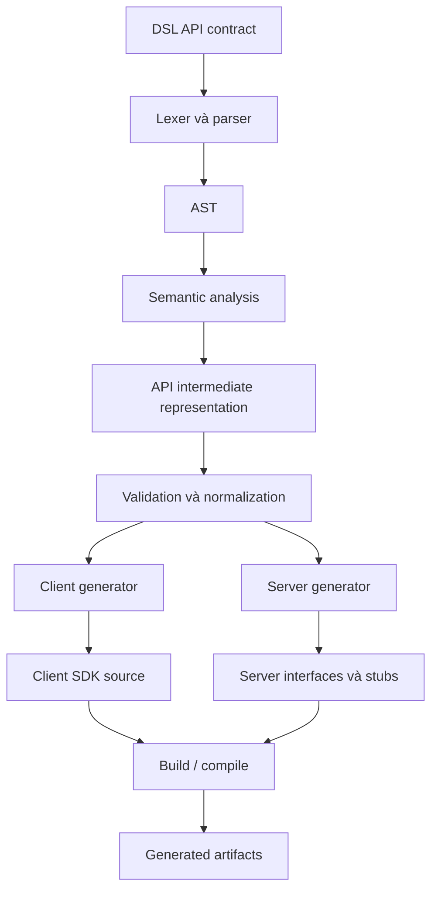

# Sinh mã client và server từ DSL API

Một DSL (*Domain-Specific Language*) mô tả API có thể định nghĩa endpoint, operation, kiểu dữ liệu, tham số, request, response, lỗi và các quy tắc bảo mật. Từ một hợp đồng API như vậy, hệ thống có thể sinh mã cho cả phía client và server.

**Sinh mã client và server** (*client/server code generation*) là quá trình chuyển định nghĩa API ở mức mô hình hoặc hợp đồng thành mã nguồn có thể sử dụng trong ứng dụng. Phía client thường nhận được SDK để gọi API bằng các hàm và kiểu dữ liệu thuận tiện. Phía server thường nhận được interface, route handler skeleton, DTO, validator, serializer hoặc adapter để triển khai nghiệp vụ.

Ví dụ, một DSL có thể mô tả operation lấy thông tin khách hàng:

```text
api CustomerService version "v1" {
    basePath = "/customers"

    get Customer byId(customerId: UUID) {
        path = "/{customerId}"
        response = Customer
        errors = [NotFound, Unauthorized]
    }
}
```

Từ hợp đồng này, generator có thể tạo hàm client getCustomerById, kiểu Customer, request builder và interface server để triển khai thao tác lấy khách hàng. Cả hai phía dùng chung contract nên giảm nguy cơ client gửi sai kiểu hoặc server trả response không đúng cấu trúc đã công bố.

Code generation không tự tạo ra toàn bộ nghiệp vụ. Nó tạo phần mã có thể suy ra từ hợp đồng, còn logic như truy vấn database, tính giá, kiểm tra chính sách hoặc gọi hệ thống khác thường do developer triển khai.

## 1. Vì sao cần sinh mã từ DSL API?

Nếu mỗi đội tự viết client và server theo tài liệu thủ công, contract dễ bị lệch:

- Client dùng tên field khác server.
- Kiểu dữ liệu hoặc nullability không thống nhất.
- Path hoặc HTTP method bị sai.
- Mã lỗi không được xử lý đồng nhất.
- Một bên cập nhật API nhưng bên còn lại chưa cập nhật.
- Tài liệu mô tả một behavior nhưng implementation làm khác.

Sinh mã từ một nguồn contract chung giúp giảm công việc lặp và tạo ra một quy ước nhất quán.

Các lợi ích chính:

1. **Giảm sai khác giữa client và server:** hai phía được tạo từ cùng API model.
2. **Tăng tốc phát triển:** không phải viết lặp DTO, request builder, route declarations và serializer.
3. **Kiểm tra kiểu sớm:** lỗi kiểu hoặc thiếu field có thể được phát hiện lúc compile.
4. **Chuẩn hóa giao tiếp:** path, method, header, status code và payload được tạo theo cùng quy tắc.
5. **Hỗ trợ nhiều ngôn ngữ:** một contract có thể sinh SDK cho Java, Kotlin, TypeScript, Python hoặc các ngôn ngữ khác.
6. **Dễ cập nhật:** thay đổi contract có thể sinh lại các artifact liên quan.
7. **Tạo tài liệu nhất quán:** schema và operation descriptions có thể được tái sử dụng trong docs.

Code generation có giá trị nhất khi API contract là nguồn thông tin có thẩm quyền và được quản lý phiên bản. Nếu contract không phản ánh implementation thực tế, generator chỉ tạo ra nhiều mã nhất quán với một mô tả sai.

## 2. Contract-first và code-first

Có hai hướng thường gặp để xác định API.

### Contract-first

Nhóm thiết kế API contract trước. Contract mô tả operation, request, response, kiểu dữ liệu và các quy tắc giao tiếp. Sau đó generator tạo client SDK và server scaffolding.

Ưu điểm:

- Client và server có thể phát triển song song.
- Contract có thể được review độc lập với implementation.
- Có thể kiểm tra compatibility trước khi deploy.
- Nhiều ngôn ngữ có thể dùng chung một định nghĩa.

### Code-first

Nhóm viết server code trước, sau đó dùng reflection, annotation hoặc framework metadata để sinh contract và client.

Ưu điểm:

- Tận dụng type system và framework hiện có.
- Có thể giảm việc khai báo trùng.
- Phù hợp với dự án đã có implementation.

Rủi ro là contract công khai có thể vô tình phụ thuộc vào chi tiết nội bộ của server, hoặc thay đổi code implementation làm API thay đổi ngoài ý muốn.

### DSL API như nguồn hợp đồng

Một DSL riêng có thể áp dụng contract-first nhưng bổ sung khái niệm nghiệp vụ, policy và constraint mà IDL tổng quát không biểu diễn trực tiếp.

Ví dụ, ngoài kiểu dữ liệu, DSL có thể mô tả:

- Field nào bắt buộc.
- Operation nào cần role cụ thể.
- Giá trị nào bị giới hạn.
- Response nào có thể null.
- Operation nào có tác dụng phụ.
- API nào cần idempotency key.
- Những version nào còn được hỗ trợ.

## 3. Kiến trúc tổng quát của code generator

Một generator thường có nhiều giai đoạn. Nó không nên chuyển trực tiếp từng dòng DSL thành chuỗi code đích mà không có mô hình trung gian.



Các giai đoạn:

1. Parse DSL thành AST.
2. Kiểm tra tên, kiểu, tham chiếu và quy tắc API.
3. Chuyển AST thành API IR (*intermediate representation*).
4. Chuẩn hóa defaults và các metadata.
5. Chạy generator cho từng target.
6. Ghi source files và manifest.
7. Compile hoặc kiểm tra output nếu pipeline yêu cầu.

API IR giúp tách semantics của DSL khỏi từng ngôn ngữ đích. Generator Java và TypeScript có thể dùng cùng một mô hình operation mà không cần tự phân tích lại grammar.

## 4. Định nghĩa API trong DSL

Một API contract có thể gồm các thành phần:

- Service hoặc API namespace.
- Version.
- Operation.
- Transport method.
- Path hoặc topic.
- Path, query, header và body parameters.
- Request và response schema.
- Error model.
- Authentication và authorization metadata.
- Pagination, filtering và sorting.
- Timeout, retry và idempotency rules.
- Documentation metadata.

Ví dụ:

```text
api Inventory version "v2" {
    basePath = "/inventory"

    get listItems(
        category: String?,
        page: Integer = 1,
        pageSize: Integer = 50
    ) -> Page<Item> {
        query = [category, page, pageSize]
        response = Page<Item>
    }

    post createItem(request: CreateItemRequest) -> Item {
        body = request
        responseStatus = 201
        errors = [ValidationError, Conflict]
    }
}
```

Cú pháp cụ thể phụ thuộc DSL. Điều quan trọng là contract phải mô tả đầy đủ thông tin cần cho cả client lẫn server.

### Operation identity

Mỗi operation cần có định danh ổn định. Tên hàm client có thể được đổi theo naming convention của target language, nhưng operation identity trong contract nên giữ nguyên để hỗ trợ diff, telemetry và compatibility analysis.

## 5. AST và API intermediate representation

AST phản ánh cấu trúc cú pháp mà người viết đã khai báo. API IR biểu diễn semantics đã được phân tích và chuẩn hóa.

Ví dụ AST có thể chứa:

- Node khai báo service.
- Node operation.
- Type reference.
- Literal và expression.
- Annotation hoặc metadata.

API IR có thể chuyển thành mô hình đã giải quyết đầy đủ:

```text
ApiModel {
    name: "CustomerService"
    version: "v1"
    operations: [
        Operation {
            id: "CustomerService.getCustomerById"
            method: GET
            path: "/customers/{customerId}"
            parameters: [...]
            responseType: Customer
            errors: [...]
        }
    ]
}
```

IR nên độc lập với cú pháp nguồn và target language. Nhờ đó, generator có thể hỗ trợ nhiều syntax version hoặc nhiều backend từ cùng một contract model.

### Vì sao cần semantic analysis?

Parser có thể xác nhận cú pháp hợp lệ nhưng chưa biết:

- Type Customer có được khai báo không.
- UUID có phải type hợp lệ không.
- Parameter customerId có khớp placeholder trong path không.
- Operation có hai response status trùng nhau không.
- Request body có được dùng với method theo policy không.
- Type graph có vòng lặp không được hỗ trợ không.

Semantic analysis giải quyết các tham chiếu và quy tắc này trước khi sinh code.

## 6. Type system và ánh xạ kiểu sang ngôn ngữ đích

Một API DSL thường có type system riêng. Generator cần ánh xạ từng kiểu sang kiểu tương ứng của target language.

Ví dụ minh họa:

| Kiểu trong DSL | Java | TypeScript |
|---|---|---|
| String | String | string |
| Boolean | boolean | boolean |
| Integer | long hoặc BigInteger theo range | number hoặc bigint |
| Decimal | BigDecimal | number hoặc decimal library |
| UUID | UUID | string hoặc UUID wrapper |
| Date | LocalDate | string hoặc Date wrapper |
| DateTime | Instant | string hoặc Date |
| List<T> | List<T> | T[] |
| Map<K,V> | Map<K,V> | Map<K,V> hoặc Record |
| Optional<T> | Optional<T> | T hoặc undefined/null theo contract |

Không phải ánh xạ nào cũng một-một. Ví dụ, JavaScript number không biểu diễn chính xác mọi số nguyên lớn. Nếu DSL hỗ trợ integer 64-bit, generator TypeScript cần quyết định dùng bigint, string hoặc một wrapper có serialization phù hợp.

### Range và precision

Type mapping cần giữ semantics của DSL:

- Integer có giới hạn min/max.
- Decimal có precision và scale.
- DateTime có timezone semantics.
- UUID có format cụ thể.
- Binary có encoding quy định.
- Enum có tập giá trị hợp lệ.

Không nên chỉ ánh xạ dựa trên tên kiểu. Generator cần xét cả constraint và cách serialize.

## 7. Optional, nullable và default values

Ba khái niệm này cần được phân biệt:

- **Optional:** client có thể không gửi field hoặc parameter.
- **Nullable:** field có thể được gửi với giá trị null.
- **Default:** server hoặc contract cung cấp giá trị khi field không được chỉ định.

Ví dụ:

```text
type SearchRequest {
    query: String
    limit: Integer = 20
    cursor: String?
    description: Nullable<String>
}
```

Cú pháp minh họa trên cần có semantics rõ: cursor có thể bị bỏ qua, description có thể mang null, limit có default 20. Nếu target language không phân biệt được các trạng thái này bằng kiểu thông thường, generator có thể cần wrapper hoặc metadata bổ sung.

Việc bỏ field trong JSON không luôn tương đương với gửi null. Client generator cần giữ đúng contract để server phân biệt absent và explicit null khi điều đó có ý nghĩa.

## 8. Sinh client SDK

Client SDK giúp ứng dụng gọi API bằng các method và type an toàn hơn so với tự tạo URL, JSON và HTTP request.

Một client generator thường tạo:

- API client hoặc service class.
- Method cho từng operation.
- Request model.
- Response model.
- Enum và shared types.
- HTTP transport abstraction.
- Authentication hooks.
- Error types.
- Serialization/deserialization code.
- Pagination helpers nếu contract hỗ trợ.

Ví dụ, operation DSL:

```text
get Customer byId(customerId: UUID) {
    path = "/{customerId}"
    response = Customer
}
```

Có thể sinh API client Java:

```java
public interface CustomerApi {
    Customer getCustomerById(UUID customerId);
}
```

Với HTTP implementation, generator có thể tạo method xây dựng request:

```java
public final class CustomerApiClient implements CustomerApi {
    private final HttpTransport transport;

    public CustomerApiClient(HttpTransport transport) {
        this.transport = transport;
    }

    @Override
    public Customer getCustomerById(UUID customerId) {
        String path = "/customers/" + encodePath(customerId.toString());
        return transport.get(path, Customer.class);
    }
}
```

Đây là ví dụ rút gọn. SDK thực tế cần xử lý base URL, headers, query parameters, timeout, authentication, error mapping, cancellation và serialization.

### Client ergonomics

Generator nên tạo API dễ dùng và phù hợp idiom của ngôn ngữ. Ví dụ:

- Java có thể dùng builder cho request phức tạp.
- Kotlin có thể dùng nullable types và data classes.
- TypeScript có thể dùng Promise và discriminated unions.
- Python có thể dùng dataclasses hoặc Pydantic models.

Không nên sinh một API chỉ là bản sao máy móc của IR nếu nó làm SDK khó dùng.

## 9. Sinh server stubs và interfaces

Server generator tạo cấu trúc để ứng dụng triển khai behavior của API.

Các output có thể gồm:

- Interface hoặc abstract handler.
- Route registration.
- Request DTO và response DTO.
- Deserializer và serializer.
- Validation hooks.
- Error mapping.
- Authentication middleware contract.
- OpenAPI hoặc API metadata.
- Test skeleton hoặc mock server.

Ví dụ, từ operation getCustomerById, generator có thể tạo interface:

```java
public interface CustomerService {
    Customer getCustomerById(UUID customerId);
}
```

Framework adapter có thể tạo route:

```java
router.get("/customers/{customerId}", request -> {
    UUID id = parseUuid(request.pathParam("customerId"));
    Customer result = service.getCustomerById(id);
    return response.json(200, result);
});
```

Generator tạo phần liên kết transport với interface. Developer triển khai CustomerService bằng cách truy vấn repository hoặc gọi hệ thống nghiệp vụ.

### Stub không phải implementation nghiệp vụ

Không nên tạo một handler giả trả dữ liệu mặc định rồi vô tình được deploy như production behavior. Stub cần được đánh dấu rõ là chưa triển khai, hoặc tạo compile-time error cho operation chưa có implementation nếu framework hỗ trợ.

## 10. Request và response models

Schema trong DSL thường trở thành model class hoặc type definition ở cả hai phía.

Ví dụ:

```text
type CreateCustomerRequest {
    name: String minLength 1 maxLength 120
    email: Email
    marketingConsent: Boolean = false
}

type Customer {
    id: UUID
    name: String
    email: Email
    createdAt: DateTime
}
```

Generator có thể tạo Java record:

```java
public record CreateCustomerRequest(
    String name,
    String email,
    boolean marketingConsent
) {}
```

Hoặc TypeScript interface:

```typescript
export interface CreateCustomerRequest {
  name: string;
  email: string;
  marketingConsent?: boolean;
}
```

Ví dụ TypeScript cần phản ánh chính xác default semantics. Nếu server áp dụng false khi field vắng mặt, client có thể bỏ field; nếu contract yêu cầu explicit value, property cần bắt buộc.

### Model evolution

Khi thêm field optional, client cũ thường có thể tiếp tục hoạt động nếu server xử lý đúng. Khi thêm field bắt buộc vào request, client cũ có thể không gửi field mới và request thất bại. Generator và compatibility checker nên phát hiện các thay đổi như vậy.

## 11. Serialization và deserialization

Code generation cần xác định cách chuyển kiểu nội bộ thành wire format và ngược lại.

Với JSON API, cần quy định:

- Tên property.
- Casing convention.
- Format ngày giờ.
- Decimal representation.
- Enum encoding.
- Null và absent behavior.
- Binary encoding.
- Unknown field handling.
- Polymorphic type discriminator.

Ví dụ, DSL có field createdAt kiểu DateTime. Contract cần nói giá trị được truyền theo ISO 8601 UTC hay một format khác. Client Java có thể chuyển thành Instant, nhưng serializer phải dùng cùng wire format với server.

### Unknown fields

Khi server thêm field mới vào response, client cũ nên có khả năng bỏ qua field không biết nếu contract cho phép. Nếu serializer từ chối unknown fields, việc thêm field có thể gây lỗi tương thích.

Với request, server cũng cần quyết định có chấp nhận field không biết hay trả validation error. Quyết định này cần nhất quán và được ghi trong contract.

## 12. Parameter binding: path, query, header và body

API operation có thể nhận dữ liệu từ nhiều vị trí trong HTTP request.

| Vị trí | Vai trò | Ví dụ |
|---|---|---|
| Path | Định danh resource | /customers/{id} |
| Query | Filter, paging, optional search | ?page=2&limit=20 |
| Header | Metadata hoặc protocol controls | If-Match, X-Request-Id |
| Body | Dữ liệu gửi để tạo hoặc cập nhật | JSON request |
| Cookie | Session hoặc thông tin theo client nếu API dùng | session token |

DSL nên khai báo vị trí của parameter thay vì để generator tự đoán từ tên.

Ví dụ:

```text
get listCustomers(
    region: String @query,
    page: Integer = 1 @query,
    requestId: UUID @header("X-Request-Id")
) -> Page<Customer>
```

Generator cần encode path segments và query values đúng quy tắc. Không nối chuỗi raw nếu giá trị có ký tự đặc biệt. Parameter names có thể khác nhau giữa DSL identifier và wire name, vì vậy cần metadata rõ.

## 13. HTTP methods và semantics của operation

Nếu DSL sinh REST client/server, operation thường ánh xạ tới HTTP methods như GET, POST, PUT, PATCH và DELETE.

| Method | Ý nghĩa thường gặp | Idempotency |
|---|---|---|
| GET | Đọc resource | Safe và idempotent theo HTTP semantics |
| POST | Tạo hoặc xử lý command | Thường không idempotent mặc định |
| PUT | Thay thế trạng thái resource | Thường idempotent |
| PATCH | Cập nhật một phần | Phụ thuộc semantics |
| DELETE | Xóa resource | Thường idempotent theo hiệu ứng dự kiến |

Generator không nên suy ra semantics chỉ từ tên operation. Contract cần khai báo method, path, request body và behavior rõ ràng.

Nếu operation có side effect nhưng client retry có thể gửi lặp, API có thể cần idempotency key hoặc request identity. Client generator có thể cung cấp helper để truyền key; server stub có thể tạo hook để triển khai deduplication.

## 14. Error model và exception mapping

API cần mô tả lỗi có thể xảy ra. Nếu không, client thường phải xử lý mọi lỗi như một chuỗi hoặc status code không có cấu trúc.

DSL có thể khai báo:

```text
error NotFound {
    code = "CUSTOMER_NOT_FOUND"
    status = 404
    message = "Customer does not exist"
}

error ValidationError {
    code = "INVALID_REQUEST"
    status = 400
    fields = List<FieldViolation>
}
```

Client generator có thể tạo typed exceptions hoặc result union. Server generator có thể tạo error response mapper.

Ví dụ Java:

```java
public sealed interface ApiResult<T>
    permits ApiSuccess, ApiFailure {}

public record ApiSuccess<T>(T value) implements ApiResult<T> {}

public record ApiFailure<T>(ApiError error) implements ApiResult<T> {}
```

Một SDK khác có thể dùng exceptions. Dù chọn cách nào, cần giữ error code ổn định và tránh phụ thuộc vào message text để xác định logic.

### Transport errors và business errors

Transport error như timeout hoặc connection reset khác business error như insufficient balance hoặc customer not found. Client cần phân biệt để quyết định retry, hiển thị thông báo hoặc yêu cầu người dùng sửa input.

## 15. Validation ở client và server

Generator có thể tạo validation code từ constraint trong DSL.

Ví dụ:

```text
type CreateCustomerRequest {
    name: String minLength 1 maxLength 120
    age: Integer min 18 max 120
    email: Email
}
```

Client SDK có thể kiểm tra input trước khi gửi request để phản hồi nhanh. Server phải kiểm tra lại vì client không đáng tin cậy và request có thể được gửi trực tiếp mà không dùng SDK.

Các lớp validation:

- Kiểu và format.
- Required/optional/nullability.
- Min/max, length và pattern.
- Enum membership.
- Quan hệ giữa các field.
- Business rules.
- Authorization và resource ownership.

Không phải constraint nào cũng có thể sinh thành validation client. Ví dụ, kiểm tra email đã được đăng ký cần truy vấn server. Generator nên phân biệt schema validation thuần với validation phụ thuộc dữ liệu hoặc quyền.

## 16. Authentication và authorization hooks

API contract có thể khai báo cơ chế xác thực:

```text
security bearerAuth {
    scheme = "Bearer"
}

operation getCustomer {
    security = bearerAuth
    requiresRole = "customer-reader"
}
```

Client generator có thể tạo token provider interface hoặc middleware để thêm Authorization header. Không nên nhúng access token cố định vào generated source.

Server generator có thể tạo middleware hook để xác thực token và đưa principal vào request context. Authorization nghiệp vụ vẫn cần được triển khai hoặc cấu hình theo policy.

Cần phân biệt:

- **Authentication:** xác định caller là ai.
- **Authorization:** xác định caller được phép làm gì.
- **Tenant scoping:** xác định dữ liệu thuộc phạm vi nào.
- **Field-level access:** xác định field nào được đọc hoặc sửa.

Một route được sinh ra không có nghĩa mọi người dùng đã xác thực đều được phép gọi route đó.

## 17. Pagination, filtering và sorting

Các API trả danh sách thường cần pagination để tránh response quá lớn.

DSL có thể mô tả:

```text
get listCustomers(
    page: Integer = 1,
    pageSize: Integer = 50,
    sort: String?,
    region: String?
) -> Page<Customer>
```

Generator có thể tạo Page<T> model và helper duyệt qua các trang.

### Offset pagination

Dùng page/limit hoặc offset/limit. Dễ hiểu nhưng có thể chậm với dữ liệu lớn và dễ thay đổi kết quả khi bản ghi được thêm hoặc xóa giữa các lần đọc.

### Cursor pagination

Dùng cursor đại diện vị trí tiếp tục. Phù hợp với dữ liệu lớn hoặc thay đổi liên tục, nhưng cần contract xác định cursor opaque và cách xử lý hết dữ liệu.

### Sorting

Contract nên định nghĩa field nào được phép sort, chiều tăng/giảm và quy tắc ổn định. Không nên để client truyền một biểu thức sort tùy ý xuống database.

## 18. Sinh mã cho nhiều ngôn ngữ và framework

Một contract có thể sinh nhiều SDK và server adapter. Generator cần tách phần semantics chung khỏi phần idiom của ngôn ngữ.

Ví dụ:

| Target | Client output | Server output |
|---|---|---|
| Java | Service interfaces, DTO, HTTP client | Controller interface, DTO, validation hooks |
| Kotlin | Suspend functions, data classes | Route/controller contracts |
| TypeScript | Promise-based SDK, interfaces | Handler types, route definitions |
| Python | Typed client, models | Protocols, schemas, router skeleton |
| Go | Client struct, request/response structs | Handler interfaces, route adapters |

Không nên cố dùng cùng một template cho mọi ngôn ngữ. Mỗi target có quy ước package, naming, error handling, async model và type system riêng.

### Target configuration

Generator có thể nhận options:

- Package hoặc module name.
- Namespace.
- HTTP library.
- Serializer.
- Async/sync API.
- Naming convention.
- Nullability mode.
- Documentation format.
- Framework adapter.

Các options ảnh hưởng output phải được ghi vào generation manifest và cache key.

## 19. Template engine và custom generator

Một cách triển khai là dùng template để tạo file từ API IR. Template phù hợp với các cấu trúc lặp như DTO, method declaration và route registration.

Tuy nhiên, template không nên chứa quá nhiều logic semantic. Nếu template phải tự quyết định type resolution, optionality hoặc path binding, logic sẽ bị phân tán và khó kiểm thử.

Một kiến trúc tốt thường gồm:

1. Semantic analysis tạo API IR đầy đủ.
2. Target mapper chuyển IR sang mô hình phù hợp ngôn ngữ.
3. Template hoặc code writer sinh source.
4. Formatter chuẩn hóa output.
5. Manifest ghi nhận file được tạo và nguồn contract.

### Plugin generator

Có thể hỗ trợ plugin để thêm target language hoặc framework. Plugin cần có API ổn định, versioning và giới hạn quyền. Không nên tải hoặc thực thi generator plugin tùy ý từ nguồn không đáng tin cậy trong pipeline phát hành.

## 20. Generated code và handwritten code

Generated code thường cần được phân biệt với mã do developer viết.

Một số cách tổ chức:

- Đặt generated source trong thư mục riêng.
- Gắn header cho biết file được sinh tự động.
- Không chỉnh sửa trực tiếp generated file.
- Cung cấp extension point hoặc partial class nếu ngôn ngữ hỗ trợ.
- Giữ business logic trong file do developer quản lý.
- Dùng manifest để biết file nào thuộc generator.

Ví dụ cấu trúc:

```text
src/
  main/
    generated/
      api/
        CustomerApiClient.java
        Customer.java
    handwritten/
      CustomerServiceImpl.java
      CustomerRepository.java
```

Nếu developer sửa generated file, lần sinh tiếp theo có thể ghi đè thay đổi. Generator nên cảnh báo hoặc quy định rõ cách mở rộng mà không sửa file generated.

### Stable extension points

Server stub có thể tạo interface CustomerService và developer triển khai CustomerServiceImpl. Khi contract thay đổi, interface được sinh lại và compiler chỉ ra method mới cần triển khai.

Đây là cách để code generation hỗ trợ tiến hóa API mà không ghi đè logic nghiệp vụ.

## 21. Deterministic generation và reproducibility

Cùng contract, generator version và options nên tạo output giống nhau.

Deterministic generation giúp:

- Git diff dễ review.
- CI phát hiện output stale.
- Cache hoạt động đúng.
- Build có thể tái lập.
- Release artifact dễ truy vết.

Các nguyên nhân làm output không deterministic:

- Thứ tự duyệt map hoặc set không ổn định.
- Timestamp trong header.
- Đường dẫn tuyệt đối của máy.
- Random ID không cố định.
- Locale hoặc line ending khác nhau.
- Template hoặc plugin version không được khóa.

Nên sắp xếp operation, type và import theo quy tắc ổn định; chuẩn hóa line ending và encoding; không đưa timestamp vào source nếu không cần.

## 22. Versioning và compatibility của API

API contract thay đổi theo thời gian. Một generator cần hỗ trợ versioning cho cả API và generated SDK.

Các thay đổi có thể tương thích hoặc phá vỡ tương thích:

| Thay đổi | Tác động thường gặp |
|---|---|
| Thêm operation mới | Thường tương thích |
| Thêm field optional vào response | Thường tương thích nếu client bỏ qua field lạ |
| Thêm field bắt buộc vào request | Có thể phá client cũ |
| Xóa field response | Có thể phá client đang dùng field |
| Đổi kiểu field | Thường breaking |
| Đổi path hoặc method | Breaking |
| Thu hẹp enum values | Có thể phá client |
| Đổi error code | Có thể phá logic xử lý lỗi |

Đánh giá compatibility cần dựa trên semantics của contract, không chỉ dựa vào diff văn bản.

### API version và SDK version

API version xác định contract được server cung cấp. SDK version xác định phiên bản package client hoặc generated code.

Hai version này có quan hệ nhưng không nhất thiết giống nhau. Một SDK có thể phát hành bản patch mà vẫn gọi cùng API version.

### Deprecation

Có thể đánh dấu operation hoặc field deprecated trước khi xóa. Generator có thể tạo annotation hoặc warning trong SDK và documentation.

## 23. Tương thích ngược và forward compatibility

**Backward compatibility** nghĩa là client hoặc consumer cũ vẫn hoạt động với server mới theo contract đã cam kết.

**Forward compatibility** nghĩa là consumer có thể xử lý một số thay đổi từ producer trong tương lai, chẳng hạn bỏ qua field response không biết.

Các quy tắc hữu ích:

- Không tái sử dụng tên field đã xóa cho ý nghĩa khác.
- Thêm field response theo cách client cũ có thể bỏ qua.
- Tránh thêm request field bắt buộc vào API đang dùng.
- Giữ error code ổn định.
- Có chính sách cho unknown enum values.
- Không thay đổi serialization format âm thầm.
- Version hóa thay đổi semantics.

Generator có thể tạo unknown enum fallback hoặc wrapper để SDK không crash khi server trả một giá trị enum mới, nếu contract yêu cầu forward compatibility.

## 24. Documentation và metadata được sinh

API IR có thể sinh thêm tài liệu:

- Reference cho operation.
- Request/response schema.
- Error catalog.
- Authentication requirements.
- Example request và response.
- SDK usage snippets.
- Changelog giữa các contract version.

Documentation nên lấy từ cùng source contract để giảm sai lệch. Tuy nhiên, ví dụ có thể cần test để bảo đảm chúng compile hoặc chạy được.

Metadata như operation ID, description, deprecation, tags và source location cũng hữu ích cho IDE, API catalog và observability.

## 25. Kiểm thử generated client và server

Không nên chỉ kiểm tra generator chạy mà không lỗi. Generated code cần được compile và kiểm tra behavior.

Các lớp test:

### Generator unit tests

Kiểm tra type mapping, naming, path binding, serialization metadata và template output với API IR nhỏ.

### Golden tests

So sánh source được sinh với output mong đợi. Khi output thay đổi, reviewer có thể xem diff để hiểu generator đã thay đổi gì.

### Compile tests

Compile SDK và server stubs cho từng target language/framework được hỗ trợ.

### Contract tests

Kiểm tra request/response thực tế phù hợp với contract. Có thể dùng mock server hoặc consumer/provider contract testing.

### Serialization tests

Round-trip các model và kiểm tra null, absent, enum, decimal, date/time và unknown fields.

### Integration tests

Chạy generated client gọi generated server adapter hoặc một implementation thật trong môi trường test. Xác nhận path, headers, status code, payload và errors.

## 26. Kiểm tra drift giữa contract và implementation

Một rủi ro là server implementation thay đổi nhưng API contract không được cập nhật, hoặc generated code được commit nhưng đã cũ.

Có thể kiểm tra drift bằng cách:

1. Chạy generator trong CI.
2. So sánh generated output với file đang có.
3. Nếu có diff ngoài dự kiến, báo lỗi hoặc yêu cầu cập nhật generated files.
4. Chạy compile và contract tests.
5. So sánh API contract với implementation metadata nếu framework hỗ trợ.

Một số repository không commit generated code mà sinh trong build. Cách nào cũng được, nhưng cần xác định source of truth và cách tái tạo output.

## 27. Bảo mật trong code generation

Generator xử lý contract và có thể tạo source được compile hoặc deploy. Vì vậy, đầu vào DSL và template cần được xem là dữ liệu có thể không đáng tin cậy.

Một số rủi ro:

- Tên package hoặc class chứa ký tự làm hỏng source.
- Path trong output có thể thoát khỏi thư mục generation.
- Template injection nếu dữ liệu được ghép trực tiếp vào template code.
- Generated route thiếu authentication middleware.
- Serializer cho phép deserialize kiểu không an toàn.
- Secret bị ghi vào source hoặc documentation.
- Generator plugin chạy code tùy ý.
- Tên operation hoặc field gây collision sau khi chuyển sang naming convention của target.

Biện pháp:

- Validate identifier và escape string literal theo target language.
- Chuẩn hóa output path và từ chối path traversal.
- Dùng template engine an toàn, không evaluate input như code.
- Tạo security metadata rõ và không mặc định bỏ qua authorization.
- Không sinh secret vào artifact.
- Pin và xác minh plugin/dependency.
- Phát hiện name collision trước khi ghi file.
- Giới hạn kích thước và độ phức tạp của contract.

### Authentication mặc định

Nếu API contract yêu cầu bảo vệ nhưng server generator tạo route không có hook xác thực, generated scaffolding có thể tạo cảm giác an toàn giả. Generator cần fail hoặc đánh dấu rõ các policy chưa được nối vào implementation.

## 28. Sinh mã cho API bất đồng bộ và streaming

Không phải API nào cũng là request-response đơn giản. Contract có thể mô tả:

- WebSocket.
- Server-Sent Events.
- Streaming HTTP.
- Message broker.
- Async operation với job ID.
- Callback hoặc webhook.

Client generator cần tạo API phù hợp với model async, cancellation và reconnect nếu được định nghĩa.

Server generator có thể tạo handler interface hoặc registration hook cho event stream.

Với async job, operation có thể trả job ID trước, sau đó client poll status hoặc subscribe event. Contract cần mô tả trạng thái, timeout, error và retention.

## 29. Sinh mã và hiệu năng runtime

Code generation có thể tạo wrapper tiện lợi nhưng không nên làm tăng chi phí không cần thiết.

Các yếu tố:

- Số object được tạo khi serialize.
- Buffering toàn bộ response hay streaming.
- Reuse connection và connection pool.
- Retry và timeout defaults.
- Async scheduling.
- Pagination helper có tải toàn bộ dữ liệu không.
- Validation có lặp lại ở nhiều lớp không.
- Serializer có dùng reflection hay code chuyên biệt.

Generator nên cho phép cấu hình transport và serializer phù hợp với ứng dụng, nhưng giữ behavior nhất quán với contract.

## 30. Ví dụ end-to-end: API quản lý khách hàng

Giả sử DSL contract:

```text
api CustomerApi version "v1" {
    basePath = "/customers"

    type Customer {
        id: UUID
        name: String
        email: Email
    }

    type CreateCustomer {
        name: String minLength 1 maxLength 100
        email: Email
    }

    post create(request: CreateCustomer) -> Customer {
        body = request
        responseStatus = 201
        security = bearerAuth
        errors = [ValidationError, Conflict]
    }

    get byId(id: UUID) -> Customer {
        path = "/{id}"
        security = bearerAuth
        errors = [NotFound, Unauthorized]
    }
}
```

Từ contract, generator có thể tạo:

- Customer và CreateCustomer models.
- CustomerApiClient với create và byId.
- HTTP transport interface.
- Error types và serializer.
- Server interface CustomerService.
- Route adapter cho POST và GET.
- Request validation hooks.
- Authentication metadata.
- API reference documentation.

Developer triển khai:

```java
public final class CustomerServiceImpl implements CustomerService {
    private final CustomerRepository repository;

    public CustomerServiceImpl(CustomerRepository repository) {
        this.repository = repository;
    }

    @Override
    public Customer byId(UUID id) {
        return repository.findById(id)
            .orElseThrow(CustomerNotFoundException::new);
    }
}
```

Generated route gọi implementation thông qua interface. Client SDK tạo request theo cùng path, schema và error contract. Nhờ đó, contract là điểm liên kết giữa hai phía.

## 31. Quy trình triển khai generator cho DSL API

Một quy trình triển khai có thể gồm:

1. Định nghĩa grammar cho API, operation, type, parameter, response và error.
2. Xây dựng AST và semantic analyzer.
3. Thiết kế API IR độc lập với target language.
4. Định nghĩa type mapping, optionality, nullability và wire format.
5. Xây dựng client generator cho một target ưu tiên.
6. Xây dựng server interface và adapter generator.
7. Tạo serializer, validator và error mapping theo contract.
8. Thiết kế extension point để developer thêm business logic.
9. Thêm generator target hoặc framework qua plugin có version.
10. Đảm bảo output deterministic và có manifest.
11. Thêm compatibility analysis và deprecation metadata.
12. Viết golden, compile, serialization và contract tests.
13. Tích hợp generation vào build/CI.
14. Kiểm tra drift giữa contract, generated output và implementation.
15. Quản lý version và phát hành SDK/artifact có provenance.

## 32. Những lỗi thiết kế thường gặp

**Sinh code trực tiếp từ AST mà không có IR.** Logic target bị trộn với cú pháp DSL và khó hỗ trợ nhiều ngôn ngữ. Dùng API IR đã phân tích semantics.

**Type mapping không giữ precision.** Decimal hoặc integer lớn có thể bị mất chính xác. Quy định range, precision và serialization rõ ràng.

**Không phân biệt optional và nullable.** Client có thể gửi null thay vì bỏ field hoặc ngược lại. Mô hình hóa riêng các trạng thái.

**Generated server stub chứa behavior giả.** Placeholder có thể bị deploy như logic thật. Đánh dấu rõ hoặc yêu cầu implementation bắt buộc.

**Sửa trực tiếp generated files.** Thay đổi bị ghi đè khi sinh lại. Dùng extension point và source do developer quản lý.

**Không kiểm tra path và identifier.** Tên từ contract có thể tạo source không hợp lệ hoặc ghi file ngoài thư mục. Validate và escape theo target.

**Bỏ qua error model.** Client phải xử lý status code và message không nhất quán. Sinh typed errors và error mapping.

**Không kiểm tra authorization.** Route sinh ra có thể bị mở rộng quyền ngoài dự kiến. Tạo security hooks và yêu cầu policy được nối vào runtime.

**Không kiểm thử compile output.** Generator có thể tạo code sai cú pháp hoặc không tương thích library. Compile từng target trong CI.

**Không kiểm tra compatibility.** Một thay đổi nhỏ trong contract có thể phá client cũ. Dùng compatibility analysis và versioning.

**Output không deterministic.** Git diff liên tục thay đổi và cache không ổn định. Chuẩn hóa thứ tự, timestamp, path và encoding.

**Generator plugin không được kiểm soát.** Plugin có thể chạy code hoặc thay output ngoài ý muốn. Pin version và giới hạn trust boundary.

## 33. Câu hỏi tự kiểm tra

1. Sinh mã client và server là gì và giải quyết vấn đề nào trong DSL API?
2. Contract-first khác code-first ở quy trình và nguồn chân lý như thế nào?
3. Vì sao generator nên có API intermediate representation?
4. Semantic analysis cần kiểm tra những gì trước khi sinh code?
5. Type mapping phải xử lý range, precision và wire format ra sao?
6. Optional, nullable và default values khác nhau như thế nào?
7. Client SDK thường gồm những thành phần nào?
8. Server stubs và interfaces hỗ trợ developer triển khai nghiệp vụ ra sao?
9. Parameter path, query, header và body cần được binding thế nào?
10. Error model giúp client và server thống nhất cách xử lý lỗi ra sao?
11. Vì sao validation ở client không thay thế validation ở server?
12. Authentication và authorization khác nhau như thế nào trong generated API?
13. Pagination, filtering và sorting cần được mô tả trong contract ra sao?
14. Generated code nên được tách khỏi handwritten code như thế nào?
15. Deterministic generation hỗ trợ review, cache và reproducibility ra sao?
16. Những thay đổi API nào thường gây breaking compatibility?
17. Contract tests và compile tests kiểm tra những khía cạnh nào?
18. Làm thế nào để phát hiện drift giữa contract và server implementation?
19. Generator cần bảo vệ khỏi path traversal, template injection và name collision như thế nào?
20. Hãy thiết kế DSL contract cho một API quản lý sản phẩm, nêu output client SDK và server stubs cần sinh.

Sinh mã client và server biến API contract thành các thành phần có thể dùng trực tiếp trong ứng dụng, đồng thời giữ hai phía dựa trên cùng một mô hình dữ liệu và giao tiếp. Khi generator có IR rõ ràng, type mapping chính xác, serialization nhất quán, extension points an toàn, compatibility checks và test cho output, DSL API có thể hỗ trợ nhiều client và server implementation mà vẫn duy trì một hợp đồng thống nhất.

