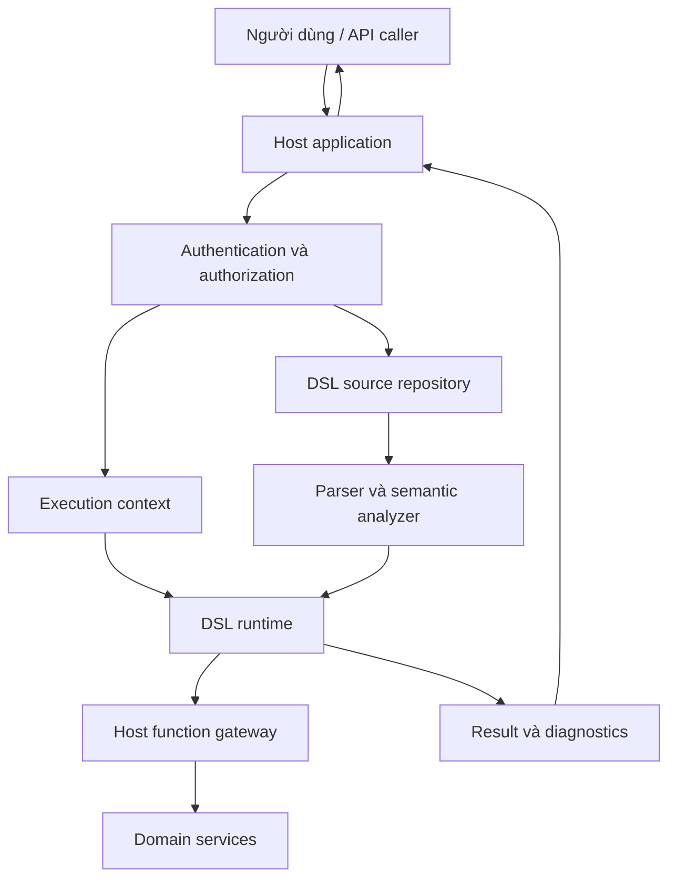

# Nhúng DSL vào ứng dụng

Một DSL (*Domain-Specific Language*) thường được xây dựng để mô tả một nhóm tác vụ trong một miền cụ thể: biểu thức tính toán, quy tắc nghiệp vụ, workflow, truy vấn, cấu hình hoặc chính sách. Khi DSL đã có parser và runtime, bước tiếp theo thường là đưa khả năng đó vào một ứng dụng lớn hơn để người dùng có thể viết, lưu, kiểm tra và thực thi các chương trình DSL ngay trong sản phẩm.

**Nhúng DSL vào ứng dụng** (*embedding a DSL*) là việc tích hợp parser, compiler hoặc interpreter của DSL vào một ứng dụng chủ (*host application*), đồng thời cung cấp giao diện lập trình để ứng dụng kiểm soát quá trình phân tích và thực thi. Ứng dụng chủ chịu trách nhiệm về danh tính người dùng, dữ liệu, vòng đời request, quyền truy cập và giao diện sản phẩm. DSL runtime chịu trách nhiệm hiểu và thực hiện các cấu trúc ngôn ngữ đã được định nghĩa.

Ví dụ, một nền tảng quản lý đơn hàng có thể cho phép quản trị viên viết quy tắc:

```text
rule "free-shipping" {
    when order.total >= 500000
         and customer.membership == "gold"
    then shipping.fee = 0
}
```

Ứng dụng chủ tải quy tắc, kiểm tra cú pháp và kiểu, cung cấp dữ liệu order/customer, rồi yêu cầu runtime đánh giá. Kết quả được trả về dưới dạng dữ liệu có cấu trúc để phần nghiệp vụ quyết định bước tiếp theo.

Nhúng DSL không chỉ là gọi parser từ code. Cần thiết kế ranh giới giữa ngôn ngữ và ứng dụng: dữ liệu nào được đưa vào runtime, hàm host nào được phép gọi, lỗi được ánh xạ ra sao, chương trình tồn tại trong bao lâu và cách giới hạn tác động của một lần thực thi.

## 1. Vì sao nhúng DSL vào ứng dụng?

Nếu người dùng nghiệp vụ cần thay đổi quy tắc thường xuyên, việc yêu cầu developer sửa source code và phát hành lại ứng dụng cho mỗi thay đổi có thể làm quy trình chậm. Một DSL cho phép biểu diễn phần logic có thể cấu hình thành dữ liệu được quản lý độc lập với bản build ứng dụng.

Các trường hợp sử dụng phổ biến:

- Công cụ tính giá cho phép người dùng định nghĩa công thức và điều kiện chiết khấu.
- Nền tảng workflow cho phép cấu hình các bước và nhánh xử lý.
- Ứng dụng phân tích cho phép viết truy vấn theo mô hình dữ liệu của sản phẩm.
- Hệ thống policy cho phép quản trị viên khai báo điều kiện truy cập.
- Công cụ báo cáo cho phép tạo phép tính và bộ lọc riêng.
- Nền tảng tích hợp cho phép mô tả mapping và transformation.
- Ứng dụng cấu hình cho phép khai báo resource, dependency và deployment rules.

Nhúng DSL có thể mang lại:

1. **Khả năng mở rộng:** thêm hoặc sửa quy tắc mà không phải sửa toàn bộ ứng dụng.
2. **Tính biểu đạt theo miền:** người dùng làm việc với thuật ngữ như Order, Customer, Region hoặc Approval.
3. **Kiểm soát:** ứng dụng quyết định DSL được phép truy cập dữ liệu và thao tác nào.
4. **Tái sử dụng:** cùng một runtime phục vụ nhiều workflow hoặc tenant.
5. **Tích hợp giao diện:** editor, validation và diagnostics có thể nằm ngay trong sản phẩm.
6. **Quản trị:** chương trình DSL có thể được version hóa, review, audit và rollback.

DSL không nên được thêm chỉ vì một nhóm muốn tránh viết code. Nếu logic ổn định, phức tạp hoặc đòi hỏi quyền truy cập quá rộng, API nội bộ hoặc code thông thường có thể phù hợp hơn. DSL hữu ích khi có một tập hành vi đủ rõ để mô hình hóa, giới hạn và hỗ trợ người dùng.

## 2. Host application và DSL runtime

Ứng dụng chủ và DSL runtime có trách nhiệm khác nhau.

**Host application** thường quản lý:

- Người dùng, tenant và session.
- Xác thực và authorization.
- Lưu trữ source DSL và phiên bản.
- Cung cấp dữ liệu nghiệp vụ.
- Giao diện chỉnh sửa và thực thi.
- Transaction và workflow bên ngoài.
- Logging, audit và observability.
- Hạn mức sử dụng và billing nếu có.

**DSL runtime** thường quản lý:

- Lexer và parser.
- AST hoặc IR.
- Name resolution và type checking.
- Validation ngữ nghĩa.
- Evaluation hoặc compilation.
- Diagnostic và source location.
- Runtime context.
- Giới hạn thực thi được hỗ trợ.
- Kết quả và thông tin giải thích.

Một nguyên tắc quan trọng là host không nên để DSL tự truy cập toàn bộ object nội bộ của ứng dụng. Thay vào đó, host công bố một API nhỏ, có kiểu và có quyền rõ ràng.



Host điều phối lần thực thi. Runtime nhận source đã được chọn, context đã được giới hạn và các capability được cấp. Khi DSL cần dữ liệu hoặc thao tác nghiệp vụ, runtime gọi qua gateway do host quản lý.

## 3. Các mô hình tích hợp

Có nhiều cách nhúng DSL. Việc chọn mô hình phụ thuộc vào độ tin cậy của chương trình, yêu cầu hiệu năng, khả năng cô lập và công nghệ runtime.

### Thư viện chạy trong cùng process

Parser và interpreter được nhúng trực tiếp dưới dạng library trong ứng dụng.

Ưu điểm:

- Gọi hàm nhanh, không cần IPC.
- Chia sẻ kiểu dữ liệu và object model có kiểm soát.
- Dễ tích hợp transaction context và tracing.
- Đơn giản khi triển khai một service.

Hạn chế:

- Lỗi runtime hoặc memory leak có thể ảnh hưởng process host.
- Cô lập tài nguyên khó hơn.
- Chương trình DSL không được phép có khả năng truy cập trực tiếp vào host internals.
- Cần quản lý thread safety và trạng thái dùng chung.

Mô hình này phù hợp khi DSL bị giới hạn chặt, runtime đáng tin cậy và các host function được thiết kế an toàn.

### Process worker riêng

Ứng dụng chủ gửi source hoặc IR tới một process worker qua IPC, sau đó nhận kết quả.

Ưu điểm:

- Crash trong worker ít ảnh hưởng process host.
- Có thể đặt timeout và kết thúc worker.
- Dùng user hệ điều hành hoặc filesystem policy riêng.
- Có thể scale worker độc lập.

Hạn chế:

- Cần serialize input và output.
- Có overhead IPC.
- Cần quản lý worker pool và phiên bản protocol.
- Cần xử lý worker crash và kết quả không rõ trạng thái.

### Runtime service riêng

DSL được thực thi bởi một service chuyên dụng. Host gửi request qua HTTP, gRPC hoặc message broker.

Mô hình này phù hợp khi nhiều ứng dụng cùng sử dụng DSL, cần scale độc lập hoặc muốn tách vòng đời runtime khỏi host. Cần thiết kế authentication giữa service, tenant isolation, timeout, retry và version compatibility.

### WebAssembly hoặc sandbox runtime

Nếu DSL được biên dịch sang một dạng module sandbox, host có thể cung cấp các import function giới hạn. Module chỉ có khả năng mà host cho phép.

Cách này hữu ích cho plugin hoặc logic ít tin cậy, nhưng host function vẫn phải kiểm tra quyền và tài nguyên.

### Compile ahead of time

Host có thể biên dịch DSL thành bytecode, IR đã chuẩn hóa hoặc artifact executable trước khi thực thi. Việc này giảm chi phí parse và semantic analysis lặp lại, nhưng cần gắn artifact với compiler version, schema version và policy version.

## 4. Chọn mô hình tích hợp theo yêu cầu

| Tiêu chí | In-process library | Process worker | Runtime service | Sandbox module |
|---|---|---|---|---|
| Độ trễ gọi | Thấp | Có IPC | Có network | Thấp đến vừa |
| Cô lập process | Thấp | Có | Có | Tùy runtime |
| Chia sẻ object host | Có kiểm soát | Qua serialization | Qua protocol | Qua imports |
| Scale độc lập | Hạn chế | Có | Có | Theo host |
| Vận hành | Đơn giản hơn | Cần worker lifecycle | Cần service operations | Cần runtime policy |
| Phù hợp | DSL nội bộ có giới hạn | Workload cần process boundary | Nhiều host/client | Plugin hoặc code ít tin cậy |

Không có lựa chọn duy nhất đúng. Một ứng dụng có thể dùng in-process parser và validator nhưng chuyển execution sang worker riêng. Hoặc dùng service riêng cho execution nhưng nhúng editor và diagnostics vào host.

Cần xác định rõ ranh giới chịu trách nhiệm cho từng bước thay vì chỉ chọn một công nghệ đóng gói.

## 5. Thiết kế API nhúng

Host thường cần một API ổn định để sử dụng DSL runtime. API này nên phản ánh các giai đoạn riêng biệt.

Một interface khái niệm có thể gồm:

```java
public interface DslEngine {
    ParsedProgram parse(String source, SourceInfo sourceInfo);

    ValidationResult validate(
        ParsedProgram program,
        DslContext context
    );

    ExecutionResult execute(
        ValidatedProgram program,
        DslContext context,
        ExecutionOptions options
    );
}
```

Đây là ví dụ thiết kế, không phải API của một thư viện cụ thể.

Tách parse, validate và execute có một số lợi ích:

- Có thể hiển thị lỗi cú pháp trước khi chạy.
- Có thể validate khi người dùng lưu source.
- Có thể cache artifact đã phân tích.
- Có thể kiểm tra quyền trước khi execute.
- Có thể dùng cùng AST cho editor và runtime.
- Có thể kiểm tra trạng thái chương trình mà không gây side effect.

Nếu API chỉ cung cấp một hàm execute(source), host khó kiểm soát chi tiết lỗi, thời gian từng giai đoạn và việc tái sử dụng kết quả parse.

## 6. Xây dựng facade và giữ ranh giới nội bộ

Host nên cung cấp một facade thay vì để mọi module gọi parser, interpreter hoặc evaluator trực tiếp.

Facade có thể chịu trách nhiệm:

1. Xác thực caller.
2. Tìm đúng DSL artifact và version.
3. Kiểm tra quyền đọc và execute.
4. Tạo execution context.
5. Chọn runtime version.
6. Parse hoặc lấy parsed artifact từ cache.
7. Validate theo schema và policy hiện hành.
8. Thực thi với resource limits.
9. Thu thập result, diagnostics và trace.
10. Ghi audit và trả response.

Facade cũng giúp thay đổi implementation runtime mà không buộc mọi module của host thay đổi theo.

Không nên để business service tự tạo ExecutionContext với quyền tùy ý. Context nên được tạo bởi một thành phần trung tâm có thể xác thực principal và cấp capability.

## 7. Quản lý source DSL và vòng đời chương trình

Host cần quyết định DSL source được lưu ở đâu và gắn với đối tượng nghiệp vụ nào.

Một record chương trình có thể chứa:

- Program ID.
- Tenant hoặc workspace ID.
- Tên và mô tả.
- DSL source.
- Language version.
- Compiler/runtime compatibility.
- Schema version hoặc dependency references.
- Người tạo và người sửa.
- Thời điểm cập nhật.
- Trạng thái draft, validated, published hoặc disabled.
- Version number hoặc immutable revision.

Không nên chỉ lưu một bản source bị ghi đè liên tục nếu cần audit hoặc rollback. Một mô hình version bất biến giúp xác định chính xác chương trình nào đã được thực thi.

### Draft và published version

Người dùng có thể chỉnh sửa draft trong khi production tiếp tục dùng published version. Khi publish, host có thể:

1. Parse và validate.
2. Chạy test hoặc simulation.
3. Kiểm tra policy.
4. Yêu cầu approval nếu cần.
5. Tạo revision immutable.
6. Chuyển active pointer sang revision mới.

Execution đang chạy nên tiếp tục dùng version đã resolve lúc bắt đầu, không tự đổi sang source mới giữa chừng.

## 8. Parse và validate trong host application

Host có thể gọi parser ngay khi người dùng nhập, khi lưu, khi publish hoặc trước khi thực thi.

Các thời điểm này phục vụ mục tiêu khác nhau:

- **Editor feedback:** parse nhanh để hiển thị lỗi cú pháp.
- **Save validation:** xác nhận source có thể lưu và tham chiếu hợp lệ.
- **Publish validation:** kiểm tra đầy đủ schema, quyền và dependency.
- **Execution validation:** xác nhận context và policy hiện tại vẫn hợp lệ.

Validation khi publish không thay thế validation khi execute. Schema, quyền hoặc dữ liệu có thể thay đổi sau lúc publish.

### Diagnostic contract

Runtime nên trả diagnostic có cấu trúc thay vì chỉ trả một chuỗi message:

```json
{
  "severity": "error",
  "code": "DSL-TYPE-012",
  "message": "Expected Decimal but found String",
  "source": "discount.dsl",
  "range": {
    "startLine": 8,
    "startColumn": 14,
    "endLine": 8,
    "endColumn": 25
  }
}
```

Host có thể dùng cùng diagnostic để hiển thị trong editor, API response, log hoặc review workflow. Source range cần tuân theo quy ước encoding mà parser và editor thống nhất.

## 9. Execution context – dữ liệu và danh tính khi chạy

Execution context là tập thông tin mà DSL được phép sử dụng trong một lần thực thi.

Nó có thể chứa:

- Principal hoặc service identity.
- Tenant ID.
- Program ID và revision.
- Input data đã được kiểm tra.
- Environment và locale.
- Clock hoặc timestamp.
- Correlation ID.
- Capability được cấp.
- Deadline và resource budget.
- Schema và policy versions.

Ví dụ khái niệm:

```java
ExecutionContext context = ExecutionContext.builder()
    .principal(authenticatedUser)
    .tenantId(currentTenant.id())
    .programRevision(program.revision())
    .input("order", orderSnapshot)
    .capability(orderReadCapability)
    .deadline(deadline)
    .correlationId(requestId)
    .build();
```

Context nên được tạo cho từng execution và coi là immutable sau khi bắt đầu. Điều này giúp tránh một request thay đổi quyền hoặc dữ liệu của request khác.

Không nên truyền toàn bộ HTTP request, session object hoặc dependency container của ứng dụng vào DSL. Chỉ truyền những giá trị mà chương trình cần.

## 10. Truyền dữ liệu giữa host và DSL

Có nhiều cách trao đổi dữ liệu:

- Map hoặc object có schema.
- Typed input/output models.
- JSON hoặc một wire format.
- Host function nhận argument.
- Capability handle tới domain service.
- Event hoặc message.

### Typed data transfer

Với dữ liệu có cấu trúc ổn định, typed model giúp kiểm tra kiểu ở compile time hoặc khi validate.

Ví dụ, host chuyển OrderSnapshot vào context. DSL chỉ đọc các field được công bố như id, total và customerTier.

### Serialization boundary

Nếu runtime nằm trong process khác hoặc service riêng, dữ liệu cần serialize. Contract phải định nghĩa:

- Field names và types.
- Optional và nullable semantics.
- Decimal precision.
- Date/time timezone.
- Enum representation.
- Binary encoding.
- Version compatibility.
- Giới hạn payload size.

Không nên serialize tùy ý toàn bộ object graph của host. Nó có thể chứa cycle, lazy proxy, database connection hoặc dữ liệu nội bộ không nên xuất hiện trong runtime.

### Snapshot dữ liệu

Nếu chương trình đọc nhiều field, host có thể tạo snapshot nhất quán trước khi execute. Điều này tránh các predicate đọc các phiên bản dữ liệu khác nhau trong cùng một lần chạy.

## 11. Host functions và extension API

DSL thường cần gọi một số hàm do ứng dụng chủ cung cấp. Ví dụ, lấy thông tin vùng, kiểm tra hạn mức hoặc tính thuế.

Host function là API được đăng ký với runtime:

```text
function taxFor(region: Region, amount: Decimal): Decimal
function isPreferredCustomer(customerId: UUID): Boolean
function lookupShippingZone(postalCode: String): ShippingZone
```

Một function registry có thể chứa:

- Tên và signature.
- Kiểu argument và return.
- Mô tả.
- Quyền cần thiết.
- Chi phí hoặc budget.
- Có được phép gọi trong context nào.
- Hành vi lỗi.
- Có thuần hay có side effect.
- Có thể cache hay không.

### Pure function

Pure function không thay đổi trạng thái bên ngoài và cùng input cho cùng output. Chúng dễ test, cache và replay.

Ví dụ, tính phần trăm chiết khấu từ tier và total có thể là pure function.

### Function có tác dụng phụ

Gửi email, tạo payment hoặc ghi database là side effect. Nên cân nhắc tách thành command hoặc action được host thực thi sau khi DSL trả quyết định. Nếu DSL được phép gọi trực tiếp, cần idempotency, authorization, audit và retry semantics rõ ràng.

## 12. Capability-based integration

Thay vì cung cấp cho DSL một service object có quyền rộng, host có thể cấp capability đại diện cho quyền cụ thể.

Ví dụ:

```text
capabilities = [
    ReadOrder(orderId),
    ReadCustomerProfile(customerId),
    CalculateShipping()
]
```

DSL chỉ có thể sử dụng những capability được cấp cho execution hiện tại.

Capability có thể giới hạn:

- Resource cụ thể.
- Operation được phép.
- Tenant.
- Thời hạn.
- Số lần gọi.
- Kích thước dữ liệu.
- Phạm vi field.

Cách thiết kế này giảm nguy cơ confused deputy: host service có quyền cao nhưng vẫn phải xác minh caller và resource scope trước khi thực hiện hành động.

## 13. Error handling và exception boundary

Lỗi từ DSL có thể xuất hiện ở nhiều giai đoạn:

| Loại lỗi | Ví dụ | Cách host xử lý |
|---|---|---|
| Parse error | Thiếu dấu đóng block | Trả diagnostic về editor |
| Semantic error | Không tìm thấy symbol | Không cho publish hoặc execute |
| Type error | String được dùng như Decimal | Báo vị trí và kiểu mong đợi |
| Runtime error | Chia cho zero | Kết thúc execution với diagnostic |
| Host function error | Domain service từ chối request | Ánh xạ thành lỗi có mã |
| Authorization error | Thiếu capability | Từ chối thao tác và audit |
| Resource limit | Hết deadline hoặc memory | Hủy execution |
| Infrastructure error | Worker mất kết nối | Phân loại retry hoặc failed |

Không nên để exception nội bộ, SQL message hoặc stack trace chứa secret đi thẳng tới người dùng. Host cần ánh xạ lỗi thành mã ổn định, message phù hợp và correlation ID.

### Không nuốt lỗi

Nếu host function gặp lỗi nhưng runtime chuyển thành giá trị mặc định mà không có quy tắc rõ, chương trình có thể đưa ra quyết định sai. Lỗi cần được truyền theo semantics đã định nghĩa: fail execution, trả Result type hoặc dùng nhánh lỗi tường minh.

## 14. Timeout, cancellation và resource limits

DSL do người dùng cung cấp có thể có vòng lặp dài, biểu thức đệ quy hoặc truy vấn quá lớn. Host cần đặt giới hạn cho mỗi lần chạy.

Các giới hạn thường gặp:

- Wall-clock deadline.
- CPU time hoặc instruction budget.
- Memory và heap.
- Số lần gọi host function.
- Số record đọc hoặc xử lý.
- Kích thước input và output.
- Số task hoặc recursion depth.
- Network request count và timeout.

### Cancellation

Khi người dùng hủy request hoặc HTTP client ngắt kết nối, host có thể truyền cancellation token tới runtime. Runtime cần kiểm tra token ở các điểm an toàn.

Nếu interpreter không thể dừng giữa một vòng lặp, cần có cơ chế instruction budget hoặc thực thi trong process có thể terminate.

### Cleanup

Sau khi execution kết thúc hoặc bị hủy, host cần giải phóng context, temporary files, handles và quota. Với worker pool, cần reset state trước khi tái sử dụng worker.

## 15. Security và sandboxing

Nhúng interpreter trong host process không tự động tạo sandbox. Nếu DSL có thể gọi Java reflection, đọc filesystem hoặc mở socket tùy ý, nó có thể truy cập tài nguyên ngoài phạm vi dự kiến.

Một thiết kế an toàn thường kết hợp:

- DSL chỉ cung cấp các construct cần thiết.
- Không expose reflection hoặc arbitrary class loading cho chương trình không tin cậy.
- Host function theo allowlist.
- Capability giới hạn resource và operation.
- Execution context gắn principal và tenant.
- Filesystem/network policy nếu runtime có I/O.
- Process/container/VM boundary khi cần.
- Resource quota và deadline.
- Audit cho thao tác nhạy cảm.

### Trust levels

Không phải mọi chương trình DSL có cùng mức tin cậy. Một số được viết bởi developer nội bộ; một số được tạo bởi quản trị viên tenant; một số đến từ người dùng bên ngoài.

Có thể phân loại theo nguồn và cấp quyền khác nhau. Tuy nhiên, không nên chỉ dựa vào tên người tạo để bỏ qua runtime controls. Mọi execution cần có policy được xác định rõ.

### Defense in depth

Nếu một lớp bị cấu hình sai, các lớp khác vẫn có thể hạn chế tác động. Ví dụ, allowlist host function kết hợp với worker process riêng và network default-deny sẽ tạo nhiều ranh giới độc lập.

## 16. Multi-tenancy và cô lập dữ liệu

Nếu một host application phục vụ nhiều tenant, mọi execution cần gắn tenant identity.

Các điểm cần kiểm soát:

- Program revision thuộc tenant nào.
- Người dùng có quyền execute chương trình không.
- Input data thuộc tenant nào.
- Capability chỉ truy cập resource tenant được phép.
- Cache key không dùng chung dữ liệu riêng tư ngoài ý muốn.
- Execution result chỉ trả về đúng caller.
- Log và trace không làm lộ dữ liệu giữa tenant.

Không nên tin tenant ID do DSL source hoặc client tự khai báo. Host lấy tenant từ security context đã xác thực và truyền vào execution context.

Nếu dùng shared runtime hoặc worker pool, state của tenant trước phải được xóa trước khi worker phục vụ tenant khác. Cache chứa dữ liệu nhạy cảm cần key theo tenant hoặc không được chia sẻ.

## 17. Thread safety và concurrency

Một ứng dụng có thể thực thi nhiều chương trình DSL cùng lúc. Cần phân biệt trạng thái dùng chung và trạng thái riêng cho mỗi execution.

Thông thường có thể chia:

- Engine configuration: immutable và dùng chung.
- Compiled program: immutable nếu runtime hỗ trợ.
- Execution context: riêng từng lần chạy.
- Variable environment: riêng từng lần chạy.
- Host service: thread-safe hoặc được truy cập qua gateway.
- Diagnostics/result builder: riêng từng lần chạy.

Không nên lưu biến chương trình hoặc current user trong singleton mutable của runtime. Hai request đồng thời có thể ghi đè context của nhau.

### Compile cache và execution cache

Compiled artifact có thể dùng chung nếu key chứa source, compiler version, schema và options. Execution result chỉ nên cache khi semantics cho phép, input đầy đủ và không có side effect.

### Backpressure

Nếu số execution vượt khả năng worker, host cần queue, giới hạn concurrency hoặc từ chối sớm. Không nên tạo số lượng thread không giới hạn cho mỗi request.

## 18. Transaction và side effects

DSL có thể yêu cầu cập nhật dữ liệu nghiệp vụ. Cần xác định transaction boundary giữa host và runtime.

Một cách an toàn là:

1. Host đọc dữ liệu và tạo input snapshot.
2. Runtime đánh giá DSL mà không ghi dữ liệu trực tiếp.
3. Runtime trả decision hoặc command có cấu trúc.
4. Host kiểm tra lại authorization và trạng thái dữ liệu.
5. Host thực hiện command trong transaction thích hợp.
6. Host ghi audit và trả kết quả.

Cách này tách phần quyết định khỏi phần thay đổi trạng thái. Nó giúp dry run, replay và kiểm thử dễ hơn.

Nếu DSL cần nhiều thao tác có side effect, có thể dùng command plan hoặc saga. Cần xác định idempotency key, thứ tự thực hiện, retry và compensation. Không nên giữ một database transaction mở trong suốt thời gian interpreter chạy lâu hoặc chờ external service.

## 19. Configuration và dependency injection

Runtime cần cấu hình như grammar version, builtin functions, type registry, limits và logging. Host có thể tạo engine qua dependency injection.

Ví dụ khái niệm:

```java
DslEngine engine = DslEngine.builder()
    .languageVersion("2")
    .functionRegistry(functionRegistry)
    .typeRegistry(typeRegistry)
    .limits(defaultLimits)
    .diagnosticListener(diagnosticListener)
    .build();
```

Engine có thể được khởi tạo một lần nếu cấu hình immutable và thread-safe. Các dependency theo request như principal, tenant, input data và deadline phải được truyền qua execution context, không lưu trong engine singleton.

Cần phân biệt cấu hình của engine với cấu hình của một execution. Engine config xác định khả năng chung; execution config xác định giới hạn và quyền của lần chạy cụ thể.

## 20. Tích hợp với editor và giao diện ứng dụng

Một ứng dụng có thể cung cấp editor DSL ngay trong sản phẩm. Editor có thể sử dụng language service để:

- Syntax highlighting.
- Completion.
- Hover documentation.
- Diagnostics.
- Go to definition.
- Formatting.
- Validation khi lưu.
- Preview kết quả.

Host có thể gọi language server riêng hoặc dùng cùng parser library để tạo diagnostics. Nếu editor và runtime dùng hai phiên bản grammar khác nhau, người dùng có thể thấy code được editor chấp nhận nhưng runtime từ chối.

Nên chia sẻ language version và contract giữa editor service và execution service. Diagnostics nên có source range, severity và code ổn định để UI có thể hiển thị nhất quán.

### Preview và dry run

Trước khi publish, người dùng có thể chạy thử trên dữ liệu mẫu hoặc snapshot được phép. Preview nên phân biệt rõ kết quả mô phỏng với tác dụng phụ thực tế. Các host function gây side effect cần bị disable hoặc thay bằng mock trong dry run.

## 21. API đồng bộ và bất đồng bộ

Một execution ngắn có thể chạy đồng bộ và trả kết quả ngay. Một chương trình dài hoặc cần nhiều tài nguyên nên chạy bất đồng bộ.

### Synchronous execution

Client gọi API, host thực thi DSL và trả result trong cùng request. Cách này đơn giản nhưng cần deadline phù hợp và giới hạn payload.

### Asynchronous execution

Host tạo execution ID, đưa công việc vào queue và trả trạng thái accepted. Client truy vấn status hoặc nhận event khi hoàn tất.

Một vòng đời có thể là:

```text
SUBMITTED -> QUEUED -> RUNNING -> COMPLETED
                              -> FAILED
                              -> CANCELLED
                              -> TIMED_OUT
```

Execution record cần lưu program revision, input reference, context metadata, trạng thái, thời điểm và kết quả. Không nên giữ toàn bộ input nhạy cảm trong log hoặc status API nếu chỉ cần reference an toàn.

### Retry và duplicate requests

Nếu client không nhận được response và gửi lại request, host cần biết đây là execution mới hay retry của cùng một yêu cầu. Idempotency key hoặc request ID giúp tránh tạo hai execution và thực hiện side effect lặp.

## 22. Observability và audit

Khi DSL được nhúng vào ứng dụng, cần theo dõi cả host request và từng giai đoạn runtime.

Thông tin hữu ích:

- Execution ID và correlation ID.
- Tenant và principal theo chính sách masking.
- Program ID và revision.
- Language/compiler/runtime version.
- Parse, validation và execution duration.
- CPU, memory và instruction usage.
- Host function calls.
- Số record hoặc output bytes.
- Trạng thái cuối và error code.
- Cache hit/miss nếu có.

### Structured logs

Log nên có field ổn định để lọc và liên kết. Tránh ghi toàn bộ DSL source hoặc input data nhạy cảm nếu không cần.

### Tracing

Nếu host gọi runtime service hoặc worker, trace context nên được truyền qua IPC hoặc network. Các span có thể đại diện cho parse, validate, execute và host function invocation.

### Decision trace

Với DSL luật hoặc quyết định, có thể ghi lại predicate nào được đánh giá và nhánh nào được chọn. Cần giới hạn dữ liệu ghi và quyền xem trace.

## 23. Versioning và tương thích

Host và DSL runtime có thể được phát hành độc lập. Cần xác định tương thích giữa:

- DSL language version.
- Parser/compiler version.
- Runtime version.
- Host API version.
- Builtin function registry version.
- Schema version.
- Program revision.

Một chương trình được tạo theo language version cũ có thể không chạy giống nhau trên runtime mới nếu semantics thay đổi. Program metadata nên lưu language version và host API contract mà nó phụ thuộc.

### Migration

Khi nâng runtime:

1. Liệt kê các program revision đang được sử dụng.
2. Kiểm tra syntax và semantic compatibility.
3. Chạy test hoặc replay trên input đại diện.
4. Ghi nhận diagnostic mới.
5. Có thể migrate source bằng tool có review.
6. Giữ khả năng rollback về runtime/version cũ nếu cần.

Không nên âm thầm thay semantics của một chương trình đang chạy mà không có kế hoạch versioning.

## 24. Caching và tối ưu hiệu năng

Parsing và compilation có thể tốn chi phí nếu cùng một chương trình được thực thi nhiều lần. Host có thể cache AST, validated program hoặc compiled artifact.

Cache key thường cần bao gồm:

- Source content hoặc immutable program revision.
- Language/compiler version.
- Schema version.
- Builtin function registry version.
- Compilation options.
- Target runtime.
- Policy metadata ảnh hưởng compile.

Không nên cache execution result nếu chương trình phụ thuộc dữ liệu thay đổi, thời gian, randomness hoặc side effect.

### Pooling

Nếu dùng worker process, có thể dùng pool để giảm chi phí khởi động. Worker cần reset state và được thay thế định kỳ hoặc khi có lỗi. Nếu không thể chứng minh reset an toàn, hủy worker sau mỗi execution hoặc sau số lần chạy được giới hạn.

### Đo trước khi tối ưu

Đo riêng thời gian parse, validation, compilation, execution và host function calls. Nút thắt có thể nằm ở database hoặc network chứ không phải interpreter.

## 25. Quản lý dữ liệu và schema evolution

DSL thường truy cập domain model của host. Khi schema thay đổi, chương trình DSL cũ có thể không còn hợp lệ.

Cần quản lý:

- Field được thêm, đổi tên hoặc xóa.
- Type và nullability thay đổi.
- Enum values mới.
- Quy tắc quyền thay đổi.
- Builtin function signature thay đổi.
- Mapping từ DSL type sang host type.

Có thể dùng versioned schema hoặc compatibility adapter để giữ chương trình cũ hoạt động trong thời gian migration.

Không nên cho DSL truy cập trực tiếp entity persistence của ORM. Entity có thể chứa lazy loading, proxy, internal fields hoặc quan hệ vòng. Dùng DTO/snapshot có schema công khai sẽ ổn định và an toàn hơn.

## 26. Testing khi nhúng DSL

Test cần bao phủ cả language runtime và tích hợp với host.

### Unit tests cho DSL

Kiểm tra parser, type checker, evaluator, builtin functions và diagnostics bằng input nhỏ có expected result.

### Host integration tests

Kiểm tra host tạo context, cấp capability, gọi runtime và xử lý result đúng.

### Contract tests

Xác nhận host function registry, input schema và output schema tương thích với chương trình DSL.

### Security tests

Kiểm tra chương trình không thể đọc field ngoài quyền, gọi function chưa đăng ký, truy cập tenant khác hoặc vượt filesystem/network boundary.

### Concurrency tests

Chạy nhiều execution đồng thời với principal và tenant khác nhau để phát hiện state leakage.

### Cancellation and recovery tests

Hủy execution, làm worker crash, restart service và xác nhận trạng thái được lưu hoặc phục hồi đúng.

### Deterministic tests

Cùng source, context snapshot và runtime version phải cho kết quả xác định nếu DSL và host functions được thiết kế thuần.

## 27. Ví dụ end-to-end: nhúng DSL trong ứng dụng Java

Giả sử ứng dụng Java có một dịch vụ tính phí giao hàng. Quản trị viên lưu một chương trình DSL xác định mức phí theo khu vực và hạng thành viên.

DSL:

```text
decision "shipping-fee" {
    when customer.membership == "gold":
        outcome 0

    when order.total >= 1000000:
        outcome 0

    when destination.region == "remote":
        outcome 50000

    otherwise:
        outcome 20000
}
```

Host service có thể thực hiện:

```java
public final class ShippingQuoteService {
    private final DslEngine engine;
    private final ProgramRepository programs;

    public ShippingQuoteService(
        DslEngine engine,
        ProgramRepository programs
    ) {
        this.engine = engine;
        this.programs = programs;
    }

    public Money quote(
        Principal principal,
        OrderSnapshot order,
        CustomerSnapshot customer,
        Destination destination
    ) {
        ProgramRevision program =
            programs.getActive("shipping-fee", principal.tenantId());

        DslContext context = DslContext.builder()
            .principal(principal)
            .tenantId(principal.tenantId())
            .input("order", order)
            .input("customer", customer)
            .input("destination", destination)
            .build();

        ValidationResult validation =
            engine.validate(program, context);

        if (!validation.isValid()) {
            throw new InvalidProgramException(validation.diagnostics());
        }

        ExecutionResult result =
            engine.execute(program, context, ExecutionOptions.defaults());

        return result.requireValue(Money.class);
    }
}
```

Ví dụ này minh họa cách host tìm program revision, tạo context có tenant và input, validate rồi execute. Một triển khai production còn cần kiểm tra quyền execute, deadline, resource limits, error mapping, audit, cache và transaction boundary.

Điểm quan trọng là ShippingQuoteService không đưa repository hoặc toàn bộ application context vào DSL. Nó chỉ cung cấp dữ liệu cần thiết và nhận một kết quả có kiểu.

## 28. Triển khai và vận hành

Nhúng DSL ảnh hưởng tới build, deploy và runtime operations.

Các thành phần cần đóng gói:

- Parser/compiler/runtime library hoặc worker image.
- Grammar và language version.
- Builtin function registry.
- Schema metadata.
- Program storage migration.
- Host API contract.
- Configuration và resource limits.
- Monitoring và audit integration.

Nếu runtime chạy trong process, nâng version thường gắn với deploy host application. Nếu runtime là service riêng, cần quản lý protocol compatibility và rollout độc lập.

### Rollout

Có thể triển khai runtime mới cho một nhóm execution trước, so sánh latency và kết quả trên test hoặc shadow traffic, sau đó mở rộng dần. Với quyết định nghiệp vụ quan trọng, không nên tự động chuyển mọi program sang runtime mới mà chưa kiểm tra compatibility.

### Rollback

Cần biết có thể quay lại runtime version trước hay không và program revision nào tương thích. Rollback runtime không nhất thiết đảo ngược side effect đã xảy ra; các action nghiệp vụ cần cơ chế compensation riêng.

## 29. Những lỗi tích hợp thường gặp

**Expose toàn bộ host object cho DSL.** Chương trình có thể truy cập dữ liệu hoặc method không dự kiến. Dùng DTO và host API hẹp.

**Trộn engine configuration với execution context.** Dữ liệu hoặc quyền của request trước có thể rò sang request sau. Tạo context riêng cho từng execution.

**Chỉ parse khi execute.** Người dùng phát hiện lỗi quá muộn và host khó phân biệt lỗi publish với lỗi runtime. Tách parse/validate và execute.

**Tin validation cũ.** Schema hoặc policy có thể thay đổi sau publish. Kiểm tra lại những điều kiện phụ thuộc context khi execute.

**Cho host function quyền quá rộng.** Sandbox không bảo vệ được nếu host API cho phép truy cập mọi resource. Dùng capability và authorization theo từng call.

**Không giới hạn tài nguyên.** Vòng lặp hoặc truy vấn lớn có thể làm cạn host. Đặt deadline, instruction budget và quota.

**Chia sẻ mutable state giữa execution.** Nhiều request có thể đọc/ghi lẫn biến. Giữ execution environment riêng và engine config immutable.

**Để DSL thực hiện side effect tùy ý.** Retry hoặc replay có thể gửi lặp hành động. Tách decision khỏi command hoặc dùng idempotency.

**Không xử lý cancellation.** Client ngắt kết nối nhưng worker vẫn chạy và tiêu thụ tài nguyên. Truyền cancellation và có cơ chế terminate.

**Không version hóa program và runtime.** Kết quả cũ khó tái hiện sau khi nâng cấp. Ghi language/runtime/schema version.

**Cache thiếu dependency.** AST hoặc compiled artifact có thể stale sau khi schema/function registry đổi. Đưa các version liên quan vào cache key.

**Log toàn bộ source và input.** Có thể làm lộ dữ liệu nhạy cảm. Dùng structured metadata, masking và retention policy.

## 30. Quy trình thiết kế nhúng DSL vào ứng dụng

Có thể triển khai theo trình tự:

1. Xác định bài toán nghiệp vụ và phần logic phù hợp để biểu diễn bằng DSL.
2. Xác định người viết chương trình và mức độ tin cậy của họ.
3. Chọn mô hình tích hợp: library, process worker, service hoặc sandbox.
4. Định nghĩa host API facade và lifecycle parse/validate/execute.
5. Thiết kế program storage, immutable revisions và language version.
6. Xây dựng execution context chứa principal, tenant, input và deadline.
7. Chuyển dữ liệu qua typed DTO hoặc schema rõ ràng.
8. Đăng ký host functions theo allowlist và capability.
9. Thiết lập error mapping, diagnostics và cancellation.
10. Đặt resource limits và isolation phù hợp threat model.
11. Xác định transaction boundary và cách xử lý side effects.
12. Thiết kế concurrency, worker pool và cache.
13. Tích hợp editor, preview và dry run nếu sản phẩm cần.
14. Bổ sung logging, tracing, audit và metrics.
15. Kiểm thử security, tenant isolation, concurrency và recovery.
16. Quản lý version, migration, rollout và rollback.
17. Theo dõi hiệu năng và cập nhật host API theo compatibility policy.

## 31. Câu hỏi tự kiểm tra

1. Nhúng DSL vào ứng dụng là gì và giải quyết vấn đề nào?
2. Host application và DSL runtime có trách nhiệm khác nhau như thế nào?
3. So sánh in-process library, process worker, runtime service và sandbox module.
4. Vì sao host nên cung cấp facade thay vì để mọi module gọi interpreter trực tiếp?
5. Parse, validate và execute nên được tách như thế nào?
6. Program definition, immutable revision và execution instance khác nhau ra sao?
7. Execution context nên chứa thông tin gì và vì sao cần immutable?
8. Typed DTO và serialization boundary giúp tránh rủi ro nào?
9. Host function registry cần mô tả những metadata gì?
10. Capability-based integration giới hạn quyền truy cập ra sao?
11. Làm thế nào để phân biệt lỗi parse, semantic, runtime và host function?
12. Timeout, cancellation và resource limits bảo vệ host như thế nào?
13. Vì sao in-process interpreter không tự động là sandbox?
14. Multi-tenancy cần được kiểm soát ở program, input, capability, cache và output ra sao?
15. Làm thế nào để tránh mutable state leakage giữa các execution đồng thời?
16. Vì sao nên tách decision result khỏi side effect?
17. API đồng bộ và bất đồng bộ phù hợp với loại workload nào?
18. Cần ghi metadata nào để quan sát và tái hiện một execution?
19. Khi schema hoặc runtime version thay đổi, cần migration và compatibility checks nào?
20. Hãy thiết kế kiến trúc nhúng một DSL tính giá vào ứng dụng thương mại điện tử, nêu API host, context, capability, error handling và giới hạn thực thi.

Nhúng DSL đưa khả năng mô tả quy tắc và hành vi theo miền vào bên trong một ứng dụng mà vẫn giữ host kiểm soát dữ liệu, quyền và vòng đời. Khi ranh giới API rõ ràng, context được giới hạn, execution có thể hủy và mọi capability được kiểm tra, DSL trở thành một phần mở rộng có quản trị của sản phẩm thay vì một đường thực thi không kiểm soát.

