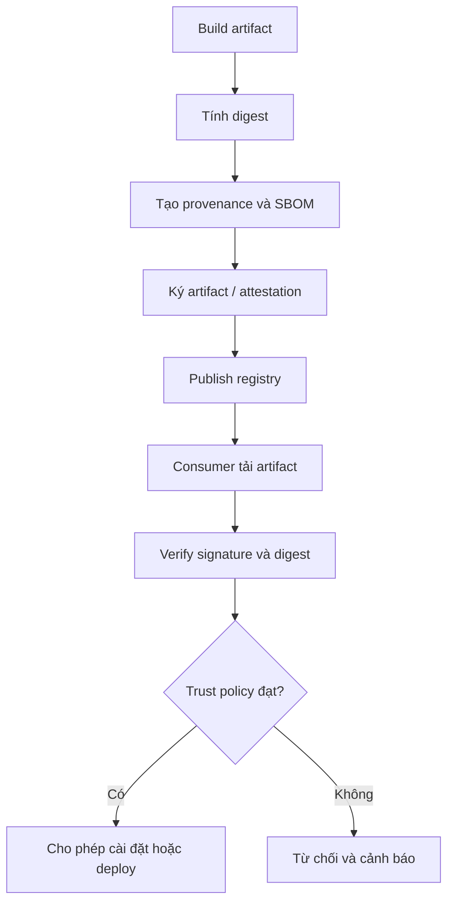

# Chuỗi cung ứng công cụ cho DSL

Một dự án DSL (*Domain-Specific Language*) không chỉ gồm grammar và mã nguồn compiler. Để tạo ra, kiểm thử, đóng gói và phân phối một phiên bản DSL, nhóm phát triển còn phụ thuộc vào parser generator, compiler, build system, package manager, thư viện, plugin, container image, CI runner, artifact registry và nhiều công cụ khác.

**Chuỗi cung ứng công cụ** (*tooling supply chain*) là toàn bộ con người, quy trình, hệ thống và artifact tham gia vào việc xây dựng, kiểm tra, đóng gói, ký, phân phối và triển khai phần mềm. Trong dự án DSL, chuỗi này bao gồm cả công cụ tạo ngôn ngữ lẫn các dependency mà compiler và runtime sử dụng.

Một lỗ hổng trong parser generator, một plugin build bị chiếm quyền, một package giả mạo hoặc một artifact bị thay thế sau khi build đều có thể làm ảnh hưởng tới compiler và các chương trình DSL được thực thi. Vì vậy, bảo mật DSL cần xem xét cả source code lẫn công cụ đã biến source thành artifact chạy được.

Ví dụ, pipeline có thể tạo parser từ grammar, biên dịch compiler, đóng gói runtime và phát hành SDK. Nếu một phiên bản generator không đáng tin cậy được tải trong lúc build, mã parser được sinh ra có thể chứa hành vi ngoài dự kiến dù grammar và source code của dự án không thay đổi.

Bảo vệ chuỗi cung ứng công cụ có mục tiêu bảo đảm rằng artifact được phát hành đến từ source và dependency đã được xác định, được tạo bởi quy trình có thể tin cậy, không bị thay thế và có thể truy vết về nguồn gốc.

## 1. Thành phần của chuỗi cung ứng DSL

Một chuỗi cung ứng DSL thường trải qua nhiều lớp:

- Source repository chứa grammar, compiler, runtime, schema, plugin và test.
- Công cụ phát triển như IDE, formatter, linter và parser generator.
- Build system và package manager.
- Dependency registry và artifact repository.
- CI runner, build worker và container image.
- Công cụ kiểm tra lỗ hổng, license và chất lượng.
- Hệ thống tạo SBOM, provenance và chữ ký.
- Kênh phân phối compiler, runtime, SDK và extension.
- Môi trường triển khai và cập nhật.

Có thể nhìn chuỗi này theo luồng:

```mermaid
flowchart LR
    A["Source và grammar"] --> B["Toolchain và dependencies"]
    B --> C["Build / Generate"]
    C --> D["Test và scan"]
    D --> E["Package"]
    E --> F["SBOM và provenance"]
    F --> G["Sign artifact"]
    G --> H["Artifact registry"]
    H --> I["Verify và deploy"]
    I --> J["Runtime DSL"]
```



Mỗi bước nhận đầu vào, tạo đầu ra và dựa vào một tập quyền nhất định. Bảo mật cần bao phủ cả tính toàn vẹn của dữ liệu, danh tính công cụ, quyền thực thi và khả năng truy vết.

## 2. Vì sao chuỗi cung ứng DSL có rủi ro đặc thù?

Một compiler hoặc runtime DSL có thể thực thi logic do người dùng cung cấp. Nếu toolchain bị xâm phạm, tác động có thể lan từ quá trình build tới mọi chương trình DSL chạy trên nền tảng.

Một số ví dụ:

- Parser generator bị sửa có thể tạo parser chứa mã độc.
- Plugin compiler có thể đọc source, secret hoặc dữ liệu build.
- Package runtime giả mạo có thể thay đổi semantics của DSL.
- CI runner bị chiếm quyền có thể đánh cắp signing key.
- Artifact registry bị ghi đè có thể phân phối compiler không đúng.
- Extension package có thể thực thi mã trong runtime có quyền rộng.
- Container image không được xác minh có thể chứa binary hoặc công cụ bị cài cắm.

DSL thường có thêm các thành phần sinh mã, schema registry và plugin ecosystem. Vì vậy, nhóm cần quản lý không chỉ dependency runtime mà cả công cụ tạo parser, compiler, language server, code generator và các artifact được sinh ra.

## 3. Threat model và tài sản cần bảo vệ

Trước khi áp dụng biện pháp kỹ thuật, cần xác định tài sản và ranh giới tin cậy.

Tài sản quan trọng gồm:

- Source code và lịch sử commit.
- Grammar, schema và API contract.
- Build scripts và generator templates.
- Dependency manifests và lockfiles.
- CI credentials và signing keys.
- Build artifacts và package metadata.
- SBOM, provenance và attestations.
- Release permissions và deployment credentials.
- DSL programs, extension packages và runtime configuration.

Các đối tượng có thể gây rủi ro:

- Attacker bên ngoài gửi pull request độc hại.
- Package maintainer bị chiếm tài khoản.
- Dependency bị takeover hoặc typo-squatting.
- Plugin có quyền vượt quá nhu cầu.
- CI runner dùng chung bị compromise.
- Insider có quyền ghi artifact hoặc ký release.
- Artifact mirror hoặc registry bị thay thế.
- Build script độc hại được đưa vào source.

Threat model nên xác định attacker có thể đọc, sửa, thực thi hoặc phát hành thành phần nào. Từ đó thiết kế quyền tối thiểu và kiểm soát độc lập ở mỗi bước.

## 4. Inventory công cụ và dependency

Không thể bảo vệ thành phần mà nhóm không biết đang sử dụng.

Một inventory tốt nên liệt kê:

- Tên công cụ và nhà cung cấp.
- Phiên bản.
- Nguồn tải.
- Checksum hoặc chữ ký nếu có.
- Mục đích sử dụng.
- Build task hoặc runtime component phụ thuộc.
- Chủ sở hữu và người chịu trách nhiệm cập nhật.
- License.
- Mức độ quan trọng.
- Cách thay thế hoặc cập nhật.

Với DSL, inventory cần bao gồm parser generator, grammar compiler, annotation processor, code generator, formatter, language server framework, plugin, schema compiler và test engine.

### Dependency graph

Build system có thể tạo đồ thị dependency trực tiếp và bắc cầu. Một package được khai báo trực tiếp có thể kéo theo hàng chục dependency khác. Rủi ro không chỉ nằm ở package mà developer chủ động thêm.

Nên có khả năng trả lời:

- Package nào được đưa vào compiler?
- Package nào chỉ dùng trong test?
- Dependency nào đi vào runtime artifact?
- Plugin nào được thực thi trong build?
- Phiên bản nào được dùng trong release?
- Thành phần nào cần cập nhật khi phát hiện lỗ hổng?

## 5. Pinning phiên bản và lockfile

Dependency version cần được kiểm soát để build không tự động nhận phiên bản mới ngoài ý muốn.

Một khai báo range rộng có thể khiến hai lần build cùng source nhận dependency khác nhau. Lockfile ghi nhận phiên bản cụ thể và thường cả thông tin nguồn hoặc checksum.

Ví dụ minh họa:

```text
dependencies:
  parser-generator:
    version: 4.2.1
    source: internal-approved-registry
    checksum: sha256:...
  runtime-library:
    version: 3.8.0
    source: public-registry
    checksum: sha256:...
```

Cú pháp trên chỉ mang tính khái niệm. Mỗi package manager có định dạng lockfile riêng.

Pinning giúp build tái lập hơn nhưng không có nghĩa phiên bản đã pin luôn an toàn. Khi dependency có lỗ hổng, nhóm cần cập nhật có chủ đích, review thay đổi và chạy lại các kiểm tra liên quan.

### Tránh dependency trôi nổi

Không nên dùng dependency không có version rõ ràng, branch mặc định hoặc tag có thể bị di chuyển trong release build. Nếu phải dùng source repository, nên pin commit hash bất biến và xác minh repository thuộc tổ chức đáng tin cậy.

## 6. Package registry và nguồn tải đáng tin cậy

Package manager thường tải dependency từ registry công khai hoặc nội bộ. Nếu nguồn tải không được kiểm soát, attacker có thể đưa package giả mạo hoặc thay đổi package đã phát hành.

Các biện pháp:

- Dùng registry được phê duyệt.
- Cấu hình namespace và scope rõ ràng.
- Chặn hoặc kiểm soát repository không đáng tin cậy.
- Xác minh checksum hoặc chữ ký khi package manager hỗ trợ.
- Dùng proxy hoặc mirror nội bộ có audit.
- Giới hạn ai có quyền publish package.
- Bảo vệ tên package quan trọng khỏi takeover.
- Kiểm tra dependency confusion giữa package nội bộ và package công khai.

### Dependency confusion

Nếu ứng dụng tìm package theo tên mà không phân biệt registry, attacker có thể publish một package công khai trùng tên package nội bộ. Package manager có thể tải nhầm package có version cao hơn hoặc nguồn ưu tiên sai.

Cần cấu hình scope và registry mapping để package nội bộ chỉ được lấy từ nguồn đã định. Không dựa vào tên package đơn thuần để xác định độ tin cậy.

## 7. Bảo vệ parser generator và compiler toolchain

Parser generator và compiler là thành phần đặc biệt quan trọng vì chúng biến grammar hoặc DSL source thành executable code.

Cần kiểm soát:

- Nguồn binary hoặc package.
- Phiên bản và checksum.
- Chữ ký của nhà phát hành nếu có.
- Plugin hoặc extension được nạp.
- Template sinh mã.
- Environment mà generator được chạy.
- Quyền đọc source và ghi output.
- Cách cập nhật và rollback toolchain.

Nếu có thể, build nên dùng toolchain đã được đóng gói trong image bất biến hoặc được tải từ registry nội bộ đã xác minh.

### Generated code cũng là artifact

Mã được sinh từ grammar có thể được commit hoặc đóng gói. Nếu parser generator bị xâm phạm, generated source có thể chứa hành vi độc hại. Vì vậy, thay đổi generated code cần có diff review và provenance về generator version cùng input grammar.

## 8. Build scripts và plugin

Build scripts thường có quyền truy cập filesystem, network, environment variables và credentials của runner. Plugin có thể thực thi mã trong cùng process build.

Một plugin build không đơn thuần là cấu hình. Nó là executable dependency.

Nguyên tắc:

- Chỉ dùng plugin từ nguồn được phê duyệt.
- Pin version plugin.
- Review thay đổi build script.
- Giới hạn quyền của build job.
- Không cấp signing credential cho job không cần.
- Không chạy script không đáng tin cậy trong môi trường có secrets.
- Kiểm tra plugin có tải thêm binary hoặc script từ network hay không.
- Theo dõi hành vi plugin khi nâng cấp.

### Build logic từ pull request

Pull request có thể sửa build script hoặc plugin declaration. Nếu CI chạy mã đó với token có quyền ghi registry, attacker có thể lấy credential hoặc phát hành artifact giả.

Build và test cho pull request không đáng tin cậy nên chạy với quyền tối thiểu, không có secrets release và không có quyền ghi vào cache hoặc registry đáng tin cậy.

## 9. CI runner và build isolation

CI runner là môi trường thực thi source và build scripts. Nếu runner dùng chung nhiều job mà không được reset đúng cách, dữ liệu hoặc credential có thể rò giữa các job.

Các biện pháp:

- Dùng runner ephemeral hoặc workspace sạch.
- Tách job build/test khỏi job release/sign.
- Không chạy untrusted code trên runner giữ credential lâu dài.
- Giới hạn network egress khi có thể.
- Chạy dưới user không có quyền quản trị.
- Dùng container image đã pin theo digest.
- Xóa workspace và temporary credentials sau job.
- Cập nhật runner và host OS.
- Theo dõi hành vi bất thường.

### Build isolation

Có thể dùng container, VM hoặc sandbox để giới hạn filesystem và network. Container giúp đóng gói môi trường nhưng không tự động là ranh giới bảo mật tuyệt đối; quyền của container, kernel, mounted volumes và credentials vẫn cần kiểm soát.

Nếu build cần network để tải dependency, nên giới hạn endpoint và dùng dependency proxy. Build hermetic có thể giảm phụ thuộc network trong lúc thực thi task.

## 10. Hermetic build

**Hermetic build** là build chỉ phụ thuộc vào những đầu vào được khai báo và kiểm soát, không dựa vào trạng thái ngầm của máy chạy.

Các nguồn không xác định thường gặp:

- Tool được tìm qua PATH.
- Environment variable tùy máy.
- Package tải động.
- Locale và timezone.
- Timestamp hiện tại.
- File ngoài workspace.
- Network response.
- Dependency không pin.
- Cache từ nguồn không rõ.

Để build hermetic hơn:

1. Khóa toolchain và dependency.
2. Đưa mọi input vào build graph.
3. Dùng môi trường build xác định.
4. Giới hạn network access.
5. Chuẩn hóa encoding, locale và timezone.
6. Không dùng file ngoài workspace nếu chưa khai báo.
7. Tạo output trong thư mục riêng.
8. Ghi lại cấu hình build và version.

Hermeticity giúp tái lập kết quả và giảm cơ hội attacker thay đổi đầu vào từ môi trường bên ngoài.

## 11. Reproducible build

**Reproducible build** là khả năng tạo artifact giống nhau từ cùng source, dependency và toolchain trong điều kiện đã xác định.

Hai build độc lập có thể so sánh checksum artifact để xác nhận output giống nhau. Nếu khác nhau, cần điều tra timestamp, path, random seed, thứ tự file hoặc môi trường.

Với DSL, reproducibility có thể áp dụng cho:

- Parser được sinh.
- Compiler binary.
- Language server.
- Runtime package.
- SDK và generated client/server code.
- Plugin package.
- Container image.

Reproducible build hỗ trợ xác minh artifact, nhưng không chứng minh source ban đầu an toàn. Một source độc hại vẫn có thể được build lặp lại chính xác. Cần kết hợp review, scanning, provenance và policy.

## 12. Artifact provenance

**Provenance** là thông tin mô tả nguồn gốc và quá trình tạo ra artifact.

Một provenance statement có thể ghi:

- Repository và commit source.
- Build workflow và job identity.
- Builder image hoặc runner identity.
- Toolchain versions.
- Dependency materials.
- Build parameters.
- Thời điểm build.
- Artifact digest.
- Quan hệ giữa input và output.

Provenance giúp người nhận xác minh artifact được tạo từ source nào và bởi quy trình nào.

### Attestation

Attestation là một tuyên bố có cấu trúc về artifact hoặc quá trình tạo artifact, thường được ký bởi một identity đáng tin cậy. Consumer có thể xác minh chữ ký, subject digest và predicate trước khi chấp nhận artifact.

Một attestation chỉ có giá trị khi trust policy xác định rõ ai được phép phát hành và builder nào được tin cậy.

## 13. SBOM – danh mục thành phần phần mềm

**Software Bill of Materials (SBOM)** là danh sách các thành phần phần mềm có trong một artifact hoặc sản phẩm.

SBOM có thể bao gồm:

- Package name.
- Version.
- Package identifier.
- Supplier hoặc origin.
- Dependency relationships.
- License.
- Hash hoặc reference.
- Metadata của artifact chứa thành phần.

Đối với DSL, SBOM có thể liệt kê compiler dependencies, runtime libraries, parser generator components, plugins và các package đi kèm SDK.

SBOM giúp nhóm trả lời nhanh khi có lỗ hổng trong một dependency: sản phẩm nào đang dùng package đó, ở version nào và dependency đi vào thành phần nào.

### SBOM không phải chứng nhận an toàn

SBOM chỉ mô tả thành phần theo dữ liệu được thu thập. Nó không chứng minh package không có lỗ hổng, không có mã độc hoặc được build an toàn. Cần kết hợp vulnerability scanning, provenance và policy.

## 14. Chữ ký artifact và xác minh

Sau khi build và package, artifact có thể được ký số. Chữ ký giúp người nhận xác minh artifact không bị thay đổi và được ký bởi một identity có thể tin cậy.

Quy trình khái niệm:



Chữ ký không mã hóa artifact. Nó cung cấp bằng chứng về tính toàn vẹn và danh tính signer. Nếu private signing key bị đánh cắp, attacker có thể ký artifact độc hại. Vì vậy, key management quan trọng không kém việc bật signing.

### Digest

Digest là hash của nội dung artifact. Consumer nên xác minh digest sau khi tải để phát hiện hỏng hoặc thay thế. Digest cũng giúp định danh artifact bất biến.

## 15. Quản lý signing keys và identity

Signing key là tài sản có giá trị cao. Nếu key bị lộ, attacker có thể tạo artifact được xác minh như thể đến từ tổ chức.

Biện pháp quản lý:

- Lưu private key trong KMS hoặc HSM phù hợp.
- Hạn chế ai và job nào được phép yêu cầu ký.
- Dùng identity ngắn hạn hoặc workload identity khi có thể.
- Không lưu key trong source, image hoặc log.
- Tách quyền build khỏi quyền sign.
- Có rotation và revocation procedure.
- Audit mỗi lần ký.
- Xác định cách xử lý artifact đã ký bằng key bị thu hồi.

### Keyless signing

Một số hệ thống dùng identity của CI workflow thay vì lưu private key dài hạn. Signing service xác thực danh tính workload và phát hành chữ ký ngắn hạn.

Mô hình này giảm rủi ro quản lý secret nhưng vẫn cần policy xác định repository, branch, workflow và builder nào được phép ký.

## 16. SLSA và mức độ bảo đảm chuỗi cung ứng

SLSA (*Supply-chain Levels for Software Artifacts*) là một khung thực hành giúp tăng độ tin cậy của quá trình build và provenance.

Các khái niệm thường gặp gồm:

- Build process được xác định.
- Builder identity có thể xác minh.
- Provenance được tạo tự động.
- Build isolation và quyền hạn phù hợp.
- Source và dependency được kiểm soát.
- Artifact được liên kết với quá trình tạo ra nó.

Không nên xem một nhãn mức SLSA như chứng nhận rằng phần mềm không có lỗ hổng. Nó mô tả một số bảo đảm về cách artifact được tạo và provenance được cung cấp. Nhóm cần xác định yêu cầu phù hợp với rủi ro và hệ thống build thực tế.

## 17. Vulnerability scanning và quản lý lỗ hổng

Dependency scanner so sánh các package đã phát hiện với cơ sở dữ liệu lỗ hổng và advisory.

Có thể scan ở nhiều thời điểm:

- Khi thêm dependency.
- Theo lịch định kỳ.
- Trước merge.
- Khi tạo release.
- Khi SBOM hoặc advisory mới được công bố.

Kết quả cần có package, version, vulnerability ID, severity, affected range và đường dependency.

### Không chỉ dựa vào severity

Một lỗ hổng critical trong package không được thực thi có thể có mức rủi ro khác với lỗ hổng high trong parser được dùng trên input không tin cậy. Cần xem xét:

- Thành phần có nằm trong artifact không.
- Code vulnerable có reachable không.
- DSL input có thể kích hoạt không.
- Có mitigation hoặc bản vá không.
- Có exploit thực tế hoặc advisory bổ sung không.

Policy có thể chặn release theo ngưỡng, nhưng cần có quy trình exception được ghi nhận, người phê duyệt và thời hạn xử lý.

## 18. License và nguồn gốc pháp lý

Dependency có thể mang license với điều kiện phân phối khác nhau. Một artifact thương mại có thể cần thông báo license, source offer hoặc tuân thủ nghĩa vụ khác tùy license và cách sử dụng.

CI có thể:

- Thu thập license metadata.
- Phát hiện license không được phê duyệt.
- Tạo third-party notices.
- Kiểm tra package bị cấm.
- Ghi nhận exception và lý do.

Không nên suy luận chỉ từ tên package hoặc một file license duy nhất nếu metadata không rõ. License compliance cần policy và review phù hợp.

## 19. Plugin ecosystem và extension packages

DSL có thể cho phép người dùng cài plugin mở rộng grammar, builtin function, formatter hoặc runtime behavior. Plugin làm tăng bề mặt tấn công vì chúng có thể được thực thi trong quá trình build hoặc runtime.

Một hệ thống plugin nên xác định:

- Manifest và plugin identity.
- Version và dependency.
- API/ABI compatibility.
- Quyền được yêu cầu.
- Nguồn phân phối.
- Signature và provenance.
- Sandbox model.
- Update và revocation.
- Chính sách tương thích.

### Least privilege cho plugin

Plugin formatter chỉ cần đọc source và trả text đã định dạng. Nó không cần quyền truy cập database production hoặc network tùy ý.

Plugin runtime có thể cần capability cụ thể. Host nên hiển thị quyền cần thiết và từ chối quyền không được policy cho phép.

### Plugin signing

Registry có thể yêu cầu plugin được ký bởi publisher đã xác minh. Client kiểm tra signature và compatibility trước khi cài. Signature không thay thế việc review plugin hoặc sandbox execution.

## 20. Bảo vệ schema registry và generated artifacts

DSL thường phụ thuộc schema, grammar package hoặc API contract được chia sẻ. Nếu schema registry bị sửa, compiler có thể chấp nhận hoặc từ chối chương trình theo semantics sai.

Cần kiểm soát:

- Ai được publish schema.
- Schema revision có bất biến không.
- Consumer có pin revision không.
- Compatibility được kiểm tra trước publish không.
- Artifact sinh từ schema có provenance không.
- Cache được invalidation khi schema thay đổi không.

Generated parser, client SDK và server stubs cũng cần gắn với source contract, generator version và options. Nếu generated artifact được phát hành riêng, nên có digest và provenance như các package khác.

## 21. Bảo vệ container images và toolchain images

CI thường chạy build trong container image chứa JDK, parser generator, package manager và các công cụ scan.

Image cần được:

- Lấy từ registry được phê duyệt.
- Pin theo digest thay vì chỉ tag mutable.
- Scan dependency và OS packages.
- Ký và xác minh nếu quy trình hỗ trợ.
- Cập nhật định kỳ.
- Build từ Dockerfile hoặc recipe được review.
- Chạy với quyền tối thiểu.
- Loại bỏ compiler cache hoặc credential không cần thiết.

Tag như latest có thể trỏ tới image khác giữa hai lần build. Pin digest giúp xác định chính xác image được sử dụng.

Không nên đưa signing key, registry password hoặc secret vào image layer. Xóa secret ở layer sau không đảm bảo secret biến mất khỏi image history.

## 22. Secure release pipeline

Build, test, package, sign và deploy nên là các bước có quyền riêng.

Một release pipeline có thể:

1. Checkout commit đã được review.
2. Xác minh branch, tag và commit policy.
3. Khôi phục dependencies từ registry tin cậy.
4. Build trong môi trường đã pin.
5. Chạy tests và security scans.
6. Tạo SBOM và provenance.
7. Tính digest và ký artifact.
8. Publish vào registry có kiểm soát.
9. Xác minh artifact sau publish.
10. Deploy artifact theo digest đã xác minh.

Job pull request thường không cần quyền publish hoặc sign. Job release nên dùng protected environment, approval và workload identity có scope hẹp.

### Immutable release

Sau khi phát hành, không nên ghi đè cùng một version tag bằng artifact khác. Dùng version bất biến và digest để consumer biết chính xác binary nào đang được cài.

## 23. Artifact registry và package distribution

Registry lưu artifact và metadata. Nó cũng là ranh giới tin cậy giữa publisher và consumer.

Các kiểm soát:

- Authentication và authorization cho pull/push.
- Namespace theo project hoặc organization.
- Quyền publish hạn chế.
- Immutable version policy.
- Retention và deletion policy.
- Audit log.
- Replication có xác minh digest.
- Malware và vulnerability scanning nếu có.
- Kiểm tra signature và provenance khi tải.

Nếu có mirror hoặc proxy, cần bảo đảm mirror không âm thầm thay package. Digest và signature giúp consumer kiểm tra nội dung độc lập với nơi tải.

## 24. Consumer-side verification

Bảo vệ publisher là chưa đủ. Máy developer, CI downstream hoặc production deployment cũng cần xác minh artifact trước khi sử dụng.

Consumer có thể kiểm tra:

- Artifact digest khớp metadata.
- Signature hợp lệ.
- Signer thuộc trust policy.
- Provenance trỏ tới repository và workflow được phép.
- Source commit thuộc branch hoặc release tag hợp lệ.
- Builder image và toolchain được chấp nhận.
- SBOM không vi phạm policy.
- Artifact version tương thích với runtime.

Nếu bất kỳ kiểm tra bắt buộc nào thất bại, installer hoặc deployment controller nên từ chối artifact hoặc yêu cầu quy trình exception rõ ràng.

## 25. Incident response cho chuỗi cung ứng

Khi phát hiện dependency, plugin hoặc toolchain bị xâm phạm, nhóm cần xác định phạm vi ảnh hưởng.

Các bước thường gặp:

1. Xác định package, version, digest và khoảng thời gian bị ảnh hưởng.
2. Tìm các build, artifact và release đã sử dụng thành phần đó.
3. Kiểm tra provenance, CI logs và signer identity.
4. Cô lập credential hoặc runner có nguy cơ.
5. Thu hồi hoặc đánh dấu artifact không còn được tin cậy.
6. Tạo build sạch với dependency đã xác minh.
7. Ký và phát hành lại artifact.
8. Thông báo cho consumer theo quy trình.
9. Kiểm tra runtime hoặc DSL program có bị ảnh hưởng không.
10. Lưu bằng chứng và cập nhật policy để ngăn tái diễn.

### Revocation và rebuild

Chỉ xóa package khỏi registry không đủ nếu artifact đã được tải về hoặc cài đặt. Cần biết digest nào bị ảnh hưởng, nơi nào đang chạy và cách cập nhật hoặc rollback.

Nếu signing key bị compromise, cần revoke key, cập nhật trust store và xác định artifact nào đã được ký trong khoảng thời gian không tin cậy.

## 26. Ví dụ manifest nguồn gốc artifact

Một manifest đơn giản có thể ghi nhận metadata build:

```json
{
  "artifact": {
    "name": "dsl-runtime",
    "version": "2.4.0",
    "digest": "sha256:..."
  },
  "source": {
    "repository": "example/dsl-platform",
    "commit": "abc123..."
  },
  "builder": {
    "workflow": "release.yml",
    "identity": "trusted-ci-release",
    "imageDigest": "sha256:..."
  },
  "materials": [
    {
      "name": "parser-generator",
      "version": "4.2.1"
    },
    {
      "name": "runtime-library",
      "version": "3.8.0"
    }
  ]
}
```

Đây là ví dụ khái niệm, không thay thế schema provenance chuẩn. Trong hệ thống thực tế, nên dùng định dạng attestation được công cụ và consumer hỗ trợ, có chữ ký và subject digest.

## 27. Chính sách cho developer workstation

Chuỗi cung ứng bắt đầu từ máy lập trình viên. Workstation có thể chứa source, token registry, SSH key và signing access.

Các thực hành hữu ích:

- Dùng toolchain version được quản lý.
- Không chạy script từ dependency không rõ nguồn.
- Bật MFA cho source control và package registry.
- Dùng credential ngắn hạn.
- Giữ OS và IDE/plugin cập nhật.
- Tách tài khoản công việc và cá nhân.
- Không lưu signing key production trên máy developer nếu không cần.
- Xác minh package trước khi cài.
- Review thay đổi build script và dependency.
- Báo cáo package hoặc extension đáng ngờ.

Developer không cần tự mình kiểm tra mọi dependency bằng tay. Nền tảng nên tự động hóa inventory, policy và cảnh báo để giảm thao tác thủ công.

## 28. Những lỗi bảo mật thường gặp

**Chỉ scan source code.** Parser generator, plugin, dependency và build image cũng có thể bị xâm phạm. Cần inventory toàn bộ toolchain.

**Dùng version range rộng trong release.** Build có thể nhận dependency khác nhau giữa các lần chạy. Pin version và dùng lockfile.

**Tin registry vì tên miền quen thuộc.** Package có thể bị takeover hoặc dependency confusion. Xác minh namespace, source, digest và publisher.

**Cho pull request quyền ghi cache hoặc registry.** Mã không đáng tin cậy có thể thay artifact được release sử dụng. Tách trust boundary và quyền writer.

**Dùng runner lâu dài có secrets.** Một job bị compromise có thể lấy credential còn sót. Ưu tiên runner ephemeral và secret ngắn hạn.

**Không tạo provenance.** Khó xác định artifact được tạo từ commit và builder nào. Tạo attestation gắn với digest.

**Chỉ ký mà không xác minh.** Chữ ký không giúp gì nếu consumer không kiểm tra signer và policy. Bắt buộc verify trước khi cài hoặc deploy.

**Để signing key trong CI variables dài hạn.** Token có thể bị lộ qua log hoặc job độc hại. Dùng KMS/HSM hoặc workload identity và tách quyền.

**Không pin container image.** Tag mutable có thể đổi nội dung. Pin digest và xác minh image.

**Coi SBOM là bằng chứng an toàn.** SBOM chỉ liệt kê thành phần. Kết hợp scanning, provenance, review và policy.

**Không kiểm soát plugin.** Plugin có thể thực thi code với quyền của build hoặc runtime. Pin, ký, giới hạn capability và sandbox.

**Không có quy trình thu hồi artifact.** Artifact độc hại đã tải có thể tiếp tục được dùng. Theo dõi digest, revoke và rebuild.

## 29. Quy trình bảo vệ chuỗi cung ứng công cụ

Có thể triển khai theo trình tự:

1. Lập inventory source, grammar, compiler, parser generator, plugin, dependency, build image và artifact.
2. Xây dựng dependency graph và xác định thành phần nào đi vào release.
3. Chọn registry và namespace được phê duyệt.
4. Pin toolchain và dependency; quản lý lockfile.
5. Review build scripts, plugin và workflow changes.
6. Dùng runner sạch, ephemeral và quyền tối thiểu.
7. Làm build hermetic và deterministic trong phạm vi có thể.
8. Quét dependency, container image và license theo policy.
9. Tạo SBOM cho artifact phát hành.
10. Tạo provenance và attestation gắn với artifact digest.
11. Ký artifact bằng identity được quản lý an toàn.
12. Publish vào registry có quyền và audit.
13. Xác minh signature, provenance và policy ở phía consumer.
14. Theo dõi advisory và cập nhật dependency có kiểm soát.
15. Thiết lập quy trình incident response, revoke và rebuild.
16. Kiểm tra định kỳ khả năng tái lập build và phục hồi sau compromise.

## 30. Câu hỏi tự kiểm tra

1. Chuỗi cung ứng công cụ là gì và bao gồm những thành phần nào trong dự án DSL?
2. Vì sao parser generator và compiler toolchain là thành phần cần bảo vệ đặc biệt?
3. Dependency inventory và dependency graph giúp điều tra lỗ hổng như thế nào?
4. Pinning version và lockfile hỗ trợ reproducibility ra sao?
5. Dependency confusion xảy ra trong trường hợp nào?
6. Build plugin có thể gây rủi ro gì cho CI runner?
7. Vì sao pull request không đáng tin cậy không nên nhận signing hoặc publish credentials?
8. Hermetic build khác reproducible build như thế nào?
9. Provenance và attestation cung cấp bằng chứng gì về artifact?
10. SBOM giúp xác định phạm vi ảnh hưởng của vulnerability ra sao?
11. Vì sao chữ ký artifact cần được kết hợp với key management?
12. SLSA tập trung vào những bảo đảm nào của quá trình build?
13. Dependency scanning cần xét reachability và context ra sao?
14. Plugin ecosystem của DSL cần kiểm soát identity, permission và version như thế nào?
15. Container image cần được pin và xác minh bằng cách nào?
16. Consumer nên kiểm tra những gì trước khi cài hoặc deploy artifact?
17. Nếu parser generator bị compromise, nhóm cần truy vết và xử lý các artifact nào?
18. Hãy thiết kế release pipeline an toàn cho compiler DSL, từ commit đến package registry và deployment, nêu rõ quyền của từng job.

Chuỗi cung ứng công cụ quyết định source và dependency nào được biến thành compiler, runtime và extension mà người dùng thực sự cài đặt. Khi toolchain được pin, build được cô lập, artifact có SBOM và provenance, chữ ký được xác minh và quyền release được giới hạn, dự án DSL có thể giảm nguy cơ một thành phần bị xâm phạm lan tới toàn bộ hệ sinh thái.

