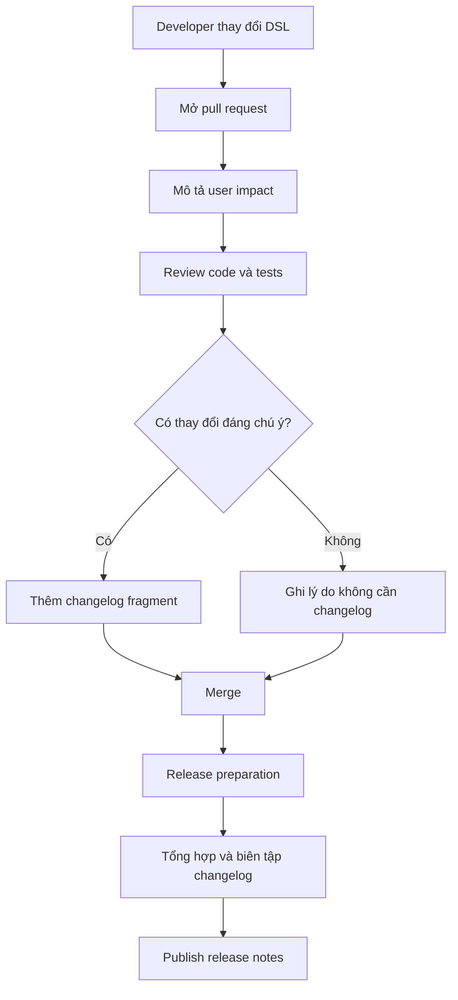

# Changelog cho dự án DSL

Một dự án DSL (*Domain-Specific Language*) thường thay đổi theo thời gian. Nhóm phát triển có thể thêm cú pháp mới, sửa semantics của toán tử, bổ sung builtin function, thay đổi compiler, cập nhật runtime hoặc điều chỉnh API tích hợp. Mỗi thay đổi có thể ảnh hưởng tới người viết chương trình DSL, ứng dụng nhúng runtime và các công cụ xung quanh.

**Changelog** là bản ghi có tổ chức về những thay đổi đáng chú ý giữa các phiên bản của một sản phẩm. Với DSL, changelog giúp người dùng biết điều gì đã thêm, sửa, loại bỏ hoặc thay đổi cách hoạt động; giúp developer đánh giá tác động khi nâng cấp; và cung cấp lịch sử có thể tra cứu khi điều tra lỗi hoặc tái hiện kết quả cũ.

Changelog không chỉ là danh sách commit. Commit mô tả hoạt động phát triển ở mức kỹ thuật, trong khi changelog giải thích thay đổi theo tác động đối với người sử dụng ngôn ngữ và hệ sinh thái. Một dòng như “refactor evaluator” ít hữu ích hơn mô tả “phép chia Decimal nay áp dụng rounding mode half-even; kết quả của một số biểu thức có thể khác ở chữ số cuối”.

Ví dụ, một mục changelog của DSL có thể viết:

```markdown
## [2.4.0] - 2026-11-15

### Added
- Bổ sung toán tử null-coalescing để cung cấp giá trị thay thế khi biểu thức không có dữ liệu.

### Changed
- Compiler nay kiểm tra kiểu của named arguments trước khi tạo bytecode.

### Fixed
- Sửa lỗi short-circuit khiến vế phải của phép OR đôi khi vẫn được đánh giá.

### Deprecated
- Đánh dấu builtin `legacyDate()` là deprecated; dùng `dateFromParts()` cho chương trình mới.
```

Mục changelog này nêu phiên bản, ngày phát hành, nhóm thay đổi và tác động đủ rõ để người dùng quyết định có cần cập nhật hoặc sửa chương trình hay không.

## 1. Vì sao dự án DSL cần changelog?

DSL là một hợp đồng giữa người viết chương trình và runtime. Thay đổi trong grammar, type system hoặc evaluation semantics có thể làm chương trình cũ không parse được, compile khác đi hoặc trả kết quả khác.

Changelog giúp:

- Người dùng biết cú pháp hoặc builtin nào mới xuất hiện.
- Developer nhận biết thay đổi có thể phá vỡ tương thích.
- Nhóm vận hành biết runtime nào sửa lỗi hoặc thay đổi hành vi.
- Người bảo trì hiểu lý do một behavior được thêm, sửa hoặc loại bỏ.
- Đội hỗ trợ trả lời câu hỏi “điều gì thay đổi từ phiên bản trước?”.
- Người quản trị quyết định thời điểm nâng cấp.
- Nhóm kiểm thử liên kết release với các regression và compatibility tests.
- Nhóm bảo mật truyền đạt bản vá và mức độ ảnh hưởng.

Nếu không có changelog, người dùng phải đọc commit history, issue và pull request để tự ghép lại ảnh hưởng. Điều đó tốn thời gian và dễ bỏ sót thay đổi quan trọng.

### Changelog là tài liệu hướng tới người dùng

Một changelog tốt giải thích kết quả mà người dùng sẽ nhận thấy. Nó có thể dẫn tới issue hoặc tài liệu kỹ thuật để cung cấp thêm chi tiết, nhưng bản thân mục changelog cần đủ thông tin để hiểu thay đổi.

Ví dụ:

- Kém rõ: “Update parser”.
- Rõ hơn: “Parser nay chấp nhận trailing comma trong danh sách argument; chương trình dùng language version 2.4 có thể viết lời gọi nhiều dòng mà không cần xóa dấu phẩy cuối”.

## 2. Phân biệt changelog, release notes và commit history

Các tài liệu này liên quan nhưng có mục đích khác nhau.

| Loại | Mục đích | Độc giả chính | Nội dung |
|---|---|---|---|
| Commit history | Ghi lại thay đổi trong repository | Developer | Commit, tác giả, file và thông điệp |
| Changelog | Tra cứu thay đổi qua các phiên bản | Người dùng và developer | Added, Changed, Fixed, Removed, Security |
| Release notes | Giải thích một lần phát hành | Người dùng, vận hành, quản lý | Điểm nổi bật, ảnh hưởng, migration và triển khai |
| Migration guide | Hướng dẫn chuyển từ cách cũ sang mới | Developer và operator | Các bước sửa source, config và deployment |
| API/Language reference | Mô tả trạng thái hiện hành | Người dùng ngôn ngữ | Cú pháp và semantics đang được hỗ trợ |

Commit history có thể chứa nhiều thay đổi nhỏ nội bộ. Changelog chọn những thay đổi có ý nghĩa đối với người dùng. Release notes thường mở rộng changelog với thông tin về nâng cấp, compatibility và hành động cần thực hiện.

### Ví dụ về cùng một thay đổi

Commit message:

```text
fix: preserve decimal scale in serializer
```

Changelog:

```markdown
### Fixed
- Serializer giữ nguyên scale của Decimal khi chuyển đổi request và response. Các API phụ thuộc vào định dạng số thập phân nay nhận được biểu diễn nhất quán hơn.
```

Release notes có thể bổ sung ví dụ trước/sau, phạm vi phiên bản bị ảnh hưởng và cách kiểm tra output sau nâng cấp.

## 3. Phạm vi thay đổi cần ghi cho một DSL

Changelog của DSL nên bao quát các lớp mà người dùng có thể phụ thuộc vào.

### Ngôn ngữ và grammar

- Cú pháp mới.
- Cú pháp bị deprecated hoặc removed.
- Thay đổi precedence và associativity.
- Quy tắc comment, literal hoặc identifier.
- Thay đổi grammar version.
- Cải thiện hoặc thay đổi diagnostic.

### Semantics và type system

- Thay đổi kiểu dữ liệu.
- Quy tắc conversion.
- Nullability và optional values.
- Scope và name resolution.
- Thứ tự đánh giá.
- Error behavior.
- Numeric precision và rounding.
- Collection ordering.
- Function overload hoặc inference.

### Compiler và runtime

- Backend mới.
- Tối ưu hiệu năng.
- Thay đổi bytecode hoặc IR.
- Sửa lỗi interpreter.
- Resource limits.
- Threading hoặc concurrency behavior.
- Cache format.
- Runtime API.

### Builtin và extension API

- Function mới.
- Thay đổi signature.
- Permission hoặc capability mới.
- Plugin API.
- Extension compatibility.
- Deprecation hoặc removal.

### Tooling và tích hợp

- Language server.
- Formatter và linter.
- Debugger.
- Code generator.
- SDK.
- Build plugin.
- Configuration schema.
- CLI và deployment packaging.

### Bảo mật và vận hành

- Security fixes.
- Thay đổi default policy.
- Dependency update có tác động đáng chú ý.
- Thay đổi authentication hoặc authorization.
- Artifact signing và verification.
- Logging, audit và monitoring.

Không phải mọi dependency update đều cần xuất hiện trong changelog công khai. Nên ghi các thay đổi ảnh hưởng tới người dùng, bảo mật, compatibility hoặc khả năng vận hành; các chi tiết nội bộ có thể nằm trong engineering notes.

## 4. Cấu trúc một changelog dễ đọc

Một cấu trúc phổ biến gồm:

1. Tiêu đề changelog và phạm vi sản phẩm.
2. Phiên bản mới nhất hoặc mục Unreleased.
3. Các phiên bản theo thứ tự thời gian ngược.
4. Nhóm thay đổi trong mỗi phiên bản.
5. Liên kết tới migration guide, issue hoặc release tag khi hữu ích.

Ví dụ:

```markdown
# Changelog

Các thay đổi đáng chú ý của DSL Platform được ghi tại đây.

## [Unreleased]

### Added

### Changed

### Deprecated

### Removed

### Fixed

### Security

## [2.4.0] - 2026-11-15

### Added
- ...

### Fixed
- ...

## [2.3.1] - 2026-10-28

### Fixed
- ...
```

Mục Unreleased giúp ghi nhận thay đổi đã merge nhưng chưa phát hành. Khi chuẩn bị release, nhóm có thể phân loại, biên tập và chuyển mục đó thành version cụ thể.

### Thứ tự phiên bản

Thường đặt phiên bản mới nhất lên đầu để người đọc nhanh chóng thấy thay đổi gần đây. Ngày phát hành nên dùng một định dạng nhất quán, tốt nhất là ISO 8601 dạng ngày nếu không cần giờ.

## 5. Các nhóm thay đổi thường dùng

Một quy ước phổ biến là phân loại thay đổi thành các nhóm rõ nghĩa.

| Nhóm | Ý nghĩa | Ví dụ trong DSL |
|---|---|---|
| Added | Tính năng mới | Thêm pattern matching |
| Changed | Thay đổi behavior hiện có | Decimal comparison dùng semantics mới |
| Deprecated | Khuyến nghị không dùng nữa | Đánh dấu builtin cũ deprecated |
| Removed | Thành phần đã bị loại bỏ | Xóa syntax chỉ tồn tại trong phiên bản cũ |
| Fixed | Sửa lỗi | Sửa lỗi resolve import |
| Security | Sửa hoặc cải thiện bảo mật | Chặn extension truy cập filesystem ngoài sandbox |
| Performance | Cải thiện hiệu năng | Giảm thời gian compile module lớn |
| Documentation | Thay đổi tài liệu | Bổ sung hướng dẫn migration |

Có thể gộp Performance vào Changed hoặc Fixed nếu dự án muốn cấu trúc ngắn hơn. Điều quan trọng là định nghĩa thống nhất để contributor biết nên xếp mục vào đâu.

### Added

Ghi tính năng mới và version hoặc điều kiện cần để sử dụng.

Ví dụ:

```markdown
### Added
- Hỗ trợ destructuring assignment cho record và tuple trong language version 2.5.
- Bổ sung builtin `matches()` để kiểm tra chuỗi theo pattern đã biên dịch.
```

### Changed

Ghi behavior hiện có đã thay đổi. Cần nói rõ thay đổi có ảnh hưởng tới chương trình cũ hay không.

```markdown
### Changed
- Toán tử so sánh hai giá trị DateTime nay chuẩn hóa về instant trước khi so sánh. Chương trình phụ thuộc vào so sánh local timestamp cần kiểm tra lại timezone.
```

### Deprecated

Ghi thành phần vẫn còn hoạt động nhưng không nên dùng trong chương trình mới.

Mục này nên nêu replacement, thời điểm hoặc version dự kiến removal nếu đã xác định và cách nhận warning.

### Removed

Ghi thành phần đã bị loại bỏ, lý do và đường chuyển đổi. Removal thường là breaking change nếu người dùng có thể đã phụ thuộc vào thành phần đó.

### Fixed

Nêu lỗi cũ, behavior trước đó và behavior sau khi sửa nếu điều đó ảnh hưởng kết quả.

### Security

Nêu phạm vi ảnh hưởng và phiên bản đã sửa mà không tiết lộ chi tiết có thể giúp khai thác trước khi người dùng cập nhật. Nếu cần, liên kết tới security advisory riêng.

## 6. Phân loại theo mức độ tương thích

Changelog nên giúp người dùng nhận ra thay đổi nào cần hành động.

Một cách phân loại:

- **Compatible:** chương trình hợp lệ cũ tiếp tục hoạt động theo cùng semantics.
- **Potentially breaking:** phần lớn chương trình không bị ảnh hưởng, nhưng một số trường hợp có thể đổi behavior.
- **Breaking:** chương trình hoặc tích hợp cũ cần sửa để hoạt động với phiên bản mới.
- **Security-sensitive:** thay đổi policy có thể làm một chương trình trước đây chạy được nay bị từ chối.

Ví dụ:

| Thay đổi | Mức độ thường gặp |
|---|---|
| Thêm builtin function mới | Compatible |
| Thêm optional field vào diagnostic | Thường compatible |
| Đổi precedence của toán tử | Breaking hoặc potentially breaking |
| Xóa builtin đã deprecated | Breaking |
| Siết quyền host function | Security-sensitive, có thể breaking |
| Sửa lỗi compiler tạo kết quả sai | Có thể đổi output, cần đánh giá tác động |

Không phải mọi bug fix đều vô hình đối với người dùng. Nếu chương trình từng dựa vào behavior sai, sau khi sửa kết quả có thể thay đổi. Changelog nên nói rõ điều đó.

## 7. Changelog và Semantic Versioning

Semantic Versioning (SemVer) là một quy ước đặt version dạng MAJOR.MINOR.PATCH cho sản phẩm có public API.

- **MAJOR:** thay đổi không tương thích.
- **MINOR:** thêm chức năng tương thích ngược.
- **PATCH:** sửa lỗi tương thích ngược.

Ví dụ version 2.4.1 có cùng major/minor với 2.4.0 nhưng chứa các bản sửa tương thích ngược theo policy dự án.

Với DSL, cần xác định SemVer áp dụng cho thành phần nào:

- Language specification.
- Compiler package.
- Runtime package.
- Plugin API.
- SDK.
- CLI.
- Host integration API.

Các thành phần có thể có version riêng. Compiler version 5.x không nhất thiết đồng nghĩa language version 5.x.

### Language version và compiler release

Một compiler mới có thể hỗ trợ nhiều language versions. Changelog nên phân biệt:

- Phiên bản compiler được phát hành.
- Language version mới được hỗ trợ.
- Runtime compatibility.
- Plugin API version.

Ví dụ, compiler 5.2 có thể thêm backend mới nhưng vẫn compile language version 2.4. Nếu changelog chỉ ghi “version 5.2” mà không nêu language version, người dùng có thể hiểu nhầm.

### SemVer không thay thế compatibility analysis

Một thay đổi có vẻ là PATCH vẫn có thể làm chương trình thay đổi kết quả nếu nó sửa bug trong evaluator. Versioning cần dựa trên contract công khai và tác động thực tế, không chỉ dựa vào tên loại commit.

## 8. Ghi breaking changes rõ ràng

Breaking change là thay đổi khiến consumer cần sửa source, configuration hoặc cách tích hợp.

Ví dụ:

- Xóa keyword cũ.
- Đổi type của builtin parameter.
- Thay đổi function overload resolution.
- Đổi default value.
- Thay đổi null semantics.
- Thay đổi serialization format.
- Loại bỏ một runtime API.
- Yêu cầu capability mới.
- Tăng compiler target hoặc runtime requirement.

Một mục breaking change nên trả lời:

1. Behavior cũ là gì?
2. Behavior mới là gì?
3. Ai hoặc chương trình nào bị ảnh hưởng?
4. Cần sửa source hay configuration ra sao?
5. Có migration tool hoặc compatibility mode không?
6. Có thời gian chuyển tiếp không?

Ví dụ:

```markdown
### Breaking Changes
- Builtin `parseDate(String)` không còn tự suy luận định dạng theo locale. Hãy truyền format tường minh bằng `parseDate(value, format)` để kết quả giống nhau trên mọi môi trường.
  - Trước đây: `parseDate("03/04/2025")`
  - Sau khi nâng cấp: `parseDate("03/04/2025", "dd/MM/yyyy")`
```

Đưa ví dụ trước/sau giúp người dùng sửa chương trình nhanh hơn.

## 9. Deprecation lifecycle

Deprecation là quá trình thông báo một tính năng sẽ được thay thế hoặc loại bỏ trong tương lai.

Một lifecycle thường có:

1. Tính năng được đánh dấu deprecated.
2. Compiler hoặc language server phát warning.
3. Tài liệu đề xuất replacement.
4. Changelog ghi thời điểm bắt đầu deprecation.
5. Người dùng có thời gian chuyển đổi.
6. Removal diễn ra trong một major version hoặc mốc đã công bố.

Ví dụ:

```text
@Deprecated(replacement = "dateFromParts")
function legacyDate(year, month, day)
```

Compiler có thể phát diagnostic:

```text
warning DSL-DEPRECATED-004:
legacyDate() is deprecated; use dateFromParts()
```

Changelog nên nói rõ replacement và thời điểm dự kiến removal nếu đã có kế hoạch. Không nên để một API ở trạng thái deprecated vô thời hạn mà không có người chịu trách nhiệm hoặc quyết định rõ.

### Deprecation không phải removal

Một tính năng deprecated vẫn có thể chạy. Người dùng cần phân biệt warning với lỗi. Nếu runtime đã chặn tính năng, đó là removal hoặc policy change và cần được ghi riêng.

## 10. Ghi thay đổi semantics

Thay đổi semantics thường khó nhận ra hơn thay đổi cú pháp vì source vẫn parse và compile thành công.

Ví dụ:

- Integer division đổi từ truncate về zero sang floor.
- Boolean evaluation đổi thứ tự hoặc short-circuit.
- Equality đổi từ identity sang value.
- Null propagation thay đổi.
- Decimal rounding mode đổi.
- Map iteration có thứ tự ổn định.
- Function argument được đánh giá theo quy tắc khác.
- Error được ném sớm hơn hoặc chuyển thành Result.

Một mục changelog semantics nên nêu:

- Construct liên quan.
- Behavior cũ.
- Behavior mới.
- Input hoặc pattern có thể bị ảnh hưởng.
- Language version áp dụng.
- Cách kiểm tra hoặc migration.

Ví dụ:

```markdown
### Changed
- Phép chia hai Integer nay truncate về zero và trả Integer. Trước đây runtime cũ dùng floor cho số âm. Nếu chương trình dùng số âm, hãy kiểm tra lại kết quả và dùng `floorDiv()` khi cần floor division.
```

Với thay đổi có thể ảnh hưởng quyết định nghiệp vụ, nên liên kết tới migration guide hoặc test case thể hiện behavior mới.

## 11. Changelog cho compiler, runtime và tooling

Một sản phẩm DSL có thể phát hành nhiều artifact. Changelog cần xác định thay đổi thuộc thành phần nào.

Ví dụ:

- Compiler: parser, type checker, optimizer, backend.
- Runtime: builtin functions, scheduler, memory model.
- CLI: command, flag, exit code.
- Language server: completion, diagnostics, formatting.
- SDK: client API, model mapping, error types.
- Plugin API: extension points, lifecycle và permission.
- Build plugin: task inputs, cache behavior, toolchain requirements.

Có thể dùng tag hoặc heading để phân biệt component:

```markdown
### Compiler
- Cải thiện type inference cho generic function.

### Runtime
- Giới hạn số bước thực thi mặc định để bảo vệ service.

### Language Server
- Completion nay đề xuất import alias theo module đang mở.

### CLI
- Thêm lệnh `dsl inspect` để xem metadata của compiled artifact.
```

Nếu mỗi artifact có version độc lập, release page hoặc package metadata cần chỉ rõ mapping giữa các component.

## 12. Changelog bảo mật

Security changes cần thông tin đủ để người dùng đánh giá và cập nhật, nhưng không nên công bố exploit details trước khi có bản vá hoặc kế hoạch phối hợp phù hợp.

Một mục security thường có:

- Thành phần bị ảnh hưởng.
- Phiên bản bị ảnh hưởng nếu đã xác định.
- Phiên bản đã sửa.
- Mức độ hoặc advisory reference.
- Hành động cần thực hiện.
- Workaround nếu có và đã được xác nhận.

Ví dụ:

```markdown
### Security
- Sửa lỗi kiểm tra capability trong host function registry có thể cho phép chương trình gọi một function ngoài tập quyền được cấp trong một số cấu hình. Nâng cấp runtime lên 3.8.2 và kiểm tra lại extension permissions.
  - Advisory: SEC-2026-014
```

Nếu chi tiết khai thác cần giữ kín, changelog công khai có thể liên kết tới advisory được phát hành theo lịch phối hợp. Tuy nhiên, người dùng cần nhận đủ thông tin để biết họ có bị ảnh hưởng và cần làm gì.

## 13. Viết một mục changelog có chất lượng

Một entry tốt thường có cấu trúc:

- Động từ nêu thay đổi.
- Thành phần hoặc behavior bị tác động.
- Kết quả mà người dùng nhận được.
- Phạm vi hoặc điều kiện quan trọng.
- Hành động cần thực hiện nếu có.
- Liên kết tới tài liệu sâu hơn.

Ví dụ:

```markdown
- **Fixed:** Compiler không còn suy luận nhầm kiểu Optional khi một nhánh match trả null. Chương trình dùng generic match expression có thể compile thành công mà trước đây bị báo lỗi type mismatch.
```

Tránh:

- Câu chung chung như “Improve performance”.
- Chỉ ghi tên ticket mà không giải thích.
- Liệt kê mọi commit.
- Dùng thuật ngữ nội bộ mà người dùng không hiểu.
- Khẳng định tương thích nếu chưa có cơ sở.
- Ghi một behavior mới mà không nói điều kiện áp dụng.
- Trộn nhiều thay đổi không liên quan trong một bullet.

### Viết theo góc nhìn người dùng

Hãy tự hỏi: người dùng cần biết gì để quyết định nâng cấp, sửa chương trình hoặc điều tra vấn đề?

Nếu câu trả lời chỉ là “developer đã sửa file X”, đó thường là thông tin commit chứ chưa phải changelog.

## 14. Changelog Unreleased

Mục Unreleased tập hợp thay đổi đã merge nhưng chưa thuộc release cụ thể.

Ví dụ:

```markdown
## [Unreleased]

### Added
- Hỗ trợ union type trong function return.

### Fixed
- Sửa source range của diagnostic trong file có ký tự Unicode ngoài BMP.
```

Khi phát hành:

1. Xác nhận phạm vi commit và artifact.
2. Kiểm tra từng entry có tác động rõ.
3. Phân loại breaking, added, fixed và security.
4. Xác định version theo release policy.
5. Ghi ngày phát hành.
6. Chuyển mục Unreleased thành version cụ thể.
7. Tạo mục Unreleased mới.
8. Liên kết version với tag hoặc release page.

Không nên để mục Unreleased chứa thay đổi chưa được merge hoặc chưa có kiểm chứng. Entry có thể được viết sớm nhưng phải phản ánh trạng thái cuối của release.

## 15. Quy trình từ pull request tới changelog

Changelog có thể được cập nhật thủ công hoặc sinh một phần từ metadata của pull request.

Một quy trình thường gặp:



Pull request template có thể yêu cầu:

- Loại thay đổi.
- Thành phần ảnh hưởng.
- Compatibility impact.
- Có cần migration guide không.
- Có cần security advisory không.
- Changelog fragment hoặc lý do không cần.

Cách này giúp tránh việc đến ngày phát hành mới phải đọc lại toàn bộ lịch sử thay đổi.

## 16. Changelog fragment và tự động tổng hợp

Một dự án nhiều contributor có thể dùng fragment riêng cho mỗi pull request. Khi release, tool tổng hợp các fragment theo category.

Ví dụ fragment:

```yaml
type: changed
component: compiler
compatibility: potentially-breaking
description: >
  Decimal division now uses the configured rounding mode.
migration: docs/migrations/2.5-decimal-division.md
```

Ưu điểm:

- Mỗi pull request chịu trách nhiệm ghi thay đổi của mình.
- Conflict trong một changelog file lớn giảm.
- Tool có thể kiểm tra field bắt buộc.
- Release manager dễ tổng hợp.

Rủi ro là fragment có thể dùng từ ngữ không nhất quán hoặc bị thiếu. Cần biên tập trước khi publish, và output cuối vẫn phải dễ đọc với người dùng.

## 17. Liên kết changelog với issue, pull request và commit

Liên kết giúp người đọc tìm thêm bối cảnh. Một entry có thể dẫn tới:

- Issue mô tả lỗi hoặc yêu cầu.
- Pull request chứa implementation.
- Migration guide.
- API reference.
- Security advisory.
- Release tag hoặc artifact.

Changelog công khai không nhất thiết phải lộ mọi thông tin nội bộ. Với issue bảo mật hoặc công việc nội bộ, dùng advisory công khai hoặc tài liệu phù hợp thay vì liên kết một ticket không có quyền truy cập.

Liên kết cần ổn định. Nếu ticket bị xóa hoặc đổi ID, changelog lịch sử không nên mất ý nghĩa chính.

## 18. Changelog và migration guide

Changelog nói điều gì thay đổi. Migration guide nói cách chuyển đổi.

Một thay đổi đơn giản có thể chỉ cần ví dụ trước/sau trong changelog. Thay đổi lớn nên có hướng dẫn riêng.

Migration guide có thể gồm:

1. Phiên bản nguồn và đích.
2. Thành phần hoặc syntax bị ảnh hưởng.
3. Cách tìm chương trình cần sửa.
4. Quy tắc chuyển đổi.
5. Ví dụ trước/sau.
6. Tool tự động hỗ trợ nếu có.
7. Cách chạy compatibility tests.
8. Rollback hoặc dual-version strategy.
9. Giới hạn còn lại.

Ví dụ changelog:

```markdown
### Breaking Changes
- Field `timezone` trong DateTime constructor nay bắt buộc khi tạo local timestamp. Xem [Migration Guide 2.5](migrations/2.5-datetime.md) để chuyển đổi source hiện có.
```

Changelog nên giữ nội dung ngắn vừa đủ và để migration guide xử lý các bước chi tiết.

## 19. Quản lý changelog cho nhiều phiên bản đang hỗ trợ

Một sản phẩm DSL có thể duy trì nhiều release line, chẳng hạn một nhánh LTS và nhánh hiện hành.

Cần phân biệt:

- Thay đổi đã có trong mainline.
- Phiên bản đã phát hành.
- Bản backport vào nhánh cũ.
- Bản vá riêng cho một release line.
- Phiên bản còn được hỗ trợ.

Một bug fix có thể xuất hiện ở version 3.2.4 và 3.3.1. Changelog của từng release cần ghi đúng phạm vi. Không nên giả định fix ở nhánh mới tự động có trong nhánh cũ.

### Support policy

Release notes hoặc trang lifecycle nên nêu thời gian hỗ trợ, thời điểm kết thúc hỗ trợ và chính sách security fixes. Changelog ghi các thay đổi của từng phiên bản, còn support policy mô tả cam kết vòng đời.

## 20. Changelog cho language version và runtime version

DSL có thể tách language version khỏi runtime release. Một runtime mới có thể hỗ trợ nhiều language versions, hoặc bỏ hỗ trợ một version cũ.

Changelog cần phân biệt:

- Syntax/semantics mới thuộc language version nào.
- Compiler release nào hỗ trợ version đó.
- Runtime tối thiểu cần có.
- Plugin API version tương thích.
- Có cần migrate source hay không.

Ví dụ:

```markdown
### Added
- Compiler 5.1 hỗ trợ language version 2.5, bao gồm union types và exhaustive match checking. Runtime 4.0 trở lên cần thiết để chạy artifact target bytecode mới.
```

Nếu không ghi rõ các quan hệ này, người dùng có thể nâng compiler nhưng quên cập nhật runtime hoặc plugin.

## 21. Changelog và generated documentation

Một số phần có thể được tạo tự động từ metadata:

- API operation additions/removals.
- Builtin function signature changes.
- CLI command changes.
- Deprecated symbols.
- Plugin API version.
- Schema changes.

Tuy nhiên, tự động diff không thể luôn suy ra user impact. Ví dụ, đổi implementation của evaluator có thể làm kết quả khác mà signature không đổi.

Một quy trình tốt kết hợp machine-generated diff với phần giải thích do developer viết và review.

### Generated API diff

Có thể so sánh API schema của hai release để phát hiện:

- Operation mới hoặc bị xóa.
- Parameter mới hoặc thay đổi required.
- Type đổi.
- Error code thay đổi.
- Security requirement mới.
- Enum value bị xóa.

Kết quả diff nên được kiểm tra với semantics và compatibility policy trước khi đưa vào changelog.

## 22. Changelog và audit trail

Changelog công khai không phải audit log.

Audit trail thường ghi chi tiết ai đã thực hiện thao tác nào, khi nào, với object và trạng thái nào. Changelog chọn những thay đổi có ý nghĩa cho người dùng của một release.

| Đặc điểm | Changelog | Audit trail |
|---|---|---|
| Mục tiêu | Giải thích thay đổi sản phẩm | Truy vết hành động |
| Độc giả | User, developer, operator | Security, compliance, admin |
| Granularity | Theo release hoặc feature | Theo event |
| Nội dung | Added, Changed, Fixed | Actor, timestamp, action, object |
| Tính riêng tư | Có thể công khai | Thường bị giới hạn quyền |
| Có thể biên tập | Có | Thường append-only hoặc có kiểm soát |

Không nên dùng changelog thay cho audit trail khi cần điều tra ai đã publish một DSL program hoặc thay đổi policy.

## 23. Changelog và bảo đảm tái lập

Khi điều tra kết quả DSL cũ, chỉ biết compiler version có thể chưa đủ. Cần thêm language version, runtime version, schema revision, plugin versions và cấu hình thực thi.

Changelog giúp hiểu những thay đổi giữa các version, nhưng không lưu toàn bộ execution environment.

Một execution record có thể tham chiếu:

- Program revision.
- Compiler/runtime version.
- Language version.
- Schema version.
- Builtin registry version.
- Plugin versions.
- Configuration revision.
- Artifact digest.

Kết hợp metadata này với changelog giúp điều tra vì sao cùng source lại tạo kết quả khác sau nâng cấp.

## 24. Chất lượng và tính nhất quán của changelog

Một changelog cần có quy tắc biên tập thống nhất.

Các nguyên tắc:

- Mỗi bullet mô tả một thay đổi chính.
- Dùng động từ cụ thể.
- Nêu component hoặc construct bị ảnh hưởng.
- Ghi compatibility impact khi cần.
- Đưa migration action vào cùng entry hoặc liên kết.
- Dùng thuật ngữ nhất quán với documentation.
- Tránh lặp cùng một thay đổi trong nhiều category.
- Giữ thứ tự version rõ ràng.
- Kiểm tra link và version reference.
- Không đưa secret, exploit detail hoặc thông tin riêng tư.
- Giữ lịch sử đã phát hành ổn định.

### Changelog có thể đọc được bằng máy

Nếu cần tự động hóa, có thể dùng metadata có cấu trúc bên cạnh Markdown:

```yaml
version: 2.5.0
date: 2026-11-15
changes:
  - category: changed
    component: type-checker
    compatibility: potentially-breaking
    summary: Generic inference now rejects ambiguous nullable bounds.
    migration: docs/migrations/2.5.md
```

Markdown vẫn là bản trình bày cho người đọc. Metadata có cấu trúc hỗ trợ release tooling, dashboard hoặc API. Cần tránh duy trì hai nguồn dữ liệu mâu thuẫn; một nguồn nên là canonical và nguồn còn lại được sinh ra.

## 25. Changelog trong monorepo và nhiều package

Một monorepo có thể chứa compiler, runtime, CLI, language server và plugin. Một release có thể phát hành một số package nhưng không phải tất cả.

Có thể tổ chức:

- Changelog tổng hợp cho sản phẩm.
- Changelog riêng cho package có version độc lập.
- Release manifest chỉ rõ package được phát hành.
- Link giữa entry cấp sản phẩm và package cụ thể.

Ví dụ:

```markdown
## [Platform 5.1.0] - 2026-11-15

### Compiler
- Hỗ trợ language version 2.5.

### Runtime
- Thêm API cancellation cho execution dài.

### CLI
- Thêm lệnh inspect để xem compiler metadata.
```

Nếu package version độc lập, changelog package cần ghi chính xác version riêng. Không nên gộp tất cả thay đổi của monorepo vào một release nếu người dùng chỉ cài một package.

## 26. Changelog cho breaking security defaults

Đôi khi security improvement thay đổi default behavior. Ví dụ, runtime từ chối host function không có capability thay vì cho phép mặc định.

Đây có thể là thay đổi bảo mật cần thiết nhưng làm chương trình cũ không chạy.

Entry nên giải thích:

- Default cũ và mới.
- Thành phần hoặc cấu hình ảnh hưởng.
- Vì sao thay đổi được thực hiện ở mức phù hợp để công bố.
- Cách cấp quyền tối thiểu hợp lệ.
- Cách kiểm tra trước khi deploy.
- Có compatibility flag không và flag đó tồn tại bao lâu.

Không nên hướng dẫn người dùng tắt toàn bộ security controls như một workaround dài hạn. Nếu có chế độ tương thích tạm thời, cần nêu phạm vi và thời hạn rõ.

## 27. Kiểm tra changelog trước khi phát hành

Release preparation nên xác nhận changelog phản ánh đúng artifact được phát hành.

Các việc thường làm:

- Đối chiếu release commits và merged pull requests.
- Xác nhận mọi user-facing change có entry hoặc lý do không cần.
- Kiểm tra version và ngày.
- Xác nhận breaking changes được đánh dấu.
- Kiểm tra migration guide tồn tại.
- Xác nhận security entry phù hợp advisory.
- Kiểm tra link.
- Xác nhận language/runtime compatibility.
- Kiểm tra không có nội dung nội bộ hoặc secret.
- Xác nhận release tag trùng artifact version.

Đây là hoạt động biên tập release. Nó khác với việc chạy test ngữ nghĩa của compiler; changelog cần phản ánh kết quả release đã được xác định.

## 28. Những lỗi thường gặp khi viết changelog

**Chỉ liệt kê commit message.** Người dùng không hiểu tác động. Viết lại theo behavior và lợi ích hoặc ảnh hưởng.

**Không ghi breaking change.** Người dùng nâng cấp bất ngờ gặp lỗi. Nêu rõ behavior cũ/mới và migration.

**Trộn compiler version với language version.** Người dùng không biết syntax nào được hỗ trợ. Ghi rõ từng version.

**Mô tả bug fix quá chung.** “Fix evaluator” không cho biết lỗi gì đã được sửa. Nêu construct và trường hợp ảnh hưởng.

**Không nói behavior cũ.** Người dùng không biết chương trình nào có thể thay đổi kết quả. Đưa ví dụ trước/sau khi cần.

**Ghi deprecated nhưng không có replacement.** Người dùng không biết chuyển sang đâu. Đề xuất API thay thế và thời điểm removal nếu có.

**Ghi removal mà không nêu phạm vi.** Người dùng khó tìm source bị ảnh hưởng. Nêu symbol, syntax hoặc config đã bỏ.

**Không liên kết migration guide.** Thay đổi lớn trở nên khó áp dụng. Cung cấp hướng dẫn cụ thể.

**Đưa quá nhiều chi tiết nội bộ.** Changelog trở thành commit log. Chỉ giữ chi tiết giúp người dùng hiểu thay đổi.

**Tự động sinh entry mà không biên tập.** Kết quả có thể trùng, khó đọc hoặc sai user impact. Review bản tổng hợp trước release.

**Không cập nhật nhiều release line.** Người dùng nhầm bản vá đã có ở nhánh cũ. Ghi đúng version đã nhận fix.

**Sửa lịch sử release âm thầm.** Khó đối chiếu thông tin đã công bố. Giữ lịch sử ổn định và bổ sung correction khi cần.

## 29. Quy trình xây dựng changelog cho DSL

Một quy trình thực tế có thể gồm:

1. Xác định artifact và versioning policy của compiler, runtime, language và tooling.
2. Định nghĩa category changelog và quy tắc compatibility.
3. Thêm yêu cầu changelog vào pull request template.
4. Yêu cầu contributor mô tả user impact, behavior cũ/mới và migration nếu có.
5. Ghi fragment hoặc cập nhật mục Unreleased khi thay đổi được merge.
6. Liên kết entry với issue, pull request và tài liệu liên quan.
7. Trước release, tổng hợp các entry theo component và category.
8. Kiểm tra breaking changes, deprecation, security và compatibility.
9. Viết migration guide cho thay đổi cần hành động.
10. Xác nhận version, ngày và artifact thực tế.
11. Publish changelog cùng release notes.
12. Giữ các mục đã phát hành ổn định và bổ sung correction có dấu vết.
13. Duy trì changelog riêng nếu package có lifecycle độc lập.
14. Lưu metadata release để liên kết với provenance và artifact digest.

## 30. Câu hỏi tự kiểm tra

1. Changelog là gì và vì sao một dự án DSL cần nó?
2. Changelog khác commit history, release notes và migration guide như thế nào?
3. Những lớp thay đổi nào của DSL nên được ghi nhận?
4. Added, Changed, Deprecated, Removed, Fixed và Security khác nhau ra sao?
5. Vì sao một bug fix trong evaluator có thể ảnh hưởng compatibility?
6. SemVer phân biệt MAJOR, MINOR và PATCH như thế nào?
7. Language version khác compiler/runtime release ra sao?
8. Một breaking change nên mô tả behavior cũ, mới và migration thế nào?
9. Deprecation lifecycle thường gồm những giai đoạn nào?
10. Vì sao thay đổi semantics cần ví dụ cụ thể?
11. Changelog cho compiler, runtime, CLI và plugin có thể tổ chức ra sao?
12. Security changelog cần cung cấp thông tin nào mà không làm lộ chi tiết khai thác?
13. Unreleased section được xử lý như thế nào khi phát hành?
14. Changelog fragment hỗ trợ quy trình pull request ra sao?
15. Khi nào cần migration guide riêng?
16. Changelog cho nhiều release line cần ghi nhận backport thế nào?
17. Có thể tự động sinh changelog từ API diff đến mức nào?
18. Changelog khác audit trail như thế nào?
19. Vì sao changelog không đủ để tái hiện một execution DSL cũ?
20. Hãy viết mục changelog cho một thay đổi precedence của toán tử, nêu compatibility impact và cách migration.

Changelog biến lịch sử phát triển thành thông tin có thể sử dụng khi nâng cấp và vận hành DSL. Khi mỗi mục nêu rõ component, behavior cũ và mới, mức tương thích cùng hành động cần thiết, người dùng có thể hiểu thay đổi giữa các phiên bản và quản lý việc chuyển đổi có kiểm soát.

