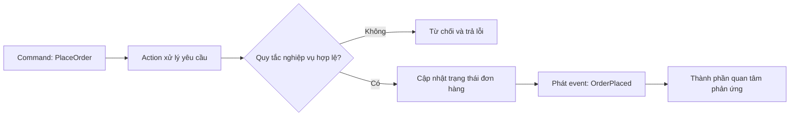
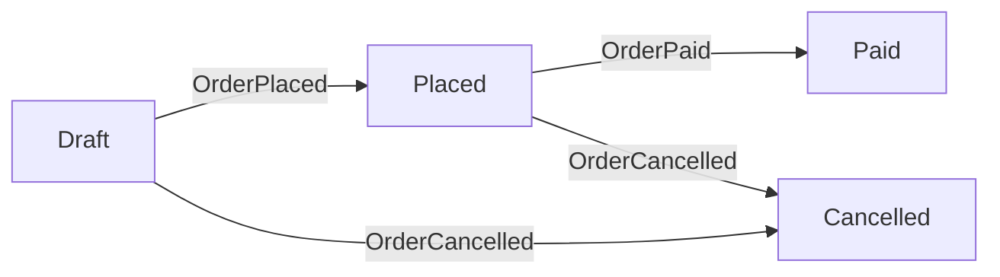

# Hành động và sự kiện

Trong mô hình miền của một **Domain-Specific Language (DSL)**, hành động và sự kiện mô tả hai khía cạnh khác nhau của nghiệp vụ. **Hành động (action)** thể hiện việc một tác nhân hoặc thành phần hệ thống yêu cầu hay thực hiện một điều gì đó. **Sự kiện (event)** ghi nhận một điều có ý nghĩa trong miền đã xảy ra. Hành động hướng tới việc tạo ra thay đổi; sự kiện mô tả một sự thật sau khi thay đổi hoặc một điều kiện nghiệp vụ đã xuất hiện.

Phân biệt rõ hai khái niệm giúp DSL diễn đạt quy trình dễ hiểu, xác định đúng thời điểm kiểm tra quy tắc và tổ chức các phản ứng giữa những thành phần trong miền. Chẳng hạn, trong hệ thống bán hàng, `placeOrder` là hành động đặt hàng, còn `OrderPlaced` là sự kiện cho biết đơn hàng đã được đặt thành công. Một hành động có thể không được chấp nhận; một sự kiện chỉ nên được phát ra khi sự việc mà nó mô tả thực sự đã xảy ra.

## 1. Hành động và sự kiện trong mô hình miền

Mô hình miền mô tả các khái niệm, quy tắc và hành vi quan trọng của một lĩnh vực nghiệp vụ. Trong mô hình đó:

- Hành động thể hiện ý định hoặc thao tác làm thay đổi trạng thái, yêu cầu một quyết định hoặc khởi động một quy trình.
- Sự kiện thể hiện một sự việc có ý nghĩa đã xảy ra trong miền và có thể được các thành phần khác quan tâm.

Ví dụ trong miền đặt hàng:

| Khái niệm | Ví dụ | Ý nghĩa |
|---|---|---|
| Hành động | `placeOrder` | Khách hàng yêu cầu đặt một đơn hàng |
| Sự kiện | `OrderPlaced` | Một đơn hàng đã được đặt thành công |
| Hành động | `cancelOrder` | Người dùng yêu cầu hủy đơn hàng |
| Sự kiện | `OrderCancelled` | Đơn hàng đã chuyển sang trạng thái bị hủy |
| Hành động | `authorizePayment` | Hệ thống yêu cầu xác thực khoản thanh toán |
| Sự kiện | `PaymentAuthorized` | Khoản thanh toán đã được xác thực |

Tên hành động thường dùng động từ ở dạng mệnh lệnh hoặc cụm động từ, vì nó mô tả việc cần làm. Tên sự kiện thường dùng cụm từ ở dạng quá khứ hoặc cách diễn đạt một sự thật đã xảy ra, vì nó mô tả kết quả hoặc thay đổi đã được xác nhận. Quy ước đặt tên này giúp người đọc nhận ra vai trò của từng khai báo ngay trong DSL.

## 2. Phân biệt hành động, yêu cầu và sự kiện

Trong thiết kế hệ thống, các từ *action*, *command* và *event* đôi khi được dùng gần nhau, nhưng chúng không hoàn toàn đồng nghĩa.

- **Command (lệnh/yêu cầu)** là thông điệp thể hiện ý định yêu cầu hệ thống thực hiện một hành động. Ví dụ: `PlaceOrder` yêu cầu đặt hàng.
- **Action (hành động)** là thao tác hoặc quy tắc nghiệp vụ xử lý ý định đó. Ví dụ: kiểm tra khách hàng, xác nhận mặt hàng và tạo đơn hàng.
- **Event (sự kiện)** là sự thật được ghi nhận sau khi một điều đã xảy ra. Ví dụ: `OrderPlaced` xác nhận đơn hàng đã được tạo.

Một command có thể bị từ chối vì không thỏa mãn quy tắc. Ví dụ, `PlaceOrder` có thể bị từ chối khi giỏ hàng rỗng hoặc khách hàng không đủ điều kiện mua hàng. Khi đó, hệ thống trả về lỗi hoặc kết quả từ chối phù hợp; không được phát `OrderPlaced` như thể đơn hàng đã tồn tại.

Luồng khái quát:



Sự kiện không phải là một yêu cầu trá hình. `OrderPlaced` không có nghĩa là “hãy đặt hàng”; nó có nghĩa “đơn hàng đã được đặt”. Thành phần nhận sự kiện có thể thực hiện hành động tiếp theo, chẳng hạn yêu cầu giữ hàng hoặc gửi email xác nhận.

## 3. Cấu trúc của một hành động

Khi mô tả hành động trong DSL, nên xác định rõ các thành phần sau:

1. **Tên và mục đích**: hành động làm gì trong ngôn ngữ nghiệp vụ.
2. **Tác nhân hoặc ngữ cảnh gọi**: ai hoặc thành phần nào được phép yêu cầu hành động.
3. **Đầu vào**: dữ liệu cần thiết để xử lý, như mã đơn hàng, mặt hàng hoặc lý do hủy.
4. **Điều kiện trước (precondition/guard)**: các điều kiện phải đúng trước khi hành động được chấp nhận.
5. **Quy tắc xử lý**: cách kiểm tra, tính toán và phối hợp các khái niệm trong miền.
6. **Thay đổi trạng thái**: trạng thái nào được cập nhật nếu hành động thành công.
7. **Kết quả**: dữ liệu trả về, lỗi nghiệp vụ hoặc các sự kiện được phát ra.

Ví dụ, hành động `cancelOrder` có thể yêu cầu đơn hàng tồn tại, người gọi có quyền hủy và đơn hàng chưa được giao. Nếu các điều kiện hợp lệ, hệ thống chuyển trạng thái đơn hàng sang `Cancelled` và phát sự kiện `OrderCancelled`. Nếu đơn hàng đã giao, hành động bị từ chối theo quy tắc miền.

Hành động không nhất thiết luôn thay đổi dữ liệu. Một hành động như `calculateShippingFee` có thể chỉ tính toán và trả về kết quả. Điều quan trọng là tên, đầu vào, điều kiện và kết quả phải diễn đạt đúng mục đích nghiệp vụ.

## 4. Cấu trúc của một sự kiện

Sự kiện nên mô tả một sự thật rõ ràng và đủ dữ liệu để người nhận hiểu điều gì đã xảy ra. Một khai báo sự kiện thường có:

- **Tên sự kiện**: biểu đạt một việc đã xảy ra, ví dụ `OrderPlaced`.
- **Định danh đối tượng miền**: cho biết sự kiện liên quan đến đơn hàng, khách hàng hoặc đối tượng nào.
- **Dữ liệu nghiệp vụ**: các giá trị cần thiết để diễn giải sự kiện, như tổng tiền, mã khách hàng hoặc lý do hủy.
- **Thời điểm xảy ra**: thời gian sự kiện được ghi nhận.
- **Thông tin theo dõi**: event ID, phiên bản hoặc correlation ID khi hệ thống cần truy vết và phối hợp xử lý.

Ví dụ, `OrderPlaced` có thể mang `orderId`, `customerId`, `totalAmount` và `occurredAt`. Người nhận sự kiện có thể dùng các dữ liệu đó để cập nhật báo cáo hoặc gửi thông báo mà không phải đoán sự kiện muốn nói đến đơn hàng nào.

Sự kiện nên được xem là dữ liệu mô tả một sự thật đã xảy ra. Sau khi công bố, nội dung của sự kiện không nên bị sửa để thay đổi lịch sử. Nếu phát hiện thông tin sai, hệ thống nên ghi nhận một sự kiện điều chỉnh hoặc quy trình sửa sai được định nghĩa rõ ràng. Cách làm này giúp các thành phần đã nhận sự kiện không có những cách hiểu khác nhau về cùng một sự việc.

## 5. Hành động tạo ra sự kiện như thế nào?

Một hành động thường kiểm tra điều kiện, thực hiện thay đổi trong miền rồi phát ra một hoặc nhiều sự kiện để công bố kết quả. Việc phát sự kiện phải phản ánh kết quả thực tế của hành động.

Ví dụ, hành động đặt hàng có thể thực hiện các bước:

1. Nhận yêu cầu đặt hàng với thông tin khách hàng và danh sách mặt hàng.
2. Kiểm tra khách hàng có thể đặt hàng và danh sách mặt hàng không rỗng.
3. Tính tổng tiền và tạo đơn hàng ở trạng thái `Placed`.
4. Ghi nhận sự kiện `OrderPlaced` với mã đơn hàng và dữ liệu liên quan.
5. Trả kết quả thành công cho bên gọi.

Nếu bước kiểm tra thất bại, hành động kết thúc bằng lỗi nghiệp vụ và không phát sự kiện thành công. Nếu việc cập nhật trạng thái thành công nhưng việc công bố sự kiện thất bại do lỗi hạ tầng, hệ thống cần có cơ chế bảo đảm sự thay đổi và sự kiện được xử lý nhất quán. Trong hệ thống phân tán, mẫu Transactional Outbox thường được dùng: lưu thay đổi miền và bản ghi sự kiện chờ gửi trong cùng giao dịch cơ sở dữ liệu, sau đó một tiến trình riêng chuyển tiếp sự kiện.

Không nên phát sự kiện thành công trước khi hành động được xác nhận. Nếu phát `OrderPlaced` trước khi lưu đơn hàng và thao tác lưu thất bại, các thành phần khác có thể gửi thông báo hoặc giữ hàng cho một đơn hàng chưa từng được tạo.

## 6. Ví dụ mô hình hành động và sự kiện trong DSL

DSL dưới đây là ví dụ minh họa cho một mô hình miền đặt hàng. Cú pháp cụ thể có thể khác tùy ngôn ngữ được xây dựng; mục tiêu là thể hiện rõ hành động, điều kiện, chuyển trạng thái và sự kiện.

```text
domain OrderManagement {
    aggregate Order {
        state Draft, Placed, Paid, Cancelled

        action place(customerId, items) {
            require customer.isActive(customerId)
            require items.count > 0

            transition Draft -> Placed
            emit OrderPlaced(
                orderId,
                customerId,
                items,
                totalAmount,
                occurredAt
            )
        }

        action cancel(reason) {
            require state in [Draft, Placed]
            require reason is not empty

            transition state -> Cancelled
            emit OrderCancelled(orderId, reason, occurredAt)
        }

        action markPaid(paymentId) {
            require state == Placed

            transition Placed -> Paid
            emit OrderPaid(orderId, paymentId, occurredAt)
        }
    }
}
```

Trong ví dụ:

- `place`, `cancel` và `markPaid` là các hành động được phép trên `Order`.
- `require` mô tả điều kiện nghiệp vụ phải thỏa mãn.
- `transition` mô tả thay đổi trạng thái hợp lệ.
- `emit` công bố sự kiện sau khi hành động thành công.
- `OrderPlaced`, `OrderCancelled` và `OrderPaid` là các sự kiện mô tả kết quả đã xảy ra.

Khai báo này làm rõ cả hành vi lẫn các kết quả quan trọng của đối tượng miền. Một công cụ xử lý DSL có thể phân tích các điều kiện, kiểm tra trạng thái chuyển tiếp và tạo mã hoặc cấu hình để thực thi quy tắc đó.

## 7. Phản ứng với sự kiện

Một sự kiện có thể được nhiều thành phần quan tâm. DSL có thể biểu diễn phản ứng bằng một khai báo dạng `on`, `when` hoặc một cấu trúc tương tự. Thành phần xử lý sự kiện thường kiểm tra dữ liệu sự kiện rồi khởi động hành động phù hợp.

Ví dụ, sau khi đơn hàng được đặt, hệ thống kho có thể tiếp nhận sự kiện `OrderPlaced` và yêu cầu giữ hàng. Khi hệ thống kho xác nhận, nó phát `InventoryReserved`; bộ phận thanh toán nhận sự kiện này và bắt đầu yêu cầu xác thực thanh toán.

```text
on OrderPlaced(event) {
    action requestInventoryReservation(
        orderId = event.orderId,
        items = event.items
    )
}

on InventoryReserved(event) {
    action requestPaymentAuthorization(
        orderId = event.orderId,
        amount = event.totalAmount
    )
}

on PaymentAuthorized(event) {
    action markOrderPaid(
        orderId = event.orderId,
        paymentId = event.paymentId
    )
}
```

Ở đây, sự kiện là đầu vào mô tả một sự việc đã xảy ra; hành động trong handler là công việc tiếp theo cần thực hiện. Việc giữ ranh giới này giúp luồng xử lý dễ đọc và giảm sự phụ thuộc trực tiếp giữa các thành phần. Thành phần phát sự kiện không cần biết tất cả người nhận sẽ làm gì với sự kiện đó.

Một sự kiện có thể kích hoạt nhiều handler độc lập. Ví dụ, `OrderPlaced` có thể đồng thời kích hoạt việc giữ hàng, gửi email và cập nhật số liệu phân tích. Nếu các handler có thứ tự phụ thuộc, thứ tự đó cần được mô hình hóa rõ bằng sự kiện trung gian hoặc quy trình điều phối, thay vì dựa vào thứ tự ngẫu nhiên của các subscriber.

## 8. Sự kiện miền và sự kiện tích hợp

Hai loại sự kiện thường gặp là:

**Domain event (sự kiện miền)** biểu đạt một việc có ý nghĩa trong mô hình nghiệp vụ. Ví dụ: `OrderPlaced`, `CreditLimitExceeded` hoặc `SubscriptionRenewed`. Sự kiện này dùng ngôn ngữ của miền và giúp các quy tắc nghiệp vụ phối hợp với nhau.

**Integration event (sự kiện tích hợp)** được công bố qua ranh giới giữa các hệ thống hoặc dịch vụ để thông báo một sự việc cho bên ngoài. Ví dụ, dịch vụ đơn hàng có thể công bố `OrderPlacedIntegrationEvent` cho dịch vụ kho hoặc hệ thống phân tích. Cấu trúc công khai thường cần được quản lý phiên bản và có thể khác với đối tượng sự kiện nội bộ.

Không phải mọi domain event đều cần trở thành integration event. Một sự kiện nội bộ chỉ phục vụ một quy tắc trong cùng miền có thể không cần công bố ra bên ngoài. Khi chuyển sự kiện miền thành sự kiện tích hợp, nên chọn dữ liệu cần chia sẻ, tránh để lộ cấu trúc nội bộ hoặc thông tin nhạy cảm không cần thiết.

## 9. Sự kiện và trạng thái của đối tượng miền

Trạng thái mô tả tình hình hiện tại của một đối tượng; sự kiện mô tả một việc đã xảy ra làm thay đổi hoặc cung cấp thông tin về tình hình đó.

Ví dụ, `Order` có trạng thái hiện tại là `Paid`. Lịch sử có thể gồm các sự kiện `OrderPlaced` và `OrderPaid`. Trạng thái hiện tại trả lời câu hỏi “đơn hàng đang ở đâu?”, trong khi chuỗi sự kiện trả lời “đơn hàng đã trải qua những việc gì?”.



Mô hình trạng thái giúp DSL xác định hành động nào được phép tại từng thời điểm. Chẳng hạn, `markPaid` chỉ hợp lệ khi đơn hàng đang ở trạng thái `Placed`; `cancel` không được phép sau khi đơn hàng đã hoàn tất giao hàng nếu quy tắc miền không cho phép điều đó.

Sự kiện không nhất thiết luôn làm thay đổi trạng thái. `FraudCheckRequested` có thể ghi nhận một yêu cầu kiểm tra đã được gửi đi, còn trạng thái đơn hàng có thể vẫn giữ nguyên. Điều cần bảo đảm là tên và ngữ nghĩa của sự kiện mô tả chính xác sự việc được ghi nhận.

## 10. Sự kiện trong Event-Driven Architecture và Event Sourcing

**Event-Driven Architecture (EDA)** là cách tổ chức hệ thống trong đó các thành phần trao đổi thông tin thông qua sự kiện. Một thành phần phát sự kiện khi có việc xảy ra; các thành phần quan tâm nhận và phản ứng. EDA có thể sử dụng message broker hoặc cơ chế truyền thông điệp khác, nhưng bản chất của mô hình vẫn là giao tiếp dựa trên sự kiện.

**Event Sourcing** là một cách lưu trữ trạng thái trong đó chuỗi sự kiện được lưu làm nguồn dữ liệu chính. Trạng thái hiện tại được tái tạo bằng cách áp dụng lần lượt các sự kiện. Đây là một quyết định về mô hình lưu trữ và truy xuất dữ liệu, không phải điều kiện bắt buộc để sử dụng domain event hay EDA.

| Khái niệm | Trọng tâm | Câu hỏi được trả lời |
|---|---|---|
| Domain event | Sự thật có ý nghĩa trong miền | Điều gì đã xảy ra trong nghiệp vụ? |
| Event-Driven Architecture | Cách các thành phần phối hợp | Thành phần nào cần phản ứng khi sự việc xảy ra? |
| Event Sourcing | Cách lưu và tái tạo trạng thái | Lịch sử sự kiện nào tạo nên trạng thái hiện tại? |

Một ứng dụng có thể phát domain event và dùng EDA nhưng vẫn lưu trạng thái hiện tại trong các bảng quan hệ thông thường. Ngược lại, một hệ thống Event Sourcing có thể lưu sự kiện làm nguồn dữ liệu chính và tạo các bản chiếu (projection) để phục vụ truy vấn.

## 11. Quy tắc thiết kế sự kiện đáng tin cậy

Khi đưa sự kiện vào DSL, cần định nghĩa cả nội dung lẫn cách xử lý để tránh lỗi khi hệ thống hoạt động phân tán.

**Tên và ngữ nghĩa rõ ràng.** Tên sự kiện phải thể hiện một sự thật đã xảy ra. `OrderPlaced` rõ nghĩa hơn `ProcessOrder` vì tên thứ hai giống một yêu cầu hoặc hành động.

**Dữ liệu đủ dùng.** Payload nên chứa định danh và những dữ kiện cần thiết cho người nhận. Không nên yêu cầu mọi consumer truy cập trực tiếp cơ sở dữ liệu nội bộ của producer để hiểu sự kiện.

**Tính bất biến.** Khi đã công bố, sự kiện đại diện cho một sự thật lịch sử. Không cập nhật lại payload cũ để phản ánh trạng thái mới.

**Định danh và truy vết.** `eventId`, `aggregateId`, `occurredAt`, phiên bản và correlation ID có thể giúp chống xử lý trùng, theo dõi luồng và chẩn đoán sự cố.

**Khả năng xử lý lặp.** Trong hệ thống phân tán, một consumer có thể nhận cùng sự kiện nhiều lần. Handler nên được thiết kế idempotent hoặc có cơ chế ghi nhận event ID đã xử lý để tránh tạo tác dụng phụ lặp lại.

**Thứ tự và phiên bản.** Nếu thứ tự sự kiện quan trọng đối với một đối tượng, cần xác định cách bảo đảm hoặc phát hiện sự kiện đến sai thứ tự. Khi thay đổi cấu trúc sự kiện công khai, cần có chính sách phiên bản và tương thích cho consumer cũ.

**Lỗi và thử lại.** Cần xác định lỗi nào có thể thử lại, giới hạn số lần thử, cách đưa thông điệp lỗi vào vùng lưu riêng để điều tra và cách khôi phục sau sự cố. Không nên để một handler lỗi khiến toàn bộ luồng không có khả năng tiến triển.

## 12. Cách mô hình hóa hành động và sự kiện khi thiết kế DSL

Một quy trình thực tế để tìm ra các hành động và sự kiện có thể bắt đầu từ mô tả nghiệp vụ bằng ngôn ngữ tự nhiên.

1. **Tìm tác nhân và mục tiêu**: xác định ai muốn đạt kết quả gì, ví dụ khách hàng muốn đặt hàng.
2. **Tách yêu cầu khỏi kết quả**: “đặt hàng” là yêu cầu/hành động; “đơn hàng đã được đặt” là sự kiện.
3. **Xác định điều kiện**: ghi lại quyền, trạng thái hiện tại, dữ liệu bắt buộc và các quy tắc để hành động được chấp nhận.
4. **Xác định thay đổi trạng thái**: mô tả trạng thái trước và sau hành động.
5. **Đặt tên sự kiện**: dùng tên biểu đạt chính xác sự thật được tạo ra bởi thay đổi hoặc quyết định nghiệp vụ.
6. **Xác định người nhận và phản ứng**: tìm các thành phần cần biết sự kiện và các hành động tiếp theo mà chúng thực hiện.
7. **Đặc tả dữ liệu và lỗi**: định nghĩa payload, định danh, thời điểm, kết quả từ chối và quy tắc xử lý khi giao tiếp thất bại.

Sau bước mô hình hóa, nhóm có thể biểu diễn các khái niệm bằng grammar, metamodel hoặc API của DSL. Cần bảo đảm DSL cho phép người viết thể hiện được điều kiện, chuyển trạng thái, sự kiện phát ra và handler một cách nhất quán. Các quy tắc như sự kiện phải được khai báo trước khi tham chiếu, trường payload phải tồn tại hoặc hành động chỉ được gọi trong trạng thái hợp lệ có thể được kiểm tra ở giai đoạn phân tích ngữ nghĩa.

## 13. Những lỗi thiết kế thường gặp

| Lỗi | Vì sao gây vấn đề | Hướng xử lý |
|---|---|---|
| Đặt tên sự kiện như một mệnh lệnh, ví dụ `SendOrder` | Không rõ đó là yêu cầu gửi hay việc gửi đã hoàn tất | Dùng tên mô tả sự thật như `OrderSent` nếu việc gửi đã xảy ra |
| Phát sự kiện thành công trước khi hành động được xác nhận | Consumer có thể phản ứng với một kết quả không tồn tại | Chỉ công bố sự kiện sau khi thay đổi miền được xác nhận |
| Dùng event để yêu cầu consumer làm việc | Trộn lẫn ý định và sự thật đã xảy ra | Dùng command cho yêu cầu, event cho kết quả |
| Payload chứa toàn bộ đối tượng nội bộ | Tạo phụ thuộc mạnh và làm lộ cấu trúc không cần thiết | Chỉ công bố dữ liệu có ý nghĩa với người nhận |
| Sửa sự kiện đã công bố | Các consumer có thể giữ những phiên bản lịch sử khác nhau | Ghi sự kiện điều chỉnh hoặc phát hành schema mới |
| Giả định mỗi sự kiện chỉ được giao đúng một lần | Consumer có thể tạo tác dụng phụ lặp khi nhận lại thông điệp | Thiết kế handler idempotent và theo dõi event ID |
| Không mô hình hóa trạng thái hợp lệ | Hành động có thể xảy ra ở thời điểm sai | Định nghĩa transition và guard trong mô hình miền |

## 14. Giá trị của hành động và sự kiện đối với DSL

Hành động và sự kiện giúp DSL diễn đạt hành vi nghiệp vụ ở mức khái niệm thay vì buộc người viết mô tả chi tiết kỹ thuật. Người đọc có thể thấy một yêu cầu được kiểm tra ra sao, trạng thái thay đổi thế nào, sự kiện nào được phát ra và những thành phần nào phản ứng.

Khi được mô hình hóa rõ ràng, các khai báo này hỗ trợ nhiều công việc: kiểm tra quy tắc trước khi chạy, sinh mã xử lý, tạo tài liệu luồng nghiệp vụ, xây dựng sơ đồ chuyển trạng thái và tạo test cho các tình huống thành công hoặc thất bại. Chúng cũng giúp nhóm phát triển trao đổi với chuyên gia nghiệp vụ bằng cùng một từ vựng.

Một mô hình tốt luôn giữ được ý nghĩa của từng khái niệm: hành động thể hiện điều được yêu cầu hoặc thực hiện; sự kiện ghi nhận điều đã xảy ra; trạng thái cho biết tình hình hiện tại. Khi ba khái niệm này được biểu đạt nhất quán, DSL có nền tảng rõ ràng để mô tả quy trình và các quy tắc của miền.
