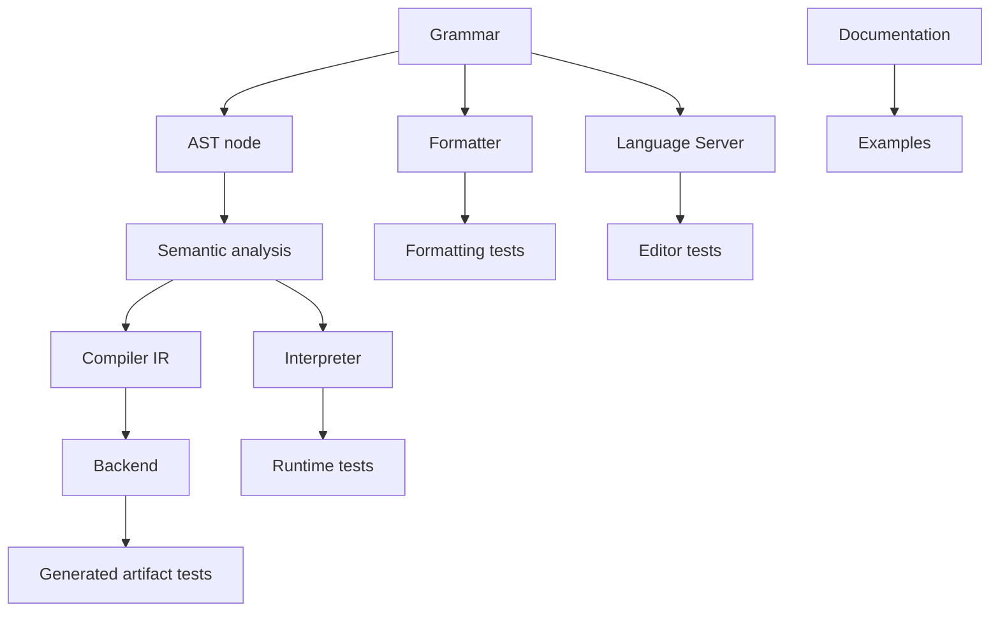

# Đánh giá thay đổi trong vòng đời DSL

Một DSL (*Domain-Specific Language*) không đứng yên sau khi được phát hành. Theo thời gian, nhóm phát triển cần thêm cú pháp, sửa lỗi compiler, thay đổi type system, cập nhật builtin function, nâng cấp runtime, điều chỉnh plugin API hoặc thay đổi policy bảo mật. Mỗi thay đổi có thể ảnh hưởng tới chương trình đã viết, ứng dụng tích hợp và quy trình vận hành.

**Đánh giá thay đổi** (*change assessment*) là quá trình xác định một thay đổi dự kiến tác động tới thành phần, người dùng, chương trình, dữ liệu và quy trình nào; ước lượng rủi ro; xác định kiểm tra cần thực hiện; và quyết định cách phát hành, chuyển đổi hoặc quay lui. Đây là hoạt động quan trọng trong quản trị vòng đời DSL vì một thay đổi nhỏ ở compiler có thể ảnh hưởng tới hàng nghìn chương trình đang chạy.

Ví dụ, nhóm muốn thay đổi cách chia hai số nguyên từ truncate về zero sang floor. Về mặt code, thay đổi có thể chỉ nằm trong một hàm evaluator. Nhưng về mặt sản phẩm, kết quả của biểu thức có số âm sẽ thay đổi, chương trình tính hạn mức có thể đưa ra quyết định khác và các ứng dụng cần kiểm tra lại output.

Một change assessment cần trả lời: thay đổi là gì, vì sao cần, ai bị ảnh hưởng, mức độ tương thích ra sao, có rủi ro nào, cần test gì, phát hành như thế nào và làm sao phục hồi nếu kết quả không như mong đợi.

## 1. Vì sao cần đánh giá thay đổi?

DSL thường được dùng để mã hóa quy tắc nghiệp vụ, policy hoặc workflow. Khi semantics thay đổi, chương trình có thể vẫn parse và compile thành công nhưng cho kết quả khác. Điều này khiến thay đổi DSL có thể tác động sâu hơn một API thông thường.

Đánh giá thay đổi giúp:

- Nhận diện consumer và chương trình bị ảnh hưởng.
- Phát hiện breaking changes trước khi release.
- Xác định phạm vi regression và compatibility tests.
- Ước lượng rủi ro vận hành và bảo mật.
- Lập kế hoạch migration cho source hoặc configuration.
- Chọn rollout strategy phù hợp.
- Xác định tiêu chí thành công và rollback.
- Ghi lại quyết định và người phê duyệt.
- Giảm sự cố do thay đổi không được truyền đạt.

Nếu chỉ review diff code, nhóm có thể bỏ qua thay đổi semantics gián tiếp. Ví dụ, nâng thư viện Decimal có thể làm thay đổi rounding, dù DSL source và evaluator không đổi.

## 2. Phân biệt change request, change assessment và change implementation

Ba hoạt động này liên quan nhưng không giống nhau.

| Hoạt động | Câu hỏi | Kết quả |
|---|---|---|
| Change request | Muốn thay đổi điều gì và vì sao? | Đề xuất có mục tiêu và lý do |
| Change assessment | Thay đổi ảnh hưởng gì và rủi ro ra sao? | Phạm vi, phân loại, test và kế hoạch |
| Change implementation | Thay đổi được thực hiện thế nào? | Code, config, schema hoặc tài liệu |
| Change verification | Làm sao xác nhận thay đổi đúng? | Test results và evidence |
| Change approval | Ai cho phép phát hành? | Quyết định có lưu vết |
| Change rollout | Thay đổi được đưa vào sử dụng ra sao? | Deployment và monitoring |
| Change closure | Kết quả có đạt mục tiêu không? | Kết luận, follow-up và record |

Đánh giá thay đổi diễn ra trước hoặc song song với implementation để nhóm hiểu phạm vi và chuẩn bị kiểm soát. Assessment có thể được cập nhật khi implementation phát hiện thêm tác động.

### Ví dụ

Một yêu cầu thêm optional chaining có thể bắt đầu bằng change request mô tả cú pháp và mục đích. Assessment xác định grammar, AST, type checker, evaluator, compiler backend, language server, documentation và compatibility. Implementation thêm feature. Verification kiểm tra semantics. Approval và rollout đưa feature vào phiên bản được hỗ trợ.

## 3. Các loại thay đổi trong DSL

Có thể phân loại theo thành phần bị thay đổi.

### Language syntax

- Thêm keyword hoặc operator.
- Thay grammar.
- Đổi precedence hoặc associativity.
- Thêm literal hoặc pattern.
- Loại bỏ syntax cũ.
- Thay quy tắc identifier hoặc comment.

### Language semantics

- Đổi type conversion.
- Thay null behavior.
- Thay evaluation order.
- Đổi numeric precision.
- Thay scope hoặc name resolution.
- Đổi error handling.
- Thay semantics của collection hoặc concurrency.

### Compiler và runtime

- Sửa parser hoặc type checker.
- Thêm optimization.
- Đổi bytecode hoặc IR.
- Nâng backend.
- Thay memory model.
- Đổi scheduler hoặc execution limits.
- Thay cache format.

### API và extension

- Thêm hoặc xóa builtin.
- Đổi function signature.
- Thay host function contract.
- Đổi plugin API.
- Thay quyền capability.
- Đổi SDK hoặc generated code.

### Tooling và operations

- CLI command.
- Language server behavior.
- Formatter output.
- Build plugin.
- Configuration schema.
- Package layout.
- Deployment model.
- Monitoring và audit.

### Policy và security

- Default permission.
- Sandbox restrictions.
- Resource limits.
- Authentication requirements.
- Tenant isolation.
- Signing và artifact verification.

Một change request có thể tác động nhiều loại cùng lúc. Ví dụ, thêm một operator mới ảnh hưởng grammar, AST, type system, interpreter, compiler, formatter, language server và documentation.

## 4. Xác định phạm vi và mục tiêu thay đổi

Bước đầu tiên là mô tả chính xác trạng thái hiện tại và trạng thái mong muốn.

Một change request nên có:

- ID hoặc tên thay đổi.
- Người đề xuất và người chịu trách nhiệm.
- Vấn đề cần giải quyết.
- Kết quả mong muốn.
- Thành phần dự kiến thay đổi.
- Người dùng hoặc hệ thống liên quan.
- Giới hạn phạm vi.
- Tiêu chí chấp nhận.
- Thời điểm hoặc release mục tiêu.

Tránh mô tả mơ hồ như “cải thiện compiler” hoặc “làm runtime nhanh hơn”. Hãy nêu vấn đề cụ thể: “giảm thời gian compile module có trên 10.000 declaration mà không thay đổi diagnostics và generated output”.

### In scope và out of scope

Ghi rõ phần được phép thay đổi và phần không thuộc phạm vi giúp tránh mở rộng công việc ngoài dự kiến. Ví dụ, một thay đổi parser có thể không cần thay đổi language semantics hoặc runtime API.

### Success criteria

Tiêu chí thành công nên đo được hoặc kiểm chứng được:

- Chương trình mẫu parse đúng.
- Diagnostics giữ source range.
- Compiler và interpreter cho cùng kết quả.
- Không có breaking API change.
- Thời gian compile giảm theo benchmark xác định.
- Không vượt resource budget.
- Migration tool xử lý được các syntax cũ đã liệt kê.

## 5. Phân tích dependency graph

Một thay đổi thường lan qua nhiều thành phần. Dependency graph giúp xác định thành phần trực tiếp và gián tiếp bị ảnh hưởng.

Ví dụ khi thêm operator:



Assessment cần xem xét:

- Thành phần nào đọc hoặc tạo dữ liệu thay đổi?
- Interface nào phụ thuộc vào contract đó?
- Artifact nào cần sinh lại?
- Cache hoặc persisted representation có bị ảnh hưởng?
- Plugin hoặc SDK nào cần cập nhật?
- Consumer nào dùng behavior hiện tại?
- Có dependency bên ngoài cần nâng cấp không?

Không nên chỉ nhìn dependency trực tiếp. Một thay đổi ở AST có thể ảnh hưởng compiler, debugger, formatter và serialized cache ở nhiều bước phía sau.

## 6. Phân tích consumer và người dùng bị ảnh hưởng

Consumer của DSL có thể là:

- Người viết chương trình DSL.
- Ứng dụng nhúng runtime.
- Service gọi compiler API.
- Plugin developer.
- Người vận hành compiler service.
- Pipeline build và deployment.
- Tooling như IDE, formatter hoặc language server.
- Hệ thống lưu program revision và compiled artifact.

Cần xác định consumer nào sử dụng API hoặc behavior bị thay đổi. Một builtin có thể chỉ được dùng trong một module, trong khi thay đổi null semantics có thể ảnh hưởng hầu hết chương trình.

### Usage inventory

Có thể dùng telemetry, source scan hoặc static analysis để ước lượng mức sử dụng:

- Bao nhiêu chương trình gọi symbol bị thay đổi?
- Version nào đang được triển khai?
- Tenant hoặc service nào phụ thuộc?
- Có chương trình production nào dùng syntax deprecated?
- Có plugin nào phụ thuộc API cũ?

Telemetry cần tôn trọng privacy và không ghi source hoặc dữ liệu nhạy cảm nếu không cần.

### Unknown consumers

Không phải lúc nào cũng biết hết consumer, đặc biệt với SDK hoặc plugin công khai. Khi không thể xác định đầy đủ, assessment cần ghi nhận độ không chắc chắn và chọn rollout thận trọng hơn.

## 7. Đánh giá compatibility

Compatibility analysis xác định consumer cũ có tiếp tục hoạt động với phiên bản mới hay không.

Các loại tương thích:

- **Source compatibility:** source DSL cũ vẫn parse và compile.
- **Semantic compatibility:** source cũ vẫn tạo cùng kết quả và side effects.
- **Binary compatibility:** compiled artifact cũ vẫn chạy với runtime mới.
- **API compatibility:** host integration hoặc plugin API cũ vẫn hoạt động.
- **Data compatibility:** persisted program, AST hoặc cache format vẫn đọc được.
- **Operational compatibility:** resource, config và deployment assumptions vẫn phù hợp.

Một thay đổi có thể tương thích ở một lớp nhưng phá vỡ lớp khác. Ví dụ, compiler vẫn chấp nhận source cũ nhưng runtime mới từ chối một host function do policy bảo mật.

### Compatibility matrix

| Thay đổi | Source | Semantics | Binary/API | Data |
|---|---|---|---|---|
| Thêm builtin mới | Thường giữ | Giữ | Có thể thêm API | Không đổi |
| Đổi operator precedence | Có thể vẫn parse | Có thể breaking | Có thể giữ ABI | Có thể ảnh hưởng artifact |
| Xóa builtin | Breaking nếu đang dùng | Không áp dụng cho source cũ | Có thể breaking | Có thể ảnh hưởng program |
| Đổi cache format | Giữ | Có thể giữ | Không nhất thiết | Cần migration/invalidation |
| Siết capability | Giữ | Có thể thay behavior | Có thể breaking | Policy metadata cần cập nhật |

## 8. Phân loại breaking change và mức rủi ro

Không phải thay đổi nào cũng cần cùng mức review.

Có thể phân loại:

- **Patch-level compatible:** sửa lỗi hoặc cải thiện không đổi contract được cam kết.
- **Feature-compatible:** thêm khả năng mới mà consumer cũ không cần thay đổi.
- **Potentially breaking:** một số chương trình hoặc cấu hình có thể đổi behavior.
- **Breaking:** consumer cần sửa source, API hoặc dữ liệu.
- **Security-critical:** thay đổi cần thiết để khắc phục lỗ hổng hoặc giảm quyền.
- **Operationally significant:** thay đổi ảnh hưởng hiệu năng, resource hoặc deployment.

Rủi ro nên xét cả xác suất và mức độ tác động. Một thay đổi hiếm gặp nhưng có thể làm sai quyết định tài chính vẫn cần đánh giá cao.

### Risk dimensions

- Phạm vi consumer.
- Mức độ nghiêm trọng nếu sai.
- Khả năng phát hiện trước production.
- Khả năng rollback.
- Tính không chắc chắn của dependency.
- Độ phức tạp migration.
- Khả năng tái lập và quan sát.
- Quyền và dữ liệu nhạy cảm liên quan.

Không nên dùng một con số risk score như bằng chứng khách quan nếu cách chấm không rõ. Nếu dùng score, hãy lưu tiêu chí, người đánh giá và giả định.

## 9. Đánh giá thay đổi grammar

Grammar change có thể ảnh hưởng parser, error recovery, formatter, syntax highlighting và source mapping.

Cần xem xét:

- Token mới có xung đột với identifier hiện tại không?
- Grammar có ambiguity mới không?
- Precedence và associativity có đổi không?
- Error recovery có thay đổi không?
- Comment hoặc whitespace rules có bị ảnh hưởng?
- Language server và formatter có hỗ trợ?
- Parser cũ có đọc source mới không?
- Có cần language version mới không?

### Ví dụ thêm keyword

Nếu thêm keyword match, một chương trình cũ có thể đã dùng match làm identifier. Đánh giá cần xác định keyword là reserved hay contextual, và có migration cho tên biến cũ không.

### Parser compatibility

Một parser mới có thể parse source cũ theo cấu trúc khác dù cả hai đều hợp lệ. Vì vậy, chỉ kiểm tra acceptance không đủ; cần kiểm tra AST shape và semantics.

## 10. Đánh giá thay đổi type system và semantics

Thay đổi type checker hoặc evaluator có thể tạo ảnh hưởng rộng mà không đổi cú pháp.

Ví dụ:

- Thay implicit conversion.
- Đổi type inference.
- Siết generic bounds.
- Thay nullability.
- Đổi equality.
- Thay overflow behavior.
- Đổi short-circuit.
- Đổi evaluation order.
- Thay Decimal rounding.

Cần xác định chương trình nào có thể thay đổi kết quả hoặc từ hợp lệ thành không hợp lệ.

### Static analysis trước migration

Có thể quét source để tìm pattern bị ảnh hưởng. Ví dụ, khi đổi implicit conversion, compiler có thể tạo warning cho những biểu thức đang dựa vào conversion cũ.

### Differential evaluation

Chạy chương trình và input đại diện trên runtime cũ và mới, sau đó so sánh result, errors và side effects. Kết quả khác biệt cần được phân loại là thay đổi có chủ đích hay regression.

## 11. Đánh giá thay đổi builtin và host function

Builtin function là một phần public surface của DSL. Thay đổi signature hoặc semantics có thể ảnh hưởng chương trình và plugin.

Cần đánh giá:

- Tên và overload.
- Argument count và type.
- Default values.
- Return type.
- Nullability.
- Exception behavior.
- Side effects.
- Permission/capability.
- Performance và resource use.
- Deprecation và replacement.

Nếu host function có side effect, cần xem retry, idempotency và transaction boundary. Một thay đổi timeout hoặc error mapping cũng có thể ảnh hưởng workflow dù signature không đổi.

## 12. Đánh giá compiler, runtime và bytecode compatibility

Compiler và runtime có thể được phát hành độc lập. Một compiled artifact có thể phụ thuộc bytecode format, runtime API hoặc builtin registry.

Assessment cần xác định:

- Artifact được tạo bởi compiler version nào?
- Runtime mới có đọc artifact cũ không?
- Có cần recompile source không?
- Bytecode schema có thay đổi không?
- Cache hoặc persisted IR có thể reuse không?
- Có migration hoặc version adapter không?
- Plugin binary có tương thích không?

Nếu bytecode format thay đổi, có thể cần giữ reader cho format cũ trong thời gian chuyển tiếp hoặc cung cấp tool recompile.

### Runtime support matrix

Một ma trận hỗ trợ giúp người dùng biết compiler/runtime combination nào hợp lệ.

| Compiler | Language version | Runtime tối thiểu | Trạng thái |
|---|---|---|---|
| 5.0 | 2.3, 2.4 | 3.5 | Supported |
| 5.1 | 2.4, 2.5 | 3.8 | Supported |
| 4.8 | 2.2, 2.3 | 3.2 | Legacy |

Ví dụ chỉ minh họa cách trình bày. Dự án thực tế cần công bố các version đã kiểm chứng.

## 13. Đánh giá dữ liệu và schema migration

DSL program có thể được lưu trong database, repository hoặc registry. Compiled artifact, AST cache và metadata cũng có thể được persist.

Thay đổi schema cần xem xét:

- Có đọc được record cũ không?
- Field mới có default không?
- Field bị xóa có cần giữ để tương thích không?
- Có thể rollback schema không?
- Migration có mất dữ liệu không?
- Có cần dual-read hoặc dual-write không?
- Cache cũ có cần invalidation?
- Backup và restore có tương thích?

### Expand-and-contract

Một cách migration an toàn là chia thành các bước:

1. Mở rộng schema để hỗ trợ cả format cũ và mới.
2. Deploy reader tương thích với cả hai.
3. Chuyển writer sang format mới.
4. Migrate dữ liệu cũ.
5. Xác nhận không còn consumer dùng format cũ.
6. Loại bỏ field hoặc reader cũ trong release sau.

Không nên thay đổi schema và code reader/writer cùng lúc nếu hệ thống có nhiều instance chạy các version khác nhau mà không có kế hoạch tương thích.

## 14. Đánh giá security và privacy impact

Một thay đổi có thể mở rộng hoặc thu hẹp quyền của DSL.

Các câu hỏi:

- Có thêm builtin truy cập dữ liệu không?
- Có mở filesystem, network hoặc reflection không?
- Capability mới có giới hạn resource không?
- Tenant isolation có giữ nguyên không?
- Log hoặc diagnostic có lộ dữ liệu không?
- Sandbox có thay đổi không?
- Plugin có thêm quyền không?
- Secret có thể đi vào cache hoặc artifact không?
- Có cần audit event mới không?

Security improvement đôi khi tạo breaking change. Ví dụ, runtime mới từ chối function không được cấp capability. Assessment cần xác định chương trình nào sẽ bị chặn và cách cấp quyền tối thiểu phù hợp.

## 15. Đánh giá performance và resource impact

Một thay đổi semantics có thể đúng nhưng làm tăng thời gian compile hoặc execution.

Cần đánh giá:

- Compile time.
- Runtime latency.
- Throughput.
- Memory usage.
- Allocation rate.
- Cache hit rate.
- Number of host function calls.
- Database/network calls.
- Bytecode hoặc artifact size.
- Concurrency và queueing.

### Benchmark baseline

Trước khi thay đổi, lưu baseline trên workload đại diện. Sau implementation, chạy cùng benchmark và môi trường để so sánh.

Benchmark cần ghi hardware, runtime version, input size, warmup, iteration count và measurement method. Không nên kết luận từ một lần chạy hoặc máy không ổn định.

### Resource budget

Nếu thay đổi thêm một tính năng có thể tạo AST hoặc bytecode lớn hơn, cần xem giới hạn memory và instruction budget. Một tính năng mới có thể mở đường cho denial of service nếu input không tin cậy.

## 16. Kiểm tra dependency và toolchain impact

Thay đổi có thể kéo theo dependency mới hoặc nâng cấp parser generator, compiler backend, serializer hay build plugin.

Assessment cần xem:

- Dependency trực tiếp và bắc cầu.
- License.
- Security advisory.
- Toolchain version.
- Binary compatibility.
- Build reproducibility.
- Cache key và invalidation.
- Container image.
- SBOM và provenance.
- Quyền plugin.

Nâng parser generator có thể làm generated code thay đổi lớn dù grammar không đổi. Cần xem diff, compiler compatibility và artifact reproducibility.

## 17. Lựa chọn kiểm thử theo mức ảnh hưởng

Test plan nên được suy ra từ impact analysis.

Các nhóm test thường dùng:

- Parser và grammar tests.
- Type checker và static semantic tests.
- Interpreter/evaluator tests.
- Compiler backend tests.
- Differential tests giữa phiên bản cũ và mới.
- Contract tests cho host API.
- Plugin compatibility tests.
- Serialization và data migration tests.
- Security tests.
- Performance benchmarks.
- End-to-end workflow tests.
- Rollback và recovery tests.

### Regression scope

Nếu thay đổi operator precedence, test cần bao phủ AST và evaluation. Nếu thay đổi cache format, test cần bao phủ restore, invalidation và fallback. Nếu thay đổi capability, test cần kiểm tra allowed và denied calls ở từng tenant.

Không phải mọi thay đổi đều cần chạy toàn bộ test suite giống nhau. Tuy nhiên, assessment phải giải thích vì sao các nhóm test được chọn đủ để kiểm soát rủi ro.

## 18. Migration strategy

Khi thay đổi không tương thích, cần chọn cách chuyển đổi.

Một số chiến lược:

- **Source migration:** sửa DSL source sang syntax mới.
- **Automated codemod:** công cụ biến đổi source có thể review.
- **Compatibility mode:** runtime tạm thời hỗ trợ semantics cũ.
- **Dual-version support:** chạy song song hai language/runtime versions.
- **Data migration:** chuyển persisted program hoặc artifact.
- **Adapter layer:** ánh xạ API cũ sang API mới.
- **Deprecation window:** cảnh báo trước khi loại bỏ.

### Automated migration

Codemod cần có:

- Input language version.
- Output language version.
- Transformation rules.
- Source mapping.
- Dry-run diff.
- Diagnostics cho trường hợp không tự chuyển được.
- Idempotency để chạy lại không làm biến dạng source.

Không nên tự động migrate mọi chương trình nếu transformation không chứng minh được semantics tương đương. Những trường hợp mơ hồ cần review thủ công.

## 19. Rollout strategy

Thay đổi có thể được triển khai theo nhiều mức.

### Big-bang rollout

Tất cả consumer chuyển sang version mới cùng lúc. Cách này đơn giản về trạng thái cuối nhưng rủi ro cao nếu hệ thống lớn hoặc rollback khó.

### Phased rollout

Triển khai theo nhóm tenant, service, region hoặc percentage traffic. Theo dõi lỗi và metrics giữa các giai đoạn.

### Canary

Một tập nhỏ consumer chạy version mới trước. Nếu metrics và behavior đạt tiêu chí, mở rộng dần.

### Shadow evaluation

Chạy chương trình trên version mới song song nhưng không dùng output mới để thực hiện side effect. So sánh kết quả với version hiện hành.

Shadow evaluation đặc biệt hữu ích khi thay đổi semantics, nhưng cần tránh gọi host functions có side effect hai lần. Dùng snapshot, fake hoặc read-only capabilities.

## 20. Feature flags và compatibility switches

Feature flag có thể cho phép bật thay đổi theo tenant, program hoặc environment.

Ví dụ:

```text
runtime:
  languageVersion: "2.5"
  features:
    newDecimalRounding: true
    strictNullChecks: false
```

Flag cần có:

- Owner.
- Default value.
- Scope.
- Thời điểm bật/tắt.
- Metrics.
- Expiry hoặc removal plan.
- Quy tắc tương thích.

Không nên tích lũy flag vô thời hạn. Mỗi flag tạo thêm tổ hợp behavior cần kiểm thử. Sau khi migration hoàn tất, cần xóa flag và code cũ theo kế hoạch.

## 21. Rollback và recovery plan

Rollback cần được thiết kế trước khi release, không đợi sự cố mới nghĩ cách quay lui.

Assessment nên trả lời:

- Có thể quay lại compiler/runtime version trước không?
- Artifact cũ còn lưu không?
- Schema migration có reversible không?
- Program revision nào đã được chuyển đổi?
- Có side effect nào không thể undo?
- Có cần compensation?
- Ai có quyền rollback?
- Thời gian phục hồi mục tiêu là bao lâu?

Nếu thay đổi dữ liệu không reversible, có thể cần backup, forward-fix hoặc migration bù thay vì rollback đơn giản.

### Rollback trigger

Định nghĩa điều kiện kích hoạt:

- Error rate vượt ngưỡng.
- Result mismatch vượt giới hạn.
- Latency tăng đáng kể.
- Crash hoặc resource exhaustion.
- Security policy bị bypass.
- Tenant bị ảnh hưởng ngoài dự kiến.

Trigger nên đo được và gắn với người có quyền quyết định.

## 22. Approval và change governance

Không phải mọi thay đổi cần cùng mức phê duyệt. Một typo trong documentation khác với thay đổi permission hoặc bytecode format.

Có thể phân cấp:

- Routine change: review theo quy trình phát triển thông thường.
- Compatibility-sensitive: cần reviewer hiểu language/runtime contract.
- Security-sensitive: cần security owner hoặc người được ủy quyền.
- Data migration: cần owner của dữ liệu và kế hoạch recovery.
- Production rollout: cần người chịu trách nhiệm vận hành.

Change record nên lưu:

- Mô tả và lý do.
- Impact assessment.
- Risk và giả định.
- Test evidence.
- Migration/rollback plan.
- Người review và approve.
- Release và thời điểm triển khai.
- Kết quả sau rollout.

Approval cần dựa trên evidence và policy, không chỉ là một trạng thái checkbox.

## 23. Communication và tài liệu thay đổi

Người dùng cần biết thay đổi trước khi họ bị ảnh hưởng.

Các kênh có thể gồm:

- Changelog.
- Release notes.
- Migration guide.
- API reference.
- Deprecation warnings.
- In-product notification.
- Developer portal.
- Email hoặc thông báo theo subscription.
- Support bulletin.

Nội dung cần nêu phiên bản, thời điểm áp dụng, consumer bị ảnh hưởng và hành động cần thực hiện. Thay đổi semantics hoặc security default cần truyền đạt nổi bật hơn thay đổi nội bộ.

## 24. Theo dõi sau triển khai

Sau rollout, cần xác nhận thay đổi đạt mục tiêu và không tạo tác động ngoài dự kiến.

Theo dõi:

- Error và diagnostic rates.
- Parse/compile success.
- Runtime result distribution.
- Latency và throughput.
- Memory và resource usage.
- Host function denials.
- Plugin failures.
- Cache misses hoặc invalidations.
- Migration completion.
- Rollback hoặc compatibility flag usage.
- Support tickets và user feedback.

Với semantic change, có thể theo dõi tỷ lệ output khác giữa old/new runtime trên sample phù hợp. Dữ liệu phải được giới hạn và bảo vệ theo privacy policy.

### Close the change

Sau thời gian quan sát, change owner ghi nhận:

- Mục tiêu đạt hay chưa.
- Sự cố phát sinh.
- Rollback có cần thiết không.
- Migration còn tồn đọng.
- Follow-up actions.
- Tài liệu và changelog đã cập nhật chưa.

## 25. Change assessment record mẫu

Một record có thể được lưu theo cấu trúc:

```yaml
changeId: DSL-CHG-042
title: Change Integer division semantics
owner: language-runtime-team
reason: Align division behavior with documented language contract
components:
  - evaluator
  - compiler-backend
  - language-reference
compatibility:
  source: compatible
  semantic: potentially-breaking
  binary: compatible
  data: no-change
risk:
  level: high
  rationale: Negative integer expressions may produce different results
tests:
  - evaluator-boundary-tests
  - interpreter-compiler-differential
  - production-program-scan
migration:
  required: true
  guide: docs/migrations/integer-division.md
rollout:
  strategy: canary
rollback:
  trigger: result-mismatch-rate-above-threshold
approval:
  required: language-owner
```

Đây là mẫu khái niệm. Tổ chức có thể thêm field phù hợp với quy trình, nhưng cần giữ một nguồn dữ liệu có thẩm quyền và lưu lịch sử thay đổi của assessment.

## 26. Ví dụ end-to-end: thay đổi semantics của Decimal

Giả sử runtime hiện tại dùng rounding half-up trong một số phép tính Decimal, nhưng đặc tả mới yêu cầu half-even.

### Change request

Mục tiêu là thống nhất rounding giữa interpreter, compiler backend và serialization.

### Impact analysis

Các thành phần liên quan:

- Decimal evaluator.
- Constant folding.
- Compiler backend.
- Builtin rounding functions.
- Serializer.
- Documentation và examples.
- Programs tính giá, thuế và tỷ lệ.
- Host integration nhận Decimal output.

### Compatibility assessment

Source có thể vẫn compile, nhưng một số kết quả thay đổi ở trường hợp tie. Đây là potentially-breaking semantic change.

### Test plan

- Unit tests cho tie values.
- Boundary và negative values.
- Interpreter/compiler parity.
- Constant-folding on/off.
- Serialization round-trip.
- Golden tests cho chương trình tính giá.
- Scan chương trình production dùng Decimal division hoặc rounding.

### Rollout

- Phát hành preview runtime.
- Chạy shadow evaluation trên snapshot đại diện.
- So sánh result và lập danh sách program bị ảnh hưởng.
- Cung cấp migration guide.
- Bật theo canary.
- Theo dõi mismatch và error rates.

### Rollback

Nếu mismatch vượt ngưỡng hoặc kết quả nghiệp vụ không chấp nhận được, chuyển consumer về runtime cũ hoặc tắt feature flag theo policy. Program revision và artifact cũ cần được giữ để phục hồi.

Ví dụ cho thấy một thay đổi trong một phép toán cần assessment qua nhiều lớp, không chỉ một file evaluator.

## 27. Những lỗi thường gặp khi đánh giá thay đổi

**Chỉ xem code diff.** Tác động có thể lan qua compiler, runtime, plugin và consumer. Dùng dependency graph và usage inventory.

**Coi mọi bug fix là patch không ảnh hưởng.** Sửa behavior sai có thể đổi output. Đánh giá semantics và chương trình đang dùng.

**Không phân biệt source và semantic compatibility.** Source compile được không có nghĩa kết quả không đổi. Kiểm tra cả hai.

**Bỏ qua persisted artifacts.** Bytecode, cache hoặc program metadata có thể không đọc được sau nâng cấp. Lập compatibility matrix và migration plan.

**Không xác định consumer.** Một API công khai có thể được dùng ngoài nhóm phát triển. Ghi nhận unknown consumers và rollout thận trọng.

**Test không theo risk.** Chạy test chung chung có thể bỏ sót tác động quan trọng. Derive test plan từ impact analysis.

**Không có rollback trigger.** Khi sự cố xảy ra, nhóm không biết lúc nào nên dừng rollout. Đặt ngưỡng đo được trước release.

**Shadow run có side effect.** Chạy hai runtime có thể gửi hai message hoặc ghi hai bản ghi. Dùng read-only capability và snapshot.

**Feature flag không có expiry.** Tổ hợp behavior tăng và khó kiểm thử. Gán owner và thời hạn xóa.

**Migration tự động không review.** Codemod có thể làm đổi semantics. Cung cấp dry-run diff và kiểm tra kết quả.

**Approval chỉ mang tính hình thức.** Người duyệt không có evidence để đánh giá. Gắn test results, risk và rollback plan vào change record.

**Không theo dõi sau rollout.** Lỗi chỉ xuất hiện trên workload thực tế. Theo dõi metrics và user feedback theo giai đoạn.

## 28. Quy trình đánh giá thay đổi cho DSL

Có thể thực hiện theo trình tự:

1. Ghi change request với mục tiêu, lý do và success criteria.
2. Phân loại thay đổi theo language, compiler, runtime, API, data, security hoặc operations.
3. Xác định in-scope và out-of-scope.
4. Lập dependency graph và inventory consumer.
5. Xác định source, semantic, binary, API, data và operational compatibility.
6. Phân tích breaking changes và risk dimensions.
7. Đánh giá security, privacy, performance và dependency impact.
8. Lập test plan dựa trên rủi ro và phạm vi.
9. Xác định migration, deprecation hoặc compatibility strategy.
10. Chọn rollout strategy và feature flag nếu cần.
11. Đặt rollback triggers và recovery plan.
12. Ghi approval, owner và evidence.
13. Cập nhật changelog, release notes và migration documentation.
14. Theo dõi sau rollout và xác nhận success criteria.
15. Đóng change record và lưu follow-up actions.

## 29. Câu hỏi tự kiểm tra

1. Đánh giá thay đổi là gì và khác implementation hoặc verification như thế nào?
2. Vì sao DSL cần change assessment riêng cho semantics?
3. Những thành phần nào có thể bị ảnh hưởng khi thêm một operator?
4. Dependency graph và usage inventory giúp xác định phạm vi ra sao?
5. Source, semantic, binary, API và data compatibility khác nhau như thế nào?
6. Vì sao một bug fix có thể tạo breaking behavior?
7. Assessment cho grammar change cần kiểm tra những yếu tố nào?
8. Type system và evaluator change có thể ảnh hưởng chương trình cũ ra sao?
9. Khi runtime hoặc bytecode thay đổi, cần lập compatibility matrix như thế nào?
10. Schema migration có thể dùng expand-and-contract ra sao?
11. Security impact assessment cần xem xét capability và tenant isolation thế nào?
12. Performance baseline nên được thiết lập và so sánh ra sao?
13. Test plan nên được suy ra từ impact analysis như thế nào?
14. Automated codemod cần những bảo đảm gì?
15. Canary, phased rollout và shadow evaluation khác nhau ra sao?
16. Vì sao shadow evaluation phải tránh side effects?
17. Rollback trigger cần được định nghĩa trước release như thế nào?
18. Change record nên lưu approval và evidence gì?
19. Làm thế nào để theo dõi semantic change sau khi triển khai?
20. Hãy lập assessment cho việc thay đổi null semantics của DSL, gồm consumer, compatibility, test, migration, rollout và rollback.

Đánh giá thay đổi giúp nhóm hiểu tác động của một quyết định kỹ thuật trước khi nó trở thành thay đổi production. Khi phạm vi, compatibility, rủi ro, test, migration, rollout và rollback được xác định rõ, DSL có thể phát triển qua nhiều phiên bản mà vẫn giữ được khả năng kiểm soát và truy vết.

