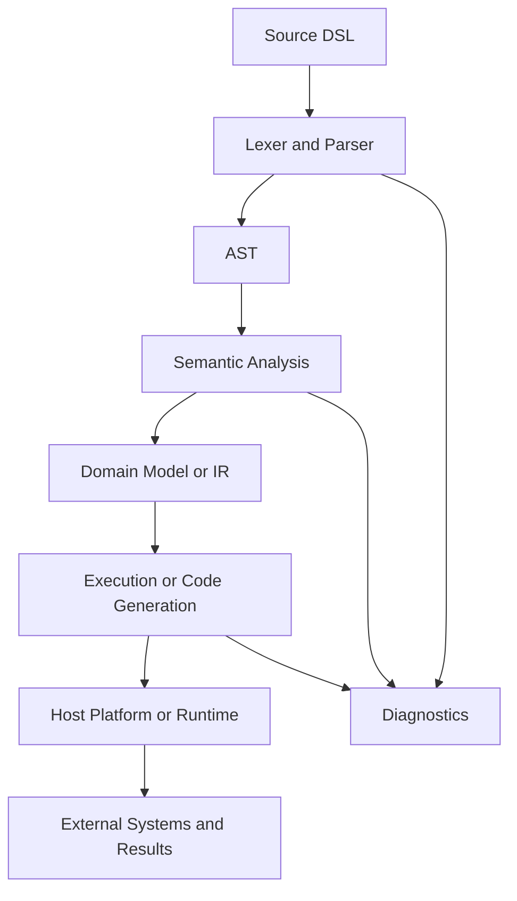

# Các lớp của một DSL

Ngôn ngữ miền chuyên biệt (Domain-Specific Language, DSL) được xây dựng để người dùng mô tả một nhóm công việc trong một miền cụ thể. Để một mô tả DSL có thể đi từ văn bản người dùng viết đến hành vi có ý nghĩa, hệ thống cần nhiều thành phần phối hợp: nhận diện cú pháp, hiểu khái niệm miền, kiểm tra quy tắc, xác định cách thực thi và kết nối với môi trường bên ngoài. Có thể tổ chức các thành phần đó thành những lớp với trách nhiệm và giao diện rõ ràng.

Kiến trúc phân lớp giúp tách câu hỏi “người dùng viết gì”, “mô tả đó có ý nghĩa gì” và “hệ thống thực hiện nó như thế nào”. Nhờ vậy, nhóm phát triển có thể thay đổi cú pháp mà ít ảnh hưởng đến logic miền, thêm một nền tảng thực thi mới mà không phải viết lại toàn bộ ngôn ngữ, hoặc cải thiện công cụ hỗ trợ mà không làm thay đổi ngữ nghĩa chương trình.

## 1. Nhìn tổng thể kiến trúc DSL

Một DSL thường có thể được phân chia thành các lớp chính sau:

1. **Lớp ngôn ngữ bề mặt:** quy định cách người dùng viết chương trình, bao gồm từ khóa, biểu thức và cấu trúc cú pháp.
2. **Lớp phân tích:** đọc văn bản, kiểm tra cấu trúc và chuyển nó thành biểu diễn có cấu trúc như cây cú pháp trừu tượng.
3. **Lớp ngữ nghĩa và mô hình miền:** xác định ý nghĩa của các cấu trúc, liên kết tên với khái niệm miền, kiểm tra kiểu và quy tắc nghiệp vụ.
4. **Lớp biểu diễn trung gian:** chuẩn hóa chương trình thành mô hình ổn định hơn để phân tích, tối ưu hoặc chuyển đổi.
5. **Lớp thực thi hoặc sinh mã:** diễn giải mô hình, biên dịch thành mã khác hoặc tạo cấu hình cho một nền tảng.
6. **Lớp tích hợp và môi trường:** kết nối DSL với ứng dụng chủ, dữ liệu, dịch vụ, hệ điều hành hoặc nền tảng đích.
7. **Lớp công cụ phát triển:** hỗ trợ soạn thảo, gợi ý, định dạng, kiểm tra và giải thích lỗi.

Không phải DSL nào cũng triển khai từng lớp thành một module riêng. Một DSL nhỏ có thể kết hợp parser và kiểm tra ngữ nghĩa trong một thư viện. Một nền tảng lớn có thể tách từng lớp thành dịch vụ hoặc gói độc lập. Điều quan trọng là trách nhiệm của từng phần được xác định rõ, để thay đổi ở một phần không tạo ra tác động dây chuyền khó kiểm soát.

Sơ đồ dưới đây thể hiện một luồng xử lý phổ biến:



Các mũi tên mô tả luồng dữ liệu chính. Thông báo lỗi có thể được tạo ở nhiều giai đoạn, không chỉ ở parser. Công cụ soạn thảo cũng có thể gọi parser và phân tích ngữ nghĩa từng phần để cung cấp phản hồi khi người dùng đang viết.

## 2. Lớp ngôn ngữ bề mặt

Lớp ngôn ngữ bề mặt (surface language) là phần người dùng nhìn thấy và trực tiếp viết. Nó xác định từ vựng, quy tắc cú pháp và phong cách diễn đạt của DSL. Mục tiêu của lớp này là giúp người dùng mô tả công việc bằng khái niệm gần với miền, đồng thời giữ cho chương trình nhất quán và dễ đọc.

Ví dụ một DSL triển khai dịch vụ có thể dùng cú pháp:

```text
service "catalog" {
    image = "catalog:3.1"
    replicas = 3
    port = 8080
}
```

Người viết tập trung vào các khái niệm `service`, `image`, `replicas` và `port`. Họ không cần khai báo cách tạo socket, khởi chạy tiến trình hay gọi API của nền tảng triển khai. Những chi tiết đó thuộc các lớp phía sau.

Khi thiết kế lớp bề mặt, cần quyết định:

- Từ khóa và tên định danh nào thuộc ngôn ngữ?
- Giá trị, biểu thức và phép toán được viết theo quy tắc nào?
- Khối lệnh, danh sách và cấu trúc lồng nhau được biểu diễn ra sao?
- Có cho phép chú thích, macro hoặc phần mở rộng cú pháp không?
- Người dùng miền có thể đọc và hiểu chương trình mà không phải biết chi tiết triển khai đến mức nào?

Một cú pháp tốt không nhất thiết phải giống ngôn ngữ tự nhiên hoàn toàn. Cú pháp cần đủ gần với tư duy miền để dễ hiểu, nhưng vẫn đủ chính xác để parser có thể nhận diện và công cụ có thể đưa ra thông báo lỗi rõ ràng.

## 3. Lớp phân tích cú pháp

Lớp phân tích (front end hoặc parsing layer) tiếp nhận văn bản DSL và xác định cấu trúc của nó. Nhiều hệ thống chia lớp này thành phân tích từ vựng và phân tích cú pháp.

### 3.1. Phân tích từ vựng

Bộ phân tích từ vựng (lexer hoặc tokenizer) đọc chuỗi ký tự và nhóm chúng thành các token, chẳng hạn từ khóa, tên định danh, số, chuỗi ký tự, toán tử và dấu phân cách.

Với biểu thức:

```text
replicas = 3 + 1
```

Lexer có thể tạo ra chuỗi token gồm `IDENTIFIER(replicas)`, `EQUALS`, `NUMBER(3)`, `PLUS` và `NUMBER(1)`. Lexer cũng xử lý khoảng trắng, chú thích và các quy tắc nhận diện chuỗi.

### 3.2. Phân tích cú pháp

Bộ phân tích cú pháp (parser) nhận các token và kiểm tra chúng có tuân theo ngữ pháp DSL hay không. Kết quả thường là cây cú pháp trừu tượng (Abstract Syntax Tree, AST), biểu diễn cấu trúc chương trình mà không cần giữ lại mọi chi tiết trình bày.

Ví dụ, đoạn `replicas = 3 + 1` có thể tạo ra một nút gán với vế trái là tên `replicas` và vế phải là nút cộng gồm hai giá trị số. AST cho phép các lớp tiếp theo thao tác trên cấu trúc thay vì phải đọc lại chuỗi văn bản.

Parser cần phát hiện lỗi như thiếu dấu đóng khối, dùng toán tử sai vị trí hoặc đặt một khai báo ở nơi ngữ pháp không cho phép. Một parser hữu ích nên giữ thông tin vị trí nguồn (source location) của các nút để thông báo lỗi có thể chỉ đúng dòng và cột.

### 3.3. AST không phải là toàn bộ ý nghĩa

AST cho biết chương trình có cấu trúc cú pháp nào, nhưng chưa chắc đã xác định chương trình có hợp lệ trong miền hay không. Ví dụ, `replicas = -2` có thể tạo ra AST hợp lệ nếu ngữ pháp cho phép số âm. Quy tắc miền có thể yêu cầu số bản sao không âm hoặc phải lớn hơn không. Việc kiểm tra đó thuộc lớp ngữ nghĩa.

Tách AST khỏi ngữ nghĩa giúp parser tập trung vào cấu trúc văn bản. Cùng một AST có thể được phân tích theo nhiều chính sách hoặc được chuyển sang các backend khác nhau, miễn là ngữ nghĩa DSL được giữ nhất quán.

## 4. Lớp ngữ nghĩa và mô hình miền

Lớp ngữ nghĩa (semantic layer) xác định ý nghĩa của cấu trúc cú pháp trong miền. Nó liên kết tên định danh với đối tượng, kiểm tra kiểu, áp dụng quy tắc nghiệp vụ và xác nhận các quan hệ giữa những thành phần trong chương trình.

Ví dụ, với khai báo:

```text
service "catalog" {
    replicas = 3
    port = 8080
}
```

Lớp ngữ nghĩa có thể kiểm tra rằng:

- `service` là một loại đối tượng được DSL hỗ trợ.
- Tên `catalog` không bị trùng trong phạm vi yêu cầu duy nhất.
- `replicas` nhận một số nguyên trong giới hạn cho phép.
- `port` là số nguyên thuộc miền cổng hợp lệ.
- Những trường bắt buộc khác đã được khai báo hoặc có giá trị mặc định.

Lớp này thường cần một mô hình miền (domain model) thể hiện các khái niệm như dịch vụ, tài nguyên, chính sách, trạng thái hoặc quy tắc. Mô hình miền giúp chuyển cấu trúc cú pháp thành các đối tượng có ý nghĩa, chẳng hạn `ServiceDefinition` với thuộc tính `replicaCount` và `containerImage`.

### 4.1. Phân giải tên và phạm vi

Phân giải tên (name resolution) xác định một tên trong chương trình tham chiếu đến khai báo nào. DSL có thể có phạm vi toàn cục, phạm vi khối, module hoặc namespace. Nếu một quy tắc tham chiếu đến dịch vụ `catalog`, hệ thống phải tìm được khai báo tương ứng và báo lỗi nếu không tồn tại hoặc có nhiều khai báo mơ hồ.

### 4.2. Kiểm tra kiểu

Hệ thống kiểu (type system) quy định kiểu dữ liệu nào được sử dụng ở từng vị trí và phép toán nào hợp lệ. Ví dụ, không nên cộng trực tiếp một giá trị tiền tệ với một thời điểm. Với DSL nghiệp vụ, kiểu có thể bao gồm kiểu miền như `Money`, `Date`, `Duration`, `EmailAddress` hoặc `CustomerId`, thay vì chỉ dùng số và chuỗi tổng quát.

Kiểm tra kiểu có thể phát hiện lỗi trước khi thực thi, giảm tình huống chương trình chạy một phần rồi mới thất bại vì dữ liệu không phù hợp.

### 4.3. Kiểm tra quy tắc miền

Ngoài kiểu dữ liệu, lớp ngữ nghĩa kiểm tra bất biến và điều kiện nghiệp vụ. Ví dụ, một dịch vụ công khai phải khai báo cổng, một quy trình không được tham chiếu đến trạng thái chưa định nghĩa, hoặc một quy tắc chiết khấu không được có mức giảm vượt giới hạn chính sách.

Cần phân biệt lỗi ngữ nghĩa tĩnh với điều kiện chỉ có thể xác định khi chạy. Một tham chiếu đến tên không tồn tại thường có thể phát hiện ngay khi phân tích. Việc một tài khoản có đủ số dư tại thời điểm giao dịch lại phụ thuộc vào dữ liệu thực tế và thường cần kiểm tra trong runtime.

## 5. Lớp biểu diễn trung gian

Biểu diễn trung gian (Intermediate Representation, IR) là mô hình có cấu trúc được tạo ra sau khi chương trình đã được phân tích và hiểu về mặt ngữ nghĩa. IR có thể đơn giản hơn AST, ít phụ thuộc vào cách người dùng viết cú pháp và thuận tiện cho việc tối ưu hoặc chuyển đổi.

Ví dụ, người dùng có thể viết một biểu thức ngắn:

```text
replicas = 2 + 1
```

Sau khi phân tích và kiểm tra kiểu, IR có thể lưu thuộc tính `replicaCount` với biểu thức số học đã được chuẩn hóa. Một DSL khác có thể cho phép cú pháp khai báo hoặc cú pháp dạng bảng nhưng cùng chuyển về một IR thống nhất.

IR hữu ích khi DSL có nhiều cú pháp bề mặt hoặc nhiều nền tảng đích. Front end chịu trách nhiệm chuyển từng kiểu cú pháp sang IR; backend chỉ cần xử lý IR. Nhờ đó, thêm một cú pháp mới không nhất thiết đòi hỏi viết lại toàn bộ backend.

Một IR tốt cần:

- Biểu diễn đủ thông tin ngữ nghĩa cần thiết cho việc thực thi.
- Có cấu trúc ổn định, không phụ thuộc quá nhiều vào cách trình bày văn bản.
- Giữ nguồn gốc vị trí để có thể liên kết lỗi backend với dòng trong tệp DSL.
- Có phiên bản hoặc quy tắc tương thích nếu được lưu hoặc trao đổi giữa các thành phần.
- Không đưa vào những chi tiết triển khai không cần thiết ở cấp mô hình miền.

Không phải DSL nhỏ nào cũng cần IR riêng. Nếu AST đã đủ rõ, ổn định và phù hợp cho runtime, có thể dùng trực tiếp AST đã được kiểm tra. IR trở nên hữu ích khi cần nhiều backend, tối ưu hóa, phân tích sâu hoặc tách front end khỏi runtime.

## 6. Lớp thực thi và sinh mã

Sau khi chương trình được phân tích và xác nhận hợp lệ, hệ thống cần biến mô hình thành hành vi. Lớp thực thi (execution layer) hoặc lớp backend có thể dùng một trong các cách sau.

### 6.1. Thông dịch

Bộ thông dịch (interpreter) duyệt AST hoặc IR và thực hiện từng thao tác theo ngữ nghĩa DSL. Cách này phù hợp khi muốn chạy chương trình trực tiếp, xây dựng nhanh hoặc hỗ trợ môi trường tương tác.

Ví dụ, một DSL tính giá có thể đọc quy tắc chiết khấu trong IR, lấy dữ liệu đơn hàng từ ngữ cảnh và tính ra giá cuối cùng. Interpreter cần quản lý môi trường thực thi, giá trị, lỗi và giới hạn tài nguyên.

### 6.2. Biên dịch thành mã khác

Compiler chuyển DSL thành mã của một ngôn ngữ hoặc định dạng khác. Ví dụ, DSL truy vấn có thể được biên dịch thành SQL; DSL giao diện có thể sinh mã HTML/CSS; DSL triển khai có thể sinh cấu hình cho nền tảng điều phối container.

Biên dịch có thể giúp tận dụng runtime và công cụ sẵn có của nền tảng đích. Tuy nhiên, backend phải bảo toàn ngữ nghĩa DSL. Nếu hai nền tảng có khả năng khác nhau, compiler cần báo rõ tính năng nào không được hỗ trợ hoặc cần cách ánh xạ thay thế.

### 6.3. Sinh cấu hình hoặc kế hoạch thực thi

Một DSL khai báo có thể không sinh mã chương trình mà sinh một kế hoạch hoặc cấu hình. Ví dụ, mô tả quy trình dữ liệu có thể được chuyển thành DAG (Directed Acyclic Graph) gồm các bước và quan hệ phụ thuộc. Bộ lập lịch hoặc runtime của nền tảng sẽ thực hiện kế hoạch đó.

### 6.4. Tách ngữ nghĩa khỏi backend

Một DSL có thể hỗ trợ nhiều backend: chạy mô phỏng cục bộ, tạo SQL cho nhiều hệ quản trị cơ sở dữ liệu hoặc sinh cấu hình cho nhiều môi trường triển khai. Lớp ngữ nghĩa cần xác định ý nghĩa chung; mỗi backend chịu trách nhiệm ánh xạ ý nghĩa đó sang khả năng của nền tảng đích.

Nếu một backend không thể thực hiện một cấu trúc, nó nên phát sinh lỗi hoặc cảnh báo có vị trí nguồn rõ ràng. Không nên âm thầm bỏ qua cấu trúc vì kết quả chạy có thể khác với điều người dùng mong đợi.

## 7. Lớp tích hợp và môi trường thực thi

Lớp tích hợp (integration layer) kết nối DSL với những thành phần mà nó cần để hoàn thành công việc. Các thành phần đó có thể là ngôn ngữ chủ, thư viện, cơ sở dữ liệu, dịch vụ mạng, hệ điều hành hoặc nền tảng triển khai.

Ví dụ, một DSL quy tắc nghiệp vụ có thể nhận đối tượng đơn hàng từ ứng dụng Java, đánh giá quy tắc và trả về quyết định. Ứng dụng chủ chịu trách nhiệm lấy dữ liệu, gọi DSL và thực hiện hành động như lưu đơn hàng hoặc gửi thông báo.

Hợp đồng tích hợp cần làm rõ:

- Dữ liệu đầu vào và kết quả đầu ra có cấu trúc gì?
- Kiểu dữ liệu miền được chuyển đổi sang kiểu của ngôn ngữ chủ ra sao?
- Lỗi phân tích, lỗi nghiệp vụ và lỗi runtime được biểu diễn thế nào?
- Thành phần nào quản lý giao dịch, tài nguyên và quyền truy cập?
- Hiệu ứng phụ nào được phép và cách xử lý khi chúng thất bại?
- Có thể hủy, giới hạn thời gian hoặc giới hạn tài nguyên khi thực thi không?

Một lớp tích hợp được thiết kế tốt giúp DSL tập trung vào miền. DSL có thể đưa ra quyết định hoặc tạo kế hoạch, còn ứng dụng chủ thực hiện các công việc chung như quản lý vòng đời, giao tiếp mạng, xác thực người dùng hoặc ghi dữ liệu.

## 8. Lớp công cụ phát triển và chẩn đoán

DSL không chỉ gồm ngữ pháp và runtime. Người dùng còn cần công cụ để viết, hiểu và sửa chương trình. Lớp công cụ có thể bao gồm trình soạn thảo, định dạng mã, kiểm tra tĩnh, gợi ý hoàn thành, điều hướng đến khai báo và tài liệu tham chiếu.

### 8.1. Thông báo lỗi

Lỗi có thể xuất hiện ở nhiều lớp:

| Lớp | Ví dụ lỗi | Thông tin nên cung cấp |
|---|---|---|
| Lexer/parser | Thiếu dấu đóng khối | Vị trí, token mong đợi và đoạn mã liên quan |
| Phân giải tên | Tham chiếu đến dịch vụ chưa khai báo | Tên không tìm thấy và phạm vi tra cứu |
| Kiểu/ngữ nghĩa | Gán chuỗi cho trường cần số nguyên | Kiểu mong đợi, kiểu nhận được và vị trí |
| Backend | Tính năng không hỗ trợ trên nền tảng đích | Tính năng, backend và cách xử lý khả thi |
| Runtime | Thiếu dữ liệu bắt buộc khi đánh giá | Quy tắc, dữ liệu thiếu và ngữ cảnh thực thi |
| Tích hợp | Dịch vụ bên ngoài không phản hồi | Thành phần lỗi, loại lỗi và khả năng thử lại |

Thông báo “chương trình không hợp lệ” thường không đủ để người dùng tự sửa. Thông báo nên chỉ rõ nguyên nhân, vị trí và gợi ý phù hợp. Nếu lỗi phát sinh trong IR hoặc backend, thông tin nguồn cần được giữ lại từ các lớp trước để liên kết lỗi với đoạn DSL ban đầu.

### 8.2. Hỗ trợ trong trình soạn thảo

Parser và mô hình ngữ nghĩa có thể được dùng để cung cấp tô màu cú pháp, gợi ý tên trường, hoàn thành từ khóa và hiển thị kiểu dữ liệu. Nếu DSL hỗ trợ phân tích từng phần, công cụ có thể đưa ra phản hồi ngay khi tài liệu chưa hoàn chỉnh.

### 8.3. Tài liệu và định dạng

Formatter giúp chương trình tuân theo một phong cách trình bày thống nhất. Tài liệu tham chiếu nên mô tả cú pháp, kiểu, ý nghĩa của từng cấu trúc và các giới hạn của backend. Ví dụ mẫu cần có thể chạy hoặc được kiểm tra tự động để tránh tài liệu lệch khỏi hành vi thực tế.

## 9. Ví dụ luồng qua các lớp

Giả sử một DSL mô tả quy tắc miễn phí vận chuyển:

```text
rule "free-shipping" {
    when order.total >= 2000000 VND
    then set order.shippingFee = 0 VND
}
```

Cùng một đoạn mã được xử lý qua các lớp như sau:

1. **Ngôn ngữ bề mặt:** người dùng viết `rule`, `when`, `then`, tên trường và giá trị tiền tệ.
2. **Lexer:** nhận diện từ khóa, định danh, toán tử so sánh và literal tiền tệ.
3. **Parser:** tạo AST gồm khai báo quy tắc, điều kiện so sánh và phép gán kết quả.
4. **Phân tích ngữ nghĩa:** xác nhận `order.total` và `order.shippingFee` tồn tại, cả hai có kiểu tiền tệ tương thích, và đơn vị tiền tệ được xác định.
5. **IR:** chuẩn hóa quy tắc thành một điều kiện trên tổng đơn hàng và một hành động cập nhật phí vận chuyển.
6. **Backend/runtime:** đánh giá điều kiện với dữ liệu đơn hàng và tạo kết quả quyết định hoặc lệnh cập nhật.
7. **Tích hợp:** ứng dụng nhận kết quả, lưu phí vận chuyển và tiếp tục quy trình xác nhận đơn.
8. **Công cụ và chẩn đoán:** nếu trường `shippingFee` không tồn tại, hệ thống chỉ ra vị trí tham chiếu trong tệp DSL.

Nếu `order.total` có kiểu `Money` nhưng giá trị ngưỡng không có đơn vị, lớp ngữ nghĩa có thể từ chối trước khi chạy. Nếu dịch vụ dữ liệu không cung cấp đơn hàng khi runtime đánh giá, đó là lỗi ngữ cảnh thực thi hoặc tích hợp. Phân lớp giúp xác định lỗi thuộc giai đoạn nào và thành phần nào có trách nhiệm xử lý.

## 10. Các kiểu tổ chức kiến trúc DSL

Các lớp có thể được triển khai theo nhiều kiểu kiến trúc, tùy thuộc quy mô và môi trường sử dụng.

### 10.1. DSL nhúng

DSL nhúng (embedded DSL) được xây dựng bên trong một ngôn ngữ chủ. Nó sử dụng cú pháp, hệ thống kiểu và công cụ của ngôn ngữ chủ để biểu diễn khái niệm miền. Ví dụ, một thư viện Java có thể cung cấp API dạng fluent để mô tả truy vấn hoặc quy tắc.

Ưu điểm là dễ tích hợp, tái sử dụng compiler và công cụ của ngôn ngữ chủ. Giới hạn là cú pháp DSL bị ảnh hưởng bởi cú pháp chủ và có thể không thật sự tự nhiên với chuyên gia miền.

### 10.2. DSL độc lập

DSL độc lập (external DSL) có cú pháp và parser riêng, thường được viết trong tệp hoặc tài liệu cấu hình độc lập. Nó có thể dùng cú pháp gần với miền hơn và không buộc người viết phải biết ngôn ngữ chủ.

Đổi lại, nhóm phát triển phải xây dựng và duy trì lexer, parser, kiểm tra ngữ nghĩa, công cụ soạn thảo và cơ chế tích hợp. Các lớp kiến trúc đã nêu thường được nhìn thấy rõ hơn trong kiểu DSL này.

### 10.3. Kiến trúc nhỏ và kiến trúc mở rộng

Một DSL dùng cho một tác vụ nhỏ có thể chỉ cần parser, mô hình miền và interpreter. Một nền tảng DSL phục vụ nhiều nhóm có thể cần IR ổn định, plugin, nhiều backend, hệ thống phiên bản, công cụ soạn thảo và cơ chế quản lý quyền.

Không nên thêm lớp chỉ vì muốn kiến trúc trông phức tạp. Mỗi lớp cần giải quyết một nhu cầu cụ thể như giảm phụ thuộc, hỗ trợ nhiều nền tảng, tăng khả năng kiểm thử hoặc tạo hợp đồng tích hợp rõ ràng.

## 11. Nguyên tắc thiết kế và kiểm thử kiến trúc phân lớp

Để các lớp phối hợp ổn định, nên áp dụng những nguyên tắc sau:

- **Trách nhiệm rõ ràng:** mỗi lớp giải quyết một loại vấn đề và công bố đầu vào, đầu ra cụ thể.
- **Phụ thuộc có kiểm soát:** lớp bề mặt không cần biết chi tiết database hoặc API của backend; lớp ngữ nghĩa làm việc với mô hình miền.
- **Bảo toàn ngữ nghĩa:** thay đổi cú pháp hoặc backend không được làm thay đổi ý nghĩa chương trình ngoài những thay đổi được công bố.
- **Giữ thông tin nguồn:** AST và IR nên giữ vị trí nguồn để chẩn đoán lỗi ở mọi giai đoạn.
- **Hợp đồng dữ liệu ổn định:** các lớp cần thống nhất kiểu, đơn vị, quy ước lỗi và phiên bản mô hình.
- **Khả năng thay thế:** có thể thay parser hoặc backend khi cần mà không phải viết lại toàn bộ hệ thống.
- **Kiểm soát hiệu ứng:** runtime và lớp tích hợp cần giới hạn quyền, tài nguyên và hành động bên ngoài.

Kiểm thử nên được tổ chức theo lớp và theo luồng đầu cuối. Kiểm thử lexer/parser xác nhận cú pháp tạo ra AST đúng. Kiểm thử ngữ nghĩa xác nhận tên, kiểu và quy tắc miền. Kiểm thử IR xác nhận quá trình chuẩn hóa. Kiểm thử backend xác nhận ánh xạ sang nền tảng đích. Kiểm thử tích hợp xác nhận dữ liệu và lỗi được truyền đúng giữa DSL và ứng dụng chủ.

Ngoài ra, nên có một số chương trình DSL mẫu được chạy xuyên suốt tất cả các lớp. Các ví dụ này giúp phát hiện trường hợp parser và backend hiểu khác nhau về cùng một cấu trúc. Khi thay đổi ngữ nghĩa, bộ kiểm thử hồi quy cần xác nhận các chương trình cũ vẫn cho kết quả mong đợi hoặc có cảnh báo tương thích rõ ràng.

## 12. Khi nào cần tách hoặc gộp các lớp?

Quyết định phân lớp cần dựa trên độ phức tạp và nhu cầu thay đổi. Nếu DSL chỉ có vài cấu trúc, một parser đơn giản có thể tạo trực tiếp mô hình miền và interpreter có thể thực thi mô hình đó. Tách thêm IR hoặc backend riêng có thể chưa mang lại lợi ích.

Khi DSL có nhiều cú pháp bề mặt, nhiều nền tảng đích hoặc cần phân tích và tối ưu độc lập, IR và backend tách biệt sẽ giúp giảm phụ thuộc. Khi nhiều ứng dụng cần dùng cùng ngữ nghĩa, lớp mô hình miền và API tích hợp ổn định giúp tránh sao chép logic. Khi người dùng không chuyên về lập trình cần viết DSL, công cụ soạn thảo và chẩn đoán trở thành phần quan trọng của kiến trúc.

Có thể dùng các câu hỏi sau để đánh giá:

- Thành phần nào thay đổi thường xuyên nhất: cú pháp, quy tắc miền hay nền tảng thực thi?
- Có cần hỗ trợ nhiều kiểu đầu vào hoặc nhiều backend không?
- Người dùng có cần kiểm tra chương trình mà không thực thi không?
- Có cần lưu hoặc trao đổi biểu diễn trung gian giữa các công cụ không?
- Lỗi có thể được truy ngược về đúng vị trí trong tài liệu DSL không?
- Có thể kiểm thử từng trách nhiệm mà không khởi động toàn bộ hệ thống không?

Một kiến trúc tốt giữ cho mỗi lớp có nhiệm vụ dễ giải thích và có hợp đồng rõ ràng với lớp kế tiếp. Lớp bề mặt giúp người dùng diễn đạt, lớp phân tích tạo cấu trúc, lớp ngữ nghĩa hiểu miền, IR chuẩn hóa ý nghĩa, backend tạo hành vi, lớp tích hợp kết nối môi trường và công cụ phát triển giúp người dùng làm việc hiệu quả. Mức độ tách biệt có thể thay đổi theo quy mô, nhưng việc phân định trách nhiệm ngay từ đầu giúp DSL dễ mở rộng, kiểm thử và duy trì.
