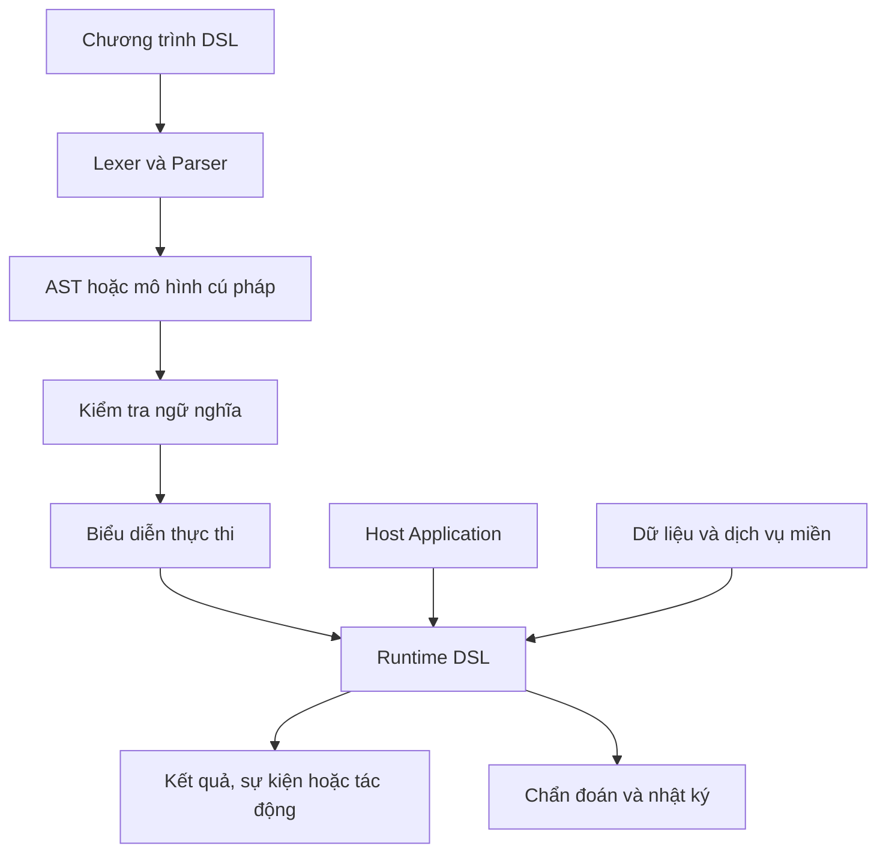
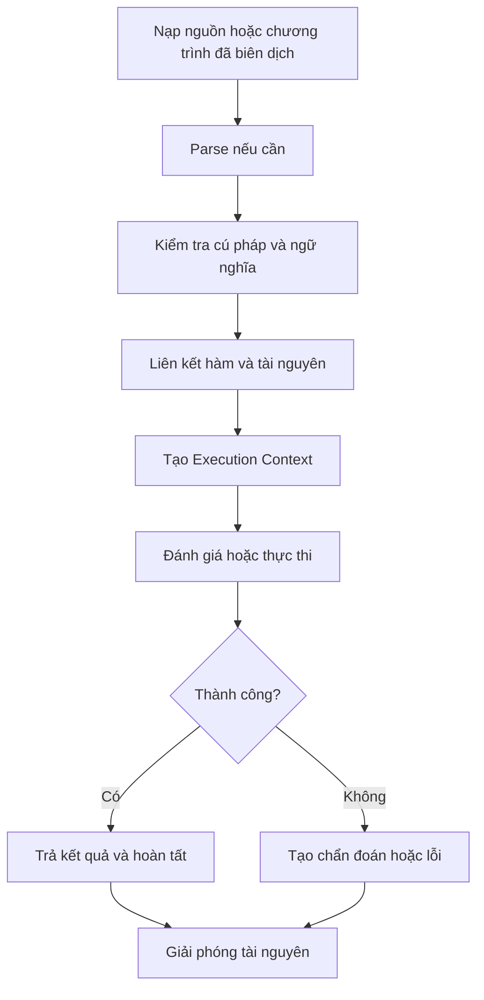
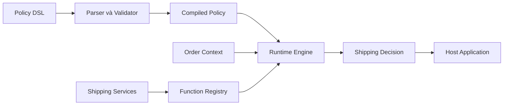

# Runtime của DSL

Ngôn ngữ chuyên biệt miền (Domain-Specific Language, DSL) cần một cơ chế để biến chương trình mà người dùng viết thành hành vi có thể quan sát được: tính toán kết quả, kiểm tra quy tắc, truy vấn dữ liệu, điều khiển quy trình hoặc tạo ra một cấu hình. Cơ chế đảm nhiệm việc tiếp nhận và thực hiện chương trình DSL trong môi trường cụ thể được gọi là **runtime của DSL**.

Runtime là một phần quan trọng trong kiến trúc DSL. Cú pháp quy định người dùng được viết gì; ngữ nghĩa quy định cấu trúc đó có ý nghĩa gì; runtime hiện thực ngữ nghĩa ấy trong lúc chương trình được chạy. Nếu runtime diễn giải cùng một câu lệnh theo những cách khác nhau tùy lần chạy, DSL sẽ không đáng tin cậy dù cú pháp được thiết kế tốt.

Runtime có thể là một bộ diễn giải trực tiếp cây cú pháp, một máy ảo chạy bytecode, một thư viện trong ứng dụng chủ, một dịch vụ thực thi từ xa hoặc một tổ hợp các thành phần. Hình thức triển khai khác nhau, nhưng runtime luôn cần có hợp đồng rõ ràng về dữ liệu đầu vào, môi trường thực thi, hành vi, kết quả, lỗi và tài nguyên.

## 1. Runtime là gì?

**Runtime** là môi trường và các thành phần phần mềm chịu trách nhiệm thực hiện hoặc điều phối việc thực hiện chương trình DSL. Runtime cung cấp những dịch vụ mà chương trình DSL cần trong lúc chạy, chẳng hạn lưu trữ biến, đánh giá biểu thức, gọi hàm miền, truy cập dữ liệu được cấp quyền, quản lý trạng thái và trả kết quả.

Ví dụ, một DSL dùng để mô tả chính sách giao hàng có thể cho phép người dùng khai báo:

```text
chinh_sach giao_hang_tieu_chuan {
    mien_phi_khi tong_tien >= 500000 VND
    phi_co_ban = 30000 VND
    phi_moi_km = 5000 VND
}
```

Runtime của DSL này có thể nhận một đơn hàng, lấy chính sách đã biên dịch hoặc đã phân tích, đánh giá điều kiện miễn phí, tính phí và trả về kết quả. Nó cần hiểu kiểu tiền tệ, đơn vị khoảng cách, cách so sánh giá trị, quy tắc làm tròn và cách xử lý khi thiếu dữ liệu.

Runtime không nhất thiết là một tiến trình độc lập. Nó có thể nằm trong ứng dụng Java, được nhúng trong máy chủ, chạy như một dịch vụ hoặc là một phần của công cụ dòng lệnh. Điều quyết định là thành phần đó chịu trách nhiệm thực hiện ngữ nghĩa của DSL.

### 1.1. Runtime khác với cú pháp và bộ phân tích

Các khái niệm thường xuất hiện cùng nhau nhưng có trách nhiệm khác nhau:

| Thành phần | Câu hỏi mà thành phần trả lời |
|---|---|
| Cú pháp | Người dùng phải viết chương trình theo hình thức nào? |
| Ngữ pháp và parser | Văn bản có tuân theo cấu trúc được phép không? |
| Kiểm tra ngữ nghĩa | Tên, kiểu, tham chiếu và quy tắc có hợp lệ không? |
| Compiler hoặc translator | Chuyển chương trình sang biểu diễn nào để xử lý? |
| Runtime | Chương trình hợp lệ được thực hiện như thế nào và trong môi trường nào? |
| Host application | Cung cấp dữ liệu, giao diện và tích hợp DSL vào sản phẩm ra sao? |

Một hệ thống nhỏ có thể gộp nhiều trách nhiệm trong cùng một thư viện. Tuy nhiên, phân biệt chúng về mặt kiến trúc giúp xác định lỗi nằm ở giai đoạn nào và cho phép thay đổi một thành phần mà không làm xáo trộn toàn bộ hệ thống.

### 1.2. Runtime và môi trường chạy của ngôn ngữ chủ

DSL thường dựa vào một ngôn ngữ hoặc nền tảng chủ. Ví dụ, runtime DSL có thể được viết bằng Java và chạy trên JVM. Khi đó, JVM quản lý bytecode Java, bộ nhớ và luồng; runtime DSL quản lý ngữ nghĩa riêng của chương trình DSL như biến miền, quy tắc, biểu thức và hàm miền.

Hai tầng runtime có thể tương tác nhưng không đồng nhất. JVM không tự hiểu ý nghĩa của `mien_phi_khi`; đó là trách nhiệm của runtime DSL. Tương tự, runtime DSL thường không tự quản lý bộ nhớ vật lý hay lịch CPU mà dựa vào nền tảng chủ.

## 2. Vị trí của runtime trong kiến trúc DSL

Một kiến trúc DSL văn bản thường có luồng xử lý như sau:



Biểu diễn thực thi ở bước E có thể là AST, bytecode, mô hình miền đã liên kết hoặc mã của ngôn ngữ chủ. Runtime nhận biểu diễn đó cùng ngữ cảnh cần thiết để thực hiện.

### 2.1. Các trách nhiệm chính

Tùy DSL, runtime có thể đảm nhiệm một phần hoặc toàn bộ các trách nhiệm sau:

- **Nạp chương trình:** Nhận AST, bytecode, mô hình đã biên dịch hoặc tài liệu khai báo.
- **Tạo ngữ cảnh:** Chuẩn bị biến, tham số, dữ liệu miền và các dịch vụ được phép sử dụng.
- **Đánh giá:** Tính giá trị biểu thức, áp dụng toán tử và thực hiện câu lệnh.
- **Gọi chức năng miền:** Thực hiện các hàm như `tinh_phi`, `kiem_tra_hop_le` hoặc `chuyen_trang_thai`.
- **Quản lý trạng thái:** Theo dõi biến cục bộ, trạng thái thực thi hoặc phiên làm việc nếu DSL cho phép.
- **Điều phối tác động:** Thực hiện hoặc yêu cầu ứng dụng chủ thực hiện các thao tác có ảnh hưởng ra bên ngoài.
- **Kiểm soát tài nguyên:** Giới hạn thời gian, số bước, bộ nhớ hoặc số lần gọi dịch vụ.
- **Báo lỗi:** Trả về lỗi có vị trí nguồn, ngữ cảnh và thông tin chẩn đoán.
- **Kết thúc:** Thu hồi tài nguyên tạm, đóng phiên hoặc hoàn tất giao dịch theo hợp đồng.

Không phải DSL nào cũng cần biến, vòng lặp, trạng thái hay tác động phụ. Một DSL chỉ chứa biểu thức toán học có thể có runtime rất nhỏ. Một DSL điều khiển quy trình cần cơ chế điều phối, trạng thái và xử lý lỗi phong phú hơn.

### 2.2. Runtime và ứng dụng chủ

Ứng dụng chủ (host application) thường quản lý vòng đời nghiệp vụ bên ngoài DSL. Nó xác thực người dùng, tải dữ liệu, chọn chương trình cần chạy, gọi runtime và quyết định cách sử dụng kết quả.

Ví dụ, trong một ứng dụng thương mại điện tử:

1. Ứng dụng xác thực yêu cầu tính phí của đơn hàng.
2. Ứng dụng tải đơn hàng và chính sách giao hàng tương ứng.
3. Ứng dụng gọi runtime DSL với chương trình và dữ liệu đầu vào.
4. Runtime đánh giá quy tắc và trả kết quả tính phí.
5. Ứng dụng hiển thị kết quả hoặc lưu kết quả theo quy trình của mình.

Việc phân chia này giúp DSL tập trung vào quy tắc miền, trong khi ứng dụng chủ giữ trách nhiệm về giao diện, xác thực, lưu trữ và tích hợp hệ thống.

## 3. Các mô hình thực thi DSL

Runtime có thể thực hiện chương trình theo nhiều mô hình. Việc lựa chọn ảnh hưởng đến hiệu năng, khả năng gỡ lỗi, tính linh hoạt và độ phức tạp của hệ thống.

### 3.1. Runtime thông dịch AST

Ở mô hình thông dịch trực tiếp, parser tạo cây cú pháp trừu tượng (Abstract Syntax Tree, AST). Runtime duyệt cây và đánh giá từng nút.

Ví dụ, biểu thức:

```text
tong_tien >= 500000 VND
```

có thể được biểu diễn bằng cây gồm nút so sánh `>=`, nút tham chiếu `tong_tien` và nút hằng số tiền `500000 VND`. Bộ thông dịch đánh giá hai vế rồi áp dụng phép so sánh đã định nghĩa cho kiểu tiền tệ.

Ưu điểm:

- Kiến trúc trực tiếp, dễ xây dựng cho DSL nhỏ.
- AST có thể giữ vị trí nguồn để báo lỗi chính xác.
- Dễ thay đổi ngữ nghĩa trong giai đoạn thử nghiệm.
- Có thể kiểm tra hoặc biến đổi cấu trúc trước khi chạy.

Hạn chế:

- Mỗi lần chạy có thể phải duyệt nhiều nút AST.
- Cần cẩn thận với đệ quy sâu hoặc cây đầu vào lớn.
- Việc tối ưu hóa có thể khó hơn so với biểu diễn trung gian chuyên biệt.

Mô hình này phù hợp với DSL quy tắc, biểu thức, bộ lọc hoặc ngôn ngữ cấu hình có quy mô vừa và nhỏ.

### 3.2. Runtime máy ảo và bytecode

Một compiler có thể chuyển AST thành bytecode, tức tập lệnh trung gian đơn giản dành cho máy ảo của DSL. Runtime máy ảo đọc và thực hiện từng lệnh trên một máy trừu tượng.

Ví dụ, biểu thức so sánh có thể được biên dịch thành chuỗi lệnh minh họa:

```text
LOAD_FIELD tong_tien
PUSH_MONEY 500000 VND
COMPARE_GREATER_OR_EQUAL
RETURN
```

Máy ảo cần định nghĩa tập lệnh, ngăn xếp hoặc thanh ghi, kiểu giá trị, cách gọi hàm, nhảy điều khiển và quy tắc lỗi. Bytecode có thể được lưu để tránh phân tích và biên dịch lại mỗi lần chạy.

Ưu điểm:

- Biểu diễn gọn và thường dễ thực thi hiệu quả.
- Có thể kiểm tra bytecode trước khi chạy.
- Có thể lưu, phân phối và cache chương trình đã biên dịch.
- Máy ảo kiểm soát rõ các thao tác mà DSL được phép thực hiện.

Hạn chế:

- Cần thiết kế và bảo trì tập lệnh cùng máy ảo.
- Công cụ gỡ lỗi cần ánh xạ lệnh bytecode về vị trí trong mã nguồn.
- Thay đổi định dạng bytecode có thể ảnh hưởng đến khả năng tương thích.

### 3.3. Biên dịch sang ngôn ngữ chủ

DSL có thể được dịch thành mã Java, Kotlin, JavaScript hoặc một ngôn ngữ chủ khác. Sau đó, compiler và runtime của nền tảng chủ thực hiện mã đã sinh.

Ví dụ, quy tắc:

```text
mien_phi_khi tong_tien >= 500000 VND
```

có thể được chuyển thành một biểu thức gọi hàm Java trên đối tượng ngữ cảnh. Runtime DSL có thể chỉ còn nhiệm vụ nạp, liên kết và gọi mã đã sinh.

Ưu điểm là tận dụng hệ sinh thái compiler, tối ưu hóa và công cụ gỡ lỗi của ngôn ngữ chủ. Hạn chế là mã sinh ra có thể khó đọc, lỗi cần ánh xạ về DSL và việc kiểm soát khả năng truy cập của chương trình cần được thiết kế cẩn thận.

### 3.4. Runtime dạng engine khai báo

Một số DSL mô tả sự kiện, điều kiện và quy tắc thay vì chuỗi lệnh tuần tự. Runtime có thể là một rule engine hoặc workflow engine. Engine theo dõi dữ liệu, tìm quy tắc thỏa điều kiện và quyết định hành động tiếp theo.

Ví dụ, DSL khai báo:

```text
quy_tac uu_tien_khach_hang {
    khi khach_hang.thanh_vien == VIP
    thi ap_dung_uu_tien_xu_ly
}
```

Engine có thể đánh giá nhiều quy tắc trên cùng một tập dữ liệu, xử lý xung đột và thực hiện quy tắc theo thứ tự ưu tiên. Trong mô hình này, runtime không nhất thiết đi từ dòng đầu đến dòng cuối như một chương trình mệnh lệnh.

### 3.5. Runtime lai

Một kiến trúc lai có thể dùng AST để kiểm tra và tối ưu, bytecode cho phần tính toán thường xuyên, đồng thời gọi dịch vụ của ứng dụng chủ cho tác động bên ngoài. Đây là cách tiếp cận phổ biến khi DSL phát triển từ bộ quy tắc đơn giản thành một thành phần lớn hơn.

Không có mô hình nào tốt nhất cho mọi DSL. Nên chọn mô hình dựa trên ngữ nghĩa, tần suất chạy, độ phức tạp, yêu cầu kiểm soát và khả năng vận hành.

## 4. Vòng đời thực thi

Một lần thực thi DSL thường trải qua các giai đoạn có thể nhận diện rõ ràng. Việc tách giai đoạn giúp hệ thống phát hiện lỗi sớm và tránh lặp lại công việc không cần thiết.



### 4.1. Nạp chương trình

Runtime nhận chương trình DSL từ chuỗi văn bản, tệp, kho lưu trữ, AST hoặc bytecode. Nếu nhận văn bản, parser thường cần chạy trước. Nếu nhận bytecode, runtime cần xác định phiên bản định dạng và kiểm tra tính hợp lệ trước khi thực thi.

Đầu vào cần được giới hạn về kích thước và cấu trúc. Một tệp quá lớn hoặc cây cú pháp quá sâu có thể tiêu thụ nhiều bộ nhớ và thời gian ngay cả trước khi chạy.

### 4.2. Kiểm tra và liên kết

Trước khi thực thi, runtime hoặc compiler có thể xác minh:

- Tên biến và hàm có được khai báo hoặc cung cấp không.
- Kiểu dữ liệu có tương thích với phép toán không.
- Tham chiếu đến tài nguyên miền có hợp lệ không.
- Phiên bản chương trình có tương thích với runtime không.
- Các hàm mở rộng có tồn tại và được phép gọi không.
- Chương trình có vượt quá giới hạn cấu trúc đã quy định không.

**Liên kết (linking)** là bước kết nối tham chiếu trong chương trình với hàm, module, dữ liệu hoặc dịch vụ thực tế. Ví dụ, tên `tinh_phi_vung` trong DSL có thể được liên kết đến một hàm đã đăng ký trong runtime.

### 4.3. Tạo ngữ cảnh thực thi

Runtime tạo một **execution context** chứa dữ liệu và dịch vụ cần thiết cho một lần chạy. Ngữ cảnh có thể gồm tham số đầu vào, biến, môi trường, danh mục hàm, thông tin người gọi, cấu hình, giới hạn tài nguyên và đối tượng ghi nhật ký.

Ngữ cảnh cần có vòng đời rõ ràng. Dữ liệu chỉ dùng trong một lần chạy không nên vô tình tồn tại sang lần chạy tiếp theo. Các đối tượng dùng chung cần có quy tắc đồng thời và quyền truy cập được xác định.

### 4.4. Đánh giá và thực thi

Runtime đánh giá biểu thức, thực hiện câu lệnh hoặc điều phối quy tắc theo ngữ nghĩa đã công bố. Kết quả có thể là một giá trị, danh sách hành động dự kiến, trạng thái mới, sự kiện hoặc lỗi.

Với DSL khai báo, runtime có thể lập kế hoạch thực hiện trước khi tác động. Với DSL mệnh lệnh, runtime thường thực hiện câu lệnh theo thứ tự, trừ khi ngữ nghĩa quy định cách khác.

### 4.5. Hoàn tất và thu hồi tài nguyên

Khi chạy xong, runtime trả kết quả và đóng các tài nguyên tạm như cursor, stream, context hoặc giao dịch nội bộ. Nếu có lỗi, việc thu hồi vẫn phải diễn ra. Quy tắc hoàn tất cần nói rõ tác động nào đã xảy ra và tác động nào đã được hoàn tác.

## 5. Ngữ cảnh và môi trường thực thi

Runtime cần biết chương trình đang chạy trong môi trường nào. Cùng một biểu thức DSL có thể cho kết quả khác nếu dữ liệu hoặc cấu hình khác nhau, vì vậy môi trường là một phần của hợp đồng thực thi.

### 5.1. Execution context

Một ngữ cảnh thực thi thường chứa:

| Thành phần | Vai trò |
|---|---|
| Input parameters | Dữ liệu đầu vào của lần chạy |
| Variable environment | Các biến và phạm vi tên hiện có |
| Function registry | Các hàm DSL có thể gọi |
| Domain services | Dịch vụ miền được cấp quyền |
| Configuration | Cấu hình ảnh hưởng đến ngữ nghĩa hoặc vận hành |
| Security context | Danh tính và quyền của người gọi |
| Resource budget | Giới hạn thời gian, bước, bộ nhớ hoặc lời gọi |
| Diagnostics sink | Nơi nhận lỗi, cảnh báo và thông tin theo dõi |

Không phải chương trình DSL nào cũng được phép truy cập mọi thành phần. Ví dụ, DSL tính biểu thức thuần có thể không được truy cập mạng hoặc cơ sở dữ liệu.

### 5.2. Môi trường biến và phạm vi tên

Nếu DSL hỗ trợ biến, runtime cần định nghĩa nơi lưu giá trị và cách tìm tên. Một mô hình phổ biến là **environment** gồm các ánh xạ tên sang giá trị, có thể liên kết với environment cha để tạo phạm vi lồng nhau.

Ví dụ:

```text
nguong = 500000

neu tong_tien >= nguong {
    ket_qua = "du_dieu_kien"
}
```

Runtime phải xác định `nguong` và `tong_tien` được tìm ở đâu, `ket_qua` tồn tại trong phạm vi nào và liệu biến trong khối có che khuất biến bên ngoài hay không.

Các mô hình phạm vi thường gặp:

- **Phạm vi toàn cục:** Giá trị có thể được truy cập trong toàn chương trình hoặc module.
- **Phạm vi cục bộ:** Giá trị chỉ tồn tại trong khối hoặc hàm.
- **Phạm vi tham số:** Giá trị được truyền vào khi gọi hàm.
- **Phạm vi phiên:** Giá trị tồn tại trong một phiên thực thi có thời hạn.

Quy tắc che khuất tên, khai báo trùng và đọc biến chưa khởi tạo cần được định nghĩa rõ. Không nên để hành vi phụ thuộc vào chi tiết triển khai của ngôn ngữ chủ.

### 5.3. Kiểu dữ liệu và giá trị runtime

Runtime phải có biểu diễn cho các kiểu mà DSL hỗ trợ. Các kiểu cơ bản có thể gồm số, chuỗi, boolean, ngày giờ, danh sách, bản ghi và giá trị rỗng. DSL miền có thể bổ sung kiểu chuyên biệt như tiền tệ, khoảng cách, khối lượng, phần trăm hoặc định danh đơn hàng.

Ví dụ, `500000 VND` và `500000 USD` đều có thể được biểu diễn bằng số cùng mã tiền tệ, nhưng không được so sánh trực tiếp nếu chưa có quy tắc chuyển đổi. Tương tự, `5 km` và `500 m` có thể so sánh sau khi quy đổi về cùng đơn vị.

Runtime cần xác định:

- Giá trị được lưu và truyền như thế nào.
- Phép toán nào hợp lệ với từng kiểu.
- Cách chuyển kiểu tường minh và ngầm định.
- Cách biểu diễn giá trị không có, chưa biết hoặc không hợp lệ.
- Quy tắc độ chính xác, làm tròn và tràn số.
- Cách so sánh giá trị miền.

Không nên dùng số thực nhị phân thông thường cho mọi đại lượng. Tiền tệ thường cần kiểu decimal hoặc số nguyên theo đơn vị nhỏ nhất để tránh sai số làm tròn ngoài ý muốn.

### 5.4. Giá trị null và dữ liệu chưa biết

Một trường không có giá trị có thể mang nhiều ý nghĩa: chưa được cung cấp, không áp dụng, không tồn tại hoặc chưa xác định. Nếu DSL gộp mọi trường hợp thành một giá trị `null`, các phép so sánh và điều kiện có thể gây bất ngờ.

Ví dụ, điều kiện `ngay_giao < ngay_hien_tai` không thể tự động cho kết quả false hay true nếu `ngay_giao` chưa được xác định. Runtime cần có quy tắc cho giá trị thiếu, chẳng hạn báo lỗi, trả về trạng thái chưa biết hoặc dùng logic ba giá trị.

## 6. Đánh giá biểu thức và thực thi câu lệnh

Đây là lõi của runtime. Runtime cần biến mỗi cấu trúc cú pháp thành hành vi nhất quán theo đặc tả ngữ nghĩa.

### 6.1. Đánh giá biểu thức

Một biểu thức tạo ra giá trị. Ví dụ:

```text
tong_tien + phi_giao_hang
so_luong * don_gia
trang_thai == DA_XAC_NHAN
```

Với AST, runtime thường xử lý từng loại nút bằng một hàm đánh giá hoặc visitor. Pseudocode minh họa:

```java
Value evaluate(Expression expression, Environment env) {
    if (expression instanceof Literal literal) {
        return literal.value();
    }

    if (expression instanceof Variable variable) {
        return env.lookup(variable.name());
    }

    if (expression instanceof Binary binary) {
        Value left = evaluate(binary.left(), env);
        Value right = evaluate(binary.right(), env);
        return apply(binary.operator(), left, right);
    }

    throw new EvaluationException("Unsupported expression");
}
```

Đây là pseudocode giản lược. Một runtime thực tế cần xử lý kiểu dữ liệu, vị trí nguồn, lỗi, giới hạn đệ quy và thứ tự đánh giá theo đặc tả.

### 6.2. Thứ tự đánh giá

Với biểu thức có nhiều toán tử, DSL cần quy định độ ưu tiên và tính kết hợp. Ví dụ, `a + b * c` thường được hiểu là `a + (b * c)`, nhưng chỉ khi ngữ pháp định nghĩa phép nhân có độ ưu tiên cao hơn phép cộng.

Thứ tự đánh giá cũng quan trọng khi biểu thức có lời gọi hàm hoặc tác động phụ. Nếu DSL cho phép `f() + g()`, runtime cần quy định hàm nào được gọi trước và điều gì xảy ra nếu hàm đầu tiên lỗi.

### 6.3. Đánh giá ngắn mạch

Với toán tử logic `AND` và `OR`, runtime có thể sử dụng short-circuit evaluation:

- Với `A AND B`, nếu A đã false thì không cần đánh giá B.
- Với `A OR B`, nếu A đã true thì không cần đánh giá B.

Điều này ảnh hưởng đến tác động phụ nếu B gọi hàm. Vì vậy, short-circuit phải là một phần của ngữ nghĩa được công bố, không phải tối ưu hóa tùy ý.

### 6.4. Câu lệnh và luồng điều khiển

Nếu DSL hỗ trợ câu lệnh, runtime có thể cần xử lý gán biến, điều kiện, vòng lặp, gọi hàm, trả về hoặc phát sự kiện.

Ví dụ:

```text
neu tong_tien >= 500000 {
    mien_phi_giao_hang()
} nguoc_lai {
    tinh_phi_chuan()
}
```

Runtime cần xác định điều kiện được đánh giá một lần hay nhiều lần, khối nào được chạy và giá trị trả về là gì. Với vòng lặp, cần có giới hạn hoặc cơ chế hủy để tránh chương trình chạy vô hạn.

### 6.5. Ngữ nghĩa tuần tự và khai báo

Trong DSL mệnh lệnh, thứ tự câu lệnh thường có ý nghĩa. Trong DSL khai báo, thứ tự văn bản có thể không ảnh hưởng đến kết quả, trừ khi đặc tả quy định ưu tiên hoặc ghi đè.

Ví dụ, hai khai báo tài nguyên trong DSL hạ tầng có thể được xử lý theo quan hệ phụ thuộc thay vì thứ tự xuất hiện. Runtime khi đó cần xây dựng đồ thị phụ thuộc và xác định thứ tự thực hiện hợp lệ.

## 7. Hàm và khả năng mở rộng runtime

Hàm giúp DSL tái sử dụng thao tác và kết nối với năng lực của ứng dụng chủ. Runtime thường có một tập hàm tích hợp và cơ chế đăng ký hàm mở rộng.

### 7.1. Hàm tích hợp

Hàm tích hợp (built-in function) là hàm được DSL cung cấp sẵn. Ví dụ:

```text
lam_tron(tong_tien, 0)
ngay_hien_tai()
co_trong(danh_sach, gia_tri)
```

Mỗi hàm cần có hợp đồng rõ: tên, số lượng tham số, kiểu tham số, kiểu kết quả, lỗi có thể phát sinh và việc có tác động phụ hay không.

### 7.2. Đăng ký hàm từ ứng dụng chủ

Ứng dụng chủ có thể cung cấp hàm miền cho runtime. Ví dụ, `tra_cuu_khu_vuc(dia_chi)` có thể gọi dịch vụ địa lý do ứng dụng quản lý.

Một registry đơn giản có thể ánh xạ tên hàm đến đối tượng thực thi:

```java
FunctionRegistry registry = new FunctionRegistry();

registry.register("tinh_phi", arguments -> {
    Money amount = arguments.getMoney("tong_tien");
    Distance distance = arguments.getDistance("khoang_cach");
    return shippingService.calculate(amount, distance);
});
```

Đây là ví dụ minh họa API. Runtime thực tế cần kiểm tra kiểu và số lượng tham số trước khi gọi, đồng thời xử lý ngoại lệ từ mã chủ theo hợp đồng của DSL.

### 7.3. Hàm thuần và hàm có tác động phụ

**Hàm thuần (pure function)** trả kết quả chỉ dựa trên tham số và không làm thay đổi trạng thái bên ngoài. Hàm thuần dễ kiểm thử, cache và đánh giá lại.

Hàm có tác động phụ có thể đọc dữ liệu bên ngoài, ghi dữ liệu, gửi thông báo hoặc thay đổi trạng thái. Những hàm này cần quyền truy cập và chính sách thực thi rõ ràng.

Ví dụ, `tinh_tong` thường là hàm thuần; `gui_email` có tác động phụ. Nếu runtime cho phép DSL gọi mọi hàm trong ứng dụng chủ, ranh giới an toàn và khả năng dự đoán của ngôn ngữ sẽ suy giảm.

### 7.4. Phiên bản hóa hợp đồng hàm

Khi đổi kiểu tham số hoặc ý nghĩa hàm, chương trình DSL cũ có thể thay đổi kết quả. Nên quản lý phiên bản API hàm, ghi nhận phiên bản trong chương trình hoặc cung cấp lớp tương thích khi cần. Không nên âm thầm đổi ý nghĩa của một hàm đang được sử dụng.

## 8. Trạng thái, tác động phụ và giao dịch

Một runtime có thể chỉ tính giá trị thuần hoặc có thể làm thay đổi hệ thống. Sự khác biệt này cần được thể hiện rõ trong kiến trúc.

### 8.1. Trạng thái của chương trình

Trạng thái có thể tồn tại ở nhiều phạm vi:

- **Tạm thời trong biểu thức:** Giá trị trung gian khi đánh giá.
- **Trong một lần chạy:** Biến cục bộ hoặc kết quả trung gian.
- **Trong phiên:** Dữ liệu cần giữ giữa nhiều lần gọi liên quan.
- **Trong miền nghiệp vụ:** Trạng thái đơn hàng, tài khoản hoặc tài nguyên được ứng dụng chủ lưu trữ.

Runtime nên làm rõ phạm vi nào được hỗ trợ. Nếu chương trình DSL cần lưu trạng thái lâu dài, thường nên giao việc lưu trữ cho dịch vụ miền của ứng dụng chủ thay vì để runtime tự quản lý một kho dữ liệu không có hợp đồng rõ ràng.

### 8.2. Tác động phụ

Tác động phụ là hành vi quan sát được ngoài giá trị trả về, ví dụ ghi dữ liệu, gửi thông báo, gọi API hoặc thay đổi trạng thái. Tác động phụ làm cho việc thử lại, chạy song song và khôi phục lỗi phức tạp hơn.

Với DSL quy tắc, một cách thiết kế hữu ích là tách **đánh giá** khỏi **áp dụng tác động**:

1. Runtime đánh giá chính sách trên dữ liệu đầu vào.
2. Runtime trả về danh sách quyết định hoặc hành động dự kiến.
3. Ứng dụng chủ kiểm tra quyền và điều kiện hiện tại.
4. Ứng dụng chủ áp dụng các hành động theo giao dịch của mình.

Cách làm này giúp kiểm tra kết quả trước khi thực hiện và hỗ trợ chế độ xem trước (dry run).

### 8.3. Giao dịch và tính nguyên tử

Nếu một chương trình DSL thực hiện nhiều thay đổi, cần xác định chúng có được áp dụng nguyên tử hay không. Ví dụ, chuyển trạng thái đơn hàng và trừ tồn kho có thể cần nằm trong cùng một giao dịch để tránh trạng thái không nhất quán.

Runtime không nên tự giả định rằng mọi dịch vụ ngoài đều tham gia cùng một giao dịch cơ sở dữ liệu. Với các tác động phân tán như gửi email hoặc gọi hệ thống vận chuyển, có thể cần cơ chế outbox, saga hoặc xử lý bù trừ do ứng dụng chủ điều phối.

### 8.4. Chạy thử và xem trước

Chế độ dry run cho phép runtime đánh giá chương trình và báo hành động dự kiến mà không áp dụng tác động thật. Đây là tính năng hữu ích khi người dùng viết chính sách, cấu hình hoặc quy tắc có ảnh hưởng lớn.

Dry run chỉ đáng tin khi runtime và các hàm mở rộng tôn trọng hợp đồng không ghi dữ liệu. Nếu một hàm được gọi trong lúc chạy thử vẫn gửi email hoặc cập nhật cơ sở dữ liệu, chế độ xem trước không còn an toàn.

## 9. Bất đồng bộ và điều phối tác vụ

Một số DSL cần gọi dịch vụ mạng, chờ phê duyệt hoặc thực hiện quy trình kéo dài. Runtime khi đó cần xác định cách xử lý bất đồng bộ.

### 9.1. Gọi hàm đồng bộ và bất đồng bộ

Với lời gọi đồng bộ, runtime chờ hàm hoàn thành rồi tiếp tục. Với lời gọi bất đồng bộ, runtime có thể nhận một future, promise hoặc task handle và tiếp tục khi kết quả sẵn sàng.

DSL cần quy định người viết có thể chờ kết quả, ghép nhiều tác vụ hoặc xử lý lỗi bất đồng bộ như thế nào. Không nên để cách xử lý phụ thuộc vào chi tiết riêng của thư viện nền.

### 9.2. Timeout và hủy

Mỗi lần chạy có thể có thời hạn tối đa. Khi quá thời hạn, runtime cần yêu cầu hủy tác vụ có thể hủy, dừng đánh giá các bước tiếp theo và trả trạng thái timeout. Tuy nhiên, một tác động đã được hệ thống bên ngoài chấp nhận có thể không thể thu hồi; kết quả cần thể hiện rõ điều đó.

### 9.3. Tác vụ dài và workflow

Nếu DSL mô tả quy trình kéo dài qua nhiều giờ hoặc nhiều ngày, runtime có thể cần lưu trạng thái workflow, điểm tiếp tục (checkpoint), lịch sử sự kiện và cơ chế khôi phục sau khi tiến trình khởi động lại.

Đây là nhu cầu khác với việc đánh giá một biểu thức trong vài mili giây. Có thể dùng workflow engine chuyên biệt làm runtime hoặc tích hợp DSL với engine có sẵn.

## 10. Xử lý lỗi và chẩn đoán

Runtime phải phân biệt lỗi trong chương trình DSL với lỗi hạ tầng hoặc lỗi của ứng dụng chủ. Thông báo rõ ràng giúp người dùng sửa chương trình và giúp nhóm vận hành xác định nguyên nhân.

### 10.1. Các nhóm lỗi

| Nhóm lỗi | Ví dụ | Thời điểm thường phát hiện |
|---|---|---|
| Lỗi cú pháp | Thiếu dấu đóng khối | Parse |
| Lỗi tham chiếu | Dùng tên biến chưa khai báo | Kiểm tra ngữ nghĩa hoặc runtime |
| Lỗi kiểu | Cộng tiền tệ với chuỗi | Kiểm tra kiểu hoặc đánh giá |
| Lỗi miền | Khối lượng âm | Kiểm tra quy tắc miền |
| Lỗi thực thi | Chia cho 0, vượt giới hạn bước | Runtime |
| Lỗi tích hợp | Dịch vụ tra cứu không phản hồi | Hàm mở rộng hoặc host |
| Lỗi quyền | Chương trình gọi chức năng không được phép | Kiểm tra quyền hoặc runtime |
| Lỗi tài nguyên | Hết thời gian hoặc vượt bộ nhớ | Runtime hoặc nền tảng |

Lỗi có thể được phát hiện sớm ở giai đoạn parse hoặc kiểm tra ngữ nghĩa. Những lỗi phụ thuộc dữ liệu đầu vào hoặc dịch vụ ngoài chỉ có thể xuất hiện khi chạy.

### 10.2. Chẩn đoán gắn với mã nguồn

Một thông báo hữu ích nên có:

- Mã lỗi ổn định để máy hoặc công cụ có thể phân loại.
- Thông điệp dễ hiểu cho người viết DSL.
- Vị trí dòng và cột trong chương trình nguồn.
- Đoạn mã hoặc biểu thức liên quan khi phù hợp.
- Giá trị kỳ vọng và giá trị nhận được nếu có thể nêu an toàn.
- Gợi ý sửa hoặc tài liệu tham khảo.
- Nguyên nhân gốc hoặc lỗi lồng bên trong để phục vụ kỹ thuật.

Ví dụ:

```text
DSL-E-TYPE-004: Không thể so sánh Money với String.
Tại: policy.dsl, dòng 8, cột 12
Biểu thức: tong_tien >= "500000"
Gợi ý: Dùng giá trị tiền tệ, ví dụ 500000 VND.
```

### 10.3. Stack trace và lỗi từ hàm mở rộng

Nếu hàm miền gọi một dịch vụ rồi phát sinh ngoại lệ, runtime nên giữ nguyên nguyên nhân kỹ thuật cho log nội bộ nhưng chuyển thành lỗi DSL phù hợp ở giao diện người dùng. Không nên làm lộ thông tin nhạy cảm như token, chuỗi kết nối hoặc dữ liệu cá nhân trong thông báo.

Với DSL có hàm lồng nhau, stack trace nên cho biết chuỗi lời gọi DSL và vị trí nguồn tương ứng. Khi chạy bytecode hoặc mã sinh, runtime cần lưu ánh xạ từ lệnh thực thi về vị trí DSL gốc.

### 10.4. Chính sách tiếp tục hoặc dừng

Một lỗi có thể làm dừng toàn bộ chương trình, bỏ qua một quy tắc hoặc được ghi nhận để xử lý sau. Chính sách phụ thuộc loại DSL. Ví dụ, trong báo cáo dữ liệu, một dòng lỗi có thể được cách ly trong khi các dòng khác tiếp tục; trong giao dịch thanh toán, lỗi có thể yêu cầu dừng toàn bộ thao tác.

Không nên có hành vi tiếp tục ngầm định. Đặc tả cần nói rõ lỗi nào có thể phục hồi, lỗi nào kết thúc lần chạy và trạng thái kết quả khi chỉ thực hiện được một phần.

## 11. Cách ly, bảo mật và giới hạn tài nguyên

DSL có thể do người dùng cuối hoặc bên thứ ba viết. Runtime vì vậy phải coi chương trình là đầu vào cần kiểm soát, đặc biệt khi chương trình có thể gọi hàm hoặc tác động đến hệ thống.

### 11.1. Mô hình quyền hạn

Runtime nên chỉ cung cấp những khả năng mà chương trình thực sự cần. Ví dụ, DSL tính phí có thể được phép đọc giá trị đơn hàng và gọi hàm tính cước, nhưng không cần quyền đọc tệp tùy ý, mở kết nối mạng hoặc thực thi lệnh hệ điều hành.

Mô hình **capability-based** cấp quyền thông qua những đối tượng hoặc hàm cụ thể được truyền vào execution context. Chương trình chỉ có thể thực hiện tác động mà nó được cấp khả năng tương ứng.

### 11.2. Sandbox

Sandbox là môi trường cách ly nhằm giới hạn tác động của chương trình. Tùy kiến trúc, sandbox có thể dựa trên máy ảo DSL, tiến trình riêng, container hoặc cơ chế hạn chế của nền tảng.

Không nên cho rằng chỉ dùng một ngôn ngữ nhúng hoặc một bộ parser riêng là đã có sandbox an toàn. Nếu mã DSL có thể gọi trực tiếp mọi hàm Java hoặc truy cập đối tượng host, nó có thể vượt ra ngoài phạm vi dự kiến.

### 11.3. Giới hạn tài nguyên

Runtime nên có giới hạn phù hợp cho:

- Thời gian thực thi tối đa.
- Số bước hoặc số lần đánh giá nút.
- Độ sâu đệ quy và độ sâu cây cú pháp.
- Kích thước chương trình và dữ liệu đầu vào.
- Số phần tử được tạo trong danh sách hoặc kết quả.
- Số lần gọi hàm và dịch vụ ngoài.
- Bộ nhớ hoặc tài nguyên đồng thời.

Giới hạn phải được kiểm tra trong quá trình chạy, không chỉ ở đầu vào. Ví dụ, một biểu thức lặp có thể tạo ra danh sách tăng vô hạn dù văn bản DSL ban đầu rất ngắn.

### 11.4. Cách ly dữ liệu giữa các lần chạy

Trong máy chủ xử lý nhiều yêu cầu, runtime có thể tái sử dụng compiler, registry hoặc đối tượng bất biến. Tuy nhiên, environment, biến tạm và dữ liệu nhạy cảm của một lần chạy không được rò sang lần chạy khác.

Nếu có cache dùng chung, cần phân vùng theo tenant, quyền và phiên bản chương trình khi những yếu tố đó ảnh hưởng đến kết quả. Không được cache kết quả có phụ thuộc vào danh tính hoặc dữ liệu riêng tư mà thiếu khóa phân biệt tương ứng.

## 12. Đồng thời và tính tái nhập

Runtime được nhúng trong máy chủ thường phải xử lý nhiều chương trình hoặc nhiều yêu cầu cùng lúc. Thiết kế đồng thời ảnh hưởng trực tiếp đến tính đúng đắn.

### 12.1. Tái sử dụng thành phần bất biến

Parser đã cấu hình, AST bất biến, bytecode và registry hàm có thể được chia sẻ giữa nhiều lần chạy nếu chúng không chứa trạng thái thay đổi theo yêu cầu. Execution context thường nên được tạo riêng cho từng lần chạy.

### 12.2. Thread safety

Một thành phần thread-safe có thể được nhiều luồng sử dụng đồng thời mà không làm hỏng trạng thái. Nếu registry hàm có thể thay đổi khi hệ thống đang chạy, cần cơ chế đồng bộ hoặc quy tắc đăng ký chỉ khi khởi tạo.

Không nên lưu dữ liệu yêu cầu trong biến toàn cục hoặc trường dùng chung của đối tượng runtime. Cách làm đó có thể khiến hai người dùng đọc nhầm dữ liệu của nhau.

### 12.3. Tái nhập

Runtime tái nhập (reentrant) có thể được gọi lồng nhau hoặc gọi lại trước khi lần chạy trước kết thúc mà không làm hỏng trạng thái. Điều này quan trọng nếu hàm mở rộng gọi ngược vào runtime hoặc một quy tắc kích hoạt một chương trình DSL khác.

Nếu không hỗ trợ tái nhập, hợp đồng cần nói rõ và runtime nên phát hiện trường hợp gọi lồng không hợp lệ thay vì rơi vào lỗi khó hiểu.

### 12.4. Thứ tự và xung đột

Khi nhiều quy tắc cùng thỏa mãn hoặc nhiều tác vụ cùng cập nhật một đối tượng, runtime cần chính sách về thứ tự, ưu tiên, khóa hoặc xử lý xung đột. Không nên để thứ tự ngẫu nhiên của collection hoặc lịch chạy luồng quyết định kết quả nghiệp vụ.

## 13. Hiệu năng và tối ưu hóa

Hiệu năng runtime phụ thuộc vào kích thước chương trình, số lần chạy, độ phức tạp của biểu thức, dữ liệu và chi phí gọi dịch vụ ngoài.

### 13.1. Tách biên dịch khỏi thực thi

Nếu một chính sách được chạy hàng nghìn lần với dữ liệu đơn hàng khác nhau, không nên parse và kiểm tra toàn bộ văn bản mỗi lần. Có thể biên dịch một lần, lưu biểu diễn đã kiểm tra rồi tạo execution context mới cho từng lần chạy.

### 13.2. Cache chương trình đã biên dịch

Cache có thể lưu AST, bytecode hoặc mô hình đã liên kết. Khóa cache cần xét đến nội dung chương trình, phiên bản DSL, phiên bản runtime, phiên bản hàm mở rộng và cấu hình ảnh hưởng đến ngữ nghĩa.

Nếu chính sách thay đổi nhưng cache vẫn trả chương trình cũ, hệ thống có thể chạy sai quy tắc. Cần có cơ chế vô hiệu hóa hoặc phiên bản hóa rõ ràng.

### 13.3. Tối ưu hóa biểu thức

Compiler có thể thực hiện constant folding, loại bỏ phép tính không cần thiết hoặc tối ưu biểu thức logic. Chỉ được tối ưu khi không thay đổi ngữ nghĩa quan sát được.

Ví dụ, `2 + 3` có thể được tính trước thành `5`. Nhưng không thể tùy tiện loại bỏ một lời gọi hàm có tác động phụ chỉ vì giá trị trả về không được sử dụng.

### 13.4. Giảm chi phí gọi dịch vụ

Lời gọi mạng hoặc cơ sở dữ liệu thường tốn thời gian hơn đánh giá biểu thức trong bộ nhớ. Có thể gom truy vấn, nạp trước dữ liệu cần thiết, dùng batch hoặc cache có thời hạn. Cần cân nhắc tính nhất quán và quyền dữ liệu khi cache.

### 13.5. Đo lường trước khi tối ưu

Nên đo thời gian parse, compile, link, evaluate và gọi dịch vụ riêng biệt. Một chương trình chậm có thể do truy vấn ngoài, không phải do interpreter. Tối ưu sai tầng sẽ tăng độ phức tạp mà không cải thiện đáng kể.

## 14. Gỡ lỗi và khả năng quan sát

Runtime cần cung cấp đủ thông tin để nhà phát triển và người vận hành hiểu chương trình đã làm gì.

### 14.1. Trace thực thi

Trace có thể ghi lại các sự kiện như bắt đầu chạy, đánh giá điều kiện, gọi hàm, chọn nhánh, phát sinh lỗi và hoàn tất. Với DSL quy tắc, trace có thể cho biết quy tắc nào được xét, điều kiện nào đúng hoặc sai và vì sao một hành động được chọn.

Trace cần có giới hạn kích thước và chính sách lọc dữ liệu nhạy cảm. Ghi mọi giá trị đầu vào có thể gây rò rỉ thông tin và tạo lượng log quá lớn.

### 14.2. Breakpoint và bước thực thi

Một công cụ phát triển DSL có thể hỗ trợ breakpoint tại dòng nguồn, chạy từng bước, xem biến và xem stack lời gọi. Với runtime bytecode hoặc mã sinh, cần ánh xạ vị trí thực thi về chương trình DSL gốc.

### 14.3. Metrics

Các chỉ số hữu ích gồm số lần chạy, tỷ lệ thành công, tỷ lệ lỗi theo mã, thời gian parse/compile/evaluate, số bước thực thi, số lần gọi hàm và số lần timeout.

Metrics nên được gắn với phiên bản DSL và runtime để phát hiện sự thay đổi sau khi triển khai bản mới.

### 14.4. Audit

Với DSL điều khiển chính sách hoặc quy trình có ảnh hưởng nghiệp vụ, có thể cần lưu ai đã chạy chương trình nào, phiên bản nào, trên dữ liệu tham chiếu nào và kết quả quyết định là gì. Audit phải cân bằng yêu cầu truy xuất với bảo vệ dữ liệu cá nhân và bí mật kinh doanh.

## 15. Ví dụ kiến trúc runtime cho DSL tính phí giao hàng

Giả sử ứng dụng cần chạy các chính sách tính phí do nhân viên vận hành khai báo. Runtime có thể được tổ chức thành các thành phần sau:



### 15.1. Đầu vào

Ứng dụng chủ cung cấp một ngữ cảnh đơn hàng:

```json
{
  "orderId": "DH102",
  "totalAfterDiscount": 650000,
  "currency": "VND",
  "distanceKm": 8,
  "areaType": "INNER_CITY"
}
```

Runtime không cần biết dữ liệu này được lấy từ bảng nào. Nó chỉ cần một mô hình đầu vào có hợp đồng rõ ràng.

### 15.2. Chương trình DSL

```text
chinh_sach giao_hang_chuan {
    mien_phi_khi tong_tien_sau_giam >= 500000 VND

    phi_co_ban = 30000 VND
    phi_moi_km = 5000 VND

    neu khu_vuc == NGOAI_THANH {
        phu_phi = 15000 VND
    } nguoc_lai {
        phu_phi = 0 VND
    }
}
```

### 15.3. Luồng xử lý

1. Parser tạo AST và validator xác minh cú pháp, kiểu tiền tệ cùng tên thuộc tính.
2. Compiler tạo biểu diễn chính sách có thể tái sử dụng.
3. Ứng dụng gọi runtime với chính sách, dữ liệu đơn hàng và cấu hình giới hạn.
4. Runtime đánh giá điều kiện miễn phí và các nhánh theo khu vực.
5. Runtime tính hoặc tạo quyết định phí theo ngữ nghĩa đã định nghĩa.
6. Runtime trả kết quả có cấu trúc cho ứng dụng chủ.

Kết quả minh họa:

```json
{
  "orderId": "DH102",
  "shippingFee": 0,
  "currency": "VND",
  "reason": "FREE_SHIPPING_THRESHOLD_MET",
  "policyVersion": "3"
}
```

Kết quả này giả định chính sách miễn phí được ưu tiên hơn các thành phần phí khác. Đặc tả DSL phải xác định rõ thứ tự ưu tiên đó. Nếu không, runtime có thể tính phụ phí rồi miễn phí toàn bộ, hoặc miễn phí phần cơ bản nhưng vẫn thu phụ phí; cả hai cách đều có thể hợp lý trong các miền khác nhau.

### 15.4. Vì sao cần tách runtime khỏi dịch vụ giao hàng?

Runtime hiểu cấu trúc DSL và cách đánh giá quy tắc. Dịch vụ giao hàng hiểu dữ liệu tuyến, bảng giá và thông tin vận chuyển thực tế. Tách hai trách nhiệm cho phép thay đổi nhà cung cấp dịch vụ hoặc cách lưu bảng giá mà không phải thay đổi ngôn ngữ, miễn là hợp đồng hàm miền vẫn giữ nguyên.

## 16. Tích hợp runtime vào ứng dụng Java

Trong một ứng dụng Java, runtime DSL thường được cung cấp như một thư viện hoặc module. Ứng dụng chủ khởi tạo runtime khi cấu hình hệ thống, sau đó tái sử dụng các thành phần an toàn để chia sẻ.

Ví dụ minh họa:

```java
DslRuntime runtime = DslRuntime.builder()
    .registerFunction("tinh_phi", shippingFunctions::calculate)
    .withExecutionLimit(Duration.ofSeconds(2))
    .build();

CompiledProgram program = runtime.compile(policySource);

ExecutionResult result = runtime.execute(
    program,
    ExecutionContext.builder()
        .put("tong_tien", Money.vnd(650_000))
        .put("khoang_cach", Distance.kilometers(8))
        .build()
);
```

API trên chỉ minh họa cách tích hợp. Một thiết kế thực tế cần xác định rõ:

- Runtime có an toàn khi dùng đồng thời không.
- `CompiledProgram` có bất biến và có thể dùng lại không.
- ExecutionContext thuộc riêng một lần chạy hay có thể chia sẻ.
- Hàm mở rộng được đăng ký lúc khởi tạo hay có thể thay đổi động.
- Lỗi được trả qua exception, result object hay cả hai.
- Giới hạn thực thi áp dụng cho một hàm, một chương trình hay toàn bộ yêu cầu.
- Tài nguyên nào cần đóng và ai chịu trách nhiệm đóng.

### 16.1. Khởi tạo và tái sử dụng

Compiler, registry hàm và cấu hình bất biến thường được khởi tạo một lần ở vòng đời ứng dụng. Chương trình đã biên dịch có thể được cache. Ngữ cảnh và dữ liệu riêng của mỗi yêu cầu cần được tạo mới.

### 16.2. Xử lý kết quả

Nên trả một kiểu kết quả có cấu trúc, gồm giá trị, trạng thái, cảnh báo và chẩn đoán. Ứng dụng chủ có thể chuyển kết quả thành HTTP response, thông báo giao diện hoặc bản ghi nghiệp vụ.

Không nên để runtime tự ghi trực tiếp vào giao diện hoặc đối tượng HTTP của ứng dụng. Điều đó làm DSL phụ thuộc chặt vào một framework cụ thể.

## 17. Kiểm thử runtime

Kiểm thử runtime cần xác minh ngữ nghĩa và các hợp đồng vận hành. Có thể tổ chức theo nhiều lớp:

- **Unit test cho evaluator:** Mỗi loại biểu thức, toán tử và kiểu dữ liệu có kết quả mong đợi.
- **Test parser/compiler:** Chương trình hợp lệ được chuyển thành biểu diễn thực thi đúng; chương trình sai tạo chẩn đoán phù hợp.
- **Test hàm miền:** Kiểm tra kiểu đầu vào, kết quả, lỗi và quyền của từng hàm mở rộng.
- **Integration test:** Chạy DSL qua runtime cùng dữ liệu và dịch vụ giả lập.
- **Test giới hạn:** Xác minh timeout, số bước, kích thước đầu vào và độ sâu được áp dụng.
- **Test đồng thời:** Nhiều lần chạy song song không rò rỉ trạng thái hoặc dữ liệu.
- **Test tương thích:** Chương trình cũ có hành vi được dự đoán khi chạy trên phiên bản runtime mới.

Với DSL quy tắc, nên có bộ ví dụ chuẩn (conformance suite) mô tả chương trình, dữ liệu đầu vào, kết quả và lỗi mong đợi. Bộ này giúp kiểm tra các cách triển khai runtime khác nhau có cùng tuân thủ đặc tả ngữ nghĩa hay không.

## 18. Phiên bản hóa và triển khai runtime

Runtime thường tồn tại lâu hơn một phiên bản DSL cụ thể. Khi ngôn ngữ thay đổi, cần quản lý tương thích giữa chương trình, compiler, runtime và hàm mở rộng.

### 18.1. Phiên bản ngôn ngữ

Một chương trình có thể khai báo phiên bản DSL hoặc được gắn phiên bản trong metadata. Runtime dựa vào đó để chọn quy tắc phân tích và ngữ nghĩa tương ứng.

Thay đổi cú pháp có thể chỉ yêu cầu cập nhật parser. Thay đổi ngữ nghĩa nguy hiểm hơn vì cùng một chương trình có thể cho kết quả khác. Cần ghi nhận những thay đổi làm ảnh hưởng kết quả và có kế hoạch chuyển đổi.

### 18.2. Phiên bản runtime và bytecode

Nếu runtime lưu bytecode hoặc mô hình đã biên dịch, cần phiên bản hóa định dạng. Runtime mới phải biết cách đọc phiên bản cũ hoặc từ chối rõ ràng với thông báo tương thích. Không nên cố thực thi một biểu diễn không hiểu đầy đủ.

### 18.3. Triển khai tập trung và nhúng

Runtime nhúng trong ứng dụng giúp giảm độ trễ gọi và đơn giản hóa tích hợp, nhưng việc cập nhật runtime gắn với vòng đời phát hành ứng dụng.

Runtime như dịch vụ tập trung giúp quản lý phiên bản và tài nguyên độc lập, đồng thời cho phép nhiều ứng dụng dùng chung. Đổi lại, cần xử lý mạng, xác thực dịch vụ, độ trễ, khả năng sẵn sàng và giới hạn tải.

### 18.4. Nhiều tenant và cấu hình riêng

Nếu nhiều tổ chức dùng chung runtime, cần phân vùng chương trình, registry, cache và dữ liệu theo tenant. Quyền của một tenant không được ảnh hưởng đến tenant khác. Cấu hình riêng phải được đưa vào execution context một cách rõ ràng và có kiểm soát phiên bản.

## 19. Những sai lầm thường gặp khi thiết kế runtime

### 19.1. Để runtime tự suy đoán ngữ nghĩa

Nếu đặc tả không quy định giá trị thiếu, thứ tự đánh giá hoặc ưu tiên quy tắc, mỗi phiên bản runtime có thể xử lý khác nhau. Ngữ nghĩa cần được xác định trước và kiểm thử bằng ví dụ chuẩn.

### 19.2. Trộn logic miền với chi tiết giao diện

Runtime không nên phụ thuộc trực tiếp vào màn hình, request HTTP hoặc framework giao diện. Hãy nhận dữ liệu theo hợp đồng và trả kết quả có cấu trúc.

### 19.3. Cấp quyền quá rộng cho hàm mở rộng

Cho phép DSL gọi tùy ý mã host khiến giới hạn của DSL mất ý nghĩa. Chỉ đăng ký các hàm cần thiết và kiểm tra quyền cùng kiểu dữ liệu.

### 19.4. Dùng trạng thái dùng chung giữa các lần chạy

Biến toàn cục hoặc context dùng chung có thể gây lỗi đồng thời và rò rỉ dữ liệu. Tách thành phần bất biến có thể chia sẻ khỏi trạng thái riêng của mỗi lần chạy.

### 19.5. Không giới hạn tài nguyên

Một chương trình sai hoặc độc hại có thể lặp vô hạn, tạo cấu trúc quá lớn hoặc gọi dịch vụ liên tục. Runtime cần budget và cơ chế hủy có hiệu lực.

### 19.6. Không lưu ánh xạ về mã nguồn

Nếu chỉ thấy lỗi trong bytecode hoặc mã sinh, người dùng khó biết phải sửa dòng nào trong DSL. Hãy giữ source map và thông tin vị trí qua các giai đoạn biên dịch.

### 19.7. Cache không xét phiên bản và quyền

Cache chỉ dựa vào tên chương trình có thể trả biểu diễn cũ hoặc dữ liệu của tenant khác. Khóa cache cần phản ánh các yếu tố ảnh hưởng đến nội dung, ngữ nghĩa và quyền truy cập.

## 20. Thuật ngữ cần nhớ

| Thuật ngữ | Ý nghĩa |
|---|---|
| Runtime | Môi trường và thành phần thực hiện hoặc điều phối chương trình DSL |
| Host application | Ứng dụng chủ tích hợp DSL và cung cấp dữ liệu hoặc dịch vụ |
| AST | Cây biểu diễn cấu trúc trừu tượng của chương trình |
| Interpreter | Thành phần trực tiếp đánh giá AST hoặc biểu diễn chương trình |
| Bytecode | Tập lệnh trung gian dành cho máy ảo |
| Virtual Machine (VM) | Máy trừu tượng thực hiện bytecode |
| Execution Context | Ngữ cảnh chứa biến, tham số, dịch vụ và giới hạn của lần chạy |
| Environment | Môi trường ánh xạ tên biến sang giá trị |
| Function Registry | Danh mục hàm mà chương trình DSL được phép gọi |
| Side Effect | Tác động quan sát được ngoài giá trị trả về |
| Sandbox | Cơ chế cách ly và giới hạn khả năng của chương trình |
| Short-circuit Evaluation | Đánh giá logic dừng sớm khi kết quả đã xác định |
| Trace | Dòng sự kiện mô tả quá trình thực thi |
| Dry Run | Chạy thử để xem kết quả hoặc tác động dự kiến mà không áp dụng thay đổi thật |
| Source Map | Ánh xạ vị trí trong biểu diễn thực thi về mã nguồn DSL |
| Conformance Test | Kiểm thử xác nhận runtime tuân thủ đặc tả ngôn ngữ |

Runtime là nơi ngữ nghĩa DSL trở thành hành vi thực tế. Một runtime tốt cần thực hiện chương trình nhất quán, quản lý rõ ngữ cảnh và trạng thái, kiểm soát tác động cùng tài nguyên, đồng thời cung cấp lỗi và dấu vết đủ để kiểm tra. Khi thiết kế runtime, hãy bắt đầu từ hợp đồng ngữ nghĩa của DSL và nhu cầu thực thi của miền; sau đó mới chọn interpreter, máy ảo, biên dịch sang ngôn ngữ chủ hay engine chuyên biệt để hiện thực hợp đồng đó.
