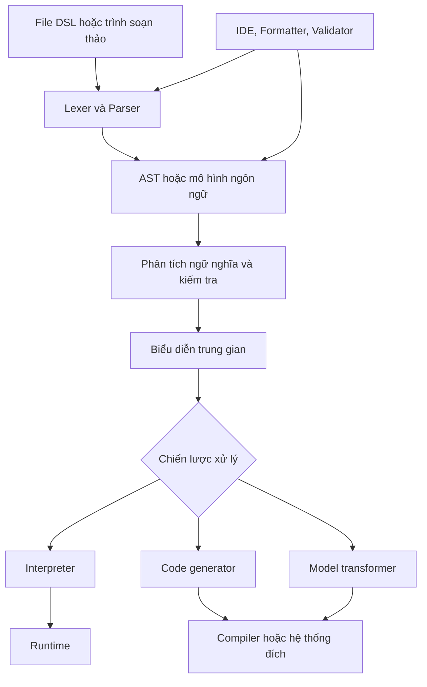
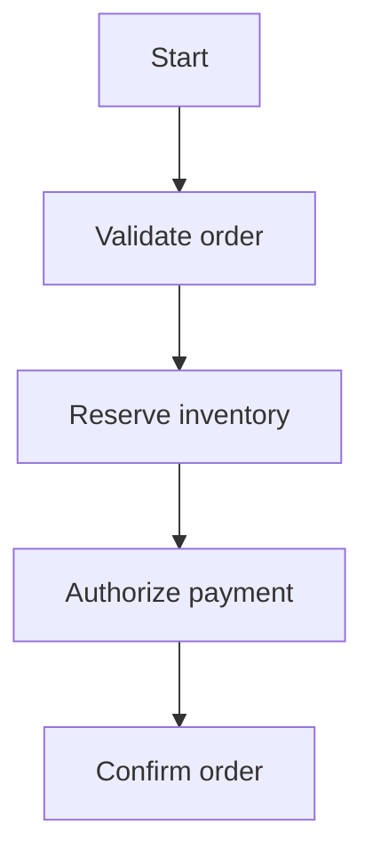
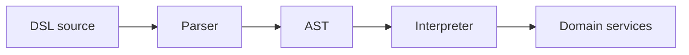
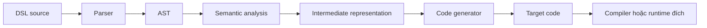
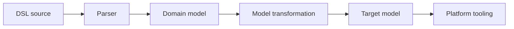
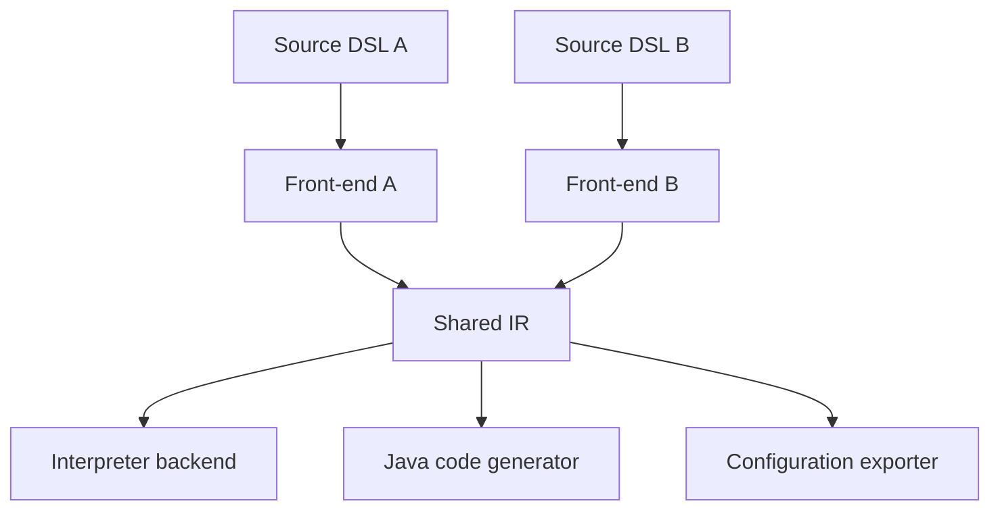
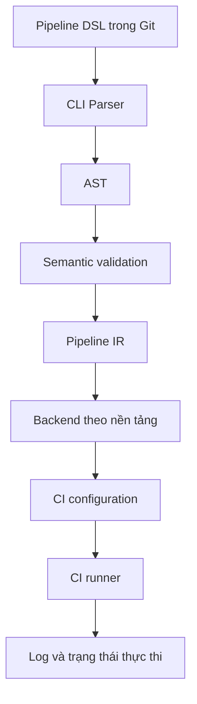

# Lựa chọn kiến trúc

Kiến trúc của một **Domain-Specific Language (DSL)** quyết định cách ngôn ngữ được biểu diễn, phân tích, kiểm tra, thực thi và tích hợp với các hệ thống khác. Một DSL có thể dùng cú pháp riêng với parser độc lập, tận dụng cú pháp của một ngôn ngữ lập trình có sẵn, được diễn giải trực tiếp hoặc biên dịch thành một dạng biểu diễn khác. Mỗi lựa chọn tạo ra những đánh đổi về trải nghiệm người dùng, độ phức tạp triển khai, hiệu năng và khả năng phát triển lâu dài.

Không có một kiến trúc phù hợp cho mọi DSL. Kiến trúc cần bắt đầu từ miền nghiệp vụ, người sẽ sử dụng ngôn ngữ và công việc họ cần hoàn thành. DSL dành cho chuyên gia nghiệp vụ có thể cần cú pháp gần ngôn ngữ tự nhiên và công cụ trực quan. DSL dành cho lập trình viên có thể ưu tiên khả năng tích hợp IDE, kiểm tra kiểu và tái sử dụng thư viện của ngôn ngữ chủ. DSL mô tả quy trình chạy lâu dài có thể cần runtime, cơ chế lưu trạng thái và khả năng phục hồi sau lỗi.

## 1. Kiến trúc DSL gồm những gì?

Khi thiết kế một DSL, cần xem xét ít nhất hai lớp kiến trúc có liên quan:

- **Kiến trúc ngôn ngữ và công cụ phát triển** xác định cú pháp, mô hình trừu tượng, parser, phân tích ngữ nghĩa, trình soạn thảo, formatter và tài liệu.
- **Kiến trúc thực thi** xác định cách một chương trình DSL được diễn giải, biên dịch, lập kế hoạch hoặc chuyển thành cấu hình để một hệ thống khác xử lý.

Hai lớp có thể dùng chung mô hình ngôn ngữ nhưng không nhất thiết nằm trong cùng một tiến trình hay cùng một sản phẩm. Ví dụ, trình soạn thảo có thể chạy trên máy lập trình viên, trong khi bộ kiểm tra và runtime chạy trên máy chủ CI hoặc nền tảng triển khai.

Một kiến trúc tham khảo cho external DSL dạng văn bản:



Đây là kiến trúc khái quát. Một DSL đơn giản có thể bỏ qua biểu diễn trung gian hoặc dùng parser có sẵn trong framework. Một DSL lớn có thể tách từng thành phần thành module hoặc dịch vụ riêng để hỗ trợ nhiều công cụ và môi trường thực thi.

## 2. Lựa chọn Internal DSL hay External DSL

Đây thường là quyết định đầu tiên vì nó ảnh hưởng đến cách người dùng viết chương trình và lượng công cụ cần xây dựng.

### 2.1. Internal DSL

**Internal DSL** được xây dựng bên trong một ngôn ngữ lập trình chủ. Cú pháp của DSL tận dụng biểu thức, hàm, kiểu dữ liệu, generic, lambda hoặc cơ chế mở rộng của ngôn ngữ đó. Người dùng thực chất viết mã bằng ngôn ngữ chủ, nhưng các API được tổ chức để diễn đạt một miền cụ thể.

Ví dụ một DSL dạng fluent trong Java để mô tả quy tắc kiểm tra:

```java
Rule rule = rule("valid-order")
    .when(order -> !order.items().isEmpty())
    .and(order -> order.total().isPositive())
    .then(order -> order.markReady());
```

Trong ví dụ, các lời gọi `rule`, `when`, `and` và `then` tạo thành một cách biểu đạt chuyên biệt cho miền kiểm tra đơn hàng. Compiler Java vẫn phân tích cú pháp và kiểm tra kiểu cho chương trình.

Ưu điểm của Internal DSL:

- Tái sử dụng compiler, hệ thống kiểu, debugger và công cụ IDE của ngôn ngữ chủ.
- Dễ gọi thư viện, kiểu dữ liệu và API hiện có.
- Có thể tận dụng kiểm tra kiểu tĩnh và refactoring của IDE.
- Thường ít công việc hơn khi xây dựng parser và hạ tầng ngôn ngữ riêng.

Giới hạn của Internal DSL:

- Cú pháp bị ràng buộc bởi ngôn ngữ chủ; khó tạo ra hình thức thật sự khác biệt.
- Người dùng thường phải biết ngôn ngữ chủ và môi trường phát triển của nó.
- Một số quy tắc miền chỉ có thể biểu đạt qua API hoặc cấu trúc mã tương đối dài.
- Có thể vô tình để lộ chi tiết kỹ thuật của ngôn ngữ chủ vào mô hình nghiệp vụ.

Internal DSL phù hợp khi người dùng là lập trình viên, miền cần tích hợp sâu với ứng dụng và cú pháp hiện có đủ khả năng biểu đạt khái niệm.

### 2.2. External DSL

**External DSL** có cú pháp riêng, độc lập với ngôn ngữ lập trình chủ. Chương trình thường được lưu trong file riêng và được xử lý bằng parser hoặc công cụ chuyên dụng.

Ví dụ một DSL cấu hình quy trình:

```text
pipeline "release" {
    step build {
        run "gradle build"
    }

    step verify {
        run "gradle test"
        after build
    }
}
```

External DSL có thể dùng từ khóa và cấu trúc phản ánh trực tiếp miền nghiệp vụ. Người viết không cần biểu đạt mọi thứ bằng cú pháp Java, Python hay một ngôn ngữ chủ cụ thể.

Ưu điểm của External DSL:

- Kiểm soát được cú pháp và cách diễn đạt theo nhu cầu của miền.
- Có thể hướng tới chuyên gia nghiệp vụ hoặc nhóm người dùng không phải lập trình viên.
- Ngôn ngữ có thể độc lập với công nghệ triển khai và ngôn ngữ dùng để xây dựng parser.
- Có thể xây dựng công cụ riêng như validator, formatter, editor và trình hiển thị mô hình.

Chi phí và giới hạn:

- Cần xây dựng hoặc cấu hình lexer, parser và phân tích ngữ nghĩa.
- Cần đầu tư vào thông báo lỗi, formatter, syntax highlighting và hỗ trợ IDE.
- Phải định nghĩa rõ kiểu dữ liệu, thư viện, cơ chế mở rộng và chính sách phiên bản.
- Người dùng cần học một ngôn ngữ mới cùng bộ công cụ của nó.

External DSL phù hợp khi cần cú pháp chuyên biệt, người dùng không nên phụ thuộc vào ngôn ngữ chủ hoặc miền có cấu trúc đủ đặc thù để xứng đáng với công cụ riêng.

### 2.3. So sánh hai lựa chọn

| Tiêu chí | Internal DSL | External DSL |
|---|---|---|
| Cú pháp | Dựa trên ngôn ngữ chủ | Được thiết kế riêng |
| Parser | Tái sử dụng parser/compiler của ngôn ngữ chủ | Cần parser hoặc công cụ ngôn ngữ riêng |
| Tích hợp thư viện | Thường trực tiếp | Thông qua API, binding hoặc runtime |
| Hỗ trợ IDE | Tận dụng công cụ của ngôn ngữ chủ | Cần tích hợp hoặc xây dựng công cụ riêng |
| Người dùng | Thường là lập trình viên | Có thể là lập trình viên hoặc chuyên gia miền |
| Tự do thiết kế cú pháp | Bị giới hạn | Cao hơn |
| Chi phí ban đầu | Thường thấp hơn nếu API phù hợp | Thường cao hơn |

Hai lựa chọn không loại trừ nhau. Một sản phẩm có thể cung cấp External DSL cho người dùng và dùng API Internal DSL hoặc mô hình đối tượng bên trong để xử lý. Điều quan trọng là xác định một mô hình ngữ nghĩa thống nhất để các cách biểu đạt khác nhau không tạo ra hành vi khác nhau.

## 3. Lựa chọn hình thức biểu diễn: văn bản hay đồ họa

DSL có thể được biểu diễn bằng văn bản, sơ đồ đồ họa hoặc kết hợp cả hai.

**DSL dạng văn bản** phù hợp khi cấu trúc có thể được diễn đạt tuần tự, cần quản lý bằng Git, review thay đổi hoặc tạo tự động. File văn bản cũng thuận tiện cho tìm kiếm, so sánh phiên bản và xử lý bằng pipeline CI.

**DSL dạng đồ họa** phù hợp khi quan hệ giữa thành phần quan trọng hơn thứ tự văn bản, chẳng hạn sơ đồ luồng, mô hình trạng thái hoặc quy trình nhiều nhánh. Người dùng có thể thao tác bằng cách kéo thả các node và nối quan hệ.

Ví dụ một quy trình có thể được biểu diễn bằng văn bản:

```text
start -> validateOrder
validateOrder -> reserveInventory
reserveInventory -> authorizePayment
authorizePayment -> confirmOrder
```

Hoặc bằng sơ đồ node và cạnh:



Nếu hỗ trợ cả hai hình thức, nên có một mô hình dữ liệu chuẩn ở giữa. Editor đồ họa và editor văn bản đọc, cập nhật cùng một mô hình; việc chuyển đổi qua lại cần bảo toàn ý nghĩa. Nếu không, một số thuộc tính có thể bị mất khi người dùng chỉnh sửa ở một giao diện rồi mở bằng giao diện còn lại.

## 4. Lựa chọn kiến trúc xử lý chương trình DSL

Sau khi xác định hình thức ngôn ngữ, cần quyết định chương trình sẽ được xử lý như thế nào. Các chiến lược thường gặp gồm thông dịch, biên dịch và chuyển đổi mô hình.

### 4.1. Thông dịch (Interpreter)

Interpreter đọc cấu trúc chương trình DSL và thực hiện hành vi tương ứng trực tiếp hoặc thông qua một runtime. Thông thường, source được parse thành AST, sau đó interpreter duyệt AST và gọi các dịch vụ cần thiết.



Ví dụ, một DSL tính phí vận chuyển có thể tạo AST biểu diễn điều kiện và biểu thức. Interpreter duyệt cây, đọc giá trị đầu vào và tính kết quả.

Ưu điểm:

- Có thể triển khai nhanh và dễ thử nghiệm với ngôn ngữ nhỏ.
- Thay đổi chương trình thường không cần chạy một bước biên dịch độc lập.
- Có thể kiểm soát ngữ cảnh, quyền và giới hạn thực thi tại runtime.
- Dễ xây dựng chế độ mô phỏng hoặc giải thích từng bước.

Đánh đổi:

- Runtime phải tồn tại ở môi trường thực thi.
- Nếu interpreter duyệt AST và đánh giá biểu thức nhiều lần, hiệu năng có thể thấp hơn mã đã biên dịch.
- Debugging và tối ưu hóa có thể phức tạp khi ngôn ngữ lớn.
- Cần thiết kế chặt chẽ giới hạn tài nguyên và quyền của chương trình DSL.

### 4.2. Biên dịch hoặc sinh mã (Compiler / Code Generator)

Compiler chuyển chương trình DSL thành một dạng mã hoặc biểu diễn khác trước khi chạy. Đầu ra có thể là bytecode, mã nguồn Java, cấu hình cho nền tảng đích hoặc một dạng biểu diễn trung gian.



Ví dụ, DSL mô tả truy vấn báo cáo có thể được chuyển thành SQL. DSL quy trình build có thể sinh file cấu hình cho một hệ thống CI khác.

Ưu điểm:

- Có thể tận dụng khả năng tối ưu hóa và runtime của nền tảng đích.
- Không nhất thiết cần interpreter DSL ở môi trường chạy cuối cùng.
- Có thể kiểm tra nhiều lỗi trước khi triển khai.
- Cho phép sinh mã cho nhiều nền tảng nếu thiết kế backend phù hợp.

Đánh đổi:

- Cần quản lý quá trình sinh mã, ánh xạ lỗi và tương thích giữa phiên bản DSL với nền tảng đích.
- Debugging có thể khó nếu lỗi chỉ xuất hiện trong mã sinh ra.
- Có thể cần bước build hoặc triển khai lại sau mỗi thay đổi.
- Sinh mã sang nhiều nền tảng làm tăng chi phí kiểm thử và bảo trì backend.

### 4.3. Chuyển đổi mô hình (Model Transformation)

Một số DSL mô tả cấu trúc hoặc quy trình ở mức trừu tượng cao. Thay vì thông dịch trực tiếp hay sinh mã nguồn, công cụ chuyển mô hình DSL thành mô hình đích. Ví dụ, một mô hình triển khai có thể được chuyển thành tài nguyên Kubernetes, cấu hình hạ tầng hoặc sơ đồ triển khai.



Lựa chọn này hữu ích khi DSL mô tả các thực thể, quan hệ và ràng buộc; đầu ra là một mô hình có cấu trúc mà nền tảng khác có thể xử lý. Cần xác định rõ quy tắc ánh xạ, cách xử lý thuộc tính không có tương ứng và cách giữ lại thông tin nguồn để chẩn đoán lỗi.

### 4.4. So sánh các chiến lược xử lý

| Tiêu chí | Interpreter | Compiler / Code generator | Model transformation |
|---|---|---|---|
| Đầu ra chính | Hành vi được thực thi | Mã hoặc biểu diễn chạy được | Mô hình đích |
| Thời điểm xử lý | Thường khi chạy | Trước khi chạy hoặc triển khai | Trước khi hệ thống đích sử dụng |
| Runtime DSL riêng | Thường cần | Có thể không cần | Tùy hệ thống đích |
| Tối ưu hóa | Có thể ở interpreter/runtime | Có thể tận dụng compiler đích | Phụ thuộc bộ xử lý mô hình |
| Trường hợp phù hợp | Quy tắc động, mô phỏng, scripting | Sinh mã, truy vấn, cấu hình thực thi | Mô hình kiến trúc, triển khai, cấu trúc |

Các chiến lược có thể kết hợp. Một DSL có thể dùng interpreter cho chế độ preview, nhưng sinh mã hoặc cấu hình để triển khai chính thức. Cũng có thể dùng một biểu diễn trung gian chung rồi cung cấp nhiều backend.

## 5. Thiết kế pipeline phân tích và mô hình trung gian

Với External DSL dạng văn bản, một pipeline phổ biến gồm lexer, parser, AST và phân tích ngữ nghĩa. Tuy nhiên, khi ngôn ngữ lớn dần, việc tách mô hình cú pháp khỏi mô hình ngữ nghĩa có thể giúp kiến trúc dễ bảo trì hơn.

### 5.1. Lexer và parser

Lexer chuyển ký tự thành token; parser kiểm tra cấu trúc token theo grammar và tạo AST hoặc parse tree. Có thể dùng parser generator như ANTLR hoặc parser viết thủ công. Parser generator hữu ích khi grammar tương đối phức tạp hoặc cần công cụ sinh parser nhất quán. Parser viết thủ công có thể phù hợp với cú pháp nhỏ, đơn giản và có yêu cầu kiểm soát đặc biệt.

Quyết định này nên cân nhắc độ phức tạp grammar, khả năng phục hồi sau lỗi, chất lượng thông báo lỗi, kỹ năng của nhóm và hệ sinh thái công cụ. Không nên chọn công nghệ parser chỉ vì nó phổ biến nếu grammar và nhu cầu thực tế không phù hợp.

### 5.2. AST và mô hình ngữ nghĩa

AST biểu diễn cấu trúc chương trình sau khi bỏ qua những chi tiết cú pháp không cần thiết cho xử lý, chẳng hạn dấu ngoặc hoặc dấu phân cách. Mô hình ngữ nghĩa biểu diễn các khái niệm miền như `Order`, `Rule`, `Pipeline`, `Step` hoặc `Dependency`.

Ví dụ, hai cách viết có thể tương đương về ngữ nghĩa:

```text
step test { after build }
```

```text
step test {
    after build
}
```

AST hoặc mô hình ngữ nghĩa nên biểu diễn cùng một cấu trúc bước `test` phụ thuộc vào `build`, bất kể cách xuống dòng.

Tách AST và mô hình ngữ nghĩa có lợi khi cú pháp cần thay đổi nhưng ý nghĩa miền vẫn giữ nguyên. Parser có thể tạo AST, sau đó một bước chuyển đổi tạo domain model. Những công cụ như validator, generator, formatter hoặc IDE có thể dùng mô hình thích hợp cho nhiệm vụ của chúng.

### 5.3. Biểu diễn trung gian (IR)

Với DSL có nhiều backend hoặc nhiều chiến lược thực thi, một **Intermediate Representation (IR)** giúp tách phần front-end khỏi phần back-end. Front-end chuyển source thành IR; các backend chuyển IR thành bytecode, mã nguồn, cấu hình hoặc hành vi thực thi.



IR hữu ích khi nhiều cú pháp cùng biểu đạt một mô hình, hoặc một ngôn ngữ cần hỗ trợ nhiều nền tảng đích. Tuy nhiên, IR cũng tạo thêm một lớp cần thiết kế và duy trì. Với DSL nhỏ chỉ có một cách xử lý, mô hình trung gian riêng có thể làm kiến trúc phức tạp hơn mà không đem lại lợi ích tương xứng.

## 6. Kiến trúc thực thi: nhúng hay tách riêng

Một quyết định khác là nơi chương trình DSL được xử lý.

**Embedded execution** chạy bộ xử lý DSL bên trong ứng dụng chủ. Ứng dụng có thể cung cấp trực tiếp các dịch vụ miền, dữ liệu và quyền cần thiết cho interpreter. Cách này giảm chi phí giao tiếp giữa các tiến trình và thuận tiện khi DSL chỉ là một phần của ứng dụng.

**Standalone execution** chạy DSL bằng một công cụ hoặc dịch vụ riêng. Công cụ nhận file hoặc nội dung DSL, xác thực, lập kế hoạch rồi thực thi hoặc xuất kết quả. Cách này tạo ranh giới rõ giữa ngôn ngữ và ứng dụng, có thể hỗ trợ nhiều ứng dụng cùng sử dụng một DSL.

| Tiêu chí | Nhúng trong ứng dụng | Công cụ/dịch vụ độc lập |
|---|---|---|
| Tích hợp dịch vụ nội bộ | Trực tiếp | Qua API hoặc giao thức |
| Triển khai | Gắn với vòng đời ứng dụng chủ | Có thể triển khai độc lập |
| Tái sử dụng | Thường gắn với ứng dụng | Có thể dùng chung cho nhiều ứng dụng |
| Cách ly lỗi và tài nguyên | Phụ thuộc tiến trình chủ | Có thể đặt giới hạn riêng |
| Vận hành | Ít thành phần hơn | Cần quản lý thêm dịch vụ hoặc công cụ |

Với DSL có thể chạy mã hoặc thao tác lên hệ thống quan trọng, cần xác định ranh giới quyền rõ ràng. Không nên cho chương trình DSL truy cập trực tiếp mọi API hoặc tài nguyên của ứng dụng. Thay vào đó, runtime nên cung cấp tập thao tác được cho phép, kiểm tra đầu vào và áp dụng giới hạn thời gian, bộ nhớ hoặc số lượng thao tác.

## 7. Tổ chức kiến trúc thành các module

Một cách tổ chức phổ biến là tách thành các module theo trách nhiệm. Ví dụ:

| Module | Trách nhiệm |
|---|---|
| `dsl-grammar` | Grammar, token và đặc tả cú pháp |
| `dsl-parser` | Đọc source và tạo AST |
| `dsl-model` | Kiểu dữ liệu và mô hình ngữ nghĩa dùng chung |
| `dsl-validator` | Kiểm tra quy tắc ngữ nghĩa và ràng buộc |
| `dsl-runtime` | Interpreter, context và điều phối thực thi |
| `dsl-codegen` | Sinh mã hoặc cấu hình đích |
| `dsl-cli` | Lệnh validate, format, compile hoặc run |
| `dsl-ide` | Tích hợp editor, completion và diagnostics |
| `dsl-docs` | Tài liệu cú pháp, ví dụ và hướng dẫn |

Không nhất thiết mỗi dòng phải trở thành một module hoặc repository riêng. Với dự án nhỏ, chúng có thể là package trong cùng ứng dụng. Điều quan trọng là ranh giới trách nhiệm rõ, tránh để parser phụ thuộc trực tiếp vào runtime hoặc để editor phải tự triển khai lại các quy tắc ngữ nghĩa.

Một nguyên tắc hữu ích là đặt mô hình miền và quy tắc ngữ nghĩa ở vị trí có thể tái sử dụng. CLI, IDE, validator và runtime nên gọi chung logic phân tích phù hợp thay vì mỗi công cụ tạo ra cách hiểu riêng về ngôn ngữ.

## 8. Các tiêu chí để chọn kiến trúc

Trước khi quyết định, nhóm nên đánh giá các tiêu chí theo bối cảnh thực tế.

### 8.1. Người dùng và trải nghiệm viết

Người dùng là lập trình viên hay chuyên gia nghiệp vụ? Họ cần viết file bằng tay, tạo nội dung từ biểu mẫu hay thao tác trên sơ đồ? Họ có quen với một ngôn ngữ chủ không? Câu trả lời ảnh hưởng đến việc chọn Internal/External DSL, văn bản/đồ họa và mức độ hỗ trợ IDE.

### 8.2. Độ phức tạp của miền

Miền có bao nhiêu khái niệm, quan hệ, ràng buộc và trường hợp ngoại lệ? Nếu ngôn ngữ chỉ mô tả một vài tùy chọn, cấu hình thông thường hoặc Internal DSL có thể đủ. Nếu có grammar, biểu thức, trạng thái và quy tắc chuyên biệt, External DSL cùng mô hình ngữ nghĩa rõ ràng có thể phù hợp hơn.

### 8.3. Hiệu năng và quy mô

Chương trình có được xử lý hàng nghìn lần mỗi giây, chạy trên file lớn hay điều khiển quy trình kéo dài nhiều giờ không? Cần đo hiệu năng của parser, interpreter, generator và runtime bằng workload thực tế. Không nên giả định biên dịch luôn cần thiết hoặc thông dịch luôn chậm; kết quả phụ thuộc thiết kế và cách sử dụng.

### 8.4. Khả năng mở rộng

DSL có cần plugin, thư viện miền, hàm tùy chỉnh, backend mới hoặc cú pháp mở rộng không? Nếu có, cần xác định extension point và hợp đồng tương thích ngay trong thiết kế. Mở rộng grammar tùy tiện có thể tạo xung đột từ khóa hoặc làm ngữ nghĩa khó dự đoán.

### 8.5. Tích hợp và triển khai

DSL cần kết nối với API, cơ sở dữ liệu, nền tảng cloud, công cụ CI hay hệ thống kế thừa nào? Việc tích hợp diễn ra trong cùng tiến trình hay qua giao thức? Môi trường triển khai có cho phép cài runtime riêng không? Đây là các yếu tố ảnh hưởng đến kiến trúc thực thi và mô hình phân phối.

### 8.6. Bảo mật và quản trị

Nếu người dùng có thể tải lên hoặc chỉnh sửa chương trình DSL, cần xác định mức độ tin cậy của source. Kiến trúc cần kiểm soát quyền, giới hạn tài nguyên, truy cập file, mạng và các thao tác có tác dụng phụ. Nếu DSL chỉ mô tả dữ liệu, vẫn cần kiểm tra kích thước đầu vào, độ sâu cấu trúc và những trường hợp có thể gây tiêu tốn tài nguyên quá mức.

### 8.7. Vận hành và bảo trì

Ai sở hữu ngôn ngữ, ai hỗ trợ người dùng và làm thế nào để phát hành phiên bản mới? Cần có chiến lược tương thích, chẩn đoán lỗi, logging, metrics và khả năng tái hiện chương trình đã chạy. Kiến trúc cần phù hợp với năng lực vận hành của nhóm.

## 9. Một quy trình ra quyết định kiến trúc

Có thể sử dụng quy trình sau để đưa ra quyết định có căn cứ:

1. **Xác định tình huống sử dụng chính**: chọn một vài tác vụ tiêu biểu mà DSL phải giải quyết.
2. **Xác định người dùng**: mô tả kỹ năng, công cụ và môi trường làm việc của họ.
3. **Lập mô hình miền**: xác định khái niệm, quan hệ, hành động, sự kiện và ràng buộc.
4. **So sánh hình thức biểu đạt**: Internal hay External; văn bản hay đồ họa; hoặc kết hợp.
5. **Chọn chiến lược xử lý**: thông dịch, sinh mã, chuyển đổi mô hình hoặc phối hợp.
6. **Xác định ranh giới triển khai**: nhúng trong ứng dụng hay chạy độc lập; dữ liệu và dịch vụ nào được phép truy cập.
7. **Tạo prototype nhỏ**: triển khai một lát cắt từ source đến kết quả để kiểm tra giả định về cú pháp, công cụ và runtime.
8. **Đánh giá bằng tiêu chí thực tế**: khả năng hiểu, tốc độ viết, chất lượng lỗi, hiệu năng, tích hợp và chi phí bảo trì.
9. **Ghi lại quyết định**: nêu bối cảnh, lựa chọn, phương án đã cân nhắc, hệ quả và điều kiện khiến quyết định cần được xem xét lại.

Prototype nên bao gồm một tình huống thành công, một lỗi cú pháp, một lỗi ngữ nghĩa và ít nhất một trường hợp biên quan trọng. Mục tiêu là kiểm chứng đường đi xuyên suốt của chương trình DSL, không phải xây dựng đầy đủ toàn bộ ngôn ngữ ngay từ đầu.

## 10. Ví dụ lựa chọn kiến trúc cho DSL quy trình

Giả sử một nhóm cần xây dựng DSL để mô tả quy trình triển khai phần mềm. Người viết là kỹ sư phát triển và vận hành; file cần được review trong Git, chạy trong CI và có thể triển khai trên nhiều môi trường.

Một lựa chọn hợp lý có thể là:

- **External DSL dạng văn bản** vì quy trình cần review bằng diff và không nên buộc người dùng viết mã của một ngôn ngữ chủ.
- **Parser tạo AST** để kiểm tra cấu trúc file và giữ vị trí nguồn cho thông báo lỗi.
- **Phân tích ngữ nghĩa** để kiểm tra tên bước, dependency, biến môi trường và quy tắc bảo vệ nhánh triển khai.
- **IR chung** biểu diễn các bước và quan hệ phụ thuộc, giúp tách cú pháp khỏi nền tảng thực thi.
- **Backend sinh cấu hình** cho các môi trường CI khác nhau.
- **CLI validator** chạy trong máy phát triển và CI để phát hiện lỗi trước khi triển khai.
- **Runtime hoặc nền tảng đích** chịu trách nhiệm thực thi các bước, quản lý log và trạng thái công việc.

Luồng xử lý có thể như sau:



Nếu nhóm chỉ dùng một nền tảng CI và không dự kiến hỗ trợ nền tảng khác, IR và backend riêng có thể chưa cần thiết. Khi đó, công cụ có thể sinh trực tiếp cấu hình đích. Kiến trúc nên phát triển theo nhu cầu đã xác nhận thay vì thêm lớp trừu tượng khi chưa có lợi ích rõ ràng.

## 11. Những sai lầm thường gặp khi chọn kiến trúc

| Sai lầm | Hệ quả | Cách tiếp cận tốt hơn |
|---|---|---|
| Chọn External DSL chỉ vì muốn cú pháp đẹp | Tăng chi phí parser, IDE và bảo trì | Xác định người dùng và lợi ích của cú pháp riêng trước |
| Dùng Internal DSL cho người không biết ngôn ngữ chủ | Người dùng phải học thêm nhiều chi tiết kỹ thuật | Cân nhắc External DSL hoặc giao diện đồ họa |
| Tự xây parser cho cú pháp rất đơn giản | Tăng mã cần duy trì và xử lý lỗi | Cân nhắc cấu hình hoặc thư viện parser phù hợp |
| Sinh mã ngay từ parser mà không có mô hình rõ ràng | Logic sinh mã gắn chặt với chi tiết cú pháp | Tách AST, mô hình ngữ nghĩa và backend khi có nhu cầu |
| Tạo IR quá sớm | Thêm lớp chuyển đổi và khái niệm khó bảo trì | Chỉ thêm IR khi cần nhiều front-end, backend hoặc tối ưu hóa |
| Trộn parser, validation và runtime vào một thành phần | Khó kiểm thử, tái sử dụng và chẩn đoán | Tách trách nhiệm theo pipeline xử lý |
| Không thiết kế chẩn đoán lỗi | Người dùng khó tìm nguyên nhân | Lưu vị trí nguồn và thống nhất định dạng diagnostics |
| Bỏ qua quản lý phiên bản | Chương trình cũ có thể thay đổi ý nghĩa | Có versioning, migration và kiểm thử tương thích |
| Cho DSL quyền truy cập quá rộng | Tăng rủi ro khi source không đáng tin cậy | Giới hạn API, quyền và tài nguyên tại runtime |

## 12. Quản lý tiến hóa kiến trúc

Kiến trúc DSL cần thay đổi cùng ngôn ngữ và nhu cầu sử dụng. Khi thêm cú pháp, cần xem xét ảnh hưởng đến grammar, AST, mô hình ngữ nghĩa, formatter, IDE và backend. Một thay đổi có vẻ nhỏ trong source có thể yêu cầu cập nhật nhiều thành phần.

Nên phân biệt:

- **Thay đổi nội bộ**: cải thiện parser hoặc tối ưu runtime nhưng không làm thay đổi ý nghĩa chương trình DSL.
- **Thay đổi tương thích**: thêm cú pháp hoặc khả năng mới mà chương trình cũ vẫn giữ hành vi.
- **Thay đổi phá vỡ tương thích**: đổi ngữ nghĩa, loại bỏ cú pháp hoặc thay đổi đầu ra khiến chương trình cũ không còn hoạt động như trước.

Với thay đổi phá vỡ tương thích, cần định nghĩa phiên bản ngôn ngữ, cảnh báo cú pháp cũ, công cụ migration và khoảng thời gian chuyển đổi. Nếu có nhiều phiên bản runtime hoặc backend, cần ghi rõ ma trận tương thích để người dùng biết công cụ nào xử lý được chương trình của họ.

Các quyết định kiến trúc quan trọng nên được ghi lại bằng Architecture Decision Record (ADR). ADR mô tả bối cảnh, lựa chọn, phương án thay thế và hệ quả. Khi bối cảnh thay đổi, nhóm có thể xem lại quyết định dựa trên lý do ban đầu thay vì chỉ dựa vào cấu trúc code hiện tại.

## 13. Kết luận

Lựa chọn kiến trúc DSL là quá trình cân bằng giữa cách người dùng diễn đạt miền nghiệp vụ, cách công cụ hiểu chương trình và cách hệ thống thực thi kết quả. Internal DSL tận dụng ngôn ngữ chủ; External DSL cho phép thiết kế cú pháp riêng. Interpreter thực thi mô hình trực tiếp; compiler hoặc generator tạo đầu ra cho nền tảng khác; model transformation chuyển một mô hình trừu tượng sang mô hình đích. Các lựa chọn này có thể được kết hợp khi có nhu cầu rõ ràng.

Một kiến trúc phù hợp cần giữ ranh giới trách nhiệm dễ hiểu, mô hình ngữ nghĩa nhất quán, chẩn đoán lỗi hữu ích, tích hợp phù hợp và khả năng tiến hóa có kiểm soát. Hãy bắt đầu từ tình huống sử dụng thực tế, tạo prototype xuyên suốt và chỉ bổ sung lớp kiến trúc khi nó giải quyết một yêu cầu đã xác định.
