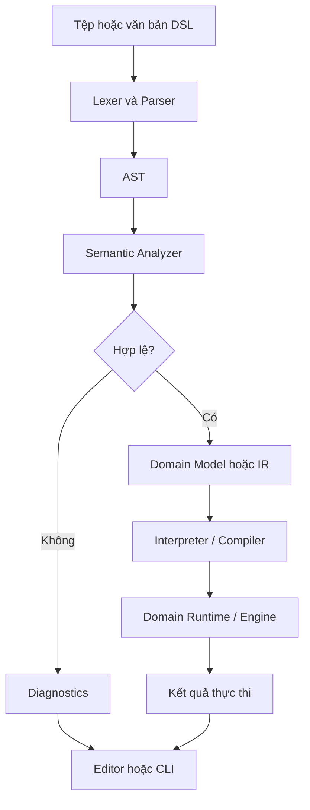

# DSL bên ngoài là gì?

Trong thiết kế ngôn ngữ đặc thù miền (*Domain-Specific Language – DSL*), có hai cách phổ biến để tạo ra cú pháp cho người dùng: nhúng cách diễn đạt miền vào một ngôn ngữ lập trình có sẵn (*internal hoặc embedded DSL*), hoặc xây dựng một ngôn ngữ có cú pháp riêng (*external DSL*). Bài học này tập trung vào **DSL bên ngoài**: khái niệm, cách nhận diện, cấu trúc xử lý, cách tích hợp vào ứng dụng và những đánh đổi khi lựa chọn.

DSL bên ngoài cho phép người dùng mô tả một công việc bằng ký hiệu và quy tắc được thiết kế riêng cho miền. Chẳng hạn, chuyên viên dữ liệu viết truy vấn SQL, quản trị viên khai báo cấu hình hạ tầng bằng HCL, hoặc người quản lý chính sách mô tả điều kiện bằng một ngôn ngữ quy tắc. Ứng dụng hoặc công cụ chuyên dụng sẽ đọc mô tả đó và chuyển nó thành hành động phù hợp.

## 1. Định nghĩa DSL bên ngoài

**External DSL (DSL bên ngoài)** là ngôn ngữ đặc thù miền có cú pháp và quy tắc biểu đạt được định nghĩa độc lập với cú pháp của một ngôn ngữ lập trình chủ (*host language*). Người dùng viết mô tả bằng ngôn ngữ đó; một bộ xử lý riêng hoặc công cụ hỗ trợ sẽ phân tích và diễn giải, thực thi hoặc chuyển đổi nội dung.

Một external DSL thường có các đặc điểm:

- **Cú pháp riêng:** có tập từ khóa, cấu trúc, dấu phân cách hoặc ký hiệu riêng.
- **Văn phạm xác định:** quy định những cấu trúc nào được xem là hợp lệ.
- **Ngữ nghĩa của miền:** quy định mỗi cấu trúc biểu đạt điều gì và tạo ra hành vi nào.
- **Bộ xử lý phù hợp:** có parser, interpreter, compiler hoặc engine hiểu ngôn ngữ.
- **Tích hợp qua giao diện:** ứng dụng truyền văn bản, tệp hoặc mô hình dữ liệu cho bộ xử lý, rồi nhận kết quả hoặc lỗi.

Ví dụ, SQL có cú pháp truy vấn riêng như `SELECT`, `FROM` và `WHERE`. Người viết không cần biểu diễn truy vấn bằng các câu lệnh vòng lặp của Java hay Python. Một hệ quản trị cơ sở dữ liệu phân tích câu SQL, kiểm tra cấu trúc và ngữ nghĩa, lập kế hoạch truy vấn rồi thực thi.

Một external DSL có thể được lưu trong tệp, nhập vào trình soạn thảo, nhận qua API hoặc được sinh tự động. Cách lưu trữ không quyết định nó có phải DSL bên ngoài hay không; điều cốt lõi là ngôn ngữ có quy tắc biểu đạt độc lập và được xử lý như một ngôn ngữ riêng.

## 2. "Bên ngoài" có nghĩa là gì?

Từ **external** nói đến ranh giới ngôn ngữ và cách biểu đạt, không nhất thiết nói đến vị trí vật lý hay nơi chương trình chạy.

Một DSL được xem là bên ngoài khi người viết sử dụng một cú pháp có đặc tả riêng, thay vì phải viết cấu trúc miền theo cú pháp của host language. Ví dụ, một ứng dụng Java có thể đọc tệp chính sách `.policy`, phân tích nó bằng parser được viết bằng Java và thực thi các quy tắc bằng các dịch vụ của ứng dụng. Ngôn ngữ mô tả vẫn là external DSL dù parser và runtime nằm trong cùng ứng dụng Java.

Vì vậy, cần tránh một số cách hiểu sai:

- External DSL không có nghĩa là ngôn ngữ phải chạy trên máy chủ bên ngoài.
- External DSL không nhất thiết do một nhà cung cấp bên thứ ba tạo ra.
- External DSL không bắt buộc phải là một chương trình độc lập có thể tự chạy.
- External DSL không nhất thiết phải có phần mở rộng tệp riêng.
- External DSL không nhất thiết phải là ngôn ngữ văn bản; một ngôn ngữ trực quan cũng có thể có cú pháp và ngữ nghĩa độc lập.

Điểm phân biệt nằm ở việc người dùng mô tả vấn đề bằng ngôn ngữ miền độc lập với cú pháp của ngôn ngữ triển khai ứng dụng.

## 3. Phân biệt external DSL và internal DSL

**Internal DSL**, còn gọi là **embedded DSL**, tận dụng cú pháp và tính năng của một ngôn ngữ chủ để tạo cách diễn đạt gần với miền. External DSL có ngôn ngữ và quy tắc cú pháp riêng, thường cần một bộ xử lý chuyên biệt.

| Tiêu chí | External DSL | Internal / Embedded DSL |
|---|---|---|
| Cú pháp | Có cú pháp độc lập | Dựa trên cú pháp host language |
| Văn phạm | Được định nghĩa cho DSL | Chủ yếu do host language quy định |
| Phân tích | Thường cần parser hoặc công cụ riêng | Thường dùng parser của host language |
| Người dùng | Có thể chỉ cần biết khái niệm miền | Thường cần biết cú pháp host language ở mức nhất định |
| Tích hợp | Qua parser, runtime, API hoặc mô hình trung gian | Trực tiếp qua hàm, lớp, lambda và thư viện của host |
| Công cụ | Có thể cần editor, formatter và debugger riêng | Có thể tận dụng IDE và công cụ host |
| Khả năng thiết kế cú pháp | Kiểm soát cao hơn | Bị giới hạn bởi host language |

Ví dụ về một mô tả quy tắc bên ngoài:

```text
policy "member-discount" {
    when order.total >= 1000000
    then discount = 10%
}
```

Một cách biểu đạt internal DSL bằng Kotlin có thể trông như sau:

```kotlin
policy("member-discount") {
    whenCondition { order.total >= 1_000_000 }
    thenAction { discount = 10.percent }
}
```

Hai ví dụ cùng mô tả ý định nghiệp vụ, nhưng cách viết khác nhau. Ví dụ thứ nhất dựa trên văn phạm của một ngôn ngữ chính sách giả định. Ví dụ thứ hai sử dụng các biểu thức Kotlin và các hàm do thư viện cung cấp. Cả hai chỉ là minh họa, không phải cú pháp của một framework cụ thể.

External DSL thường phù hợp khi cần cho phép người không phải lập trình viên đọc hoặc chỉnh sửa mô tả, hoặc khi miền cần một cách biểu đạt khác rõ rệt với host language. Internal DSL thường thuận lợi khi người dùng chính là lập trình viên và cần tích hợp trực tiếp với mã ứng dụng.

## 4. DSL bên ngoài khác định dạng dữ liệu và tệp cấu hình như thế nào?

Một tệp JSON, YAML hoặc TOML có thể chứa cấu hình, nhưng không phải mọi tệp cấu hình đều là DSL. Định dạng dữ liệu chủ yếu quy định cách biểu diễn và trao đổi dữ liệu. DSL còn cần những khái niệm, cấu trúc và ngữ nghĩa chuyên biệt để mô tả công việc trong một miền.

Ví dụ, một tệp YAML chỉ khai báo tên ứng dụng và cổng mạng có thể đơn thuần là dữ liệu cấu hình:

```yaml
application:
  name: catalog
  port: 8080
```

Một ngôn ngữ cấu hình hạ tầng có thể cung cấp biểu thức tham chiếu tài nguyên, khối khai báo, quy tắc phụ thuộc và ngữ nghĩa tạo hoặc thay đổi tài nguyên. Khi đó, nó hoạt động như một external DSL cho miền quản lý hạ tầng.

Có thể dùng các câu hỏi sau để nhận diện:

1. Ngôn ngữ có tập khái niệm và từ vựng chuyên biệt cho một miền không?
2. Nó có quy tắc cú pháp hoặc cấu trúc riêng không?
3. Những cấu trúc đó có ý nghĩa và hành vi được định nghĩa không?
4. Có bộ xử lý hiểu các cấu trúc đó để tạo kết quả trong miền không?

Một định dạng dữ liệu có thể được dùng làm nền tảng cú pháp cho DSL. Ranh giới không phụ thuộc vào đuôi tệp mà phụ thuộc vào ngữ nghĩa và cách sử dụng của nó.

## 5. Những dạng external DSL thường gặp

External DSL không chỉ có một hình thức trình bày.

### 5.1. DSL dạng văn bản

Người dùng viết từ khóa, biểu thức và cấu trúc theo văn phạm. Ví dụ quen thuộc:

- **SQL:** mô tả truy vấn và thao tác dữ liệu.
- **Regular expressions:** mô tả mẫu cần tìm trong chuỗi.
- **CSS:** mô tả quy tắc trình bày tài liệu hoặc giao diện.
- **HCL:** mô tả tài nguyên và cấu hình hạ tầng.
- **Ngôn ngữ chính sách hoặc workflow chuyên biệt:** mô tả điều kiện, hành động và đường đi trong một miền.

### 5.2. DSL dạng khai báo

Người dùng mô tả trạng thái mong muốn hoặc quan hệ cần có; engine xác định cách đạt đến trạng thái đó.

Ví dụ, một tệp mô tả tài nguyên hạ tầng có thể khai báo máy chủ cần tồn tại với một số thuộc tính. Công cụ xử lý sẽ so sánh mô tả với trạng thái hiện tại rồi lập kế hoạch thay đổi.

### 5.3. DSL dạng đồ họa

Người dùng xây dựng mô hình bằng node, cạnh, biểu tượng hoặc khối kéo thả. Công cụ có thể lưu mô hình dưới dạng đồ thị hoặc chuyển đổi thành biểu diễn trung gian.

Ví dụ, một trình thiết kế quy trình có thể dùng các khối Start, Task, Decision và End. Dù người dùng không trực tiếp viết từ khóa, công cụ vẫn phải định nghĩa những cấu trúc nào được phép nối với nhau và ý nghĩa khi thực thi.

### 5.4. DSL kết hợp

Một hệ thống có thể kết hợp tệp văn bản, biểu thức, bảng và giao diện trực quan. Ví dụ, người dùng tạo luồng bằng sơ đồ rồi nhập biểu thức điều kiện trong từng node. Các hình thức này có thể cùng được chuyển về một mô hình nội bộ chung.

## 6. Cấu trúc xử lý một external DSL

Vì external DSL có cú pháp riêng, văn bản nguồn cần được chuyển đổi thành một biểu diễn mà máy có thể hiểu. Một pipeline thường gồm các bước sau:

1. Đọc văn bản nguồn.
2. Phân tích từ vựng để tạo token.
3. Phân tích cú pháp theo grammar để tạo parse tree hoặc AST.
4. Kiểm tra ngữ nghĩa và kiểu dữ liệu.
5. Chuyển AST thành mô hình thực thi hoặc biểu diễn trung gian.
6. Thông dịch, biên dịch hoặc chuyển yêu cầu đến engine của miền.
7. Trả kết quả, thông báo lỗi và thông tin theo dõi.

Không phải hệ thống nào cũng tách mọi bước thành thành phần độc lập. Một parser generator có thể kết hợp lexer và parser; một engine có thể kiểm tra ngữ nghĩa trong lúc xây dựng mô hình; một số DSL chỉ chuyển đổi thành cấu hình cho hệ thống khác.

### 6.1. Lexical analysis – phân tích từ vựng

**Lexer** đọc chuỗi ký tự và gom chúng thành các đơn vị gọi là **token**. Token thường có loại, giá trị và vị trí trong tệp nguồn.

Với biểu thức:

```text
order.total >= 500000
```

một chuỗi token đơn giản có thể là:

| Văn bản | Loại token |
|---|---|
| `order` | Identifier |
| `.` | Member access |
| `total` | Identifier |
| `>=` | Comparison operator |
| `500000` | Numeric literal |

Lexer có thể bỏ qua khoảng trắng hoặc comment nếu grammar quy định chúng không ảnh hưởng đến cấu trúc. Nó cũng phát hiện các lỗi từ vựng như chuỗi chưa đóng dấu nháy, ký tự không được hỗ trợ hoặc literal không hợp lệ.

### 6.2. Grammar – văn phạm của DSL

**Grammar** là tập quy tắc hình thức xác định cách token được kết hợp thành cấu trúc hợp lệ. Grammar giúp parser biết một câu lệnh có đúng thứ tự, đủ thành phần và đúng dạng hay không.

Một external DSL có thể dùng EBNF để mô tả grammar. Ví dụ, ngôn ngữ chính sách giả định ở bài học có thể dùng quy tắc rút gọn:

```ebnf
policy       = "policy", string, "{", rule, { rule }, "}" ;
rule         = "when", condition, "then", action ;
condition    = path, comparison, literal ;
path         = identifier, { ".", identifier } ;
comparison   = ">=" | "<=" | "==" | "!=" | ">" | "<" ;
action       = identifier, "=", literal ;
literal      = number | string | boolean ;
```

Quy tắc này chỉ minh họa một tập con nhỏ. Nó cho thấy:

- **Terminal:** từ hoặc ký hiệu xuất hiện trực tiếp như `policy`, `when` và `>=`.
- **Non-terminal:** tên đại diện cho cấu trúc như `policy`, `rule` và `condition`.
- **Production rule:** luật mô tả cách một non-terminal được tạo từ terminal và non-terminal khác.
- **Repetition:** một cấu trúc có thể xuất hiện nhiều lần, ký hiệu bằng dấu ngoặc nhọn trong EBNF.
- **Optionality:** một cấu trúc có thể xuất hiện hoặc không, thường được ký hiệu bằng dấu ngoặc vuông trong EBNF.

Grammar cần đủ chặt để parser có thể phân tích nhất quán, nhưng cũng cần đủ dễ đọc để người dùng miền có thể học và viết.

### 6.3. Parsing – phân tích cú pháp

**Parser** nhận chuỗi token và kiểm tra nó theo grammar. Nếu hợp lệ, parser thường tạo một parse tree hoặc AST. Nếu không hợp lệ, parser trả về lỗi cú pháp cùng vị trí hoặc cấu trúc gây lỗi.

Ví dụ, nếu grammar yêu cầu mỗi rule có `when` và `then`, đoạn thiếu phần hành động sau `then` sẽ không được phân tích thành một rule hoàn chỉnh.

Có nhiều kỹ thuật parsing, ví dụ recursive descent, LL, LR và parser sinh từ grammar. Lựa chọn phụ thuộc mức độ phức tạp của ngôn ngữ, khả năng mở rộng grammar và yêu cầu thông báo lỗi.

### 6.4. AST – cây cú pháp trừu tượng

**Abstract Syntax Tree (AST)** biểu diễn cấu trúc có ý nghĩa của chương trình dưới dạng cây. AST thường bỏ qua chi tiết trình bày như khoảng trắng và comment.

Ví dụ, biểu thức `order.total >= 500000` có thể được biểu diễn như sau:

```text
        GreaterThanOrEqual
           /          \
      Property       Number
       /   \          500000
    order  total
```

AST giúp các bước sau làm việc với thành phần có cấu trúc. Một interpreter có thể đánh giá nút so sánh; một compiler có thể chuyển nút đó thành mã hoặc biểu diễn khác.

### 6.5. Semantic analysis – phân tích ngữ nghĩa

Một câu lệnh có thể đúng grammar nhưng vẫn không hợp lệ trong miền. **Semantic analysis** kiểm tra ý nghĩa và tính hợp lệ của cấu trúc.

Ví dụ:

```text
order.unknownProperty >= 500000
```

Cấu trúc này có thể đúng cú pháp nếu grammar cho phép truy cập thuộc tính. Tuy nhiên, nếu mô hình miền không có thuộc tính `unknownProperty`, biểu thức cần bị từ chối ở bước ngữ nghĩa.

Các kiểm tra thường gặp:

- Định danh hoặc thuộc tính có tồn tại không?
- Kiểu dữ liệu hai phía của phép so sánh có tương thích không?
- Hành động có được phép trong ngữ cảnh hiện tại không?
- Tham chiếu có đúng phạm vi và quyền hạn không?
- Các giá trị có thỏa ràng buộc của miền không?

### 6.6. Interpreter, compiler và engine

Sau khi phân tích và kiểm tra, hệ thống cần xác định cách xử lý DSL.

- **Interpreter:** trực tiếp duyệt AST hoặc mô hình nội bộ và thực hiện hành vi tương ứng.
- **Compiler:** chuyển DSL sang mã hoặc biểu diễn khác, chẳng hạn bytecode, SQL, mã Java hay cấu hình cho một runtime.
- **Domain engine:** nhận mô hình đã phân tích và thực hiện chức năng chuyên biệt, ví dụ query engine, workflow engine hoặc rule engine.

Các cách xử lý có thể kết hợp. Một DSL có thể được biên dịch thành mô hình trung gian rồi giao cho workflow engine thực thi.

## 7. Phân tích cú pháp và ngữ nghĩa phải được tách bạch

Cú pháp trả lời câu hỏi “cấu trúc có được viết đúng quy tắc không?”. Ngữ nghĩa trả lời “cấu trúc đó có ý nghĩa gì trong miền và có được phép không?”.

Ví dụ, xét một ngôn ngữ chính sách giả định:

```text
policy "shipping" {
    when order.total >= "high"
    then freeShipping = true
}
```

Nếu grammar cho phép so sánh một path với một literal bất kỳ, biểu thức có thể qua bước parsing. Nhưng nếu `order.total` có kiểu Decimal trong khi `"high"` là String, semantic analysis sẽ phát hiện lỗi kiểu.

| Tình huống | Bước phát hiện phù hợp | Ví dụ |
|---|---|---|
| Thiếu dấu đóng ngoặc | Parsing | Khối policy chưa kết thúc |
| Ký tự không hợp lệ | Lexical analysis | Ký hiệu không nằm trong tập token |
| Thuộc tính không tồn tại | Semantic analysis | `order.unknown` |
| So sánh sai kiểu | Type checking | Decimal so với String |
| Giá trị vượt ràng buộc nghiệp vụ | Validation miền | Tỷ lệ giảm giá lớn hơn giới hạn |
| Lỗi khi gọi dịch vụ | Runtime | Dịch vụ vận chuyển không phản hồi |

Phân chia rõ các lớp lỗi giúp người dùng sửa đúng vấn đề. Thông báo lỗi nên nêu vị trí, thành phần gây lỗi, nguyên nhân và gợi ý cách khắc phục nếu có thể.

## 8. Tích hợp external DSL vào ứng dụng

External DSL thường không tự thực hiện mọi công việc. Nó mô tả ý định trong miền, còn ứng dụng hoặc engine cung cấp dữ liệu, dịch vụ và quyền thực thi.

Một cách tích hợp phổ biến:

1. Ứng dụng nhận tệp hoặc chuỗi DSL.
2. Parser chuyển nội dung thành AST.
3. Semantic analyzer kiểm tra với domain model và schema hiện có.
4. Hệ thống tạo mô hình nội bộ hoặc kế hoạch thực thi.
5. Runtime gọi các dịch vụ được cho phép.
6. Kết quả và lỗi được trả lại cho ứng dụng hoặc người dùng.

Ví dụ, một ứng dụng Java có thể cung cấp parser cho tệp chính sách, ánh xạ các định danh trong DSL tới đối tượng miền và dùng rule engine để đánh giá điều kiện. Java là ngôn ngữ triển khai parser và runtime; người dùng vẫn viết chính sách bằng external DSL.

### Giao diện tích hợp

DSL có thể kết nối với ứng dụng qua nhiều dạng giao diện:

- **File interface:** ứng dụng đọc tệp chứa định nghĩa.
- **API interface:** client gửi DSL hoặc mô hình đã phân tích qua API.
- **Database interface:** định nghĩa DSL được lưu và quản lý phiên bản trong cơ sở dữ liệu.
- **Editor integration:** IDE hoặc công cụ web cung cấp tô màu cú pháp, tự động hoàn thành và kiểm tra lỗi.
- **Runtime integration:** engine nhận mô hình DSL để thực thi hoặc phối hợp với dịch vụ miền.

Giao diện cần quy định encoding, phiên bản ngôn ngữ, schema đầu vào, giới hạn kích thước, quyền truy cập và cách báo lỗi.

### Ranh giới tin cậy và quyền hạn

Một external DSL có thể do người dùng nghiệp vụ hoặc hệ thống khác cung cấp. Vì vậy, ứng dụng không nên mặc định mọi nội dung đều đáng tin cậy.

Thiết kế an toàn cần:

- Chỉ cho phép các thao tác và hàm đã được công bố cho DSL.
- Kiểm tra dữ liệu và kiểu trước khi thực thi.
- Giới hạn thời gian, bộ nhớ, độ sâu lồng nhau hoặc số bước khi phù hợp.
- Kiểm tra quyền của người tạo, người sửa và người chạy định nghĩa.
- Tránh thực thi trực tiếp mã tùy ý từ DSL như mã host language.
- Ghi nhận lịch sử thay đổi và kết quả thực thi.

Mục tiêu là cho phép người dùng mô tả công việc trong miền mà không vô tình trao quyền truy cập không giới hạn vào ứng dụng hoặc hệ điều hành.

## 9. Ví dụ thực tế về external DSL

Các ví dụ dưới đây cho thấy external DSL xuất hiện trong nhiều lĩnh vực. Chúng có mức độ phức tạp và cách thực thi khác nhau, nhưng đều cung cấp cách biểu đạt chuyên biệt cho một miền.

### 9.1. SQL – miền truy vấn dữ liệu

SQL cho phép người dùng mô tả dữ liệu cần lấy và điều kiện lọc bằng cú pháp truy vấn:

```sql
SELECT customer_id, SUM(total) AS revenue
FROM orders
WHERE status = 'PAID'
GROUP BY customer_id;
```

Người viết tập trung vào tập dữ liệu và điều kiện truy vấn. Database engine phân tích SQL, kiểm tra bảng và cột, xác định kiểu dữ liệu, lập kế hoạch truy vấn và thực thi trên dữ liệu.

SQL có thể được gửi từ một ứng dụng Java hoặc Python dưới dạng chuỗi. Việc SQL được đặt trong mã host language không biến cú pháp SQL thành cú pháp Java hoặc Python; SQL vẫn là ngôn ngữ riêng với grammar và semantics của nó.

### 9.2. Regular expressions – miền nhận diện mẫu chuỗi

Regular expression (regex) mô tả một mẫu văn bản bằng các ký hiệu chuyên biệt:

```regex
^[A-Z]{2}-[0-9]{6}$
```

Mẫu trên khớp chuỗi gồm hai chữ cái in hoa, dấu gạch nối và sáu chữ số, với điều kiện toàn bộ chuỗi phải khớp. Ký hiệu `^` và `$` biểu thị đầu và cuối chuỗi; `{2}` và `{6}` biểu thị số lần lặp; `[A-Z]` và `[0-9]` biểu thị tập ký tự.

Regex engine diễn giải mẫu và áp dụng nó lên chuỗi đầu vào. Regex thường được truyền qua chuỗi trong một host language, nhưng phần mẫu vẫn tuân theo ngôn ngữ regex riêng.

### 9.3. CSS – miền trình bày giao diện

CSS mô tả quy tắc trình bày cho các phần tử tài liệu:

```css
.card {
    display: grid;
    gap: 1rem;
    padding: 1rem;
}
```

Selector xác định phần tử được áp dụng; declaration quy định thuộc tính và giá trị. Trình duyệt đọc stylesheet, phân tích cú pháp, tạo mô hình quy tắc và áp dụng cascade cùng layout để hiển thị trang.

### 9.4. HCL – miền mô tả hạ tầng

HCL (*HashiCorp Configuration Language*) được dùng để mô tả cấu hình và tài nguyên hạ tầng. Một ví dụ rút gọn:

```hcl
resource "example_server" "web" {
  name  = "catalog-web"
  size  = "small"
  image = "stable"
}
```

Người dùng mô tả tài nguyên mong muốn bằng các block và thuộc tính. Công cụ tương ứng đọc cấu hình, kiểm tra tham chiếu, so sánh với trạng thái quản lý và lập kế hoạch thay đổi. Cú pháp và ngữ nghĩa cụ thể phụ thuộc công cụ và provider đang sử dụng.

### 9.5. DSL chính sách giả định

Một ứng dụng thương mại có thể cung cấp DSL để chuyên viên nghiệp vụ khai báo điều kiện miễn phí vận chuyển:

```text
policy "free-shipping" {
    when order.total >= 500000
    then shipping.fee = 0
}
```

Ứng dụng cần định nghĩa các khái niệm `order`, `total`, `shipping` và `fee`, cùng kiểu dữ liệu và quy tắc áp dụng. Parser kiểm tra cấu trúc; semantic analyzer xác minh các thuộc tính; rule engine đánh giá điều kiện trên một đơn hàng cụ thể.

Đây là ví dụ thiết kế giả định để minh họa cách tạo external DSL theo miền thương mại, không phải ngôn ngữ có sẵn.

## 10. Lợi ích của external DSL

### 10.1. Diễn đạt gần với miền

Từ khóa và cấu trúc có thể phản ánh thuật ngữ mà chuyên gia miền sử dụng. Người đọc tập trung vào quy tắc nghiệp vụ hoặc mục tiêu cần đạt thay vì chi tiết của ngôn ngữ triển khai.

### 10.2. Tách mô tả khỏi triển khai

Một định nghĩa DSL có thể được lưu độc lập với mã nguồn ứng dụng. Khi quy tắc nghiệp vụ thay đổi, nhóm có thể cập nhật định nghĩa theo quy trình quản lý phù hợp mà không nhất thiết phải sửa thuật toán lõi.

Việc tách này cần được thiết kế cẩn thận: DSL vẫn phụ thuộc vào hợp đồng dữ liệu, các action được hỗ trợ và phiên bản runtime.

### 10.3. Kiểm soát cú pháp và ngữ nghĩa

Nhóm phát triển có thể quyết định cấu trúc nào được phép, kiểu dữ liệu nào tồn tại, biểu thức nào được hỗ trợ và hành động nào có thể gọi. Điều này tạo cơ sở để xác thực mô tả trước khi thực thi.

### 10.4. Có thể giới hạn khả năng của người dùng

Một DSL được thiết kế phù hợp chỉ phơi bày các thao tác cần thiết cho miền. Người dùng có thể tạo quy tắc hoặc mô tả quy trình mà không cần quyền thực thi mọi chức năng của host language.

Giới hạn này hỗ trợ phân quyền và giảm phạm vi lỗi, nhưng không tự động bảo đảm an toàn. Runtime vẫn cần xác thực dữ liệu và quyền thực thi.

### 10.5. Có thể phục vụ nhiều công cụ

Cùng một định nghĩa DSL có thể được đọc bởi editor, validator, công cụ sinh tài liệu và runtime nếu các thành phần dùng chung grammar, semantics hoặc mô hình trung gian. Điều này giúp quy tắc không bị diễn giải khác nhau giữa các công cụ.

### 10.6. Hỗ trợ kiểm tra và phân tích trước khi chạy

Parser và semantic analyzer có thể phát hiện lỗi cấu trúc, tham chiếu không tồn tại, kiểu không tương thích hoặc quy tắc mâu thuẫn trước khi workflow hay chính sách được áp dụng vào dữ liệu thực tế.

## 11. Chi phí và giới hạn của external DSL

### 11.1. Chi phí xây dựng bộ xử lý

Nhóm phải định nghĩa grammar, xây dựng hoặc tích hợp lexer/parser, tạo mô hình nội bộ và xử lý ngữ nghĩa. Với DSL có nhiều biểu thức, phạm vi và kiểu dữ liệu, công việc này có thể đáng kể.

### 11.2. Cần duy trì hệ sinh thái công cụ

Một ngôn ngữ hữu ích thường cần editor support, syntax highlighting, formatter, diagnostics, debugger, tài liệu và ví dụ. Nếu chỉ có parser mà không có công cụ hỗ trợ, người dùng có thể khó học và khó sửa lỗi.

### 11.3. Rủi ro về khả năng đọc và thiết kế cú pháp

Cú pháp quá giống ngôn ngữ tự nhiên có thể mơ hồ; cú pháp quá kỹ thuật có thể khó dùng với chuyên gia miền. Một DSL cần nhất quán về từ khóa, thứ tự, dấu phân cách và cách kết hợp biểu thức.

### 11.4. Chi phí tích hợp

DSL cần liên kết với domain model, dữ liệu, API, quyền hạn và runtime. Khi mô hình miền thay đổi, định nghĩa DSL cũ có thể không còn hợp lệ. Hệ thống cần cách báo lỗi, tương thích và chuyển đổi phù hợp.

### 11.5. Nguy cơ tạo ra một ngôn ngữ quá lớn

Nếu liên tục thêm cú pháp để giải quyết mọi trường hợp đặc biệt, DSL có thể trở nên phức tạp gần như một GPL nhưng thiếu hệ sinh thái và công cụ trưởng thành. Phạm vi miền cần được giữ rõ; các khả năng mới nên xuất phát từ nhu cầu thực tế và có ngữ nghĩa nhất quán.

### 11.6. Rủi ro khi thực thi

Một DSL có thể gây ra truy vấn tốn tài nguyên, vòng lặp dài hoặc thao tác không mong muốn nếu runtime không giới hạn. Cần có giới hạn tài nguyên, quyền hạn, kiểm soát phiên bản và audit trail tương ứng với tác động của các action.

| Lợi ích | Chi phí hoặc giới hạn đi kèm |
|---|---|
| Cú pháp sát với miền | Phải thiết kế và duy trì grammar |
| Tách định nghĩa khỏi mã ứng dụng | Cần hợp đồng tích hợp ổn định |
| Kiểm soát khả năng biểu đạt | Phải xây dựng semantic validation |
| Người dùng có thể tự mô tả quy tắc | Cần editor, tài liệu và thông báo lỗi tốt |
| Có thể kiểm tra trước khi chạy | Cần duy trì validator nhất quán với runtime |
| Giới hạn thao tác được phép | Runtime vẫn phải kiểm soát quyền và tài nguyên |

## 12. Khi nào nên chọn external DSL?

External DSL phù hợp khi có một hoặc nhiều điều kiện sau:

- Người dùng mục tiêu cần diễn đạt quy tắc bằng thuật ngữ miền và không nên phải viết mã bằng host language.
- Cú pháp của host language không thể hiện rõ cấu trúc của miền.
- Định nghĩa cần được lưu, trao đổi, xem xét hoặc quản lý phiên bản độc lập với ứng dụng.
- Nhiều công cụ cần đọc cùng một định nghĩa theo một grammar thống nhất.
- Cần giới hạn tập thao tác để người dùng chỉ mô tả được những gì miền cho phép.
- Ngôn ngữ có vòng đời và nhu cầu sử dụng đủ ổn định để biện minh cho chi phí xây dựng công cụ.

External DSL có thể không cần thiết nếu chỉ có vài tùy chọn cấu hình đơn giản, người dùng đều là lập trình viên, hoặc thư viện của host language đã biểu đạt miền một cách rõ ràng. Trong trường hợp đó, một API hay internal DSL có thể giảm chi phí phát triển và bảo trì.

### Các câu hỏi quyết định

| Câu hỏi | Nếu câu trả lời là "Có" |
|---|---|
| Người dùng chính không quen host language? | Cân nhắc cú pháp độc lập gần ngôn ngữ miền |
| Cấu trúc miền khác xa cấu trúc host language? | Cân nhắc external DSL |
| Định nghĩa cần được chỉnh sửa độc lập với release ứng dụng? | Cân nhắc lưu và quản lý DSL như artifact riêng |
| Nhiều công cụ cần hiểu cùng một mô tả? | Cân nhắc grammar và mô hình trung gian dùng chung |
| Ngôn ngữ chỉ có vài cặp khóa–giá trị? | Định dạng cấu hình có thể đã đủ |
| Chỉ lập trình viên sử dụng và tích hợp thư viện là ưu tiên? | Internal DSL có thể phù hợp hơn |

Không có lựa chọn nào đúng cho mọi dự án. Cần đánh giá người dùng, độ phức tạp của miền, tần suất thay đổi, khả năng kiểm soát và chi phí duy trì trong suốt vòng đời.

## 13. Kiến trúc tổng quát của một hệ thống external DSL

Một hệ thống external DSL thường có thể chia thành các lớp theo trách nhiệm. Cách chia này giúp thay đổi cú pháp, mô hình miền hoặc cách thực thi mà không làm mọi thành phần phụ thuộc trực tiếp vào nhau.



Các lớp chính:

- **Source layer:** tiếp nhận nội dung DSL, tên tệp, encoding và phiên bản ngôn ngữ.
- **Front end:** lexer, parser và semantic analyzer. Đây là phần hiểu cú pháp và kiểm tra cấu trúc.
- **Intermediate representation (IR):** mô hình trung gian chuẩn hóa ý nghĩa của DSL để các thành phần sau không cần phụ thuộc trực tiếp vào văn bản nguồn.
- **Back end:** interpreter, compiler hoặc adapter chuyển mô hình thành thao tác của hệ thống đích.
- **Runtime:** cung cấp dữ liệu, dịch vụ, quyền hạn và tài nguyên cần thiết để thực hiện.
- **Tooling:** editor, CLI, formatter, validator, debugger, tài liệu và công cụ quan sát.

Không phải DSL nào cũng cần tất cả các lớp. Một ngôn ngữ nhỏ có thể được parser chuyển thẳng thành lệnh cho engine. Một DSL lớn có thể cần IR để hỗ trợ nhiều runtime hoặc nhiều loại đầu ra.

### Vì sao cần mô hình trung gian?

IR (*Intermediate Representation*) là biểu diễn có cấu trúc nằm giữa mã nguồn DSL và phần thực thi. Ví dụ, một DSL quy tắc có thể chuyển thành danh sách điều kiện và hành động; một workflow DSL có thể chuyển thành đồ thị node và transition.

IR đem lại một số lợi ích:

- Giảm sự phụ thuộc giữa parser và runtime.
- Cho phép nhiều nguồn cú pháp cùng tạo một mô hình thực thi.
- Hỗ trợ tối ưu hóa, phân tích tĩnh hoặc sinh tài liệu.
- Giúp kiểm tra và hiển thị cấu trúc sau khi phân tích.
- Có thể hỗ trợ nhiều backend mà không phải viết lại parser.

IR cần giữ đủ thông tin để thực thi đúng ngữ nghĩa. Nếu loại bỏ nhầm thông tin về vị trí nguồn hoặc kiểu dữ liệu, công cụ có thể khó báo lỗi hoặc khó giải thích kết quả.

## 14. Các bước thiết kế một external DSL

Thiết kế DSL nên bắt đầu từ vấn đề và người dùng trong miền. Cú pháp chỉ là một phần của thiết kế.

### Bước 1: Xác định người dùng và mục tiêu

Làm rõ ai sẽ viết, đọc, xem xét và thực thi DSL. Người dùng là chuyên gia nghiệp vụ, quản trị viên, nhà phát triển hay một hệ thống tự sinh cấu hình? Họ cần mô tả loại công việc nào và cần kiểm soát đến mức nào?

### Bước 2: Xác định ranh giới miền

Liệt kê đối tượng, thuộc tính, sự kiện, hành động, quy tắc và các khái niệm chuyên môn. Quy định điều gì nằm trong phạm vi DSL và điều gì thuộc về ứng dụng hoặc hệ thống nền.

### Bước 3: Xây dựng domain model và semantics

Xác định ý nghĩa của từng khái niệm, kiểu dữ liệu, phép toán, phạm vi tên và hành vi. Cần trả lời cả trường hợp bình thường lẫn dữ liệu thiếu, lỗi và ngoại lệ.

### Bước 4: Chọn hình thức biểu đạt

Quyết định DSL sẽ dùng văn bản, đồ họa hay kết hợp. Nếu dùng văn bản, hãy chọn cấu trúc nhất quán: khai báo, biểu thức, block, câu lệnh hoặc bảng. Cú pháp nên đủ rõ để người dùng nhận biết cấu trúc mà không phải ghi nhớ quá nhiều quy ước tùy tiện.

### Bước 5: Đặc tả grammar

Viết grammar và tạo bộ ví dụ hợp lệ, không hợp lệ. Grammar cần quy định từ khóa, identifier, literal, toán tử, thứ tự ưu tiên, dấu phân cách và cách lồng cấu trúc.

### Bước 6: Xây dựng parser và semantic analyzer

Parser tạo AST hoặc IR. Semantic analyzer kiểm tra định danh, kiểu, phạm vi, tham chiếu và ràng buộc miền. Hai phần cần cung cấp diagnostics đủ chi tiết để người viết sửa lỗi.

### Bước 7: Xây dựng runtime hoặc compiler

Xác định cách mô tả được chuyển thành kết quả: thông dịch, biên dịch, gọi engine hoặc sinh cấu hình. Giới hạn rõ các action và quyền mà DSL có thể sử dụng.

### Bước 8: Xây dựng công cụ hỗ trợ

Cung cấp tài liệu, ví dụ, syntax highlighting, auto-completion, formatter và validator khi phù hợp. Với DSL được nhiều người sử dụng, công cụ hỗ trợ là một phần quan trọng của trải nghiệm ngôn ngữ.

### Bước 9: Quản lý phiên bản và tương thích

Khi grammar hoặc semantics thay đổi, cần biết định nghĩa cũ được xử lý ra sao. Có thể dùng trường version, migration tool, cảnh báo cấu trúc sắp bị loại bỏ hoặc hỗ trợ nhiều phiên bản runtime trong một khoảng thời gian.

### Bước 10: Kiểm thử bằng tình huống thực tế

Thử các mô tả thường gặp, trường hợp biên, dữ liệu không hợp lệ và hành vi lỗi. Chuyên gia miền cần xác nhận rằng kết quả của DSL phản ánh đúng quy tắc nghiệp vụ.

## 15. Quản lý phiên bản của external DSL

DSL là một hợp đồng giữa người viết định nghĩa và bộ xử lý. Khi ngôn ngữ thay đổi, cả hai phía cần có cách nhận biết phiên bản và hiểu những cấu trúc được hỗ trợ.

Các loại thay đổi thường gặp:

- **Thay đổi cộng thêm:** thêm từ khóa, thuộc tính hoặc phép toán mới mà không làm hỏng định nghĩa cũ.
- **Thay đổi ngữ nghĩa:** giữ nguyên cú pháp nhưng thay đổi cách diễn giải. Đây là thay đổi có thể gây ảnh hưởng lớn vì tệp cũ vẫn phân tích được nhưng kết quả có thể khác.
- **Thay đổi phá vỡ tương thích:** xóa từ khóa, đổi cấu trúc bắt buộc hoặc thay đổi kiểu dữ liệu.
- **Ngừng hỗ trợ:** đánh dấu một cấu trúc sẽ bị loại bỏ trong phiên bản tương lai.

Một số nguyên tắc quản lý:

1. Định nghĩa rõ phiên bản DSL hoặc schema mà tệp sử dụng.
2. Ghi lại các thay đổi grammar và semantics.
3. Có kiểm tra tương thích trước khi chạy định nghĩa cũ.
4. Cung cấp thông báo deprecation và thời gian chuyển đổi hợp lý.
5. Nếu cần migration, tạo công cụ chuyển đổi và cho phép người dùng xem trước thay đổi.
6. Giữ khả năng truy vết phiên bản định nghĩa đã tạo ra một kết quả thực thi.

Đặc biệt, không nên thay đổi semantics âm thầm. Một chính sách cũ được chạy lại trong tương lai cần có hành vi có thể dự đoán và giải thích.

## 16. Những nhầm lẫn thường gặp

**Cho rằng external DSL phải chạy bên ngoài ứng dụng.** External mô tả cú pháp độc lập với host language. Parser và runtime có thể nằm ngay trong ứng dụng sử dụng DSL.

**Cho rằng external DSL luôn cần một compiler lớn.** Một DSL có thể được xử lý bằng parser nhỏ, interpreter, rule engine, query engine hoặc bộ chuyển đổi cấu hình. Kiến trúc phụ thuộc mục tiêu.

**Cho rằng tệp có đuôi riêng tự động là DSL.** Phần mở rộng tệp chỉ giúp nhận diện định dạng. Một DSL cần từ vựng, cấu trúc và semantics cho miền.

**Cho rằng JSON hoặc YAML luôn là DSL.** Chúng là định dạng dữ liệu phổ biến. Một hệ thống có thể dùng chúng làm cú pháp cho DSL, nhưng điều đó phụ thuộc các cấu trúc và ngữ nghĩa mà hệ thống định nghĩa.

**Cho rằng người dùng external DSL không cần hiểu kỹ thuật.** Cú pháp có thể gần với nghiệp vụ, nhưng người dùng vẫn cần hiểu khái niệm miền, dữ liệu và hệ quả của các quy tắc họ khai báo.

**Cho rằng grammar là toàn bộ ngôn ngữ.** Grammar chỉ xác định cấu trúc hình thức. Ngôn ngữ còn cần semantics, kiểu, phạm vi, hành vi runtime và quy tắc lỗi.

**Cho rằng DSL độc lập hoàn toàn với ứng dụng.** DSL vẫn phụ thuộc vào domain model, các action, dữ liệu và runtime mà ứng dụng cung cấp. Nó độc lập về cú pháp, không nhất thiết độc lập về môi trường thực thi.

## 17. Cách phân tích một DSL bên ngoài

Khi đọc một DSL mới, có thể dùng trình tự sau:

1. Xác định miền và nhóm người dùng mà ngôn ngữ phục vụ.
2. Tìm các từ khóa, identifier, literal và toán tử.
3. Xác định grammar: cấu trúc khai báo, biểu thức và cách lồng nhau.
4. Tìm hiểu parser tạo ra AST hoặc mô hình trung gian nào.
5. Xác định semantics của từng cấu trúc và kiểu dữ liệu được hỗ trợ.
6. Tìm thành phần thực thi: interpreter, compiler hoặc domain engine.
7. Xác định ứng dụng cung cấp dữ liệu, API và quyền hạn nào.
8. Tìm cách báo lỗi, kiểm tra trước khi chạy và quan sát runtime.
9. Kiểm tra cơ chế quản lý phiên bản và tương thích.
10. Thử một ví dụ hợp lệ, một ví dụ sai cú pháp và một ví dụ đúng cú pháp nhưng sai ngữ nghĩa.

Trình tự này giúp hiểu cả cách viết lẫn cách ngôn ngữ được sử dụng trong hệ thống thật.

## 18. Câu hỏi tự kiểm tra

1. External DSL là gì? Từ “external” nói đến đặc điểm nào của ngôn ngữ?
2. Vì sao một external DSL vẫn có thể được xử lý bên trong ứng dụng Java?
3. External DSL khác internal DSL ở cú pháp và cách tích hợp như thế nào?
4. Một tệp JSON hoặc YAML có luôn là DSL không? Giải thích bằng ví dụ.
5. Lexer, parser và semantic analyzer thực hiện những nhiệm vụ gì?
6. Grammar và semantics khác nhau ở điểm nào?
7. AST hoặc IR giúp ích gì cho bộ xử lý DSL?
8. Nêu hai ví dụ external DSL trong các miền khác nhau và giải thích chúng mô tả điều gì.
9. Những công cụ nào giúp người dùng viết và sửa external DSL?
10. Vì sao thay đổi semantics có thể phá vỡ tương thích dù cú pháp không đổi?
11. Khi nào nên chọn external DSL thay vì internal DSL?
12. Nếu xây dựng DSL mô tả chính sách vận chuyển, bạn sẽ xác định từ vựng, điều kiện, hành động và quyền thực thi như thế nào?

Khi trả lời được các câu hỏi này, người học có thể nhận diện một external DSL, giải thích ranh giới của nó với host language, mô tả pipeline xử lý và đánh giá những thành phần cần thiết để đưa ngôn ngữ vào một ứng dụng.
