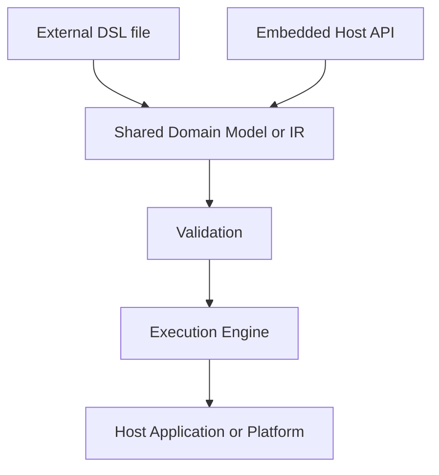

# DSL lai

Ngôn ngữ miền chuyên biệt (Domain-Specific Language, DSL) được thiết kế để diễn đạt công việc trong một miền cụ thể bằng các khái niệm gần với người sử dụng miền. Có DSL được nhúng bên trong một ngôn ngữ chủ, tận dụng cú pháp và công cụ của ngôn ngữ đó; có DSL độc lập với cú pháp và bộ phân tích riêng. **DSL lai (hybrid DSL)** kết hợp hai cách tiếp cận này trong cùng một giải pháp: một phần mô tả được viết bằng cú pháp DSL độc lập, phần khác được biểu đạt bằng API hoặc mã của ngôn ngữ chủ, hoặc người dùng có thể lựa chọn cả hai hình thức tùy theo nhiệm vụ.

Mục tiêu của cách kết hợp là cân bằng giữa khả năng đọc, tính khai báo và sự gần gũi với miền của DSL độc lập với tính linh hoạt, khả năng mở rộng và sức mạnh lập trình của DSL nhúng. Một cấu hình có thể mô tả cấu trúc và chính sách phổ biến bằng cú pháp dễ đọc, trong khi phần logic đặc biệt được viết bằng ngôn ngữ chủ hoặc gọi thư viện đã có.

DSL lai không có một cú pháp duy nhất hay một kiến trúc bắt buộc. Thuật ngữ này mô tả cách một hệ thống phối hợp nhiều hình thức biểu đạt. Điều quan trọng là các hình thức đó cùng tuân theo một mô hình miền và ngữ nghĩa được xác định rõ, để cùng một ý định không tạo ra kết quả khác nhau chỉ vì được viết ở hai nơi khác nhau.

## 1. Ôn lại DSL nhúng và DSL độc lập

Để hiểu DSL lai, cần phân biệt hai hình thức thường được kết hợp.

### 1.1. DSL nhúng (internal hoặc embedded DSL)

DSL nhúng được xây dựng bên trong một ngôn ngữ chủ (host language), thường thông qua hàm, đối tượng, toán tử, lambda hoặc API dạng fluent. Cú pháp của ngôn ngữ chủ vẫn chi phối cách viết, còn thư viện cung cấp các khái niệm và thao tác thuộc miền.

Ví dụ minh họa bằng Kotlin:

```kotlin
workflow {
    task("compile") {
        dependsOn("generate")
    }
    task("test") {
        dependsOn("compile")
    }
}
```

Khối `workflow` và các lời gọi `task`, `dependsOn` có thể là API của thư viện. Kotlin xử lý cú pháp, kiểu dữ liệu, lambda và kiểm tra tên; thư viện diễn giải lời gọi theo mô hình workflow.

Ưu điểm của DSL nhúng là có thể tái sử dụng compiler, hệ thống kiểu, thư viện, IDE và công cụ gỡ lỗi của ngôn ngữ chủ. Người viết có thể dùng vòng lặp, hàm và trừu tượng hóa khi cần. Hạn chế là cú pháp miền bị ràng buộc bởi ngôn ngữ chủ; người dùng thường phải hiểu ít nhất một phần ngôn ngữ lập trình đó.

### 1.2. DSL độc lập (external DSL)

DSL độc lập có ngữ pháp và cú pháp riêng, thường được viết trong tệp cấu hình hoặc tài liệu tách khỏi mã nguồn của ứng dụng. Hệ thống cần lexer/parser hoặc một bộ đọc định dạng để phân tích nó.

Ví dụ một DSL khai báo workflow:

```text
workflow "release" {
    task "generate" {}
    task "compile" {
        depends_on = ["generate"]
    }
    task "test" {
        depends_on = ["compile"]
    }
}
```

Cú pháp có thể được thiết kế gần với ngôn ngữ của miền và không phụ thuộc trực tiếp vào Java, Kotlin hay Python. Người dùng không chuyên lập trình có thể đọc cấu trúc khai báo dễ hơn. Đổi lại, nhóm phát triển phải duy trì ngữ pháp, parser, hệ thống kiểu hoặc kiểm tra ngữ nghĩa, thông báo lỗi và công cụ biên tập riêng.

| Khía cạnh | DSL nhúng | DSL độc lập |
|---|---|---|
| Cú pháp | Dựa trên ngôn ngữ chủ | Có ngữ pháp riêng |
| Công cụ | Tận dụng compiler và IDE của ngôn ngữ chủ | Cần công cụ hoặc hỗ trợ riêng cho DSL |
| Tính linh hoạt | Có thể dùng hàm, vòng lặp, thư viện của ngôn ngữ chủ | Bị giới hạn bởi những cấu trúc DSL cung cấp |
| Khả năng tiếp cận | Thường cần biết ngôn ngữ chủ | Có thể gần với chuyên gia miền hơn |
| Kiểm soát biểu đạt | Khó giới hạn hoàn toàn vì có thể thoát sang mã chủ | Có thể giới hạn cú pháp và khả năng thực thi rõ hơn |

## 2. DSL lai kết hợp những gì?

Một DSL lai kết hợp cú pháp độc lập với một hoặc nhiều khả năng của ngôn ngữ chủ. Sự kết hợp có thể diễn ra theo nhiều cách:

- **Cấu hình ngoài, logic trong:** tệp DSL mô tả cấu trúc, dữ liệu và quy tắc phổ biến; mã của ngôn ngữ chủ cung cấp hàm tùy chỉnh hoặc xử lý trường hợp đặc biệt.
- **DSL trong gọi DSL ngoài:** API nhúng tải, phân tích hoặc tạo tài liệu DSL độc lập rồi kết hợp kết quả vào chương trình.
- **Biểu thức chủ trong tài liệu DSL:** một số vị trí trong tệp DSL cho phép nhúng biểu thức hoặc lời gọi hàm của ngôn ngữ chủ.
- **Nhiều mặt cú pháp cho cùng mô hình:** người dùng có thể viết cùng một khái niệm bằng tệp khai báo hoặc bằng API nhúng; cả hai được chuyển về cùng mô hình miền.
- **Lõi khai báo và phần mở rộng lập trình:** phần lớn công việc dùng cấu trúc khai báo dễ đọc, còn plugin hoặc extension dùng mã chủ để mở rộng hành vi.

Ví dụ, hệ thống triển khai có thể cho phép người dùng khai báo dịch vụ, cổng và tài nguyên trong tệp cấu hình. Nếu một nhóm cần quy tắc đặt tên tài nguyên phức tạp, họ có thể viết hàm mở rộng bằng Kotlin hoặc Java và đăng ký hàm đó với bộ thực thi. Cả tệp cấu hình và hàm mở rộng đều tác động lên một mô hình triển khai chung.

Điểm cốt lõi của thiết kế lai là xác định rõ phần nào thuộc cú pháp DSL, phần nào thuộc ngôn ngữ chủ và cách hai phần trao đổi dữ liệu. Nếu ranh giới không rõ, người dùng phải đoán một biểu thức được đánh giá trong môi trường nào, biến nào có thể truy cập và lỗi sẽ xuất hiện ở đâu.

## 3. Các mẫu kiến trúc DSL lai

### 3.1. Tệp khai báo kết hợp hàm tùy chỉnh

Đây là mẫu phổ biến: tệp ngoài giữ cấu hình dễ đọc, còn mã chủ cung cấp những hành vi không thể hoặc không nên mô tả bằng DSL lõi.

Tệp DSL giả định:

```text
pipeline "daily-import" {
    source = "orders"
    destination = "warehouse"
    transform = custom("normalize-order")
}
```

Mã Kotlin đăng ký hàm xử lý:

```kotlin
registry.registerTransform("normalize-order") { row ->
    row.with("customerName", row["customerName"].trim())
}
```

Khi nạp pipeline, bộ thực thi phân giải tên `normalize-order` trong registry và gắn hàm vào bước biến đổi tương ứng. Tệp khai báo vẫn cho thấy cấu trúc luồng dữ liệu, còn phần xử lý đặc thù được viết trong ngôn ngữ lập trình đầy đủ.

### 3.2. API nhúng tạo hoặc mở rộng mô hình DSL ngoài

Một ứng dụng có thể dùng API của ngôn ngữ chủ để tải tệp DSL, thêm cấu hình theo môi trường hoặc tạo các thành phần có tính lặp lại.

```kotlin
val model = loadWorkflow("release.workflow")

model.configure {
    variable("targetRegion", environment.region)
    addTask("publish-metrics") {
        dependsOn("test")
    }
}

engine.run(model)
```

Ở đây, tệp ngoài lưu cấu hình dùng chung; mã Kotlin điều chỉnh mô hình theo môi trường chạy. API nên thay đổi mô hình đã được kiểm tra qua các thao tác miền được hỗ trợ, thay vì sửa chuỗi văn bản tùy ý.

### 3.3. Nhúng biểu thức của ngôn ngữ chủ

Một DSL có thể cho phép dùng biểu thức hoặc callback của ngôn ngữ chủ trong một số vị trí. Ví dụ, một cấu hình giao diện có thể khai báo bố cục trong DSL và gắn sự kiện bằng hàm JavaScript hoặc Kotlin.

```text
screen "profile" {
    title = "Thông tin cá nhân"
    button "save" {
        label = "Lưu"
        on_click = host("saveProfile")
    }
}
```

Trong ví dụ, `host("saveProfile")` là điểm liên kết đến hàm do ứng dụng đăng ký. DSL không nhất thiết cho phép viết tùy ý toàn bộ mã JavaScript bên trong tệp. Nó có thể chỉ cho phép tham chiếu đến những hàm đã đăng ký và có hợp đồng đầu vào/đầu ra cụ thể.

### 3.4. Nhiều giao diện cho cùng mô hình miền

Một nền tảng có thể cung cấp cả cú pháp tệp và API nhúng. Cả hai front end chuyển nội dung về cùng một biểu diễn trung gian hoặc mô hình miền:



Mẫu này hữu ích khi một nhóm muốn lưu cấu hình trong hệ thống quản lý phiên bản, còn nhóm khác muốn tạo cấu hình động bằng mã. Vì cả hai hình thức dùng chung ngữ nghĩa, backend không cần biết mô hình được tạo ra từ tệp hay API.

## 4. Ví dụ: cấu hình pipeline lai

Giả sử một nền tảng dữ liệu có DSL để mô tả pipeline. Tệp khai báo xác định các bước và quan hệ phụ thuộc:

```yaml
pipeline:
  name: daily-orders
  steps:
    - id: load
      type: read
      source: orders
    - id: normalize
      type: transform
      handler: normalize-order
      depends_on: [load]
    - id: store
      type: write
      target: warehouse
      depends_on: [normalize]
```

Ứng dụng Java đăng ký handler:

```java
registry.register("normalize-order", input -> {
    Order order = (Order) input;
    return order.withNormalizedCustomerName();
});

Pipeline pipeline = dslLoader.load("daily-orders.yml", registry);
pipelineRunner.run(pipeline);
```

Trong ví dụ này, YAML chỉ mô tả cấu trúc và tên handler. Java định nghĩa cách biến đổi dữ liệu. Bộ nạp đọc tệp, kiểm tra các bước, phân giải handler và tạo mô hình pipeline. Runtime thực thi các bước theo quan hệ phụ thuộc.

Cần có hợp đồng rõ ràng cho handler: kiểu đầu vào, kiểu đầu ra, lỗi có thể phát sinh, quyền truy cập dữ liệu và hành vi khi thử lại. Nếu handler có thể thay đổi dữ liệu bên ngoài, runtime cũng cần quy định giao dịch và cách tránh thực hiện một hiệu ứng hai lần khi một bước được chạy lại.

## 5. Vì sao chọn cách tiếp cận lai?

DSL lai hữu ích khi một hình thức biểu đạt đơn lẻ không đáp ứng tốt tất cả người dùng hoặc mọi loại yêu cầu.

**Giữ cấu hình phổ biến dễ đọc.** Những thông tin có cấu trúc ổn định như tên dịch vụ, thứ tự bước, giới hạn, ánh xạ trường hoặc chính sách đơn giản có thể nằm trong tệp DSL. Người đọc có thể xem xét thay đổi mà không phải đi sâu vào mã ứng dụng.

**Cho phép mở rộng bằng ngôn ngữ đầy đủ.** Những trường hợp cần thuật toán, thư viện chuyên dụng, tính toán phức tạp hoặc tích hợp đặc biệt có thể dùng hàm của ngôn ngữ chủ. Nhóm không phải bổ sung mọi khả năng lập trình vào ngữ pháp DSL.

**Phù hợp nhiều nhóm người dùng.** Chuyên gia miền có thể chỉnh sửa cấu hình khai báo; lập trình viên có thể xây dựng extension và tích hợp. Mỗi nhóm làm việc ở mức trừu tượng phù hợp với nhiệm vụ.

**Tái sử dụng hệ sinh thái hiện có.** Phần nhúng có thể dùng hệ thống kiểu, thư viện, kiểm thử và công cụ của ngôn ngữ chủ. Phần ngoài có thể được lưu, xem xét và triển khai như dữ liệu cấu hình.

**Hỗ trợ thay đổi theo môi trường.** Một mô hình khai báo chung có thể được điều chỉnh bằng mã chủ dựa trên môi trường, quyền hoặc thông tin chỉ có khi chạy.

## 6. Chi phí và rủi ro của DSL lai

Kết hợp hai hình thức cũng làm tăng số khái niệm mà người dùng và nhóm phát triển phải hiểu.

### 6.1. Hai ngữ cảnh cú pháp và lỗi

Người dùng có thể gặp lỗi parser của DSL, lỗi biên dịch của ngôn ngữ chủ hoặc lỗi khi runtime gọi extension. Thông báo cần chỉ ra lỗi thuộc phần nào và liên kết được với vị trí trong tệp hoặc hàm tương ứng.

### 6.2. Ngữ nghĩa không nhất quán

Nếu cùng một quy tắc được triển khai riêng trong parser, API nhúng và extension, các phiên bản có thể cho kết quả khác nhau. Cần đặt ngữ nghĩa cốt lõi trong một mô hình miền hoặc thư viện chung, rồi để các front end chuyển đổi về mô hình đó.

### 6.3. Phụ thuộc vào ngôn ngữ chủ

Một phần DSL lai có thể yêu cầu người dùng biết Java, Kotlin, Python hoặc ngôn ngữ khác. Điều này làm giảm khả năng tiếp cận đối với người chỉ muốn chỉnh sửa cấu hình. Cần giới hạn phần yêu cầu lập trình và cung cấp các thao tác dựng sẵn cho nhu cầu phổ biến.

### 6.4. Khả năng tái lập

Nếu kết quả phụ thuộc vào biến môi trường, thư viện cài trên máy hoặc mã extension thay đổi theo thời gian, cùng một tệp DSL có thể tạo ra kết quả khác nhau ở hai môi trường. Nên ghi nhận phiên bản extension, cấu hình, phụ thuộc và môi trường cần thiết để có thể tái tạo kết quả.

### 6.5. Bảo mật và độ tin cậy

Cho phép chạy mã của ngôn ngữ chủ đồng nghĩa với việc cấp quyền cho mã đó. Một tệp cấu hình được xem là dữ liệu có thể trở thành điểm khởi chạy mã nếu DSL cho phép biểu thức tùy ý. Với tệp do người dùng hoặc bên ngoài cung cấp, cần xác thực nguồn, giới hạn quyền, sandbox hoặc danh sách hàm được phép, giới hạn thời gian và tài nguyên. Không nên coi một tệp khai báo là an toàn nếu nó có thể gọi mã tùy ý.

### 6.6. Phiên bản và tương thích

Cú pháp tệp, API nhúng, mô hình miền và extension có thể phát triển ở tốc độ khác nhau. Cần quy định phiên bản DSL, phiên bản API, chính sách tương thích và cách xử lý extension không còn phù hợp. Một cấu hình cũ nên được phân tích với ngữ nghĩa phiên bản đã công bố, hoặc được chuyển đổi có kiểm soát.

## 7. Nguyên tắc thiết kế ranh giới lai

Một DSL lai tốt cần làm rõ trách nhiệm của từng hình thức biểu đạt.

- **Đặt phần khai báo vào DSL ngoài:** cấu trúc, tham số, quan hệ và chính sách phổ biến nên dễ đọc, dễ so sánh và dễ kiểm tra trong tệp.
- **Đặt thuật toán đặc thù vào ngôn ngữ chủ:** chỉ dùng extension khi thực sự cần khả năng lập trình hoặc thư viện bên ngoài.
- **Dùng mô hình miền chung:** cả parser ngoài và API nhúng nên tạo cùng một kiểu mô hình hoặc IR.
- **Quy định điểm mở rộng rõ ràng:** tên handler, kiểu dữ liệu, hợp đồng lỗi, quyền và vòng đời của extension cần được công bố.
- **Tránh nhúng mã tùy ý không cần thiết:** cung cấp callback hoặc hàm đã đăng ký khi chỉ cần một số hành vi có giới hạn.
- **Giữ chẩn đoán xuyên suốt:** lỗi phải chỉ ra nguồn là tệp DSL, lời gọi API hay mã extension.
- **Quản lý phiên bản:** ràng buộc phiên bản schema, runtime và extension để kết quả có thể tái lập.
- **Kiểm soát hiệu ứng phụ:** quy định ai được phép đọc, ghi hoặc gọi dịch vụ bên ngoài và cách xử lý thử lại.

Ranh giới nên được xác định từ công việc thực tế. Nếu người dùng thường xuyên phải viết mã chủ chỉ để khai báo những cấu trúc phổ biến, DSL ngoài có thể đang thiếu khái niệm miền. Nếu tệp DSL chứa nhiều đoạn mã nhúng phức tạp, có thể phần khai báo chưa đủ hoặc phần logic nên chuyển về thư viện của ứng dụng.

## 8. Quy trình thiết kế và triển khai DSL lai

Có thể triển khai theo các bước sau:

1. **Xác định người dùng và nhiệm vụ:** phân loại phần việc nào là cấu hình thường xuyên, phần nào cần logic lập trình hoặc tích hợp.
2. **Thiết kế mô hình miền:** xác định đối tượng, thuộc tính, quan hệ, quy tắc và các thao tác hợp lệ.
3. **Chọn phần biểu đạt ngoài:** xây dựng cú pháp cho cấu trúc và chính sách phổ biến, có thể phân tích và kiểm tra độc lập.
4. **Thiết kế API nhúng:** cung cấp hàm hoặc extension cho các hành vi đặc thù, với kiểu và hợp đồng rõ ràng.
5. **Xây dựng mô hình trung gian chung:** chuyển tệp DSL và lời gọi API về cùng mô hình để tránh hai cách thực thi khác nhau.
6. **Xác định chính sách runtime:** quy định thứ tự xử lý, dữ liệu đầu vào, hiệu ứng phụ, quyền, giới hạn tài nguyên và xử lý lỗi.
7. **Xây dựng công cụ:** hỗ trợ parser, kiểm tra tĩnh, gợi ý, tài liệu, định dạng và thông báo lỗi có vị trí nguồn.
8. **Kiểm thử hai hướng:** xác nhận tệp ngoài và API nhúng tạo ra cùng kết quả cho cùng một mô hình, đồng thời kiểm thử extension và tích hợp.
9. **Quản lý phiên bản:** xác định schema, API, runtime và cách chuyển đổi khi có thay đổi.

Việc kiểm thử hai hướng đặc biệt quan trọng. Nếu một pipeline được tạo từ tệp và một pipeline tương đương được tạo từ API nhúng, chúng nên có cùng mô hình chuẩn hóa và hành vi. Điều này kiểm tra rằng hai giao diện thực sự là hai cách diễn đạt của cùng một DSL.

## 9. Khi nào nên dùng DSL lai?

DSL lai phù hợp khi có nhiều nhóm người dùng với nhu cầu khác nhau, khi phần lớn công việc có cấu trúc nhưng một số trường hợp cần mở rộng bằng mã, hoặc khi một nền tảng cần hỗ trợ cả cấu hình lưu trữ lẫn tạo mô hình động.

| Tình huống | Cách tiếp cận có thể phù hợp |
|---|---|
| Người dùng chủ yếu khai báo cấu trúc cố định | DSL độc lập |
| Người dùng đều là lập trình viên và cần trừu tượng hóa nhỏ | DSL nhúng |
| Cấu hình phổ biến cần dễ đọc, nhưng có logic đặc thù | DSL lai |
| Nhiều hệ thống cần tạo cùng một mô hình bằng các cách khác nhau | DSL lai với mô hình miền chung |
| Tệp do người dùng không tin cậy cung cấp và không cần logic tùy ý | DSL độc lập có khả năng biểu đạt giới hạn |
| Hầu hết cấu hình đều trở thành mã chủ phức tạp | Xem xét lại ranh giới hoặc dùng thư viện/API thông thường |

Không nên chọn DSL lai chỉ vì có thể kết hợp nhiều cú pháp. Mỗi hình thức bổ sung đều tạo chi phí về tài liệu, kiểm thử, phiên bản, bảo mật và hỗ trợ. Nếu một DSL độc lập đã giải quyết tốt công việc hoặc một API nhúng đã đủ tự nhiên, thêm hình thức thứ hai có thể làm hệ thống khó học hơn.

## 10. Một số ví dụ thực tế về cách kết hợp

Các công cụ và hệ sinh thái phần mềm thường phối hợp cấu hình khai báo với mã của ngôn ngữ chủ theo nhiều mức độ khác nhau:

- **Hệ thống build:** cấu hình build có thể được viết bằng DSL nhúng trong Groovy hoặc Kotlin, đồng thời sử dụng tệp thuộc tính, plugin và mã của ngôn ngữ chủ để tùy biến theo dự án.
- **Truy vấn dữ liệu:** ứng dụng có thể dùng SQL viết trong chuỗi hoặc tệp truy vấn, kết hợp với API Java/Python để truyền tham số, ánh xạ kết quả và điều phối giao dịch.
- **Pipeline dữ liệu:** tệp YAML/JSON mô tả nguồn, đích và thứ tự bước; hàm Python hoặc Java xử lý biến đổi đặc thù.
- **Template và giao diện:** tài liệu template mô tả cấu trúc hiển thị, trong khi hàm của ứng dụng cung cấp dữ liệu và hành vi sự kiện.

Đây là những mẫu kết hợp thường gặp, không có nghĩa mọi công cụ trong nhóm đều tự nhận mình là một DSL lai theo cùng một định nghĩa. Khi phân tích một hệ thống cụ thể, cần xem xét ngữ pháp, API và runtime thực tế để xác định phần nào là DSL, phần nào là cấu hình và phần nào là mã ứng dụng.

## 11. Đánh giá một thiết kế DSL lai

Khi xem xét một thiết kế, hãy kiểm tra những câu hỏi sau:

- Người đọc có thể nhận ra phần nào là khai báo miền và phần nào là mã của ngôn ngữ chủ không?
- Có thể hiểu kết quả của chương trình mà không phải chạy extension không?
- Hai cách viết có cùng ngữ nghĩa và cùng quy tắc xác thực không?
- API extension có kiểu dữ liệu, quyền và hợp đồng lỗi rõ ràng không?
- Có thể kiểm tra tệp DSL độc lập trước khi thực thi không?
- Thông báo lỗi có chỉ được vị trí và nguồn phát sinh không?
- Có thể tái tạo kết quả với cùng phiên bản DSL, runtime và extension không?
- Mã tùy chỉnh có bị giới hạn quyền và tài nguyên phù hợp không?

Một thiết kế thành công giữ phần khai báo dễ đọc và cung cấp điểm mở rộng vừa đủ cho những trường hợp đặc biệt. Mô hình miền chung là nền tảng để các hình thức cú pháp phối hợp nhất quán. Khi ranh giới giữa tệp DSL, API chủ và runtime được xác định rõ, DSL lai có thể phục vụ cả nhu cầu cấu hình dễ hiểu lẫn nhu cầu lập trình linh hoạt mà vẫn duy trì được khả năng kiểm soát, kiểm thử và phát triển lâu dài.
