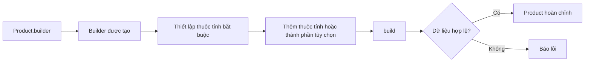

# Mẫu Builder

Trong thiết kế **Internal Domain-Specific Language (Internal DSL)**, mẫu **Builder** là một cách tổ chức API để người dùng mô tả đối tượng hoặc quy tắc miền bằng chuỗi lời gọi có thứ tự, dễ đọc. Thay vì truyền nhiều tham số vào constructor hoặc tạo đối tượng rồi gọi hàng loạt setter, người dùng gọi các phương thức có tên gần với ngôn ngữ nghiệp vụ, sau đó kết thúc bằng `build()` để nhận kết quả hoàn chỉnh.

Builder thường được biết đến như một mẫu thiết kế khởi tạo đối tượng. Khi được thiết kế với các phương thức fluent, nó còn có thể tạo thành cú pháp của một Internal DSL. Ví dụ, lời gọi `Order.builder().customer(...).item(...).shippingTo(...).build()` vừa tạo một đối tượng `Order`, vừa diễn đạt các bước cấu thành đơn hàng theo cách gần với nghiệp vụ.

## 1. Builder giải quyết vấn đề gì?

Một đối tượng miền có thể có nhiều thuộc tính, một số bắt buộc, một số tùy chọn và một số có quan hệ phụ thuộc. Nếu dùng constructor có quá nhiều tham số, lời gọi dễ khó đọc và người gọi có thể truyền nhầm giá trị cùng kiểu dữ liệu.

```java
Order order = new Order(
    "C-1024",
    "12 Nguyen Hue, Ho Chi Minh City",
    true,
    "BOOK-01",
    2,
    new BigDecimal("120000")
);
```

Nhìn vào lời gọi này, người đọc phải nhớ thứ tự và ý nghĩa của từng tham số. Khi có thêm thuộc tính, constructor tiếp tục dài ra hoặc phải tạo nhiều overload.

Một lựa chọn khác là tạo đối tượng rỗng rồi gọi setter:

```java
Order order = new Order();
order.setCustomerId("C-1024");
order.setShippingAddress("12 Nguyen Hue, Ho Chi Minh City");
order.setPriority(true);
order.setItem("BOOK-01", 2, new BigDecimal("120000"));
```

Cách này dễ đọc hơn về tên thuộc tính nhưng đối tượng có thể tồn tại trong trạng thái chưa hợp lệ giữa các lần gọi. Nếu quên một setter bắt buộc, lỗi có thể chỉ xuất hiện muộn hơn khi đối tượng được sử dụng.

Builder giải quyết các vấn đề đó bằng cách:

- Đặt tên cho từng giá trị hoặc thao tác cấu thành đối tượng.
- Cho phép chỉ định thuộc tính tùy chọn mà không cần nhiều constructor overload.
- Gom việc kiểm tra tính hợp lệ vào một điểm hoàn tất, thường là `build()`.
- Tạo đối tượng kết quả bất biến hoặc hạn chế thay đổi sau khi tạo.
- Cho phép API được đọc như một chuỗi mô tả trong ngôn ngữ của miền.

## 2. Cấu trúc cơ bản của mẫu Builder

Mẫu Builder thường có các thành phần sau:

1. **Product**: đối tượng cuối cùng cần tạo, ví dụ `Order`, `Query`, `DeploymentPlan` hoặc `Report`.
2. **Builder**: đối tượng trung gian lưu các giá trị và cung cấp các phương thức để cấu hình Product.
3. **Fluent methods**: các phương thức trả về builder hiện tại để có thể nối tiếp lời gọi.
4. **Build operation**: phương thức hoàn tất việc kiểm tra và tạo Product.

Luồng khởi tạo tổng quát:



Một Builder đơn giản có thể có dạng:

```java
Report report = Report.builder()
    .title("Monthly sales")
    .period(startDate, endDate)
    .includeDetails(true)
    .build();
```

Mỗi lời gọi mô tả một phần của cấu hình. `build()` là ranh giới giữa giai đoạn khai báo và đối tượng đã được tạo. API có thể chọn không cho phép sử dụng builder sau khi build, hoặc cho phép gọi `build()` nhiều lần để tạo nhiều Product từ cùng một cấu hình; hành vi này cần được định nghĩa rõ.

## 3. Fluent API biến Builder thành Internal DSL

Một API được gọi là *fluent* khi các phương thức được đặt tên và tổ chức để lời gọi liên tiếp dễ đọc như một câu mô tả. Builder thường hỗ trợ phong cách này bằng cách trả về `this` sau khi cập nhật trạng thái builder.

```java
Order order = Order.builder()
    .customer("C-1024")
    .item("BOOK-01", 2, new BigDecimal("120000"))
    .shippingTo("12 Nguyen Hue, Ho Chi Minh City")
    .priority()
    .build();
```

Đoạn mã trên có thể đọc như một khai báo nghiệp vụ: tạo đơn hàng cho khách hàng, thêm mặt hàng, chọn địa chỉ giao và đánh dấu ưu tiên. Người đọc không cần quan tâm đối tượng builder lưu dữ liệu bằng danh sách hay biến nội bộ nào.

Để fluent API thực sự trở thành một Internal DSL tốt, tên phương thức cần phản ánh từ vựng của miền. Ví dụ, `.shippingTo(...)` thường dễ hiểu hơn `.setAddress(...)` trong một DSL đặt hàng; `.after("build")` có thể tự nhiên hơn `.addDependency("build")` trong DSL mô tả quy trình. Việc chọn tên phụ thuộc người dùng và khái niệm miền, không chỉ sở thích của người viết API.

Fluent API cũng cần có quy tắc ghép lời gọi nhất quán. Nếu phương thức lúc trả về builder, lúc trả về Product mà không có lý do rõ ràng, người dùng sẽ khó biết bước tiếp theo có thể gọi là gì. Phương thức kết thúc như `build()`, `execute()` hoặc `compile()` nên thể hiện rõ thời điểm chuyển sang hành động tiếp theo.

## 4. Ví dụ Java: xây dựng một đơn hàng

Ví dụ sau dùng Java 17 để mô tả một `Order` bất biến. Đơn hàng có khách hàng, danh sách mặt hàng, địa chỉ giao hàng và cờ ưu tiên. Builder thu thập dữ liệu, kiểm tra các điều kiện cần thiết rồi tạo đối tượng hoàn chỉnh.

```java
import java.math.BigDecimal;
import java.util.ArrayList;
import java.util.List;
import java.util.Objects;

public record Order(
        String customerId,
        List<OrderLine> lines,
        String shippingAddress,
        boolean priority) {

    public Order {
        if (customerId == null || customerId.isBlank()) {
            throw new IllegalArgumentException("customerId is required");
        }
        if (lines == null || lines.isEmpty()) {
            throw new IllegalArgumentException("An order needs at least one item");
        }
        if (shippingAddress == null || shippingAddress.isBlank()) {
            throw new IllegalArgumentException("shippingAddress is required");
        }

        // Không để bên gọi thay đổi danh sách sau khi Order được tạo.
        lines = List.copyOf(lines);
    }

    public static Builder builder() {
        return new Builder();
    }

    public record OrderLine(
            String sku,
            int quantity,
            BigDecimal unitPrice) {

        public OrderLine {
            if (sku == null || sku.isBlank()) {
                throw new IllegalArgumentException("sku is required");
            }
            if (quantity <= 0) {
                throw new IllegalArgumentException("quantity must be positive");
            }
            Objects.requireNonNull(unitPrice, "unitPrice is required");
            if (unitPrice.signum() < 0) {
                throw new IllegalArgumentException("unitPrice cannot be negative");
            }
        }
    }

    public static final class Builder {
        private String customerId;
        private final List<OrderLine> lines = new ArrayList<>();
        private String shippingAddress;
        private boolean priority;

        private Builder() {
        }

        public Builder customer(String customerId) {
            this.customerId = customerId;
            return this;
        }

        public Builder item(String sku, int quantity, BigDecimal unitPrice) {
            lines.add(new OrderLine(sku, quantity, unitPrice));
            return this;
        }

        public Builder shippingTo(String address) {
            this.shippingAddress = address;
            return this;
        }

        public Builder priority() {
            this.priority = true;
            return this;
        }

        public Builder standardDelivery() {
            this.priority = false;
            return this;
        }

        public Order build() {
            return new Order(
                    customerId,
                    lines,
                    shippingAddress,
                    priority
            );
        }
    }
}
```

Sử dụng Builder:

```java
Order order = Order.builder()
    .customer("C-1024")
    .item("BOOK-01", 2, new BigDecimal("120000"))
    .item("PEN-02", 5, new BigDecimal("8000"))
    .shippingTo("12 Nguyen Hue, Ho Chi Minh City")
    .priority()
    .build();
```

Ở đây, `Order` là Product; `Order.Builder` là Builder. Các phương thức `customer`, `item`, `shippingTo` và `priority` là các từ vựng của Internal DSL. `build()` kiểm tra điều kiện thông qua constructor của record và tạo một `Order` mới. `List.copyOf` bảo vệ danh sách bên trong khỏi việc bị thay đổi thông qua tham chiếu bên ngoài.

Ví dụ cũng thể hiện một nguyên tắc quan trọng: builder có thể thay đổi trong lúc cấu hình, nhưng Product sau khi tạo nên có trạng thái ổn định. Nếu đối tượng miền cần bất biến, không nên trả ra một danh sách có thể sửa trực tiếp hoặc để builder tiếp tục thay đổi Product đã được tạo.

## 5. Thiết kế các bước và điều kiện hợp lệ

Builder có thể cho phép gọi các phương thức theo nhiều thứ tự. Điều này linh hoạt, nhưng có thể tạo ra lời gọi không hợp lệ hoặc khó hiểu. Ví dụ, `build()` được gọi khi chưa có khách hàng hoặc địa chỉ giao hàng. Có hai cách phổ biến để xử lý.

### 5.1. Kiểm tra khi gọi build

Cách đơn giản là cho phép cấu hình theo bất kỳ thứ tự nào, sau đó kiểm tra tất cả điều kiện trong `build()` hoặc constructor của Product.

```java
Order order = Order.builder()
    .item("BOOK-01", 1, new BigDecimal("120000"))
    .customer("C-1024")
    .shippingTo("12 Nguyen Hue")
    .build();
```

Ưu điểm là API dễ triển khai và người dùng có thể sắp xếp lời gọi theo cách họ thấy tự nhiên. Nhược điểm là một số lỗi chỉ được phát hiện khi gọi `build()`, tức là lúc cuối chuỗi cấu hình.

### 5.2. Step Builder

**Step Builder** chia quá trình xây dựng thành các interface hoặc kiểu khác nhau, mỗi kiểu chỉ cung cấp những phương thức hợp lệ ở bước hiện tại. Cách này có thể buộc các thuộc tính bắt buộc phải được cung cấp theo một thứ tự xác định ngay từ lúc biên dịch.

Ví dụ rút gọn:

```java
interface CustomerStep {
    ItemStep customer(String customerId);
}

interface ItemStep {
    ItemStep item(String sku, int quantity);
    ShippingStep finishItems();
}

interface ShippingStep {
    BuildStep shippingTo(String address);
}

interface BuildStep {
    BuildStep priority();
    Order build();
}
```

Một API khởi đầu có thể trả về `CustomerStep`; sau khi cung cấp khách hàng, người dùng nhận `ItemStep`, rồi phải hoàn tất danh sách mặt hàng và cung cấp địa chỉ trước khi có thể gọi `build()`.

Step Builder giúp hướng dẫn người dùng bằng hệ thống kiểu, nhưng số lượng interface và kiểu triển khai tăng lên. Nó phù hợp khi thứ tự hoặc các trường bắt buộc là một phần quan trọng của hợp đồng API. Với DSL nhỏ hoặc cấu hình có nhiều thứ tự hợp lệ, Builder thông thường kết hợp validation thường dễ bảo trì hơn.

## 6. Builder lồng nhau cho cấu trúc phức tạp

Một số DSL tạo ra cấu trúc gồm nhiều đối tượng con. Ví dụ, `DeploymentPlan` có nhiều `Service`, mỗi service có image, port và biến môi trường. Có thể dùng builder lồng nhau để thể hiện cấu trúc đó.

```java
DeploymentPlan plan = DeploymentPlan.builder()
    .environment("staging")
    .service("api", service -> service
        .image("example/api:2.1")
        .port(8080)
        .environment("LOG_LEVEL", "INFO"))
    .service("worker", service -> service
        .image("example/worker:2.1")
        .environment("QUEUE", "orders"))
    .build();
```

Trong cách viết này, lambda nhận builder của đối tượng con. Người dùng có thể mô tả cấu trúc lồng nhau mà không cần tạo biến trung gian cho từng builder. Kiểu API này thường được gọi là nested builder hoặc lambda-based builder.

Một biến thể khác trả về builder con rồi yêu cầu gọi `end()` để quay lại builder cha:

```java
planBuilder.service("api")
    .image("example/api:2.1")
    .port(8080)
    .end()
    .service("worker")
    .image("example/worker:2.1")
    .end()
    .build();
```

Phương thức `end()` phải có ngữ nghĩa rõ: nó hoàn tất đối tượng con và trả về builder cha. Cần tránh giữ tham chiếu đến builder con sau khi `end()` nếu việc sửa đổi tiếp tục có thể làm thay đổi đối tượng đã được thêm vào builder cha.

Builder lồng nhau đặc biệt hữu ích khi cấu trúc DSL có quan hệ cha-con rõ ràng như truy vấn với điều kiện, pipeline với bước, form với field hoặc cấu hình dịch vụ với tài nguyên.

## 7. Builder có thể tạo AST hoặc mô hình miền

Builder không nhất thiết phải tạo ngay đối tượng nghiệp vụ cuối cùng. Trong kiến trúc DSL, nó cũng có thể tạo một **Abstract Syntax Tree (AST)** hoặc một mô hình khai báo để xử lý ở giai đoạn sau.

Ví dụ một Internal DSL mô tả quy tắc:

```java
Rule rule = rule("eligible-customer")
    .when(customer -> customer.age() >= 18)
    .and(customer -> customer.isActive())
    .then(customer -> customer.markEligible())
    .build();
```

Lời gọi có thể xây dựng một cấu trúc biểu diễn gồm:

- Tên quy tắc `eligible-customer`.
- Các điều kiện `age >= 18` và `isActive`.
- Hành động `markEligible` khi điều kiện thỏa mãn.

Sau khi tạo mô hình, engine có thể kiểm tra, tối ưu, lưu trữ, diễn giải hoặc chuyển đổi quy tắc. Cách làm này tách **khai báo quy tắc** khỏi **thực thi quy tắc**. Người dùng mô tả điều cần làm, còn engine quyết định thời điểm và cách thực hiện.

Đây là điểm quan trọng khi dùng Builder làm nền tảng cho Internal DSL: fluent API là cú pháp bề mặt, builder tạo ra mô hình có cấu trúc, còn runtime hoặc compiler xử lý mô hình đó.


Nếu builder gọi trực tiếp các dịch vụ và tạo tác dụng phụ trong từng phương thức, chuỗi lời gọi có thể khó kiểm tra trước khi thực thi. Với DSL cần preview, validate, lưu cấu hình hoặc chạy lại nhiều lần, tạo mô hình trước rồi xử lý sau thường linh hoạt hơn.

## 8. Builder và các mẫu khởi tạo đối tượng khác

Builder thường được so sánh với constructor, static factory và setter. Mỗi cách phù hợp với mức độ phức tạp khác nhau.

| Cách khởi tạo | Điểm mạnh | Hạn chế | Phù hợp khi |
|---|---|---|---|
| Constructor | Trực tiếp, đơn giản | Nhiều tham số khó đọc; nhiều overload | Ít tham số và cấu trúc ổn định |
| Static factory | Tên hàm diễn đạt mục đích; có thể trả về subtype | Vẫn có thể nhiều tham số | Có vài cách tạo rõ ràng |
| Setter | Dễ cấu hình từng thuộc tính | Có thể tạo trạng thái chưa hợp lệ | Đối tượng mutable và vòng đời cho phép cấu hình dần |
| Builder | Dễ đọc với nhiều thuộc tính, hỗ trợ tùy chọn và validation tập trung | Thêm kiểu và mã triển khai | Đối tượng phức tạp hoặc DSL cần fluent API |

Builder không nên được áp dụng máy móc cho mọi đối tượng. Với một value object chỉ có hai thuộc tính bắt buộc, constructor hoặc static factory thường ngắn gọn hơn. Builder tạo giá trị khi số lượng lựa chọn lớn, cấu trúc lồng nhau hoặc ngôn ngữ cần một chuỗi khai báo rõ ràng.

## 9. Các nguyên tắc thiết kế Builder tốt

### 9.1. Phân biệt thuộc tính bắt buộc và tùy chọn

Các thuộc tính bắt buộc cần được kiểm tra rõ ràng. Có thể yêu cầu chúng trong constructor của Builder, thông qua Step Builder hoặc kiểm tra khi `build()`. Thuộc tính tùy chọn nên có mặc định được tài liệu hóa.

Không nên để giá trị mặc định mơ hồ. Ví dụ, `timeout = 0` có thể mang nghĩa không chờ, dùng giá trị mặc định của hệ thống hoặc không giới hạn. DSL cần quy định một cách hiểu nhất quán.

### 9.2. Giữ Product ở trạng thái hợp lệ

Validation trong builder hữu ích nhưng Product vẫn nên bảo vệ các bất biến của chính nó. Nếu Product có thể được tạo từ nơi khác, constructor hoặc factory của Product cần đảm bảo những điều kiện không được phép vi phạm.

### 9.3. Trả về kiểu phù hợp

Các phương thức cấu hình thường trả về builder để nối lời gọi. Phương thức kết thúc nên trả về Product hoặc mô hình được xây dựng. Tránh trả về `Object` hoặc một kiểu tổng quát làm mất thông tin kiểu cần thiết.

### 9.4. Bảo vệ dữ liệu mutable

Nếu builder lưu danh sách hoặc map, Product nên sao chép hoặc tạo collection bất biến khi build. Nếu builder được tái sử dụng, cần quyết định `build()` có tạo snapshot độc lập hay chia sẻ cấu trúc dữ liệu với builder.

### 9.5. Không để builder có quá nhiều trách nhiệm

Builder nên tập trung thu thập cấu hình và tạo Product. Logic truy cập database, gọi mạng hoặc thực thi nghiệp vụ phức tạp thường thuộc service hoặc runtime. Giữ ranh giới này giúp API dễ kiểm thử và có thể dùng lại mô hình đã tạo.

### 9.6. Thiết kế method chain dễ đọc

Tên phương thức cần nhất quán về ngữ pháp và mức độ trừu tượng. Tránh trộn lẫn tên setter kỹ thuật như `setX` với từ vựng nghiệp vụ như `deliverTo` nếu không có quy ước rõ. Không nên tạo quá nhiều alias chỉ khác tên nhưng cùng hành vi.

### 9.7. Xác định khả năng tái sử dụng builder

Một Builder có thể được dùng một lần hoặc nhiều lần. Nếu được tái sử dụng, `build()` nên tạo Product độc lập từ trạng thái hiện tại và không để việc sửa builder làm thay đổi Product đã tạo. Nếu builder là đối tượng dùng một lần, có thể đánh dấu trạng thái đã build và từ chối các lời gọi tiếp theo để tránh nhầm lẫn.

## 10. Những vấn đề thường gặp

| Vấn đề | Hệ quả | Cách xử lý |
|---|---|---|
| Builder cho phép thiếu trường bắt buộc | Product chỉ lỗi khi được sử dụng | Kiểm tra tại `build()` hoặc dùng Step Builder |
| Có quá nhiều phương thức cấu hình trùng nghĩa | DSL khó học và khó duy trì | Chuẩn hóa từ vựng miền và tên method |
| `build()` trả về đối tượng còn mutable ngoài ý muốn | Trạng thái có thể thay đổi sau khi xác nhận | Sao chép collection và bảo vệ invariant |
| Builder gọi dịch vụ bên ngoài ngay khi cấu hình | Khó validate, preview và chạy lại | Tạo mô hình trước, thực thi ở bước riêng |
| Nested builder không có ranh giới hoàn tất rõ | Người dùng không biết khi nào quay về cấu trúc cha | Dùng lambda hoặc `end()` với hợp đồng rõ ràng |
| Dùng Builder cho đối tượng rất đơn giản | Mã triển khai nhiều hơn lợi ích | Dùng constructor hoặc static factory |
| Cho phép thứ tự lời gọi tùy ý dù nghiệp vụ yêu cầu thứ tự | Có thể tạo cấu hình sai | Dùng Step Builder hoặc validation theo trạng thái |

## 11. Kiểm thử và tài liệu hóa Internal DSL dùng Builder

Vì fluent API là cú pháp của DSL, việc kiểm thử cần xem xét cả kết quả lẫn cách người dùng tương tác với API.

- **Kiểm thử Product**: xác nhận các giá trị sau `build()` đúng như cấu hình.
- **Kiểm thử validation**: xác nhận thiếu trường bắt buộc, dữ liệu sai kiểu hoặc vi phạm quy tắc miền tạo lỗi phù hợp.
- **Kiểm thử mặc định**: bảo đảm thuộc tính không được chỉ định có giá trị và ý nghĩa như tài liệu.
- **Kiểm thử tính bất biến**: thay đổi collection đầu vào sau khi build không làm thay đổi Product đã tạo.
- **Kiểm thử chuỗi lời gọi**: xác nhận các tổ hợp phương thức hợp lệ tạo ra mô hình đúng và những tổ hợp bị cấm được phát hiện.
- **Kiểm thử tương thích API**: nếu người dùng viết DSL trong nhiều module hoặc dự án, thay đổi tên method hoặc kiểu trả về có thể là thay đổi phá vỡ tương thích.

Tài liệu nên có một ví dụ ngắn hoàn chỉnh, giải thích thứ tự lời gọi, trường bắt buộc, giá trị mặc định, hành vi khi `build()` thất bại và các phương thức lồng nhau. Người dùng nên có thể hiểu cách viết một cấu hình phổ biến bằng cách đọc ví dụ mà không phải xem mã nguồn của Builder.

## 12. Khi nào nên dùng Builder trong Internal DSL?

Builder đặc biệt phù hợp khi:

- Đối tượng hoặc mô hình miền có nhiều thuộc tính tùy chọn.
- Quá trình tạo có nhiều bước hoặc thành phần lồng nhau.
- Tên phương thức có thể phản ánh trực tiếp từ vựng nghiệp vụ.
- Cần kiểm tra nhiều điều kiện trước khi tạo đối tượng cuối cùng.
- Muốn tạo AST hoặc mô hình khai báo để validate, lưu trữ, diễn giải hay sinh mã sau đó.
- Người dùng cần đọc và review cấu hình như một chuỗi mô tả có cấu trúc.

Builder ít cần thiết khi đối tượng có ít tham số, constructor đã rõ nghĩa hoặc việc xây dựng chỉ là một phép chuyển đổi đơn giản. Cũng cần cân nhắc giải pháp khác nếu người dùng cần cú pháp hoàn toàn độc lập với Java, vì Builder vẫn chịu giới hạn cú pháp của ngôn ngữ chủ.

Mẫu Builder vì vậy vừa là kỹ thuật khởi tạo đối tượng vừa là nền tảng hữu ích để tạo Internal DSL. Khi các method được đặt tên theo ngôn ngữ miền, các bước cấu hình được tổ chức nhất quán và `build()` tạo ra mô hình hợp lệ, mã Java có thể diễn đạt quy tắc hoặc cấu trúc nghiệp vụ theo cách dễ đọc, kiểm tra và bảo trì.
