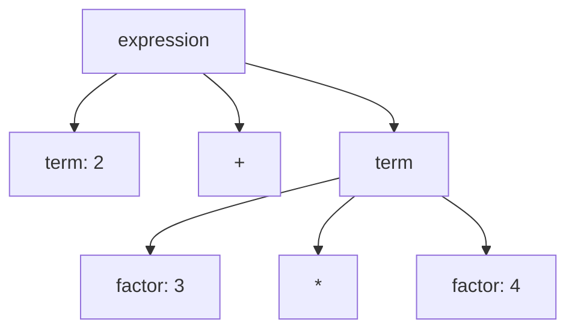

# Tránh mơ hồ cú pháp

Khi thiết kế ngôn ngữ miền chuyên biệt (Domain-Specific Language, DSL), cú pháp cần giúp người viết diễn đạt ý định rõ ràng và giúp công cụ xác định được cấu trúc chương trình một cách nhất quán. **Mơ hồ cú pháp (syntactic ambiguity)** xảy ra khi một chuỗi đầu vào có thể được phân tích theo nhiều cấu trúc cú pháp khác nhau theo cùng một ngữ pháp. Nếu DSL không quy định cách hiểu duy nhất, người đọc, parser, công cụ định dạng và runtime có thể hiểu cùng một đoạn mã theo những cách khác nhau.

Tránh mơ hồ không chỉ là việc viết một parser không báo lỗi. Một DSL cần có quy tắc rõ về từ vựng, cấu trúc câu lệnh, độ ưu tiên và tính kết hợp của toán tử, phạm vi khối, từ khóa và các trường hợp đặc biệt. Khi những quy tắc đó được xác định tốt, chương trình dễ đọc, dễ phân tích, dễ sửa lỗi và có thể được xử lý nhất quán qua các công cụ.

## 1. Mơ hồ cú pháp là gì?

Một ngữ pháp được xem là mơ hồ nếu tồn tại ít nhất một chuỗi hợp lệ có nhiều hơn một cây phân tích (parse tree) khác nhau. Nói cách khác, cùng một chuỗi token có thể được cấu trúc thành nhiều cách hiểu mà ngữ pháp không phân biệt được.

Ví dụ, xét biểu thức:

```text
2 + 3 * 4
```

Nếu ngữ pháp không quy định độ ưu tiên, biểu thức có thể được nhóm theo hai cách:

```text
(2 + 3) * 4
2 + (3 * 4)
```

Hai cách nhóm tạo kết quả khác nhau. Quy ước toán học thông thường cho phép phép nhân có độ ưu tiên cao hơn phép cộng, nên cách hiểu mong muốn là `2 + (3 * 4)`. DSL phải đưa quy tắc này vào ngữ pháp hoặc quy tắc phân tích một cách tường minh.

Mơ hồ có thể xuất hiện ở nhiều cấp độ:

- **Từ vựng:** một chuỗi ký tự có thể được chia thành các token khác nhau.
- **Cú pháp:** một chuỗi token có thể tạo thành nhiều cây phân tích.
- **Ngữ nghĩa:** cấu trúc cú pháp đã rõ nhưng ý nghĩa nghiệp vụ vẫn có thể không xác định hoặc phụ thuộc ngữ cảnh chưa được mô tả.

Ba vấn đề này liên quan nhưng không giống nhau. Lexer xử lý ranh giới token; parser xử lý cấu trúc; phân tích ngữ nghĩa xử lý ý nghĩa và quy tắc miền.

## 2. Phân biệt mơ hồ từ vựng, cú pháp và ngữ nghĩa

### 2.1. Mơ hồ từ vựng

Mơ hồ từ vựng xảy ra khi cách chia chuỗi ký tự thành token không rõ ràng. Ví dụ, DSL có toán tử `>` và `>=`. Khi lexer đọc `>=`, nó cần nhận ra đây là một token duy nhất thay vì hai token `>` và `=`.

Một quy tắc phổ biến là *longest match* (chọn chuỗi khớp dài nhất): lexer ưu tiên token dài nhất hợp lệ tại vị trí hiện tại. Với các toán tử như `=`, `==`, `!=`, `<`, `<=`, `>`, `>=`, quy tắc này giúp kết quả token hóa nhất quán.

Tên định danh và từ khóa cũng có thể gây nhầm lẫn. Nếu `order` là từ khóa, DSL cần quyết định liệu người dùng có thể đặt tên biến hoặc trường là `order` hay không. Một số ngôn ngữ dành riêng từ khóa hoàn toàn; một số dùng từ khóa ngữ cảnh, chỉ có ý nghĩa đặc biệt ở một vị trí nhất định.

### 2.2. Mơ hồ cú pháp

Mơ hồ cú pháp xuất hiện sau khi token đã được nhận diện. Ví dụ, chuỗi:

```text
if ready then if paid then ship else wait
```

Từ khóa `else` có thể gắn với câu lệnh `if` bên trong hoặc `if` bên ngoài nếu ngữ pháp không xác định cách ghép. Đây là trường hợp kinh điển gọi là *dangling else*.

### 2.3. Mơ hồ ngữ nghĩa

Một chương trình có thể có một cây phân tích duy nhất nhưng ý nghĩa vẫn chưa đủ rõ. Ví dụ:

```text
apply discount 10
```

Cú pháp có thể rõ, nhưng `10` là 10 phần trăm, 10 đồng hay 10 đơn vị tiền tệ? Chính sách áp dụng trước hay sau thuế? Những câu hỏi đó thuộc ngữ nghĩa miền và kiểu dữ liệu, không phải mơ hồ cú pháp thuần túy.

Một DSL tốt xử lý cả ba lớp: quy định token, quy định cấu trúc và định nghĩa ý nghĩa của mỗi cấu trúc.

## 3. Ngữ pháp và cây phân tích

Ngữ pháp mô tả những chuỗi token nào được phép và cách chúng được kết hợp. Có thể viết ngữ pháp bằng EBNF (Extended Backus–Naur Form), một ký pháp thường dùng để mô tả cú pháp.

Ví dụ ngữ pháp biểu thức đơn giản:

```ebnf
expression  = term, { ("+" | "-"), term } ;
term        = factor, { ("*" | "/"), factor } ;
factor      = number | "(", expression, ")" ;
number      = digit, { digit } ;
digit       = "0" | "1" | "2" | "3" | "4"
            | "5" | "6" | "7" | "8" | "9" ;
```

Trong ngữ pháp này, `expression` kết hợp các `term`, còn `term` kết hợp các `factor`. Vì phép nhân và chia nằm ở lớp `term`, chúng được phân tích trước phép cộng và trừ. Dạng lặp `{ ... }` thể hiện có thể có không hoặc nhiều phần tiếp theo.

Với `2 + 3 * 4`, cấu trúc được tạo ra có thể hình dung như sau:



Cây phân tích phản ánh cấu trúc cú pháp; các bước sau có thể chuyển nó thành AST gọn hơn, bỏ đi một số nút chỉ phục vụ ngữ pháp.

### 3.1. Ngữ pháp mơ hồ và ngữ pháp không mơ hồ

Một ngữ pháp mơ hồ cho phép ít nhất một chuỗi có nhiều cây phân tích. Một ngữ pháp không mơ hồ bảo đảm mỗi chuỗi hợp lệ có một cách cấu trúc duy nhất theo ngữ pháp đó.

Không phải mọi xung đột của parser đều chứng minh ngữ pháp mơ hồ. Một thuật toán phân tích cụ thể có thể không xử lý được một ngữ pháp vốn không mơ hồ, hoặc cần thêm thông tin về lookahead. Ngược lại, parser có thể áp dụng một quy tắc ưu tiên mặc định để chọn một cách phân tích từ ngữ pháp mơ hồ. Điều đó khiến chương trình chạy được nhưng không làm cho ngữ pháp ban đầu trở nên rõ ràng.

Vì vậy, khi thiết kế DSL, cần phân biệt việc làm cho ngữ pháp không mơ hồ với việc cấu hình parser để giải quyết xung đột. Cả hai đều có thể cần, nhưng tài liệu ngôn ngữ phải công bố cách hiểu mà người dùng được quyền dựa vào.

## 4. Quy định độ ưu tiên của toán tử

Độ ưu tiên (precedence) xác định toán tử nào được nhóm trước khi không có dấu ngoặc. Nếu DSL hỗ trợ nhiều toán tử, cần công bố thứ tự rõ ràng.

Một bảng minh họa:

| Mức ưu tiên | Nhóm toán tử | Ví dụ |
|---|---|---|
| Cao nhất | Dấu ngoặc và truy cập thành viên | `(a + b)`, `order.total` |
| Cao | Một ngôi | `!active`, `-amount` |
| Trung bình cao | Nhân, chia, chia lấy dư | `a * b`, `a / b` |
| Trung bình | Cộng, trừ | `a + b`, `a - b` |
| Thấp | So sánh | `a > b`, `a == b` |
| Thấp hơn | AND | `a and b` |
| Thấp hơn nữa | OR | `a or b` |
| Thấp nhất | Gán hoặc biểu thức điều kiện nếu có | `x = value` |

Bảng thực tế phải được điều chỉnh theo các toán tử DSL hỗ trợ. Không nên thêm toán tử chỉ vì ngôn ngữ lập trình khác có nó; mỗi toán tử cần ý nghĩa rõ trong miền.

Ví dụ, nếu `and` có độ ưu tiên cao hơn `or`, biểu thức:

```text
isMember and total >= 1000 or isAdmin
```

được hiểu như:

```text
(isMember and (total >= 1000)) or isAdmin
```

Nếu ý định là mọi người phải là thành viên và một trong hai điều kiện còn lại đúng, người viết cần đặt ngoặc:

```text
isMember and ((total >= 1000) or isAdmin)
```

Ngoặc giúp người đọc thể hiện rõ nhóm logic, ngay cả khi bảng ưu tiên đã xác định.

## 5. Quy định tính kết hợp của toán tử

Tính kết hợp (associativity) xác định cách nhóm các toán tử có cùng độ ưu tiên.

### 5.1. Kết hợp trái

Toán tử kết hợp trái được nhóm từ trái sang phải. Phép trừ thường có tính kết hợp trái trong biểu thức số học:

```text
10 - 3 - 2
```

được hiểu là:

```text
(10 - 3) - 2
```

Kết quả là 5. Nếu nhóm thành `10 - (3 - 2)`, kết quả sẽ là 9.

### 5.2. Kết hợp phải

Toán tử kết hợp phải được nhóm từ phải sang trái. Phép gán trong nhiều ngôn ngữ thường kết hợp phải:

```text
x = y = 10
```

được hiểu là `x = (y = 10)`, nếu ngữ nghĩa cho phép phép gán trả về giá trị.

### 5.3. Không kết hợp

Một số toán tử không nên được phép nối liên tiếp nếu cách nhóm không có ý nghĩa rõ. Ví dụ, DSL có thể yêu cầu người viết đặt ngoặc cho:

```text
a < b < c
```

Thay vì tự suy đoán, ngôn ngữ có thể từ chối chuỗi này và yêu cầu viết:

```text
a < b and b < c
```

Điều này tránh nhầm lẫn giữa phép so sánh chuỗi và cách hiểu toán học về so sánh liên tiếp.

### 5.4. Ưu tiên và kết hợp phải được công bố cùng nhau

Chỉ công bố độ ưu tiên là chưa đủ. Với các toán tử cùng mức, người dùng vẫn cần biết chúng nhóm trái, nhóm phải hay không được kết hợp. Parser, formatter và tài liệu phải dùng cùng một bảng quy tắc.

## 6. Giải quyết trường hợp dangling else

Xét cú pháp:

```text
if conditionA then
    if conditionB then approve
else reject
```

Nếu không có quy tắc ghép `else`, người đọc có thể không biết `reject` thuộc nhánh `if conditionA` hay `if conditionB`.

Một quy ước phổ biến là ghép `else` với `if` gần nhất chưa có `else`. Theo quy ước đó, đoạn trên được hiểu là:

```text
if conditionA then
    (if conditionB then approve else reject)
```

Tuy nhiên, DSL có thể chọn một cách khác hoặc yêu cầu dấu phân cách khối để loại bỏ sự mơ hồ. Ví dụ dùng `end`:

```text
if conditionA then
    if conditionB then
        approve
    else
        reject
    end
end
```

Hoặc dùng ngoặc nhọn:

```text
if conditionA {
    if conditionB {
        approve
    } else {
        reject
    }
}
```

Dấu đóng khối làm ranh giới rõ ràng, đặc biệt khi câu lệnh có thể lồng nhiều cấp. Nếu DSL dùng thụt lề để xác định khối, cần quy định cách tab, dấu cách và dòng trống được xử lý.

## 7. Thiết kế từ khóa và tên định danh

Tên định danh là tên của biến, đối tượng, trường, hàm hoặc tài nguyên. Từ khóa là token có ý nghĩa cú pháp đặc biệt, như `service`, `rule`, `when`, `then` hoặc `end`.

Một số lựa chọn thiết kế:

- **Từ khóa dành riêng:** từ khóa không thể được dùng làm tên định danh. Cách này dễ phân tích và dễ giải thích.
- **Từ khóa ngữ cảnh:** một từ chỉ có ý nghĩa đặc biệt ở một vị trí hoặc cấu trúc nhất định. Cách này giảm số tên bị dành riêng nhưng có thể làm parser và người đọc khó đoán hơn.
- **Tên định danh có escape:** cho phép dùng từ khóa làm tên khi đặt trong dấu nháy hoặc dùng ký hiệu escape.
- **Namespace rõ ràng:** phân biệt từ khóa, tên miền và tên do người dùng khai báo bằng cấu trúc hoặc tiền tố.

Ví dụ, nếu `order` vừa là từ khóa mở đầu một cấu trúc vừa có thể là tên biến, DSL cần quy định cách phân biệt. Có thể dành riêng từ khóa, hoặc yêu cầu viết tên biến trong dấu nháy:

```text
let "order" = currentOrder
```

Không nên để parser tự đoán dựa trên tên có vẻ quen thuộc. Quy tắc tên phải ổn định để công cụ hoàn thành mã, tô màu cú pháp và định dạng có thể hoạt động nhất quán.

## 8. Làm rõ cấu trúc câu lệnh và biểu thức

Một nguồn mơ hồ phổ biến là dùng cùng một dạng cú pháp cho nhiều mục đích. Ví dụ, dấu ngoặc nhọn có thể mở khối câu lệnh, khởi tạo đối tượng hoặc tạo tập hợp. Nếu ngữ pháp không phân biệt vị trí, parser có thể có nhiều cách hiểu.

### 8.1. Phân biệt câu lệnh và biểu thức

Câu lệnh (statement) thường thực hiện hành động; biểu thức (expression) tạo ra một giá trị. DSL có thể quy định rõ vị trí nào chấp nhận mỗi loại:

```text
let total = order.items.sum(item -> item.price)

if total > 1000 then
    applyDiscount(order)
end
```

Trong ví dụ, phần sau dấu `=` cần một biểu thức tạo giá trị; phần thân của `if` chứa câu lệnh. Nếu DSL cho phép câu lệnh xuất hiện ở vị trí biểu thức, cần quy định cách nó trả về giá trị và cách điều khiển luồng.

### 8.2. Dấu phân cách và kết thúc câu lệnh

DSL cần quyết định câu lệnh kết thúc bằng dấu chấm phẩy, xuống dòng, dấu đóng khối hay quy tắc tự động chèn dấu phân cách. Quy tắc tự động kết thúc dòng có thể gây khó hiểu khi một biểu thức được viết trên nhiều dòng.

Ví dụ:

```text
let result = firstCondition
    and secondCondition
```

Nếu xuống dòng luôn kết thúc câu lệnh, dòng thứ hai có thể bị phân tích thành một câu lệnh riêng. DSL cần quy định việc xuống dòng có tiếp tục biểu thức hay không, chẳng hạn dựa vào toán tử ở cuối dòng hoặc dấu ngoặc chưa đóng.

### 8.3. Danh sách và dấu phẩy cuối

Một DSL có thể cho phép hoặc không cho phép dấu phẩy cuối trong danh sách:

```text
fields = ["id", "name", "status"]
```

Nếu cho phép viết nhiều dòng, cần thống nhất liệu dấu phẩy cuối có hợp lệ không. Một quy tắc nhất quán giúp formatter tạo mã tự động và giảm khác biệt giữa các tệp.

## 9. Xử lý cú pháp phụ thuộc ngữ cảnh

Một số cấu trúc chỉ có thể được xác định rõ khi biết thông tin xung quanh. Ví dụ, tên trường có thể hợp lệ trong một loại đối tượng nhưng không tồn tại trong loại khác; từ `timeout` có thể là một trường cấu hình trong một khối nhưng không phải từ khóa toàn cục.

Cần phân biệt hai việc:

- **Cú pháp phụ thuộc ngữ cảnh:** parser cần thông tin về khai báo hoặc phạm vi để quyết định cấu trúc nào hợp lệ.
- **Kiểm tra ngữ nghĩa:** parser đã tạo được cấu trúc, sau đó bộ phân tích ngữ nghĩa xác nhận tên và kiểu có tồn tại trong mô hình miền.

Khi có thể, nên giữ ngữ pháp tương đối độc lập với dữ liệu miền và chuyển việc xác thực tên, kiểu hoặc tham chiếu sang semantic analysis. Cách này giúp parser đơn giản hơn và thông báo lỗi có thể phân biệt “cấu trúc không hợp lệ” với “trường không tồn tại”.

Tuy nhiên, một số DSL có thể cần ngữ cảnh để phân biệt cú pháp thật sự. Khi đó, cần xác định rõ thông tin nào parser được phép truy cập và tránh để kết quả phân tích phụ thuộc vào trạng thái runtime không ổn định.

## 10. Chọn chiến lược parser phù hợp

Các thuật toán phân tích cú pháp có khả năng xử lý những lớp ngữ pháp khác nhau. Việc chọn parser nên dựa trên ngữ pháp, khả năng bảo trì và nhu cầu báo lỗi.

### 10.1. Recursive descent và LL

Parser recursive descent thường gồm các hàm tương ứng với quy tắc ngữ pháp. Nó dễ viết và dễ tùy chỉnh thông báo lỗi. Tuy nhiên, ngữ pháp cần phù hợp với cách parser dự đoán cấu trúc; đệ quy trái trực tiếp có thể gây lặp vô hạn nếu không được chuyển đổi.

Ví dụ, ngữ pháp biểu thức:

```ebnf
expression = term, { ("+" | "-"), term } ;
term       = factor, { ("*" | "/"), factor } ;
factor     = number | "(", expression, ")" ;
```

phù hợp với parser recursive descent vì mỗi mức gọi quy tắc con và vòng lặp xử lý các toán tử cùng mức.

### 10.2. LR và parser sinh tự động

Parser LR xử lý một lớp ngữ pháp rộng và thường được dùng với công cụ sinh parser. Công cụ có thể báo xung đột shift/reduce hoặc reduce/reduce khi ngữ pháp chưa xác định đủ cách phân tích.

Xung đột shift/reduce có thể xuất hiện trong trường hợp dangling else hoặc biểu thức toán tử. Một số công cụ cho phép khai báo precedence và associativity để giải quyết. Cần hiểu quy tắc mà công cụ áp dụng và ghi chúng trong đặc tả DSL.

### 10.3. PEG và ordered choice

Parsing Expression Grammar (PEG) sử dụng lựa chọn có thứ tự (ordered choice). Nếu có hai nhánh, parser thử nhánh trước; khi nhánh đó thành công, nhánh sau không được xét theo cách lựa chọn thông thường. Vì vậy, thứ tự khai báo nhánh có thể ảnh hưởng kết quả.

PEG tránh kiểu mơ hồ nhiều cây phân tích như CFG truyền thống bằng ngữ nghĩa lựa chọn có thứ tự, nhưng không tự động làm mọi ngữ pháp dễ hiểu. Người thiết kế vẫn phải đảm bảo thứ tự nhánh phản ánh ý định và tránh nhánh rộng che mất nhánh cụ thể.

### 10.4. Parser thủ công hay công cụ sinh parser?

| Tiêu chí | Parser thủ công | Công cụ sinh parser |
|---|---|---|
| Kiểm soát | Linh hoạt trong cách xử lý và báo lỗi | Theo mô hình và khả năng của công cụ |
| Bảo trì ngữ pháp | Có thể khó khi ngữ pháp lớn | Có thể tập trung trong tệp ngữ pháp |
| Hỗ trợ cú pháp phức tạp | Cần nhiều mã và kinh nghiệm | Có thể hỗ trợ lớp ngữ pháp rộng hơn |
| Tích hợp | Dễ tùy biến với DSL nhỏ | Cần học công cụ và quy trình sinh mã |
| Chẩn đoán | Do nhóm tự thiết kế | Phụ thuộc công cụ và phần tùy chỉnh |

Không có một lựa chọn đúng cho mọi DSL. DSL cấu hình nhỏ có thể dùng parser thủ công; ngôn ngữ có biểu thức lồng nhau và nhiều cấu trúc có thể hưởng lợi từ parser generator.

## 11. Quy tắc khôi phục sau lỗi cú pháp

Khi gặp lỗi, parser có thể dừng ngay hoặc cố gắng tiếp tục để báo nhiều lỗi trong một lần. Cơ chế khôi phục (error recovery) thường bỏ qua token đến một điểm đồng bộ như dấu chấm phẩy, dấu đóng khối hoặc từ khóa bắt đầu câu lệnh tiếp theo.

Ví dụ, nếu một khối `service` thiếu dấu đóng `}`, parser có thể báo lỗi tại cuối khối và tìm dấu bắt đầu `service` kế tiếp để tiếp tục phân tích. Cách này giúp người viết sửa nhiều lỗi trong một lượt.

Khôi phục lỗi cần thận trọng. Nếu parser đoán sai điểm đồng bộ, các lỗi phía sau có thể chỉ là hệ quả của lỗi đầu tiên. Thông báo nên phân biệt lỗi gốc với lỗi có thể phát sinh do quá trình phục hồi. Với công cụ soạn thảo, parser có thể tạo AST chưa hoàn chỉnh hoặc nút lỗi để vẫn cung cấp gợi ý cho phần văn bản còn lại.

## 12. Giảm mơ hồ bằng thiết kế cú pháp rõ ràng

Có một số kỹ thuật thực tế giúp làm ngữ pháp dễ hiểu hơn:

1. **Tách mức ưu tiên:** tạo quy tắc riêng cho biểu thức OR, AND, so sánh, cộng, nhân và một ngôi.
2. **Quy định tính kết hợp:** công bố toán tử kết hợp trái, phải hay không kết hợp.
3. **Dùng dấu phân cách khối:** chọn `end`, `{}` hoặc thụt lề có quy tắc rõ để tránh nhầm lẫn khi lồng nhau.
4. **Phân biệt câu lệnh và biểu thức:** chỉ cho phép từng loại ở vị trí phù hợp.
5. **Định nghĩa từ khóa và tên định danh:** quyết định từ khóa dành riêng, từ khóa ngữ cảnh và cách escape.
6. **Giữ cú pháp nhất quán:** cùng một cấu trúc nên có cách viết giống nhau ở các phần của DSL.
7. **Tránh cấu trúc quá ngắn nhưng đa nghĩa:** không hy sinh khả năng đọc chỉ để giảm số ký tự.
8. **Dùng ngoặc khi cần:** cho phép người dùng làm rõ ý định ngay cả khi ngữ pháp đã có precedence.
9. **Tách cú pháp khỏi xác thực miền:** dùng semantic analysis cho các kiểm tra phụ thuộc kiểu, khai báo và mô hình miền.
10. **Công bố quy tắc:** bảng toán tử, EBNF, ví dụ hợp lệ và không hợp lệ nên có trong tài liệu.

## 13. Ví dụ tổng hợp: DSL quy tắc nghiệp vụ

Giả sử DSL bán hàng cho phép viết điều kiện và hành động:

```text
rule "priority-shipping" {
    when customer.isGold
         and (order.total >= 2000000 VND or order.isUrgent)
    then set order.shippingPriority = HIGH
}
```

Để phân tích đoạn mã này nhất quán, DSL cần xác định:

- `rule`, `when`, `and`, `or`, `then` và `set` là từ khóa hay cấu trúc đặc biệt.
- `customer.isGold`, `order.total` và `order.isUrgent` là biểu thức truy cập trường.
- `>=` là một token duy nhất và có độ ưu tiên cao hơn `and`/`or`.
- `and` có độ ưu tiên cao hơn `or`, hoặc người viết phải đặt ngoặc để thể hiện nhóm.
- `2000000 VND` là literal tiền tệ có kiểu `Money` và đơn vị rõ ràng.
- `HIGH` là giá trị enum hoặc tên định danh được phân giải trong phạm vi phù hợp.
- Khối `rule` kết thúc ở dấu `}`, không phụ thuộc vào dòng trống hoặc cách thụt lề.

Nếu DSL không quy định precedence, người đọc có thể hiểu điều kiện theo nhiều cách. Dấu ngoặc trong ví dụ làm rõ rằng khách hàng Gold phải đồng thời thỏa mãn một trong hai điều kiện về giá trị đơn hàng hoặc tính khẩn cấp. Semantic analysis tiếp tục kiểm tra trường có tồn tại, kiểu tiền tệ có phù hợp và hành động có được phép cập nhật trường đó hay không.

## 14. Kiểm thử tính rõ ràng của ngữ pháp

Ngữ pháp cần được kiểm thử như một phần của DSL. Không chỉ kiểm tra chương trình hợp lệ, mà còn cần xác nhận những chuỗi có khả năng gây nhầm lẫn được xử lý đúng.

### 14.1. Bộ ví dụ dương và âm

- **Ví dụ dương:** chương trình hợp lệ cần được parser chấp nhận và tạo AST mong đợi.
- **Ví dụ âm:** chương trình không hợp lệ cần bị từ chối với thông báo có ích.
- **Ví dụ biên:** tên gần giống từ khóa, biểu thức nhiều toán tử, khối lồng nhau, danh sách nhiều dòng và chú thích ở vị trí đặc biệt.

### 14.2. Kiểm thử precedence và associativity

Với mỗi toán tử, tạo biểu thức thể hiện các cách nhóm khác nhau. Kiểm tra AST hoặc kết quả đánh giá để bảo đảm quy tắc công bố được áp dụng.

Ví dụ:

```text
10 - 3 - 2
2 + 3 * 4
true or false and false
```

Kiểm thử không nên chỉ xác nhận kết quả số cuối cùng; kiểm tra cấu trúc AST giúp phát hiện lỗi parser ngay cả khi hai cách nhóm tình cờ cho cùng kết quả ở một bộ dữ liệu.

### 14.3. Kiểm thử tính chất

Có thể tạo nhiều biểu thức ngẫu nhiên theo ngữ pháp và xác nhận parser không bị treo, không làm mất token hoặc tạo cấu trúc không hợp lệ. Với parser có formatter, có thể kiểm tra tính chất round-trip: phân tích chương trình, định dạng lại, rồi phân tích lần nữa phải giữ nguyên cấu trúc ngữ nghĩa.

### 14.4. Kiểm thử tương thích công cụ

Parser, formatter, syntax highlighter, IDE và runtime cần dùng cùng một đặc tả. Một chương trình được IDE tô màu như hợp lệ nhưng runtime từ chối vì cách hiểu khác nhau sẽ làm người dùng mất niềm tin. Bộ ví dụ chuẩn dùng chung cho tất cả công cụ giúp giảm sai lệch.

## 15. Tài liệu hóa quy tắc cú pháp

Đặc tả cú pháp nên có các nội dung sau:

- Danh sách token, từ khóa và quy tắc tên định danh.
- Ngữ pháp chính thức hoặc ký pháp mô tả cú pháp.
- Bảng độ ưu tiên và tính kết hợp của toán tử.
- Quy tắc dấu phân cách, xuống dòng, chú thích và khối lồng nhau.
- Ví dụ hợp lệ và ví dụ bị từ chối.
- Quy tắc xử lý cú pháp phụ thuộc ngữ cảnh.
- Cách parser báo lỗi và khôi phục sau lỗi.
- Phiên bản cú pháp và chính sách tương thích khi thay đổi.

Khi ngữ pháp thay đổi, cần xem xét liệu một chương trình trước đây có thể được hiểu theo cách khác hay không. Thêm một từ khóa dành riêng, đổi precedence hoặc thay đổi quy tắc xuống dòng đều có thể làm chương trình cũ mất tính hợp lệ hoặc thay đổi cấu trúc. Những thay đổi như vậy cần được ghi nhận trong phiên bản DSL và có hướng dẫn chuyển đổi.

Tránh mơ hồ cú pháp là quá trình kết hợp giữa thiết kế ngữ pháp, quy ước đọc hiểu và kiểm thử công cụ. Một DSL tốt giúp mỗi chuỗi hợp lệ có cấu trúc rõ ràng, công bố cách nhóm biểu thức, xác định ranh giới câu lệnh và từ khóa, đồng thời tách việc phân tích cú pháp khỏi xác thực ngữ nghĩa. Khi các quy tắc được viết thành đặc tả và kiểm thử bằng ví dụ cụ thể, người dùng có thể dự đoán chương trình sẽ được hiểu như thế nào và nhóm phát triển có thể duy trì ngôn ngữ ổn định khi mở rộng.
