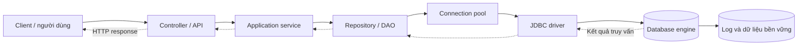
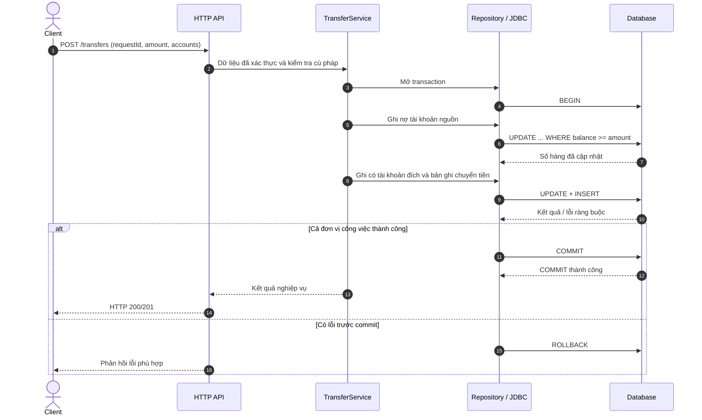
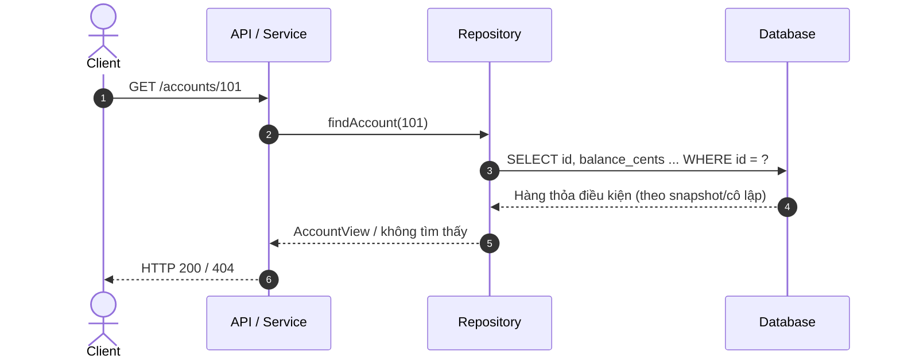
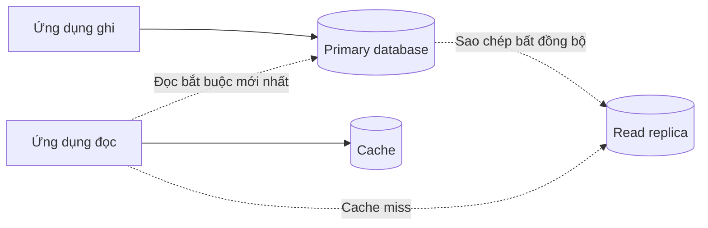

# Luồng dữ liệu giữa ứng dụng và hệ thống lưu trữ

> **Chương:** Định hướng  
> **Học phần:** `DATA_PERSISTENCE_FUNDAMENTALS` — nền tảng lưu trữ dữ liệu bền vững cho ứng dụng Java.

Một lời gọi API như `POST /transfers` có thể chỉ mất vài dòng ở tầng controller, nhưng để một thay đổi thực sự tồn tại sau khi tiến trình Java dừng, dữ liệu phải đi qua nhiều ranh giới: kiểm tra đầu vào, quy tắc nghiệp vụ, giao dịch, kết nối, driver, cơ chế thực thi truy vấn và bộ máy lưu trữ. Chiều ngược lại, đọc dữ liệu còn phụ thuộc vào chỉ mục, trạng thái giao dịch, bộ đệm và nơi ứng dụng thực sự lấy kết quả. Hiểu đường đi này giúp quyết định mô hình dữ liệu, lược đồ, truy vấn, giao dịch, cô lập và kiểm soát đồng thời; đồng thời là nền tảng để xử lý sự cố kết nối, tiến hóa schema, bảo mật, sao lưu và tối ưu hiệu năng.

Sau bài này, người học có thể:

- Lần theo đường đi của dữ liệu từ HTTP request đến bản ghi bền vững và từ truy vấn đến response.
- Phân biệt trách nhiệm của controller, service, repository, connection pool, driver và hệ quản trị dữ liệu.
- Xác định điểm bắt đầu/kết thúc giao dịch, thời điểm `commit` và các cửa sổ lỗi có thể xảy ra.
- Giải thích vì sao hai lần đọc có thể khác nhau, vì sao ghi thành công vẫn có thể gặp phản hồi lỗi và khi nào cần cơ chế chống xử lý lặp.
- Đặt đúng vị trí cho bảo mật, migration, cache, chỉ mục, quan sát hệ thống và sao lưu trong luồng tổng thể.

## 1. Từ dữ liệu trong bộ nhớ đến dữ liệu bền vững

Biến và đối tượng Java nằm trong bộ nhớ của tiến trình. Nếu chỉ gán `account.balance = 500_000`, giá trị này chưa tự động trở thành dữ liệu bền vững. Khi ứng dụng khởi động lại, thông tin chỉ còn nếu đã được lưu bằng một cơ chế persistence phù hợp: cơ sở dữ liệu quan hệ, kho tài liệu, key-value store, object storage, tệp hoặc hệ thống khác có cam kết lưu trữ được xác định rõ.

Trong học phần này, cơ sở dữ liệu quan hệ và JDBC là ví dụ xuyên suốt vì chúng làm rõ các ranh giới giao dịch. Mô hình tư duy vẫn áp dụng cho NoSQL hoặc object storage, nhưng cách xác nhận ghi, cơ chế nhất quán và khả năng giao dịch có thể khác nhau theo sản phẩm.



Đây là **luồng logic**. Các lời gọi từ repository đến driver thường diễn ra trong cùng tiến trình JVM; chỉ đoạn trao đổi với máy chủ database mới nhất thiết đi qua mạng nếu database nằm ở máy khác. Bên trong database còn có bộ phân tích SQL, bộ tối ưu kế hoạch, bộ đệm trang, quản lý khóa hoặc phiên bản bản ghi, transaction log và các tệp dữ liệu. Không nên coi một đối tượng Java là bản sao luôn đồng bộ với một hàng trong database.

| Thành phần | Trách nhiệm chính | Điều cần tránh |
| --- | --- | --- |
| Controller/API | Nhận request, xác thực ngữ cảnh truy cập, chuyển dữ liệu đầu vào, trả mã HTTP phù hợp | Gắn trực tiếp câu SQL và quản lý giao dịch ở nhiều endpoint |
| Application service | Thực hiện quy tắc nghiệp vụ, điều phối một đơn vị công việc và ranh giới giao dịch | Giữ giao dịch mở khi gọi dịch vụ ngoài hoặc chờ người dùng |
| Repository/DAO | Ánh xạ thao tác nghiệp vụ sang truy vấn/lệnh ghi và ánh xạ kết quả về đối tượng | Để chi tiết JDBC/SQL lan khắp mã nghiệp vụ |
| Connection pool và driver | Cấp phát/tái sử dụng kết nối, biến lệnh JDBC thành giao thức database | Mở kết nối mới cho mọi câu lệnh hoặc quên đóng tài nguyên |
| Database engine | Xác minh ràng buộc, thực thi truy vấn, xử lý cạnh tranh, ghi log và quản lý dữ liệu | Giả định mọi lần đọc đều mới nhất ở mọi bản sao |

**Ranh giới trách nhiệm quan trọng:** validation ở ứng dụng giúp phản hồi dễ hiểu, nhưng các bất biến dữ liệu quan trọng vẫn cần ràng buộc tại database như `PRIMARY KEY`, `UNIQUE`, `FOREIGN KEY`, `NOT NULL` và `CHECK`. Nhiều request có thể đến đồng thời hoặc bỏ qua một đường vào của ứng dụng; kiểm tra chỉ ở Java không đủ để giữ toàn vẹn dữ liệu.

## 2. Luồng ghi: từ yêu cầu đến `commit`

Giả sử người dùng chuyển 25.000 đồng giữa hai tài khoản. Để không phụ thuộc kiểu số dấu phẩy động khi tính tiền, ví dụ lưu số tiền dưới dạng đơn vị nhỏ nhất (`balance_cents`, `amount_cents`; tên đơn vị là minh họa). Trong hệ thống thực tế, phải thống nhất đơn vị tiền tệ, quy tắc làm tròn và giới hạn số học trong toàn bộ hệ thống.



Các chặng chính của một thao tác ghi:

1. **Tiếp nhận:** API xác thực người gọi, kiểm tra kiểu dữ liệu, định dạng và quyền thực hiện. Request DTO chưa phải thực thể lưu trữ.
2. **Áp dụng nghiệp vụ:** service xác định những bản ghi nào phải cùng thay đổi; chẳng hạn ghi nợ, ghi có và ghi lịch sử chuyển tiền là một đơn vị nguyên tử.
3. **Mở giao dịch:** lấy kết nối từ pool, tắt auto-commit hoặc dùng cơ chế giao dịch của framework. Các lệnh chạy trên **cùng kết nối/giao dịch**.
4. **Thực thi SQL:** driver truyền câu lệnh cùng tham số; database chọn kế hoạch, tìm hoặc khóa bản ghi, kiểm tra điều kiện và ràng buộc.
5. **Chốt thay đổi:** nếu tất cả hợp lệ thì `COMMIT`; nếu một thao tác bắt buộc thất bại thì `ROLLBACK`. Sau commit thành công, database bảo đảm độ bền theo cấu hình và cơ chế mà nó công bố, thường có transaction log/redo log và đồng bộ xuống lưu trữ.
6. **Tạo phản hồi:** chuyển kết quả nghiệp vụ thành HTTP response. Đây là một bước riêng biệt với commit: kết nối giữa API và client vẫn có thể mất sau khi database đã commit.

**Không đồng nhất `UPDATE` chạy xong với dữ liệu đã commit.** Một lệnh có thể cập nhật bản ghi trong giao dịch nhưng người khác chưa thấy thay đổi đó; lỗi ở thao tác tiếp theo vẫn có thể khiến cả giao dịch bị rollback. Tương tự, nếu database hoặc driver đặt cấu hình độ bền nới lỏng, cần đọc đúng cam kết durability thay vì suy ra tuyệt đối từ một lần trả về `COMMIT`.

### Một schema tối thiểu để minh họa

Ví dụ sau dùng cú pháp PostgreSQL; ý tưởng khóa/ràng buộc tương đương có thể có cú pháp khác ở DBMS khác.

```sql
CREATE TABLE account (
    id BIGINT PRIMARY KEY,
    balance_cents BIGINT NOT NULL CHECK (balance_cents >= 0)
);

CREATE TABLE transfer_record (
    id UUID PRIMARY KEY,
    from_account_id BIGINT NOT NULL REFERENCES account(id),
    to_account_id BIGINT NOT NULL REFERENCES account(id),
    amount_cents BIGINT NOT NULL CHECK (amount_cents > 0),
    created_at TIMESTAMPTZ NOT NULL DEFAULT CURRENT_TIMESTAMP,
    CHECK (from_account_id <> to_account_id)
);
```

`PRIMARY KEY` của `transfer_record.id` vừa định danh bản ghi vừa ngăn hai giao dịch lưu cùng một mã yêu cầu. `FOREIGN KEY` ngăn tham chiếu đến tài khoản không tồn tại. `CHECK` bổ sung hàng rào cuối cùng đối với số dư âm. Database chỉ biết các ràng buộc đã khai báo; nó không tự hiểu mọi quy tắc nghiệp vụ nếu ta chưa mã hóa chúng.

### Ví dụ Java: một giao dịch JDBC trọn vẹn

```java
import java.sql.Connection;
import java.sql.PreparedStatement;
import java.sql.SQLException;
import java.util.UUID;
import javax.sql.DataSource;

public final class TransferService {
    private final DataSource dataSource;

    public TransferService(DataSource dataSource) {
        this.dataSource = dataSource;
    }

    public void transfer(UUID requestId, long fromId, long toId,
                         long amountCents) throws SQLException {
        if (requestId == null || fromId == toId || amountCents <= 0) {
            throw new IllegalArgumentException("Invalid transfer request");
        }

        try (Connection conn = dataSource.getConnection()) {
            conn.setAutoCommit(false);
            try {
                try (PreparedStatement debit = conn.prepareStatement(
                        "UPDATE account " +
                        "SET balance_cents = balance_cents - ? " +
                        "WHERE id = ? AND balance_cents >= ?")) {
                    debit.setLong(1, amountCents);
                    debit.setLong(2, fromId);
                    debit.setLong(3, amountCents);
                    if (debit.executeUpdate() != 1) {
                        throw new IllegalStateException(
                                "Source account missing or insufficient funds");
                    }
                }

                try (PreparedStatement credit = conn.prepareStatement(
                        "UPDATE account " +
                        "SET balance_cents = balance_cents + ? WHERE id = ?")) {
                    credit.setLong(1, amountCents);
                    credit.setLong(2, toId);
                    if (credit.executeUpdate() != 1) {
                        throw new IllegalStateException(
                                "Destination account missing");
                    }
                }

                try (PreparedStatement record = conn.prepareStatement(
                        "INSERT INTO transfer_record " +
                        "(id, from_account_id, to_account_id, amount_cents) " +
                        "VALUES (?, ?, ?, ?)")) {
                    record.setObject(1, requestId);
                    record.setLong(2, fromId);
                    record.setLong(3, toId);
                    record.setLong(4, amountCents);
                    record.executeUpdate();
                }

                conn.commit();
            } catch (SQLException | RuntimeException original) {
                try {
                    conn.rollback();
                } catch (SQLException rollbackFailure) {
                    original.addSuppressed(rollbackFailure);
                }
                throw original;
            }
        }
    }
}
```

Đọc ví dụ theo **đường đi dữ liệu**, không theo số dòng code:

- `DataSource` cung cấp kết nối; khi có pool, `close()` thường trả kết nối về pool. `try-with-resources` giải phóng cả statement và connection, kể cả khi lỗi xảy ra.
- `PreparedStatement` gửi giá trị qua tham số, giúp tránh ghép chuỗi SQL từ đầu vào và cho driver/database cơ hội tái sử dụng kế hoạch.
- Điều kiện `balance_cents >= ?` nằm ngay trong `UPDATE`, vì hai request đồng thời có thể đều đã đọc số dư cũ trước đó. Kiểm tra số hàng cập nhật phát hiện không đủ tiền hoặc không tồn tại tài khoản.
- Nếu ghi nợ thành công nhưng ghi có hoặc ghi lịch sử lỗi, `rollback()` hủy các thay đổi của giao dịch trên cùng kết nối. Ghi lỗi rollback vào `suppressed` giữ được nguyên nhân ban đầu để chẩn đoán.
- ID của giao dịch cần được tạo và giữ ổn định qua những lần client **thử lại cùng một yêu cầu**. Với schema trên, một ID trùng dẫn đến lỗi `UNIQUE` và rollback; dịch vụ hoàn chỉnh còn cần tra lại bản ghi cùng ID, so sánh tham số gốc và chuyển trường hợp đã xử lý thành kết quả idempotent phù hợp.

Ví dụ cố ý tập trung vào ranh giới persistence. Khi triển khai thực tế, phải cân nhắc thứ tự khóa nhất quán cho các tài khoản, retry toàn bộ giao dịch khi gặp deadlock/serialization failure, phân loại lỗi nghiệp vụ thành mã HTTP thích hợp và không ghi lộ chi tiết nhạy cảm vào log. Cũng cần kiểm soát tràn số, quyền truy cập tài khoản và định dạng tiền tệ; chỉ kiểm tra `amountCents > 0` chưa hoàn thiện toàn bộ nghiệp vụ chuyển tiền.

## 3. Luồng đọc: từ truy vấn đến đối tượng và response

Chiều đọc bắt đầu từ một câu hỏi nghiệp vụ, chẳng hạn `GET /accounts/101`. Service chọn dữ liệu cần trả; repository thực thi `SELECT`; database phân tích điều kiện lọc, cân nhắc chỉ mục, đọc phiên bản dữ liệu được phép nhìn thấy rồi trả hàng/cột cho driver. JDBC chuyển dữ liệu thành `ResultSet`, repository ánh xạ thành đối tượng hoặc projection, service kiểm tra quyền và controller tạo response.



Ví dụ Java ngắn cho bước ánh xạ:

```java
import java.sql.Connection;
import java.sql.PreparedStatement;
import java.sql.ResultSet;
import java.sql.SQLException;
import javax.sql.DataSource;

record AccountView(long id, long balanceCents) {}

final class AccountReader {
    private final DataSource dataSource;

    AccountReader(DataSource dataSource) {
        this.dataSource = dataSource;
    }

    AccountView findById(long id) throws SQLException {
        String sql = "SELECT id, balance_cents FROM account WHERE id = ?";
        try (Connection conn = dataSource.getConnection();
             PreparedStatement stmt = conn.prepareStatement(sql)) {
            stmt.setLong(1, id);
            try (ResultSet rs = stmt.executeQuery()) {
                if (!rs.next()) {
                    return null; // API có thể ánh xạ thành HTTP 404.
                }
                return new AccountView(
                        rs.getLong("id"), rs.getLong("balance_cents"));
            }
        }
    }
}
```

Ví dụ đọc một hàng dùng auto-commit mặc định của kết nối. Nếu một thao tác đọc cần nhiều câu `SELECT` cùng nhìn một trạng thái nhất quán, service phải xác định ranh giới giao dịch và isolation level thích hợp; mở nhiều connection tùy tiện rồi mong mọi câu query có cùng snapshot là sai.

Ba điểm ảnh hưởng trực tiếp đến kết quả đọc:

1. **Chỉ mục và kế hoạch truy vấn:** `WHERE id = ?` thường tận dụng khóa chính. Lọc/sắp xếp trên cột không có chỉ mục phù hợp có thể buộc database quét nhiều hàng. Chỉ mục giúp đọc nhưng tốn không gian và chi phí cập nhật khi ghi.
2. **Giao dịch và phiên bản hàng:** database quyết định câu lệnh nhìn thấy các commit nào. `READ COMMITTED`, `REPEATABLE READ` và `SERIALIZABLE` có đặc tính khác nhau tùy DBMS; cần hiểu hành vi cụ thể của sản phẩm, không chỉ dựa vào tên mức cô lập.
3. **Nguồn dữ liệu thực tế:** nếu ứng dụng đọc qua cache hoặc read replica bất đồng bộ, kết quả có thể cũ hơn primary dù ghi đã commit thành công. Phải chọn nhất quán phù hợp với yêu cầu nghiệp vụ.

Với JPA/Hibernate, đường đi tương tự nhưng có thêm tầng persistence context và ORM: gọi `save()` hoặc thay đổi một entity được quản lý chưa nhất thiết phát SQL ngay, `flush()` chưa phải `commit`, còn lazy loading có thể tạo thêm truy vấn. Để tìm vấn đề hiệu năng, cần quan sát SQL thực sự chạy thay vì chỉ đếm số phương thức repository được gọi.

## 4. Giao dịch, cô lập và yêu cầu đồng thời

Một **transaction** là ranh giới trong đó một nhóm thao tác được database xử lý theo các bảo đảm đã cấu hình. Cách đọc ACID trong luồng dữ liệu:

| Thuộc tính | Ý nghĩa với luồng ứng dụng | Minh họa |
| --- | --- | --- |
| Atomicity | Các thay đổi trong giao dịch cùng commit hoặc cùng rollback | Chuyển tiền phải ghi nợ và ghi có cùng nhau |
| Consistency | Giao dịch giữ các ràng buộc/bất biến đã được biểu diễn và kiểm soát | Không để số dư âm hoặc tham chiếu tài khoản không tồn tại |
| Isolation | Giao dịch đồng thời quan sát và ảnh hưởng lẫn nhau theo mức cô lập | Hai giao dịch không được rút cùng số dư mà đều coi mình còn đủ tiền |
| Durability | Thay đổi đã commit sống sót qua những loại sự cố mà DBMS/cấu hình cam kết | Khởi động lại không làm mất giao dịch đã được xác nhận bền vững |

**Đọc trước rồi ghi sau** là một lỗi thường gặp:

```text
T1: SELECT balance -> 100
T2: SELECT balance -> 100
T1: nếu >= 80 thì UPDATE balance = 20
T2: nếu >= 80 thì UPDATE balance = 20
```

Tùy cách triển khai, hai yêu cầu có thể cùng được chấp nhận dù số tiền chỉ đủ cho một yêu cầu; hoặc một cập nhật đè lên cập nhật kia (lost update). Cách bảo vệ phụ thuộc bài toán: `UPDATE ... WHERE balance >= amount` nguyên tử như ví dụ, khóa hàng (`SELECT ... FOR UPDATE`), optimistic locking bằng cột `version`, hoặc mức cô lập cao hơn với cơ chế retry khi xung đột. Kiểm tra điều kiện trong Java rồi thực hiện câu cập nhật vô điều kiện không tương đương với kiểm tra nguyên tử tại database.

Giao dịch càng dài thì khóa hoặc tài nguyên giữ càng lâu, tăng thời gian chờ và xác suất deadlock. Không giữ giao dịch đang mở trong lúc gọi API thanh toán, gửi email, chờ người dùng hay thực hiện việc không cần thuộc giao dịch database. Ghi và gửi thông điệp qua hai hệ thống khác nhau cũng không mặc nhiên cùng một transaction.

## 5. Điểm dễ nhầm khi một yêu cầu đi qua nhiều hệ thống

### `COMMIT` thành công nhưng client vẫn nhận timeout

Hãy xét chuỗi sự kiện:

```text
Client gửi requestId=abc
    -> ứng dụng thực hiện transaction
    -> database COMMIT thành công
    -> đường truyền đứt trước HTTP response
    -> client chỉ thấy timeout
```

Client không thể suy ra từ timeout rằng transaction đã rollback. Nếu client gửi lại một yêu cầu chuyển tiền bằng **ID mới**, hệ thống có thể thực hiện lần thứ hai. Cần một **idempotency key** ổn định và ràng buộc duy nhất ở nơi lưu trạng thái. Khi có request trùng, kiểm tra kết quả đã lưu và bảo đảm payload tương thích rồi trả lại kết quả đã biết. Khả năng retry an toàn là thuộc tính phải thiết kế, không tự xuất hiện chỉ nhờ dùng HTTP hoặc JDBC.

### Database đã lưu nhưng sự kiện chưa được gửi

Ví dụ lưu đơn hàng xong rồi gọi message broker:

```text
COMMIT đơn hàng -> ứng dụng chết -> chưa publish OrderCreated
```

Nếu sự kiện cần được phát đáng tin cậy, có thể lưu `outbox_event` **trong cùng giao dịch** với thay đổi đơn hàng. Một worker riêng lấy các event chưa gửi và publish, sau đó đánh dấu tiến độ. Consumer vẫn phải xử lý trùng vì hệ thống publish/retry thường có thể gửi lại. Đây là bài toán phối hợp giữa các hệ thống, không giải quyết bằng một giao dịch JDBC duy nhất trải qua database và broker.

### Cache, replica và trạng thái vừa ghi



Một `GET` ngay sau `POST` có thể trả giá trị cũ nếu đọc từ replica chưa bắt kịp hoặc cache chưa bị vô hiệu hóa. Với số dư và dữ liệu đòi hỏi *read-your-writes*, có thể định tuyến đọc về primary hoặc dùng kỹ thuật đồng bộ/version phù hợp. Với nội dung ít nhạy cảm với độ trễ, cache và replica giúp mở rộng tải đọc. Chọn cơ chế dựa trên cam kết nhất quán mà người dùng thực sự cần.

## 6. Lỗi phát sinh ở đâu, xử lý tại ranh giới nào?

| Nơi phát sinh | Dấu hiệu | Cách xử lý đúng mức |
| --- | --- | --- |
| Đầu vào/API | Sai định dạng, số tiền âm, thiếu quyền | Từ chối sớm; tránh bắt đầu transaction vô ích; không trả chi tiết bí mật |
| Connection pool/mạng | Hết kết nối rảnh, timeout, kết nối bị ngắt | Đặt timeout hợp lý; giới hạn tải, theo dõi pool; không retry vô hạn |
| SQL/schema | Vi phạm `UNIQUE`, `CHECK`, `FOREIGN KEY`, sai kiểu cột | Rollback, phân loại lỗi nghiệp vụ và lỗi hệ thống; giữ ràng buộc DB |
| Đồng thời | Deadlock, serialization failure, version conflict | Retry **toàn bộ transaction** khi phù hợp, có giới hạn và backoff; bảo đảm idempotency |
| Commit/phản hồi | Mất kết nối trong hoặc sau commit; kết quả không rõ | Tra cứu trạng thái bằng request ID thay vì suy đoán rồi ghi lại một lần nữa |
| Đọc qua cache/replica | Stale read hoặc không thấy bản ghi vừa tạo | Điều chỉnh read routing, invalidation và yêu cầu nhất quán |
| Triển khai schema | Code mới đọc cột chưa có; code cũ không hiểu dữ liệu mới | Migration theo bước tương thích, phối hợp thứ tự rollout |

Không phải lỗi nào cũng được retry. Vi phạm dữ liệu đầu vào sẽ lặp lại; thiếu quyền phải bị từ chối; `UNIQUE` do trùng idempotency key cần kiểm tra kết quả cũ. Với PostgreSQL, SQLSTATE `40001` thường là serialization failure và `40P01` là deadlock; quy tắc retry của DBMS khác có thể khác. Trước khi retry, phải xem thao tác đã có tác dụng phụ ngoài database chưa.

Một repository nên cung cấp cho service thông tin lỗi đủ để quyết định: *không tìm thấy*, *xung đột dữ liệu*, *lỗi tạm thời*, hay *lỗi không xác định sau commit*. Không nên biến mọi `SQLException` thành cùng một `200 OK`, cũng không nên trả nguyên thông báo JDBC hoặc SQL chứa dữ liệu riêng tư cho client.

## 7. Schema, bảo mật, hiệu năng và vận hành nằm trong cùng luồng

**Mô hình dữ liệu và schema.** Chọn thực thể và quan hệ dựa trên bất biến nghiệp vụ: khóa nào định danh bản ghi, thuộc tính nào có thể thiếu, các quan hệ tham chiếu nào phải được bảo vệ. Chuẩn hóa giúp tránh cập nhật không nhất quán; phi chuẩn hóa có thể được cân nhắc sau khi đo tải truy vấn. Chọn loại dữ liệu chính xác và lưu thời gian kèm quy ước múi giờ rõ ràng.

**Tiến hóa schema.** Khi cần đổi tên cột đang được nhiều phiên bản ứng dụng dùng, quy trình an toàn thường là *expand → migrate/backfill → switch → contract*: thêm cấu trúc mới tương thích, triển khai mã có thể đọc/ghi trong giai đoạn chuyển tiếp, chuyển dữ liệu, kiểm chứng rồi mới loại cấu trúc cũ. Migration chạy lúc deploy là một bước vận hành có thể khóa bảng hoặc kéo dài thời gian truy vấn; cần có phương án phục hồi và chạy thử với dữ liệu gần thực tế.

**Bảo mật.** Luồng dữ liệu phải mang theo ngữ cảnh danh tính và quyền truy cập từ API đến truy vấn. Dùng tài khoản database có quyền tối thiểu; không nhúng mật khẩu trong mã nguồn; bảo vệ kết nối bằng TLS khi phù hợp; sử dụng tham số hóa SQL, mã hóa dữ liệu nhạy cảm theo yêu cầu, kiểm soát log và truy cập bản sao lưu. `PreparedStatement` phòng SQL injection ở **giá trị tham số**; với tên bảng/cột hoặc `ORDER BY` động, cần whitelist vì không thể dùng placeholder cho mọi định danh SQL.

**Hiệu năng.** Tổng độ trễ một request không chỉ là thời gian thực thi SQL:

```text
Latency ≈ chờ pool + mạng + lập kế hoạch/truy vấn + chờ khóa
        + đọc/ghi lưu trữ + ánh xạ kết quả + xử lý nghiệp vụ
```

Để tối ưu đúng điểm nghẽn, hãy đo p95/p99 của endpoint, thời gian lấy connection, số query/request, lượng dữ liệu trả về, thời gian chờ khóa và kế hoạch thực thi (`EXPLAIN`, công cụ tương ứng). Dùng pagination với các tập kết quả lớn, tránh `SELECT *` không cần thiết, kiểm soát N+1 query ở ORM và tạo chỉ mục theo mẫu lọc/sắp xếp thực tế. Tăng pool vô hạn có thể chỉ chuyển tình trạng nghẽn sang database.

**Sao lưu và phục hồi.** Replication phục vụ tính sẵn sàng hoặc tải đọc nhưng không thay thế backup: thao tác xóa nhầm có thể được sao chép ngay sang replica. Cần xác định RPO (mức mất dữ liệu tối đa có thể chấp nhận) và RTO (thời gian phục hồi tối đa), lưu backup phù hợp, kiểm tra khả năng khôi phục định kỳ và theo dõi transaction log/point-in-time recovery nếu DBMS hỗ trợ. Một hệ thống chỉ được coi là vận hành bền vững khi đã thử phục hồi, không chỉ khi job backup báo thành công.

**Quan sát và kiểm thử.** Dùng trace/correlation ID nối request với số lần gọi repository, thời gian query và log lỗi; tránh ghi mật khẩu, token hoặc dữ liệu cá nhân vào log. Thử các tình huống cụ thể: ghi nợ thành công nhưng ghi có thất bại; hai yêu cầu đồng thời rút cùng số dư; retry cùng request ID; database timeout trong lúc commit; ứng dụng mới làm việc với schema cũ; khôi phục dữ liệu từ backup. Những tình huống này kiểm tra các bảo đảm của toàn luồng tốt hơn chỉ kiểm tra một phương thức repository riêng lẻ.

## 8. Tự lần vết một yêu cầu thực tế

Cho hai tài khoản A có 100.000 đơn vị nhỏ nhất và B có 20.000. Ứng dụng nhận hai request đồng thời, mỗi request muốn chuyển 80.000 từ A sang B.

1. **Tại API:** cả hai request có đúng định dạng và quyền thao tác hay không? Chúng dùng hai `requestId` khác nhau hay là retry của cùng một yêu cầu?
2. **Tại service:** một giao dịch bao gồm những thay đổi nào? Có gọi mạng ra ngoài trong lúc transaction còn mở không?
3. **Tại database:** câu `UPDATE ... WHERE balance_cents >= 80000` có thể cho phép cả hai ghi nợ thành công không? Nếu một câu trả `0 rows`, những thay đổi đã làm trước đó phải được xử lý ra sao?
4. **Tại commit/response:** nếu một request commit rồi mất kết nối HTTP, lần gửi lại cần kiểm tra dữ liệu gì?
5. **Tại đọc:** client gọi `GET` ngay sau chuyển tiền; kết quả có thể cũ trong trường hợp nào và nên đọc từ đâu nếu yêu cầu nhất quán tức thời?

Trong mô hình ở trên, tối đa một request có thể trừ thành công 80.000 từ A; request còn lại bị từ chối hoặc được thử lại theo chính sách nghiệp vụ. Sau một giao dịch thành công, A còn 20.000 và B có 100.000. Kết quả quan sát từ một endpoint đọc qua replica/cache vẫn có thể trễ so với trạng thái đã commit trên primary; đó là một quyết định về luồng đọc, không phải bằng chứng rằng chuyển tiền chưa xảy ra.

## 9. Những nguyên tắc cần giữ khi thiết kế persistence cho Java

- Vẽ rõ đường đi **request → nghiệp vụ → transaction → database → response** trước khi chọn framework.
- Đặt transaction quanh một đơn vị công việc nhỏ, thống nhất; giữ các ràng buộc dữ liệu quan trọng tại database và xử lý cạnh tranh có chủ đích.
- Tách trạng thái **đã thực thi lệnh**, **đã commit**, **client đã nhận phản hồi** và **mọi bản sao/cache đã bắt kịp**: bốn mốc này không đồng nghĩa.
- Dùng connection pool, câu lệnh tham số hóa, timeout, phân loại lỗi và idempotency khi có retry; chỉ retry những trường hợp thật sự an toàn.
- Đo hành vi truy vấn thực tế, triển khai schema có tương thích, bảo vệ dữ liệu trên toàn đường đi và diễn tập khôi phục backup.

Hiểu được mỗi điểm dữ liệu đi qua là cơ sở để đọc đúng lỗi production, thiết kế repository và transaction cho Java, và lựa chọn chiến lược lưu trữ phù hợp với yêu cầu toàn vẹn, độ trễ và khả năng phục hồi của ứng dụng.
