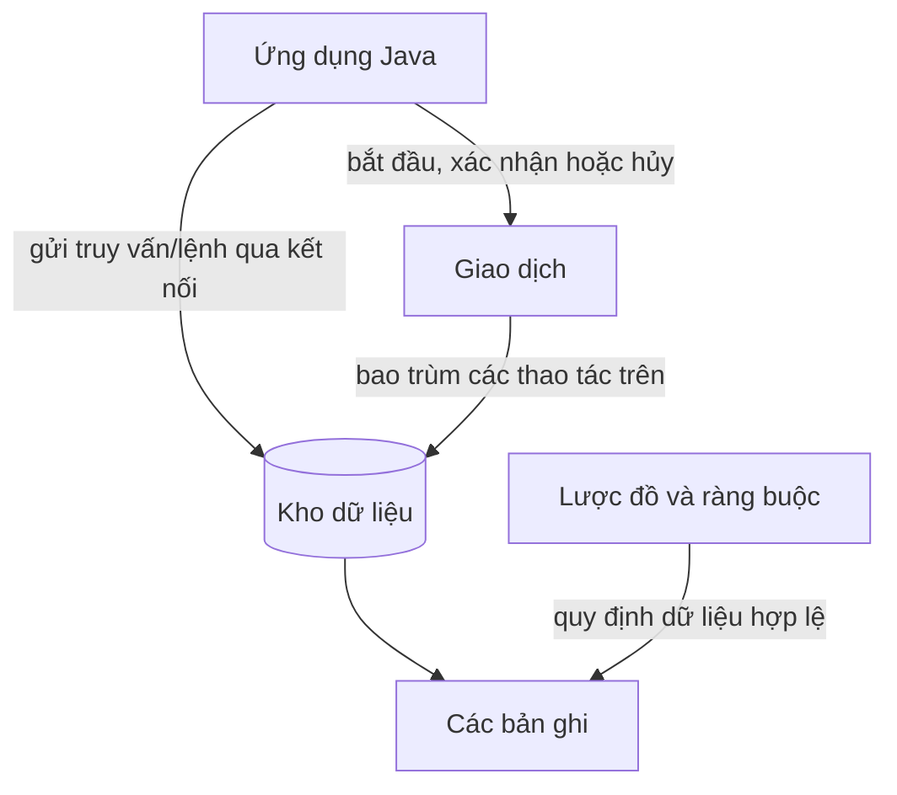

# Các thuật ngữ: kho dữ liệu, bản ghi, lược đồ, truy vấn và giao dịch

Trong một ứng dụng Java, thao tác “lưu thông tin” thực chất liên quan đến nhiều khái niệm khác nhau: **dữ liệu được lưu ở đâu**, **một đơn vị dữ liệu là gì**, **dữ liệu phải tuân theo cấu trúc nào**, **ứng dụng đọc hoặc thay đổi dữ liệu ra sao**, và **khi nhiều thay đổi liên quan với nhau thì làm thế nào để giữ chúng nhất quán**. Năm thuật ngữ nền tảng tương ứng là **kho dữ liệu (data store)**, **bản ghi (record)**, **lược đồ (schema)**, **truy vấn (query)** và **giao dịch (transaction)**.

Bài học thuộc phần **Định hướng** của module `DATA_PERSISTENCE_FUNDAMENTALS`. Các khái niệm này là nền tảng để tiếp tục học về mô hình dữ liệu, chỉ mục, giao dịch và cô lập, kiểm soát đồng thời, thiết kế ranh giới persistence trong Java, xử lý lỗi kết nối, tiến hóa lược đồ, bảo mật, sao lưu và hiệu năng.

## 1. Bức tranh tổng thể

Giả sử ứng dụng quản lý **điểm thưởng** cho khách hàng. Tài khoản của An có 120 điểm, tài khoản của Bình có 30 điểm. An muốn chuyển 50 điểm cho Bình. Sau khi chuyển thành công, số điểm phải lần lượt là 70 và 80, đồng thời hệ thống phải lưu lịch sử chuyển điểm.

| Thuật ngữ | Câu hỏi mà thuật ngữ trả lời | Ví dụ trong ứng dụng điểm thưởng |
| --- | --- | --- |
| **Kho dữ liệu (data store)** | Dữ liệu tồn tại ở đâu sau khi chương trình kết thúc? | Cơ sở dữ liệu PostgreSQL lưu tài khoản và lịch sử chuyển điểm. |
| **Bản ghi (record)** | Một đơn vị thông tin được lưu là gì? | Một hàng mô tả tài khoản của An: `id = 1`, `points = 120`. |
| **Lược đồ (schema)** | Đơn vị thông tin phải có cấu trúc và ràng buộc nào? | Mỗi tài khoản có `id` duy nhất, tên không rỗng, điểm không âm. |
| **Truy vấn (query)** | Làm thế nào tìm kiếm, đọc hoặc yêu cầu xử lý dữ liệu? | Tìm tài khoản theo `id`, hoặc liệt kê tài khoản có ít nhất 50 điểm. |
| **Giao dịch (transaction)** | Làm thế nào thực hiện nhiều thao tác như một đơn vị công việc? | Trừ điểm của An, cộng điểm cho Bình và lưu lịch sử; nếu có lỗi thì hủy toàn bộ. |

Có thể hình dung mối quan hệ như sau:



Sơ đồ mang tính khái niệm: trong một hệ quản trị cơ sở dữ liệu, lược đồ, dữ liệu và xử lý giao dịch đều do hệ thống lưu trữ quản lý hoặc phối hợp thực thi.

## 2. Kho dữ liệu (data store): nơi dữ liệu được giữ lại

**Kho dữ liệu** là thành phần hoặc hệ thống dùng để lưu trữ và truy xuất dữ liệu. Trong ngữ cảnh *data persistence*, điều cần quan tâm là dữ liệu có được giữ lại qua các lần khởi động ứng dụng, sự cố hoặc thay đổi phiên làm việc theo mức độ bảo đảm đã thiết kế hay không.

Một số loại kho dữ liệu thường gặp:

- **Cơ sở dữ liệu quan hệ** (ví dụ: PostgreSQL, MySQL): lưu dữ liệu dạng bảng, quan hệ và ràng buộc; thường hỗ trợ giao dịch ACID.
- **Cơ sở dữ liệu tài liệu** (ví dụ: MongoDB): lưu tài liệu có cấu trúc như JSON/BSON; phù hợp khi dữ liệu được truy xuất chủ yếu theo tài liệu.
- **Kho khóa–giá trị** (ví dụ: Redis): truy xuất theo khóa; khả năng lưu bền vững phụ thuộc cấu hình, cơ chế ghi và triển khai cụ thể. Không mặc định xem mọi dữ liệu trong bộ nhớ đệm là bền vững.
- **Tệp hoặc kho đối tượng**: phù hợp với tài liệu, ảnh, bản sao lưu và các đối tượng lớn; cách truy vấn và mức hỗ trợ giao dịch có thể khác cơ sở dữ liệu.
- **Kho phân tích dữ liệu (data warehouse)**: tối ưu cho báo cáo và phân tích trên dữ liệu lớn; thường không phải nơi thực hiện giao dịch cập nhật tức thời của ứng dụng.

Cần phân biệt **data store** (khái niệm bao quát về nơi lưu dữ liệu) với **data warehouse** (một loại hệ thống phục vụ phân tích, cũng thường được dịch là “kho dữ liệu”). Trong bài này, *kho dữ liệu* được dùng theo nghĩa **data store**, trừ khi ghi rõ *data warehouse*.

Ví dụ, đối tượng Java đang nằm trong RAM có thể mất khi tiến trình dừng. Khi ứng dụng ghi thông tin tài khoản vào một cơ sở dữ liệu được cấu hình lưu bền vững và thao tác được xác nhận thành công, dữ liệu có thể tiếp tục tồn tại sau khi tiến trình Java kết thúc. Tuy vậy, **lưu bền vững không có nghĩa là không bao giờ mất dữ liệu**: còn cần xem xét lỗi phần cứng, chính sách ghi đĩa, sao lưu, phục hồi và cam kết của hệ lưu trữ.

Khi chọn kho dữ liệu, cần đánh giá kiểu dữ liệu, cách truy cập, yêu cầu nhất quán, giao dịch, khả năng mở rộng, độ trễ, vận hành và phục hồi. Không có một loại kho phù hợp nhất cho mọi trường hợp.

## 3. Bản ghi (record): một đơn vị dữ liệu đã lưu

**Bản ghi** là một tập hợp các giá trị mô tả một đối tượng hoặc một sự kiện được lưu trữ. Trong cơ sở dữ liệu quan hệ, bản ghi thường tương ứng với **một hàng (row)** trong bảng; các **cột (column)** biểu diễn thuộc tính.

Bảng `reward_accounts` có thể chứa:

| id | owner_name | points |
| ---: | --- | ---: |
| 1 | An | 120 |
| 2 | Bình | 30 |

Ở đây:

- Mỗi hàng là **một bản ghi tài khoản**.
- `id` là **định danh** của bản ghi và sẽ được khai báo làm **khóa chính (primary key)**.
- `owner_name` và `points` là các thuộc tính.
- Hai bản ghi có cùng số điểm vẫn là hai bản ghi khác nhau vì chúng có định danh khác nhau.

Trong kho tài liệu, một bản ghi có thể được biểu diễn bằng một tài liệu:

```json
{
  "id": 1,
  "ownerName": "An",
  "points": 120
}
```

Cấu trúc cụ thể tùy hệ thống, nhưng ý tưởng “một đơn vị dữ liệu có thể được tìm, đọc và cập nhật” vẫn hữu ích.

### Bản ghi lưu trữ không đồng nhất với đối tượng Java

Trong Java, chương trình có thể biểu diễn thông tin bằng một lớp hoặc Java `record`:

```java
public record RewardAccount(long id, String ownerName, long points) {}
```

Một `RewardAccount` trong bộ nhớ **không tự động trở thành bản ghi trong cơ sở dữ liệu**. Ứng dụng cần một cơ chế persistence (ví dụ JDBC, JPA hoặc mã truy cập dữ liệu phù hợp) để ánh xạ, ghi và đọc các giá trị. Ngoài ra, từ khóa `record` của Java là một dạng khai báo kiểu dữ liệu; nó không có nghĩa là “hàng trong cơ sở dữ liệu”.

Bản ghi cũng cần được phân biệt với **thực thể nghiệp vụ (entity)**. Chẳng hạn, tài khoản điểm thưởng có thể được biểu diễn bằng một hàng, hoặc bằng nhiều bảng và các bản ghi liên quan. Một thực thể nghiệp vụ không bắt buộc ánh xạ một–một với một hàng.

## 4. Lược đồ (schema): cấu trúc và điều kiện hợp lệ

**Lược đồ** mô tả cách dữ liệu được tổ chức: bảng, cột, kiểu dữ liệu, khóa, quan hệ và các ràng buộc. Lược đồ giúp hệ quản trị cơ sở dữ liệu và ứng dụng thống nhất cách diễn giải dữ liệu.

Ví dụ sau sử dụng cú pháp gần với PostgreSQL:

```sql
CREATE TABLE reward_accounts (
    id         BIGINT PRIMARY KEY,
    owner_name VARCHAR(100) NOT NULL,
    points     BIGINT NOT NULL CHECK (points >= 0)
);

CREATE TABLE point_transfers (
    id              BIGINT GENERATED ALWAYS AS IDENTITY PRIMARY KEY,
    from_account_id BIGINT NOT NULL REFERENCES reward_accounts(id),
    to_account_id   BIGINT NOT NULL REFERENCES reward_accounts(id),
    points          BIGINT NOT NULL CHECK (points > 0),
    created_at      TIMESTAMP NOT NULL DEFAULT CURRENT_TIMESTAMP,
    CHECK (from_account_id <> to_account_id)
);
```

Các thành phần đáng chú ý:

| Thành phần | Tác dụng | Ví dụ |
| --- | --- | --- |
| Kiểu dữ liệu | Xác định miền giá trị phù hợp | `BIGINT` cho số điểm nguyên; `VARCHAR(100)` cho tên. |
| `PRIMARY KEY` | Định danh duy nhất, không `NULL` | Mỗi tài khoản có một `id` riêng. |
| `NOT NULL` | Không chấp nhận thiếu giá trị ở cột đó | Tài khoản phải có tên và số điểm. |
| `CHECK` | Kiểm soát một điều kiện dữ liệu | Số điểm tài khoản không được âm. |
| `REFERENCES` | Tạo khóa ngoại, ràng buộc tham chiếu | Lịch sử chuyển phải trỏ tới các tài khoản tồn tại. |
| Giá trị mặc định | Tự điền khi không cung cấp giá trị | `created_at` mặc định bằng thời điểm hiện tại của cơ sở dữ liệu. |

Một vài bản ghi mẫu:

```sql
INSERT INTO reward_accounts (id, owner_name, points)
VALUES (1, 'An', 120),
       (2, 'Bình', 30);
```

Khi cố ghi `points = -10`, ràng buộc `CHECK (points >= 0)` sẽ chặn dữ liệu không hợp lệ trong hệ quản trị có thực thi ràng buộc này. Nhưng lược đồ **chưa đủ để bảo đảm mọi quy tắc nghiệp vụ**. Ví dụ: “một yêu cầu chuyển điểm chỉ được thực hiện một lần” cần thêm thiết kế định danh yêu cầu, ràng buộc duy nhất và quy trình xử lý tương ứng.

**Lược đồ không phải là mô hình đối tượng Java.** Một mô hình có thể được biểu diễn bằng nhiều bảng; và một bảng có thể được nhiều chức năng sử dụng. Khi cấu trúc dữ liệu cần thay đổi, ứng dụng thường phải thực hiện **schema migration** có kiểm soát, đặc biệt khi dữ liệu cũ và phiên bản phần mềm cũ vẫn còn hoạt động.

Với kho tài liệu hoặc hệ thống không yêu cầu khai báo cấu trúc cố định, không nên hiểu “không có lược đồ bắt buộc” là “không cần quy tắc dữ liệu”. Ứng dụng vẫn cần xác định các trường, kiểu, phiên bản và cách xác thực phù hợp.

## 5. Truy vấn (query): yêu cầu đọc hoặc thao tác dữ liệu

**Truy vấn** là yêu cầu gửi tới hệ lưu trữ để lấy thông tin hoặc thực hiện xử lý dữ liệu. Trong cách nói thông thường, *query* thường chỉ thao tác **đọc** (như `SELECT`); nói rộng hơn, ứng dụng còn gửi các **câu lệnh thao tác dữ liệu** như `INSERT`, `UPDATE` và `DELETE`.

Ví dụ truy vấn đọc một tài khoản:

```sql
SELECT id, owner_name, points
FROM reward_accounts
WHERE id = 1;
```

Kết quả ban đầu là `(1, 'An', 120)`. Một truy vấn khác lọc và sắp xếp:

```sql
SELECT id, owner_name, points
FROM reward_accounts
WHERE points >= 50
ORDER BY points DESC, id ASC
LIMIT 20;
```

Trong câu lệnh trên, `WHERE` giới hạn các bản ghi cần xét, `ORDER BY` quyết định thứ tự kết quả, và `LIMIT` giới hạn số hàng trả về (cú pháp phân trang có thể khác giữa các hệ quản trị).

Ví dụ cập nhật dữ liệu:

```sql
UPDATE reward_accounts
SET points = points + 10
WHERE id = 2;
```

Câu lệnh trên tăng 10 điểm cho bản ghi `id = 2`; nó **không tự động lưu lịch sử** hoặc bảo đảm các thay đổi nghiệp vụ khác cùng thành công. Đó là lý do cần khái niệm giao dịch ở phần tiếp theo.

### Tham số hóa truy vấn từ Java

Khi tham số xuất phát từ người dùng hoặc tầng nghiệp vụ, sử dụng **`PreparedStatement`** và tham số ràng buộc thay vì nối chuỗi SQL:

```java
String sql = """
    SELECT id, owner_name, points
    FROM reward_accounts
    WHERE id = ?
    """;

try (PreparedStatement statement = connection.prepareStatement(sql)) {
    statement.setLong(1, accountId);

    try (ResultSet rows = statement.executeQuery()) {
        if (rows.next()) {
            long id = rows.getLong("id");
            String owner = rows.getString("owner_name");
            long points = rows.getLong("points");
            // Ánh xạ các giá trị sang kiểu dữ liệu của ứng dụng.
        }
    }
}
```

Cách viết này tách dữ liệu tham số khỏi cấu trúc câu lệnh và giúp hạn chế **SQL injection**. Đoạn mã giả định `connection` đã được tạo và sẽ được quản lý, đóng đúng vòng đời bởi mã gọi.

Truy vấn có thể đúng về cú pháp nhưng chậm nếu cần quét nhiều bản ghi. **Chỉ mục (index)** có thể giúp một số cách tìm kiếm, sắp xếp hoặc kết hợp bảng, song cũng làm tăng chi phí ghi và lưu trữ. Việc chọn chỉ mục cần dựa trên truy vấn thực tế và kế hoạch thực thi, không chỉ dựa vào tên cột.

## 6. Giao dịch (transaction): nhiều thay đổi thành một đơn vị công việc

Trong ví dụ chuyển 50 điểm từ An sang Bình, ứng dụng cần thực hiện ba thay đổi liên quan:

1. Trừ 50 điểm khỏi tài khoản An, với điều kiện An đủ điểm.
2. Cộng 50 điểm vào tài khoản Bình.
3. Thêm một bản ghi vào `point_transfers` để lưu lịch sử.

Nếu bước 1 thành công nhưng bước 2 hoặc 3 thất bại, dữ liệu sẽ không còn phản ánh đầy đủ nghiệp vụ. **Giao dịch** cho phép nhóm các thao tác để **hoặc tất cả được xác nhận (`COMMIT`), hoặc các thay đổi chưa xác nhận bị hủy (`ROLLBACK`)** trong phạm vi hỗ trợ của hệ thống.

Ví dụ SQL minh họa:

```sql
BEGIN;

UPDATE reward_accounts
SET points = points - 50
WHERE id = 1 AND points >= 50;
-- Ứng dụng PHẢI kiểm tra có đúng 1 hàng được cập nhật.

UPDATE reward_accounts
SET points = points + 50
WHERE id = 2;
-- Ứng dụng PHẢI kiểm tra có đúng 1 hàng được cập nhật.

INSERT INTO point_transfers
    (from_account_id, to_account_id, points)
VALUES (1, 2, 50);

COMMIT;
```

**Lưu ý:** đây là *luồng minh họa*, không phải một script an toàn để chạy nguyên khối mà không kiểm tra kết quả. Sau mỗi lệnh `UPDATE`, ứng dụng phải kiểm tra số hàng bị ảnh hưởng. Nếu không đúng một hàng, hoặc nếu lệnh nào gặp lỗi, ứng dụng phải gọi `ROLLBACK` và không đi tiếp đến `COMMIT`. Với một giao dịch thành công, kết quả là An có **70 điểm**, Bình có **80 điểm**, và có **một** bản ghi lịch sử; tổng điểm của hai tài khoản vẫn là **150**.

Điều kiện `WHERE points >= 50` kết hợp với phép trừ ngay trong `UPDATE` giúp cơ sở dữ liệu kiểm tra điều kiện và cập nhật cùng một câu lệnh, tránh cách làm dễ lỗi là đọc số điểm sang Java rồi ghi đè một giá trị tính toán từ dữ liệu có thể đã cũ. Thiết kế đồng thời cụ thể vẫn phụ thuộc hệ quản trị và mức cô lập của giao dịch.

### Bốn thuộc tính ACID

| Thuộc tính | Ý nghĩa cốt lõi | Áp dụng vào ví dụ |
| --- | --- | --- |
| **Atomicity – Tính nguyên tử** | Các thao tác của giao dịch được xác nhận cùng nhau hoặc bị hủy cùng nhau. | Không thể chỉ trừ điểm mà quên cộng điểm sau khi giao dịch bị hủy. |
| **Consistency – Tính nhất quán** | Giao dịch hợp lệ phải đưa dữ liệu từ trạng thái thỏa các bất biến sang trạng thái cũng thỏa chúng. | Ràng buộc không âm, khóa ngoại và quy tắc chuyển điểm phải tiếp tục được đáp ứng. |
| **Isolation – Tính cô lập** | Các giao dịch đồng thời tương tác theo một mức cô lập được cấu hình. | Hai yêu cầu chuyển đồng thời không nên cùng tiêu dùng số điểm dựa trên một kết quả đọc cũ. |
| **Durability – Tính bền vững** | Sau khi `COMMIT` thành công, dữ liệu được bảo vệ theo cam kết độ bền của hệ lưu trữ. | Lịch sử chuyển điểm và số dư mới phải được giữ lại theo bảo đảm đã cấu hình. |

**ACID không tự động giải quyết mọi bài toán.** Các mức cô lập khác nhau cho phép hoặc ngăn chặn những hiện tượng đồng thời khác nhau. Ngoài ra, nếu mạng bị ngắt đúng lúc `COMMIT`, ứng dụng có thể **không biết chắc** giao dịch đã thành công hay chưa. Thử lại mù quáng có thể ghi một lần chuyển điểm thứ hai. Đối với thao tác quan trọng, cần thiết kế thêm **khóa định danh yêu cầu (idempotency key)**, ràng buộc duy nhất, kiểm tra trạng thái hoặc cơ chế khôi phục phù hợp.

### Ranh giới giao dịch trong Java

Với JDBC, ứng dụng có thể tắt chế độ tự động xác nhận để kiểm soát giao dịch:

```java
try (Connection connection = dataSource.getConnection()) {
    connection.setAutoCommit(false);

    try {
        // Thực thi trừ điểm, cộng điểm, ghi lịch sử bằng PreparedStatement.
        // Kiểm tra số hàng cập nhật và mọi quy tắc nghiệp vụ cần thiết.
        connection.commit();
    } catch (SQLException | RuntimeException error) {
        try {
            connection.rollback();
        } catch (SQLException rollbackError) {
            error.addSuppressed(rollbackError);
        }
        throw error;
    }
}
```

Đây là **khung mô tả ranh giới giao dịch**, chưa phải phương thức chuyển điểm hoàn chỉnh: phần thực thi câu lệnh, kiểm tra số hàng và chính sách xử lý lỗi phải được triển khai. Kết nối được đóng qua `try-with-resources`; trong ứng dụng sử dụng connection pool hoặc framework transaction, việc quản lý trạng thái kết nối và giao dịch phải tuân theo hợp đồng của thành phần đó. Nếu xảy ra lỗi ở thời điểm xác nhận, cần xác minh kết quả trước khi thử lại.

Một giao dịch cơ sở dữ liệu cục bộ cũng không mặc nhiên bao trùm việc gửi email, gọi HTTP hoặc ghi sang một dịch vụ khác. Các tác vụ xuyên hệ thống cần cách thiết kế phù hợp như **outbox**, quy trình bù trừ hoặc xử lý sự kiện đáng tin cậy.

## 7. Kết nối năm khái niệm trong thiết kế persistence

Đường đi phổ biến của một chức năng Java có thể được diễn đạt như sau:

1. **Tầng nghiệp vụ** nhận yêu cầu chuyển điểm và kiểm tra đầu vào: số điểm dương, tài khoản nguồn khác tài khoản đích.
2. **Tầng truy cập dữ liệu** mở kết nối tới **kho dữ liệu** và bắt đầu **giao dịch**.
3. Ứng dụng thực thi các **truy vấn/câu lệnh** trên những **bản ghi** tài khoản và lịch sử.
4. **Lược đồ** kiểm tra kiểu dữ liệu, khóa và các ràng buộc; ứng dụng kiểm tra thêm bất biến nghiệp vụ.
5. Nếu mọi bước hợp lệ, ứng dụng `COMMIT`; nếu xảy ra lỗi cần hủy, ứng dụng `ROLLBACK`. Kết quả được trả về sau khi xác định trạng thái xử lý.

Khi phát triển chức năng thực tế, năm khái niệm này gắn với các câu hỏi tiếp theo của module:

| Vấn đề cần giải quyết | Khái niệm nền tảng liên quan |
| --- | --- |
| Chọn SQL, tài liệu hay khóa–giá trị | Kho dữ liệu và cách tổ chức bản ghi |
| Kiểm soát định danh và quan hệ | Bản ghi, khóa và lược đồ |
| Ngăn dữ liệu sai hoặc thiếu | Lược đồ, ràng buộc và kiểm tra nghiệp vụ |
| Đọc danh sách lớn hiệu quả | Truy vấn, phân trang và chỉ mục |
| Tránh mất cập nhật khi có nhiều người dùng | Giao dịch, cô lập và kiểm soát đồng thời |
| Thay đổi cột hoặc quan hệ khi ứng dụng đang chạy | Lược đồ và tiến hóa schema |
| Phục hồi sau sự cố | Độ bền dữ liệu, sao lưu, nhật ký và khôi phục |
| Bảo vệ dữ liệu cá nhân | Quyền truy cập, câu lệnh tham số hóa và bảo mật kho dữ liệu |

## 8. Những nhầm lẫn thường gặp

- **“Dữ liệu đang ở trong biến Java nghĩa là đã được lưu.”** Sai: dữ liệu trong RAM và dữ liệu đã được ghi bền vững có vòng đời khác nhau.
- **“Bản ghi là cùng một thứ với Java `record`.”** Sai: một bên là đơn vị dữ liệu được lưu, một bên là cú pháp khai báo kiểu trong Java.
- **“Cơ sở dữ liệu không áp schema thì dữ liệu không cần cấu trúc.”** Sai: vẫn cần thỏa thuận dữ liệu và kiểm tra hợp lệ ở cấp phù hợp.
- **“Một câu `SELECT` luôn nhanh nếu có `WHERE`.”** Sai: tốc độ còn phụ thuộc lượng dữ liệu, chỉ mục, điều kiện lọc và kế hoạch thực thi.
- **“Có `BEGIN` và `COMMIT` là đủ để an toàn.”** Sai: phải kiểm tra lỗi, số hàng bị ảnh hưởng, mức cô lập và khả năng yêu cầu được gửi lặp lại.
- **“`COMMIT` thành công nghĩa là không cần sao lưu.”** Sai: transaction durability và chiến lược phục hồi sau thảm họa giải quyết các loại rủi ro khác nhau.

## 9. Tự kiểm tra

**Câu 1.** Ứng dụng lưu `new RewardAccount(1, "An", 120)` vào một biến cục bộ rồi kết thúc. Đã có bản ghi bền vững chưa?

**Đáp án:** Chưa. Đối tượng Java chưa chứng minh đã có thao tác ghi vào một kho lưu trữ có bảo đảm persistence.

**Câu 2.** Một lệnh `UPDATE reward_accounts SET points = points - 50 WHERE id = 1 AND points >= 50` cập nhật **0 hàng**. Ứng dụng nên làm gì trước khi cộng điểm cho tài khoản nhận?

**Đáp án:** Dừng quy trình, hủy giao dịch và xác định nguyên nhân (không đủ điểm hoặc tài khoản không tồn tại). Không được tiếp tục cộng điểm hoặc `COMMIT`.

**Câu 3.** Lược đồ đã có khóa ngoại từ lịch sử chuyển điểm sang tài khoản. Vậy có cần giao dịch khi vừa trừ, vừa cộng và vừa ghi lịch sử không?

**Đáp án:** Có. Khóa ngoại kiểm soát tính hợp lệ của tham chiếu, nhưng không bảo đảm cả ba thao tác thành công hoặc thất bại như một đơn vị.

**Câu 4.** Tại sao một yêu cầu chuyển điểm có thể cần mã yêu cầu duy nhất dù các câu lệnh đã nằm trong giao dịch?

**Đáp án:** Giao dịch bảo vệ tính nguyên tử của **mỗi lần thực thi**. Khi ứng dụng không nhận được phản hồi sau `COMMIT`, yêu cầu có thể bị gửi lại; mã yêu cầu và cơ chế kiểm tra duy nhất giúp tránh xử lý nghiệp vụ hai lần.

Sau bài học, hãy luôn xác định rõ **nơi lưu dữ liệu**, **đơn vị dữ liệu**, **quy tắc cấu trúc**, **cách truy cập** và **ranh giới giao dịch** khi phân tích bất kỳ chức năng persistence nào trong Java.
