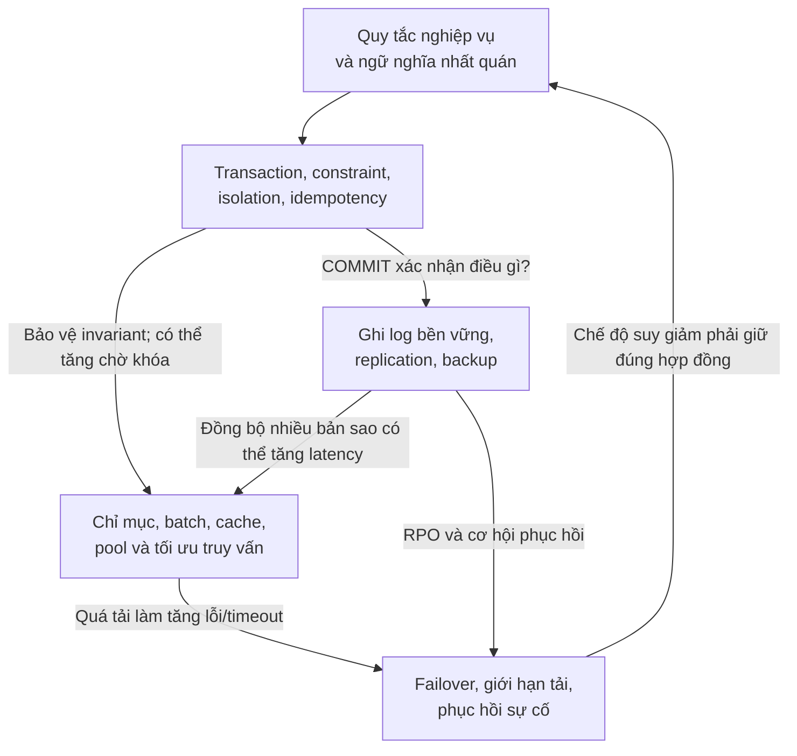

# Quan hệ giữa tính đúng đắn, độ bền, hiệu năng và tính sẵn sàng

## 1. Vì sao phải xét bốn mục tiêu cùng lúc?

Một hệ thống lưu trữ dữ liệu bền vững (data persistence) không chỉ cần **ghi được dữ liệu xuống cơ sở dữ liệu**. Hệ thống còn phải bảo đảm dữ liệu có ý nghĩa đúng, sống sót qua các sự cố đã cam kết hỗ trợ, phục vụ yêu cầu trong thời gian chấp nhận được và tiếp tục hoạt động khi một số thành phần gặp lỗi.

Xét dịch vụ Java đặt giữ hàng trong kho:

1. Khách gửi yêu cầu giữ 2 sản phẩm với mã yêu cầu duy nhất.
2. Hệ thống kiểm tra tồn kho, trừ số lượng và tạo bản ghi đặt giữ hàng.
3. Sau khi giao dịch thành công, hệ thống phản hồi mã đặt giữ hàng.
4. Một tiến trình khác đọc sự kiện và gửi thông báo xác nhận.

Nếu chỉ nhìn vào việc câu lệnh SQL chạy thành công, ta sẽ bỏ sót các câu hỏi quan trọng:

- **Tính đúng đắn:** Hai khách cùng đặt món hàng cuối cùng có làm tồn kho âm không? Gửi lại yêu cầu có tạo hai đơn không?
- **Độ bền:** Sau khi API báo thành công mà máy chủ cơ sở dữ liệu mất điện, giao dịch có còn không?
- **Hiệu năng:** Bao nhiêu yêu cầu có thể xử lý mỗi giây? Phân vị độ trễ p95/p99 tăng thế nào khi tải cao?
- **Tính sẵn sàng:** Nếu nút cơ sở dữ liệu chính hỏng hoặc mạng bị chia cắt, người dùng còn đọc hay ghi được gì?

Bốn mục tiêu có quan hệ chặt chẽ. Cải thiện một mục tiêu có thể tăng chi phí của mục tiêu khác, nhưng cũng có những giải pháp cải thiện nhiều mục tiêu cùng lúc. Cần định nghĩa rõ điều hệ thống **cam kết** trước khi chọn kiến trúc.

## 2. Hiểu đúng từng mục tiêu

| Mục tiêu | Câu hỏi cốt lõi | Ví dụ tiêu chí đánh giá | Cơ chế thường dùng |
|---|---|---|---|
| **Tính đúng đắn (correctness)** | Kết quả có thỏa quy tắc nghiệp vụ và quy tắc dữ liệu ở mọi tình huống cần hỗ trợ? | Không bán vượt tồn kho; mỗi `request_id` chỉ có một kết quả hợp lệ; không lộ dữ liệu sai quyền | Ràng buộc SQL, transaction, isolation, khóa, kiểm soát phiên bản, kiểm tra phân quyền, idempotency |
| **Độ bền (durability)** | Dữ liệu đã được cam kết có tồn tại sau các dạng lỗi trong mô hình sự cố đã chọn? | Giao dịch đã xác nhận vẫn tồn tại sau khi tiến trình hoặc máy chủ khởi động lại; đạt RPO đã cam kết | Transaction log/WAL, flush xuống lưu trữ bền vững, replication, backup và diễn tập khôi phục |
| **Hiệu năng (performance)** | Hệ thống đáp ứng nhanh và xử lý được bao nhiêu công việc với tài nguyên hiện có? | p95 độ trễ ghi dưới ngưỡng mục tiêu, throughput ổn định, không quá tải kết nối | Chỉ mục, thiết kế truy vấn, batching, pool kết nối, cache, phân tải, tối ưu thời gian giữ khóa |
| **Tính sẵn sàng (availability)** | Trong khoảng thời gian quan sát, hệ thống có thể thực hiện các thao tác đã cam kết hay không? | Tỷ lệ yêu cầu thành công, thời gian gián đoạn, RTO phục hồi | Redundancy, giám sát, failover, timeout, giới hạn tải, phân vùng chức năng, diễn tập vận hành |

**Tính đúng đắn** bao gồm hai lớp cần phân biệt:

- **Đúng quy tắc nghiệp vụ:** Ví dụ tồn kho không âm, số tiền ghi nợ và ghi có cân bằng, chủ tài khoản mới xem được dữ liệu của mình.
- **Đúng theo ngữ nghĩa nhất quán đã công bố:** Ví dụ một yêu cầu đọc sau ghi có thấy dữ liệu mới ngay không, thứ tự giao dịch đồng thời được xử lý ra sao.

**Độ bền** là thuộc tính gắn với **mốc cam kết** và **mô hình sự cố**. “Đã ghi trong bộ nhớ ứng dụng”, “đã gửi SQL”, “database trả COMMIT thành công” và “đã được nhiều nút lưu trữ xác nhận” không mặc nhiên có cùng bảo đảm. Một cơ sở dữ liệu hỗ trợ ACID vẫn cần cấu hình ghi log, lưu trữ, replication và cơ chế khôi phục phù hợp.

**Hiệu năng** phải được đo bằng phân phối, không chỉ lấy thời gian trung bình. Một API có độ trễ trung bình 30 ms nhưng p99 là 5 giây có thể gây timeout, retry và làm cả hệ thống quá tải.

**Tính sẵn sàng** không có nghĩa mọi thao tác đều phải hoạt động trong mọi sự cố. Dịch vụ có thể còn cho phép đọc lịch sử nhưng tạm ngừng tạo giao dịch mới để bảo vệ tính đúng đắn. Cần đo availability theo từng loại thao tác đã hứa với người dùng.

### Các chỉ số không thay thế cho nhau

- **Latency:** Thời gian từ lúc nhận yêu cầu đến khi có phản hồi, nên đo p50, p95, p99 theo từng API.
- **Throughput:** Số giao dịch/yêu cầu hoàn tất trong một đơn vị thời gian; phải đi kèm tỷ lệ lỗi và độ trễ.
- **Availability:** Tỷ lệ thao tác đủ điều kiện hoàn tất đúng hợp đồng dịch vụ trong cửa sổ đo.
- **RPO (Recovery Point Objective):** Lượng dữ liệu tối đa được chấp nhận mất khi khôi phục, thường diễn đạt theo thời gian.
- **RTO (Recovery Time Objective):** Khoảng thời gian mục tiêu để khôi phục dịch vụ sau sự cố.

RPO và RTO là **mục tiêu**, không phải kết quả được bảo đảm chỉ vì đã có backup hay replica. Cần kiểm chứng bằng diễn tập sự cố.

## 3. Quan hệ và đánh đổi giữa bốn mục tiêu

### 3.1. Tính đúng đắn và hiệu năng

Để tránh bán vượt tồn kho, ứng dụng cần cập nhật dữ liệu dưới cơ chế đồng thời an toàn. Khóa hàng, kiểm tra ràng buộc, phát hiện xung đột hoặc isolation chặt hơn có thể làm giao dịch phải chờ, bị hủy và retry. Độ trễ vì vậy có thể tăng.

Tuy nhiên, bỏ khóa hoặc bỏ ràng buộc để cải thiện tốc độ thường chỉ chuyển chi phí sang sửa dữ liệu sai. Thiết kế tốt có thể **vừa đúng vừa nhanh hơn**, chẳng hạn dùng một câu lệnh cập nhật có điều kiện ngay trong cơ sở dữ liệu:

```sql
UPDATE stock
SET available = available - 2
WHERE sku = 'BOOK-01' AND available >= 2;
```

Chỉ xem đặt hàng là thành công nếu câu lệnh ảnh hưởng đúng **1 hàng**. Cơ sở dữ liệu quan hệ sẽ phối hợp các cập nhật đồng thời trên cùng hàng; khi lượng còn lại không đủ, điều kiện sẽ không còn thỏa sau khi giao dịch trước hoàn tất. Câu lệnh này bảo vệ một quy tắc trên **một hàng**; quy tắc trải qua nhiều hàng hoặc nhiều hệ thống có thể cần transaction, khóa hoặc isolation mạnh hơn.

### 3.2. Độ bền và hiệu năng

Để bảo đảm COMMIT có thể khôi phục sau lỗi, cơ sở dữ liệu thường ghi transaction log (ví dụ WAL), và tùy cấu hình phải bảo đảm log được đưa xuống phương tiện lưu trữ bền vững trước khi xác nhận. Ghi đồng bộ ra đĩa và đợi replica xác nhận làm tăng độ trễ so với chỉ giữ dữ liệu trong bộ nhớ.

Các kỹ thuật như group commit, batch và thiết bị lưu trữ tốt có thể giảm chi phí mà vẫn giữ cam kết. Ngược lại, tắt cơ chế đồng bộ ghi để lấy độ trễ đẹp hơn là **thay đổi mức bảo đảm độ bền**, cần đánh giá theo nguy cơ mất điện hoặc crash cụ thể.

### 3.3. Tính sẵn sàng và tính đúng đắn khi có lỗi mạng

Khi các nút không liên lạc được với nhau, một hệ phân tán phải quyết định có tiếp tục cho ghi hay không. Nếu nhiều nút cùng được phép ghi một dữ liệu có quy tắc mạnh (ví dụ tổng tồn kho không được vượt giới hạn) mà không phối hợp, kết quả có thể xung đột.

Định lý CAP bàn đến **consistency theo nghĩa hành vi đọc/ghi như một bản sao duy nhất (linearizability)** và availability khi xảy ra **network partition**. Nó không đồng nghĩa với chữ “Consistency” trong ACID, cũng không nói rằng mọi hệ thống luôn phải chọn vĩnh viễn hai trong ba thuộc tính. Trong một partition, hệ yêu cầu ghi mạnh có thể từ chối một phía để tránh hai chủ ghi; hệ ưu tiên phản hồi trên nhiều phía phải chấp nhận một ngữ nghĩa nhất quán yếu hơn và có quy tắc hòa giải rõ ràng.

Ví dụ với tồn kho, không thể chỉ cho hai vùng độc lập cùng bán toàn bộ lượng còn lại rồi hy vọng đồng bộ sau. Nếu muốn ghi offline/multi-region, cần phân bổ trước quota cho mỗi vùng, dùng cơ chế hợp nhất bảo toàn invariant hoặc chọn từ chối ghi khi không thể quyết định an toàn.

### 3.4. Độ bền và tính sẵn sàng

Một primary có replica **bất đồng bộ** thường trả lời ghi nhanh và vẫn có thể phục vụ đọc khi primary hỏng. Nhưng nếu primary xác nhận giao dịch trước khi replica nhận đủ log, failover sang replica còn chậm có thể làm **mất giao dịch đã được phản hồi thành công**.

Replication **đồng bộ** đến số nút yêu cầu có thể giảm rủi ro mất giao dịch đã xác nhận khi mất một nút, đổi lại phải chờ nhiều nút và có thể không nhận ghi khi thiếu quorum. Cần phân biệt:

- **Replication** hỗ trợ tiếp tục phục vụ khi hỏng nút; không thay thế backup.
- **Backup** hỗ trợ phục hồi sau xóa nhầm, mã độc, lỗi logic lan sang replica hoặc sự cố diện rộng; không tự động tạo failover tức thời.
- **Khôi phục thực tế** phụ thuộc phạm vi lỗi, cấu hình flush/ack, số bản sao còn sống và kết quả diễn tập.

### 3.5. Hiệu năng và tính sẵn sàng

Cache, read replica, pool kết nối và phân tải có thể tăng năng lực phục vụ. Nhưng một cache cho đọc nhanh có thể trả dữ liệu cũ; retry không giới hạn có thể khiến hệ thống cơ sở dữ liệu đang chậm bị quá tải nặng hơn.

Khi tải vượt năng lực, hàng đợi, thời gian giữ khóa và timeout tăng, cuối cùng làm giảm cả throughput hữu ích lẫn availability. Giới hạn concurrency, timeout có ngân sách, backpressure và tạm dừng chức năng ít quan trọng thường bảo vệ hệ thống tốt hơn việc cho mọi yêu cầu chen vào.

### Sơ đồ các quan hệ chủ yếu



Không có một thứ tự ưu tiên tuyệt đối cho mọi hệ thống. Cần cố định **invariant không được vi phạm** và **hợp đồng phản hồi** trước, rồi chọn phương án chi phí hợp lý cho hiệu năng, độ bền và sẵn sàng.

## 4. ACID giúp gì, và không giúp gì?

Một transaction trong cơ sở dữ liệu quan hệ thường được giải thích bằng ACID:

| Chữ | Ý nghĩa | Liên hệ thực tế |
|---|---|---|
| **Atomicity** | Nhóm thay đổi cùng thành công hoặc cùng rollback | Trừ tồn kho và tạo đặt giữ hàng phải đồng thời thành công |
| **Consistency** | Transaction chuyển trạng thái hợp lệ thành trạng thái hợp lệ theo các quy tắc đã khai báo/duy trì | `CHECK`, `UNIQUE`, khóa ngoại và logic nghiệp vụ ngăn trạng thái bất hợp lệ |
| **Isolation** | Kiểm soát việc các giao dịch đồng thời quan sát và ảnh hưởng lẫn nhau | Tránh các bất thường như lost update, non-repeatable read, write skew tùy mức isolation |
| **Durability** | Dữ liệu đã COMMIT được bảo toàn qua các lỗi thuộc bảo đảm của hệ lưu trữ | Phụ thuộc transaction log, flush, cấu hình và phạm vi lỗi |

Ba điểm dễ nhầm:

1. **ACID không tự xác minh mọi nghiệp vụ.** Cơ sở dữ liệu không thể biết “một khách chỉ được đặt tối đa 3 vé” nếu ứng dụng không mã hóa quy tắc này bằng ràng buộc, thao tác nguyên tử hoặc giao dịch thích hợp.
2. **Isolation không phải chỉ có bật/tắt.** `READ COMMITTED`, `REPEATABLE READ` và `SERIALIZABLE` có ngữ nghĩa khác nhau giữa các hệ quản trị. Ví dụ, hai giao dịch đọc hai hàng khác nhau rồi cùng cập nhật có thể gặp **write skew** nếu không có cơ chế phù hợp. Dựa trên tài liệu của DBMS cụ thể khi chọn mức isolation.
3. **Một transaction cục bộ không tự bao phủ HTTP, broker hoặc dịch vụ thanh toán.** Gọi API bên ngoài giữa transaction rồi COMMIT có thể tạo kết quả không nhất quán nếu một bên thành công, bên kia thất bại. Cần các mẫu như transactional outbox, idempotency, saga hoặc quy trình đối soát theo yêu cầu nghiệp vụ.

## 5. Ví dụ Java/PostgreSQL: đúng dữ liệu và ghi sự kiện bền vững

Mục tiêu: mỗi yêu cầu giữ hàng có một `request_id` duy nhất; không giữ quá tồn kho; bản ghi giữ hàng và sự kiện chờ phát phải nằm trong **cùng transaction**. Ví dụ dùng PostgreSQL với mức isolation `READ COMMITTED`.

### 5.1. Lược đồ và invariant

```sql
CREATE TABLE stock (
    sku TEXT PRIMARY KEY,
    available INTEGER NOT NULL CHECK (available >= 0)
);

CREATE TABLE reservations (
    id UUID PRIMARY KEY,
    request_id UUID NOT NULL UNIQUE,
    sku TEXT NOT NULL REFERENCES stock(sku),
    quantity INTEGER NOT NULL CHECK (quantity > 0),
    created_at TIMESTAMPTZ NOT NULL DEFAULT now()
);

CREATE TABLE outbox (
    event_id UUID PRIMARY KEY,
    aggregate_id UUID NOT NULL REFERENCES reservations(id),
    event_type TEXT NOT NULL,
    payload JSONB NOT NULL,
    created_at TIMESTAMPTZ NOT NULL DEFAULT now(),
    published_at TIMESTAMPTZ
);
```

Ở đây:

- `CHECK (available >= 0)` ngăn lưu tồn kho âm ngay cả khi có một đường ghi khác bỏ qua kiểm tra của Java.
- `UNIQUE (request_id)` chặn hai kết quả thành công cho một khóa yêu cầu.
- Transaction bảo đảm dữ liệu giữ hàng và sự kiện outbox được COMMIT hoặc rollback cùng nhau.
- Chỉ mục khóa chính và UNIQUE giúp tra cứu khóa tương ứng; không cần thêm chỉ mục trùng lặp chỉ để đáp ứng các truy vấn đó.

### 5.2. Đường ghi trong một transaction

```java
import javax.sql.DataSource;
import java.sql.*;
import java.util.UUID;

public final class ReservationService {
    private final DataSource dataSource;

    public ReservationService(DataSource dataSource) {
        this.dataSource = dataSource;
    }

    public UUID reserve(UUID requestId, String sku, int quantity)
            throws SQLException {
        if (requestId == null || sku == null || sku.isBlank() || quantity <= 0) {
            throw new IllegalArgumentException("Yeu cau khong hop le");
        }

        try (Connection c = dataSource.getConnection()) {
            c.setTransactionIsolation(Connection.TRANSACTION_READ_COMMITTED);
            c.setAutoCommit(false);

            try {
                UUID reservationId = UUID.randomUUID();
                int inserted;

                try (PreparedStatement p = c.prepareStatement("""
                    INSERT INTO reservations (id, request_id, sku, quantity)
                    VALUES (?, ?, ?, ?)
                    ON CONFLICT (request_id) DO NOTHING
                    """)) {
                    p.setObject(1, reservationId);
                    p.setObject(2, requestId);
                    p.setString(3, sku);
                    p.setInt(4, quantity);
                    inserted = p.executeUpdate();
                }

                if (inserted == 0) {
                    // Retry cua cung mot yeu cau: tra ve ket qua da commit.
                    try (PreparedStatement p = c.prepareStatement("""
                        SELECT id, sku, quantity
                        FROM reservations
                        WHERE request_id = ?
                        """)) {
                        p.setObject(1, requestId);
                        try (ResultSet rs = p.executeQuery()) {
                            if (!rs.next()) {
                                throw new SQLException("Khong tim thay request_id");
                            }
                            if (!sku.equals(rs.getString("sku"))
                                    || quantity != rs.getInt("quantity")) {
                                throw new IllegalArgumentException(
                                    "request_id duoc su dung voi noi dung khac");
                            }
                            UUID existing = (UUID) rs.getObject("id");
                            c.rollback();
                            return existing;
                        }
                    }
                }

                int updated;
                try (PreparedStatement p = c.prepareStatement("""
                    UPDATE stock
                    SET available = available - ?
                    WHERE sku = ? AND available >= ?
                    """)) {
                    p.setInt(1, quantity);
                    p.setString(2, sku);
                    p.setInt(3, quantity);
                    updated = p.executeUpdate();
                }
                if (updated != 1) {
                    throw new IllegalStateException("Khong du ton kho");
                }

                try (PreparedStatement p = c.prepareStatement("""
                    INSERT INTO outbox
                        (event_id, aggregate_id, event_type, payload)
                    VALUES (?, ?, 'RESERVATION_CREATED',
                        jsonb_build_object(
                            'reservationId', ?, 'sku', ?, 'quantity', ?))
                    """)) {
                    p.setObject(1, UUID.randomUUID());
                    p.setObject(2, reservationId);
                    p.setString(3, reservationId.toString());
                    p.setString(4, sku);
                    p.setInt(5, quantity);
                    p.executeUpdate();
                }

                c.commit();
                return reservationId;
            } catch (SQLException | RuntimeException ex) {
                try {
                    c.rollback();
                } catch (SQLException rollbackFailure) {
                    ex.addSuppressed(rollbackFailure);
                }
                throw ex;
            }
        }
    }
}
```

Ví dụ có chủ ý dùng cú pháp PostgreSQL (`ON CONFLICT`, `jsonb_build_object`). Khi `request_id` trùng, câu lệnh chờ kết quả giao dịch cạnh tranh theo cơ chế UNIQUE của PostgreSQL; tại `READ COMMITTED`, truy vấn tiếp theo có thể đọc bản ghi vừa được COMMIT. Việc kiểm tra lại `sku` và `quantity` ngăn dùng cùng khóa cho hai yêu cầu khác nhau.

Đường ghi này **không** gọi broker hoặc API bên ngoài khi đang giữ transaction. Một worker riêng đọc outbox, phát sự kiện rồi đánh dấu đã phát; worker hoặc consumer có thể gặp sự kiện lặp sau crash, nên consumer vẫn phải xử lý idempotent (chẳng hạn lưu `event_id` đã xử lý).

Nếu `commit()` bị timeout hoặc mất kết nối, phía Java có thể **không biết** transaction đã được COMMIT hay chưa. Không được mặc định coi đó là thất bại rồi tạo khóa yêu cầu mới. Khách gửi lại **cùng `request_id`**, tra cứu kết quả đã có và chỉ tạo mới nếu giao dịch trước thực sự không tồn tại. Với thao tác có tác động ngoài cơ sở dữ liệu, cần thêm cơ chế đối soát.

**Giới hạn của ví dụ:** Cập nhật có điều kiện bảo vệ tồn kho theo một hàng. Nếu nghiệp vụ có giới hạn chéo nhiều SKU, quota toàn hệ thống, chính sách phụ thuộc các hàng khác hoặc ghi ở nhiều DB, phải phân tích bất thường đồng thời và thiết kế khóa/isolation phù hợp. Cũng cần cấu hình connection pool, timeout, quyền DB và lịch dọn dữ liệu phù hợp vận hành thật.

## 6. Phân tích hành vi theo dòng thời gian lỗi

Giả sử HTTP client gửi cùng khóa `R-42`.

```mermaid
sequenceDiagram
    participant C as Client
    participant A as Java API
    participant DB as PostgreSQL
    participant W as Outbox worker

    C->>A: reserve(request_id=R-42)
    A->>DB: BEGIN; INSERT reservation
    A->>DB: UPDATE stock; INSERT outbox
    A->>DB: COMMIT
    DB-->>A: COMMIT thành công
    Note over A,C: Có thể mất phản hồi HTTP tại đây
    C-->>A: Retry cùng request_id=R-42
    A->>DB: Kiểm tra khóa đã tồn tại
    DB-->>A: Trả về reservation cũ
    A-->>C: Cùng một mã reservation
    W->>DB: Đọc outbox chưa phát
    W-->>C: Thông báo qua kênh riêng
```

Một số tình huống cần được giải thích riêng:

| Sự cố | Nguy cơ | Cách bảo vệ và chi phí |
|---|---|---|
| Ứng dụng chết trước COMMIT | Có thể còn thay đổi dang dở | DB rollback transaction chưa hoàn tất; client retry cùng khóa |
| Mất phản hồi sau COMMIT | Client không biết đã thành công, dễ tạo bản ghi trùng | Khóa idempotency và tra cứu kết quả; lưu ý tình huống “commit outcome unknown” |
| Hai request tranh cùng lượng hàng cuối | Oversell, lost update | Cập nhật có điều kiện trên hàng và kiểm tra số hàng được sửa; chờ khóa có thể tăng |
| Primary chết trước khi replica bất đồng bộ nhận log | Có thể mất giao dịch đã xác nhận nếu chuyển sang replica chậm | Cân nhắc đồng bộ/quorum theo RPO; đánh đổi latency và khả năng chấp nhận ghi |
| Partition giữa các nút | Hai phía cùng chấp nhận ghi xung đột | Quy tắc leader/quorum, quota chia trước hoặc từ chối ghi khi thiếu thông tin |
| DB vẫn sống nhưng connection pool cạn | Timeout hàng loạt, giảm availability | Giới hạn tải, pool đúng cỡ, truy vấn ngắn, timeout và backpressure |
| Cache chưa được làm mới | Người dùng thấy tồn kho cũ | Xác định chính sách stale-read, invalidate/versioning; quyết định cuối vẫn dựa vào DB |
| Xóa nhầm dữ liệu được replicate | Bản sao cũng bị xóa | Backup độc lập, point-in-time recovery và thử restore thực tế |

Bài học từ bảng này: **không thể suy ra độ bền từ việc có replica**, cũng không thể suy ra tính đúng đắn từ việc request trả HTTP 200.

## 7. Chọn ranh giới persistence theo mức cam kết

Ranh giới persistence của ứng dụng Java nên trả lời ba câu hỏi: **ai sở hữu dữ liệu**, **thao tác nào phải nguyên tử**, và **lúc nào được nói “thành công” với client**.

Một phân tách thường gặp:

- **Domain/service layer:** Nắm invariant nghiệp vụ, xác thực ý định, quyết định khi nào cần transaction.
- **Repository/data-access layer:** Thực hiện SQL có tham số, ánh xạ dữ liệu, xử lý optimistic locking/row count và lỗi DB một cách rõ nghĩa.
- **Transaction boundary:** Bao trọn các cập nhật cần cùng thành công; giữ ngắn, tránh chờ dịch vụ ngoài.
- **Outbox/event publisher:** Đưa thay đổi đã lưu ra hệ thống khác theo cơ chế ít nhất một lần (at-least-once); người nhận xử lý lặp an toàn.
- **Operations/recovery:** Quản lý cấu hình ghi bền, bản sao, backup, quyền truy cập, giám sát và kịch bản khôi phục.

Một lựa chọn tốt là đưa những quy tắc có thể biểu diễn bằng `UNIQUE`, `CHECK`, khóa ngoại và cập nhật nguyên tử xuống chính DB. Kiểm tra trong Java vẫn cần cho thông báo lỗi hữu ích và quyền truy cập, nhưng **check trước rồi write sau** mà không có bảo vệ đồng thời không đủ để giữ invariant.

### Khi nào dùng cách nào?

| Nhu cầu | Hướng triển khai | Điều phải kiểm chứng |
|---|---|---|
| Chỉ một dòng cần cập nhật theo điều kiện | `UPDATE ... WHERE ...` + kiểm tra row count | Cạnh tranh ghi cao, không có đường ghi bỏ qua invariant |
| Nhiều bảng trong cùng DB phải đổi cùng nhau | Transaction + constraint; isolation theo bất thường có thể xảy ra | Rollback, deadlock, timeout, retry có giới hạn |
| Chống ghi đè dữ liệu người dùng khi chỉnh sửa đồng thời | Optimistic locking bằng cột `version` hoặc ETag | Phát hiện conflict và thông báo/merge đúng |
| Cần đồng bộ thông tin sang broker | Transactional outbox | Publisher retry, duplicate event, backlog và idempotent consumer |
| Ghi liên vùng với yêu cầu nhất quán mạnh | Leader/quorum hoặc dịch vụ đồng thuận phù hợp | Availability khi partition và độ trễ xuyên vùng |
| Truy vấn đọc rất nhiều | Chỉ mục, cache, read replica | Độ mới dữ liệu và các luồng yêu cầu read-your-writes |

Không dùng cache làm nguồn quyết định cuối cho tồn kho hoặc số dư khi cache không có cơ chế nhất quán đáp ứng invariant. Không kéo dài transaction để chờ gửi email, thanh toán qua HTTP hoặc thao tác có thời gian không dự đoán được.

## 8. Mục tiêu dịch vụ và quyết định theo nghiệp vụ

Một phương án kiến trúc chỉ có ý nghĩa khi gắn với mục tiêu có thể đo. Ví dụ minh họa cho dịch vụ đặt giữ hàng (các con số dưới đây là **giả định để thảo luận**, không phải chuẩn ngành):

| Phạm vi | Mục tiêu giả định | Quyết định cần xem xét |
|---|---|---|
| Đúng đắn | 0 trường hợp tồn kho âm hoặc một `request_id` tạo hai reservation thành công | Constraint, transaction, idempotency, kiểm thử đồng thời |
| Độ bền | Không mất đặt giữ hàng đã xác nhận sau lỗi một nút DB | Cấu hình commit/replication và mô hình lỗi; đo RPO thực tế |
| Hiệu năng | p95 ghi dưới 200 ms tại 300 request/giây, tỷ lệ lỗi trong ngưỡng | Đo tải, chỉ mục, thời gian chờ khóa, pool và capacity planning |
| Sẵn sàng | 99,9% yêu cầu ghi hợp lệ hoàn tất trong cửa sổ đo; RTO mục tiêu 15 phút | Failover, cảnh báo, runbook, định nghĩa lỗi và diễn tập |

Mục tiêu “không mất dữ liệu sau lỗi một nút” **chưa đủ** để hứa không mất dữ liệu khi cả cụm mất điện, khi có lỗi logic, hoặc khi xóa nhầm. Mọi cam kết phải nêu **phạm vi sự cố được hỗ trợ**.

Tùy nghiệp vụ, thứ tự ưu tiên thay đổi:

- **Chuyển tiền:** Không được hạch toán lệch hoặc lặp; khi không xác định được kết quả, chấp nhận trả trạng thái “đang xử lý/đối soát” thay vì phản hồi thành công sai.
- **Đặt giữ hàng:** Không oversell; khi DB ghi không an toàn, có thể chỉ cho xem catalog và tạm dừng đặt giữ hàng.
- **News feed:** Có thể ưu tiên độ trễ đọc và khả năng hoạt động, chấp nhận nội dung hiển thị chậm cập nhật trong giới hạn đã công bố; quyền truy cập dữ liệu vẫn phải đúng.
- **Báo cáo phân tích:** Có thể tính lại dữ liệu dẫn xuất từ nguồn bền vững, tăng tốc bằng batch và snapshot; phải ghi rõ mốc dữ liệu đã tổng hợp.

## 9. Đo lường và kiểm chứng bằng sự cố thật

Để biết một giải pháp cải thiện hay làm xấu đi mục tiêu nào, cần theo dõi cả **đầu ra nghiệp vụ** lẫn **hạ tầng**:

- **Đúng đắn:** Số vi phạm invariant, trùng `request_id`, số lần phát hiện conflict, số tác vụ đối soát thất bại.
- **Độ bền:** Kết quả diễn tập phục hồi, độ trễ replica, điểm khôi phục gần nhất, kiểm tra khả năng restore của backup, chênh lệch RPO thực tế.
- **Hiệu năng:** p50/p95/p99 theo loại thao tác, throughput **thành công**, thời gian chờ lock, slow queries, bão hòa pool/CPU/IO.
- **Sẵn sàng:** Tỷ lệ lỗi theo endpoint, timeout, thời gian phát hiện và phục hồi, số lần failover, RTO thực tế.

Các bài thử có giá trị:

1. **Cạnh tranh:** Bắt đầu với 5 sản phẩm, cho 100 yêu cầu khác nhau cùng giữ mỗi yêu cầu 1 sản phẩm. Không quá 5 yêu cầu được xác nhận, tồn kho không âm.
2. **Gửi lại:** Cho nhiều lần gọi đồng thời với cùng `request_id` và cùng payload. Kết quả thành công phải tham chiếu cùng một reservation; outbox không sinh nhiều sự kiện cho cùng thao tác.
3. **Mất kết nối ở ranh giới COMMIT:** Chủ động gây timeout sau khi DB có thể đã commit; client retry cùng khóa, không bị trừ tồn kho hai lần.
4. **Thất bại thành phần:** Hạ ứng dụng, một nút DB hoặc cắt kết nối mạng trong môi trường thử; ghi lại lỗi được trả về, dữ liệu còn lại và thời gian hồi phục.
5. **Khôi phục:** Phục hồi từ backup và log đến mốc chọn trước; so sánh RPO/RTO đạt được với mục tiêu.
6. **Quá tải:** Tăng traffic có kiểm soát; xác định lúc p99, lock wait, queue và timeout tăng, sau đó kiểm tra giới hạn tải và backpressure.

Một hệ thống có khả năng phục hồi tốt cần **cảnh báo dựa trên kết quả người dùng**, không chỉ dựa trên trạng thái “DB process đang chạy”. Database còn sống nhưng request ghi timeout hàng loạt vẫn là sự cố availability.

## 10. Những nhầm lẫn cần tránh

- **“Đã có transaction là không thể sai dữ liệu.”** Transaction cần invariant phù hợp và isolation thích hợp; logic nghiệp vụ sai vẫn có thể commit.
- **“Đã có hai replica là không thể mất dữ liệu.”** Replica bất đồng bộ có thể chậm, và lỗi logic có thể nhân bản sang mọi node.
- **“COMMIT thành công nghĩa là không thể mất dữ liệu trong bất kỳ sự cố nào.”** Bảo đảm tùy DBMS, cấu hình, thiết bị và mô hình lỗi; backup, kiểm tra phục hồi vẫn cần thiết.
- **“Thêm cache luôn tăng chất lượng.”** Cache cải thiện latency nhưng có thể làm dữ liệu cũ hơn và tăng độ phức tạp invalidation.
- **“Retry càng nhiều càng tốt.”** Retry không có idempotency, deadline và backoff có thể tạo trùng dữ liệu hoặc khuếch đại tải.
- **“Availability cao nghĩa là luôn được phép ghi.”** Đôi khi từ chối ghi có kiểm soát là lựa chọn đúng để tránh phá vỡ quy tắc nghiệp vụ.

## 11. Checklist thiết kế cho một chức năng persistence mới

Trước khi triển khai, trả lời được:

1. **Invariant:** Dữ liệu nào tuyệt đối không được sai? Ràng buộc có thể biểu diễn trực tiếp trong schema không?
2. **Đồng thời:** Những thao tác nào có thể race? Isolation, lock, version hay cập nhật nguyên tử nào thực sự chặn race đó?
3. **Cam kết:** Chỉ trả “thành công” sau mốc nào? Xử lý thế nào nếu kết quả COMMIT không xác định?
4. **Idempotency:** Client retry với khóa nào, trong bao lâu, và điều gì xảy ra nếu cùng khóa nhưng payload khác?
5. **Phạm vi lỗi:** Chịu được crash ứng dụng, lỗi nút DB, partition, lỗi vùng, mất dữ liệu logic đến mức nào? Mục tiêu RPO/RTO là gì?
6. **Tải:** p95/p99, throughput thành công, lock wait và độ bão hòa được đo dưới tải thật ra sao?
7. **Suy giảm:** Khi thiếu quorum hoặc DB quá tải, endpoint nào được phép đọc, endpoint nào phải dừng ghi, client nhận trạng thái gì?
8. **Khôi phục và an toàn:** Backup/restore đã được thử chưa? Quyền DB tối thiểu, mã hóa, quản lý secret và migration schema có được kiểm soát không?

### Tự kiểm tra

**Tình huống A:** API đã COMMIT đặt hàng nhưng mất mạng trước khi trả HTTP 200. Client nên gửi lại với khóa mới hay cũ? Vì sao?

**Tình huống B:** Primary có một replica bất đồng bộ, bình thường độ trễ ghi rất thấp. Primary hỏng ngay sau một COMMIT thành công. Có thể khẳng định RPO bằng 0 không? Cần thêm điều kiện nào?

**Tình huống C:** Một cache giúp p95 đọc giảm từ 100 ms xuống 10 ms nhưng thỉnh thoảng trả tồn kho cũ. Có thể dùng giá trị đó để ra quyết định bán món cuối cùng không? Đâu là nguồn dữ liệu phải bảo vệ invariant?

**Gợi ý trả lời:** A dùng lại khóa cũ và tra cứu kết quả vì trạng thái COMMIT có thể không xác định; B không, vì replica có thể chưa nhận log và phải xem cơ chế xác nhận đồng bộ, failover, mô hình lỗi; C cache có thể phục vụ hiển thị theo chính sách độ mới, nhưng quyết định giữ hàng phải dựa trên cơ chế ghi nguyên tử/transaction bảo vệ tồn kho ở nguồn dữ liệu có thẩm quyền.

Một thiết kế persistence tốt không cố tối đa hóa một chỉ số đơn lẻ. Nó làm rõ **điều không được phép sai**, **mốc dữ liệu được coi là bền**, **mức tải cần phục vụ** và **những thao tác còn an toàn khi có sự cố**, sau đó đo và kiểm chứng những cam kết đó trong thực tế.
