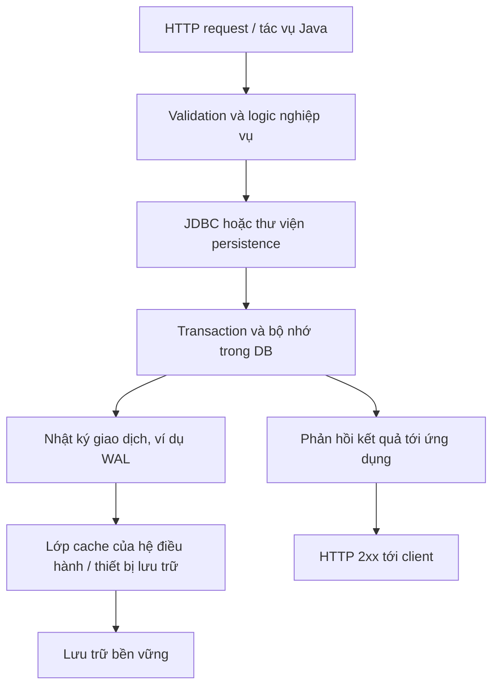

# Vì sao lưu thành công ở ứng dụng chưa đủ để kết luận dữ liệu an toàn

Một API trả `201 Created`, giao diện hiện “Đã lưu” và log ghi `save succeeded`. Vài phút sau, người dùng không tìm thấy dữ liệu. Điều này không nhất thiết có nghĩa API đã nói dối: thao tác có thể **thành công ở một lớp** nhưng chưa đạt mức bảo đảm mà người dùng hiểu là “an toàn”.

Trong module **DATA_PERSISTENCE_FUNDAMENTALS**, chúng ta học cách chọn mô hình dữ liệu, thiết kế lược đồ, truy vấn, chỉ mục, giao dịch, cô lập, kiểm soát đồng thời và ranh giới persistence cho Java; đồng thời xử lý lỗi kết nối, tiến hóa schema, bảo mật, sao lưu và hiệu năng. Bài này thuộc chương **Định hướng**, trả lời câu hỏi nền tảng: *“Lưu thành công” đã được xác nhận ở đâu, dữ liệu chịu được kiểu sự cố nào, và ai có thể khôi phục dữ liệu khi xảy ra lỗi?*

Sau bài này, người học có thể:

- Phân biệt việc ứng dụng chấp nhận yêu cầu, lệnh ghi được thực thi, giao dịch được commit và dữ liệu được ghi bền vững.
- Nhận diện các khoảng trống giữa `COMMIT`, xác nhận HTTP, bộ nhớ đệm, bản sao và bản sao lưu.
- Xử lý đúng trường hợp không biết giao dịch đã commit hay chưa, tránh ghi trùng khi retry.
- Đặt câu hỏi và thiết kế phép kiểm chứng phù hợp với yêu cầu mất dữ liệu, khôi phục và bảo mật.

## 1. “Đã lưu” là một phát biểu chưa đủ rõ

Xét thao tác tạo đơn hàng: người mua bấm **Đặt hàng**, máy chủ trả mã đơn và thông báo thành công. Chúng ta cần tách ít nhất sáu sự kiện:

| Sự kiện | Điều có thể kết luận | Điều chưa thể kết luận |
| --- | --- | --- |
| Ứng dụng nhận và kiểm tra yêu cầu | Dữ liệu đầu vào đã qua một số quy tắc kiểm tra | Dữ liệu đã tới cơ sở dữ liệu |
| Lệnh `INSERT` trả số dòng bị tác động | Cơ sở dữ liệu đã xử lý lệnh trong ngữ cảnh giao dịch hiện tại | Giao dịch đã commit, nhất là khi `autoCommit=false` |
| `COMMIT` được cơ sở dữ liệu xác nhận | Giao dịch đã commit theo cơ chế và cấu hình của hệ quản trị | Mọi hình thức hỏng đĩa, mất vùng dữ liệu hoặc xóa nhầm đều có thể phục hồi |
| Thành phần lưu trữ xác nhận ghi bền vững | Dữ liệu đã vượt qua một số lớp bộ nhớ dễ mất điện theo hợp đồng lưu trữ | Không thể bị hỏng phần cứng, lỗi cấu hình hay mất toàn bộ địa điểm |
| Bản sao khác nhận thay đổi | Có thêm một bản dữ liệu theo cơ chế sao chép đang dùng | Bản sao đồng bộ hoàn toàn hoặc có thể phục hồi bản ghi đã xóa nhầm |
| Có bản sao lưu và đã diễn tập khôi phục | Có căn cứ thực nghiệm về khả năng phục hồi tại thời điểm được thử | Mọi dữ liệu mới nhất đều nằm trong bản sao lưu, hoặc việc phục hồi luôn tức thời |

Các hàng trên mô tả **những mức bảo đảm khác nhau**, không phải một danh sách bước mà mọi hệ thống đều phải thực hiện tuần tự. Ví dụ, với JDBC đặt `autoCommit=true`, một lệnh có thể tự tạo và commit giao dịch; với `autoCommit=false`, `executeUpdate()` thành công chưa nói gì về kết quả commit sau đó. Không thể đoán ý nghĩa của “thành công” nếu thiếu thông tin về transaction, driver, DB và cấu hình lưu trữ.

**Bền vững (durability)** là khả năng thay đổi đã commit tồn tại sau những kiểu lỗi nằm trong cam kết của hệ thống. Nhưng **an toàn dữ liệu** còn rộng hơn:

- **Toàn vẹn:** dữ liệu tuân theo ràng buộc, không xuất hiện đơn hàng thiếu chi tiết hoặc số dư sai.
- **Nhất quán khi truy cập:** người đọc thấy trạng thái đúng theo mức nhất quán được thiết kế; cache và replica có thể chậm hơn nguồn chính.
- **Sẵn sàng và khôi phục được:** ứng dụng còn phục vụ hoặc có thể được phục hồi khi máy chủ, ổ đĩa hay cả vùng gặp lỗi.
- **Bảo mật và kiểm soát truy cập:** bản ghi không bị đọc, sửa hay xóa bởi người không có quyền.
- **Khả năng truy vết:** biết ai thay đổi dữ liệu, vào lúc nào, và có đủ log để điều tra sự cố.

Một hệ thống có thể ghi rất bền vững **giá trị sai** do bug tính tiền; hoặc có thể commit đúng nhưng mất dữ liệu do người vận hành chạy nhầm `DELETE`. Vì vậy không nên coi durability là toàn bộ câu trả lời.

## 2. Dữ liệu đi qua những lớp nào trước khi “nằm trên đĩa”?

Trong một luồng Java → database thông thường, dữ liệu có thể đi qua nhiều lớp:



*Sơ đồ chỉ mô tả các thành phần liên quan; thời điểm DB gửi xác nhận và việc đồng bộ xuống thiết bị phụ thuộc engine cùng cấu hình. Không suy ra mọi đường nối đều hoàn tất trước khi HTTP được trả.*

### 2.1. Bộ nhớ ứng dụng và lệnh ghi

Một đối tượng Java đổi trạng thái (`order.setStatus(PAID)`) mới chỉ thay đổi bộ nhớ ứng dụng. Ngay cả gọi `repository.save(order)` cũng cần xem framework đã phát lệnh SQL hay mới xếp thay đổi vào persistence context. Với JPA/Hibernate, `flush()` đồng bộ thay đổi thành SQL nhưng **không đồng nghĩa commit**; rollback sau `flush()` vẫn có thể hủy thay đổi đó.

Tương tự, `Files.writeString(path, text)` báo xong thường chỉ có nghĩa lời gọi ghi đã hoàn thành theo hợp đồng API và hệ điều hành. Nó không mặc nhiên bảo đảm dữ liệu đã thoát khỏi page cache hay metadata thư mục sẽ tồn tại sau mất điện. Khi cần mức bền vững cụ thể, phải xem cách mở file, `FileChannel.force(...)`, thao tác rename, đồng bộ metadata và bảo đảm của hệ thống tệp, ổ đĩa. Không nên suy rộng cam kết của database sang việc ghi file.

### 2.2. Transaction, WAL và xác nhận commit

Nhiều hệ quản trị quan hệ dùng nhật ký ghi trước (**write-ahead log**, WAL) hoặc cơ chế tương đương: trước khi coi thay đổi là bền vững, chúng ghi thông tin phục hồi vào log theo giao thức của chúng. Trang dữ liệu chính có thể được ghi xuống đĩa sau. Nhờ đó, sau crash, hệ quản trị có cơ sở để **redo** giao dịch đã commit hoặc **undo** thay đổi chưa commit.

Tuy nhiên, kết quả phụ thuộc cấu hình. Ví dụ, một hệ quản trị có chế độ commit bất đồng bộ có thể trả xác nhận trước khi nhật ký được ép xuống lưu trữ bền vững. Khi mất điện ngay lúc đó, giao dịch đã được ứng dụng ghi nhận vẫn có nguy cơ mất. Ngay cả khi yêu cầu đồng bộ được bật, cam kết cuối cùng còn phụ thuộc hệ điều hành, bộ điều khiển và việc thiết bị thực sự tôn trọng lệnh flush.

Đừng ghi nhớ một quy tắc kiểu “`commit()` trả về thì không thể mất dữ liệu”. Hãy hỏi: **DB nào, phiên bản nào, chế độ đồng bộ nào, trên loại lưu trữ nào và đang bảo vệ trước lỗi nào?**

### 2.3. Replica và backup giải quyết hai vấn đề khác nhau

**Replica** thường được dùng để tăng khả năng phục vụ, chuyển đổi máy chính hoặc phân tải đọc. Với sao chép bất đồng bộ, máy chính có thể xác nhận commit trước khi replica nhận thay đổi; nếu máy chính hỏng ở thời điểm này, phần thay đổi chưa sao chép có thể mất khi failover. Sao chép đồng bộ hoặc quorum có thể tăng mức bảo đảm, đổi lại có chi phí độ trễ và khả năng bị chặn khi thiếu nút.

**Backup** dùng để khôi phục một mốc dữ liệu trong quá khứ, đặc biệt hữu ích với xóa nhầm, lỗi chương trình, mã độc hoặc hỏng dữ liệu được sao chép sang các replica. Có replica không có nghĩa đã có backup: lệnh `DELETE` sai rất có thể cũng được sao chép sang replica. Có tệp backup cũng chưa đủ: phải kiểm tra tệp hợp lệ, khóa giải mã truy cập được, quy trình restore chạy được và dữ liệu sau restore có thể sử dụng.

## 3. Một yêu cầu tạo đơn hàng có thể thất bại ở nhiều thời điểm

Giả sử API thực hiện tạo đơn, giảm tồn kho, commit rồi trả `201`. Bảng sau cho thấy các mốc lỗi:

| Thời điểm lỗi | Hậu quả có thể xảy ra | Cách ứng dụng nên nhìn nhận |
| --- | --- | --- |
| Trước khi phát SQL | Không có thay đổi bền vững ở DB | Có thể báo thất bại rõ ràng |
| Sau `INSERT`, trước `COMMIT` | Transaction có thể bị rollback khi kết nối chết | Không báo thành công chỉ dựa vào số dòng ghi |
| DB đang xử lý `COMMIT` thì mạng đứt | Commit có thể đã thành công **hoặc** chưa | Kết quả **không xác định**, cần đối soát bằng khóa yêu cầu |
| `COMMIT` thành công, trước khi trả HTTP | Bản ghi có thể đã commit nhưng client không nhận được xác nhận | Client có thể gửi lại; phải chống tạo trùng |
| API đã trả HTTP, sau đó mất điện | Có sống sót hay không tùy bảo đảm durability đã cấu hình | Kiểm tra cam kết DB và lưu trữ trước loại lỗi này |
| Sau khi dữ liệu đã bền vững, có người xóa nhầm | Giao dịch ghi ban đầu vẫn đúng nhưng dữ liệu hiện tại không còn | Cần quyền hạn, audit và khả năng khôi phục theo thời điểm |

Sự kiện **mất kết nối khi commit** đặc biệt nguy hiểm: Java nhận `SQLException` không đủ để khẳng định transaction đã rollback. Cơ sở dữ liệu có thể đã commit rồi mới mất gói phản hồi. Nếu ứng dụng retry toàn bộ thao tác mà không có cơ chế chống trùng, một đơn hàng hoặc một lần trừ tiền có thể xảy ra hai lần.

```mermaid
sequenceDiagram
    participant C as Client
    participant A as Java API
    participant D as Database
    C->>A: Tạo đơn (request_key = R42)
    A->>D: BEGIN; INSERT; COMMIT
    D--xA: Phản hồi COMMIT bị mất
    Note over A,D: Java không biết commit đã hoàn tất hay chưa
    A-->>C: Timeout / trạng thái chưa rõ
    C->>A: Retry với request_key = R42
    A->>D: Tra cứu R42; chỉ tạo nếu chưa tồn tại
    D-->>A: Cùng kết quả đơn hàng
    A-->>C: Kết quả nhất quán theo R42
```

Ở đây, `request_key` là **khóa idempotency** do client cung cấp hoặc hệ thống cấp, giữ nguyên qua các lần retry của *cùng một yêu cầu nghiệp vụ*. Database nên có ràng buộc duy nhất cho khóa này. Nếu cùng khóa mà payload khác, ứng dụng phải trả lỗi xung đột thay vì xem đó là cùng một yêu cầu.

## 4. Java: đặt ranh giới thành công tại commit và xử lý kết quả chưa rõ

Ví dụ minh họa dùng JDBC và một bảng kiểu PostgreSQL; các kiểu dữ liệu và cú pháp cần điều chỉnh nếu dùng hệ quản trị khác.

```sql
CREATE TABLE orders (
    id           UUID PRIMARY KEY,
    request_key  VARCHAR(100) NOT NULL UNIQUE,
    customer_id  UUID NOT NULL,
    total_cents  BIGINT NOT NULL CHECK (total_cents >= 0),
    created_at   TIMESTAMPTZ NOT NULL DEFAULT CURRENT_TIMESTAMP
);
```

Đoạn mã sau chỉ trả kết quả thành công sau khi lời gọi commit trả về. Nó phân biệt lỗi phát sinh trước commit với **lỗi trong khi commit**:

```java
import javax.sql.DataSource;
import java.sql.Connection;
import java.sql.PreparedStatement;
import java.sql.SQLException;
import java.util.UUID;

public final class OrderWriter {
    private final DataSource dataSource;

    public OrderWriter(DataSource dataSource) {
        this.dataSource = dataSource;
    }

    public void create(UUID id, String requestKey,
                       UUID customerId, long totalCents) throws SQLException {
        try (Connection connection = dataSource.getConnection()) {
            connection.setAutoCommit(false);

            try (PreparedStatement statement = connection.prepareStatement(
                    "INSERT INTO orders " +
                    "(id, request_key, customer_id, total_cents) VALUES (?, ?, ?, ?)")) {
                statement.setObject(1, id);
                statement.setString(2, requestKey);
                statement.setObject(3, customerId);
                statement.setLong(4, totalCents);
                statement.executeUpdate();
            } catch (SQLException writeError) {
                try {
                    connection.rollback();
                } catch (SQLException rollbackError) {
                    writeError.addSuppressed(rollbackError);
                }
                throw writeError;
            }

            try {
                connection.commit();
            } catch (SQLException commitError) {
                // Kết nối lỗi có thể che mất một COMMIT đã thành công.
                throw new CommitOutcomeUnknownException(commitError);
            }
        }
    }

    public static final class CommitOutcomeUnknownException
            extends RuntimeException {
        public CommitOutcomeUnknownException(SQLException cause) {
            super("Cannot determine whether the transaction committed", cause);
        }
    }
}
```

Đây là ví dụ về **ranh giới transaction**, chưa phải một API xử lý retry hoàn chỉnh. Trong dịch vụ thật còn phải xử lý bản ghi trùng `request_key`, tra cứu kết quả đã có, so sánh nội dung yêu cầu và quy định trạng thái phản hồi cho client. `UNIQUE(request_key)` ngăn ghi trùng trong DB nhưng tự nó không giúp dựng lại phản hồi nghiệp vụ hoặc chứng minh hai payload giống nhau.

Một luồng retry thực tế nên đi theo nguyên tắc:

1. Client gửi một `request_key` ổn định cho đúng một ý định tạo đơn.
2. Server lưu khóa đó **trong cùng transaction** với thay đổi nghiệp vụ và đặt ràng buộc duy nhất ở DB.
3. Nếu thấy khóa đã tồn tại, server kiểm tra payload/ngữ nghĩa của yêu cầu cũ rồi trả kết quả tương ứng, hoặc báo xung đột.
4. Nếu mất kết nối trong lúc commit, server **đối soát bằng khóa** sau khi DB có thể truy cập lại. Việc không tìm thấy ngay trên một replica đọc chậm không chứng minh transaction chưa commit.
5. Chỉ retry thao tác có nguy cơ tạo tác dụng phụ sau khi đã thiết kế tính idempotent hoặc có cơ chế xác minh trạng thái đáng tin cậy.

**Lưu ý với Spring `@Transactional`:** lệnh `repository.save(...)` thường chạy **trước** thời điểm transaction do interceptor commit. Nếu service trả đối tượng rồi proxy mới commit, controller cần bảo đảm phản hồi HTTP thành công chỉ được hoàn tất khi ranh giới transaction thực sự kết thúc thành công. `saveAndFlush()` cũng không thay thế commit. Với lỗi commit không rõ kết quả, nguyên tắc đối soát bằng khóa vẫn giữ nguyên.

## 5. “An toàn” phải gắn với sự cố và mục tiêu phục hồi

Không có cấu hình đơn lẻ nào bảo đảm “dữ liệu sẽ không bao giờ mất”. Trước khi chọn công nghệ hay chế độ commit, hãy xác định **mô hình sự cố**: cần chịu được crash JVM, reboot máy, mất điện, hỏng ổ đĩa, mất cả vùng, xóa nhầm, lỗi schema migration hay truy cập trái phép?

| Sự cố cần chịu đựng | Cơ chế thường liên quan | Cách kiểm chứng có ý nghĩa |
| --- | --- | --- |
| Process Java bị kill | Transaction và commit phía DB; không phụ thuộc biến trong RAM Java | Kill ứng dụng sau commit, đọc lại từ phiên khác |
| DB process/OS crash hoặc mất điện | WAL, flush/fsync, cấu hình đồng bộ, lưu trữ hỗ trợ | Thử crash trong môi trường cô lập; kiểm tra dữ liệu và log phục hồi |
| Máy hoặc ổ đĩa chính hỏng | Storage redundancy, replica, failover được cấu hình đúng | Diễn tập mất nút và đo dữ liệu thiếu sau failover |
| Xóa nhầm hoặc migration gây hỏng dữ liệu | Backup độc lập, point-in-time recovery, quy trình rollback/migration | Restore vào môi trường khác rồi đối chiếu các bản ghi |
| Người dùng ghi đồng thời | Transaction isolation, constraint, locking hoặc versioning | Bài thử concurrent update, double-submit, tranh chấp khóa |
| Truy cập trái phép hoặc ransomware | Phân quyền tối thiểu, audit, mã hóa và bản sao lưu cách ly | Thử quyền truy cập và diễn tập khôi phục từ nguồn sạch |

Hai đại lượng giúp biến yêu cầu thành tiêu chí cụ thể:

- **RPO (Recovery Point Objective):** mức mất dữ liệu *tối đa chấp nhận* khi phải khôi phục. Ví dụ RPO 5 phút nghĩa là thiết kế hướng tới việc mất không quá 5 phút thay đổi, không phải lời hứa hệ thống hiện tại đã đạt.
- **RTO (Recovery Time Objective):** thời gian *tối đa chấp nhận* để dịch vụ được khôi phục. Ví dụ RTO 30 phút chỉ có ý nghĩa nếu kế hoạch restore, phụ thuộc hạ tầng và diễn tập thực tế đáp ứng được.

Replica có thể giúp RTO nhưng vẫn có RPO khác 0 nếu sao chép bất đồng bộ. Backup mỗi ngày có thể giúp phục hồi khỏi xóa nhầm nhưng có RPO lên đến gần một ngày nếu thiếu lưu trữ log liên tục. Chọn cơ chế theo RPO/RTO và kiểu sự cố, không theo nhãn “có HA” hoặc “đã bật backup”.

## 6. Những trường hợp dễ bị hiểu sai trong ứng dụng Java

### Trường hợp A: ghi vào DB xong rồi gửi email

```text
BEGIN → INSERT đơn hàng → COMMIT → gọi dịch vụ email
```

Nếu DB commit thành công nhưng dịch vụ email lỗi, đơn hàng vẫn tồn tại song thông báo chưa gửi. Nếu đảo thứ tự, email có thể gửi xong trong khi transaction đơn hàng rollback. Hai hệ thống không tự nhiên nằm trong một transaction ACID chung. Một mẫu thường dùng là **transactional outbox**: ghi bản ghi nghiệp vụ cùng một sự kiện `OrderCreated` vào bảng outbox trong cùng transaction, sau đó worker gửi sự kiện và đánh dấu tiến độ. Worker/consumer vẫn cần idempotency vì sự kiện có thể được giao nhiều lần.

### Trường hợp B: ghi thành công nhưng lần đọc kế tiếp không thấy

Ứng dụng ghi vào primary, sau đó đọc từ replica bất đồng bộ hoặc cache chưa được vô hiệu hóa. Câu trả lời “không thấy” có thể là **độ trễ hiển thị**, không nhất thiết là mất bền vững. Cần phân biệt `read-after-write consistency` với durability. Với yêu cầu người dùng phải xem ngay kết quả vừa tạo, có thể đọc từ primary, giữ phiên nhất quán hoặc dùng cơ chế đồng bộ cache phù hợp.

### Trường hợp C: ghi một phần làm hệ thống không nhất quán

Ví dụ trừ tiền trong ví rồi tạo bản ghi giao dịch ở hai transaction riêng: bước đầu commit, bước sau thất bại. Dữ liệu vẫn bền vững, nhưng nghiệp vụ bị sai. Khi các thay đổi cần cùng thành công hoặc cùng thất bại, hãy đặt chúng trong **một transaction phù hợp** và bổ sung constraint. Khi thay đổi trải qua nhiều service, cần mô hình điều phối và bù trừ có kiểm soát, không giả định có transaction chung.

### Trường hợp D: một nút DB sống sót nhưng mất cả vùng

Commit đã được xác nhận trên một nút lưu trữ bền vững vẫn có thể không đủ trước sự cố mất máy hoặc vùng đặt dữ liệu. Cấu hình nhân bản liên vùng, phân bổ bản sao và chiến lược backup ngoài vùng mới trả lời được câu hỏi này. Các lựa chọn có chi phí và độ trễ khác nhau; phải kiểm tra failover có giữ đúng mức dữ liệu đã xác nhận hay không.

### Trường hợp E: ghi file trên volume tạm của container

Lời gọi ghi file trả thành công và dữ liệu có thể đọc lại ngay. Nhưng nếu file nằm trên filesystem tạm gắn với vòng đời container, việc thay pod/container có thể làm file biến mất. Cần phân biệt **thành công ở API ghi** với **chính sách tồn tại của volume**; chọn persistent volume hoặc object storage đúng yêu cầu và kiểm tra cách bảo đảm durability của từng hệ thống.

## 7. Thiết kế hợp đồng “lưu thành công” có thể kiểm chứng

Với một endpoint quan trọng, nhóm phát triển cần trả lời rõ các câu sau:

1. **Thành công nghĩa là gì?** `2xx` được trả sau transaction commit hay chỉ sau khi đưa yêu cầu vào queue? Nếu mới nhận vào queue, API phải đặt tên trạng thái phù hợp như *accepted*, kèm cách tra cứu tiến độ.
2. **Điểm lưu trữ có bền vững không?** Kiểm tra cấu hình commit và flush thực tế, loại volume, chính sách replica, đặc tính crash recovery của phiên bản DB đang chạy.
3. **Giao dịch bao trùm gì?** Các thay đổi cần tính nguyên tử có cùng transaction không? Constraint nào bảo vệ tính toàn vẹn khi nhiều yêu cầu chạy đồng thời?
4. **Nếu mất phản hồi thì sao?** Có `request_key`/khóa nghiệp vụ duy nhất, đường tra cứu trạng thái và quy tắc retry tránh tác dụng phụ lặp không?
5. **Nếu dữ liệu bị mất hoặc hỏng thì sao?** Backup có lưu ngoài miền lỗi chung, có mã hóa và kiểm soát quyền, có nhật ký để point-in-time restore, và đã thực sự khôi phục thử chưa?
6. **Chứng cứ ở đâu?** Có log với correlation ID, metric commit failure, replication lag, thời điểm backup/restore thành công và kết quả diễn tập lỗi không? Không log dữ liệu nhạy cảm hoặc thông tin xác thực để đổi lấy khả năng truy vết.

Hãy biến các câu trả lời thành **hợp đồng có giới hạn cụ thể**, chẳng hạn:

> API chỉ trả `201` sau khi transaction tạo đơn và ghi khóa idempotency commit thành công trên primary. Hệ thống có mục tiêu RPO/RTO được phê duyệt; cấu hình đồng bộ, sao chép và restore được kiểm tra định kỳ. Nếu mất kết nối khi commit, API không tự khẳng định thất bại; client dùng cùng khóa yêu cầu để truy vấn hoặc gửi lại an toàn.

Phát biểu này vẫn cần được kiểm nghiệm trong môi trường triển khai cụ thể: nó không tự bảo đảm chịu được mọi thảm họa.

## 8. Bài tập suy luận và kiểm chứng

**Bài tập 1 — phân loại kết luận.** Một lập trình viên viết `entityManager.flush(); return "saved";` trong phương thức có transaction. Có thể khẳng định dữ liệu đã bền vững không?

**Gợi ý:** Không. `flush()` đồng bộ SQL nhưng giao dịch vẫn có thể rollback hoặc commit thất bại. Cần xác định thời điểm transaction kết thúc và bảo đảm ghi bền vững của DB.

**Bài tập 2 — retry sau timeout.** Client gửi lệnh tạo đơn, DB đã commit nhưng phản hồi bị rơi. Client thử lại với cùng `request_key`. Thiết kế điều kiện duy nhất và xử lý xung đột để không có hai đơn hàng; giải thích vì sao chỉ đọc từ replica có độ trễ là chưa đủ.

**Gợi ý:** Ghi khóa vào cùng transaction, tạo unique constraint, đối soát trên nguồn đọc đủ mạnh và kiểm tra payload trùng. Không kết luận “chưa ghi” chỉ từ replica chưa thấy dữ liệu.

**Bài tập 3 — lựa chọn chiến lược phục hồi.** Hệ thống được yêu cầu RPO 5 phút, RTO 30 phút và phục hồi được khi nhân viên xóa nhầm dữ liệu từ hôm qua. Một replica đồng bộ có đáp ứng đủ không?

**Gợi ý:** Chưa đủ, vì xóa nhầm cũng có thể được đồng bộ. Cần backup độc lập, khả năng phục hồi theo thời điểm cùng diễn tập đo RPO và RTO thực tế.

**Thực hành có kiểm soát:** Trong môi trường thử nghiệm, hãy tạo bản ghi có khóa yêu cầu duy nhất; mô phỏng mất phản hồi sau khi DB commit; gửi lại cùng khóa và xác nhận chỉ có một bản ghi. Tiếp theo, tắt tiến trình ứng dụng, đọc lại từ kết nối DB mới; cuối cùng thử restore một bản backup vào database khác và đối chiếu dữ liệu. Mỗi phép thử chứng minh một phạm vi bảo đảm riêng, không thể dùng một phép thử để thay thế tất cả.

## Ghi nhớ

“Lưu thành công” chỉ có ý nghĩa khi biết **ai xác nhận, vào thời điểm nào và dựa trên cam kết nào**. `executeUpdate()`, `COMMIT`, HTTP `201`, replica và backup cung cấp các loại bằng chứng khác nhau. Muốn kết luận dữ liệu an toàn, hãy gắn từng bằng chứng với mô hình sự cố, mức nhất quán, yêu cầu bảo mật, RPO/RTO và kết quả khôi phục đã được kiểm chứng. Đây là nền tảng để thiết kế ranh giới persistence đáng tin cậy trong ứng dụng Java.
