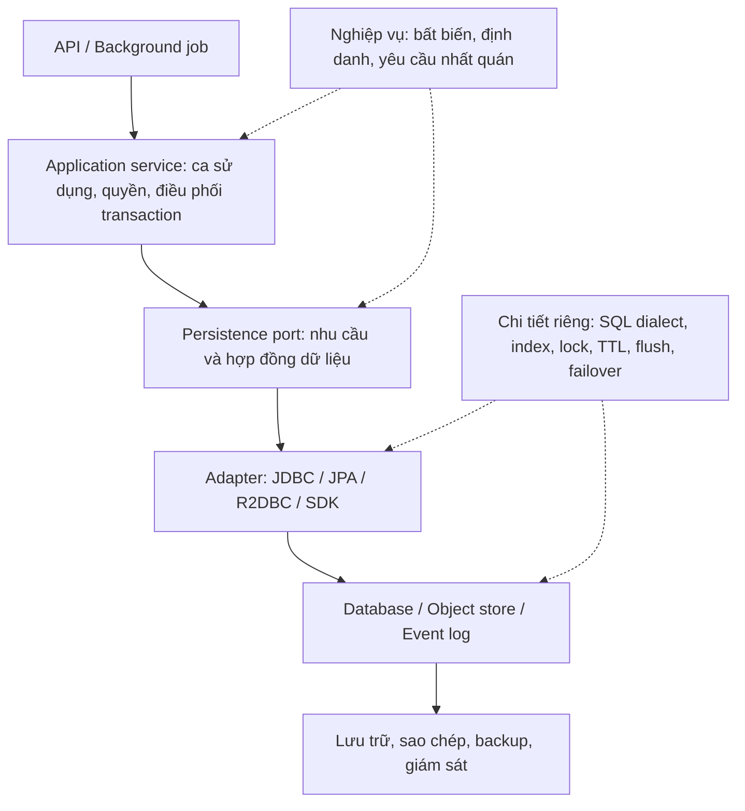

# Phạm vi nền tảng chung và ranh giới với các công nghệ triển khai

Một đội phát triển có thể dùng PostgreSQL với JDBC, đội khác dùng MySQL với JPA, một dịch vụ khác dùng kho tài liệu, và hệ thống báo cáo dùng object storage. Các giải pháp đó khác nhau về API, ngôn ngữ truy vấn, cách mở rộng và vận hành; nhưng đều phải trả lời những câu hỏi như: *Dữ liệu nào cần được giữ lại? Điều kiện nào phải luôn đúng? Khi nhiều yêu cầu chạy đồng thời thì điều gì được phép xảy ra? Sau sự cố, hệ thống có thể khôi phục đến đâu?*

Bài này thuộc chương **Định hướng** của module **DATA_PERSISTENCE_FUNDAMENTALS**. Module xây dựng hiểu biết về lưu trữ dữ liệu bền vững trong ứng dụng: chọn mô hình dữ liệu, thiết kế lược đồ, truy vấn và chỉ mục; giao dịch, cô lập và kiểm soát đồng thời; thiết kế ranh giới persistence trong Java; xử lý lỗi kết nối, tiến hóa schema, bảo mật, sao lưu và tối ưu hiệu năng. Mục tiêu ở đây là xác định **phần kiến thức dùng chung**, **phần phụ thuộc vào công nghệ triển khai**, và cách nối hai phần đó thành một thiết kế có thể kiểm chứng.

Sau khi học, bạn có thể:

- Phân biệt **yêu cầu nghiệp vụ**, **bảo đảm dữ liệu cần có** và **cơ chế của một sản phẩm/driver/framework**.
- Nhận diện các nguyên lý chung áp dụng cho nhiều loại kho dữ liệu, nhưng hiểu rằng mức hỗ trợ của mỗi công nghệ có thể rất khác nhau.
- Chọn ranh giới hợp lý giữa domain/service và lớp Java truy cập dữ liệu, không tạo ra một abstraction giả vờ mọi database giống nhau.
- Lập danh sách các bảo đảm phải xác minh bằng tài liệu, cấu hình và phép thử trên hệ thống thực tế.

## 1. Ba lớp câu hỏi cần tách biệt

Hãy xét yêu cầu: **mỗi đơn hàng chỉ được đặt một lần cho một yêu cầu của khách, không bán vượt tồn kho và có thể tra cứu sau khi ứng dụng khởi động lại**.

| Lớp | Câu hỏi mẫu | Ai quyết định hoặc chịu trách nhiệm? |
| --- | --- | --- |
| **Nhu cầu và bất biến nghiệp vụ** | Một yêu cầu chỉ tạo tối đa một đơn? Tồn kho có được âm không? | Nhóm sản phẩm, nghiệp vụ và kiến trúc ứng dụng |
| **Hợp đồng dữ liệu** | Định danh yêu cầu duy nhất ở đâu? Các thay đổi nào cần nguyên tử? Cần nhất quán khi đọc đến mức nào? | Nhóm thiết kế hệ thống, chủ sở hữu dữ liệu |
| **Cơ chế triển khai** | Dùng UNIQUE constraint, conditional update, transaction JDBC, document update, khóa hay so sánh phiên bản? | Nhóm triển khai, theo khả năng của kho dữ liệu cụ thể |

Nếu bắt đầu bằng câu “dùng `@Transactional` là đủ”, ta đã nhảy thẳng xuống lớp cơ chế mà chưa xác định transaction bao trùm những tài nguyên nào, khi nào có commit, hay điều gì xảy ra nếu phản hồi bị mất. Ngược lại, câu “cần cập nhật số dư có tính nguyên tử” là một yêu cầu có thể dùng để đánh giá nhiều giải pháp.

**Nguyên lý chung không đồng nghĩa mọi sản phẩm có cùng tính năng.** Có thể đặt câu hỏi về transaction đối với cả SQL database và một hệ NoSQL, nhưng không được suy ra rằng tất cả hỗ trợ giao dịch đa bản ghi, mức cô lập hay quy tắc commit giống nhau.

## 2. Phạm vi của nền tảng persistence

Persistence là cách ứng dụng ghi, giữ, đọc, cập nhật, xóa và khôi phục trạng thái cần tồn tại qua vòng đời của một tác vụ hoặc tiến trình. Từ mô hình nghiệp vụ tới vận hành, có những nhóm vấn đề thường gặp:

| Nhóm kiến thức chung | Câu hỏi không phụ thuộc tên sản phẩm | Điểm triển khai cần tra cứu riêng |
| --- | --- | --- |
| **Mô hình dữ liệu** | Thực thể, thuộc tính, quan hệ, định danh và vòng đời dữ liệu là gì? | Bảng/cột, tài liệu JSON, key–value, cạnh đồ thị, đối tượng trong bucket |
| **Lược đồ và ràng buộc** | Điều kiện nào phải đúng với mọi trạng thái đã chấp nhận? | `PRIMARY KEY`, `UNIQUE`, `CHECK`, JSON Schema, kiểm tra tại ứng dụng |
| **Đọc/ghi và truy vấn** | Truy cập theo khóa nào, lọc/sắp xếp/phân trang ra sao? | SQL, query API, partition key, scan, cursor, pagination token |
| **Chỉ mục và cấu trúc truy cập** | Truy vấn chính có đáp ứng độ trễ và chi phí không? | B-tree, hash, inverted index, index cho JSON, thiết kế partition |
| **Tính nguyên tử và nhất quán** | Những thay đổi nào phải thành công cùng nhau? | Transaction, thao tác nguyên tử một bản ghi, batch, saga |
| **Cô lập và đồng thời** | Hai người cùng sửa có gây mất cập nhật hoặc vi phạm bất biến không? | Isolation level, optimistic lock, conditional write, version token |
| **Độ bền và khả năng khôi phục** | Sau crash, lỗi thiết bị hay xóa nhầm, dữ liệu còn đến đâu? | WAL, flush, replication, snapshot, point-in-time recovery |
| **Tiến hóa dữ liệu** | Thay đổi định dạng mà ứng dụng cũ/mới vẫn hoạt động thế nào? | DDL migration, versioned document, backfill, dual-read/write có kiểm soát |
| **An toàn và bảo mật** | Ai được đọc/sửa, cần mã hóa hoặc lưu vết gì? | Database roles, IAM, row security, secret management, audit log |
| **Hiệu năng và vận hành** | Độ trễ, thông lượng, chi phí, tải, lỗi kết nối và thời gian khôi phục được đo ra sao? | Connection pool, query plan, quota, metrics, backup/restore tooling |

Bảng là **bản đồ phạm vi**, chưa phải danh sách cấu hình bắt buộc. Chẳng hạn, không phải mọi kho dữ liệu có “schema” theo nghĩa DDL; nhưng ứng dụng vẫn cần biết cấu trúc nào được chấp nhận, cách chuyển đổi dữ liệu cũ và cách ngăn trạng thái sai. Tương tự, cache có thể làm nhanh thao tác đọc nhưng không tự biến thành nguồn dữ liệu bền vững.

### Những khái niệm cần mang theo qua mọi công nghệ

**Định danh và bất biến.** Mỗi đối tượng cần cách nhận diện rõ ràng. Giá trị nào phải duy nhất? Quan hệ nào không được mất? Có thể kiểm tra các điều kiện tại ứng dụng, nhưng với ghi đồng thời, việc kiểm tra rồi mới ghi có thể bị race condition; cần cơ chế nguyên tử hoặc ràng buộc đủ mạnh ở phía lưu trữ.

**Hợp đồng nhất quán.** Sau khi ghi, ai cần thấy thay đổi và thấy khi nào? Đọc từ primary, replica, cache hay một chỉ mục tìm kiếm có thể cho các mức mới của dữ liệu khác nhau. Cần phát biểu rõ yêu cầu đọc sau ghi, thứ tự các thay đổi và chấp nhận độ trễ, thay vì gọi chung là “real-time”.

**Hợp đồng lỗi.** Thất bại trước khi gửi lệnh, lỗi trả về từ DB, timeout khi commit và mất kết nối sau commit không có cùng ý nghĩa. Một lần retry có thể nhân đôi tác dụng nếu không có khóa idempotency và đường đối soát. Hợp đồng lỗi là một phần của thiết kế dữ liệu, không chỉ của thư viện networking.

**Hợp đồng vòng đời.** Dữ liệu sẽ được giữ trong bao lâu, ai được xóa, cần lưu lịch sử hay khôi phục đến mốc nào? Giải pháp backup, retention và migration phải trả lời được các yêu cầu đó.

## 3. Công nghệ lưu trữ giải những phần khác nhau của bài toán

Không có một loại kho dữ liệu “tốt nhất” cho mọi nhu cầu. Các nhóm dưới đây có phần giao nhau và sản phẩm thực tế có thể cung cấp nhiều mô hình.

| Nhóm công nghệ | Thế mạnh thường gặp | Câu hỏi phải xác minh thay vì mặc định |
| --- | --- | --- |
| **Cơ sở dữ liệu quan hệ** (ví dụ PostgreSQL, MySQL) | Bảng, quan hệ, SQL, constraint, transaction, truy vấn linh hoạt | Mức cô lập thực tế, tính năng theo engine, cách khóa, index, failover và durability configuration |
| **Kho tài liệu** | Cấu trúc tài liệu linh hoạt; truy xuất theo document/aggregate | Bảo đảm ghi nguyên tử trên một hay nhiều tài liệu, index, kiểu truy vấn và cơ chế schema evolution |
| **Key–value store** | Truy cập bằng khóa với latency thấp; có thể dùng cho session, cache hoặc dữ liệu có mô hình khóa rõ | Dữ liệu chỉ nằm trong RAM hay có lưu bền? TTL, eviction, ghi đĩa, replication, tính nguyên tử ra sao? |
| **Wide-column / phân tán theo partition** | Phân phối dữ liệu và tải lớn với access pattern được thiết kế trước | Partition key, độ nhất quán cho read/write, chi phí cross-partition, repair và vận hành |
| **Graph database** | Duyệt quan hệ sâu và đường đi phức tạp | Quy mô traversal, bảo đảm transaction, index, ràng buộc, cách triển khai phân tán |
| **Object/file storage** | Lưu file, bản ghi bất biến, media, backup, dữ liệu phân tích | Atomicity của update/rename, versioning, consistency, retention, quyền truy cập, lifecycle và phí truy cập |
| **Event log / streaming platform** | Ghi lại chuỗi sự kiện, tích hợp bất đồng bộ, tái xử lý | Retention, thứ tự theo partition, xác nhận ghi, replay, duplicate delivery, projection và tính nhất quán |

Phân loại theo mục đích cũng quan trọng: **database nguồn sự thật** cho giao dịch khác với **cache** dùng để giảm tải, **search index** để tìm kiếm, hay **data warehouse** để phân tích. Một bản ghi có thể xuất hiện ở nhiều nơi, nhưng cần định nghĩa nơi nào có quyền quyết định trạng thái chuẩn, cách đồng bộ các bản sao và xử lý khi chúng bất đồng.

Ví dụ, một website có thể dùng cơ sở dữ liệu quan hệ làm nguồn đơn hàng, object storage giữ ảnh hóa đơn, Redis làm cache và search engine làm chỉ mục tra cứu. Mỗi thành phần giải quyết một vấn đề; tính đúng đắn của đơn hàng vẫn cần được thiết kế tại nguồn trạng thái và ở đường truyền thay đổi đến các thành phần khác.

## 4. Ranh giới kiến trúc: từ nghiệp vụ đến thiết bị lưu trữ

Hình sau tách *điều ứng dụng muốn bảo đảm* khỏi *cách một công nghệ cung cấp bảo đảm đó*:



### 4.1. Domain và application service

Domain mô tả các khái niệm và điều kiện nghiệp vụ như “không cho phép số lượng đặt vượt tồn kho”. Application service điều phối một ca sử dụng: lấy dữ liệu, xác thực quyền, áp dụng điều kiện, ghi trạng thái và phát sự kiện thích hợp.

Điều quan trọng là xác định **ranh giới nguyên tử**: nếu tạo đơn và trừ kho phải cùng commit, đặt chúng trong phạm vi transaction mà kho dữ liệu có thể cung cấp. Khi có nhiều database hoặc dịch vụ khác nhau, lời gọi transaction cục bộ không tự bao trùm các tài nguyên bên ngoài; có thể cần transactional outbox, quy trình bù trừ hoặc mô hình nhất quán cuối cùng tùy yêu cầu.

### 4.2. Persistence port

Port là một interface thể hiện nhu cầu dùng dữ liệu của ứng dụng, ví dụ “tìm sản phẩm theo SKU”, “ghi nhận một yêu cầu có khóa duy nhất”, “đặt chỗ nếu còn tồn kho”. Các phương thức nên mô tả **ý nghĩa hành vi**, đầu vào, kết quả, lỗi và kỳ vọng nhất quán mà caller cần.

Không nhất thiết tạo port cho mọi entity hay bọc mọi thao tác CRUD. Với một báo cáo SQL đặc thù, có thể dùng query service chuyên biệt. Đối với pipeline phân tích hoặc công cụ migration, dùng API trực tiếp của engine đôi khi rõ ràng và dễ kiểm thử hơn. Ranh giới tốt giảm sự phụ thuộc không cần thiết nhưng vẫn cho phép tận dụng năng lực thật của backend.

### 4.3. Adapter và driver

Adapter chuyển yêu cầu thành truy vấn, lệnh ghi và transaction đúng cho công nghệ được chọn. JDBC/JPA/Hibernate/Spring Data/jOOQ/MyBatis/R2DBC là các lựa chọn **ở lớp truy cập hoặc lập trình**, không phải bảo đảm lưu trữ tự thân. Driver chuyển lời gọi thành giao thức; database engine mới áp dụng quy tắc transaction, constraint, storage và replication.

Một framework giúp viết ít mã không thay thế việc hiểu commit, isolation, query plan và lỗi. Hai adapter cùng implement một interface chỉ tương đương nếu chúng **đáp ứng cùng hợp đồng quan sát được**; trùng chữ ký phương thức chưa đủ chứng minh tính tương đương.

## 5. Ví dụ Java: tách nhu cầu tra cứu khỏi SQL cụ thể

Giả sử domain cần lấy tên và giá sản phẩm theo SKU. Phía gọi chỉ cần một thao tác tra cứu; cách đọc từ SQL nằm ở adapter.

```java
import java.util.Optional;

record ProductView(String sku, String name, long priceCents) { }

interface ProductReader {
    Optional<ProductView> findBySku(String sku);
}
```

Triển khai JDBC cho một schema có bảng `product(sku, name, price_cents)`:

```java
import java.sql.Connection;
import java.sql.PreparedStatement;
import java.sql.ResultSet;
import java.sql.SQLException;
import java.util.Optional;
import javax.sql.DataSource;

final class JdbcProductReader implements ProductReader {
    private final DataSource dataSource;

    JdbcProductReader(DataSource dataSource) {
        this.dataSource = dataSource;
    }

    @Override
    public Optional<ProductView> findBySku(String sku) {
        String sql = """
                SELECT sku, name, price_cents
                FROM product
                WHERE sku = ?
                """;

        try (Connection connection = dataSource.getConnection();
             PreparedStatement statement = connection.prepareStatement(sql)) {
            statement.setString(1, sku);
            try (ResultSet result = statement.executeQuery()) {
                if (!result.next()) {
                    return Optional.empty();
                }
                return Optional.of(new ProductView(
                        result.getString("sku"),
                        result.getString("name"),
                        result.getLong("price_cents")
                ));
            }
        } catch (SQLException error) {
            throw new PersistenceReadException("Cannot read product", error);
        }
    }
}

final class PersistenceReadException extends RuntimeException {
    PersistenceReadException(String message, Throwable cause) {
        super(message, cause);
    }
}
```

Đoạn mã minh họa cú pháp Java hỗ trợ text block (Java 15 trở lên). Để chạy cần schema, datasource và driver thực tế. Cách ánh xạ từ `ResultSet` vào `ProductView` là chi tiết của JDBC adapter. Caller không cần import `java.sql` và không cần biết bảng được lưu trong PostgreSQL hay một engine quan hệ khác.

Nhưng interface trên **chưa** nói dữ liệu có thể cũ đến mức nào. Nếu adapter thứ hai đọc từ cache hoặc read replica, cần làm rõ yêu cầu đọc ngay sau ghi, TTL, stale result và cách kiểm soát quyền. Nếu nghiệp vụ đòi hỏi đọc dữ liệu vừa commit trong cùng ca sử dụng, port có thể cần hợp đồng phù hợp hơn về transaction/session; không thể âm thầm đổi sang cache với ngữ nghĩa khác.

**Một khác biệt cần chú ý:** trong ví dụ, mọi `SQLException` được chuyển thành lỗi đọc chung để giữ interface đơn giản; ứng dụng thực tế cần phân loại lỗi theo cơ chế retry, mất kết nối, timeout và chặn truy cập, đồng thời giữ nguyên nguyên nhân gốc. Với thao tác ghi, đặc biệt nếu lỗi xảy ra quanh commit, không được tự kết luận giao dịch đã rollback và retry vô điều kiện.

## 6. Từ yêu cầu chung đến chiến lược ghi cụ thể

Bây giờ xét tồn kho. Bất biến là **available >= 0**, và hai khách đặt cùng lúc không được cùng tiêu thụ một đơn vị hàng cuối cùng.

**Cách dễ gặp race condition:**

```text
Đọc available = 1
→ yêu cầu A thấy đủ hàng, yêu cầu B cũng thấy đủ hàng
→ A trừ 1; B trừ 1 dựa trên cùng giá trị cũ
→ mất cập nhật, bán vượt tồn hoặc phản hồi sai
```

**Một cách triển khai trong SQL database** là conditional update:

```sql
UPDATE inventory
SET available = available - :quantity
WHERE sku = :sku AND available >= :quantity;
```

Ở đây `:quantity` và `:sku` đại diện cho tham số bind do thư viện truy cập dữ liệu cung cấp; JDBC thuần thường dùng dấu `?`. Với DB có bảo đảm nguyên tử cho từng lệnh cập nhật và xử lý cạnh tranh phù hợp, ứng dụng kiểm tra số dòng bị tác động: 1 nghĩa là lệnh giảm tồn kho có hiệu lực trong phạm vi transaction đó; 0 nghĩa là không có dòng đáp ứng điều kiện tại thời điểm DB đánh giá lệnh. Muốn bảo đảm giao dịch đã được lưu, vẫn phải xét **commit** và lỗi commit.

Một kho tài liệu hỗ trợ cập nhật có điều kiện trên **một document** có thể thực hiện ý tưởng tương tự. Tuy nhiên, nếu tồn kho và đơn hàng ở hai document/partition hoặc hai dịch vụ, khả năng nguyên tử và cách thực hiện khác nhau. Không thể mang nguyên câu SQL hay lời hứa transaction sang backend khác mà không kiểm chứng.

Khi dùng yêu cầu đặt hàng thật, còn cần:

1. **Idempotency key:** cùng ý định đặt hàng có thể bị gửi lại sau timeout; phải tránh tạo hai đơn hoặc trừ kho hai lần.
2. **Định danh và ràng buộc:** mỗi SKU/đơn hàng/khóa yêu cầu có quy tắc duy nhất tương ứng; DB hoặc hệ thống lưu trữ phải cưỡng chế ở đúng phạm vi.
3. **Transaction boundary:** bản ghi đơn hàng, trừ tồn kho và bản ghi chống trùng cần đồng bộ theo hợp đồng đã chọn. Một lệnh update đơn lẻ không tự bảo đảm toàn bộ luồng nhiều bước.
4. **Kết quả chưa rõ:** nếu client mất kết nối khi commit, phải tra cứu/đối soát dựa trên định danh ổn định. Đọc từ replica chậm có thể cho kết quả cũ.
5. **Sự kiện đi ra ngoài:** gửi thông báo, cập nhật search index hoặc gửi message tới broker cần thiết kế xử lý lỗi riêng; commit database không đồng thời commit tất cả các hệ thống đó.

Năm yêu cầu này là **vấn đề thiết kế có tính chuyển giao**; câu trả lời chi tiết phụ thuộc vào các transaction và API cụ thể.

## 7. Những chỗ công nghệ thường “rò rỉ” qua abstraction

Một thiết kế Java có interface giống nhau vẫn có thể khác nhau ở các hành vi quan trọng:

| Điểm khác nhau | Ví dụ về rủi ro | Cần làm rõ trong hợp đồng hoặc phép thử |
| --- | --- | --- |
| **Transaction** | Backend A có transaction đa bảng, B chỉ nguyên tử một document | Những thay đổi nào cùng commit/rollback? |
| **Cô lập** | Hai hệ quản trị gọi cùng một isolation level nhưng hành vi locking và anomaly khác | Cần ngăn lost update, write skew, phantom ở tình huống nào? |
| **Đọc sau ghi** | Bản ghi hiện ngay trên primary nhưng chậm xuất hiện ở replica | Port có cam kết read-your-writes hay cho phép stale read? |
| **Uniqueness** | Dữ liệu trùng do chỉ kiểm tra trước ghi hoặc uniqueness theo partition | Constraint áp dụng ở phạm vi nào, xử lý race ra sao? |
| **Kiểu dữ liệu** | Decimal, timestamp, timezone, null, JSON, Unicode khác nhau | Quy tắc chuẩn hóa và kiểm tra ở đâu? |
| **Phân trang** | Offset chậm và thiếu ổn định khi dữ liệu đổi; cursor phụ thuộc thứ tự | Có thứ tự duy nhất, khả năng lặp/thiếu khi ghi đồng thời không? |
| **Lỗi và timeout** | Mất kết nối khiến trạng thái commit chưa rõ | Phân loại transient/permanent/unknown; đối soát trước retry |
| **Chỉ mục và truy vấn** | Query chạy tốt ở môi trường nhỏ nhưng full scan ở production | Access pattern, query plan, giới hạn index, số lượng bản ghi |
| **Độ bền và khôi phục** | Replica tồn tại nhưng không có backup khôi phục xóa nhầm | RPO/RTO, backup độc lập và restore drill |

Điều này dẫn tới một nguyên tắc thực hành: **abstraction chỉ nên che chi tiết mà ứng dụng thực sự không cần biết; những khác biệt ảnh hưởng đến tính đúng đắn phải được đưa thành hợp đồng hoặc quyết định kiến trúc rõ ràng**.

Ví dụ, phương thức `save(Order)` không nói liệu nó insert, update, upsert, enqueue hay lưu vào cache. Một tên cụ thể hơn như `createIfAbsent(requestKey, order)` thường giúp thể hiện hành vi cần thiết; nhưng nó cũng cần đặc tả atomicity, uniqueness scope và cách báo conflict. Không nên hứa “đổi database mà không sửa gì” khi thiết kế dựa vào tính năng riêng của engine.

## 8. Phân biệt vấn đề nền tảng với công cụ trong hệ sinh thái Java

| Công cụ/lớp | Vai trò chính | Điều công cụ không tự quyết định cho bạn |
| --- | --- | --- |
| **JDBC** | API Java chuẩn để làm việc với kết nối, statement, result set và transaction | Thiết kế schema, index, SQL dialect, isolation phù hợp, recovery |
| **JPA/Hibernate** | Ánh xạ object–relational, persistence context, dirty checking, flush | Tránh N+1, ranh giới commit, tải dữ liệu, tính đúng của transaction phân tán |
| **Spring Data** | Repository abstraction và tích hợp nhiều nguồn dữ liệu | Quy tắc nghiệp vụ, ý nghĩa idempotency, giới hạn của từng store |
| **jOOQ/MyBatis** | Làm việc với SQL rõ ràng hoặc mapping truy vấn | Query có index tốt, isolation, retry, backup |
| **R2DBC** | Truy cập relational database theo API reactive, không blocking theo giao diện thiết kế | Thay đổi ngữ nghĩa transaction/durability của database |
| **Migration tool** (Flyway/Liquibase) | Quản lý thứ tự và phiên bản thay đổi schema | Bảo đảm migration tương thích với mọi bản ứng dụng đang chạy |
| **Connection pool** | Tái sử dụng kết nối và kiểm soát tài nguyên | Tự giải quyết deadlock, rò rỉ transaction, connection timeout hoặc mọi lỗi mạng |

Bạn có thể chọn JDBC để kiểm soát SQL trực tiếp, ORM để giảm mã ánh xạ, hoặc phối hợp chúng cho các luồng khác nhau. Việc chọn thư viện dựa trên access pattern, kỹ năng nhóm, tính quan sát được, hiệu năng và chi phí bảo trì. Chọn đúng framework không bù được thiếu unique constraint hay thiếu restore plan.

## 9. Cách chuyển từ yêu cầu sang quyết định công nghệ

Thay vì bắt đầu bằng danh sách sản phẩm, hãy đi qua các bước:

1. **Đặt hợp đồng dữ liệu:** cần giữ thông tin gì, mối quan hệ nào, bất biến nào? Ai là chủ sở hữu dữ liệu và nguồn sự thật?
2. **Liệt kê thao tác chính:** ghi đơn lẻ hay hàng loạt; đọc theo khóa hay truy vấn tổ hợp; truy vấn liên kết, tìm kiếm toàn văn, thống kê hay truy cập theo thời gian?
3. **Nêu bảo đảm cần thiết:** nguyên tử một bản ghi hay nhiều bản ghi; isolation; read-your-writes; độ bền trước lỗi nào; có phải chống ghi lặp?
4. **Định lượng tải và ràng buộc vận hành:** số lượng bản ghi, QPS, kích thước và tăng trưởng dữ liệu, phân bố truy vấn, p95/p99 latency, chi phí, yêu cầu vùng dữ liệu.
5. **Định lượng khôi phục và bảo mật:** RPO (mức mất dữ liệu chấp nhận), RTO (thời gian phục hồi chấp nhận), retention, mã hóa, quyền truy cập, audit và yêu cầu lưu trữ theo quy định.
6. **So sánh phương án bằng thử nghiệm:** tạo dữ liệu gần sản xuất, chạy truy vấn quan trọng, thử ghi đồng thời, failure injection và restore; ghi rõ độ lệch giữa yêu cầu và khả năng quan sát thực tế.

### Ví dụ ma trận quyết định tối giản

Giả sử có hai luồng: (A) thanh toán/đơn hàng cần transaction nhiều bản ghi và ràng buộc rõ; (B) kho ảnh sản phẩm dung lượng lớn, truy xuất theo object key, ít cần truy vấn cấu trúc.

| Tiêu chí | Luồng A: đơn hàng | Luồng B: ảnh sản phẩm |
| --- | --- | --- |
| Dữ liệu chính | Bản ghi có quan hệ, trạng thái và lịch sử | Nội dung nhị phân và metadata |
| Bất biến quan trọng | Không trùng đơn; số dư và tồn kho hợp lệ | File thuộc đúng chủ sở hữu; metadata tham chiếu object tồn tại |
| Truy cập điển hình | Tạo, cập nhật có điều kiện, truy vấn theo khách/trạng thái | Upload, download, xóa theo key |
| Phương án thường hợp lý | Cơ sở dữ liệu quan hệ có transaction và constraint phù hợp | Object storage; metadata trong database khi cần |
| Điểm phải thử | Concurrent writes, isolation, commit failure, restore | Upload hoàn chỉnh, versioning, quyền truy cập, lỗi ghi giữa chừng |

Bảng chỉ là ví dụ lựa chọn ban đầu. Nếu ảnh cần xử lý giao dịch chặt chẽ cùng metadata, phải thiết kế workflow bù trừ/dọn dẹp object orphan; object store và relational database không tự dùng chung transaction ACID.

### Mẫu ghi quyết định kiến trúc

```text
Nhu cầu: Một yêu cầu đặt hàng không tạo quá một đơn.
Bất biến: Mỗi request_key chỉ có một kết quả nghiệp vụ.
Access pattern: Ghi theo request_key; đọc lại khi client retry.
Cam kết: Unique trong phạm vi toàn bộ đơn; lưu cùng transaction tạo đơn.
Cơ chế chọn: UNIQUE(request_key) + transaction + đường tra cứu theo key.
Rủi ro: Mất phản hồi COMMIT, replica lag, payload thay đổi khi dùng lại key.
Kiểm chứng: Thử đồng thời 100 yêu cầu cùng key, cắt kết nối,
           tái gửi cùng key; đối chiếu số đơn và kết quả trả về.
```

Tài liệu ngắn như trên giúp đánh giá giải pháp bằng hành vi kiểm chứng được, kể cả sau này đổi driver, framework hoặc backend.

## 10. Kiểm thử đúng ranh giới

Có thể kiểm thử các lớp theo mục tiêu khác nhau; không nên dùng unit test của mock repository để kết luận tính nguyên tử của database:

| Mức kiểm thử | Chứng minh được điều gì? | Ví dụ |
| --- | --- | --- |
| **Unit test domain/service** | Quy tắc quyết định nghiệp vụ trong một trạng thái được mô phỏng | Không cho đặt số lượng âm; payload trùng trả cùng quyết định |
| **Contract test cho port** | Các adapter thực hiện cùng hành vi đã định nghĩa | Không tìm thấy trả empty; duplicate key có kết quả nhất quán |
| **Integration test với DB thực** | Schema, constraint, truy vấn, mapping, transaction hoạt động trong engine đã chọn | Hai request cạnh tranh cùng SKU; rollback; unique conflict |
| **Failure/recovery test** | Hành vi khi lỗi thật hoặc khi phục hồi trong môi trường thử nghiệm | Mất kết nối quanh commit, kill process, failover, restore backup |
| **Performance test** | SLO có được đáp ứng với dữ liệu và tải phù hợp không | Query plan, p95 latency, pool saturation, tốc độ backfill |

Mock thường hữu ích cho logic, nhưng không mô phỏng chính xác transaction isolation, lock, deadlock, query planner hoặc điều kiện flush. Với adapter dùng tính năng đặc thù PostgreSQL hay MySQL, kiểm thử trên H2 hoặc in-memory DB có thể không phản ánh hành vi production; cần ít nhất một tầng kiểm thử với engine và cấu hình tương ứng.

**Quan sát trong production** cũng là một phần của kiểm chứng: đo lỗi commit, retry, saturation của pool, query latency, replication lag, tuổi bản sao lưu và lần restore thành công gần nhất; đặt cảnh báo theo SLO. Đừng lưu mật khẩu, token hoặc nội dung nhạy cảm vào log để đổi lấy khả năng gỡ lỗi.

## 11. Các ngộ nhận cần tránh

- **“Persistence là ORM.”** ORM chỉ là một cách ánh xạ; bài toán rộng hơn gồm mô hình, giao dịch, dữ liệu phi quan hệ, lỗi, recovery và vận hành.
- **“Có interface repository là đổi database được ngay.”** Port chỉ có giá trị nếu hợp đồng về transaction, lỗi, consistency và truy vấn tương thích với backend mới.
- **“Schema-less nghĩa là không cần schema.”** Cấu trúc và quy tắc tồn tại dù chúng được thực thi tại application, contract hoặc quy trình kiểm tra thay vì DDL.
- **“Dùng cache là đã có dữ liệu an toàn.”** Cache có thể bị evict/expire; phải biết khi nào nó chỉ là bản sao và khi nào thực sự là nơi lưu trạng thái chính.
- **“Transaction tại service đảm bảo cả email và message broker.”** Một transaction cục bộ không tự bao gồm hệ thống bên ngoài; cần giao thức đồng bộ hoặc mô hình outbox/consumer idempotent theo yêu cầu.
- **“Lệnh ghi hoàn tất nghĩa là luôn khôi phục được.”** Durability, replica, backup và restore cung cấp các mức bảo đảm khác nhau; kết luận phụ thuộc cấu hình và loại sự cố.
- **“Chỉ mục và tối ưu truy vấn là chuyện riêng của DBA.”** Access pattern của ứng dụng quyết định nhiều lựa chọn chỉ mục; index cũng tiêu tốn lưu trữ và chi phí cập nhật.

## 12. Bài tập áp dụng

**Bài tập 1 — phân lớp yêu cầu.** Với yêu cầu “người dùng chỉ được đăng ký một tài khoản cho mỗi email đã chuẩn hóa”, hãy phân biệt: (a) bất biến nghiệp vụ, (b) hợp đồng dữ liệu, (c) cơ chế SQL và (d) câu hỏi cần kiểm chứng nếu chuyển sang kho tài liệu.

*Gợi ý:* Bất biến là duy nhất theo quy tắc chuẩn hóa email. Hợp đồng cần định nghĩa phạm vi duy nhất và cách trả conflict khi ghi đồng thời. SQL có thể dùng khóa/index duy nhất phù hợp với dữ liệu đã chuẩn hóa; với kho tài liệu cần xem unique index/transaction áp dụng ở scope nào, không dựa vào bước “kiểm tra trước khi insert” đơn lẻ.

**Bài tập 2 — đổi adapter.** Một interface trả `Optional<ProductView>` đang đọc primary. Muốn chuyển sang đọc cache với TTL 60 giây, những caller nào có thể bị ảnh hưởng?

*Gợi ý:* Ca sử dụng đòi hỏi nhìn thấy cập nhật ngay lập tức, chính sách giá mới, trạng thái bị vô hiệu hóa, kiểm soát quyền và kết quả ngay sau ghi. Cần làm rõ staleness chấp nhận được hoặc tạo đường đọc phù hợp thay vì thay adapter một cách âm thầm.

**Bài tập 3 — chọn công nghệ.** Một ứng dụng cần lưu: đơn hàng, ảnh đính kèm và báo cáo phân tích theo ngày. Hãy đề xuất nguồn sự thật cho từng loại, cách kết nối các hệ thống và chiến lược xử lý việc ghi đơn thành công nhưng upload ảnh lỗi.

*Gợi ý:* Có thể dùng relational DB cho đơn hàng, object storage cho ảnh và pipeline/warehouse cho phân tích. Cần thiết kế trạng thái upload, retry hoặc bù trừ; ghi DB và object không tự động cùng commit.

**Thực hành:** Lấy một ca sử dụng Java đang dùng repository/DAO. Viết một trang mô tả: dữ liệu được giữ, 3 bất biến quan trọng, transaction boundary, kết quả khi timeout, read-after-write, RPO/RTO, và 3 phép thử đủ phân biệt lỗi nghiệp vụ với lỗi công nghệ. Sau đó mới liệt kê lớp adapter, API/SQL và cấu hình mà hệ thống đang dùng.

## Ghi nhớ

**Nền tảng persistence là bộ câu hỏi và bảo đảm về dữ liệu; công nghệ triển khai là các cơ chế cụ thể để đạt những bảo đảm ấy.** Hiểu mô hình, định danh, ràng buộc, transaction, concurrency, consistency, durability, migration, bảo mật, sao lưu và hiệu năng giúp kỹ sư Java chọn đúng công cụ và nhận ra giới hạn của chúng. Ranh giới tốt giữ cho nghiệp vụ rõ ràng, nhưng không che giấu khác biệt có thể khiến dữ liệu sai, mất, trùng hoặc không thể khôi phục.
