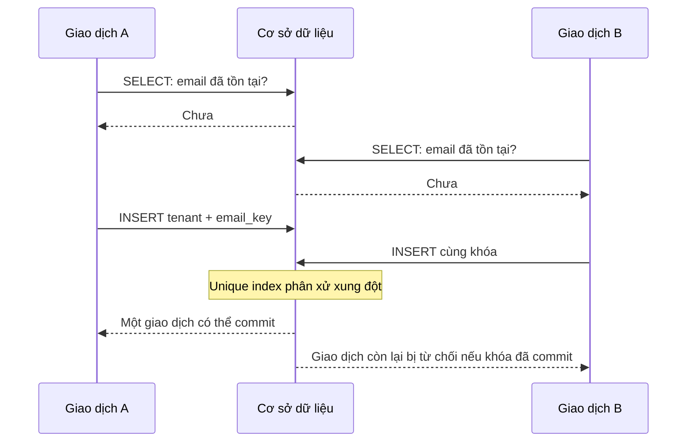

# Chỉ mục duy nhất và vai trò bảo vệ dữ liệu

> **Chương:** Chỉ mục  
> **Phạm vi:** `DATA_PERSISTENCE_FUNDAMENTALS` — thiết kế mô hình dữ liệu, lược đồ và truy vấn cho ứng dụng Java; hiểu mối liên hệ giữa chỉ mục, giao dịch, cô lập, kiểm soát đồng thời, tiến hóa schema, bảo mật và vận hành persistence.

## Mục tiêu học tập

Sau bài này, người học có thể:

1. Phân biệt **chỉ mục duy nhất** (*unique index*), **ràng buộc duy nhất** (*unique constraint*) và **khóa chính** (*primary key*).
2. Xác định đúng giá trị nghiệp vụ cần duy nhất, phạm vi duy nhất và cách xử lý `NULL`, chữ hoa/thường, dữ liệu chuẩn hóa hoặc bản ghi đã xóa mềm.
3. Giải thích vì sao kiểm tra tồn tại trước khi ghi không ngăn được ghi trùng khi nhiều giao dịch chạy đồng thời.
4. Thiết kế thao tác ghi và xử lý lỗi vi phạm duy nhất trong Java mà không làm sai ranh giới giao dịch.
5. Triển khai ràng buộc trên bảng đã có dữ liệu, đánh giá chi phí hiệu năng và giới hạn bảo vệ của nó.

## 1. Vì sao ứng dụng cần chỉ mục duy nhất?

Giả sử hệ thống bán hàng quy định mỗi hóa đơn của một cửa hàng có một mã hóa đơn duy nhất. Nếu cùng một cửa hàng có hai hàng dữ liệu mang mã `INV-2026-042`, việc đối soát, thu tiền và hoàn tiền trở nên mơ hồ. Đây là một **bất biến dữ liệu** (*data invariant*): sau mọi thao tác ghi thành công, không được tồn tại hai hóa đơn cùng cặp `(store_id, invoice_no)`.

Kiểm tra ở giao diện hoặc tầng service giúp phản hồi sớm nhưng không đủ để bảo vệ bất biến. Hai yêu cầu có thể cùng đọc thấy mã chưa tồn tại, rồi đều cố ghi. Quy tắc nhất quán cần được thực thi tại tầng lưu trữ, nơi các giao dịch cạnh tranh gặp nhau.

**Chỉ mục duy nhất** là cấu trúc chỉ mục được cơ sở dữ liệu sử dụng để từ chối việc tạo ra hai khóa chỉ mục trùng nhau, theo quy tắc so sánh và xử lý `NULL` của hệ quản trị. Ngoài khả năng tra cứu nhanh, nó là một cơ chế bảo vệ tính toàn vẹn khi `INSERT` hoặc `UPDATE`.

Ví dụ với PostgreSQL:

```sql
CREATE TABLE invoice (
    id BIGINT GENERATED ALWAYS AS IDENTITY PRIMARY KEY,
    store_id BIGINT NOT NULL,
    invoice_no VARCHAR(50) NOT NULL,
    amount NUMERIC(14, 2) NOT NULL CHECK (amount >= 0),
    CONSTRAINT uq_invoice_store_no UNIQUE (store_id, invoice_no)
);

INSERT INTO invoice (store_id, invoice_no, amount)
VALUES (10, 'INV-2026-042', 850000);

-- Cùng cửa hàng + cùng mã: bị từ chối vì vi phạm uq_invoice_store_no.
INSERT INTO invoice (store_id, invoice_no, amount)
VALUES (10, 'INV-2026-042', 120000);

-- Khác cửa hàng: hợp lệ vì phạm vi duy nhất là từng store_id.
INSERT INTO invoice (store_id, invoice_no, amount)
VALUES (20, 'INV-2026-042', 120000);
```

Mã được chọn phải phản ánh quy tắc nghiệp vụ. Nếu `invoice_no` cần duy nhất **toàn hệ thống**, khóa `(store_id, invoice_no)` quá lỏng; nếu chỉ duy nhất **trong cửa hàng**, `UNIQUE(invoice_no)` lại quá chặt.

## 2. Chỉ mục duy nhất, UNIQUE constraint và PRIMARY KEY

| Cơ chế | Ý nghĩa chính | Điều cần nhớ |
| --- | --- | --- |
| Chỉ mục thường (`INDEX`) | Hỗ trợ tra cứu, lọc, sắp xếp hoặc join | Cho phép các giá trị khóa trùng nhau. |
| Chỉ mục duy nhất (`UNIQUE INDEX`) | Hỗ trợ truy vấn và ngăn khóa chỉ mục trùng | Có thể áp trên biểu thức hoặc tập hàng có điều kiện, tùy hệ quản trị. |
| Ràng buộc `UNIQUE` | Tuyên bố quy tắc toàn vẹn trong lược đồ | Trong PostgreSQL, hệ quản trị tự tạo unique B-tree index để thực thi ràng buộc. |
| `PRIMARY KEY` | Định danh duy nhất của từng hàng | Hàm ý `UNIQUE` và `NOT NULL`; mỗi bảng có tối đa một khai báo khóa chính, có thể gồm nhiều cột. |

Trong PostgreSQL, hai cách sau đều bảo vệ giá trị `code` khỏi trùng trên các hàng có khóa khác `NULL`, nhưng thể hiện mục đích quản trị khác nhau:

```sql
-- Dùng khi quy tắc là một ràng buộc dữ liệu của bảng.
ALTER TABLE product
    ADD CONSTRAINT uq_product_code UNIQUE (code);

-- Dùng khi cần tính năng của chỉ mục cụ thể; ví dụ biểu thức.
CREATE UNIQUE INDEX ux_product_code_lower
    ON product (lower(code));
```

Hai lệnh trên chỉ có ý nghĩa minh họa **hai lựa chọn thiết kế**: không nên tự động áp cả hai lên cùng một khóa vì sẽ tạo cấu trúc thừa và tăng chi phí ghi. Với quy tắc nghiệp vụ thông thường, khai báo `UNIQUE` dưới dạng constraint dễ thể hiện ý định hơn; dùng unique index trực tiếp khi cần biểu thức, bộ lọc hoặc cấu trúc đặc thù.

Ràng buộc `UNIQUE` không thay thế khóa ngoại (`FOREIGN KEY`), `CHECK`, điều kiện nghiệp vụ liên hàng hoặc cơ chế phân quyền. Ví dụ, `UNIQUE(invoice_no)` không xác nhận hóa đơn thuộc khách hàng hợp lệ, đã thanh toán đúng cách hay được tạo bởi người có quyền.

## 3. Chọn khóa duy nhất đúng theo nghiệp vụ

### 3.1. Khóa đơn cột và khóa ghép

Các trường hợp thường gặp:

| Quy tắc nghiệp vụ | Khóa đề xuất | Lý do |
| --- | --- | --- |
| Mỗi sản phẩm có một SKU toàn hệ thống | `(sku)` | SKU là mã toàn cục. |
| Một khách hàng không dùng trùng mã đơn hàng của chính họ | `(customer_id, order_code)` | Mã chỉ duy nhất trong phạm vi khách hàng. |
| Mỗi tài khoản có một tên đăng nhập trong một tenant | `(tenant_id, username_key)` | Cho phép cùng tên giữa các tenant khác nhau. |
| Không nhận lại cùng một yêu cầu thanh toán từ một đối tác | `(partner_id, idempotency_key)` | Ngăn tạo lặp do gọi lại API khi khóa được tái sử dụng. |

Ví dụ bảng tài khoản đa tenant:

```sql
CREATE TABLE app_user (
    id BIGINT GENERATED ALWAYS AS IDENTITY PRIMARY KEY,
    tenant_id BIGINT NOT NULL,
    email VARCHAR(320) NOT NULL,
    email_key VARCHAR(320) NOT NULL,
    deleted_at TIMESTAMPTZ,
    CONSTRAINT uq_app_user_tenant_email_key UNIQUE (tenant_id, email_key)
);
```

`id` là định danh kỹ thuật ổn định; `(tenant_id, email_key)` là **khóa nghiệp vụ** có thể thay đổi theo chính sách. Không nên thay `id` bằng email nếu sau này tài khoản được phép đổi địa chỉ. Trong truy vấn, thứ tự cột của chỉ mục ghép còn tác động đến khả năng tận dụng chỉ mục: `(tenant_id, email_key)` phù hợp với các truy vấn lọc theo tenant rồi theo email. Việc hai cột cùng tham gia quy tắc duy nhất không có nghĩa mọi thứ tự cột đều có hiệu năng truy vấn như nhau.

### 3.2. Dữ liệu được so sánh theo cách nào?

Unique index so sánh **giá trị khóa đã lưu hoặc kết quả biểu thức chỉ mục**, không tự hiểu thế nào là cùng một người hay cùng một email. Các cặp như `An@Example.com` và `an@example.com`, số điện thoại `090...` và `+84...`, hoặc chuỗi Unicode với cách biểu diễn khác nhau có thể tương đương theo nghiệp vụ nhưng khác khi so sánh trong cơ sở dữ liệu.

Cần chốt **chính sách chuẩn hóa** ngay tại ranh giới persistence:

- Loại bỏ khoảng trắng không có nghĩa theo chính sách đầu vào; thống nhất xử lý chữ hoa/thường và Unicode khi phù hợp.
- Với điện thoại, xác định quốc gia và chuẩn hóa về một định dạng thống nhất như E.164 sau khi kiểm tra hợp lệ.
- Với email, xác định quy tắc sản phẩm cho chữ hoa/thường và không tự ý áp các phép biến đổi đặc thù nhà cung cấp như bỏ dấu chấm hay phần sau `+`.
- Nếu lưu cả giá trị hiển thị và khóa chuẩn hóa (`email`, `email_key`), mọi đường ghi phải duy trì tính nhất quán giữa chúng; nên cân nhắc cột sinh tự động hoặc biểu thức index nếu hệ quản trị hỗ trợ đúng phép chuẩn hóa mong muốn.

Chẳng hạn, PostgreSQL có thể tạo unique index theo `lower(email)`:

```sql
CREATE UNIQUE INDEX ux_app_user_tenant_lower_email
    ON app_user (tenant_id, lower(email));
```

Đây là một **phương án thay thế** cho khóa chuẩn hóa `email_key`, không phải chỉ mục nên thêm vào cùng bảng một cách máy móc. `lower()` chỉ thực hiện chuyển chữ hoa/thường theo quy tắc của PostgreSQL/collation đang dùng; nó không giải quyết đầy đủ mọi vấn đề Unicode, khoảng trắng hay quy tắc địa chỉ email. Collation và thay đổi phiên bản/cấu hình so sánh chuỗi cần được xem xét khi chuyển môi trường.

### 3.3. `NULL` không có cùng ý nghĩa ở mọi hệ quản trị

Trong PostgreSQL, với `UNIQUE(email)` thông thường, nhiều hàng có `email IS NULL` vẫn có thể cùng tồn tại vì các giá trị `NULL` mặc định được xem là khác nhau khi kiểm tra tính duy nhất. MySQL cũng thường cho nhiều `NULL` trong unique index; SQL Server có hành vi khác ở tình huống tương đương. **Không viết ứng dụng dựa vào một giả định chung cho tất cả DBMS.**

Nếu mỗi tài khoản bắt buộc có email, dùng `NOT NULL` cùng `UNIQUE`. Nếu muốn nhiều hàng có email trống, hãy ghi rõ ý định. PostgreSQL 15 trở lên hỗ trợ cú pháp `NULLS NOT DISTINCT` để coi các `NULL` là bằng nhau khi thực thi tính duy nhất:

```sql
-- PostgreSQL 15+: tối đa một hàng có recovery_token NULL.
ALTER TABLE recovery_request
    ADD CONSTRAINT uq_recovery_token
    UNIQUE NULLS NOT DISTINCT (recovery_token);
```

Ví dụ trên chỉ hợp lý nếu thật sự muốn hạn chế cả giá trị `NULL` toàn bảng; với các yêu cầu phục hồi chưa có token, quy tắc đó có thể quá chặt. Trước khi chọn cú pháp, hãy diễn đạt quy tắc bằng lời và thử cả các ca chứa `NULL`.

### 3.4. Xóa mềm và phạm vi hàng đang hoạt động

Với hệ thống dùng `deleted_at` để xóa mềm, ràng buộc `UNIQUE(tenant_id, email_key)` sẽ tiếp tục giữ chỗ email của tài khoản đã xóa. Nếu chính sách cho phép đăng ký lại email sau khi xóa mềm, PostgreSQL hỗ trợ **partial unique index**:

```sql
-- Dùng thay cho constraint không điều kiện ở ví dụ app_user,
-- nếu quy tắc nghiệp vụ chỉ áp dụng cho tài khoản chưa xóa.
ALTER TABLE app_user DROP CONSTRAINT uq_app_user_tenant_email_key;

CREATE UNIQUE INDEX ux_app_user_active_email
    ON app_user (tenant_id, email_key)
    WHERE deleted_at IS NULL;
```

Khi đó, tối đa một tài khoản **chưa xóa** có một `(tenant_id, email_key)`; bản ghi đã xóa vẫn được giữ để kiểm toán. Việc khôi phục (`deleted_at = NULL`) có thể bị từ chối nếu email đã được tái sử dụng. Đây là hành vi đúng theo bất biến mới, cần được xử lý rõ ràng trong API phục hồi.

Không dùng mẹo `UNIQUE(tenant_id, email_key, deleted_at)` để thay thế trong PostgreSQL: vì `deleted_at` của các hàng đang hoạt động là `NULL`, quy tắc `NULL` mặc định có thể cho phép nhiều hàng trùng email đang hoạt động.

## 4. Unique index giải quyết cạnh tranh ghi như thế nào?

Giả sử hai yêu cầu A và B đều đăng ký email `a@example.com` trong cùng một tenant:



Trước khi có unique index, **check-then-insert** có khe hở giữa `SELECT` và `INSERT` (*time-of-check/time-of-use race*). Trong PostgreSQL, khi hai giao dịch chèn cùng một khóa duy nhất chưa commit, một giao dịch có thể phải đợi giao dịch kia rồi tiếp tục hoặc nhận lỗi tùy kết quả commit/rollback. Điều được bảo đảm ở đây là sau khi các giao dịch hoàn tất thành công, không có hai hàng vi phạm ràng buộc.

Tăng mức cô lập giao dịch, khóa ở tầng Java bằng `synchronized`, hay khóa trên một instance ứng dụng không phải cách tổng quát để bảo vệ một khóa nghiệp vụ giữa nhiều tiến trình/instance. Unique index đặt luật tại nguồn dữ liệu dùng chung. Tuy vậy, nó **không thay thế** giao dịch cho các bất biến nhiều bước như chuyển tiền giữa hai tài khoản hoặc cập nhật tồn kho kèm đơn hàng.

Một số lựa chọn phản hồi khi trùng khóa:

- **Từ chối:** thao tác tạo tài khoản mới trả lỗi nghiệp vụ phù hợp, ví dụ HTTP `409 Conflict` khi API cho phép báo trùng.
- **Bỏ qua bản ghi trùng:** hữu ích trong nhập liệu hoặc tạo idempotent, nhưng phải xác nhận hành động bị bỏ qua có đúng ý định.
- **Cập nhật khi trùng (*upsert*):** chỉ dùng khi có chính sách rõ ràng về cột nào được phép ghi đè; không dùng upsert để che lỗi thiết kế khóa.

Ví dụ PostgreSQL với khóa duy nhất không điều kiện `(tenant_id, email_key)`:

```sql
INSERT INTO app_user (tenant_id, email, email_key)
VALUES (7, 'Lan@example.com', 'lan@example.com')
ON CONFLICT (tenant_id, email_key) DO NOTHING
RETURNING id;
```

Kết quả `RETURNING` **không có hàng** nghĩa là câu `INSERT` này không tạo hàng mới; ứng dụng có thể truy vấn riêng hoặc trả kết quả đã tồn tại theo quy tắc nghiệp vụ. Nếu bảng đang dùng partial unique index ở phần 3.4, conflict target phải tương ứng với predicate, ví dụ `ON CONFLICT (tenant_id, email_key) WHERE deleted_at IS NULL DO NOTHING`; không bê nguyên lệnh trên sang mô hình đã đổi constraint.

**Lưu ý về idempotency:** unique index trên `(partner_id, idempotency_key)` giúp ngăn tạo hai yêu cầu mang cùng khóa, nhưng ứng dụng còn phải lưu trạng thái/kết quả và so sánh nội dung yêu cầu để phân biệt lần gọi lại hợp lệ với việc tái sử dụng khóa cho một payload khác.

## 5. Xử lý vi phạm duy nhất từ Java

Ứng dụng Java nên coi vi phạm unique là một **kết quả cạnh tranh ghi có thể dự đoán**, đồng thời vẫn phân biệt nó với timeout, mất kết nối, deadlock hay lỗi quyền truy cập.

Ví dụ JDBC dưới đây dùng PostgreSQL, với bảng `app_user` có duy nhất một khóa nghiệp vụ `(tenant_id, email_key)` và `id` được DB sinh tự động:

```java
import javax.sql.DataSource;
import java.sql.Connection;
import java.sql.PreparedStatement;
import java.sql.SQLException;

public final class UserRepository {
    private final DataSource dataSource;

    public UserRepository(DataSource dataSource) {
        this.dataSource = dataSource;
    }

    // emailKey đã được chuẩn hóa và kiểm tra hợp lệ theo chính sách chung.
    // true: đã chèn; false: khóa duy nhất đã tồn tại.
    public boolean insertUser(long tenantId, String email, String emailKey)
            throws SQLException {
        String sql = """
            INSERT INTO app_user (tenant_id, email, email_key)
            VALUES (?, ?, ?)
            """;

        try (Connection connection = dataSource.getConnection();
             PreparedStatement statement = connection.prepareStatement(sql)) {
            statement.setLong(1, tenantId);
            statement.setString(2, email);
            statement.setString(3, emailKey);
            statement.executeUpdate();
            return true;
        } catch (SQLException error) {
            // PostgreSQL: SQLSTATE 23505 = unique_violation.
            // Chỉ trả false khi vi phạm đúng khóa nghiệp vụ đang xử lý.
            if ("23505".equals(error.getSQLState())) {
                return false;
            }
            throw error;
        }
    }
}
```

Đoạn code minh họa giả định SQL chỉ có thể phát sinh vi phạm unique từ khóa nghiệp vụ được xét; ở bảng thực tế có nhiều unique constraint hoặc có trigger, **phải xác định tên constraint gây lỗi** trước khi ánh xạ thành “email đã tồn tại”. PostgreSQL cung cấp thông tin constraint trong chẩn đoán lỗi của driver; với Spring, có thể nhận `DuplicateKeyException`/`DataIntegrityViolationException` và kiểm tra nguyên nhân. Không dựa vào nội dung thông báo lỗi dạng văn bản vì nó có thể thay đổi theo phiên bản hoặc ngôn ngữ.

Ứng dụng còn cần:

1. **Chuẩn hóa cùng một quy tắc ở mọi đường ghi** (`create`, `update`, import, job nền); hoặc đặt phép chuẩn hóa trong DB nếu khả thi.
2. **Dùng tham số truy vấn**, không ghép chuỗi SQL từ email hoặc mã do người dùng nhập.
3. **Ánh xạ lỗi đúng nghiệp vụ**: trả `409` chỉ khi API cho phép công khai tình trạng trùng; với luồng đăng ký/khôi phục mật khẩu, cân nhắc phản hồi trung tính để tránh dò tìm tài khoản.
4. **Giữ nguyên các lỗi khác** để tầng gọi có thể xử lý hoặc retry có kiểm soát. Không tự động retry lỗi `23505` vì thử lại cùng khóa thường tiếp tục thất bại.
5. **Tôn trọng giao dịch:** nếu một statement trong PostgreSQL thất bại bên trong transaction, transaction thường phải được rollback (hoặc rollback về savepoint được thiết kế trước). Không bắt exception rồi tiếp tục dùng transaction đang lỗi. Trong Spring `@Transactional`, chú ý việc nuốt exception có thể làm sai trạng thái rollback của transaction.

Khi nhiều thao tác phải thành công cùng nhau, ví dụ tạo người dùng và gán quyền mặc định, đặt chúng trong cùng một transaction. Unique index bảo vệ riêng khóa duy nhất, còn transaction đảm bảo toàn bộ thay đổi được commit hoặc rollback theo thiết kế.

## 6. Thêm unique index vào hệ thống đang có dữ liệu

Thêm quy tắc duy nhất vào bảng đang hoạt động là một **migration dữ liệu và schema**. Chỉ chạy DDL sẽ thất bại nếu dữ liệu hiện có đã trùng, và tiến trình khác vẫn có thể tạo trùng trong lúc chuẩn bị migration.

**Bước 1 — Chốt quy tắc:** khóa duy nhất là gì, phạm vi tenant/cửa hàng nào, có loại trừ bản ghi xóa mềm không, `NULL` và chuỗi được so sánh thế nào? Nếu thay đổi quy tắc chuẩn hóa, cần cập nhật mọi đường ghi trước hoặc phối hợp với migration.

**Bước 2 — Phát hiện dữ liệu vi phạm:** với tài khoản đang hoạt động và cột `email_key` đã được chuẩn hóa:

```sql
SELECT tenant_id, email_key, COUNT(*) AS total
FROM app_user
WHERE deleted_at IS NULL
GROUP BY tenant_id, email_key
HAVING COUNT(*) > 1
ORDER BY total DESC;
```

**Bước 3 — Xử lý trùng có kiểm soát:** thống nhất bản ghi nào giữ, bản ghi nào gộp/đổi khóa; kiểm tra khóa ngoại, lịch sử giao dịch, dữ liệu cá nhân và khả năng phục hồi. Không xóa tự động tất cả các dòng trùng mà chưa hiểu tác động nghiệp vụ.

**Bước 4 — Triển khai constraint/index:** với PostgreSQL có thể dùng `CREATE UNIQUE INDEX CONCURRENTLY` trên bảng lớn để giảm thời gian chặn thao tác ghi thường xuyên:

```sql
-- PostgreSQL: lệnh CONCURRENTLY không được chạy trong transaction block.
CREATE UNIQUE INDEX CONCURRENTLY ux_app_user_active_email
    ON app_user (tenant_id, email_key)
    WHERE deleted_at IS NULL;
```

Đây là ví dụ áp dụng **thay cho** unique constraint không điều kiện ở phần 3.1. Việc tạo concurrent vẫn có thể thất bại nếu xuất hiện trùng mới trong lúc xây dựng, và có thể để lại chỉ mục `INVALID` cần kiểm tra/xử lý trước khi thử lại. Migration framework có thể mặc định bọc migration trong transaction, nên phải cấu hình lệnh này phù hợp. Không xem `CONCURRENTLY` là thao tác luôn tức thời hoặc hoàn toàn không gây tải.

**Bước 5 — Xác minh và giám sát:** kiểm tra chỉ mục đã hợp lệ, thử `INSERT`/`UPDATE` trùng trong môi trường kiểm thử, xem lỗi từ ứng dụng và theo dõi thời gian ghi, kích thước chỉ mục, tình trạng chờ khóa. Kế hoạch rollback phải cân nhắc khả năng dữ liệu mới đã bắt đầu dựa vào quy tắc duy nhất.

Với một unique constraint thông thường trên toàn bộ cột (không phải partial/expression index), PostgreSQL còn cho phép tạo unique index đồng thời rồi gắn nó vào bảng bằng `ALTER TABLE ... ADD CONSTRAINT ... UNIQUE USING INDEX ...` theo các điều kiện hỗ trợ. Cách này giảm thời gian khóa nặng so với tạo constraint trực tiếp trên một bảng rất lớn; cần kiểm tra phiên bản và điều kiện DDL trước khi dùng.

## 7. Hiệu năng, bảo mật và giới hạn

Unique index vừa có ích cho truy vấn vừa phải duy trì tính duy nhất mỗi lần ghi:

- **Đọc:** có thể hỗ trợ tìm đúng bản ghi theo khóa nghiệp vụ; điều kiện truy vấn cần tương thích với cột/biểu thức/predicate của chỉ mục. Partial index có thể không được chọn nếu bộ tối ưu không chứng minh được điều kiện truy vấn thỏa predicate.
- **Ghi:** `INSERT`, `UPDATE` khóa, `DELETE` phải bảo trì chỉ mục; nhiều chỉ mục dư thừa tăng I/O, dung lượng, chi phí kiểm tra và khả năng chờ khi tranh chấp cùng khóa.
- **Thiết kế:** khóa ghép rất dài hoặc chuỗi lớn tốn tài nguyên; nên chọn khóa bền vững, có giới hạn độ dài phù hợp, và đánh giá bằng dữ liệu thực tế cùng `EXPLAIN (ANALYZE, BUFFERS)` trong môi trường an toàn.
- **Bảo mật:** tên bảng, giá trị trùng hoặc thông báo SQL chi tiết có thể làm lộ dữ liệu. Ghi log thông tin kỹ thuật cần thiết nhưng hạn chế dữ liệu định danh cá nhân; API không phải lúc nào cũng nên cho biết email đã tồn tại.
- **Sao lưu và khôi phục:** constraint giúp ngăn dữ liệu trùng sau khi khôi phục, nhưng không thay thế backup, kiểm tra toàn vẹn backup hay quy trình phục hồi khi lỗi kết nối và lỗi lưu trữ.
- **Phân vùng và phân tán:** trên PostgreSQL, unique/primary key của bảng partitioned phải bao gồm các cột khóa phân vùng theo yêu cầu của hệ quản trị. Trong hệ thống sharding, unique index cục bộ ở mỗi shard không tự bảo đảm duy nhất toàn cụm; phải thiết kế phạm vi khóa, định tuyến hoặc cơ chế phối hợp phù hợp.

Unique index bảo vệ **một loại bất biến dựa trên sự bằng nhau của khóa**. Nó không bảo đảm các khoảng thời gian đặt phòng không giao nhau, số dư không âm sau thao tác nhiều hàng, hoặc mã đã được cấp quyền sử dụng. Các yêu cầu đó có thể cần `CHECK`, `FOREIGN KEY`, transaction/locking, exclusion constraint (nếu DB hỗ trợ) hoặc quy trình nghiệp vụ khác.

## 8. Tình huống thực hành: đăng ký tài khoản đa tenant

**Yêu cầu:** trong cùng tenant, một email chỉ thuộc tối đa một tài khoản đang hoạt động; tài khoản xóa mềm được lưu để kiểm toán và email có thể tái sử dụng. Người dùng có thể gửi hai yêu cầu đăng ký gần như đồng thời.

Thiết kế tham khảo với PostgreSQL:

```sql
CREATE TABLE tenant_account (
    id BIGINT GENERATED ALWAYS AS IDENTITY PRIMARY KEY,
    tenant_id BIGINT NOT NULL,
    email VARCHAR(320) NOT NULL,
    email_key VARCHAR(320) NOT NULL,
    deleted_at TIMESTAMPTZ
);

CREATE UNIQUE INDEX ux_tenant_account_active_email
    ON tenant_account (tenant_id, email_key)
    WHERE deleted_at IS NULL;
```

Đường ghi ở Java chuẩn hóa/kiểm tra `email_key` nhất quán và `INSERT` trong transaction phù hợp. Khi có hai yêu cầu cùng khóa, DB phân xử và ứng dụng ánh xạ vi phạm đúng chỉ mục thành kết quả nghiệp vụ. Khi khôi phục tài khoản đã xóa, ứng dụng phải xử lý khả năng email đã được cấp cho tài khoản mới. Một truy vấn xác nhận trước có thể cải thiện trải nghiệm, nhưng **unique index mới là lớp bảo vệ cuối cùng**.

Tự kiểm tra thiết kế bằng bốn phép thử:

| Phép thử | Kết quả mong đợi |
| --- | --- |
| Thêm cùng `email_key` và cùng tenant hai lần, đều đang hoạt động | Chỉ một lần chèn thành công. |
| Thêm cùng `email_key` nhưng khác tenant | Cả hai có thể thành công. |
| Xóa mềm tài khoản, rồi đăng ký lại cùng khóa | Cho phép tạo tài khoản đang hoạt động mới. |
| Khôi phục tài khoản cũ khi khóa đã được tái sử dụng | `UPDATE` bị từ chối vì vi phạm unique index. |

**Câu hỏi tự đánh giá**

1. Vì sao `SELECT ... WHERE email_key = ?` trước `INSERT` vẫn có thể tạo lỗi trùng khi chạy trên hai instance Java khác nhau?
2. Khi nào nên dùng `UNIQUE(tenant_id, email_key)` và khi nào dùng partial unique index có `WHERE deleted_at IS NULL`?
3. Vì sao không thể mặc định rằng `UNIQUE(email)` chỉ cho phép một hàng có email `NULL` trên mọi DBMS?
4. Nếu một migration tạo unique index bị lỗi vì dữ liệu trùng, cần kiểm tra và xử lý những gì trước khi thử lại?
5. Tại sao chỉ mục duy nhất trên mỗi shard không đủ để khẳng định một mã đơn hàng là duy nhất toàn hệ thống?

## Ghi nhớ

Ràng buộc duy nhất cần được xác định từ **bất biến nghiệp vụ**, bao gồm cả phạm vi, phép so sánh và vòng đời dữ liệu. Tầng Java có thể kiểm tra sớm và phản hồi thân thiện, nhưng cơ sở dữ liệu mới là nơi kiểm soát cạnh tranh ghi cuối cùng. Thiết kế tốt kết hợp unique constraint/index, transaction, xử lý lỗi rõ ràng, migration có kiểm soát và kiểm thử trên dữ liệu thực tế.
