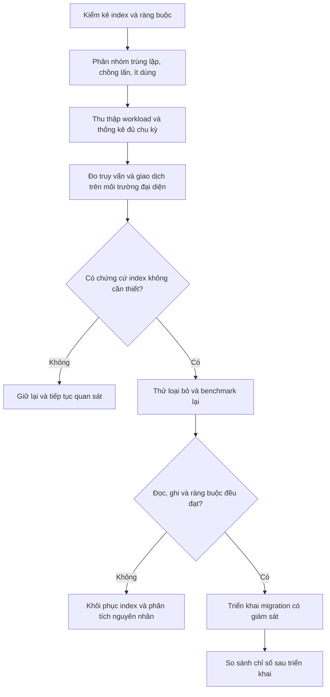

# Nhận diện chỉ mục dư thừa và chi phí bảo trì

## Mục tiêu học tập

Sau bài này, người học có thể:

- Phân biệt **chỉ mục trùng lặp**, **chỉ mục chồng lấn** và **chỉ mục ít được sử dụng**; biết vì sao ba khái niệm này không đồng nghĩa.
- Giải thích chi phí của chỉ mục đối với `INSERT`, `UPDATE`, `DELETE`, dung lượng lưu trữ, bộ nhớ đệm, WAL và hoạt động bảo trì cơ sở dữ liệu.
- Đọc định nghĩa chỉ mục, ràng buộc dữ liệu, thống kê sử dụng và kế hoạch thực thi để tìm **ứng viên** cần xem xét.
- Lập quy trình kiểm chứng và loại bỏ chỉ mục an toàn, có đo lường trước–sau và phương án khôi phục.
- Liên hệ việc thiết kế chỉ mục với truy vấn, giao dịch và tiến hóa lược đồ trong ứng dụng Java.

## 1. Vì sao không nên tạo càng nhiều chỉ mục càng tốt?

Chỉ mục (index) là cấu trúc dữ liệu giúp hệ quản trị cơ sở dữ liệu tìm hàng, lọc, nối bảng hoặc lấy dữ liệu theo thứ tự mà không nhất thiết phải quét toàn bộ bảng. Một chỉ mục B-tree thường có lợi cho truy vấn chọn lọc theo khóa và một số truy vấn có `ORDER BY`. Tuy nhiên, chỉ mục là **một cấu trúc vật lý riêng** cần được lưu trữ và duy trì cùng với dữ liệu gốc.

Giả sử một dịch vụ Java ghi đơn hàng với tần suất cao. Mỗi lần thêm đơn hàng, cơ sở dữ liệu phải lưu hàng mới và cập nhật những chỉ mục liên quan. Nếu hai chỉ mục phục vụ cùng một nhóm truy vấn, việc giữ cả hai có thể khiến thao tác ghi đắt hơn trong khi cải thiện đọc rất ít. Vấn đề cần giải quyết là **giữ tập chỉ mục nhỏ nhất nhưng vẫn đáp ứng được yêu cầu truy vấn và ràng buộc dữ liệu của hệ thống**.

Trong phạm vi `DATA_PERSISTENCE_FUNDAMENTALS`, đây là một quyết định ở ranh giới persistence: mô hình dữ liệu và truy vấn của Java quyết định nhu cầu đọc; cấu trúc index, giao dịch, kiểm soát đồng thời và chiến lược tiến hóa schema quyết định tính đúng đắn và chi phí vận hành. Bài viết sử dụng **PostgreSQL với B-tree** làm hệ quy chiếu cụ thể; cú pháp, thống kê và chiến lược tối ưu có thể khác ở MySQL, SQL Server, Oracle hoặc các loại chỉ mục khác.

### Ba khái niệm dễ nhầm

| Khái niệm | Dấu hiệu | Kết luận ban đầu |
| --- | --- | --- |
| **Trùng lặp (duplicate)** | Hai index có cùng bảng, cùng khóa/thứ tự khóa, kiểu index, biểu thức, điều kiện lọc và các thuộc tính ảnh hưởng đến ngữ nghĩa | Có thể là ứng viên loại bỏ mạnh, sau khi kiểm tra ràng buộc và tình trạng sử dụng |
| **Chồng lấn (overlapping)** | Một index có phần khóa đầu giống index khác, ví dụ `(tenant_id)` và `(tenant_id, created_at)` | Cần so sánh lợi ích đọc, kích thước, sắp xếp và chi phí ghi; chưa thể kết luận dư thừa |
| **Ít dùng (low-usage)** | Thống kê ghi nhận ít lần quét index trong một khoảng quan sát | Cần xác minh thời gian quan sát, truy vấn theo mùa, đường ghi và ràng buộc; ít dùng không đồng nghĩa vô ích |

Một chỉ mục trùng về cột nhưng **khác tính duy nhất (`UNIQUE`)**, điều kiện `WHERE` của partial index, collation, operator class, biểu thức, hướng sắp xếp, `NULLS FIRST/LAST` hoặc cột `INCLUDE` có thể phục vụ yêu cầu khác nhau. Đừng phân loại chỉ bằng tên index hoặc chuỗi tên cột.

## 2. Ví dụ xuyên suốt: truy vấn đơn hàng đa khách hàng

Giả sử ứng dụng lưu đơn hàng theo `tenant_id`. API phổ biến hiển thị 50 đơn hàng mới nhất của một tenant; hệ thống cũng có thống kê đơn hàng và tác vụ cập nhật trạng thái.

```sql
-- Ví dụ PostgreSQL; chỉ thực hành trên cơ sở dữ liệu thử nghiệm.
CREATE TABLE purchase_order (
    id           BIGINT GENERATED ALWAYS AS IDENTITY PRIMARY KEY,
    tenant_id    BIGINT NOT NULL,
    order_code   TEXT NOT NULL UNIQUE,
    status       TEXT NOT NULL,
    created_at   TIMESTAMPTZ NOT NULL DEFAULT now(),
    total_amount NUMERIC(16, 2) NOT NULL
);

CREATE INDEX idx_po_tenant
    ON purchase_order (tenant_id);

CREATE INDEX idx_po_tenant_created
    ON purchase_order (tenant_id, created_at DESC);

CREATE INDEX idx_po_status
    ON purchase_order (status);

-- Giả sử một migration khác tạo thêm index này:
CREATE INDEX idx_po_tenant_copy
    ON purchase_order (tenant_id);
```

Lược đồ trên đã có index được PostgreSQL tạo để hỗ trợ `PRIMARY KEY (id)` và `UNIQUE (order_code)`. Vì vậy, ngoài bốn chỉ mục do ta khai báo, **các ràng buộc cũng tiêu thụ dung lượng và chi phí bảo trì index**. Không được xem index phục vụ tính duy nhất là chỉ mục tùy ý có thể xóa.

Xét hai truy vấn:

```sql
-- Q1: danh sách đơn hàng mới nhất theo tenant
SELECT id, order_code, status, total_amount, created_at
FROM purchase_order
WHERE tenant_id = 42
ORDER BY created_at DESC
LIMIT 50;

-- Q2: tổng số đơn hàng của tenant
SELECT COUNT(*)
FROM purchase_order
WHERE tenant_id = 42;
```

- `idx_po_tenant_created` phù hợp với Q1 vì phần khóa đầu lọc `tenant_id`, phần khóa tiếp theo hỗ trợ thứ tự `created_at DESC`. Kết quả vẫn có thể cần đọc bảng để lấy các cột không nằm trong chỉ mục.
- `idx_po_tenant` và `idx_po_tenant_copy` giống nhau về mục đích và định nghĩa trong ví dụ. Một trong hai là **ứng viên trùng lặp**, nhưng vẫn cần kiểm tra metadata và tác động trước khi loại bỏ.
- `idx_po_tenant` là tiền tố của `idx_po_tenant_created`. PostgreSQL có thể dùng index ghép để lọc chỉ theo `tenant_id`, nhưng index một cột nhỏ hơn có thể hiệu quả hơn cho Q2 hoặc các truy vấn quét nhiều khóa `tenant_id`.
- `idx_po_status` không trùng với các index kia. Nếu `status` chỉ có vài giá trị và đa số hàng mang cùng trạng thái, truy vấn lọc riêng theo `status` có thể không hưởng lợi nhiều. Đây là câu hỏi về **giá trị sử dụng và độ chọn lọc**, không phải trùng lặp.

### Quy tắc tiền tố trái của B-tree nhiều cột

Với index `(tenant_id, created_at DESC)`, điều kiện bằng trên `tenant_id` thường cho phép tận dụng tốt cả việc lọc và thứ tự `created_at`. Truy vấn chỉ lọc `created_at` không mặc nhiên nhận được cùng lợi ích vì `created_at` không phải cột dẫn đầu. Một số phiên bản hoặc chiến lược optimizer có thể dùng quét đặc biệt hoặc quét toàn index, nhưng phải xem kế hoạch thực thi cụ thể.

Không suy luận khả năng thay thế chỉ mục chỉ từ quy tắc tiền tố. Cần xem thêm `ORDER BY`, toán tử so sánh, cột được trả về, phân bố dữ liệu, index-only scan, độ lớn index và truy vấn thực tế. Đặc biệt, index-only scan của PostgreSQL còn phụ thuộc **visibility map**; việc index chứa đủ cột chưa bảo đảm tránh đọc heap trong mọi lần thực thi.

## 3. Chi phí bảo trì một chỉ mục phát sinh ở đâu?

Một chỉ mục có thể rút ngắn thời gian đọc nhưng cũng tạo ra các loại chi phí sau:

| Hoạt động | Chi phí bổ sung có thể xuất hiện | Tình huống minh họa |
| --- | --- | --- |
| `INSERT` | Thêm mục vào từng index liên quan; thay đổi trang index, phát sinh WAL, I/O và áp lực lên bộ nhớ đệm | Luồng tạo đơn hàng liên tục phải duy trì cả index trùng lặp |
| `UPDATE` | Nếu thay đổi khóa/cột được index, có thể phải cập nhật các mục index; tăng lượng ghi và nguy cơ page split | Chuyển `status` từ `PENDING` sang `PAID` khi tồn tại index trên `status` |
| `DELETE` | Tạo bản ghi dữ liệu chết theo cơ chế MVCC, khiến công việc thu gom/làm sạch sau đó tăng; chi phí phụ thuộc cơ chế của DBMS | Tác vụ xóa dữ liệu hết hạn làm tăng công việc `VACUUM` |
| Lưu trữ và cache | Index chiếm không gian riêng và cạnh tranh bộ nhớ đệm với dữ liệu, index khác | Một chỉ mục ít dùng nhưng rất lớn có thể đẩy dữ liệu nóng khỏi cache |
| Vận hành | Tốn thời gian tạo, rebuild, sao lưu/khôi phục, phân tích thống kê; có thể ảnh hưởng replication và thời gian migration | Thêm index lớn trước khi phát hành phiên bản ứng dụng |

Ở PostgreSQL, **WAL (write-ahead log)** ghi lại những thay đổi cần thiết để khôi phục và sao chép dữ liệu. Thao tác gây thêm ghi index có thể làm tăng lượng WAL, mức sử dụng ổ đĩa và độ trễ của replica. Chỉ mục B-tree cũng có thể phát sinh phân tách trang (*page split*) hoặc phình kích thước (*bloat*) tùy đặc điểm dữ liệu và tải ghi.

Một điểm tinh tế: PostgreSQL có cơ chế **HOT update (heap-only tuple)** trong một số trường hợp, khi việc cập nhật không đòi hỏi thay đổi giá trị mà index tham chiếu và trang dữ liệu còn đủ chỗ. HOT giúp tránh cập nhật index cho lần sửa đó. Thêm index trên cột thường xuyên thay đổi, chẳng hạn `status`, có thể khiến một số update trước đây đủ điều kiện HOT không còn đủ điều kiện. Vì vậy tác động của index mới phụ thuộc **cột nào thực sự thay đổi**, không chỉ tổng số index.

Không có công thức cố định kiểu “mỗi index làm `INSERT` chậm thêm 10%”. Chi phí tùy kích thước bảng, phân bố khóa, bộ nhớ, mức đồng thời, kiểu index, khối lượng ghi và đặc tính lưu trữ. Muốn ước lượng đúng cần đo với workload đại diện.

## 4. Nhận diện ứng viên từ định nghĩa và ràng buộc

### Bước 1: Liệt kê toàn bộ index của bảng

```sql
SELECT indexname, indexdef
FROM pg_indexes
WHERE schemaname = 'public'
  AND tablename = 'purchase_order'
ORDER BY indexname;
```

`indexdef` cho biết phương thức index, cột hoặc biểu thức, `UNIQUE`, điều kiện partial index và cột được bao gồm. Từ kết quả, lập danh sách các cặp có khóa giống nhau hoặc cặp mà một index là tiền tố của index kia. Trong hệ thống có nhiều schema, luôn lọc theo đúng schema để tránh so nhầm bảng cùng tên.

### Bước 2: Kiểm tra ràng buộc trước khi đánh giá loại bỏ

```sql
SELECT conname, contype, pg_get_constraintdef(oid) AS definition
FROM pg_constraint
WHERE conrelid = 'public.purchase_order'::regclass
ORDER BY conname;
```

Trong PostgreSQL, `contype = 'p'` là khóa chính, `u` là ràng buộc unique, `f` là khóa ngoại. Khóa chính và unique được hỗ trợ bằng index tương ứng và mang ý nghĩa **toàn vẹn dữ liệu**; một index không unique trên cùng cột không thay thế được ràng buộc unique. Ngược lại, `UNIQUE (a, b)` cũng không thay thế `UNIQUE (a)` vì hai ràng buộc cấm các tập dữ liệu khác nhau.

Với khóa ngoại, PostgreSQL tự có index cho khóa được tham chiếu thông qua `PRIMARY KEY`/`UNIQUE`, nhưng **không tự động tạo index cho các cột phía tham chiếu**. Một index rất ít được dùng bởi truy vấn ứng dụng vẫn có thể giúp xử lý `DELETE`/`UPDATE` ở bảng cha và kiểm tra khóa ngoại. Cần xem tác động này trước khi đánh giá nó là vô ích.

### Bước 3: Phân nhóm ứng viên

1. **Trùng lặp gần như hoàn toàn:** cùng khóa, cùng thuộc tính cần thiết và không đảm nhiệm ràng buộc khác nhau. Ví dụ `idx_po_tenant` với `idx_po_tenant_copy`.
2. **Tiền tố/chồng lấn:** `(tenant_id)` và `(tenant_id, created_at DESC)`; chỉ cân nhắc gộp nếu index ghép vẫn đáp ứng chấp nhận được toàn bộ truy vấn liên quan.
3. **Ít có giá trị trong workload:** index trên cột ít chọn lọc hoặc ít truy vấn; phải có bằng chứng qua thống kê và thời gian quan sát.

Một số khác biệt dễ bị bỏ sót khi so sánh index: index trên `lower(email)` khác index trên `email`; partial index `WHERE status = 'PENDING'` khác index toàn bảng; `(tenant_id, created_at)` khác `(created_at, tenant_id)`; cột `INCLUDE` có thể giúp truy vấn đọc đủ dữ liệu từ index nhưng làm index lớn và tăng chi phí bảo trì.

## 5. Đo mức sử dụng thay vì đoán

### Thống kê truy cập index

```sql
SELECT
    s.relname AS table_name,
    s.indexrelname AS index_name,
    s.idx_scan,
    s.idx_tup_read,
    s.idx_tup_fetch,
    pg_size_pretty(pg_relation_size(s.indexrelid)) AS index_size
FROM pg_stat_user_indexes AS s
WHERE s.schemaname = 'public'
  AND s.relname = 'purchase_order'
ORDER BY pg_relation_size(s.indexrelid) DESC;
```

`idx_scan` phản ánh số lần quét index được thống kê, `idx_tup_read` là số mục index trả về và `idx_tup_fetch` liên quan đến số bản ghi heap được tìm nạp qua index scan; các đại lượng này **không phải** số lần truy vấn nghiệp vụ, cũng không đo trực tiếp số lần cập nhật index. Một index có `idx_scan = 0` mới chỉ là **ứng viên điều tra**, chưa phải bằng chứng đủ để xóa.

Cần biết thống kê được thu thập từ khi nào, có bị reset hay chưa, ứng dụng đã chạy đủ chu kỳ ngày–tuần–tháng chưa, có tác vụ batch cuối tháng hay không và truy vấn có chạy trên replica hay không. Thống kê trên một instance không tự đại diện cho toàn bộ các nơi phục vụ đọc. Thống kê mức cơ sở dữ liệu có thể xem bằng:

```sql
SELECT datname, stats_reset
FROM pg_stat_database
WHERE datname = current_database();
```

Không nên reset bộ đếm ở production chỉ để làm ví dụ; hãy ghi nhận hai mốc thời gian và so sánh trong cùng một cửa sổ quan sát đã biết.

### Xem kế hoạch thực thi của truy vấn quan trọng

```sql
EXPLAIN (ANALYZE, BUFFERS)
SELECT id, order_code, status, total_amount, created_at
FROM purchase_order
WHERE tenant_id = 42
ORDER BY created_at DESC
LIMIT 50;
```

Khi đọc kết quả, chú ý `Index Scan`, `Index Only Scan`, `Bitmap Index Scan`, `Seq Scan`, thao tác `Sort`, số hàng thực tế, thời gian thực thi và buffer hits/reads. Đối chiếu các truy vấn có lưu lượng lớn với phân bố dữ liệu thật; cùng một câu SQL có thể có kế hoạch khác nhau giữa tenant nhỏ và tenant có nhiều đơn hàng.

`EXPLAIN ANALYZE` **thực sự chạy câu lệnh**. Hãy thử với `SELECT` trên dữ liệu đại diện và cân nhắc tác động tải; không chạy tùy tiện với `UPDATE`, `DELETE` hoặc câu lệnh thay đổi dữ liệu. Thống kê theo truy vấn từ `pg_stat_statements` (nếu hệ thống đã bật extension này), logs và tracing của Java cũng hữu ích để tìm các câu SQL thực sự nóng.

### Những chỉ số cần đặt cạnh nhau

| Nhóm | Ví dụ chỉ số | Mục đích |
| --- | --- | --- |
| Đọc | p50/p95/p99 latency theo endpoint, số hàng được đọc, buffers, số lần sort | Đảm bảo giảm index không làm hỏng đường truy vấn quan trọng |
| Ghi | Thông lượng `INSERT`/`UPDATE`/`DELETE`, thời gian commit, lock wait | Xác định lợi ích và tác động đến giao dịch |
| Tài nguyên | Kích thước bảng/index, lượng WAL, I/O, cache hit, CPU, replica lag | Phát hiện chi phí vận hành và tác động dây chuyền |
| Bảo trì | Thời gian vacuum, dead tuples, thời gian migration, xu hướng bloat | Kiểm tra hệ thống còn khỏe sau thời gian dài |

Với một lượng dữ liệu nhỏ nằm trọn trong cache, benchmark vài giây rất dễ cho kết quả sai lệch. Nên dùng dữ liệu và tỷ lệ đọc/ghi gần thực tế, có giai đoạn khởi động, đo lặp lại và ghi rõ điều kiện đo.

## 6. Khi nào chỉ mục “có vẻ thừa” vẫn cần giữ?

**Trường hợp A — Index nhỏ cho truy vấn đếm.** `idx_po_tenant_created` đã bắt đầu bằng `tenant_id`, nhưng `idx_po_tenant` có thể ít trang hơn và giúp Q2 chạy nhanh hơn. Nếu Q2 được gọi rất thường xuyên, chi phí giữ index nhỏ có thể hợp lý.

**Trường hợp B — Ràng buộc dữ liệu.** Chỉ mục do `UNIQUE (order_code)` tạo ra phải giữ để ngăn hai đơn hàng có cùng mã. Việc truy vấn theo mã đơn hàng hiếm khi xảy ra không làm ràng buộc này trở nên thừa.

**Trường hợp C — Truy vấn hiếm nhưng quan trọng.** Báo cáo chốt sổ, khôi phục vận hành hoặc kiểm tra đối soát có thể chạy mỗi tháng một lần nhưng có giới hạn thời gian nghiêm ngặt. `idx_scan` thấp trong một tuần là chưa đủ để xóa.

**Trường hợp D — Khóa ngoại và cạnh tranh khóa.** Một index ở phía bảng con có thể làm quá trình kiểm tra tham chiếu khi xóa/sửa hàng ở bảng cha nhanh hơn, giảm thời gian giữ khóa và giảm ảnh hưởng tới giao dịch khác.

**Trường hợp E — Cơ chế truy vấn khác nhau.** Index toàn bảng, partial index, index trên biểu thức, index có cột `INCLUDE` hay index với thứ tự sắp xếp khác có thể phục vụ các đường đọc khác nhau dù cùng chứa một số cột.

Nếu phần lớn truy vấn cần đơn hàng đang chờ xử lý, partial index có thể đáng thử:

```sql
CREATE INDEX idx_po_pending_by_tenant_created
    ON purchase_order (tenant_id, created_at DESC)
    WHERE status = 'PENDING';
```

Chỉ mục này nhỏ hơn index toàn bảng **nếu** `PENDING` chiếm một tỷ lệ nhỏ, nhưng vẫn phải bảo trì mỗi khi một hàng gia nhập hoặc rời tập `PENDING`. PostgreSQL chỉ dùng partial index khi optimizer xác định được điều kiện truy vấn suy ra điều kiện `WHERE` của index; với prepared statement có tham số `status = ?`, kế hoạch tổng quát không nhất thiết chứng minh được điều đó. Phải xác nhận bằng `EXPLAIN` trong hình thức truy vấn mà ứng dụng Java thật sự phát ra.

## 7. Quy trình ra quyết định và triển khai an toàn



1. **Kiểm kê:** xác định định nghĩa index, quan hệ với `PRIMARY KEY`/`UNIQUE`/`FOREIGN KEY`, các biểu thức, partial predicate và các query phụ thuộc.
2. **Đo đường cơ sở:** lưu kế hoạch thực thi, độ trễ, lưu lượng đọc/ghi, kích thước index và mức tiêu thụ tài nguyên. Thu thập đủ chu kỳ nghiệp vụ.
3. **Chọn một thay đổi nhỏ:** ưu tiên cặp trùng lặp thật sự như `idx_po_tenant`/`idx_po_tenant_copy`; với tiền tố hoặc index ít dùng, yêu cầu chứng cứ chặt chẽ hơn.
4. **Thử trên staging:** dùng dữ liệu đủ đại diện, đối chiếu truy vấn của API, batch, tác vụ quản trị và luồng update; xác minh không mất ràng buộc hay tăng độ trễ ngoài ngưỡng chấp nhận.
5. **Chuẩn bị migration và rollback:** viết phương án xóa index, ghi lại đầy đủ câu lệnh tạo lại index, yêu cầu dung lượng và thời điểm thực hiện.
6. **Triển khai từng bước:** tránh xóa nhiều index cùng lúc; quan sát query plan, p95/p99, WAL, lock waits và replica lag sau thay đổi. Khi chất lượng giảm, phục hồi index theo phương án đã kiểm chứng.

Ví dụ cú pháp PostgreSQL cho **một index thường không gắn ràng buộc** đã được xác minh dư thừa:

```sql
-- Dùng ngoài transaction block; kiểm tra tác động trên staging trước.
DROP INDEX CONCURRENTLY IF EXISTS public.idx_po_tenant_copy;

-- Phương án tạo lại nếu cần:
CREATE INDEX CONCURRENTLY idx_po_tenant_copy
    ON public.purchase_order (tenant_id);
```

`CONCURRENTLY` giảm mức chặn truy cập trong lúc thao tác index, nhưng có thể chạy lâu hơn, tiêu thụ tài nguyên đáng kể và không dùng được trong transaction block thông thường. Không thể dùng `DROP INDEX CONCURRENTLY` để xóa index đang hỗ trợ constraint. Với Flyway, cần cấu hình migration phù hợp để không bọc thao tác này trong transaction; đồng thời cân nhắc cơ chế retry/kiểm tra trạng thái khi migration bị gián đoạn. Không áp dụng nguyên xi ví dụ trên cho index gắn khóa chính hay `UNIQUE`.

## 8. Liên hệ với ứng dụng Java và tiến hóa schema

Ví dụ repository trong Spring Data JPA:

```java
public interface PurchaseOrderRepository
        extends JpaRepository<PurchaseOrder, Long> {

    List<PurchaseOrder> findTop50ByTenantIdOrderByCreatedAtDesc(Long tenantId);
}
```

Tên phương thức giúp mô tả ý định nghiệp vụ, nhưng **SQL thực tế** do ORM sinh ra, các điều kiện bổ sung, join, phân trang và tham số ràng buộc mới là những gì optimizer nhận được. Vì vậy, trước khi xóa index, cần kiểm tra SQL qua log/tracing và các query native/JDBC, báo cáo định kỳ, background jobs bên cạnh repository method trên.

Trong hệ thống Java dùng Flyway hoặc Liquibase, nên coi migration schema là nguồn kiểm soát thay đổi index trên môi trường vận hành. Tránh tình trạng migration đã xóa index nhưng cơ chế tự cập nhật schema của ORM lại tạo nó vào lần khởi động sau. Có thể dùng chế độ kiểm tra schema tương thích với chiến lược triển khai (chẳng hạn Hibernate `validate`) và thực hiện thay đổi lược đồ qua migration có kiểm soát.

Một index thừa có thể gây chậm `INSERT`/`UPDATE` và kéo dài giao dịch; giao dịch kéo dài có thể giữ khóa lâu hơn, tăng khả năng chờ và khiến lỗi timeout lộ ra ở tầng Java. Nhưng xóa index cũng có thể làm truy vấn trong cùng transaction chậm hơn. Đánh giá phải bao gồm **toàn bộ đường đi của giao dịch**, không chỉ thời gian chạy một `SELECT` độc lập. Đặt timeout, quản lý connection pool và xử lý lỗi kết nối đúng cách vẫn là trách nhiệm của tầng persistence, dù đã tối ưu chỉ mục.

## 9. Bài tập tình huống

Một hệ thống có ba index sau và không có constraint đặc biệt gắn vào chúng:

```sql
CREATE INDEX idx_a ON purchase_order (tenant_id);
CREATE INDEX idx_b ON purchase_order (tenant_id, created_at DESC);
CREATE INDEX idx_c ON purchase_order (tenant_id);
```

Thống kê trong 24 giờ cho thấy `idx_a` được quét 20 lần, `idx_b` được quét 12.000 lần và `idx_c` không được quét lần nào. API chủ yếu chạy Q1; một báo cáo tổng số đơn theo tenant chạy vào cuối tháng.

**Câu hỏi**

1. Index nào là ứng viên trùng lặp mạnh nhất, và cần xác minh điều gì trước khi xóa?
2. Có thể xóa cả `idx_a` lẫn `idx_c` vì đã tồn tại `idx_b` không?
3. Vì sao quan sát 24 giờ chưa đủ để quyết định loại bỏ index một cột?
4. Khi bỏ một index, những chỉ số nào chứng minh quyết định là có lợi?

**Gợi ý đáp án**

1. `idx_a` và `idx_c` trùng định nghĩa, nên một trong hai là ứng viên loại bỏ. Kiểm tra metadata đầy đủ, ràng buộc, SQL sử dụng, thống kê và kế hoạch triển khai trước; việc `idx_c` ít được quét không phải lý do duy nhất.
2. Chưa thể quyết định: `idx_b` có thể phục vụ điều kiện `tenant_id`, nhưng index một cột nhỏ hơn đôi khi hữu ích cho `COUNT(*)` hoặc workload quét nhiều giá trị tenant. Cần benchmark.
3. Báo cáo cuối tháng chưa xuất hiện trong cửa sổ đo, nên có thể bỏ sót truy vấn quan trọng.
4. So sánh độ trễ đọc của Q1/báo cáo, throughput và độ trễ ghi, kích thước index, WAL/I/O, lock waits, p95/p99 và kế hoạch thực thi trên tải đại diện.

## 10. Checklist trước khi kết luận một index dư thừa

- [ ] Đã xác nhận **cùng bảng, cùng phương thức và đầy đủ thuộc tính index** thay vì chỉ so tên cột.
- [ ] Đã loại trừ index bảo vệ khóa chính, unique hoặc cần thiết cho hiệu quả xử lý khóa ngoại.
- [ ] Đã kiểm tra truy vấn Java/JDBC/ORM, tác vụ nền, báo cáo và workload theo chu kỳ.
- [ ] Đã so sánh kế hoạch thực thi và độ trễ trên dữ liệu đại diện; không kết luận chỉ từ `idx_scan = 0`.
- [ ] Đã lượng hóa tác động đến các thao tác ghi, tài nguyên, bảo trì và giao dịch.
- [ ] Đã có migration, phương án tạo lại index, cách quan sát và ngưỡng phục hồi.

**Ghi nhớ:** Chỉ mục tốt là chỉ mục có **lợi ích đọc hoặc bảo toàn ràng buộc lớn hơn chi phí duy trì** trong workload thực tế. Chỉ mục trùng lặp là tín hiệu mạnh để điều tra; chỉ mục chồng lấn hoặc ít dùng đòi hỏi đo lường trước khi quyết định.
