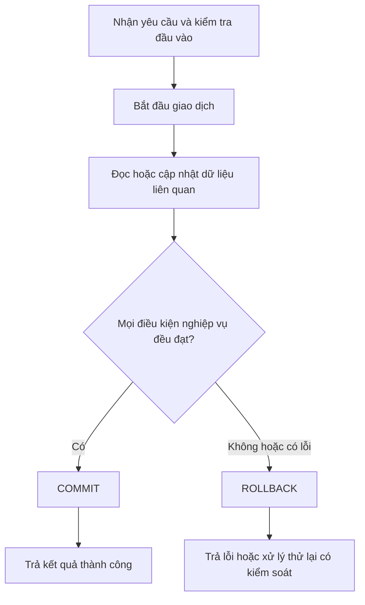

# Giao dịch là gì và ranh giới công việc cần cùng thành công

Khi một ứng dụng lưu dữ liệu bền vững, một hành động của người dùng thường tạo ra nhiều thay đổi liên quan. Chuyển tiền cần giảm số dư tài khoản nguồn **và** tăng số dư tài khoản đích. Đặt hàng có thể cần tạo đơn, ghi các dòng hàng và giữ số lượng hàng trong kho. Nếu hệ thống chỉ hoàn thành một phần các thay đổi này, dữ liệu vẫn được lưu xuống cơ sở dữ liệu nhưng trạng thái nghiệp vụ đã sai.

**Giao dịch (transaction)** là đơn vị công việc mà hệ quản trị cơ sở dữ liệu xử lý theo nguyên tắc: các thay đổi thuộc giao dịch được **chấp nhận cùng nhau** (`COMMIT`) hoặc **hủy cùng nhau** (`ROLLBACK`). Bài học này tập trung vào cách nhận diện đơn vị công việc đó và đặt ranh giới giao dịch trong ứng dụng Java.

## 1. Tại sao cần giao dịch?

Giả sử An chuyển 200.000 đồng từ tài khoản A sang tài khoản B. Hai thao tác ghi được mô tả đơn giản như sau:

```sql
UPDATE accounts SET balance = balance - 200000 WHERE id = 1;
UPDATE accounts SET balance = balance + 200000 WHERE id = 2;
```

Nếu câu lệnh đầu thành công nhưng ứng dụng mất kết nối trước khi câu lệnh thứ hai chạy, tiền đã bị trừ khỏi A mà chưa được cộng cho B. Việc từng câu `UPDATE` thực thi thành công không đủ để bảo đảm hành động **chuyển tiền** thành công.

Đưa cả hai câu lệnh vào một giao dịch tạo ra một ranh giới chung:

```sql
BEGIN;

UPDATE accounts SET balance = balance - 200000 WHERE id = 1;
UPDATE accounts SET balance = balance + 200000 WHERE id = 2;

COMMIT;
```

Nếu phát hiện lỗi **trước khi commit**, ứng dụng cần yêu cầu `ROLLBACK` thay cho `COMMIT`. Hệ quản trị cơ sở dữ liệu sẽ hủy các thay đổi chưa được commit trong giao dịch đó. Cú pháp mở giao dịch và hành vi mặc định có thể khác nhau giữa các hệ quản trị; ví dụ trên dùng SQL minh họa.

| Trường hợp | Khi thực hiện từng lệnh độc lập | Khi đặt cả hai lệnh trong một giao dịch |
| --- | --- | --- |
| Cả hai bước thành công | Hai thay đổi được ghi | `COMMIT`, hai thay đổi được ghi |
| Bước thứ hai thất bại trước commit | Bước đầu có thể đã được ghi | `ROLLBACK`, cả hai thay đổi bị hủy |
| Quy tắc nghiệp vụ không đạt (ví dụ không đủ tiền) | Dễ lưu một phần kết quả | Ứng dụng hủy toàn bộ giao dịch |

Lưu ý: chỉ thêm `BEGIN` và `COMMIT` chưa đủ để thực hiện nghiệp vụ đúng. Ứng dụng vẫn cần kiểm tra dữ liệu hợp lệ, kết quả từng lệnh ghi và những tình huống truy cập đồng thời.

## 2. Ranh giới giao dịch là ranh giới của một bất biến nghiệp vụ

Một **bất biến (invariant)** là điều kiện phải đúng ở trạng thái dữ liệu đã được chấp nhận. Ví dụ: một giao dịch chuyển tiền nội bộ không được tự tạo ra hoặc làm mất tiền; số dư không được âm nếu hệ thống cấm thấu chi; đơn hàng không được ở trạng thái đã xác nhận khi chưa có đủ dữ liệu bắt buộc.

Hãy hỏi: **“Những thay đổi nào phải cùng tồn tại để một kết quả nghiệp vụ được coi là hợp lệ?”** Nhóm các thay đổi ấy vào một giao dịch nếu chúng nằm trong phạm vi mà cùng một cơ sở dữ liệu có thể bảo đảm tính nguyên tử.

| Nghiệp vụ | Các thay đổi thường cần cùng thành công | Việc thường nên đặt ngoài giao dịch dữ liệu |
| --- | --- | --- |
| Chuyển tiền giữa hai tài khoản cùng cơ sở dữ liệu | Ghi nợ, ghi có, tạo bản ghi chuyển tiền | Gửi email thông báo |
| Tạo đơn hàng | Tạo đơn, thêm dòng hàng, giữ/trừ tồn kho theo thiết kế | Gọi dịch vụ vận chuyển để tạo vận đơn |
| Đăng ký người dùng | Lưu tài khoản, lưu thông tin xác thực và vai trò ban đầu | Gửi email xác minh |
| Chuyển trạng thái hóa đơn | Cập nhật trạng thái và ghi lịch sử thay đổi cần đối soát | Đẩy thông báo tới dịch vụ bên ngoài |

Một thao tác HTTP, một phương thức Java hay một câu SQL **không mặc nhiên** tương ứng với một giao dịch. Một yêu cầu HTTP có thể cần nhiều giao dịch ở các giai đoạn khác nhau; ngược lại, nhiều câu SQL trong một phương thức có thể cùng nằm trong một giao dịch. Ranh giới được quyết định bởi sự nhất quán cần bảo vệ và khả năng giao dịch của hệ lưu trữ.

### Nhìn giao dịch theo vòng đời



Các bước kiểm tra không cần truy cập dữ liệu (ví dụ số tiền phải lớn hơn 0) có thể thực hiện trước khi bắt đầu giao dịch, giúp giảm thời gian giữ kết nối và khóa.

## 3. Bốn thuộc tính ACID: giao dịch bảo đảm điều gì?

| Thuộc tính | Ý nghĩa đối với ứng dụng | Điều cần nhớ |
| --- | --- | --- |
| **Atomicity — Nguyên tử** | Các thay đổi trong một giao dịch được commit cùng nhau hoặc rollback cùng nhau | Không bảo đảm một API bên ngoài cũng sẽ rollback |
| **Consistency — Nhất quán** | Giao dịch đưa dữ liệu từ trạng thái hợp lệ sang trạng thái hợp lệ khi các quy tắc và ràng buộc được thực thi đúng | Database không tự biết toàn bộ quy tắc nghiệp vụ của ứng dụng |
| **Isolation — Cô lập** | Các giao dịch đồng thời được quan sát theo quy tắc của mức cô lập đang dùng | Mức cô lập khác nhau cho phép các hiện tượng đọc/ghi khác nhau; không nên giả định mọi xử lý đều tuần tự |
| **Durability — Bền vững** | Dữ liệu đã commit được hệ lưu trữ bảo vệ theo cơ chế và cấu hình độ bền của nó | Cần hiểu cấu hình lưu trữ, replication và phương án khôi phục khi có sự cố |

Đặc biệt, **atomicity không đồng nghĩa với xử lý đồng thời an toàn trong mọi trường hợp**. Hai yêu cầu cùng đọc `stock = 1`, cùng quyết định bán một sản phẩm rồi ghi lại dữ liệu vẫn có thể tạo lỗi nếu ứng dụng kiểm tra và cập nhật không đúng. Bài về cô lập và kiểm soát đồng thời sẽ đi sâu vào các hiện tượng như lost update, deadlock và mức isolation.

## 4. Xác định giao dịch trước khi viết mã

Có thể phân tích một use case theo trình tự sau:

1. **Nêu kết quả cuối cùng hợp lệ.** Ví dụ: chuyển 200.000 đồng phải giảm A đúng 200.000, tăng B đúng 200.000 và lưu dấu vết chuyển tiền.
2. **Liệt kê các bản ghi cần đổi.** Xác định bảng, đối tượng, ràng buộc và các bước ghi phụ thuộc nhau.
3. **Phân biệt phần nguyên tử và hiệu ứng bên ngoài.** Các bảng nằm trong cùng cơ sở dữ liệu có thể tham gia một giao dịch nội bộ; email, HTTP và message broker cần cơ chế phối hợp riêng.
4. **Xác định điểm chấp nhận kết quả.** Chỉ trả lời “đã chuyển tiền” sau khi `COMMIT` được xác nhận thành công; nếu không biết kết quả commit, cần cơ chế tra cứu và đối soát.
5. **Đánh giá đồng thời và lỗi.** Cân nhắc cập nhật có điều kiện, ràng buộc cơ sở dữ liệu, retry an toàn và cách xử lý khi một bước thất bại.

Quá nhiều thao tác trong một giao dịch khiến kết nối và khóa bị giữ lâu; quá ít thao tác khiến bất biến nghiệp vụ có thể bị phá vỡ giữa các lần commit. Ranh giới tốt thường ôm trọn **một thay đổi trạng thái nghiệp vụ nhất quán** và kết thúc sớm nhất có thể.

### Ví dụ: tạo đơn hàng

Một thiết kế đơn giản có thể dùng giao dịch để:

1. Ghi `orders` ở trạng thái `CONFIRMED`.
2. Ghi toàn bộ `order_items`.
3. Trừ tồn kho bằng cập nhật có điều kiện, bảo đảm còn đủ số lượng.

Nếu bước 3 không thành công, cả ba bước cần rollback. Nếu cửa hàng chỉ đặt giữ hàng trước khi thanh toán, giao dịch có thể kết thúc ở trạng thái `RESERVED`; quá trình thanh toán sau đó là một giai đoạn nghiệp vụ khác. Điều cần bảo vệ là **bất biến tại mỗi trạng thái đã commit**, không phải giữ một giao dịch cơ sở dữ liệu mở suốt thời gian người dùng nhập thông tin thẻ.

## 5. Triển khai một giao dịch trong Java với JDBC

JDBC mặc định thường bật `autoCommit`: mỗi câu lệnh SQL được commit khi hoàn thành theo cơ chế JDBC/driver. Để nhiều lệnh cùng thành một giao dịch, ứng dụng tắt `autoCommit` trên **một `Connection`**, thực hiện các bước trên chính kết nối đó, rồi gọi `commit()` hoặc `rollback()`.

Ví dụ sau giả định bảng `accounts(id, balance)`, `balance` dùng kiểu số thập phân chính xác như `DECIMAL(19, 2)`, và cả hai tài khoản nằm trong cùng cơ sở dữ liệu có hỗ trợ giao dịch. Đây là ví dụ tập trung vào ranh giới chuyển tiền; trong hệ thống tài chính thực tế còn cần sổ cái, mã giao dịch duy nhất và khả năng đối soát.

```java
import java.math.BigDecimal;
import java.sql.Connection;
import java.sql.PreparedStatement;
import java.sql.SQLException;
import java.util.Objects;
import javax.sql.DataSource;

public final class TransferService {
    private final DataSource dataSource;

    public TransferService(DataSource dataSource) {
        this.dataSource = Objects.requireNonNull(dataSource);
    }

    public void transfer(long fromId, long toId, BigDecimal amount)
            throws SQLException {
        Objects.requireNonNull(amount, "amount");
        if (fromId == toId || amount.signum() <= 0) {
            throw new IllegalArgumentException("Chuyển tiền không hợp lệ");
        }

        try (Connection connection = dataSource.getConnection()) {
            connection.setAutoCommit(false);

            try {
                // Điều kiện balance >= amount giúp chặn ghi nợ vượt số dư.
                try (PreparedStatement debit = connection.prepareStatement(
                        "UPDATE accounts " +
                        "SET balance = balance - ? " +
                        "WHERE id = ? AND balance >= ?")) {
                    debit.setBigDecimal(1, amount);
                    debit.setLong(2, fromId);
                    debit.setBigDecimal(3, amount);
                    if (debit.executeUpdate() != 1) {
                        throw new IllegalStateException(
                                "Tài khoản nguồn không tồn tại hoặc thiếu tiền");
                    }
                }

                try (PreparedStatement credit = connection.prepareStatement(
                        "UPDATE accounts SET balance = balance + ? WHERE id = ?")) {
                    credit.setBigDecimal(1, amount);
                    credit.setLong(2, toId);
                    if (credit.executeUpdate() != 1) {
                        throw new IllegalStateException(
                                "Tài khoản đích không tồn tại");
                    }
                }

                connection.commit();
            } catch (SQLException | RuntimeException failure) {
                try {
                    connection.rollback();
                } catch (SQLException rollbackFailure) {
                    failure.addSuppressed(rollbackFailure);
                }
                throw failure;
            }
        }
    }
}
```

Các điểm quan trọng trong đoạn mã:

- **Một kết nối, một giao dịch:** cả hai lệnh `UPDATE` phải dùng cùng `connection`. Tạo hai kết nối độc lập thường không đem lại tính nguyên tử như mong đợi.
- **Dùng `PreparedStatement`:** truyền số tiền và ID qua tham số; tránh ghép đầu vào vào SQL và các rủi ro SQL injection.
- **Kiểm tra số dòng bị ảnh hưởng:** `executeUpdate() == 0` có thể nghĩa là tài khoản không tồn tại hoặc không đáp ứng điều kiện. Đây là lỗi nghiệp vụ, cần rollback.
- **Cập nhật số dư có điều kiện:** `WHERE balance >= ?` kiểm tra và giảm số dư trong một câu SQL, an toàn hơn cách đọc số dư ra Java rồi ghi đè giá trị mới mà không kiểm soát đồng thời.
- **Chỉ commit sau bước cuối:** ném ngoại lệ trước `commit()` sẽ dẫn tới nhánh rollback. Trong ví dụ, lỗi rollback được đính kèm ngoại lệ ban đầu để hỗ trợ chẩn đoán.
- **Giải phóng tài nguyên:** `try-with-resources` đóng statement và connection. Với connection pool, cần dùng cấu hình và driver phù hợp để trạng thái kết nối được trả về đúng chuẩn khi tái sử dụng.

Trên cơ sở dữ liệu thật, nên bổ sung ràng buộc như khóa chính, khóa ngoại, `CHECK (balance >= 0)` khi thích hợp và kiểm soát số chữ số thập phân. Điều kiện trong SQL và ràng buộc tại database hỗ trợ nhau: ứng dụng diễn đạt nghiệp vụ, database cung cấp hàng rào bảo vệ dữ liệu khi có nhiều luồng truy cập.

### Khi dùng Spring `@Transactional`

Trong một ứng dụng Spring có transaction manager thích hợp, ranh giới thường được thể hiện ở phương thức dịch vụ:

```java
@Service
public class TransferApplicationService {
    private final AccountRepository accounts;

    public TransferApplicationService(AccountRepository accounts) {
        this.accounts = accounts;
    }

    @Transactional
    public void transfer(long fromId, long toId, BigDecimal amount) {
        int debitCount = accounts.debitIfEnough(fromId, amount);
        if (debitCount != 1) {
            throw new IllegalStateException("Không đủ số dư");
        }

        int creditCount = accounts.credit(toId, amount);
        if (creditCount != 1) {
            throw new IllegalStateException("Không thấy tài khoản đích");
        }
    }
}
```

Đây là **mã minh họa**, giả định các phương thức repository thực thi câu lệnh cập nhật có điều kiện tương tự ví dụ JDBC, và chúng cùng tham gia transaction manager. Spring thường rollback mặc định với `RuntimeException` và `Error`; ngoại lệ checked có thể cần cấu hình `rollbackFor`. Khi dùng transaction dạng proxy, lời gọi từ phương thức này tới phương thức `@Transactional` khác trong **cùng đối tượng** thường không đi qua proxy để mở ranh giới mới. Cần kiểm tra cơ chế giao dịch thực tế của framework và không xem annotation là bảo đảm tự động cho mọi tài nguyên.

## 6. Những điều giao dịch không tự giải quyết

### Xung đột do xử lý đồng thời

Ví dụ không an toàn khi hai người cùng mua sản phẩm cuối cùng:

```text
Giao dịch A: SELECT stock -> 1
Giao dịch B: SELECT stock -> 1
A: tính stock mới = 0
B: tính stock mới = 0
A/B: cùng xác nhận đơn
```

Tùy mức cô lập và cách cập nhật, kết quả có thể vi phạm ràng buộc nghiệp vụ hoặc ghi đè thay đổi. Một cách xử lý phổ biến là **cập nhật có điều kiện** rồi kiểm tra số dòng cập nhật:

```sql
UPDATE products
SET stock = stock - :quantity
WHERE id = :product_id AND stock >= :quantity;
```

Chỉ khi đúng một dòng được cập nhật mới tiếp tục ghi đơn hàng. Ngoài ra có thể dùng khóa dòng (`SELECT ... FOR UPDATE` trong hệ quản trị hỗ trợ), optimistic locking qua cột phiên bản hoặc mức cô lập phù hợp. Mỗi lựa chọn có chi phí và hành vi riêng; cần xem xét cả deadlock, timeout và retry.

### Tác vụ ngoài cơ sở dữ liệu

Giả sử ứng dụng vừa lưu đơn hàng vừa gọi API vận chuyển:

```text
BEGIN DB TRANSACTION
  INSERT orders ...
  POST /shipping/create-label   <-- hệ thống bên ngoài
ROLLBACK DB TRANSACTION
```

`ROLLBACK` không xóa được vận đơn đã tạo ở hệ thống vận chuyển. Tương tự, email đã gửi hoặc thông điệp đã phát tới dịch vụ khác không biến mất chỉ vì database rollback.

Các lựa chọn thiết kế thường gặp:

- **Transactional outbox:** cùng một giao dịch ghi thay đổi nghiệp vụ và một bản ghi sự kiện vào bảng outbox. Tiến trình khác phát sự kiện ra broker sau commit; phía nhận cần xử lý trùng lặp an toàn.
- **Saga / tác vụ bù:** khi nhiều hệ thống phải thay đổi trạng thái, chia thành các giao dịch cục bộ và thiết kế thao tác bù cho bước đã hoàn thành nếu bước sau thất bại.
- **Trạng thái trung gian:** ghi `PENDING`, `RESERVED` hoặc `PROCESSING`, rồi hoàn tất theo phản hồi thực tế từ dịch vụ bên ngoài.

Không nên giữ giao dịch cơ sở dữ liệu mở trong lúc chờ HTTP, thanh toán hay người dùng xác nhận. Chờ đợi kéo dài tăng khả năng giữ khóa, chiếm kết nối và gặp timeout.

### Lỗi xảy ra ngay lúc commit

Nếu kết nối bị cắt khi ứng dụng gửi `COMMIT`, phía ứng dụng có thể **không biết** database đã commit hay chưa. Vì vậy, việc nhận ngoại lệ không luôn đồng nghĩa giao dịch chưa được ghi. Thử lại nguyên yêu cầu mà không có cơ chế chống trùng lặp có thể tạo hai giao dịch chuyển tiền hoặc hai đơn hàng.

Với nghiệp vụ quan trọng, nên lưu **mã yêu cầu duy nhất (idempotency key)** cùng ràng buộc unique, và cung cấp cách tra cứu kết quả đã xử lý. Khi trạng thái commit không rõ, đối soát bằng mã yêu cầu trước khi retry. Timeout, deadlock và lỗi kết nối cũng cần được phân loại để quyết định retry có an toàn không.

## 7. Sai lầm phổ biến khi đặt ranh giới giao dịch

| Sai lầm | Hệ quả | Cách sửa |
| --- | --- | --- |
| Mỗi repository tự mở và commit một kết nối | Một bước commit, bước sau thất bại; dữ liệu chỉ hoàn thành một phần | Đặt transaction boundary tại dịch vụ điều phối use case, dùng chung transaction context |
| `commit()` sau mỗi câu SQL dù các câu phụ thuộc nhau | Không còn khả năng rollback như một đơn vị | Chỉ commit khi toàn bộ bất biến được thỏa mãn |
| Bắt ngoại lệ rồi trả thành công | Giao dịch có thể bị commit với trạng thái không hợp lệ | Đưa lỗi lên lớp quản lý giao dịch hoặc đánh dấu rollback rõ ràng |
| Giữ transaction khi gọi dịch vụ mạng hoặc xử lý lâu | Khóa tồn tại lâu, tăng xung đột và cạn kết nối | Tách hiệu ứng ngoài DB, dùng outbox hoặc trạng thái trung gian |
| Cho rằng có transaction thì không thể bán vượt tồn kho | Nhiều giao dịch vẫn có thể tranh chấp dữ liệu | Kết hợp ràng buộc, cập nhật có điều kiện và chiến lược đồng thời |
| Retry toàn bộ tác vụ sau lỗi bất kỳ | Có nguy cơ xử lý trùng khi kết quả commit chưa rõ | Dùng idempotency key, phân loại lỗi, tra cứu và đối soát |

## 8. Kiểm thử ranh giới giao dịch

Một bài kiểm thử tốt cần quan sát **trạng thái đã lưu sau khi giao dịch kết thúc**, không chỉ kiểm tra phương thức có ném lỗi hay không.

| Kịch bản | Kết quả cần xác minh |
| --- | --- |
| Chuyển tiền hợp lệ | Cả hai số dư thay đổi đúng; tổng tiền được bảo toàn |
| Tài khoản nguồn không đủ tiền | Không số dư nào thay đổi |
| Tài khoản đích không tồn tại | Phần ghi nợ trước đó được rollback |
| Lỗi khi ghi bước thứ hai | Không còn bất kỳ thay đổi dở dang nào từ giao dịch |
| Hai yêu cầu cùng trừ một số dư/tồn kho ít ỏi | Không vi phạm ràng buộc, chỉ những yêu cầu đủ điều kiện được chấp nhận |
| Gửi lại cùng mã yêu cầu | Không tạo thêm một lần chuyển tiền/đơn hàng |

Với giao dịch JDBC hoặc ORM, hãy chạy các bài kiểm thử tích hợp trên cơ sở dữ liệu có hành vi giao dịch gần môi trường thật. Một mock repository đơn thuần không chứng minh được rollback, khóa hoặc mức cô lập. Khi framework tự bao kiểm thử bằng transaction rồi rollback cuối test, phải chú ý cách đó có thể che giấu hành vi commit thực tế của ứng dụng.

## 9. Tự kiểm tra bằng một tình huống thiết kế

Ứng dụng bán sách có các bước: tạo đơn, trừ kho, gọi API thanh toán, gửi email. Hãy xác định điều gì nên cùng nằm trong một giao dịch database và điều gì cần điều phối riêng.

Một phương án hợp lý là ghi đơn ở trạng thái `PENDING` cùng các dòng hàng và phần giữ chỗ tồn kho trong **một giao dịch ngắn**. Sau commit, hệ thống thực hiện thanh toán qua một tiến trình riêng, rồi dùng giao dịch khác để đổi trạng thái sang `PAID` hoặc giải phóng giữ chỗ khi thất bại. Email được gửi sau khi trạng thái phù hợp đã được ghi, có thể thông qua outbox để tránh bỏ sót. Cần thêm mã yêu cầu duy nhất và chiến lược bù/đối soát khi phản hồi thanh toán không rõ. Những chi tiết như thời điểm trừ kho thật và thời hạn giữ chỗ tùy chính sách nghiệp vụ.

**Điểm cần ghi nhớ:** giao dịch là công cụ để giữ các thay đổi dữ liệu liên quan thành một đơn vị nguyên tử. Hãy bắt đầu từ bất biến nghiệp vụ, xác định những bản ghi cần được commit cùng nhau, đặt ranh giới ở lớp điều phối nghiệp vụ Java và kết thúc giao dịch nhanh. Sau đó bổ sung các cơ chế phù hợp cho truy cập đồng thời, lỗi kết nối và hiệu ứng vượt ra ngoài một cơ sở dữ liệu.
